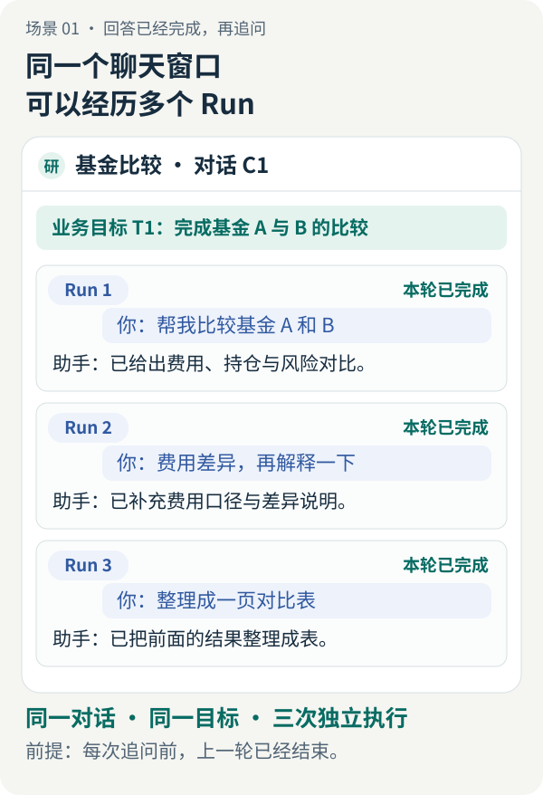
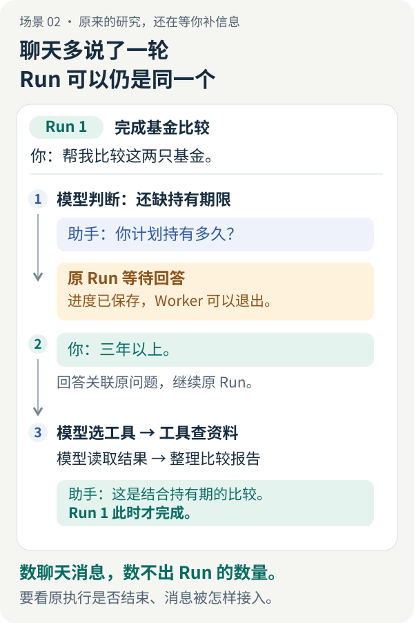
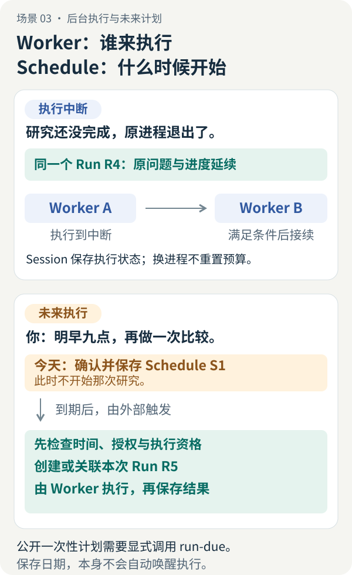

# 任务、会话、Run、Worker、Schedule：Agent 到底在继续哪件事？

<LearningPathNav />

你在同一个聊天窗口里问：“帮我比较基金 A 和 B。”助手给出完整回答后，你接着问：“费用差异，再解释一下。”随后又让它“整理成一页对比表”。

窗口没换，研究目标也没换，后台是否一直在执行同一个任务？如果助手尚未完成比较，先反问“你计划持有多久”，你回答“三年以上”，这次多轮聊天又该怎么算？

要回答这些问题，先区分**用户看到的对话、想完成的目标，以及系统的一次执行**。再把场景扩展到“执行进程退出了”和“明早九点再做”，Worker 与 Schedule 才有具体的落点。

本文使用基金比较与聊天界面作教学示意，不代表一次真实研究结果或公开版已有的聊天产品。这里把用户看到的聊天串统一称为**对话（Conversation）**；不同框架也可能称它为 Thread 或 Session。Open ETF Agent 代码中的 `Session` 另有执行状态保存职责，后文会单独对应。公开实现与命令以 v0.28.0 为例，入口是本地 CLI/API。

## 一、同一件研究，可以有不止一次运行

### 回答完成后再追问：同一对话，多个 Run

先采用一种常见设计：每个独立请求开启一次运行，处理完这个请求后结束。刚才的三轮聊天就可以这样对应：

[](../visuals/continuity-scenes/01-chat-and-runs.svg)

图一：每组问答都标出了“本轮已完成”。这是本例划分 Run 的条件，不是“一条用户消息必然创建一个 Run”的通用规则。点击图片可查看完整图。

| 概念 | 在这段聊天里对应什么 | 边界由什么决定 |
| --- | --- | --- |
| 对话（Conversation） | 一直使用的这条聊天，关联前后消息 | 产品如何组织交互与历史 |
| 任务（Task） | 完成两只基金的比较，理解它们的差异 | 用户想实现的业务目标 |
| 运行（Run） | 比较、补充费用解释、整理表格这三次独立处理 | 一次执行的输入、权限、预算与终止条件 |

**任务回答“还欠用户什么”，运行回答“这一轮允许做什么、做到了哪里”。** 第一轮可以已经结束，第二轮读取相关历史和结果，再处理新的追问。聊天记录一直保留，不意味着后台有一个 Run 从头到尾不停运行。

图中三次执行恰好围绕同一目标。假如你在原窗口改问“帮我润色一封邮件”，对话可以不变，业务目标已经变了；反过来，一个长期研究目标也可以跨多条对话推进。因此，不宜把这些概念画成一套固定的逐层包含关系。

Run 结束也不代表整个目标已经达成。例如本轮交付了一份“资料不足”的报告，程序完成了本次处理，用户可能还需要补资料后再研究。

### 原研究等待你回答：多轮问答，同一个 Run

再看另一段外观相似的聊天。你要求比较基金，助手还缺持有期限，于是提问；你回答“三年以上”，它再继续研究。这条消息补齐的是原执行正在等待的信息：

[](../visuals/continuity-scenes/02-one-run-human-reply.svg)

图二：聊天多说了一轮，Run 可以仍是同一个。等待期间可以让出 Worker；收到回答后仍须满足原执行的期限、预算和权限。图中的界面是教学示意。

Open ETF Agent 的[普通问答机制](https://github.com/hpoenixf/open-etf-agent/blob/v0.28.0/docs/human-interaction.zh-CN.md)已经支持这种阻塞问答：任务提出缺失信息问题、保存等待状态，接收明确关联的回答后继续原 Run。回答被接收、被原运行采用和最终报告完成，是不同的状态；等待不会自动延长原期限或补发预算。

这里的关联很重要。系统知道你正在回答哪个问题，才能把“三年以上”交回原研究。自由聊天中随时插入的新要求如何处理，则需要另外定义：可能排队、作为执行中的补充，也可能启动新运行。公开版这一入口支持普通阻塞问答，尚未启用非阻塞聊天介入或终态任务续跑。

### 一次 Run 内，还可以调用模型和工具很多次

第一张图里的 Run 1 并不一定只调用一次模型。它可以先由模型判断要查什么，再让工具读取年报与费率，模型看到结果后决定补查，最后整理回答。图二中的提问和等待，也可以位于这次执行之内。

因此，**聊天轮次、模型调用次数、工具调用次数和 Run 数量，应分别计数**。“提取年报事实、检查费用、复核报告”可以是一个 Run 内的步骤；只有执行契约把它们分成独立开始和结束的运行时，才算多个 Run。

本文的 Task 是业务层含义，不要求每个应用都建一张 Task 表。公开项目的 `tasks/<id>.json` 保存的是单次研究定义，绑定问题、配置和资料快照；它没有因此成为通用的、多阶段项目管理器。理解责任之后，再选择数据模型。

## 二、Session 保存关联，不保证“模型记得一切”

现在可以回答“同一个对话的多轮聊天是不是一个 Session”：**如果某个聊天框架用 Session 命名对话，可以这样说；本文引用的项目代码却不能直接这样对应。** 两处同名，需要回到实际职责判断。

| 使用语境 | 这个名字指什么 | 本文怎样称呼 |
| --- | --- | --- |
| 聊天产品中的会话 | 关联用户与助手的消息、交互历史 | 对话（Conversation） |
| Open ETF Agent 的 `Session` | 保存 Run 状态、检查点、租约及结果相关记录 | 持久执行记录 |

在基金比较例子中，界面负责让你回看第一轮报告；下一轮执行决定把哪些旧信息交给模型；持久执行记录则帮助系统确认原 Run 是否完成、是否正在等回答，以及谁能继续推进。[Session 实现](https://github.com/hpoenixf/open-etf-agent/blob/v0.28.0/src/session.mjs)

这对应三份相互关联的信息：

- **界面中的记录**：用户能够回看什么。
- **本次发给模型的上下文**：经过选择、压缩或检索后，模型实际看到什么。
- **持久执行记录**：哪些步骤已经提交、谁可以继续执行、有什么尚未确认。

页面上显示了上次的报告，不代表这次模型请求一定包含它；模型看到了一段旧摘要，也不代表拥有原始文件的读取权限。进程把聊天历史读回来了，更不代表可以安全重做一个已经发出的外部动作。项目资料与持久报告也各有保存位置，不必都挤进聊天历史。

[LangGraph 的持久化文档](https://docs.langchain.com/oss/python/langgraph/persistence)把线程内的图状态检查点与跨线程的应用数据存储分开。它提供的启发是：保留一段交互的状态，与保留长期知识，是不同的存储需求。理解这些责任以后，可以再对照[五个问题图](../visuals/three-articles/continuity-five-questions.svg)，而不必先记住所有类名。

## 三、换了 Worker，不应该换掉承诺

正常处理请求时，总要有一个执行者进入模型与工具循环、推进 Run 并保存结果。这里把实际执行工作的进程称为 **Worker**。它不是聊天里的一个角色，也不是每调用一次工具就必须新建的对象。

现在把场景改一下：年报读到一半，执行进程退出了。没有新资料，问题没改，用户也没有取消。

满足恢复条件时，可以由新的执行进程接手。Worker 的责任是领取工作、进入原有执行器、观察执行结果；它不应该因为“我是新进程”就重新发一份同样的任务、再领一份完整预算。

公开版 Worker 的设计来路很具体。早期执行器将外部停止与取消联系在一起，但后台进程退出不总是用户取消。引入独立 Worker 时，需要区分“这个主机停下”与“这个任务被撤销”。因此，新的 Worker 仍进入原来的 Runtime，并沿用 Session 中的 Run 身份和执行权，而不是复制另一套模型循环。[公开设计记录](https://github.com/hpoenixf/open-etf-agent/blob/v0.28.0/docs/evolution/v09-worker-lineage.md)

替换执行者时，原问题、权限、预算与已提交结果仍要延续；[执行者交接图](../visuals/three-articles/continuity-worker-handoff.svg)展示了这组关系。

多个进程同时看到一项工作时，不能靠“我先读到了记录”取得执行权。公开实现由原 Session 租约和写入代次校验决定谁能推进。旧执行者即使晚一些返回，也不能冒充当前持有者继续写入。

[Temporal 对 Worker 的说明](https://docs.temporal.io/workers)也区分 Worker 程序、实体与进程，并让执行进程从任务队列领取工作。它提供了更完整的持久工作流基础设施；公开版的单 Run Worker 则刻意没有引入通用队列或第二套任务状态机。单机教学项目不一定需要完整平台，跨机器编排、长期运维和复杂调度成为主要需求时，复用成熟系统更合适。

还有一个容易忽略的界限：主机不再等待，不等于服务商已经停止处理请求。一次请求已发出、结果未收到时，新 Worker 必须保留“未知”，不能直接把它改成“没执行”。身份延续的价值，正是在这种不确定时刻仍能说清之前发生过什么。用户关闭网页后后台是否继续，要看具体宿主怎样管理执行生命周期，不能仅凭聊天窗口的开关判断。

## 四、Schedule 保存约定，不替你研究

你已经拿到了比较报告，又说：“明早九点，再做一次比较。”这次希望延续的是研究目标，执行时间却在未来。

系统需要先确认并保存未来工作的约定：做什么、何时开始、使用哪些输入与权限。到期后，再由触发机制检查是否有资格执行。这项时间约定就是 **Schedule**。把它和刚才的进程中断并排看，区别会更清楚：

[](../visuals/continuity-scenes/03-worker-and-schedule.svg)

图三：上半部回答“谁来继续执行”，下半部回答“什么时候开始”。两个场景相互独立；保存未来日期时，不需要让一个模型请求一直等到明天。点击图片可查看完整图。

Schedule 关心时刻、时区、定义版本，以及错过时刻后还允许等待多久。到点后，它给出执行机会，再由任务的授权、额度与执行规则决定能否开始。

**时间到了，不等于模型已经调用；模型调用了，不等于报告已经交付。**

[时间窗口图](../visuals/three-articles/continuity-schedule-window.svg)进一步区分过早、窗口内和错过时刻三种情况。错过之后是否补跑，必须由明确规则决定。

Open ETF Agent 的公开一次性计划要求显式调用 `run-due`，没有常驻守护进程。它不会因为保存了一个未来日期就自动唤醒电脑，也没有由这个模块提供周期任务或通知。到期物化与 Run 的关联由原有持久机制处理；重复扫描不会自动为已完成的计划创造新一轮研究。[一次性计划说明](https://github.com/hpoenixf/open-etf-agent/blob/v0.28.0/docs/scheduled-tasks.zh-CN.md)

如果期待“明天有新公告就加入比较”，还需要明确新资料如何进入新的研究输入。固定今天的资料快照后再预约一次执行，并不自动获得明天的新资料。图中的聊天指令用于解释时间约定；公开版的计划要通过其现有确认入口提交。

一次性的、人工可控制的练习适合把边界保留得很小。需要长期自动运行时，还得选择和运维真正的外部唤醒机制，并明确取消、迟到和重复触发策略。

[Kubernetes CronJob 文档](https://kubernetes.io/docs/concepts/workloads/controllers/cron-jobs/)把按日程创建 Job 与实际执行分开，也明确说明调度可能漏建或重复创建，因此工作本身应具备幂等性。成熟调度器并不会免除业务端识别“这是不是同一次工作”的责任。

## 五、明天的“继续”，先回答一个选择题

现在再回到“今天先读到这里，明天继续研究这份资料”。同一句话，需要结合原状态判断：

| 你实际在做什么 | 应先确认什么 | 对应的执行方式 |
| --- | --- | --- |
| 完整回答之后再追问 | 原 Run 已结束，新请求的输入是什么 | 通常创建新的 Run，可关联原对话与业务目标 |
| 回答 Agent 尚未完成的澄清问题 | 回答是否关联原问题，原 Run 是否仍有资格继续 | 接收回答并继续原 Run |
| 研究中途执行进程退出 | 原状态、执行权、剩余预算与未知结果 | 由 Worker 接续原 Run |
| 希望明早再开始一次研究 | 已确认的工作定义、触发时间和唤醒方式 | 保存 Schedule，到期检查后执行 |

这里的新资料边界也要说清。公开项目绑定已确认的输入快照；在这套契约下，改换研究问题或追加独立的新资料，应保留旧报告和资料版本，为新研究建立明确输入。对原澄清问题的关联回答则沿它支持的问答机制处理，不因为收到一条消息就重建任务。基金报告尤其需要保留时点：新获取时间不等于新的披露时点，重新运行也不代表来源已经更新。

恢复时，原授权、执行截止时间、预算和未知效果都延续。过期或已终结的运行不能靠换进程重新获得资格。需要复习主机接续、新研究与未来计划的关系时，可对照[三种继续图](../visuals/three-articles/continuity-three-continues.svg)；执行中等待关联回答的情况见图二。

公开项目中，已经存在且获准执行的非定时任务可以用下面的命令观察这些区别。`PROJECT` 和 `RUN_ID` 需要替换成原项目与原运行身份：

```bash
node src/research-cli.mjs run inspect --project PROJECT --run RUN_ID
node src/research-cli.mjs run work --project PROJECT --run RUN_ID
node src/research-cli.mjs run report --project PROJECT --run RUN_ID
```

`inspect` 看状态，`work` 尝试推进原 Run，`report` 读取持久结果。正在等用户回答时，应先按[普通问答说明](https://github.com/hpoenixf/open-etf-agent/blob/v0.28.0/docs/human-interaction.zh-CN.md)提交关联回答，再推进原运行。真实 `work` 需要先完成提供方、资料与费用授权；完整初始化和输入条件见[本地研究项目指南](https://github.com/hpoenixf/open-etf-agent/blob/v0.28.0/docs/research-project.zh-CN.md)。命令展示的是接口含义，不是本文替读者执行过真实模型任务。

## 六、不必把五个名词都做成五个模块

一个只回答单次问题的应用，可以由请求直接触发 Run；不需要为了架构完整就增加 Task 管理器。一个不会跨进程恢复的小脚本，也不必复制工作流平台。只有当“同一件事”的寿命开始超过一次调用、一个进程或一次对话时，才值得把相应责任分出来。

判断是否拆分，可以回到这些场景，看哪些身份需要保留、哪些可以改变：

- 聊天窗口保持不变，用户仍可以提出新的目标或开始新的 Run。
- 原 Run 等待关联回答，用户补信息后可以继续原执行。
- Worker 换个进程，不应改变原来的权限和预算。
- 新计划改了时间，不应偷偷改写旧 Run 的输入。
- 一轮报告完成，不应自动宣称整个业务目标达成。

真正需要稳定保存的，是用户确认过的工作及其进展；进程、页面、模型调用都可以是围绕它工作的临时参与者。下次再说“让 Agent 继续”，先找到原来那次执行的状态，再判断这次是在继续目标、补齐原问题、恢复原执行，还是安排下一次机会。

## 延伸阅读

- [专家、Subagent、Review、Judge：都是另一个模型，为什么不是同一回事？](./agent-expert-subagent-review-judge.md)：区分一轮研究内部的协作责任。
- [Agent 不必一直在线思考](https://hpoenixf.com/eff-agent-article/articles/agent-autonomous-scheduled-research)：进一步讨论定时与条件触发的完整系统设计，注意其中私有系统与公开示例的范围不同。
- [练手篇](https://hpoenixf.com/eff-agent-article/articles/open-etf-agent-research-project-workshop)：从明确选择的资料开始建立自己的本地研究项目。


<!-- introductory-series-links:start -->

## 入门系列：按顺序继续

上一篇：[聊天记录、上下文、记忆、检查点，Agent 怎样接上过去？](conversation-context-memory-checkpoints.md)。

下一篇：[Agent 深入：从一份报告到持续执行与专家协作](open-etf-agent-v010-system-design.md)。

<!-- introductory-series-links:end -->
