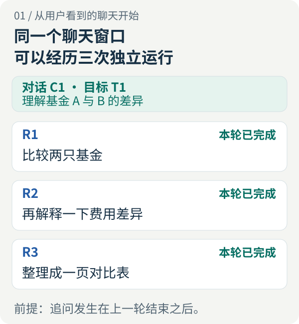
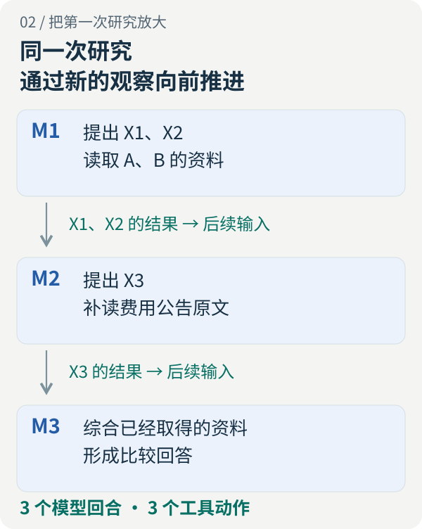
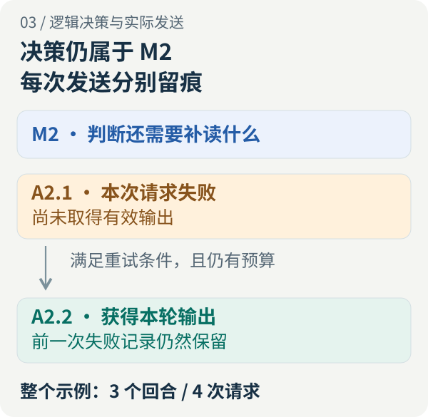
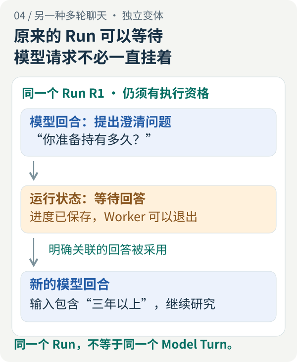
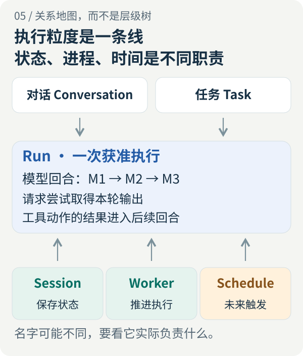

<!-- legacy-section-anchors -->
<span id="任务、会话、run、worker、schedule-agent-到底在继续哪件事"></span>

# Agent 运行身份全景：从一次聊天到 Model Turn，系统到底在继续什么？

<LearningPathNav />

你让 Agent 比较两只基金。它查完资料，给出报告；你接着问费用差异，又让它整理成一页表格。窗口始终没换，这究竟是一次任务、三次运行，还是很多次模型调用？

如果它中途问你“准备持有多久”，你回答“三年以上”；如果模型请求失败后重试；如果执行进程重启；如果你说“明早再做一次”——这些看起来都叫“继续”，系统接下去做的却不是同一种事。

理解它们，不必先背一串类名。沿着一次具体工作往下看就够了：**用户在延续什么目标，模型正在作哪一次判断，程序实际发出了哪些请求，又留下了哪些不可忽略的结果。**

本文用基金比较作贯穿的教学案例，不讨论具体产品的投资结论。示例中的 C1、R1、M1 等只是方便追踪的编号，不是某个框架的统一字段。公开实现示例固定在 Open ETF Agent v0.28.0；通用设计与该版本的具体支持范围分开说明。

<!-- legacy-section-anchors -->
<span id="一、同一件研究-可以有不止一次运行"></span>
<span id="回答完成后再追问-同一对话-多个-run"></span>

## 一、先从聊天窗口看：同一对话，为什么可以有多个 Run？

假设你依次发出三条请求，每次都等上一轮完整回答之后再问：

> 你：根据现有资料，比较基金 A 和 B 的费用与持仓，并标出资料日期。  
> Agent：比较报告已完成。  
> 你：费用差异，再解释一下。  
> Agent：补充说明已完成。  
> 你：把刚才的结果整理成一页对比表。  
> Agent：表格已完成。

这里至少有三个不同的观察对象。

| 对象 | 本例中的含义 | 它回答的问题 |
| --- | --- | --- |
| 对话（Conversation） | 你一直使用的聊天串 C1 | 哪些消息属于这段交互？ |
| 任务（Task） | 理解基金 A 与 B 差异这一目标 T1 | 用户最终想完成什么？ |
| 运行（Run） | 比较、解释、制表这三次独立处理 R1、R2、R3 | 系统这一次获准做什么，何时结束？ |

[](../visuals/run-identity/01-conversation.svg)

*图一：本例采用“上一次处理完成，再为新请求开启 Run”的设计。窗口连续，执行可以分段。*

**对话保存关联，任务表达目标，Run 划定一次执行。** R1 结束后，R2 可以读取前面的报告再回答；保持话题连贯，不要求 R1 在后台一直活着。OpenAI Agents SDK 的运行文档也把一次运行中的代理循环，与在同一会话中继续发起后续运行分开描述。[运行与会话说明](https://openai.github.io/openai-agents-python/running_agents/)

这张图并不是固定的包含关系。你在原窗口改问“帮我润色一封邮件”，对话没变，目标已经变了。一个持续数周的研究目标，也可能通过不同对话推进。是否建立显式任务对象，要看产品是否真的需要管理这个长期目标。

同样，一次 Run 正常结束，也不代表任务完全实现。Agent 可能诚实地交付“现有资料不足以比较持仓”的说明：本次处理有了结果，研究目标仍待补充材料后推进。

一次 Run 应当有可辨认的开始与结束：开始时接纳问题、确定可用能力和执行限制；结束时按本次约定结算结果，也可能因失败、超时或用户取消而结束。正在等用户补充信息，则可以是尚未结束的中间状态。

完成标准取决于承诺。只要求回答时，可用回答可能已经足够；明确要求保存可取得的报告时，模型生成“报告已完成”还不够，程序要确认结果确实保存。Run 的边界来自应用的执行约定，而不是聊天页面有没有停止滚字。

<!-- legacy-section-anchors -->
<span id="一次-run-内-还可以调用模型和工具很多次"></span>

## 二、把第一次研究放大：一个 Run 里面发生了什么？

现在只看 R1，不看后面的追问。

运行开始后，通常不是调用一次模型、直接拿到完整报告。程序把当前问题、可用工具和相关资料交给模型；模型决定下一步；程序执行工具，再把新结果交给模型。随着观察增加，下一步才逐渐清楚。

为便于解释，本文把宿主系统组织的**一次逻辑模型决策**称为**模型回合（Model Turn）**：针对一份确定的当前输入，让模型给出本次输出。输出可以是回答，也可以是工具调用提议。这里说的是系统可观察的交互单位，不是在给模型内部的思考过程计步。

下面是一条简化路径：

| 模型回合 | 本次输入中新增加了什么 | 模型给出的下一步 |
| --- | --- | --- |
| M1 | 用户问题，以及可用资料与工具的信息 | 读取 A、B 两份资料：提出 X1、X2 |
| M2 | X1、X2 的结果；发现 B 的费用说明缺少原始出处 | 补读 B 的费用公告：提出 X3 |
| M3 | X3 返回的原始说明 | 综合资料，形成比较回答 |

[](../visuals/run-identity/02-model-loop.svg)

*图二：模型回合沿新观察推进；工具动作发生在模型输出之后，其结果进入后续模型输入。此图没有表示工具必须并行。*

这条路径中，用户只问了一次，Agent 却完成了三个模型回合、提出三个工具动作。M1 一次提出 X1、X2，并不等于进行了两个模型回合；M3 没有调用工具，仍然是一个模型回合。

在这种由应用执行工具的交互中，模型先生成结构化调用，应用完成操作，再把结果送回。Anthropic 的客户端工具文档明确展示了这段往返，也允许一次响应包含多个工具调用。[客户端工具往返](https://platform.claude.com/docs/en/agents-and-tools/tool-use/overview)

### 回合的关键，是下一次判断拿到了什么

M2 不能仅凭“程序已经读过文件”，就自动知道文件内容。系统必须把相关结果纳入 M2 的实际输入，或提供它可以继续回读的引用。保存了结果，与下一次模型请求真正携带了结果，是两件事。

一个模型回合也不等于一个文字气泡。流式输出中的几十个片段，可能都属于同一次响应；同一次响应里的一段说明和两项工具调用，也可能属于同一回合。不能拿气泡数量、流式事件数量或工具数量反推模型回合数。

还有一个观察范围：服务商托管的搜索、代码执行等工具，可能在服务端完成内部步骤。客户端看到的一次 API 往返，不足以推断服务端到底经历了多少内部模型回合。本文的计数限定在宿主能明确组织和观察的范围内。[客户端与服务端工具](https://platform.claude.com/docs/en/agents-and-tools/tool-use/overview)

## 三、Model Turn 与 Attempt：为什么三个回合可能发出四次请求？

给刚才的例子加一个变化：M2 的第一次模型请求，在得到有效输出之前收到一次明确、符合本系统重试规则的失败；程序仍有预算，于是重新发送本轮请求，第二次成功。

研究依然经历 M1、M2、M3 三次逻辑决策，但实际请求多了一次。

**请求尝试（Attempt）记录一次具体发送尝试；模型回合记录这次发送是在服务哪一次逻辑决策。** 在本文的计数约定下，M2 的两次发送分别叫 A2.1 和 A2.2；失败的 A2.1 不会因为后一次成功而消失。

[](../visuals/run-identity/03-attempts.svg)

*图三：示例保留同一个逻辑回合，仅新增实际请求尝试。三个模型回合因此对应四次请求；这个计数不包含其他辅助模型调用。*

这样区分，并不是为了多记一个编号。排查时你会问不同的问题：

“研究为什么改为补读费用公告？”要看 M2 的输入和输出。“为什么同一轮费用增加、延迟变长？”则要看 M2 关联的每个 Attempt，包括失败、超时和实际选择的模型路线。

### 重发原请求，与根据新信息重新判断不同

重试成立，需要一个明确前提：系统仍在尝试取得原来那次逻辑决策的结果，并且允许这样重试。如果部分输出已经触发工具，或已有内容正式提交，就不能把它当成什么都没发生的请求直接从头重放；需要沿原记录处理后续步骤与未知结果。

如果模型已经返回工具调用，工具也返回了新资料，接下来再调用模型，是新的回合。如果系统收到无效输出后，加入“这个字段不符合要求，请修正”的反馈再请求模型，输入已经增加了一次新观察；按本文约定，它也是新的语义回合，而不是悄悄覆盖原请求。

有些框架会用不同的 Step、Turn 或 Retry 定义包装这些动作。这没有必然对错，但日志、预算和评测必须采用同一口径。阅读 `max_turns` 这类配置时，应先查它限制的是模型调用、代理循环还是别的单位，不能把它理解为“用户还能聊几轮”。

### 隐式重试也会产生真实请求

一次业务代码中的 SDK 调用，内部可能已经重试。OpenAI Python SDK 文档列出了默认自动重试的错误类型，并允许配置 `max_retries`。因此，应用层再包一层重试时，需要弄清两层分别做了什么。[SDK 重试说明](https://github.com/openai/openai-python#retries)

需要精确限制请求数量的系统，可以由一处统一控制发送重试，或接入底层尝试的观察记录。仅在最外层函数入口加一次计数，不能证明只向提供方发送过一次。

而且，“客户端超时”只说明没有及时取得结果，不等于服务端没处理，更不等于费用为零。结果和用量未知时，应保留未知；不能把重试写成一份没有历史的新预算。

如果还要切换供应商，就多了数据接收方与能力适配问题。原上下文是否可以交给新供应商、它是否支持本次工具和参数，都需要重新确认。把两次请求关联到同一个逻辑回合，是对来路的说明，不是跨供应商发送的授权。

## 四、工具动作：模型说“做了”，与系统真的做了有多远？

在 M1 中，模型提出“读取 A 的资料”，我们把这个动作记为 X1。此时真实读取还没有发生。

对于应用执行的工具，一条正常路径是：宿主检查调用及权限，派发读取，取得结果，保存调用与结果的对应关系，再为后续模型准备输入。无效参数或缺失权限也可能在派发前就被拒绝。

所以，X1 至少连接着两端：**哪一次模型输出提出了它，以及哪一次后续输入带上了它的结果。** 只有前者，没有后者，工具可能一直在忙，研究却没有真正利用这些材料。

这里还要保持一层克制：结果进入模型输入，可以核查；模型是否正确理解并用于结论，需要另外检查答案。一次成功工具回执不能证明语义判断正确。

### 同一回合提出多个工具，不会自动创造依赖顺序

M1 可以同时提出读 A 和读 B，因为两次读取互不依赖。宿主可以串行执行，也可以在权限与资源允许时并行执行。

但如果第二个动作需要第一个动作返回的新标识，模型不能预先知道这个标识。通常要等结果回来后，在后续回合构造第二个调用；或者由一个明确定义的复合工具在内部完成依赖。多个调用放在同一个响应里，并不会自动解决数据依赖。

公开教学实现 v0.28.0 在原运行循环中逐项推进工具调用。上图表达“一个模型回合可以提出多项动作”，不意味着该实现采用了并行执行。[公开运行循环](https://github.com/hpoenixf/open-etf-agent/blob/b34750d1515982dbaaaf4c1aa4da4c380173d753/src/runtime.mjs)

### 写操作需要再分清“重复发送”与“重复意图”

把读取换成保存报告：远端可能已经保存成功，只是回执丢了。此时让模型重新决定“保存一次”，或者给同样的保存请求换个全新身份，可能产生第二份结果。

更稳妥的处理取决于工具的实际契约：查询原操作是否完成，或用接收方支持的幂等标识重试同一操作。AWS 关于幂等 API 的说明讨论的正是这个问题：响应缺失时，调用方无法仅凭本地异常断定操作没有发生。[安全重试与幂等 API](https://aws.amazon.com/builders-library/making-retries-safe-with-idempotent-APIs/)

模型协议中的 `tool_call_id` 首先用于把调用与工具响应配对。它是否还能用于业务去重，要看接收方是否真的识别、保存并执行这份约定。**本地生成一个 UUID，并不会让远端副作用自动变成“只发生一次”。**

对只读操作，重新读取可能更容易接受，但也要考虑数据是否变化。今天读到的新公告，不能被伪装成昨天已经取得的原结果。

<!-- legacy-section-anchors -->
<span id="原研究等待你回答-多轮问答-同一个-run"></span>

## 五、Agent 问我一句，我回答后，究竟继续哪个回合？

现在暂时离开三回合的完整例子，看一个独立变体。

> 你：帮我比较这两只基金。  
> Agent：这次比较主要面向多长的持有期？  
> 你：三年以上。  
> Agent：好的，我按这个条件继续。

如果产品把它设计成原研究的澄清过程，那么 Run 可以一直是 R1。但**提问的模型回合已经给出了输出；收到回答之后，继续研究通常需要新的模型回合。**

[](../visuals/run-identity/04-human-reply.svg)

*图四：延续的是获准的研究执行，不是把一条模型请求挂在那里等待用户。图中是独立变体，不累计到图二的三个回合中。*

系统需要保存“正在等哪个问题的回答”。收到“三年以上”后，先关联原问题，再检查原运行是否仍可继续，然后把回答放入下一次模型输入。等待期间可以释放执行资源，并不需要保留一个正在生成的模型响应。

Open ETF Agent 的普通问答机制就支持这个有限范围：原任务提出缺失信息问题，Worker 让出执行，明确关联的回答被保存并采用，再继续同一个 Run。等待不会延长原期限，也不会重置预算。收到回答、采用回答与完成报告分别有自己的状态。[普通问答说明](https://github.com/hpoenixf/open-etf-agent/blob/b34750d1515982dbaaaf4c1aa4da4c380173d753/docs/human-interaction.zh-CN.md)

### 不能把“新消息”一律解释为同一种继续

回答一个待澄清的问题，与在研究过程中突然说“不要比较了，帮我生成交易指令”，不是相同的输入变化。

对正在执行的 Run，产品可以把新消息排队，也可以在明确的接纳点加入下一回合，还可以另开一次运行。关键是说明哪一种消息获得了哪一种处理资格。已经发送给模型的输入不能被事后改写成“它当时其实看到了新要求”。

同一 Run 内，新增工具观察和被允许的澄清回答本来就可以改变后续输入。因此，“输入有变化就必须新建 Run”过于绝对。真正需要检查的是：这次变化是否仍属于原任务与权限范围，系统是否有明确的接纳机制。

该公开版本的普通问答，不提供外部效果审批、追加权限或任意时刻插入聊天要求。用户回答一个研究问题，不会顺便授权系统读取另一份私人资料或执行一笔交易。

<!-- legacy-section-anchors -->
<span id="二、session-保存关联-不保证-模型记得一切"></span>

## 六、Session 放在哪里：别把这些概念画成一棵树

看到这里，很容易想画出一条整齐的层级链：Conversation 包含 Task，Task 包含 Run，Run 再包含 Model Turn。

这个画法只能表达某些产品的局部安排，不能当作统一模型。对话与任务可能交叉关联；模型回合产生工具动作，而工具结果又影响后续回合；Session、Worker、Schedule 则分别作用于状态、执行者和触发时间。

[](../visuals/run-identity/05-relationship-map.svg)

*图五：这是不同职责与执行主线的关系地图，不是五层架构，也不是要求新建五个服务。图中“执行状态存储”只对应具有这种职责的 Session。*

“Session”尤其容易误导。某些 SDK 用它管理跨多次运行的聊天历史；Open ETF Agent 的 `Session` 则保存 Run 状态、检查点、执行租约等。相同名字，并不保证相同寿命或相同数据内容。[会话管理](https://openai.github.io/openai-agents-python/running_agents/) · [公开 Session 实现](https://github.com/hpoenixf/open-etf-agent/blob/b34750d1515982dbaaaf4c1aa4da4c380173d753/src/session.mjs)

与其争论名字，不如把三份东西分清：

| 信息 | 基金比较中的例子 | 不能据此推断什么 |
| --- | --- | --- |
| 用户可见的对话历史 | 第一轮报告仍显示在页面里 | 下一次模型一定看到了整份报告 |
| 某次模型请求的输入 | 原问题、选取的历史、工具结果与约束 | 它就是完整的聊天数据库或执行状态 |
| 持久执行状态 | 等待哪个回答、哪些调用已提交、剩余预算与执行权 | 模型会理解这些记录，或者远端动作可以安全重做 |

检查点的作用，是让程序知道允许从哪里继续；模型上下文的作用，是让下一次判断获得合适的信息。两者可以从相同历史中派生，却不能互相替代。

一个很实际的设计是：Run 保留持续身份，每次 Model Turn 保留自己的输入依据。后续回合可以获得更多资料，较早回合当时看到了什么，却不应被后来发生的事情覆盖。这样既允许研究进展，又能解释为什么前后判断不同。

<!-- legacy-section-anchors -->
<span id="三、换了-worker-不应该换掉承诺"></span>

## 七、Worker 换了，哪些东西应该接着算？

Worker 是推进执行的程序或进程，不是又一个“投资专家”。它调用运行逻辑，向模型发送请求，组织工具执行，并保存进度。模型服务可能在远端，工具也可能在别处；Worker 不必亲自承担所有计算。

一个进程可以先后处理多个 Run；有恢复支持的一个 Run，也可能跨多个进程继续。进程的寿命与工作的寿命不必相同。

Open ETF Agent 的 Worker 设计记录里，有一个具体动因：原先的外部停止路径与取消相连，但“运行主机停了”并不总是“用户撤销任务”。公开适配因此复用原 Runtime 和 Session，同时区分主机中断与用户取消，而不是复制第二套模型循环。[Worker 设计来路](https://github.com/hpoenixf/open-etf-agent/blob/b34750d1515982dbaaaf4c1aa4da4c380173d753/docs/evolution/v09-worker-lineage.md)

### 恢复不是统一的“再调用一次模型”

进程退出时，执行停在哪个位置，决定下一步能做什么。

| 退出前可以确认的事实 | 接手后的合理方向 |
| --- | --- |
| 下一次请求尚未发送 | 重新检查执行资格，按原进度决定是否发送 |
| 工具结果已经可靠保存 | 校验并复用结果，推进到后续步骤 |
| 请求或写操作已发出，但结果未知 | 查询、对账或按明确协议恢复；无法确定时保留未知并停止相应推进 |
| 最终内容已经提交，只是通知失败 | 从已提交结果继续交付，不为补通知重跑研究 |

这张表是恢复设计的判断框架，不代表所有实现都支持每一行。公开版运行循环在发现未结算的模型请求时，会保留 `MODEL_OUTCOME_UNKNOWN`；对已派发工具尝试协调，无法确定时保留 `TOOL_OUTCOME_UNKNOWN`。换个 Worker 不会使这些状态自动变成可重试。[恢复分支](https://github.com/hpoenixf/open-etf-agent/blob/b34750d1515982dbaaaf4c1aa4da4c380173d753/src/runtime.mjs)

其他框架也有自己的恢复粒度。LangGraph 的中断恢复会重新进入相应节点，节点中位于中断之前的代码可能再次执行，因此文档要求这部分副作用具备幂等性。“保存了检查点”并不等于从原进程的某一行机器指令无缝接着跑。[LangGraph 中断恢复规则](https://docs.langchain.com/oss/python/langgraph/interrupts)

### 执行权延续，不等于外部世界倒带

两个 Worker 都读到同一条记录时，谁可以写下一步，不能靠它们自行约定。租约用于限定当前执行资格，写入代次等机制用于拒绝旧执行者的迟到提交。

但阻止旧进程写入本地状态，不会撤销它已经发出的远端请求。外部效果仍需要对应的查询、幂等或补偿机制。这是执行权控制与副作用恢复的分工。

只要接续的是原 Run，已经使用的预算、原截止时间和已提交结果就应继续算。权限也不能因为换进程而增加；恢复时若权限已撤销，还需要按实际政策收紧后续访问。身份保持连续，绝不意味着旧资格永远有效。

<!-- legacy-section-anchors -->
<span id="四、schedule-保存约定-不替你研究"></span>

## 八、Schedule：明早再做，是延续目标还是复活旧执行？

你已经取得报告，又说：“明早九点，再做一次比较。”这里延续的是目标，但要求的是一次未来执行。

Schedule 保存的是经确认的时间约定，以及它关联的工作定义。实际执行还需要外部触发机制到期检查，再让执行者领取工作。保存一个日期，并不会让模型或电脑自动在那个时刻醒来。

对于重复计划，还要区分**计划定义**与**某一次执行机会**。每天九点的规则可以长期不变，今天九点与明天九点却是两个不同的发生时刻；反过来，同一个九点被扫描两次，不应该因此变成两份独立工作。

一个设计可以用“计划身份、定义版本、计划时刻”识别这次机会；具体字段由系统决定。重要的是先认出“这是同一次触发的重复观察，还是下一次真正的新执行”，再决定创建或关联哪个 Run。

Open ETF Agent v0.28.0 提供的是更小的一次性方案：必须显式调用 `run-due`，由既有机制检查和物化任务。错过允许窗口的计划记为 `missed`，不会自动创建替代 Run；重复扫描已物化或已完成的计划，也不会自动重派。它没有常驻调度、周期任务或通知服务。[一次性计划说明](https://github.com/hpoenixf/open-etf-agent/blob/b34750d1515982dbaaaf4c1aa4da4c380173d753/docs/scheduled-tasks.zh-CN.md)

还要问一句：明早比较的资料从哪里来？如果计划绑定的是今天选定的资料快照，明早执行只意味着晚一点处理这些资料，不代表自动获取明天的新公告。时间约定与资料更新，是两个需要分别定义的机制。

因此，不必让一个 Run 或模型请求一直睡到明天。也不能把“到时开始”“研究完成”“报告送到用户面前”当成同一个承诺。一次性计划是否已经保存，不能代替最终交付事实。

## 九、把概念变成排查能力：看到日志时，先数对什么？

回到图二、图三。下面不是生产日志，而是同一教学例子的简化记录：

```text
R1 / M1 / A1.1       模型返回：提出 X1、X2
R1 / X1, X2         读取结果已保存
R1 / M2 / A2.1       当前请求失败；满足本例的重试条件
R1 / M2 / A2.2       模型返回：提出补读动作 X3
R1 / X3             费用原文读取结果已保存
R1 / M3 / A3.1       带上 X3 结果，生成比较回答
R1 / 结果版本 V1     正式内容已保存，交付状态另外记录
```

按本文约定，这里是 **1 个 Run、3 个逻辑模型回合、4 次模型请求尝试、3 个工具动作**。报告保存如果由另一个工具完成，还应计入那个动作；这里把它设为宿主的结果提交步骤。

这些数字各有用途。模型回合帮助分析研究怎样推进；请求尝试帮助分析重试、路线与耗时；工具动作帮助定位实际读取或副作用；结果版本帮助确认用户取得的是哪份内容。

### 总模型用量，不一定等于主研究回合数

系统可能还调用模型生成历史摘要，或把一部分问题交给 Subagent。它们也是实际模型调用，但未必计入主研究分支的回合数。

公开版运行循环就把摘要调用标记为不同用途，并在独立摘要计数与共享模型预算中处理；不能只用主研究的 `rounds` 推断全部模型用量。[摘要与研究调用的计数](https://github.com/hpoenixf/open-etf-agent/blob/b34750d1515982dbaaaf4c1aa4da4c380173d753/src/runtime.mjs)

Subagent 则多了一条执行分支：主模型的一次委派，可能让子代理经历多次模型调用、工具执行和重试，最后才交回结果。有的系统把它组织为父 Run 内的子执行，有的建立关联的子 Run。应同时保留执行分支与实际请求的归属，不能把“一次委派”记成“一次模型调用”。

这也解释了为什么“模型回合变少”不必然意味着更省：可能是工具批量化，也可能把更多调用藏到了子代理或服务端。比较成本与延迟前，要先统一观察范围；失败请求的未知用量也不能按零补齐。

### 界面上的“还在回答”，也需要明确对象

假如 R1 的报告完成通知晚到，而用户已经开始 R2，客户端不能让这条旧事件把 R2 的状态改成“已完成”。但也不应该直接丢掉 R1 的合法结果；它仍属于原研究。

一项可行做法是让事件携带所属 Run，以及该结果或事件流中的版本、顺序信息。界面据此更新对应工作，而不是用一个全局 `isLoading` 表示所有研究。跨独立执行分支时，还需要分别理解顺序，不能假定一个局部序号代表全系统时间线。

当用户说“卡住了”，先确认是哪个 Run，再看它是在等用户、等模型、等工具，还是内容已保存而交付未完成。定位到这里，才知道该补信息、重试请求、核对外部效果，还是重新读取已有结果。

<!-- legacy-section-anchors -->
<span id="六、不必把五个名词都做成五个模块"></span>

## 十、怎样落地，而不把小应用做成工作流平台？

这些区别首先是理解与记录的方式，不是建表清单。

一个短小、只读、单次回答的应用，可以直接用已有请求身份表示一次 Run；只有一个模型调用时，也未必需要独立的 Model Turn 存储。聊天历史交给框架已有 Session 即可，不必再造一套会话管理器。

当出现多轮工具循环和重试时，先让日志分清模型回合与实际发送。需要跨进程接续时，再持久化足够的执行状态，并明确哪些阶段可恢复。需要等待用户时，补上原问题与回答的关联。需要未来执行时，才引入计划与执行机会的身份。

新增机制也有成本：输入版本、调用回执、等待状态和恢复分支都需要维护。已有框架已经准确表达的责任，优先复用；不必为了图中的每个词再增加一个 Manager。权限和副作用正确性是任务本身的要求，则不能以“保持简单”为由略过。

<!-- legacy-section-anchors -->
<span id="五、明天的-继续-先回答一个选择题"></span>

把全文压缩成一张判断表，可以用于设计评审：

| 发生的变化 | 通常延续什么 | 必须新增或重新确认什么 |
| --- | --- | --- |
| 完整回答后，用户继续追问 | 原对话，可能还有原业务目标 | 新 Run 的输入与执行范围 |
| 原研究收到明确关联的澄清回答 | 仍有资格继续的原 Run | 回答接纳记录，以及后续模型回合 |
| 原决策请求发生允许重试的失败 | 原 Run；按本文约定可延续原逻辑回合 | 新请求尝试及剩余重试资格 |
| 工具返回新观察，需要继续判断 | 原 Run | 后续模型回合及它实际收到的输入 |
| 执行进程退出，由另一进程接手 | 合同允许恢复的工作与已提交事实 | 当前执行权、恢复位置和未知结果处理 |
| 同一计划的同一次机会被重复扫描 | 原执行机会及其 Run 关联 | 是否已物化或执行，不能盲目再建一份 |
| 到了周期计划的下一次执行时刻 | 原计划与长期目标 | 新执行机会；按计划合同创建或关联 Run |

这里的“通常”保留了必要的实现选择。系统可以采用不同的名称或数据结构，但应当能解释：什么还属于原来的工作，什么已经是一件新的事。

### 用公开实现观察这些区别

在已经初始化、具备原资料与授权的本地研究项目中，可以按原运行身份检查状态、尝试推进和读取结果：

```bash
node src/research-cli.mjs run inspect --project PROJECT --run RUN_ID
node src/research-cli.mjs run work --project PROJECT --run RUN_ID
node src/research-cli.mjs run report --project PROJECT --run RUN_ID
```

这些是 v0.28.0 源码工作区的接口示例，不是本文替读者执行过的真实研究。运行环境、项目初始化与费用前提见[固定版本项目指南](https://github.com/hpoenixf/open-etf-agent/blob/b34750d1515982dbaaaf4c1aa4da4c380173d753/docs/research-project.zh-CN.md)；后续版本以[当前项目入口](https://github.com/hpoenixf/open-etf-agent)为准。

公开版的 Session、Worker、普通阻塞问答和一次性计划，是上述思想的不同切片，不是一套任意组合的完整聊天产品。尤其该版本的一次性计划尚不能与 Response、Child 等能力组合。前文的全景用于理解关系，不应据此推断全部场景已经在同一个公开入口接通。

## 结语：连续的体验，来自清楚的执行边界

重新看开头的聊天：用户一直在研究同一件事，系统可以经历多次 Run；一次 Run 通过多个模型回合前进；一个逻辑回合可以包含多次获准的请求尝试；工具动作留下真实观察，再成为后续判断的依据。

Session 保存需要延续的状态，Worker 提供暂时的执行能力，Schedule 让工作在未来获得执行机会。它们解决的问题不同，却共同支撑了用户感受到的“接着做”。

**真正需要连续的，是工作目标、有效依据和已经发生的事实；不必连续的，是同一个进程、同一条连接，或者同一次模型请求。**

下次设计“继续”“重试”或“恢复”按钮时，先写清它指向哪个对象。然后再问：原来的执行还有效吗，哪些结果可以复用，哪些事情必须重新确认？这比先决定要建几个模块，更接近问题本身。

## 延伸阅读

- [六层调用全景](./017-prompt-to-answer-six-layer-panorama-v3.md)：从职责交接看一次请求如何走到答案可见。
- [超长研究全景](./agent-long-horizon-research-panorama.md)：从长期工作看上下文、中断与时间如何衔接。
- [专家、Subagent、Review、Judge](./agent-expert-subagent-review-judge.md)：进一步区分一次研究里的协作角色。
- [定时研究](./agent-autonomous-scheduled-research.md)：展开计划、触发与持续研究的系统设计。

<!-- introductory-series-links:start -->

## 入门系列：按顺序继续

上一篇：[聊天记录、上下文、记忆、检查点，Agent 怎样接上过去？](conversation-context-memory-checkpoints.md)。

下一篇：[Agent 深入：从一份报告到持续执行与专家协作](open-etf-agent-v010-system-design.md)。

<!-- introductory-series-links:end -->
