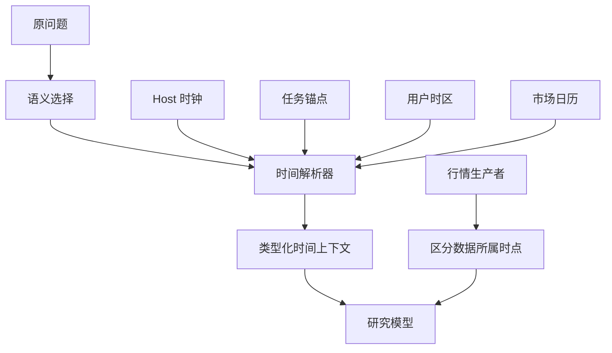

---
readingBrief:
  takeaways:
    - "当前时刻、任务锚点、用户日期、市场场次与行情截至时点各有来源；时区换算或日历收盘不能证明行情已经更新。"
    - "模型选择时间含义，代码按可信 IANA 时区解析；同 Run 恢复保留原任务锚点，不能用新“今天”改写旧问题。"
    - "市场日历必须有场所、版本与覆盖依据，缺失就保留未知；公开切片只冻结任务日期，完整日历实测仍未完成。"
  appliesTo:
    - "跨时区、跨午夜恢复或“最新交易日”查询，需要区分用户意图、任务时间、交易排期和数据新鲜度。"
  notFor:
    - "寻找已验收的全球实时市场日历，或把合成日期演示、默认关闭的排期源当最新报价和自然研究稳定性的证明。"
---
# Agent 说“今天”时，到底是哪一天：任务时间、用户时间与市场交易日

一位在广州的用户，周六上午打开投研 Agent，问：“今天美股科技板块怎么样？”自然语言似乎只需要一个日期。然而广州已进入周六，美国东部仍可能停留在周五；周五已经结束的交易时段，与此刻刚取到的行情数据，还是两件事。

如果系统在 Web 搜索里默认北京时间，在模型提示里使用 UTC 日期，在市场数据里又把“最近取到”写成“最新交易日”，每个组件都可能独立运行正确，最终答案仍然答错。**时间不是一个可随手格式化的字符串，它是一组需要明确来源和用途的事实。**

本文讨论我们如何为研究 Agent 设计并部分实现时间语义能力 A36：让模型判断用户要问什么时间，确定性代码解释已经选定的时间，市场来源给出实际交易排期，而行情数据保留自己的截至时点。

## 一、“今天”至少有五种相关事实

| 时间概念 | 解决什么问题 | 谁提供事实 |
| --- | --- | --- |
| 当前时刻（host now） | 系统现在处于哪个 UTC instant | Host 时钟 |
| 任务锚点（task anchor） | 原问题是何时被接受的 | 原 Conversation/Run |
| 用户自然日（user local date） | 用户明确或偏好时区中的日期 | 可信时区绑定与 IANA 规则 |
| 市场 Session（market calendar） | 指定交易场所预定何时开收盘、哪一场已结束 | 有来源和覆盖范围的交易所日历 |
| 行情时点（dataAsOf） | 返回的报价、净值或指标实际截至何时 | 数据生产者及其来源回执 |

前四项都准确，也不能推导第五项一定存在。举例说，日历证明星期五的常规交易时段已经结束，不代表数据服务返回了星期五的最终收盘价；报价也可能是盘前、延迟或缺失。发布日期、抓取时间与基金报告期同样不能互相回填。

过去“最近的交易日”“最近取到的交易数据”“研究发生于今天”常被压缩成一个日期。这种压缩不是文案简洁，而是删除了会影响投资判断的事实差异。

## 二、一个合成请求如何拆成有身份的时间

取一个**仅用于解释时区差异的合成输入**：原研究在 `2026-10-24T00:00:00Z` 接受。若用户时区是 `Asia/Shanghai`，当地时间是周六 08:00；若市场场所使用 `America/New_York`，当时仍是周五 20:00（2026 年该日处于美东夏令时）。这并不表示我们已经查询了当日实际市场状态。

```json
{
  "referenceInstantUtc": "2026-10-24T00:00:00Z",
  "taskAnchorUtc": "2026-10-24T00:00:00Z",
  "user": {
    "timeZone": "Asia/Shanghai",
    "source": "account",
    "localDate": "2026-10-24"
  },
  "market": {
    "venue": "XNAS",
    "marketLocalDate": "2026-10-23",
    "latestCompletedCalendarSession": "unknown",
    "calendarStatus": "unavailable"
  },
  "quoteDataAsOf": "unknown"
}
```

这里特意保留 unknown：从日期和时区换算，不能自己推导已获权威来源确认的市场完成 Session，更不能推导报价状态。真正执行时，市场日历和实际行情会由各自消费路径提供独立回执。



图中最后两条路径必须保持并列：日历可以告诉模型“哪个时段按计划结束”，数据则告诉它“取得的值对应哪个时点”。将它们强行合并，会在交易休市、供应商落后和用户跨时区时制造假精确。

## 三、语义交给模型，解析交给确定性代码

“今天美股怎么样”可能是问最新市场表现，也可能是问今天发生的相关新闻；“上个交易日”则要求一个特定市场场所的 session。A03 研究模型负责理解这些语义，并在有重大歧义时澄清。我们没有使用“包含美股就取最近收盘”“今天就用北京时间”这样的 Host 关键词判断器。

A36 只接收**已经选定**的时间含义、参照 instant、时区与可用日历事实，对其做可复算的解释。它不能改变模型研究策略，也不签发数据来源权限；Web/Search 使用明确的 typed 时间范围，不再由另一段字符串规则偷偷改写年份或“今天”。

时区也需要来源优先级：**本次显式选择 > 账号持久偏好 > 经校验的设备 IANA 报告 > unknown**。不知道用户时区就明确 unknown，不根据 IP、界面语言或市场默认值猜一个。用户指定“按纽约时间”只能改变这次查询的解释，不能静默改写用户账号设置。

IANA `America/New_York` 规则处理 EDT/EST 切换，不能把 UTC-4 或 UTC-5 固定写成永远成立的偏移。这正是把时区当成有版本规则的地区标识、而不是数字的原因。

## 四、为什么原 Run 的时间不能在恢复时重算

假设用户星期五晚上要求分析“今天的数据”，研究暂停数小时后跨过午夜。若恢复过程把最新 Host now 覆盖到原任务锚点，同一个问题的“今天”会改变含义，前半段证据和后半段查询不再可比。

我们的处理将两项事实分开：`hostNowUtc` 可以前进，`taskAnchorUtc` 由原 Run 封存并在同 Run/recover 中保持。用户原先显式指定的绝对范围或截止，也不能因为重启或新一次 Web 检索被重新解释。

Schedule 的 occurrence 和时区另归原定时任务 Owner；本文的时间解释不接管何时启动任务。会话“到某时刻交付”也仍由原交付 Owner 结算；研究材料的 `publishedAt` 与 `dataAsOf` 则由原来源管理。所谓统一时间语义，统一的是解释接缝，不是统一所有计时和审批。

### 把冻结日期放进一个可运行任务

[Open ETF Agent v0.12.0 的固定公开实现](https://github.com/hpoenixf/open-etf-agent/tree/46c2822be9865b99696bb70fb9e0ff1b5257ff35)只实现上面的任务时间这一小段：显式选择 IANA 时区，把任务接受时的 UTC 锚点与换算出的自然日封存在 Session 定义中，再交给原运行时和 Gateway 消费。它没有把原文的市场日历、账号偏好或自然语言时间解析一并搬入公开版。

选定上述固定源码，使用 Node 26.8.1–26.x（此例实际验证为 26.11.1），按[该版本 README](https://github.com/hpoenixf/open-etf-agent/blob/46c2822be9865b99696bb70fb9e0ff1b5257ff35/README.zh-CN.md)安装依赖后，可以用下面这个合成任务观察跨时区差异：

```bash
npm run temporal -- submit --session runs/article-time --run fixed \
  --time-zone America/Los_Angeles --anchor 2026-10-28T00:30:00.000Z
npm run temporal -- work --session runs/article-time --run fixed
npm run temporal -- read --session runs/article-time --run fixed
```

这个 instant 在洛杉矶仍是 10 月 27 日，所以保存的 `taskDate` 是 `2026-10-27`，`yesterday` 是 `2026-10-26`，`tomorrow` 是 `2026-10-28`。提交与执行须在原有 300 秒任务截止内完成，之后仍可读回已完成的结果；冻结任务日期不会延长执行期限。后两个命令不再接收新的时区或锚点。读回结果中的 `directory` 与 `receipt.path` 指向原报告，`receipt.sha256` 标识其字节；不是以读取时的“今天”重新生成一份报告。

“前一日”在这里指相邻自然日，不是减去 24 小时，也不是上一个交易日。日期换算使用运行环境的 IANA 时区规则；未给出合法时区、或者把夏令时回拨时可能有歧义的本地时间当作 UTC 锚点，输入会被拒绝。

示例用脚本 Gateway 检查实际请求里的冻结时间，并通过既有工具保存报告；SQLite 持久化与跨进程读取真实发生，模型如何理解用户的“今天”仍是另一项验证。公开提炼的作用，是让已经选定的任务时间不因换进程、换机器时区或恢复而被静默改写，而不是证明取得了最新行情。
日期构造见 [`temporal.mjs`](https://github.com/hpoenixf/open-etf-agent/blob/46c2822be9865b99696bb70fb9e0ff1b5257ff35/src/temporal.mjs)，分进程回读见[对应示例测试](https://github.com/hpoenixf/open-etf-agent/blob/46c2822be9865b99696bb70fb9e0ff1b5257ff35/test/temporal-cli.test.mjs)。日常使用入口仍是[当前 main README](https://github.com/hpoenixf/open-etf-agent/blob/main/README.md)；上面的命令与行为固定在本文所引版本。

## 五、市场日历不能靠周一到周五硬算

真实市场有节假日、特殊休市、提前收盘和不同场所规则。知道美东当地是周五，不足以宣布 XNAS 一定开市；知道常规 16:00 收盘，也不能推断当日没有临时停市。

因此，首期市场侧限定为有**来源身份、版本、场所、时区和覆盖区间**的美国现金股票常规 Session 日历，由原 B01/Market 数据生产路径提供。A36 消费合格的 Session，区分当前市场本地日、目标场次、最近有日历依据的已完成场次；没有证据时返回 `partial` 或 `unavailable`，而不是回退到 weekday 猜测。盘前盘后、停牌、其他交易所、基金财报期留待有独立来源与验收时扩展。

这里的合格日历只说明排期及限定范围，不能认证实际撮合交易、提供方报价的新鲜度、某篇报告已发布。**日历的确认与行情的确认，属于两条不同证据链。**

## 六、三个分支说明为什么必须保留 unknown

| 场景 | 可由谁确定 | 正确表达 |
| --- | --- | --- |
| 已知用户时区，但市场日历不可用 | Host 可确定用户日期，B01 无合格日历 | 可以说明用户当地日期；市场是否完成某 Session 保留未知 |
| 来源确认某日提前收盘，报价仍滞后 | B01 排期与行情生产者分别返回 | 区分已结束的日历场次与较早的 `dataAsOf` |
| 原任务跨午夜恢复 | Recovery 保留冻结任务时间，Host now 变化 | 相对表达沿原任务锚点；当前时间作为新观察，不暗中改写原问题 |

这些情况都不应该使其他已获准的研究解释自动消失。A23 Publication 仍负责独立正文与附件的局部降级；A36 不能因缺市场日历就创建新的全局答案拦截门，也不通过反复重试掩盖来源不可用。

## 当前实现与仍待验收的部分

截至 **2026 年 10 月 24 日**，ETF Agent 主干已经合入用户时区绑定、UTC 当前时间与冻结任务时间的请求投影、Web 接缝的时间规则收拢，以及有界的 Nasdaq 2026 排期来源与结构化 Market 消费。相关日历来源需显式开启，默认关闭。实现和限定本地证据可以用于说明这些职责如何交接。

A36 的原 P0 任务仍未完成：普通认证 Agent 请求使用真实资格化日历的完整验证、真实 PostgreSQL/浏览器与正式关闭还没有被这些源码合入替代。本文不声称已经在自然研究里稳定回答“最新交易日”，也不把合成计算作为实时市场事实。后续如需支持 A 股、港股、财年或基金报告期，应先取得相应来源与独立验收，而不是现在建一套空泛的大型通用时间管理器。

最值得保留的设计判断是：**模型可以解释用户提及的时间，代码可以精确换算所选时间，市场与报价来源却必须各自证明它们知道的事实。** 时间语义清楚了，研究才有条件谈“最新”。

## 延伸阅读

[定时研究：会话结束后继续](https://hpoenixf.com/eff-agent-article/articles/agent-autonomous-scheduled-research)解释何时生成下一次任务；[金融数字的时点、口径与复算](https://hpoenixf.com/eff-agent-article/articles/031-fintech-data-time-and-reproducible-numbers)讲实际数据时点。本文讨论的是用户自然语言时间与市场日历怎样进入普通研究，三篇文章互为补充。

本文属于 [ETF Agent Engineering Notes](https://github.com/hpoenixf/eff-agent-article) 的工程案例。欢迎 Star 公开文集。
