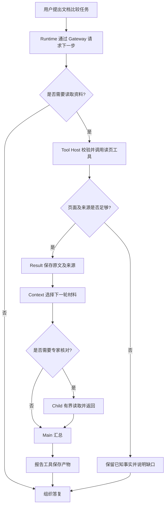

# Agent 进阶：读懂 Open ETF Agent 的十个核心模块

<LearningPathNav />

上一篇已经走过一个 Agent Loop：**AI 根据当前信息选择动作，工具返回结果，AI 再决定下一步。**

现在打开 Open ETF Agent 的源码，你会看到更多名字：Gateway、Skill、MCP、Memory、Session、Child。它们为什么出现？怎样接回刚刚看懂的循环？

我们以 [v0.15 固定版本](https://github.com/hpoenixf/open-etf-agent/tree/74bd5aa455ccaeb2994eb22aa744affde660bfa2)为底座，按学习顺序分成十组能力。继续用同一个任务理解它们：比较 Atlas Notes A、B 两版指南，整理免费版导出的变化与共同条件。这是仓库里的合成教学资料。

**先看前三项怎样工作，再看后面的能力怎样逐步接进来。** 十组能力是阅读源码的分组，可以在同一个程序里协作。


## 六层能力图：进阶新增了哪些模块？

相较入门图，**彩色卡片突出本篇新增的领域**：Skill 方法、MCP 工具连接、Result 来源、Memory、Session/Worker、专家 Child 与 Artifact。浅灰卡片是已经解释过的模型、Runtime、Tool Host 和入口。每个实线卡片都链接固定 v0.15 源文件。

<PanoramaViewer src="/eff-agent-article/visuals/learning-stage-maps/intermediate-zh.svg" label="进阶六层能力图：十组核心模块及新增领域">
<div class="v3-owner-map-scroll">
  <object class="v3-owner-map" type="image/svg+xml" data="/eff-agent-article/visuals/learning-stage-maps/intermediate-zh.svg" role="img" aria-label="进阶六层能力图：十组核心模块及新增领域">
    <a href="https://hpoenixf.com/eff-agent-article/visuals/learning-stage-maps/intermediate-zh.svg">打开 SVG 六层能力图</a>
  </object>
</div>
</PanoramaViewer>

**范围边界：** 这是一张十组模块的阅读地图，并非一条任务的实际 Trace。文中 T1、`skill-mcp`、检索与专家协作是分别运行的示例；没有实现证据的领域不画。

## 先想一个需求：为什么三行 Agent Loop 还不够？

入门篇的 `while` 循环回答了“下一步谁来选”。真正写成应用，还会遇到另一类问题：**谁允许它读、读到的东西放在哪里、失败之后还能不能继续、用户最后拿到的是哪份结果？**

继续看 Atlas Notes 的合成文档比较。需求稍微变复杂：A/B 两份指南在不同文档服务里；用户还要求把结论保存为报告，隔一会儿回来继续读。循环本身并不会自动解决这些要求。

| 任务变化 | 只有 Loop 时的缺口 | 对应能力 |
| --- | --- | --- |
| 模型说“读取 B 版第一页” | 不能让一句自然语言直接获得文件访问权 | Tool Host 校验参数与允许范围，MCP 连接工具提供者 |
| B 页有版本号、原文和行数 | 一段摘要无法替代可回查的原始资料 | Result 留下来源，Context 选择下一轮所需内容 |
| 用户要求“先给表格” | 表达偏好不应该写死在每次提问里 | Skill 提供比较方法，Memory 在获准时提供长期偏好 |
| 一次任务要等用户回复、跨进程继续 | 进程内变量不能代表持久任务事实 | Session 记录任务，Worker 继续驱动 Runtime |
| 某个细节需要独立核对 | 主任务无需把所有阅读细节塞进一个上下文 | Child 在受限范围内核对，再把证据交回 Main |
| 用户需要再次打开报告 | 模型说“写好了”不等于文件已保存 | Artifact/报告工具给出可回读的结果 |

这就是十个模块的由来：**不是把一个简单循环包装成十层，而是让每个新增问题有明确的负责者。** 读源码时，先问该模块防止了哪种混淆，再问它怎样参与原有 Loop。

## 一、先把循环跑起来

### 1. 模型接入：把一次判断交给 AI

模型负责理解问题、选择工具和组织回答。Gateway 则处理模型服务的请求与响应，让运行程序拿到“调用工具”或“给出答案”这样的结果。

在文档比较中，AI 可以先选择读 A，得到内容后再选择读 B。开发者关心两件事：这次给模型哪些材料，以及怎样接收它提出的动作。

源码入口：[gateway.mjs](https://github.com/hpoenixf/open-etf-agent/blob/74bd5aa455ccaeb2994eb22aa744affde660bfa2/src/gateway.mjs)。

### 2. Runtime：让一轮判断接上下一轮

Runtime 驱动循环：调用模型，接收动作，交给工具执行，再把结果送入下一轮。一次用户请求里，可以发生多轮这样的往返。

**AI 决定任务接下来做什么，Runtime 负责让这些动作按程序约定运行。** 它也管理工具范围和运行额度。已有结果返回后，AI 才有新材料继续判断。

源码入口：[runtime.mjs](https://github.com/hpoenixf/open-etf-agent/blob/74bd5aa455ccaeb2994eb22aa744affde660bfa2/src/runtime.mjs)。

### 3. 工具宿主：把模型的请求接到函数

读取页面、计算变化、保存报告，都是具体操作。工具宿主（Tool Host）集中提供这些能力的说明、参数检查和执行入口。

比如 `read_page` 接收文档标识和页码，返回该页内容；`save_report` 接收正文与来源，保存报告。前后端开发者可以从已有函数或 API 开始，再补齐让模型使用的说明。

源码入口：[tools.mjs](https://github.com/hpoenixf/open-etf-agent/blob/74bd5aa455ccaeb2994eb22aa744affde660bfa2/src/tools.mjs)。


这三项构成主干。接下来增加的能力，仍然围绕这条循环工作。

## 二、给助手方法，再接上资料

### 4. Skill：告诉助手这一类问题怎样做

比较产品指南，可以先统一版本范围，再整理变化与共同条件，最后按表格表达。把这种可复用的做法写成 Skill，模型就能按需读到方法。

Open ETF Agent 包含比较用的技能说明和辅助清单。读它时，重点看“方法怎样进入任务”，再看模型如何用已有工具完成操作。Skill 的通用格式可以参考 [Agent Skills](https://agentskills.io/home)。

源码入口：[skills.mjs](https://github.com/hpoenixf/open-etf-agent/blob/74bd5aa455ccaeb2994eb22aa744affde660bfa2/src/skills.mjs)。

### 5. MCP：连接另一个程序提供的工具

当文档由独立服务提供，应用需要发现服务的工具，并按约定调用。MCP 就提供这样的连接协议。

仓库的 `skill-mcp` 示例会读取方法说明，再通过本地 MCP 服务取得合成文档。模型看到的是可用的读页能力，程序负责建立连接与交换结果。[官方架构说明](https://modelcontextprotocol.io/docs/learn/architecture)介绍了这一客户端与服务端关系。

源码入口：[mcp.mjs](https://github.com/hpoenixf/open-etf-agent/blob/74bd5aa455ccaeb2994eb22aa744affde660bfa2/src/mcp.mjs)。

### 6. 资料与上下文：保存取得的内容，选进下一轮

读取工具取得原文后，Result 保存内容及其来源；Context 组织下一次模型调用需要的材料。资料变多时，检索帮助找到相关位置，压缩帮助整理当前工作的笔记。

可以把原始资料想成书架，把上下文想成工作桌。AI 当前要比较导出功能，就把对应页面放上桌；继续问离线使用时，再寻找相关内容。

源码入口：[context.mjs](https://github.com/hpoenixf/open-etf-agent/blob/74bd5aa455ccaeb2994eb22aa744affde660bfa2/src/context.mjs)。先理解资料如何进入一次调用，再按需要展开 Result、检索和压缩。

### 7. Memory：让合适的信息跨任务使用

例如用户允许保存“产品比较先给表格”的偏好，后面的任务就可以召回它，再放进当前上下文。

公开实现既有显式保存、更正和遗忘，也有 v0.14 加入的只读记忆消费入口。学习时先关注“保存什么、何时召回、怎样进入本轮输入”。这类偏好与产品指南有不同用途：一个指导表达，一个提供产品事实。

源码入口：[memory.mjs](https://github.com/hpoenixf/open-etf-agent/blob/74bd5aa455ccaeb2994eb22aa744affde660bfa2/src/memory.mjs)。

## 三、把研究变成能继续使用的工作

### 8. 报告与产物：把分析留下来

用户需要的可能是一段回答，也可能是一份 Markdown 或 CSV。报告与产物模块保存这些内容，阅读入口让人再次查看已经生成的结果。

在 T1 示例里，可以直接打开 `report.md`；涉及表格时，另有 CSV 示例。此时只需理解“模型组织内容、工具保存产物”，具体的版本管理留到相应专文。

源码入口：[artifacts.mjs](https://github.com/hpoenixf/open-etf-agent/blob/74bd5aa455ccaeb2994eb22aa744affde660bfa2/src/artifacts.mjs)。

### 9. Session 与 Worker：让任务跨一次命令继续

最早的示例在一个进程里完成。任务变长以后，需要保存当前进展，再交给后续执行者继续。Session 记录任务，Worker 驱动选定任务，核心执行仍交给 Runtime。

公开代码还提供普通回复示例：程序提出一个问题，用户通过 CLI 提交回答，再继续原任务。这里可以先体验“任务有自己的进展，用户回答能接回去”，以后再研究更细的持久运行设计。

源码入口：[session.mjs](https://github.com/hpoenixf/open-etf-agent/blob/74bd5aa455ccaeb2994eb22aa744affde660bfa2/src/session.mjs)。

### 10. 专家 Child：把一块工作交给专门的助手

v0.15 的重点是串行来源核对专家。Main 把核对问题交给 Child；Child 在自己的上下文里读取 A、B 原文，返回资料与核对意见；Main 接着整理报告。

这里最值得理解的是**两个 Loop 怎样交接**：主任务负责整体问题，子任务负责范围更小的核对。Child 使用同一套 Runtime，收到的任务说明和工具范围更专注。

源码入口：[specialist-child.mjs](https://github.com/hpoenixf/open-etf-agent/blob/74bd5aa455ccaeb2994eb22aa744affde660bfa2/src/specialist-child.mjs)。下一篇会沿这条真实代码路径展开。


## 四、沿一份任务，看十个模块怎样接力

把刚才的例子画成一张执行图。**这是用于解释职责的示意图，不是某次运行的逐条 Trace**；其中“是否需要专家”是可选分支，入门 T1 不会自动跑出所有模块。


三幅分镜是阅读概览，不是一次真实 Trace。第二幅的虚线旁路表示不需要 Child；不需要读取或来源不足时，也可直接组织答复，缺口仍须说明。完整原图保留全部条件分支。

<details>
<summary>查看完整关系与文字对照</summary>



</details>

图中的三处判断值得细看。第一处由模型结合任务选择动作，但工具是否能调用，由 Runtime 和 Host 依据实际权限、参数及额度决定。第二处不是“工具返回 200 就算完成”：A 读到了、B 没读到，就不能声称完成了版本比较。第三处是按需委派，不是每次都开启子代理。

### 模块之间传递的究竟是什么？

前后端工程里习惯传 DTO；Agent 也需要清楚的数据契约。下面是**帮助理解的概念化示例**，不是 Open ETF Agent 的真实 API schema：

```json
{
  "request": { "task": "compare_free_exports", "versions": ["A", "B"] },
  "toolCall": { "name": "read_page", "documentId": "atlas-b", "page": 1 },
  "source": { "documentId": "atlas-b", "version": "B-2026-02", "page": 1 },
  "observation": { "formats": ["CSV", "Markdown"], "maxRows": 300 },
  "coverage": { "aRead": true, "bRead": true },
  "nextAction": "synthesize"
}
```

其中 `observation` 是从材料整理的结论，`source` 才能告诉读者原文出自哪里。即使观察值正确，也不能因此把版本、来源和权限一起省略。真实代码的结果存储和工具回执字段以对应固定提交为准。

### 模型建议动作，代码确认事实


模型可以提议动作、解释材料；代码必须确认允许范围、实际来源与写入事实。完整五项职责如下。

<details>
<summary>查看完整关系与文字对照</summary>

| 问题 | 交给模型做什么 | 必须由代码保证什么 |
| --- | --- | --- |
| 下一步读 A 还是 B | 根据问题和已知材料选动作 | 只能调用允许的工具及文档 |
| 资料是否足以回答 | 判断还需不需要继续查 | 未读到的资料不得伪装成已取得的 Result |
| 怎样表达变化 | 比较语义，写可读说明 | 计算和来源身份不能靠模型自由编写 |
| 何时委派专家 | 提议一个明确的核对问题 | Child 只能继承受限范围和预算 |
| 是否保存报告 | 组织希望交付的正文 | 文件写入结果要有真实回执 |

</details>

比如 Skill 可以教模型“先比较相同维度”，**它不是授权书**；MCP 可以让工具被发现，**它不是执行通行证**；Memory 可以提醒“优先表格”，**它不是 B 版指南的权威来源**。把这三组区别想明白，很多看似是 Prompt 的问题就有了工程解法。

## 五、三个失败场景，比十个名词更值得记住

**场景 A：只读到了 A，没有读到 B。** 此时有证据支持“A 版提供 CSV”，但没有证据支持“B 版新增 Markdown”。合理的降级是报告 A 已确认、B 待读，并展示缺口；不能让模型根据经验补完 B 的内容。可检查项：Result 中有无对应 B 版的来源与页码，报告是否把未核实部分明确标注。

**场景 B：Child 试图读取核对范围之外的文档。** 即使其理由听起来合理，Host 也要拒绝越界访问。公开 v0.15 来源核对 Child 的工具范围收窄到 `read_page`，并限定文档和预算。验证重点不只是 Prompt 写了“请不要越界”，而是越界请求能否在工具层被拒绝。

**场景 C：Worker 断开，上一轮工具执行状态不明。** 不能靠“再调用一次”掩盖未知结果，尤其当工具会写文件或产生外部效果。已知完成与已派发但未知必须分开；恢复时检查持久记录和已有产物，再决定可否继续。这里介绍的是设计原则，具体受支持的恢复点要看对应版本的代码与测试。

这三个场景分别考察**证据完整性、权限完整性、执行完整性**。不需要一开始就做分布式系统，但应该在第一个可运行原型里为这三类失败留下明确状态。

## 六、工程师可以怎样从小项目走到应用？

不必一口气实现十个模块。可以按需求逐次增加能力，并为每一步留一个可观察的验收点。

| 迭代 | 增加什么 | 最小验收 |
| --- | --- | --- |
| 第一次：最小 Loop | Gateway、Runtime、Tool Host | 真实工具被调用，结果进入下一轮；达到上限能停止 |
| 第二次：可信资料 | Skill、MCP、Result、Context | 有来源的 A/B 比较；缺页时不生成虚假差异 |
| 第三次：长期使用 | Memory、Artifact、Session、Worker | 明确偏好可更正，保存的报告可读回，任务能够按支持的条件继续 |
| 第四次：受限分工 | Child 与 Main 协作 | 子任务越界被拒绝；返回的派生判断与原始证据可区分 |

这里的顺序是教学建议，**不是宣称每个历史版本严格按这张表交付**。源码对应的运行环境、实际边界和验证证据仍以固定提交与独立记录为准。

## 用同一个 v0.15，分三次体验

在[入门篇安装好的 v0.15 环境](./agent-in-15-minutes.md#自己跑一次五分钟体验)中，先分别运行以下命令：

```bash
# 方法说明和 MCP 文档工具
npm run demo -- --case skill-mcp

# 查找并阅读离线使用的相关资料
npm run demo -- --case retrieve-reread --query "offline editing"

# Main 委派一个来源核对专家
node src/specialist-cli.mjs run --session runs/learning-specialist
```

前两次会输出各自的运行目录，可以查看报告。第三次使用一个新的专属 session 目录；它的报告与交接结果，我们在下一篇一起看。默认命令用脚本模拟模型动作，读资料、调用工具、保存文件等程序操作实际执行，无需模型密钥。

这三条是**独立示例**，各自展示一组能力。更多入口见[当前项目指南](https://github.com/hpoenixf/open-etf-agent/blob/main/docs/module-guide.zh-CN.md)。

## 下一站：十个模块，在六层地图里放在哪里？

十个模块不是六层的别名。**模块是能力，六层是一次任务从触发到可见的交接位置**；同一个模块可能参与多个阶段。先用一个简化映射收束这一篇：


两幅图按交接位置读六层，不表示六个服务必须顺序执行；同一模块可能出现在多层。发布治理和产品 UI 的扩展范围仍以正文为准。

<details>
<summary>查看完整关系与文字对照</summary>

| 六层 | 用 Atlas Notes 任务想象 | 这一篇认识的关键能力 |
| --- | --- | --- |
| **L1 任务输入与触发** | 用户要求比较 A/B | 任务输入；后续可扩展到定时触发 |
| **L2 身份、会话与上下文** | 确认允许读哪些文档、拿哪些既有资料 | Session、Context、Memory、Skill 的选用 |
| **L3 Agent 决策与运行** | AI 决定读、继续核对还是总结 | Gateway、Runtime、Main/Child |
| **L4 工具与领域能力** | 真正读取页面，保留源文 | Tool Host、MCP、Result |
| **L5 结果发布与交付** | 保存可回读的报告 | 报告与 Artifact；更完整的发布治理留给全景 |
| **L6 用户界面** | 用户打开正确任务的报告 | CLI 先验证读取体验，产品 UI 再承担展示与恢复 |

</details>

**从这里进入深入篇，下一步不再增加名词，而是追问三个交接的正确性：一个数字怎样回到来源、一项任务怎样跨进程继续、专家结论怎样不越过原始证据。**

继续阅读：[**Agent 深入：从一份报告到持续执行与专家协作**](./open-etf-agent-v010-system-design.md)。读完后再展开[六层调用全景](./017-prompt-to-answer-six-layer-panorama-v3.md)，就能把局部机制放回整张系统地图。

[返回入门](./agent-in-15-minutes.md) · [English](../en/articles/agent-ten-modules.md) · [Open ETF Agent（欢迎 Star）](https://github.com/hpoenixf/open-etf-agent)
