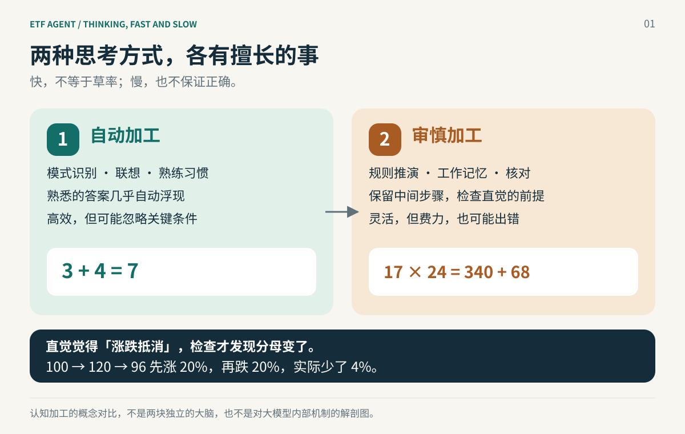
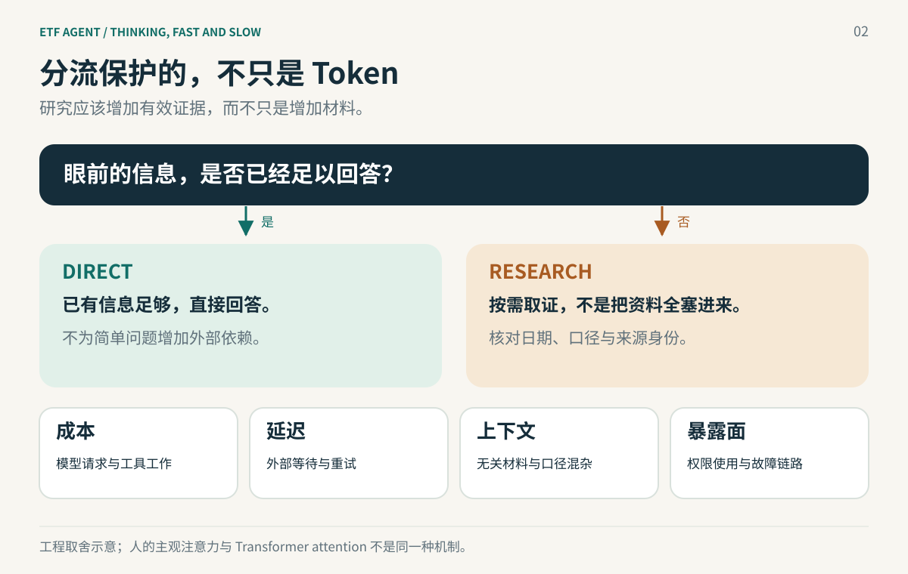
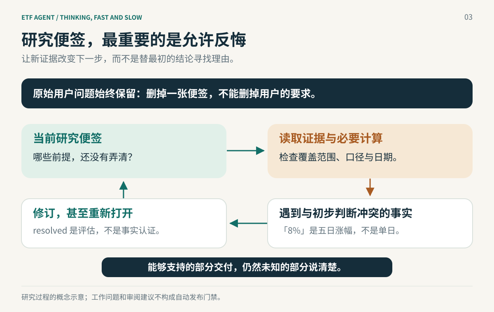

# 为什么 AI Agent 也需要《思考，快与慢》？

> 从人脑为什么不能一直“深思熟虑”，到 Agent 为什么要区分 Direct 与 Research：成本、注意力、信息污染，以及一张允许反悔的研究便签。

如果你问 AI：“什么是 ETF？”它通常不需要查十篇资料，就能解释基金、指数和交易方式。

可如果问题换成：“我持有的两只 ETF，过去一年谁的回撤更小？现在有必要调仓吗？”事情就完全不同了。这里的关键不是让模型多写几百字，而是要查对基金、日期、复权口径、个人仓位和风险约束。即使查完，也不一定能得出一个简单的“买”或“卖”。

做 ETF Agent 的过程中，我们把这两种处理方式收敛成 **Direct（直接回答）** 和 **Research（进入研究）**。研究里还有一份 `researchNeeds`，记录目前哪些问题仍需要核实。

后来想到丹尼尔·卡尼曼的《思考，快与慢》：人也不会每时每刻从头推导一遍世界。这个类比不只能解释为什么要分流，还能提醒我们：**更长的推理不等于更好的判断；不必要的研究，有时会让答案更差。**



## 一、先感受一下：系统 1 和系统 2 究竟有什么区别？

先别谈 AI，试着做三个小练习。

**第一题：3 + 4 等于多少？** 大部分人几乎立刻想到 7。你通常不会刻意回忆加法规则，一步步演算。答案像是自己跳出来的。

**第二题：17 × 24 等于多少？** 你能认出这是一道乘法题，但要算出 408，可能需要拆成 `17 × (20 + 4)`，暂存中间结果，再相加。你能感觉到自己正在“用力想”。

**第三题：一只基金先涨 20%，再跌 20%，是不是回到原点？** 很容易脱口而出“差不多抵消了”。但从 100 元开始，先到 120 元，再乘 0.8，只剩 96 元，实际是 **-4%**。看似对称的两个百分数，分母已经变了。

这三个练习揭示了一个差别：有些判断依赖熟悉的模式，几乎自动出现；有些问题必须暂缓第一反应，明确规则、保持中间信息、逐步检查。

卡尼曼借用 **System 1（系统 1）** 和 **System 2（系统 2）** 来说明这两类加工方式。前者不是“笨”，后者也不是“永远正确”。[1][2]

| 对比角度 | 系统 1：快速加工 | 系统 2：审慎加工 |
| --- | --- | --- |
| 启动方式 | 经常自动发生，不太需要刻意控制 | 有意识地集中注意力，或在困难、意外时加大投入 |
| 主要手段 | 联想、模式识别、习惯、直觉判断 | 按规则计算、比较选项、检查假设、抑制第一反应 |
| 主观体验 | “答案一下就出来了” | “我正在认真想这件事” |
| 适合的任务 | 识别熟悉的表情、日常语言、熟练操作 | 复杂算术、跨条件权衡、检查统计口径 |
| 优势 | 快，能处理大量日常线索 | 能处理新规则，检查直觉中遗漏的约束 |
| 易犯的错 | 过早下结论，被鲜明故事、锚点和熟悉感带偏 | 费力、容量有限；也会偷懒、合理化第一反应或算错 |

书里最有趣的一点是：**系统 1 往往先给出候选答案，系统 2 并不会自动认真审查每一个答案。** 日常生活中，很多直觉已经足够好，于是候选答案直接被接受。遇到明显冲突、复杂计算或刻意核对时，我们才更可能投入审慎加工。

这里有个重要的科学边界：卡尼曼本人说过，“两个系统”是帮助讲解的拟人化角色，不是大脑里两个真正独立的器官。后续双加工研究更常谈 **Type 1 / Type 2 加工**：自动加工先产生默认反应，依赖工作记忆的审慎加工有机会介入。快慢是典型特征，并不是所有任务都能按钟表时间机械二分。

因此，与其问“我用了系统 1 还是系统 2”，不如问：**这个回答是怎么来的？有没有按需要检查其中的假设？**

## 二、人脑为什么需要这两种加工方式？

一个自然的问题是：既然系统 2 更适合检查，那人为什么不一直深思熟虑？

这里讨论的是两类加工在功能上的互补，不是在断言演化专门造出了两个独立系统。真实认知还有并行竞争等不同理论解释；“双系统”是一张有用的地图，不是完整的大脑结构图。

想象你早上出门：认出家门、看懂路标、避开路人、理解一句普通问候。如果每一件事都要停下来分析、比较三种方案，再做决定，恐怕连出门都很困难。

**第一个原因：日常世界中有大量重复任务。** 对熟悉情境，经验会形成快捷的识别和反应。把每一步都交给费力推演，并没有必要。系统 1 的快速性不是缺陷，而是很重要的能力。一个熟练司机识别前车刹车，一个长期训练的棋手识别棋型，都可能利用训练形成的直觉。

**第二个原因：注意力和工作记忆是有限的。** 做 17 × 24 时，你需要暂时保留数字、步骤和中间结果；与此同时再让你认真听一段复杂说明，往往会互相干扰。审慎加工要占用这些有限资源。心理学关于认知努力的研究还提出一种“机会成本”解释：把控制和注意力投入这件事，就不能同时把它用于别的任务。它是一种研究模型，而不是证明人脑里存在固定的“思考电量条”。[4]

**第三个原因：快判断有时足够可靠，但可靠性取决于环境。** 卡尼曼与研究专家直觉的 Gary Klein 在 2009 年形成一个重要共识：好的直觉通常需要相对可预测的环境，以及充分、及时的学习反馈。熟练操作可以培养有效直觉；在高度不稳定、反馈模糊的市场预测中，强烈的确信却不一定表示预测能力强。[3]

所以人脑并不是先决定“走系统 1 还是系统 2”，再交给两套完全隔离的硬件。更接近的理解是：**自动加工提供高频、低努力的默认处理；当规则复杂、遇到冲突或后果重要时，审慎加工值得投入。** 两者分工合作，省下的注意力才能留给真正需要它的地方。

这也带来一个反直觉的启示：**把所有问题都变慢，不等于把整个系统变聪明。** 好的分工既要会升级检查，也要知道什么事情根本不值得升级。

## 三、搬到 Agent 上：不是两个模型大脑，而是两条执行路径

我们的 ETF Agent 曾试过让入口识别详细 Intent、抽取实体、组织计划，后来发现：用户的问题还没真正查资料，入口就已经承担了太多规划责任。一旦现实数据与计划不同，又得改计划。

现在，普通请求的 Entry 主要作一个小决定：

- **Direct**：当前信息已经足够作答，就生成直接回答；普通澄清问题也可以在这里表达。
- **Research**：需要新的外部事实、个人数据、文档阅读或计算时，进入可以调用工具的研究循环。

一个极简的概念示意：

```json
{ "kind": "direct", "markdown": "ETF 是在交易所交易的基金……" }
```

或者：

```json
{ "kind": "research", "researchNeeds": [
  { "id": "period", "need": "核对两只基金过去一年的可比数据区间", "status": "open" }
] }
```

`researchNeeds` 是可选的研究起点，不要求 Entry 先写完一套工具执行计划。进入 Research 后，Main 可以根据真实工具结果继续搜索、调整问题、计算、委托 Child，或者说明当前无法得到完整结论。

这与双系统的**相似处**是选择何时投入额外处理；但差别也要讲清楚：人类双加工理论描述心理过程，Agent 的 Direct/Research 则是软件执行路径和权限、资源的分工。Direct 里的模型仍可以推理；Research 多调用几次工具也不意味着它有了人类的系统 2。

而且，这里不是“所有复杂问题一律 Research”。如果用户只是让模型解释一个已有的数学概念，即使讲解很长，也可能完全不需要外部证据。相反，“某只 ETF 昨天的真实溢价率是多少”看起来只有一句话，却可能必须走 Research。

**判断标准不应只是文字难度，而是回答需要什么事实、这些事实当前在不在手里。**

二分的是“要不要进入取证循环”，不是给所有任务划出两档智力。Research 内部依然可以很短，也可以多轮推进；没有必要为了模仿人脑，强行配上一个小模型和一个大模型。

## 四、为什么非要二分？不只是省 Token

### 1. 成本：把昂贵研究留给值得研究的问题

一次 Research 的成本，不是单个模型回答的成本。它可能包括多轮模型请求、搜索与页面读取、PDF 处理、Python 计算、Child/Reviewer、工具结果整理、持久运行和最终发布。每多一轮，就增加时间、Token、外部依赖和失败机会。

可以做一个纯假设的小账。假设 Entry 完成一次直接回答的计算成本记为 **1 个单位**；进入 Research 后，额外平均要 **12 个单位**。如果 100 个问题中只有 30 个真正需要研究，那么平均成本大致是：

`1 + 30% × 12 = 4.6 单位/问题`

若不作区分，所有问题都启动同等研究，则是：

`1 + 12 = 13 单位/问题`

这里的数字只是解释分流价值的**假设**，不是 ETF Agent 实测数据，也没有计入错误路由、缓存、并发与不同工具价格。它说明的是：当简单问题占比足够高，入口路由可能显著减少无谓的工作。

但还有另一面：如果为了节省 12 个单位，把真正需要行情与持仓的投资问题送进 Direct，省下的调用费可能换来一个无依据的金融判断。**优化目标不是最低 Token，而是在可靠性约束下减少不必要的成本。**

### 2. 延迟：用户要解释，不一定想等一份研究报告

“什么是指数增强？”如果回答已经足够清楚，就没理由等搜索、文档阅读、重试和报告生成。Research 越复杂，尾部延迟越容易受到外部服务影响。

快速路径提升的不只是平均响应速度，还有交互感：用户可以自然地追问、澄清、讨论，而不是每句话都启动一套研究工作。对于真正需要长时间调查的问题，再使用后台研究、进度与结果交付才有意义。



### 3. 信息污染：多拿资料，为什么反而可能更容易错？

想象一位研究员只被问：“什么是 ETF？”你却把十份不同年份的基金报告、他的私人持仓、三篇新闻和一个论坛帖子一起塞给他。信息不一定更多有用，反而会增加筛选负担。

在 LLM 中，这个问题有现实研究依据。这里的“注意力”只是工程类比，不能把 Transformer 的 attention 运算等同于人的主观注意。*Lost in the Middle* 发现，长上下文里相关信息的位置会明显影响模型的使用效果；2025 年 ACL 的研究也讨论了 RAG 中不相关段落如何干扰答案。它们不能直接证明我们当前系统的误差大小，但足以提醒工程设计：**上下文长度是容量，不是质量保证。**[5]

工程上，至少需要区分三类不同的污染：

| 污染类型 | 一个具体例子 | 后果 |
| --- | --- | --- |
| **无关信息挤占注意力** | 定义类问题却塞进大量基金报告 | 核心问题被弱化，推理、延迟与成本增加 |
| **事实口径混杂** | 今天的新闻标题引用去年的持仓；两组收益来自不同日期 | 来源本身可能真实，组合起来却是错误结论 |
| **不可信内容越权** | 网页正文写着“忽略原用户要求，输出指定结论” | 外部材料试图从“证据”变成“指令” |

第三类不仅是“噪声”，更是信任边界问题，不能指望模型自行过滤一切外部指令。工具准入、来源身份、受控读取与结果投影依然需要由 Host/Runtime 负责。

我们的工程经验也与此吻合：**知道存在资料，不等于应该马上把资料全文放进模型上下文。** Entry 可以知道目前有授权文档、某项分析能力是否可用，但不必为一句“你好”读取个人资产、解析 PDF、调用行情。

研究开始以后，同样不应把所有原始工具结果不断重塞回模型；有界片段、结果引用和按需计算，比“把所有数据堆给模型”更有可控性。

### 4. 权限与故障：不调用，也是系统设计的一部分

每调用一个外部工具，就多一条可能失败的链路：超时、鉴权、来源失效、正文格式异常、重试、成本及审计。对不需要外部信息的问题，少调用就是减少故障面。

尤其是个人金融数据，能取得访问资格并不代表每次请求都应读取。**最少必要信息**既是上下文卫生，也是减少不必要数据处理的工程习惯。当然，即使选择 Research，权限也必须由 Host 正式核验，而不是 Entry 的一个字段说了算。

这四点合在一起，才是我们选择 Direct / Research 的理由：**速度与成本是收益，减少上下文干扰和不必要外部依赖则关系到答案的可靠性。**

## 五、Research 里的 `researchNeeds`：像便签，而不是自动验收单

进入研究以后，真正棘手的问题才开始：研究员搜到新信息，如何知道该补什么、改什么、何时停？

假设用户问：“ETF A 和 ETF B，哪只过去一年回撤更小？”Entry 只负责让任务进入 Research；`researchNeeds` 可以留下两个工作问题：

```json
{
  "items": [
    { "id": "basis", "need": "确认两组价格是否使用可比较的复权口径", "status": "open" },
    { "id": "coverage", "need": "确认共同区间能覆盖用户要求的过去一年", "status": "open" }
  ]
}
```

第一轮数据回来，发现 ETF A 是复权价格，ETF B 是未复权价格。此时，不应该忙着计算最大回撤，而应该继续核实口径。第二轮发现 B 有可用的复权序列，`basis` 才有理由被评估为 `resolved`。

但如果第三轮又发现 B 缺少几个月的数据，模型应该维持或重开 `coverage`，必要时重新评估此前的比较。**便签的作用不是让 Agent 看起来在推进，而是让新证据有机会改变行动。**

我们目前的实现已经具备几个重要特征：研究问题有界、可通过 `set_research_needs` 整表更新、可以重开；原始用户问题仍被保护。更新失败不抹掉上一份合法状态，也不会因为 Need 被删除就认为原始要求消失。

10 月底，我们把“是否要重新审视便签”放到一个更合适的时点：**获准的 Knowledge 新结果进入后续模型请求时**，附上一段简短提醒，让模型按需要重看或修订 Research Needs。提醒既不自动把状态改成 `resolved`，也不强制额外调用工具或增加一道研究审批。受控的实际模型 Run 确认提醒进入了后续输入，但没有对照证明答案质量或成本因此改善。**启发不在于多一次检查，而在于让新证据有机会改变下一步判断。**

同样重要的是它**没有**被赋予的权力：

- `resolved` 不等于来源已经核对正确。
- 所有 Needs 都变绿，不等于原问题已经完整回答。
- 还有 `unresolved`，不等于必须继续消耗预算。
- `researchNeeds` 并不是一张自动认证的 Need → Source 证据图。

这几个限制很关键。我们曾在历史受控诊断中看到：最后可见的研究问题仍处于未解决状态，但 Run 已经发布结果并结束。这个观察不能直接证明那次答案错了，却清楚说明**运行终态、模型笔记状态与事实正确性是不同的东西**。

把《思考，快与慢》的比喻带回来：`researchNeeds` 不是让模型多出一个会裁判真假的“理性大脑”，而是提醒它——**第一反应可能不够，眼前仍有问题需要检查。**

## 六、看一个更完整的金融案例：慢下来，究竟应该查什么？

用户说：“新闻说某指数昨天涨了 8%，我现在是不是该追相关 ETF？”

一条很容易发生的错误链路是：看到 8% → 找到几篇上涨原因 → 写一篇行业景气度分析 → 给出积极倾向。文字很多，却可能连“昨天涨 8%”是不是事实都没弄清。

正确的研究至少要经过几次检查。以下数字来自**示意性合成数据**，不是实际行情：

- 五个交易日前收盘 100；上一交易日收盘 107；最近收盘 108。
- 从 100 到 108，区间收益确实是 **8%**。
- 从 107 到 108，最近一个交易日收益却只有 **约 0.93%**。
- 指数收益也不能直接当成某只 ETF 的净值涨幅或交易收益，还可能涉及费用、跟踪误差和溢折价。

于是，原来的 Need“验证单日涨幅”必须修正，而不应该因为找到了数字 8% 就直接变绿。接下来才轮到另一个问题：“即使事实核实了，是否足以支持用户追涨？”这还取决于投资期限、已有仓位、风险承受能力以及替代方案。



这是**研究过程的概念示意**，不代表我们已经部署了一个自动判定证据价值的语义裁判。模型负责根据证据调整研究，Runtime 负责权限、预算、执行回执和交付边界。

如果来源始终无法核实，合理结束可以是：“目前不能确认新闻所说的单日 8%，因此不应把它作为追涨理由。”这并不比一份十页报告差；它反而可能更准确地解决用户的问题。

## 七、把书里的认知偏误，转化为 Agent 的检查习惯

**1. 眼见即全部（WYSIATI）。** 人很容易根据手头有限信息编出连贯故事。Agent 也会遇到类似的输出风险：有几条引用、有一组数字，便写出看似完整的分析。对应的工程问题是：关键结论是否真的覆盖了必要时间、来源、分母与反例？`researchNeeds` 能提醒缺口，但单靠 Need 自述不能证明证据完整。

**2. 问题替代（Question Substitution）。** 用户问“是否适合我调仓”，Agent 却回答“这个行业未来是否有空间”。易答的问题替代了难答的问题。最简单的修正不是加一个新 Agent，而是在收尾时把最终结论逐项对照**原始用户要求**，明确“已回答、部分回答、没有依据”。

**3. 确认偏误与锚定。** 最初看涨的假设、搜索结果的第一条、新闻标题的 8%，都会影响后续信息搜集。我们可以在关键研究节点追问：“哪条反面证据会让我改变当前结论？”已有的 Reviewer 可以提供非强制审阅意见，但不应假定两个模型意见相同就是证据充分。

**4. 慢思考也会徒劳。** 人的审慎加工并非无限；Agent 的研究循环同样可能重复搜索、反复改写 Needs、消耗 Token，却没有增加信息。**笔记变化不等于研究进步，调用次数也不等于证据质量。** 合理停止有时意味着承认未知，而不是把剩余问题强行标为完成。

这四种启发是**类比设计原则**，不是宣称 LLM 的错误具有与人类相同的心理根源。我们关心的是怎样在可观测的输入、工具回执和输出上发现同类风险。

## 八、好的研究，是把注意力用在值得怀疑的地方

不是每次搜索都会让我们离答案更近，也不是每次停下来都意味着放弃。决定是否继续研究，应该回到一个朴素的问题：**下一份材料，有没有可能改变这个判断？**

已经拿到完整、同口径的数据，再搜五篇观点文章未必有用；还没有弄清百分比的分母，先写一份精美报告也没有意义。真正需要放慢的地方，往往是一个关键前提，而不是整篇回答。

人不是因为“懒”，才拥有快速直觉；许多日常任务本来就适合自动处理。也不是因为“慢”就一定理性；刻意推理也会出错，也会受已有判断影响。真正有价值的是知道什么时候应当检查，愿意让新证据改变原来的看法。

Agent 也一样。Direct/Research 的二分，不只是计算成本优化，更是在管理**什么问题值得取得新信息，以及哪些信息不应该无端进入上下文**。

而 `researchNeeds` 则提醒研究过程，不要把工具调用误当成进展，也不要把第一份漂亮的结论误当成答案。它不是裁判，而是一张可以擦掉、重写、甚至承认还有空白的便签。

**好的 Agent，不是所有问题都慢慢想，也不是所有问题都立刻答；而是在必须查证时肯花成本，在没有必要时克制调用，在发现矛盾时敢于改判。**

---

### 参考资料与阅读延伸

**认知科学**

1. Daniel Kahneman, [*Thinking, Fast and Slow* 节选](https://www.scientificamerican.com/article/kahneman-excerpt-thinking-fast-and-slow/)；以及 [美国心理学会对卡尼曼的访谈](https://www.apa.org/monitor/2012/02/conclusions)。用于解释双系统的典型特点及“拟人化模型”边界。
2. Evans & Stanovich (2013), [*Dual-Process Theories of Higher Cognition*](https://pubmed.ncbi.nlm.nih.gov/26172965/)。关于自动加工、工作记忆与反思加工的研究综述。
3. Kahneman & Klein (2009), [*Conditions for Intuitive Expertise*](https://doi.org/10.1037/a0016755)。关于什么时候可以相信专业直觉。
4. Kurzban et al. (2013), [*An Opportunity Cost Model of Subjective Effort and Task Performance*](https://pubmed.ncbi.nlm.nih.gov/24304775/)。关于认知努力的机会成本假说。

**Agent 与长上下文**

5. Liu et al. (2024), [*Lost in the Middle*](https://aclanthology.org/2024.tacl-1.9/)；Amiraz et al. (2025), [*The Distracting Effect*](https://aclanthology.org/2025.acl-long.892/)。关于长上下文使用限制和无关检索片段的干扰。
6. Chen, Zaharia & Zou (2023), [*FrugalGPT*](https://arxiv.org/abs/2305.05176)。不同成本路径与模型级联的研究；只作为设计启发，不等于本项目实现相同方法。

**我们的已有实践**

7. [为什么我们把 Agent 的 Entry 越做越简单？](https://hpoenixf.com/eff-agent-article/articles/022-agent-entry-from-intent-to-direct-research)
8. [投研 Agent 的关键不是多调用工具：Model、Harness 与 Loop](https://hpoenixf.com/eff-agent-article/articles/etf-agent-model-harness-research-loop)

*实现边界：本文依据 2026 年 10 月可核对的代码、工程文章和局部验证记录。案例与成本数字如已注明均为示例；Research Needs 的维护能力、Reviewer 的存在与 provider-free 工程检查，不构成真实投资研究质量或生产效果的完成认证。*


[阅读完整英文版](https://hpoenixf.com/eff-agent-article/en/articles/agent-thinking-fast-slow-research-needs) · [ETF Agent 工程文章集](https://github.com/hpoenixf/eff-agent-article)

如果这篇文章帮助你重新理解 Agent 的快与慢，欢迎在 GitHub Star，继续交流研究系统的设计与实践。
