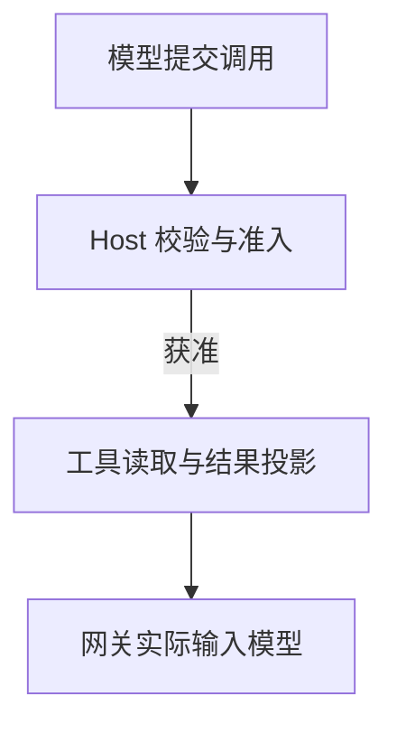

# 从工具调用到模型输入：把 Agent 的观测链路接起来

工具返回成功，后台也有结果，模型为什么还是没有用上？

要查清这个问题，需要接通两段链路：一段记录工具怎样执行，另一段记录结果怎样进入后续模型请求。只有调用日志，排查会停在“工具没问题”；只有输入快照，又很难找到内容在哪一步发生了变化。

我们的做法是：**把读取型工具纳入统一执行入口，在生命周期钩子上记录执行与投影，再把结果关联到实际提交的模型请求。** 这里的“模型看到”，只指可观察的调用输入，不指模型内部的理解过程。

## 一、先统一执行入口，再统一钩子

如果网页、知识库和业务查询各自在自己的函数里打日志，很容易出现相同字段表达不同事实：一个工具的“成功”指上游返回，另一个却已经包含解析、裁剪和保存。

我们把 Native 读取交给同一个执行协调入口。调用方提交已封存的模型回合与动作身份，由入口协调授权、预算、调用、结果投影和回执收尾；正常执行和恢复后的读取使用同一条协调路径。知识库的检索算法仍留在检索器里，不搬进通用入口。

下面概括新读取的主要阶段，省略并发和恢复分支：



顺序与拒绝分支分别核对：

1. 模型向 Host 提交工具调用，Host 校验并决定准入。**调用不获准**时，直接向模型返回拒绝回执，不执行工具。
2. **调用获准**时，Host 才向工具执行读取，接收原始结果或错误；错误不能因为经过统一入口就变成成功。
3. Host 向上下文投影器请求生成允许使用的结果视图，投影器返回投影结果与状态。
4. Host 据此组装下一次模型请求，交给模型网关；网关实际传入的内容和工具结果才是模型收到的输入。工具返回、投影完成与实际送模不是同一个事件。


统一入口不等于统一业务逻辑。它集中的是每次读取都需要遵守的执行规则；新增工具时，不必重新实现一遍授权、回执和观测，也不会让通用层开始理解每个业务领域。

关联也不能只靠工具名。同一个工具可以并行调用多次，因此要用运行身份和动作身份定位执行，保留模型调用 ID，并把后续消费结果的请求单独关联起来。**产生结果的回合，与携带结果的回合，不是同一个概念。**

### 工具身份在派发前就可能组装失败

公开教学实现里的一次流式修复发生在这条执行链之前：同一响应索引已经有非空工具 ID，后续片段携带 `id: null`，旧组装规则却把它当作非法新身份。修复只让这种续片保留原 ID；首片段 null、新索引 null、冲突字符串与非法类型继续拒绝，完整参数仍经最终校验与 Host 授权。

这提醒我们，Provider 碎片、SDK 聚合提议、Host 实际派发和结果进入下次模型输入，是不同阶段。没有派发回执时，不应把组装失败写成工具执行失败，更不能为补齐身份制造新的调用 ID。该案例来自 open-etf-agent，不据此追认其他运行时的历史错误；完整分析见[一个 null 如何让 Agent 工具调用失败](agent-stream-tool-call-null-continuation.md)。

## 二、钩子记录变化，不只是开始和结束

### 调用前：保留“原本要做什么”和“最后做了什么”

调用前钩子可以阻断请求，也可能按明确规则规范化参数。我们分别保留 `originalArguments` 和 `effectiveArguments`，传给钩子的上下文是不可变副本。

例如，某工具明确声明 `quarterly` 是 `Q` 的别名，规范化后应同时保留原值与执行值。这是教学例子：映射必须来自工具契约，不能由通用钩子猜测用户意图。变更后的参数仍须经过相应校验和授权，不能因为“钩子允许了”就直接执行。

否则，排查时只能看到最终参数，无法判断错误来自模型、规范化规则，还是实际调用。

### 调用后：改变展示，不改写执行事实

调用后的处理区分三份内容：上游原始输出、运行时持有的结果、允许进入模型上下文的结果视图。

我们的调用后投影允许收窄内容，但保留下来的事实不能被悄悄改值；派生说明与原始事实分开。例如，移除内部字段属于展示处理，把“暂无报价”改成数值零却是在创造事实。执行状态与投影状态也分别记录，不能用一次“成功”覆盖两者。

这样，上游读取成功但结果投影失败，就不会被误报成上游服务故障。排查对象从“整个工具不行”，缩小到了具体阶段。

### 失败时：标明失败位置，不混成一个错误

执行失败、结果不可用、投影失败、持久化失败，修复动作并不相同。当前观测将执行、结果、投影分别建模，并保留准入、预留、执行、重放、投影、持久化等阶段事实。

`ToolFailure` 是生命周期扩展点，不是包住所有阶段的万能 `catch`。钩子和观察者也不能接管回执所有权：授权失败是否阻断、动作是否完成，仍由执行机制决定。

## 三、把追踪延伸到最终模型输入

调用后投影完成，还没有到链路终点。后续组装上下文时，结果可能再次被缩减，或者替换成一个允许继续读取的引用。因此，调用后钩子不能单独证明下一轮收到了正文。

我们的网关在形成有效 SDK 输入时准备有界快照，再关联实际提交事件。快照覆盖消息、工具定义和有关调用参数；它记录的是有效 SDK 输入，不是 HTTP 请求的逐字节重放。准备过但没有提交的请求，也不能当作已经交付。

连接调用回执与请求快照，需要在转换过程中传递结果来路，而不是事后猜测：

**从回执生成结果表示时绑定身份；裁剪或替换时继承关联；映射为 SDK 消息后记录位置；采集时核对所属运行、动作及结果版本。** 当前实现用进程内关联信息传递这条来路，不把追踪字段塞进模型消息。没有携带关联的新对象，宁可留下未知，也不按相似文本自动匹配。

下面把这些事实合成一个教学用诊断对象，不是项目的原样接口。假设一次外部读取生成了前五行的结果视图，它随后出现在两个已提交的请求中：

```json
{
  "actionId": "read-7",
  "externalDispatches": 1,
  "executionStatus": "succeeded",
  "resultSelection": { "offset": 0, "limit": 5 },
  "appearances": [
    { "requestAttemptId": "request-8", "representation": "reference-only" },
    { "requestAttemptId": "request-9", "representation": "full" }
  ]
}
```

这份记录能回答三个问题：第八次请求只带引用，没有正文；第九次请求带了完整的五行视图，不代表原始来源已经读全；两次出现来自一次外部执行，不能算成重复调用。

真正排查“模型没用上数据”时，应先定位相关请求，再检查其结果表示和关联回执。工具日志负责解释怎么得到结果，请求快照负责解释这一轮拿到了哪一版。

## 四、这条链路怎样改变一次排查

2026 年 10 月 6 日的一次受控验证里，模型两次更新研究工作笔记，系统都接受了；但第一次更新之后的五份后续输入，没有更新正文，只剩下不可用、披露状态未知的信息。该验证使用合成网页资料，不是线上用户事故。

沿着“更新回执 → 状态投影 → 实际请求”核对，问题落在了投影逻辑：导航结果没有正式引用所需的来源标识，当时的逻辑把相关笔记的披露状态降为未知，后续获得正文也没有恢复。结果不是简单的“模型忘了”，而是更新成功后没有正确传到后续输入。

当前工作笔记契约已明确：后续工具失败、摘要或来源变化，不应隐藏已接受的工作笔记。这个变化属于状态传递的修正，不能进一步推导成回答质量已经全面改善。

同样的排查方式，也能把其他现象分开：

| 观察到的事实 | 优先检查的位置 |
| --- | --- |
| 调用前被拒绝，没有实际执行 | 参数、权限和准入规则 |
| 执行成功，投影失败 | 调用后处理与结果结构 |
| 投影成功，本次请求只带引用 | 上下文组装与按需读取 |
| 记录被截断，或来路关联缺失 | 先补观测证据，不直接归因模型 |

这里的价值不是多收集一批日志，而是把每种现象导向不同的修复位置。

## 五、恢复与观测隔离不能改变执行事实

统一观测最容易留下两个隐患。

**一个是恢复时重复执行。** 读取已经完成并有合法回执时，恢复应按既有契约重放结果，而不是为了重新生成一条“完整轨迹”再调用上游、重跑有副作用的钩子。回执仍由恢复存储负责，观测层不维护第二本执行账。当前执行器区分新执行与回执重放；这并不构成对外部服务的 exactly-once 保证。

**另一个是观测反过来影响业务。** 正文采集应先检查权限和开关，再遍历、复制内容；观察者只拿副本，异常不能改写实际请求。采集超限要保留缺口，而不是把“没有记录到”解释成“没有发生”。这些隔离与容量检查已体现在采集实现中。

跨接口交接的关键是能否保留执行与消费身份，而不只是钩子有没有被调用。以下几种情况应保持一致：

| 交接场景 | 应保持的行为 |
| --- | --- |
| 同一回执多次进入请求 | 出现位置分别记录，执行计数不增加 |
| 容量处理把正文换成引用 | 快照中没有原正文，但仍关联原回执 |
| 结果被替换、身份重复或运行不匹配 | 不自动关联到一个“看起来相同”的结果 |
| 关闭采集，或观察回调修改数据后抛错 | 关闭时不额外读取正文；回调异常不污染请求和回执 |

这些是不应被观测层改变的工程行为，和最终研究内容好不好是两类问题。

<!-- open-etf-case:batch@e1b8e4edde724548fab16d8ca4b205379bfa7f30 -->
### 沿批量读取观察结果怎样进入报告

固定公开快照的[批量读取 CLI](https://github.com/hpoenixf/open-etf-agent/blob/e1b8e4edde724548fab16d8ca4b205379bfa7f30/src/cli.mjs)提供一条容易读回的执行链：两个固定读取任务交回合成原文，再由 Main 保存引用报告。

在所链固定快照按 README 安装依赖后，运行：

```bash
node src/cli.mjs --case batch-read --output runs/article-batch
```

终端 JSON 的 `observations` 保留工具结果返回与 Run 释放观察；返回的 `directory` 中有 `run.jsonl`、`report.md` 和 `manifest.json`。可以对照调用、取得的来源和最终报告，而不只看一个成功标志。

这里是固定读取 worker 和本地 Hook 观察，不是通用并发模型专家、完整模型输入追踪平台或 Langfuse 导出器；观察记录也不单独证明外部效果持久化。
<!-- /open-etf-case -->

## 结语

对多轮 Agent，工具生命周期和模型输入追踪最好一起设计：前者解释一次动作怎样执行，后者解释这次执行的结果怎样参与后续推理。

落地时先抓住三个连接点：**统一执行入口、结果投影、请求实际提交。** 在连接处保留身份、版本和阶段事实，比继续增加零散的“调用成功”日志，更能帮助我们找到该改哪段代码。
