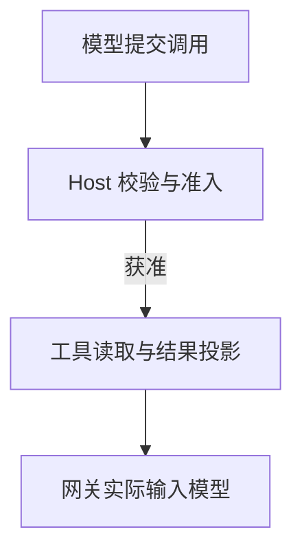

# 从工具调用到模型输入：把 Agent 的观测链路接起来

一个工具返回了五行数据，下一次模型请求只带了读取引用，再下一次才带上五行正文。后台看见“一次成功调用”，模型却在不同回合拿到两种内容。此时只问“工具成功了吗”，已经解释不了回答为什么漏掉数据。

这是一条教学场景。我们当前的做法是把**执行回执、结果投影、实际请求和旁路保存**沿原身份接起来。每一段都保留自己的事实，排查才知道该修工具、上下文组装，还是模型综合。

下面说的“模型看到”，只指实际提交的可观察输入，不推测模型内部是否理解。

<span id="一、先统一执行入口-再统一钩子"></span>
<span id="工具身份在派发前就可能组装失败"></span>

## 一、为什么先收口一次读取，而不是再补一批日志

最初，普通 Runtime 和恢复适配器共同编排一次读取。上层要预留尝试、设置投影回调，下层再处理回放、派发、钩子和回执。各模块都有合理职责，问题是调用者必须记住跨模块的握手顺序。

新增读取即使日志齐全，也可能少接一次投影或结算。只把函数搬到同一文件，没有减少调用方需要知道的协议。我们因此选择一个按 Run 绑定的读取执行协调入口，把这些步骤封装起来，仍然复用原来的授权、预算和持久存储。这个选择来自调用链审查，不是一次已量化的线上故障率比较。

我们把 Native 读取交给同一个执行协调入口。调用方提交已封存的模型回合与动作身份，由入口协调授权、预算、调用、结果投影和回执收尾；正常执行和恢复后的读取使用同一条协调路径。知识库的检索算法仍留在检索器里，不搬进通用入口。

下面概括新读取的主要阶段，省略并发和恢复分支：



顺序与拒绝分支分别核对：

1. 模型向 Host 提交工具调用，Host 校验并决定准入。**调用不获准**时，直接向模型返回拒绝回执，不执行工具。
2. **调用获准**时，Host 才向工具执行读取，接收原始结果或错误；错误不能因为经过统一入口就变成成功。
3. Host 向上下文投影器请求生成允许使用的结果视图，投影器返回投影结果与状态。
4. Host 据此组装下一次模型请求，交给模型网关；网关实际传入的内容和工具结果才是模型收到的输入。工具返回、投影完成与实际送模不是同一个事件。


统一入口不等于统一业务逻辑。它集中的是每次读取都需要遵守的执行规则；新增工具时，不必重新实现一遍授权、回执和观测，也不会让通用层开始理解每个业务领域。

关联也不能只靠工具名。同一个工具可以并行调用多次，因此要用运行身份和动作身份定位执行，保留模型调用 ID，并把后续消费结果的请求单独关联起来。**产生结果的回合，与携带结果的回合，不是同一个概念。**

调用还可能在执行之前失败：Provider 碎片先要被 SDK 组装成完整提议，再交 Host 派发。没有派发回执时，应先检查协议组装，不要把它算成工具执行失败。公开实现中 `id: null` 续片的具体教训见[工具身份组装案例](agent-stream-tool-call-null-continuation.md)，本文不重复展开那条协议分支。

## 二、钩子记录变化，不只是开始和结束

### 调用前：保留“原本要做什么”和“最后做了什么”

调用前钩子可以阻断请求，也可能按明确规则规范化参数。我们分别保留 `originalArguments` 和 `effectiveArguments`，传给钩子的上下文是不可变副本。

例如，某工具明确声明 `quarterly` 是 `Q` 的别名，规范化后应同时保留原值与执行值。这是教学例子：映射必须来自工具契约，不能由通用钩子猜测用户意图。变更后的参数仍须经过相应校验和授权，不能因为“钩子允许了”就直接执行。

否则，排查时只能看到最终参数，无法判断错误来自模型、规范化规则，还是实际调用。

### 调用后：改变展示，不改写执行事实

调用后的处理区分三份内容：上游原始输出、运行时持有的结果、允许进入模型上下文的结果视图。

我们的调用后投影允许收窄内容，但保留下来的事实不能被悄悄改值；派生说明与原始事实分开。例如，移除内部字段属于展示处理，把“暂无报价”改成数值零却是在创造事实。执行状态与投影状态也分别记录，不能用一次“成功”覆盖两者。

这样，上游读取成功但结果投影失败，就不会被误报成上游服务故障。排查对象从“整个工具不行”，缩小到了具体阶段。

### 失败时：标明失败位置，不混成一个错误

执行失败、结果不可用、投影失败、持久化失败，修复动作并不相同。当前观测将执行、结果、投影分别建模，并保留准入、预留、执行、重放、投影、持久化等阶段事实。

`ToolFailure` 是生命周期扩展点，不是包住所有阶段的万能 `catch`。钩子和观察者也不能接管回执所有权：授权失败是否阻断、动作是否完成，仍由执行机制决定。

<span id="三、把追踪延伸到最终模型输入"></span>

## 三、同一次执行，为什么会出现在不同模型请求里？

调用后投影完成，还没有到链路终点。后续组装上下文时，结果可能再次被缩减，或者替换成一个允许继续读取的引用。因此，调用后钩子不能单独证明下一轮收到了正文。

我们的网关在形成有效 SDK 输入时准备有界快照，再关联实际提交事件。快照覆盖消息、工具定义和有关调用参数；它记录的是有效 SDK 输入，不是 HTTP 请求的逐字节重放。准备过但没有提交的请求，也不能当作已经交付。

连接调用回执与请求快照，需要在转换过程中传递结果来路，而不是事后猜测：

**从回执生成结果表示时绑定身份；裁剪或替换时继承关联；映射为 SDK 消息后记录位置；采集时核对所属运行、动作及结果版本。** 当前实现用进程内关联信息传递这条来路，不把追踪字段塞进模型消息。没有携带关联的新对象，宁可留下未知，也不按相似文本自动匹配。

下面把这些事实合成一个教学用诊断对象，不是项目的原样接口。假设一次外部读取生成了前五行的结果视图，它随后出现在两个已提交的请求中：

```json
{
  "actionId": "read-7",
  "externalDispatches": 1,
  "executionStatus": "succeeded",
  "resultSelection": { "offset": 0, "limit": 5 },
  "appearances": [
    { "requestAttemptId": "request-8", "representation": "reference-only" },
    { "requestAttemptId": "request-9", "representation": "full" }
  ]
}
```

这份记录能回答三个问题：第八次请求只带引用，没有正文；第九次请求带了完整的五行视图，不代表原始来源已经读全；两次出现来自一次外部执行，不能算成重复调用。

真正排查“模型没用上数据”时，应先定位相关请求，再检查其结果表示和关联回执。工具日志负责解释怎么得到结果，请求快照负责解释这一轮拿到了哪一版。

## 四、这条链路怎样改变一次排查

2026 年 10 月 6 日的一次受控验证里，模型两次更新研究工作笔记，系统都接受了；但第一次更新之后的五份后续输入，没有更新正文，只剩下不可用、披露状态未知的信息。该验证使用合成网页资料，不是线上用户事故。

沿着“更新回执 → 状态投影 → 实际请求”核对，问题落在了投影逻辑：导航结果没有正式引用所需的来源标识，当时的逻辑把相关笔记的披露状态降为未知，后续获得正文也没有恢复。结果不是简单的“模型忘了”，而是更新成功后没有正确传到后续输入。

当前工作笔记契约已明确：后续工具失败、摘要或来源变化，不应隐藏已接受的工作笔记。这个变化属于状态传递的修正，不能进一步推导成回答质量已经全面改善。

同样的排查方式，也能把其他现象分开：

| 观察到的事实 | 优先检查的位置 |
| --- | --- |
| 调用前被拒绝，没有实际执行 | 参数、权限和准入规则 |
| 执行成功，投影失败 | 调用后处理与结果结构 |
| 投影成功，本次请求只带引用 | 上下文组装与按需读取 |
| 记录被截断，或来路关联缺失 | 先补观测证据，不直接归因模型 |

这里的价值不是多收集一批日志，而是把每种现象导向不同的修复位置。

<span id="五、恢复与观测隔离不能改变执行事实"></span>
<span id="六、2026-年-10-月补充-执行回执与证据存储不是同一个-owner"></span>

## 五、观察链应该能失败，执行事实仍然成立

读取已完成并有合法回执时，恢复复用已结算的最终结果，不为补齐轨迹再调用上游、重跑有副作用的钩子。回执仍由原恢复存储负责，观测层不另记执行账。这样能够避免把同一回执的多次出现统计成多次执行，但不等于外部服务具备恰好一次效果保证。

观察副本还经过独立的采集、排队、持久保存和回读。输入快照进入队列时，正文可能还没落盘；历史回读失败，也可能只是留存期或当前读取条件不满足。不能从这些状态倒推出工具当时没执行，或模型当时没收到输入。

~~~mermaid
flowchart LR
    A[原工具 Host] --> B[原 Result 与回执]
    B --> C[上下文投影]
    C --> D[实际模型请求]
    D --> E[原 Gateway 派发/结算]
    D -. 尝试被动采集 .-> F[E04 逻辑输入副本]
    E -. 尝试被动采集 .-> G[E04 可观察输出副本]
    F --> H[有限队列/持久证据]
    G --> H
    H --> I[独立授权回读]
~~~

图中虚线是旁路采集：它关联原身份，不接管原调用。更详细的采集准入、保留期和回读规则见[研究证据存储](agent-research-evidence-store-lifecycle.md)。这里保留一个实际采用原则：**先保证原执行回执，再让观察副本尽力留下准确记录。**

具体实现先检查权限与开关，再遍历、复制正文；观察者只拿副本，异常不改写实际请求。采集超限、来路缺失或保存失败就记录相应缺口。关闭采集时不为了日志多读一次正文，也不把观察失败升级成整轮研究失败。

这也决定排查的顺序：

| 看到的现象 | 下一步查什么 |
| --- | --- |
| 同一结果出现在两个请求 | 按原回执合并执行计数，分别查看每次表示 |
| 请求里只有引用 | 检查后续是否实际读取，别把引用当正文 |
| 副本仍在队列或已过期 | 查保存与留存状态，不重做已结算动作 |
| 结果被替换、身份冲突或关联缺失 | 保留未知，别用相似文本拼一条假链路 |

## 六、通用追踪已经很好，为什么还要记录结果的来路？

[OpenTelemetry 的生成式 AI 语义约定](https://github.com/open-telemetry/semantic-conventions-genai/blob/main/docs/gen-ai/gen-ai-spans.md)为模型推理、工具执行及相关输入输出提供了统一表达。沿调用记录时延、错误和工具名称，是大多数系统合理的第一步。

但是，调用树回答“哪个调用发生在谁下面”，本文的问题是“哪一份结果的哪种表示进入了后面的哪个请求”。一个结果可以被多个后续回合使用；同一份结果也可以先是引用，再是部分正文。这个消费关系不是简单的父子关系。

我们保留已有追踪与存储，在转换处附带结果身份、版本及出现位置。选择进程内关联信息，是为了不把诊断字段塞进模型消息，也不另建执行账本。代价是每个实际转换处都要主动传递关联；漏接的转换会留下观测缺口，而不是自动从内容猜回来。

如果产品只有单次模型调用、一个工具结果直接原样返回，普通调用追踪通常已经足够。只有出现外置结果、裁剪、重放和多轮复用时，这条消费关系才值得增加。它补充通用追踪，不替代通用追踪。

## 七、用公开教学代码观察一条小链路

<!-- open-etf-case:batch@e1b8e4edde724548fab16d8ca4b205379bfa7f30 -->
### 沿批量读取观察结果怎样进入报告

固定公开快照的[批量读取 CLI](https://github.com/hpoenixf/open-etf-agent/blob/e1b8e4edde724548fab16d8ca4b205379bfa7f30/src/cli.mjs)提供一条容易读回的执行链：两个固定读取任务交回合成原文，再由 Main 保存引用报告。

此示例固定在所链公开快照；新版本入口请查看[当前 README](https://github.com/hpoenixf/open-etf-agent/blob/main/README.md)，不要混用版本命令。在固定快照按 README 安装依赖后，运行：

```bash
node src/cli.mjs --case batch-read --output runs/article-batch
```

终端 JSON 的 `observations` 保留工具结果返回与 Run 释放观察；返回的 `directory` 中有 `run.jsonl`、`report.md` 和 `manifest.json`。可以对照调用、取得的来源和最终报告，而不只看一个成功标志。

这里是固定读取 worker 和本地 Hook 观察，不是通用并发模型专家、完整模型输入追踪平台或 Langfuse 导出器；观察记录也不单独证明外部效果持久化。
<!-- /open-etf-case -->

## 结语

排查“模型没有用上资料”时，从最终回答向前追：相关请求里究竟有什么，这份表示来自哪个结果，结果又由哪次实际执行产生。

先接好统一读取入口、结果转换和实际请求提交，再让证据保存成为可独立失败的旁路。比起增加更多“成功”日志，这样更容易找到应该修改的那一段，也更不容易为了让轨迹完整而重复业务动作。
