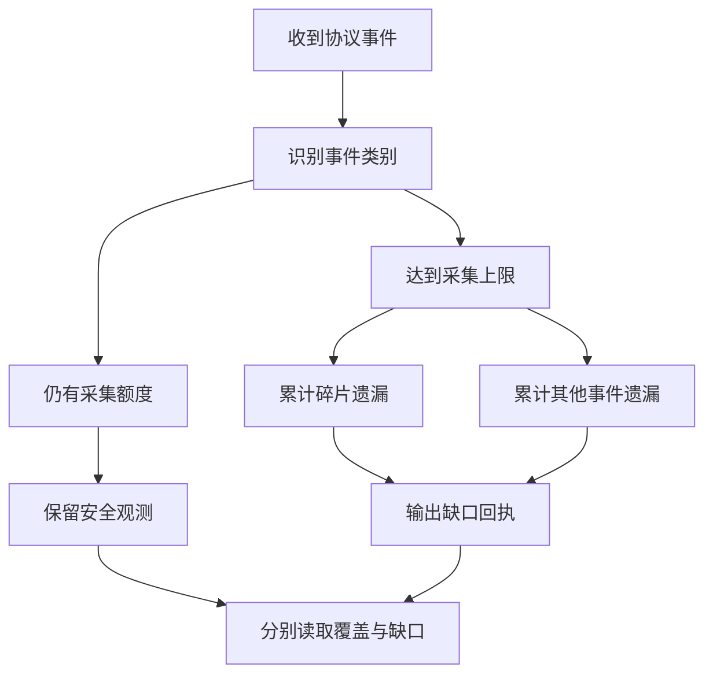

---
evidence:
  implementation: "协议遗漏分类已实现"
  scoped: "真实长任务回查与受控缺口验证"
  live: "历史缺失事件不可恢复；新机制的长任务覆盖效果未评估"
readingBrief:
  takeaways:
    - "Trace 查询 complete 只说明已读完可返回记录；分页、模型正文、工具阶段、持久交付和研究正确性必须分别判断。"
    - "本次修复在原容量内区分碎片与其他协议遗漏，改善新记录解释性；旧分类仍未知，未证明长任务覆盖率提高。"
    - "追踪缺失时沿原动作、发布版本和实际请求找证据；看不见不等于没发生，也不应为补齐图表重放持久操作。"
  appliesTo:
    - "排查长任务 Trace 缺口、流式事件容量及观测与原执行回执不一致的工程人员。"
  notFor:
    - "不提供历史事件恢复或工具成功率结论，也不是已完成的逐调用全阶段覆盖系统。"
---

# Trace 显示 Complete，为什么 Agent 还是无法完整复盘？

一次研究结束后，追踪查询返回了 `complete`，却找不到回答发布事件。直觉上，这像是“Agent 根本没有发布答案”。但沿同一次运行的原发布记录回查，我们读到了一份已经保存的非空正文。

问题不在于两个系统谁说了谎，而在于我们把两个不同问题混成了一个：**查询是否读完了已有记录，与执行过程中是否留下了全部记录，不是一回事。**

对长任务 Agent，可观测系统需要交付的不只是日志，还包括这些日志的覆盖范围。否则，一张完整显示出来的时间线，可能只是一个不完整过程的完整展示。

## 一、先给 complete 补上宾语

本文的案例来自 2026 年 10 月 30—31 日的一组研究测评。计划中的 120 次运行，当时已经结束 59 次；它们是不同的运行实例，不应理解为 59 道互不重复的问题，也不是完整测评的最终结果。

这 59 次追踪回读都被查询器标记为 `complete`。继续逐轮检查，却发现 17 条模型轮次输出缺失；41 次运行中出现了 42 个工具协议缺口，回执累计报告遗漏 851,339 个事件。

这里有两个不能混淆的单位：缺少的是 **17 条模型轮次输出**，不是“17 次运行没有任何输出”；遗漏计数描述的是观测器报告的事件，不是工具调用次数，也不是经过独立去重的事件总量。

查询器的 complete 可以是真的：它已经读完了这次查询范围内所有可返回的记录。但采集器可能早已因容量、协议支持范围或其他原因，没有保存其中一部分事实。

| 完整的是哪一层 | 它回答的问题 |
| --- | --- |
| 查询分页 | 查询范围内还有没有未读页？ |
| 模型正文采集 | 某一轮的输入和输出是否留下？ |
| 工具协议观测 | 从碎片到派发、结果，各阶段记录到什么程度？ |
| 持久执行与交付 | 哪些动作、正文或文件已由原模块确认保存？ |
| 研究结论 | 最终主张是否得到资料支持，是否满足用户问题？ |

这些维度有关联，却不能沿着表格自动升级。读完分页不代表正文齐全，正文齐全不代表工具阶段完整，答案已保存也不代表研究结论正确。

## 二、为什么流式工具调用特别容易耗尽观测容量

一条工具调用，在流式传输时可能被拆成很多小片段。函数名、参数字符串和结束标记逐步到达，SDK 再把这些碎片聚合成完整调用。

对执行器而言，它可能仍是一条工具提议；对观测器而言，却可能已经经过大量事件。如果不区分二者，一个参数很长的工具调用就可能占满整轮研究的日志预算。

当时的应用观测器为每次研究运行（Run）保留最多 512 个协议事件槽位，并对 provider/SDK 碎片另设 256 个槽位的上限。设计意图是：不能让前半段碎片把后续规范化、校验、派发和结果回执全部挤掉，还需要留出缺口说明的位置。

这个取舍合理，但不是完整性保证。长任务里，非碎片事件也会持续累积。对出现 `event_limit` 的 41 次运行回查，其中 35 次的最大非 gap 事件序号达到 511：预留空间可以缓解碎片挤占，却不能承诺整轮始终装得下。

因此，看到有派发事件，不等于每次派发都被记录；看到某次运行有 gap，也不等于所有工具生命周期都丢了。两种极端解释都超出了证据。

## 三、这次修复的重点：让遗漏可以解释，而不是假装没有遗漏

面对大量缺口，最直接的办法是增大上限。但扩大容量会增加存储、导出压力与敏感内容留存，也只是把下一次触顶推迟。

这次实际落地的是更小的一步：**维持原有容量，分别统计遗漏的碎片事件和其他协议事件。** 新的缺口回执增加 `omittedFragmentEvents` 与 `omittedOtherEvents`，总遗漏仍保留在 `omittedEvents` 中。

下面是教学化示例，数字是构造值，不是某次真实运行的原始回执：

```json
{
  "stage": "gap",
  "reason": "event_limit",
  "omittedEvents": 259,
  "omittedFragmentEvents": 2,
  "omittedOtherEvents": 257
}
```

它能回答“主要是碎片被省略，还是其他事件也受到容量影响”。但 `other` 不能重命名成“执行事件”：它还可能包含 SDK 聚合、终止和其他协议类别，不能据此推算丢失了多少次工具执行。



图中“预算耗尽”可能来自整轮事件限制，也可能来自碎片子预算。遗漏时只进入与原事件类别对应的一条计数分支，并不是两项同时增加。采集异常仍由独立字段记录，不能把它藏进容量遗漏里。

旧记录没有这两个分类字段时，分类应当保持未知，不能补成两个零。这次改动改善的是新数据的可解释性，没有恢复过去未保存的事件，也还不能声称真实长任务的覆盖率已经提高。

## 四、追踪缺失时，应当去哪里找事实

前面的“没有发布事件，却有持久正文”就是一个有用的反例。我们按同一运行与访问范围，调用原发布模块的历史读取接口，取回了已保存正文；没有为此重新运行模型，也没有补写一条假想的历史发布事件。

这说明排查要沿事实归属回查，而不是让观测平台独占解释权。

工具是否执行，优先找原动作与结果回执；正文是否保存，找原发布版本；文件能否取得，找原产物身份与实际读取；某段材料是否进入后续请求，找那一次请求的输入。Langfuse 把它们串成诊断视图，但不能替代各自的原始事实。

实际处理可以分成三种情形。

**追踪没有，原模块有。** 保留追踪缺口，同时记录原模块确认的事实。不要为了“补齐图表”重放执行，尤其不要重跑会产生持久效果的动作。

**两边都有，但内容或版本不同。** 先核对运行、动作、请求和版本身份。时间接近或文本相似只是线索，不能把两个版本拼成同一次交付。

**两边都没有足够证据。** 结论是当前无法确认，不是动作一定没发生。后续修复应改善新运行的取证，而不是让模型补出一段看起来合理的历史。

这里还有一个容易忽略的约束：观测器失败不应改变原执行。同步抛错、异步导出拒绝、采集超限，都不能因为诊断系统自己的问题，清空已经独立获准保存的答案。

## 五、下一步不是一个更大的布尔值

我们还把持久动作与追踪中的调用身份做了同运行关联。部分动作能匹配到派发和结果阶段，部分只能匹配到其他事件，另一些没有匹配记录。这是定位观测覆盖的入口，不是工具成功率。

若要继续完善，值得增加的是“某个已知调用在哪些阶段有证据”的可读视图，而不是另一个叫 `fullyComplete` 的总开关。这是后续设计方向，不是本次已经交付的完整机制。

复盘时最有用的三个问题是：这个完整性字段完整了什么？缺少的部分有没有明确身份和原因？原执行模块是否保留了可以独立核对的事实？

**可信观测不是让所有格子都变绿，而是让读者知道哪些格子有证据、哪些只是没有被记录。** 对 Agent 尤其如此：一旦把“看不见”写成“没发生”，后续的故障定位、成本统计和模型评测就都会建立在错误前提上。

延伸阅读：[从 Trace 到可信观测](025-agent-langfuse-from-trace-to-trustworthy-observability.md) · [多专家贡献如何取证](agent-subagent-contribution-evidence.md) · [别把所有失败算给模型](agent-failure-is-a-boundary-problem.md)

更多工程案例见 [ETF Agent 技术文集](https://github.com/hpoenixf/eff-agent-article)。对这些实践感兴趣，欢迎为文集点一个 Star。
