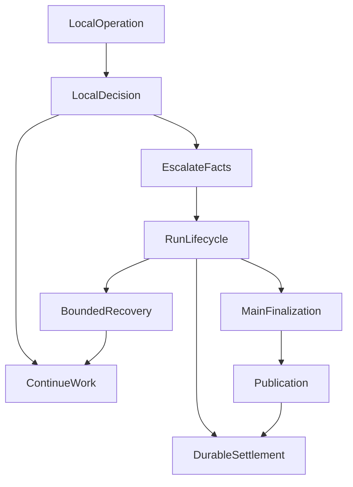
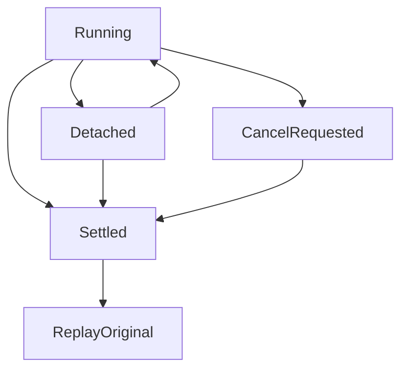

# 当每个模块都能说“不”：Agent 的终结权、阶段预算与安全恢复


一次研究已经查过多个来源、完成部分计算，也向用户交付了几段内容。此时，一个工具失败、一条可选建议变化，或者浏览器断了连接，整项研究应该结束吗？

简单地让异常向上抛，往往会把这个决定交给最先失败的模块。它原本只负责一次读取或一条建议，却通过控制流取得了终结整个任务的权力。另一个方向也有问题：系统为了避免失败，换成一个更容易回答的问题，最后留下流畅的文字和一个绿色的 completed。

这两个问题需要一起处理：**局部失败不能无故结束整个任务，恢复也不能改变任务、扩大权限或把未知效果写成成功。** 核心不是增加重试，而是明确谁拥有局部操作、整项运行和最终交付的决定权。

## 一、正文处置权与 Run 终结权是两件事

[答案发布系统](019-agent-answer-publication.md)负责候选正文、预览、版本化提交与修订。某段正文是否获准展示，与整项研究是否还能继续，是不同效果。

工具可以拒绝自己不获准的调用；搜索服务可以拒绝超出自身额度的新搜索；压缩模块可以放弃一个身份不成立的摘要。这些拒绝都可能正确。问题是，它们是否足以证明其他合法资料、工具和已提交正文也必须停止？

这就是否决权的范围。它不一定写成 `deny`：一个 `throw`、一次过滤、提前返回，乃至没有向模型展示一个已获准能力，都可能产生否决效果。判断依据应是它改变了什么，而不是代码使用哪个词。

| 原负责者 | 有权确认的事实 | 不能由此直接推出 |
| --- | --- | --- |
| 工具、来源与执行模块 | 本次操作被拒绝、失败、成功或效果未知 | 整项研究已经失败 |
| 原资源负责者 | 某类资源的准入、消耗与剩余额度 | 其他资源也已耗尽，或任务语义已经完整 |
| Publication | 正文是否展示、提交及其准确版本 | 用户问题已经正确回答 |
| Run Lifecycle | 依据原事实继续、恢复、收尾或终结 | 重新授予权限、改写回执或认证答案质量 |

**同一个效果应有一个最终负责者；不同效果仍然各有边界。** 把所有决定交给一个“可信管理器”，并不会自动得到更可靠的系统。

## 二、附属信息怎样长成了第二个裁判

我们曾让模型维护 `Research Needs`，即当前还需要研究的问题列表。它帮助组织工作，但不拥有来源权限，也不能证明问题已经解决。

早期 Main 请求准备好后，临近派发还会比较列表是否变化：

```typescript
// 历史实现的关键分支，已退出现行派发决定。
if (JSON.stringify(fittedState) !== JSON.stringify(currentNeeds)) {
  throw new Error("Research needs changed before provider dispatch");
}
```

原意是防止请求与状态不一致，实际却让可选工作列表获得了整轮阻断权。Reviewer 建议也出现过相似问题：准备阶段已经按 Child 终态、Run 授权和实际请求建立绑定，派发前再次解释其原材料，反而可能否决已经合法封存的建议。

Reviewer 的后置重复检查先于终结权专项被移除。随后的终结权收敛又将可选 Needs 的准备问题与真实派发隔开。请求身份、用户纠正、工具合同和执行围栏仍然成立；被撤掉的是附属信息对整个 Main 请求的影子裁决。

Stop Hook 则暴露了另一种否决。Main 已提出合法完成，Stop 返回 `continue`，旧路径仍可能把完成改成 `block`，迫使模型再转一轮。当前合同把 Stop 留作建议：它不能独立否决正常完成，也不能强制增加请求。用户显式取消、真实权限和预算等客观边界仍由原负责者执行。

这不改变原有无进展规则：既无可交付正文又无有效调用时，仍有界结束并明确未生成回答；移除 Stop 的重复否决，不会把空响应变成完成。

这几次变化不是删除所有一致性检查，而是重新确定：**这项检查究竟保护哪个效果，是否拥有阻止主流程的资格。**

## 三、一个预算事实，也不应该有两份账本

研究同时受到请求、工具、时间、并发和输出预留等限制。“有多个限制”很正常；对同一笔消耗作出两次独立决定，才容易产生冲突。

Root Resource 负责原有共享请求的原子准入与实际使用事实。Runtime 读取资源视图、选择阶段和生成提醒，不再凭独立账本授予或收回请求资格。专项验证了 Root Resource 与 Runtime 的职责分工，没有因为收拢决策接口而复制资源额度账本。

Web 搜索额度、Provider 物理并发和正文修订次数仍可由不同模块维护，因为它们约束不同资源。搜索额度耗尽只拒绝新搜索；已有结果能否继续读取，要看读取及共享资源自己的条件。普通研究资源耗尽，也不等于原先保留的最终输出资源已经消失。

重试同样从原余额扣减。若每个阶段各自领取“两次重试”，规划、工具和续答的嵌套就会放大总消耗。只读请求也可能占用付费额度、租约和上游容量，不能因为不写数据库就当作免费重试。具体资源机制见[Run 预算与约束治理](agent-runtime-constraint-governance-v2.md)。

## 四、先说清楚是哪一种超时，再决定能否继续

失败旧稿留下了两条值得保留的诊断反例。

一次检查从页面看耗时约 **360 秒**，其中约 **347 秒是排队，13 秒是实际执行**，执行本身正常结束。另一次组合查询被页面表现为“网络错误”，工具却在约 **0.15—0.29 秒**内成功；失败发生在工具返回后的第二轮模型续答，等待约 **30 秒**仍没有正文。

这两个案例来自原受控开发窗口，不能作为今天的性能基线。它们改变的判断是：墙钟很长不等于执行超时，工具成功也不等于续答成功。

| 时钟 | 起点 | 主要解释什么 |
| --- | --- | --- |
| 排队时间 | 进入调度队列 | 容量与并发等待 |
| 阶段执行时间 | 阶段实际获得执行权 | 模型、工具或校验器的执行耗时 |
| 无进展时间 | 最近一次有效业务进展 | 当前阶段是否继续产生可用工作 |
| 整体截止时间 | 业务运行开始 | 原任务还剩多少总时间 |

网络心跳、usage 事件或内部推理片段只说明传输活动，不能自动刷新业务进展。阶段预算也必须受整体剩余时间约束，否则每段都在“合法等待”，整项请求却没有有限终点。

恢复范围要与事实对应：工具已成功而续答失败，应优先保留工具回执，检查能否沿原条件恢复后续工作；不应仅根据页面错误把整条链从头执行。只有 headers 到达、正文未知中断而没有明确截止证据时，应保留中断或 unknown，不能凭感觉命名为 timeout。更细的故障身份由[失败诊断专文](agent-failure-is-a-boundary-problem.md)承接。

## 五、旧规划器教过我们的事：不能换一个问题宣布成功

在早期固定规划架构的一组 **48 条验证记录**中，**8 个运行里的 10 次规划调用**持续产生内部推理，却没有合法计划正文，最终碰到阶段截止。旧恢复路径随后构造通用知识任务，丢掉实体、时间和证据需求；其中一个请求经过重复规划与排队，端到端约 **672 秒**。

真正的问题不只在等待时间。用户要的是当前事实，系统最后却解释一般概念，再把它算成完成。话题相近，完成条件已经改变。

当时修复采用 `planning_failed` 和失败后不再偷偷进入工具、回答、评审的负向验证。这是**旧规划架构的历史修复**，不能移植成今天“所有研究必须先产出合法计划”的规则。当前原生工具循环由模型选择研究路线，Runtime 维护真实授权、执行和提交事实。

仍然成立的经验是：降级可以减少承诺，不能悄悄替换目标。查询当前行情缺少证据时，可以交代缺口、保留已确认内容；不能以一般知识冒充当前行情。结构合法、资料齐全、正文保存、语义质量和用户收到结果，也不能再合成一个 `PlanValid` 公式。

## 六、深化原有生命周期，选择仍然合法的下一步

我们没有新增终结 Agent，也没有让一个统一异常包装函数接受各模块提前决定的 `failed`。后者只是统一写终态，并没有收回决定权。

现有 Run Lifecycle 接收局部负责者已确认的事实，再选择原有继续、恢复、收尾或结算路径。Main 仍负责研究选择与综合；Recovery 保留租约、围栏和恢复回执；资源负责者决定准入；Publication 决定正文处置。



局部可以处理的失败留在局部。需要升级时，生命周期选择的不是一个抽象的“成功/失败”，而是当前仍获准的操作：

| 实际状态 | 可以考虑的后续路径 | 必须保留的限制 |
| --- | --- | --- |
| 一个普通工具失败，独立资料和其他工具仍可用 | 继续获准研究 | 不将失败改成空结果成功 |
| 临时 Provider 故障，原恢复条件和余额仍成立 | 原机制内有界恢复 | 不创造新额度或更换原任务身份 |
| 普通研究不能继续，原输出预留仍成立 | 单向进入 `finalization-only` | 使用已有合格材料，明确未完成范围 |
| 用户取消、总硬限制生效或保护性身份不成立 | 按原事实停止、结算 | 不为“优雅”新增派发 |
| 外部效果是否发生仍未知 | 交原执行/恢复负责者核对 | 不盲目重放，不先标成功 |

Finalization 复用原输出路径，不是新的兜底系统。它只能使用原先接受的资源与权限，不能收尾失败后又回普通研究，再循环申请一次收尾。

隔离影响范围与微软的[隔舱设计模式](https://learn.microsoft.com/en-us/azure/architecture/patterns/bulkhead)有相近目标，但这里不意味着为每个模块新建线程池。我们收拢的是同一 Runtime 内的控制权：一个效果被拒绝，不自动扩大成其他独立效果也被拒绝。

## 七、恢复要保留原任务，也要承认未知效果

恢复资格至少要同时检查：原任务身份、可用检查点、同一 Run 授权、剩余预算，以及原执行是否允许安全接续。一个“临时错误”标签不够。

AWS Builders’ Library 的[幂等 API 与安全重试](https://aws.amazon.com/builders-library/making-retries-safe-with-idempotent-APIs/?did=ba_card)说明了同类难题：未收到响应，不代表服务端没做过。Agent 的工具超时、数据库提交回执丢失，同样不能直接解释成“没有副作用”。请求身份与原回执决定能否重放，模型说“再试一次”不构成执行证明。

几个边界需要同时存在：

- **已发生的效果不能重新发明。** 已提交工具结果和正文沿原身份读回；未提交候选不能因预览过就算保存，摘要不能重建一个不存在的原件。
- **同 Run 不重新领取权限。** 恢复继承原已记录授权，不因当前权限表变化重新裁决原 Run；账户、scope、内容身份、取消和预算等原边界继续有效。新 Run 独立准入。
- **共享资源不能重置。** 重试、续答和恢复消费原有资源，不各自生成新余额。
- **未知执行不能自动再做。** 是否可安全重放由原执行和 Recovery 事实决定，不能仅凭超时、只读标签或用户期望猜测。
- **继续工作不能改写原目标。** 缺证据时缩小结论范围并说明缺口；用户的新更正需要由当前工作实际接收，不能从旧摘要推定已经应用。

这些规则让恢复更克制，也让失败更可解释。它们没有许诺每次故障都能恢复，尤其没有给已经不满足身份或持久化条件的运行补开一条旁路。

## 八、连接断开、运行结束与用户收到，各自留下事实

浏览器连接是观察通道，Run 是业务运行。普通断线解除订阅，用户显式停止表达取消意图，两者不能混用；重连也不应仅因重新订阅就生成新研究。

这条连接生命周期边界可以用一个分支图说明：



`Detached` 表示连接离开，不是重新授权；`Settled` 保留实际完成、部分、失败或取消的结算事实，不认证研究质量。重连读取原事件与提交，不把旧失败改成成功。确需在终态之后继续研究，要产生有因果关系的新运行，并独立准入。

服务端写下唯一终态，仍不能证明浏览器收到全部内容。需要区分候选生成、服务端提交、传输发送以及客户端观察。后台保存最终只有 `partial` 时，对外结果和完成回调不能沿用保存前的 `complete`；但客户端接收是否完整，仍需要对应的接收证据。

分块正文和文件交付也一样：第二块失败不抹去已提交的第一块，第一块存在不代表整题完成；正文保存不代表附件已经保存或下载。具体发布与文件机制继续由原专文解释，不在生命周期里再建一套审查器。

## 九、哪些变化已有证据，哪些仍需单独验证

终结权收敛已在 2026-10-19 完成实现、accepted specs 同步和归档。所选验证覆盖共享终结控制、原机制恢复与有界收尾、Needs 隔离、Stop 建议化，以及实际持久状态与完成回调的一致性。

受控检查覆盖生产 Factory 下的脚本化模型、独立 PostgreSQL 的新连接恢复，以及关键结束回执的一致性。它们支持这些具体控制行为，而不是全仓质量或真实模型研究成功率。

真实模型能否完成复杂研究、浏览器交互是否稳定以及生产环境效果，仍需在各自运行场景中检验。

验收真正需要观察的是原调用链：局部失败后还有没有合法后续请求，Stop 有没有迫使多转一轮，未知效果有没有被再执行，Publication 实际结算和回调是否一致。既要证明必要的拒绝存在，也要证明独立合法工作没有被错误阻止。

## 十、合并代码之前，先问清一项拒绝的职责

工程评审中，我们把问题收敛为三句：这个模块是否拥有该效果的最终决定权？拒绝是否只影响它负责的效果？它是否重新解释了其他负责者已经记录的事实？

这与 John Ousterhout 对[模块化设计和信息隐藏](https://web.stanford.edu/~ouster/cgi-bin/cs190-winter18/lecture.php?topic=modularDesign)的讨论相呼应：有价值的封装应让调用者不再复制内部决定。把所有异常搬进一个巨大函数，却允许调用方绕过它另判一次终态，职责仍未收拢。

可靠的运行不是每次都返回一段漂亮文字，而是准确保留已经发生的效果，在原权限与资源内继续可做的工作，并在无法继续时诚实结算。一个模块有权说自己的操作不能继续；整项研究还能怎样走下去，应由掌握原执行事实与恢复条件的生命周期决定。

这次治理最直接地落实了[原则 4「局部失败不能取得全局否决权」](/principles#principle-4)：工具拒绝自己的操作，不应自动终结仍可合法继续的研究。在代码评审里，我们把[方法 2「职责设计与拒绝评审」](/principles#method-2)落实为三个问题：决定权归谁、拒绝影响哪个效果、是否重复解释了其他 Owner 的事实。

## 延伸阅读与交流

- [独立发布系统](019-agent-answer-publication.md)：正文版本、局部降级与持久提交。
- [Run 预算与约束治理](agent-runtime-constraint-governance-v2.md)：资源准入、输出预留与阶段收敛。
- [别把每个失败都算给模型](agent-failure-is-a-boundary-problem.md)：故障身份、诊断归因与未知状态。
- [测试与评测怎样避免假绿](honest-agent-evaluation.md)：执行、交付与质量证据各自证明什么。

更多文章见 [ETF Agent 阅读站](https://hpoenixf.github.io/eff-agent-article/)；欢迎在 [GitHub 文章仓库](https://github.com/hpoenixf/eff-agent-article) Star 或提出反例。
