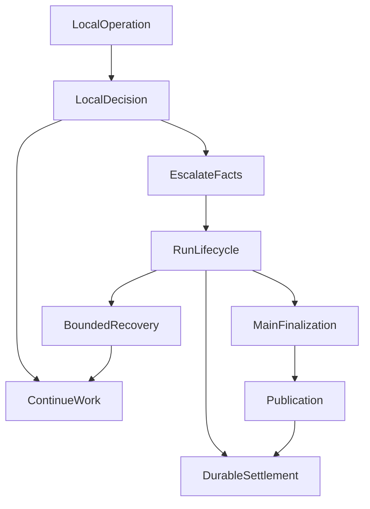
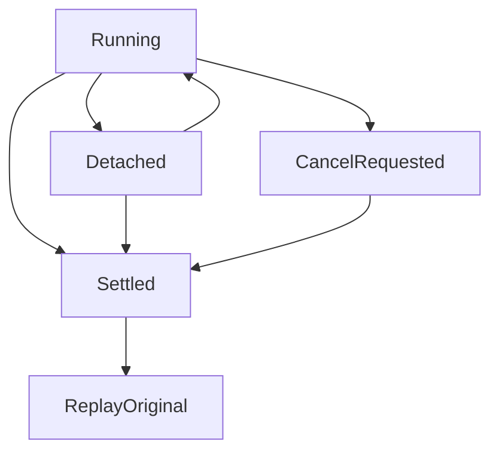

# 当每个模块都能说“不”：Agent 的终结权、阶段预算与安全恢复

**一次读取失败，应该让这次读取停下，不应该自动让所有已经做好的工作消失。** 但继续工作也不是无限重试：权限、用户取消、总预算和结果未知，仍然可能要求系统停止。

下面用一个教学例子理解这个取舍。用户上传三份已经授权的产品资料，请助手比较差异并保存报告。前两份读到了，第三份暂时打不开。助手应该说明缺失，交付可以独立成立的比较；不能把第三份写成“没有差异”，也不该删除已经保存的前两份结果。这个情节用来解释设计，不是一次真实运行的复述。

困难在于：负责读取文件的模块，通常只知道“我没读到”。它并不知道其他资料是否足够、还有没有别的合法路径，以及用户能不能先拿到部分结果。**决定一项操作能否继续，与决定整个任务该怎样结束，是两种责任。**

## 一、先分清“这一步失败”和“整个任务结束”

沿着三份资料的例子，可以把几个决定分开看：

| 要决定什么 | 应由谁确认 | 不能顺带决定什么 |
| --- | --- | --- |
| 第三份资料是否读取成功 | 实际执行读取的工具 | 前两份资料也全部失效 |
| 还允许多少次搜索或模型请求 | 掌握对应资源余额的程序 | 换个阶段就重新领取预算 |
| 哪一版正文已经保存、可以显示 | 原有答案发布模块 | 文字已经正确回答了整个问题 |
| 任务继续、收尾还是停止 | 掌握原执行事实的任务生命周期 | 为了完成而扩权、重写回执或改变目标 |

这里的任务生命周期，就是一次研究运行（Run）从开始到结束的管理逻辑，不是额外的“主管 Agent”。它接收各处已经确认的事实，再选择仍然允许的下一步。

判断一个模块是否越权，不只看它有没有写 `deny`。抛异常、提前返回、过滤候选正文，都可能让一次局部失败变成全局停止。评审时要问：**它究竟阻止了哪一项效果，依据是否足够？**

## 二、研究便签为什么不能变成总开关

ETF Agent 曾有一份可选的研究问题列表，名为 `Research Needs`。它像桌面上的便签，提醒模型还有什么需要核实，而不是授权书或任务完成证书。

旧实现会在模型请求准备好后，再比较这份列表有没有变化。只要发生变化，就可能拒绝派发整次请求。原意是保持一致，实际却让一张辅助便签取得了阻断主要工作的权力。

在教学例子里，这相当于助手已经准备继续核对第二份资料，只因为便签从“查价格”改成“查价格及有效期”，系统就把整次工作取消。应该确认的是：请求仍属于原用户、工具仍在获准范围、资源仍可用；便签变化本身不足以否决它。

审阅建议也出现过相近问题：准备阶段已确认建议的归属，临近派发又重复解释一遍原材料，反而阻止合法请求。这个重复检查先于终结权专项被移除，后来的收敛不能把前面的修复都算到自己名下。

停止钩子（Stop Hook）则应保留为建议。它可以提醒“也许还值得再查”，不能独立推翻合法结束、强制模型多运行一轮。反过来，既没有可交付正文、也没有有效调用的空响应，仍应有界结束并说明没有生成答案，而不是因为少了一道拦截就算成功。

## 三、允许继续，不等于每一步都有一份新预算

读不到第三份资料，可以尝试已有的其他读取方式，但要继续使用原任务的权限、余额和截止时间。

如果搜索允许重试两次，工具允许重试两次，模型续答又允许重试两次，层层嵌套很容易把一次小失败放大成长时间等待。只读调用也可能消耗费用、并发名额和上游容量，不应被当成没有代价。

不同资源可以由不同模块负责：搜索额度、模型并发、正文修订次数并不是同一笔账。问题是同一笔消耗不能再由两个模块各算一次，或者因为换了执行阶段就清零。

没有搜索额度，不一定不能阅读已经取得的资料；普通研究额度耗尽，也不一定连原先预留的最终输出资源都消失。是否能继续，取决于实际剩余的那种资源，而不是一个笼统的“预算不足”。具体实现见[预算与约束治理](agent-runtime-constraint-governance-v2.md)。

## 四、页面等了很久，先确认时间花在哪里

旧开发记录中，一次页面观察耗时约 **360 秒**，其中约 **347 秒在排队，13 秒在实际执行**，执行本身正常结束。另一次工具在约 **0.15—0.29 秒**内返回，页面却表现为“网络错误”：卡住的是随后约 **30 秒**没有正文的模型续答。

这些是历史受控案例，不是今天的性能基线。它们说明：给工具增加重试，并不能解决工具已经成功后的续答问题；调整执行超时，也未必能解决排队过长。

| 时间 | 从哪里开始算 | 应优先检查什么 |
| --- | --- | --- |
| 排队时间 | 等待获得执行机会 | 容量和并发 |
| 实际执行时间 | 真正开始执行这一阶段 | 模型、工具或存储的行为 |
| 无进展时间 | 最近一次有效工作之后 | 有没有产生新的可用结果 |
| 总截止时间 | 原任务开始 | 整项工作是否仍有时间 |

网络心跳只说明连接还有活动，不代表研究有进展。每一阶段的等待也要受原任务总截止时间约束，不能让每一步都合法等待，整项任务却永远不结束。

## 五、不能换一道容易的问题，来掩盖没有完成

早期固定规划路径还暴露过另一个问题：模型迟迟没有给出合法计划，恢复逻辑便改成通用知识任务，丢掉原来的对象、时间和证据需求。其中一条历史请求经过重复规划与排队，端到端约 **672 秒**。

用户要的是当前事实，系统最后却解释一般概念，再标成完成。话题相近，不代表任务相同。

当时的修复保留了明确的规划失败，不让后续步骤偷偷改题继续。这是旧架构的历史教训，不意味着今天的原生工具循环也必须先产出固定计划。

回到三份资料的例子，合理的结果是“已比较前两份，第三份未读取，暂时不能判断三者的全部差异”，不是把缺失资料变成一个关于“如何选择产品”的泛泛介绍。**降级可以减少承诺，不能暗中更换用户的问题。**

## 六、用原有流程决定继续、收尾或停止

我们没有增加一个专门决定失败的 Agent。已有任务生命周期需要真正掌握继续、恢复、收尾和结算的决定，而不是只替其他模块把 `failed` 写进数据库。

图里的分支可以直接落到用户任务上：

| 现在发生了什么 | 可以怎样处理 | 仍要保留什么 |
| --- | --- | --- |
| 第三份资料失败，前两份和其他工具仍可用 | 继续获准研究或交付明确范围的部分结果 | 不把缺失写成空结果成功 |
| 临时服务故障，原恢复条件与余额仍成立 | 按既有方式有限重试 | 不重置任务、权限和预算 |
| 无法继续研究，但原输出预留仍可用 | 只整理已经取得的材料并交代缺口 | 收尾失败后不回研究阶段重新领额度 |
| 用户取消、硬限制生效或必要身份不成立 | 停止新增执行，按原事实结算 | 不为了“优雅结束”再发一次模型请求 |
| 外部操作是否生效仍未知 | 由原执行与恢复逻辑核对 | 不猜成功，也不盲目再做一次 |

隔离局部失败，与微软[隔舱设计模式](https://learn.microsoft.com/en-us/azure/architecture/patterns/bulkhead)的目标相近。但这里不是要求每个模块都新建线程池，而是限制同一系统里一次拒绝的影响范围。

终结权收敛的受控验证支持上述具体控制行为，不替真实模型证明研究质量。选测试时，应同时检查“必要的拒绝还在”和“独立合法工作没有被错杀”。

## 七、恢复的第一步不是重做，而是确认已经发生了什么

保存报告后连接中断，可能是没有保存，也可能已经保存但回执丢了。AWS 对[幂等 API 与安全重试](https://aws.amazon.com/builders-library/making-retries-safe-with-idempotent-APIs/)的讨论说明了同类问题：没收到响应，不等于服务端没有执行。

因此，恢复应先检查原任务、已保存结果、支持的检查点和剩余资源。已确认的效果沿原身份读取；结果未知的操作不能仅凭“再试一次”就重放。检查点也不是任意故障都能继续的保证。

按当前 ETF Agent 合同，同一次 Run 接续继承已记录的授权，不重新拿今天的权限表裁决原 Run；账户、范围、内容身份、取消和预算检查仍然存在。新 Run 需要自己的准入。文件下载请求另有访问检查，不能把研究授权误解成永久下载权限。

子代理也遵守相同分工。一次物理模型请求已经关闭，不等于子代理已交付合格结果；子代理可以在原允许路径耗尽后结算自己的技术失败，但不能据此改写原请求费用、擅自重试，或撤销主研究已经交付的内容。若连请求是否完成都不确定，就应保留未知，而不是只因没有文字便认定失败。

## 八、断线、取消和交付，需要分别观察

用户暂时关掉页面，是离开观察通道；点击停止，是表达取消意图。两者不应混成一个状态。重连应读取原任务，不因重新订阅就创建一份新研究。

其中 `Detached` 表示连接离开，`Settled` 表示任务已经按实际结果结算。这个图说明连接与任务的关系，不承诺服务进程崩溃后仍能在任意位置继续。

服务器记录了结束，也不代表浏览器收到了全部正文。生成、提交、发送、客户端实际显示是不同观察点。第二段正文失败不能删除第一段；第一段存在也不能证明整道问题完成。附件能否打开，还要看文件自己的保存与访问结果。

如果最后只能交付部分内容，对外状态就要保留“部分完成”，而不是沿用早先乐观的完成标记。[发布系统](019-agent-answer-publication.md)负责正文版本，[断线与恢复专文](agent-disconnect-is-not-crash-recovery-contract.md)解释更细的恢复承诺。

## 九、把原则落到下一次评审

下次看到 `throw`、提前返回或自动重试，先用一个具体任务检查：这一步失败后，哪些独立结果还应该存在？谁记录了最终状态？恢复有没有改掉原目标或重复未知操作？

Ousterhout 关于[模块化与信息隐藏](https://web.stanford.edu/~ouster/cgi-bin/cs190-winter18/lecture.php?topic=modularDesign)的讨论强调让调用方不必重复内部知识。这里也是同一个方向：把决定放在真正掌握事实的地方，而不是只把异常集中到一个更大的函数。

在三份资料的例子里，完成判断不复杂：能读的如实比较，缺失的明确留下，已保存的不要抹掉，不能安全继续时停止。**一个模块可以说“这一步我做不了”，但这不自动等于“整个任务已经没有价值”。**

相关判断见[原则 4：局部失败的影响范围](/principles#principle-4)与[方法 2：职责与拒绝评审](/principles#method-2)。进一步排查可读[失败归因](agent-failure-is-a-boundary-problem.md)和[测试与评测](honest-agent-evaluation.md)。

更多文章见 [ETF Agent 阅读站](https://hpoenixf.com/eff-agent-article/)；欢迎在 [GitHub 文集](https://github.com/hpoenixf/eff-agent-article) Star 或提供反例。
