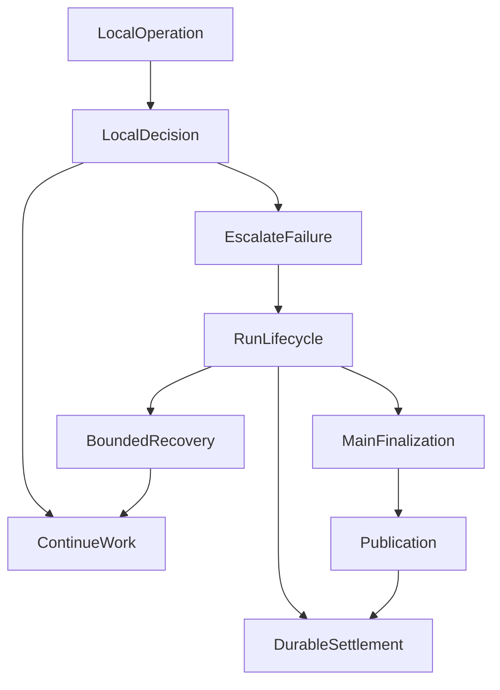

# 当每个模块都能说“不”：我们如何收回 Agent 系统里散落的否决权

做一个简单的 Agent，失败处理通常不难。

模型调用失败了，就重试；工具调用失败了，就返回错误；最终没有生成结果，就结束任务。

但当 Agent 开始拥有多轮研究、工具调用、子代理、持久化恢复、上下文压缩、预算控制和流式交付之后，情况就不一样了。

一次研究可能已经进行了十几轮，查阅了多个来源，完成了部分计算，甚至向用户展示了几段有效结论。此时，如果某个工具失败、某个插件返回异常，或者一份可选上下文发生变化，系统应该怎么处理？

直觉上，最简单的做法是让异常向上抛，由外层决定是否停止。

问题在于，随着功能增加，这种处理方式可能逐渐形成一个没有明确设计过的机制：

**每个模块都只负责自己的一小部分工作，却有机会通过异常传播，决定整个 Agent 的命运。**

我们在开发 ETF Agent 的过程中反复遇到了类似问题。最初是引用，后来是预算、工具结果、上下文和恢复。最近，我们又发现，即使 Run Lifecycle 在架构上已经被定义为终态的唯一所有者，实际控制流仍可能绕过它，让局部模块间接决定任务结束。

这促使我们重新思考 Agent Runtime 的职责划分。

问题不只是如何处理错误，而是：

**一个模块究竟有权拒绝什么？它是否有权决定整项任务应该失败？**

## 一、从正文处置权到 Run 终结权

[独立发布系统](019-agent-answer-publication.md)已经集中讨论候选、预览、版本化提交，以及两轮治理怎样收回外围正文否决权。本文不再复述引用降级、批次部分成功与历史隐藏案例。

这里继续追问另一个问题：即使正文由 Publication 负责，工具、建议、预算或上下文的局部失败，为什么仍可能结束整个 Run？**发布一段正文的决定权，与继续或终结一项研究的决定权，是不同效果。** 下文只展开后者的控制流、恢复条件和验收。

## 二、我们后来意识到：权限之外，还有一种容易被忽视的权力

在 Agent 架构中，我们通常很重视权限。

模型不能直接访问数据库，工具不能自行扩大作用域，Skill 不能授予自己新的能力，插件也不能绕过 Host 执行受保护操作。

这些约束很重要，但它们主要回答的是：

**谁可以执行一个操作？**

还有另一个问题：

**谁可以阻止一个已经获准的操作继续完成？**

两者并不完全相同。

例如，某个插件没有读取私人文件的权限，它当然不能执行读取。但如果这个插件只是提供一条研究建议，它是否有权因为建议不可用，阻止 Main Agent 继续研究公开资料？

某个工具拥有自己独立的调用额度。额度耗尽后，它当然可以拒绝新的调用。但它是否有权据此让整个 Research Run 失败，即使 Main 还有其他工具和已取得的合法材料？

一个上下文压缩模块可以拒绝不可信的摘要，但它是否有权阻止使用仍然合法、容量允许的原始上下文？

这些问题都指向同一种权力：**否决权（Veto Authority）**。

它不一定通过显式的 `deny` 实现。

一个普通的 `throw`、一个 `return false`、一次过滤、一个提前返回，甚至一个没有展示在模型工具列表里的能力，都可能产生实际的否决效果。

区别只在于影响范围。

如果一个模块拒绝的是自己负责的操作，通常没有问题。

如果它拒绝的事实被上层当作整个任务失败的依据，就需要进一步解释：这个模块为什么有资格决定整项任务的命运？

### 一次很具体的代码审查

在 ETF Agent 中，`Research Needs` 是由模型维护的工作问题列表。

它可以帮助模型记住当前还有哪些问题需要研究，但它不是权限、证据或任务完成状态的权威来源。

然而，Main 模型请求真正派发前，代码仍会读取当前工作问题状态，与已经装配进请求的状态核对。关键拒绝分支如下（略去外围解析）：

```typescript
if (JSON.stringify(fittedState) !== JSON.stringify(currentNeeds)) {
  throw new Error("Research needs changed before provider dispatch");
}
```

这里有一个合理的出发点：模型即将接收的内容，不应该与当前状态不一致。

但这也意味着，一个可选工作列表的变化，有机会使整个 Main 请求无法派发。

它原本只是给模型提供参考，却通过请求装配获得了实际的硬阻断能力。

类似的问题也曾出现在 Reviewer 建议中。

Reviewer 是一个可选的研究复核角色。它可能指出尚未核实的来源、遗漏的问题或者结论中的矛盾。但 Reviewer 的意见本身不应该变成新的来源权限，也不应该独立决定 Main 能否执行。

早期实现会在请求准备时验证 Reviewer 建议，临近派发时又重新检查一次。如果原始材料状态变化，第二次检查可能直接拒绝整个 Main 请求。

2026 年 10 月 18 日取材的 `main` 已经移除了这条后置重复检查。

新的处理方式是：在准备阶段，通过原 Child 终态、冻结的 Run 授权和实际拟合请求建立绑定；已经合法封存的建议，不再因为可选原始材料随后无法重新物化而被重新否决。真正的请求身份、用户纠正和执行围栏仍然由原有机制保护。

这是一项已经进入代码的局部收敛，但并不自动证明 Reviewer 的全部路径已通过端到端验收。

而 `Research Needs` 的重复派发检查在该版本仍然存在，尚待新 Spec 对应的实现和验证。

这两个例子很能说明问题：

**我们要删除的不是状态一致性检查，而是让非权威的附属信息变成主执行路径的第二个裁判。**

## 三、预算治理让我们看清：单一 Owner 不意味着只有一个限制

预算也是类似的问题。

一个复杂 Agent 往往同时受到很多限制：模型请求次数、工具调用次数、搜索额度、Provider 并发、运行时间、最后输出预留、修订次数等。

最初很容易把这些额度理解成若干个计数器。

但当研究跨越多个阶段、允许子代理并发执行、支持暂停和恢复之后，计数器就不再只是数字。

一个模块认为还剩两次调用，另一个模块认为进入了 Finalization。一次失败到底有没有消耗额度，重试是否需要重新扣账，Child 占用的预留能否被 Main 使用，都需要明确的原始事实。

如果各模块自行维护自己的使用量，就可能出现相互矛盾的判断。

我们后来将 Research 请求资源进一步收敛到 Root Resource Owner。

这个 Owner 负责原有请求准入和真实使用事实。Runtime 读取资源视图、选择下一阶段、生成提醒，但不能再凭自己的独立账本创造新的执行许可。

2026 年 10 月 18 日的专项移除了原 Native Runtime 中剩余的本地请求扣账分支，相关 provider-free 选集完成了 279 项定向检查，原 Root Owner 的另外 88 项检查也通过。两套检查各有覆盖，不应简单相加为独立案例总数。[Root 请求记账改造记录](https://github.com/hpoenixf/etf-agent/blob/7f7cd9b901253878bdf3118958df7a95eddd107f/doc/agent-backend/validation/root-resource-only-20261018.md)

这里的价值不在于删除了多少行代码，而在于消除了一个更深层的歧义：

**一笔资源到底由谁确认已经花费？谁有权决定下一次请求可以发生？**

当然，这不意味着系统只能拥有一个预算模块。

Web Gateway 仍然可以维护搜索调用次数，Provider Admission 可以限制物理并发和排队，Publication 可以限制正文修改次数。

因为它们约束的不是同一种资源。

真正需要避免的是 Web 搜索额度耗尽后，Main 又把这个结果解释成整个 Research 预算耗尽；或者 Root 已经保留了合法输出额度，外围模块却用自己的本地判断提前结束研究。

原始 Owner 可以拒绝它负责的新操作。

**但一个局部额度的耗尽，不自动等于整项任务没有继续完成的机会。**

这个区别，后来成为终结权设计的关键。

## 四、真正危险的是：异常在向上传播时，悄悄获得了终结权

Publication 处理的是正文，Root Resource 处理的是资源。

但它们还没有回答最后一个问题：

当一个模块确实失败了，接下来谁决定整个 Run 应该怎么做？

这比前面的职责划分更复杂。

假设 Main 正在研究一个问题，已经获得了部分有效材料，随后一次工具调用失败。

对工具而言，它能确认的事实可能只是：这次执行失败、没有得到可用结果，或者实际效果是否发生仍然未知。

但对整个研究而言，还有其他可能性。

Main 也许可以继续使用已有资料。也许能够等待原 Provider 的受控重试。也许正常研究已经无法继续，但仍然保留了最后输出额度，可以整理一份明确说明缺口的阶段性报告。

当然，也可能已经没有安全继续的条件，只能终止。

工具模块本身无法完整决定这些事情。

如果它简单地抛出异常，而最外层将异常直接转换为 `runtime-operation-failed`，就相当于让一个局部模块间接决定了整个研究的终态。

这不是因为那个模块主动要求结束研究，而是控制流赋予了它这个能力。

在 ETF Agent 的现有实现中，类似风险不止出现在单个工具上。

Native Tool 批处理会在某个读取抛错时停止继续分配其他读取，并在批次结束后抛出第一个异常。这对执行身份不可信、持久化不确定或整个 Run 被取消的场景是必要的保护；但它也意味着，必须仔细区分普通局部失败与真正需要停止批次的异常。

另一方面，现有 Run Lifecycle 还允许 Stop Hook 影响完成决定。

例如，Main 已经提出 `finish_research`，原完成检查接受了这个决定，但 Stop Hook 返回 `continue` 时，Runtime 仍可能将其改成：

```typescript
{
  accepted: false,
  decision: "block",
  code: "hook.stop_feedback"
}
```

Stop Hook 原本用于提供扩展反馈，现在却能够让已经满足原完成条件的 Main 再执行一次。

它不能无限创造预算，但它确实形成了一个额外的完成否决入口。

如果 Reviewer、Needs 和 Stop 都可以通过各自的机制阻止 Main 完成，最终就会出现一个奇怪的系统：

**我们有一个负责研究的 Main Agent，却有越来越多不负责最终研究结果的组件，可以决定它还不准结束。**

这就是“收拢终结权”真正要处理的问题。

## 五、收拢终结权，不是增加一个负责处理所有错误的 Agent

面对这种问题，很容易产生两种方案。

第一种是给所有模块增加统一的异常包装器。

局部出错后，调用一个公共函数：

```typescript
// 示意，不是当前 ETF Agent 接口
catch (error) {
  return terminate("failed", error);
}
```

这看起来统一了终态处理，实际上没有解决问题。

调用者已经在进入这个函数之前决定了失败。它只是把决定写进了一个公共接口。

第二种方案是增加一个新的终结 Agent，让它阅读当前状态，判断研究应该继续还是结束。

这个想法更容易让人联想到 Agent 的自主能力，但也会引入新的问题：终结 Agent 需要知道哪些动作已经完成、哪些效果未知、剩余多少预算、能否使用私人资料，以及某段正文是否可以发布。

为了判断这些问题，它要么重新解释已经存在的权威事实，要么复制一套控制逻辑。

这就有可能制造一个比原来更大的决策中心。

我们最终选择了第三条路：

**深化现有 Run Lifecycle，而不是新增终结 Agent。**

局部 Module 仍然负责自己的效果和失败处理。无法自行处理的情况向 Run Lifecycle 提供事实，由后者根据原有资源、取消、恢复与执行状态决定下一步。

这个设计并不让 Run Lifecycle 取代其他 Owner。

Main 仍然负责理解用户问题、选择研究策略和组织答案。

Publication 仍然负责正文的受控发布。

Recovery 仍然负责持久回执、租约、围栏与恢复事实。

Root Resource 仍然负责原子预算准入。

Run Lifecycle 只负责它真正有资格作出的决定：**整个 Run 现在应该继续工作、进入受控恢复、转入最终收尾，还是依据实际结果终结。**

用一张简化图表示这项设计：



图中最重要的不是节点，而是两个不同层级的决定。

局部 Owner 可以确认自己的操作失败、结果不可用或某项受保护效果被拒绝。

但它不能仅凭这个事实宣布整个 Run 已经没有继续完成的可能。

另一方面，Run Lifecycle 也不能自行绕过这些拒绝。它只能在仍然合法的资源和效果范围内，选择后续控制流。

这个区别避免了两种极端：每个模块都可以结束任务，或者一个全能的中央模块可以推翻所有局部安全约束。

这一方案已写入新的 [Run 终结权收敛 Spec](https://github.com/hpoenixf/etf-agent/blob/7f7cd9b901253878bdf3118958df7a95eddd107f/openspec/changes/agent-centralize-run-termination/proposal.md)，但在本文取材时尚未完成实现和验收。

## 六、优雅收尾不是兜底回答，而是一种受预算约束的控制流

新 Spec 中，我们认为最重要的一项设计是：

**异常无法在局部处理时，优先考虑原有的受控恢复；无法恢复但仍有安全输出条件时，由终结 Owner 主动发起收尾。**

这里的收尾不是让模型随便补一段文字，也不是把失败伪装成完成。

ETF Agent 原本就有 `finalization-only` 阶段和输出预留。新设计是让这条原有路径承担异常升级后的合法收尾，而不是重新创造一个兜底系统。

例如，普通研究阶段的工作资源耗尽了，但原先预留的输出资源仍然可用。

此时，Run Lifecycle 可以决定不再执行新的普通研究操作，让 Main 使用已经取得且仍有合法来源依据的材料，完成受限的总结和发布。

如果用户原本要求完整比较，但现有材料只支持其中一部分，模型可以明确说明已完成范围和缺口。是否满足用户要求仍属于模型语义和后续质量评估的问题；技术终态不能因为有一段流畅总结就被改写成完整研究成功。

如果是一次可恢复的 Provider 故障，已有符合条件的等待和重试路径则应优先于过早进入收尾。

如果是用户取消、总硬资源耗尽，或者某项保护性执行状态无法确认，就不能为了“优雅”再制造一次模型调用。

尤其不能把未知副作用自动重试。

AWS Builders’ Library 中，Malcolm Featonby 在[《Making retries safe with idempotent APIs》](https://aws.amazon.com/builders-library/making-retries-safe-with-idempotent-APIs/)讨论过类似的分布式系统难题：调用方没有收到成功响应，不代表服务端一定没有完成操作。没有明确的请求身份和幂等协议，简单重试就可能产生重复副作用。

这个原则放到 Agent 中同样重要。

工具返回超时，不能直接推断它没有执行；数据库提交回执丢失，也不能直接推断写入失败。

因此，终结 Owner 拥有控制流决定权，并不意味着它可以重放任何失败步骤。

只有原 Recovery 和执行 Owner 已经证明可以安全恢复的操作，才允许沿原身份与额度继续。

同样，Finalization 只能单向进入，不能因为最后整理答案又遇到错误，就重新进入普通研究、再次收尾、再次失败，最终形成一个不断自我修复的循环。

**收尾能力必须来自任务开始时已经接受的资源与权限，而不是错误发生后临时创造的新机会。**

## 七、我们需要限制的不是错误数量，而是错误的影响范围

这种设计背后，还有一个更一般的工程原则。

微软 Azure Architecture Center 的[隔舱设计模式（Bulkhead Pattern）](https://learn.microsoft.com/en-us/azure/architecture/patterns/bulkhead)讨论了如何通过资源隔离，使一个子系统的故障不至于影响其他子系统。

我们的场景不完全相同。

这里不一定需要为每个模块创建线程池或独立进程。很多失败发生在同一个 Research Runtime 内部。

但它们面临相似的问题：一个局部故障的影响范围是否超过了它实际负责的部分？

如果一个 Web 查询失败，只要来源和执行状态仍然可信，它就应该主要影响该查询结果。

如果一个 Reviewer 建议失效，它不能自动抹掉 Main 已经合法取得的资料。

发布块的来源依赖与逐块隔离由[发布系统专文](019-agent-answer-publication.md)展开；这里沿用其客观处置事实，不再重新解释正文资格。

因此，我们真正想控制的是三个范围：

| 层级 | 应当决定什么 | 不应顺手决定什么 |
| --- | --- | --- |
| **效果 Owner** | 当前 Tool、来源、预算扣账或发布修改是否成立 | 整个 Research 是否失败 |
| **Run Lifecycle** | 在已确认事实和合法资源下继续、恢复、收尾或终结 | 重新授予权限、改写回执、认证答案正确 |
| **交付与历史读取** | 已提交内容能否按当前读取条件展示 | 重新解释已经发生的执行、发布和终态事实 |

这不是要求整个 Agent 只有一个裁决者，而是要求**同一个效果只有一个最终裁决者**。

其他模块可以验证它收到的事实，也可以拒绝自己负责的新效果，但不应该另外维护一套对同一效果的解释。

如果某项异常必须升级到整个 Run 层面，就应该说清楚为什么局部处理不足，而不是让异常自然传播后，默认把它转换成全局失败。

## 八、真正的验收，不是证明失败能够被捕获

设计上收拢权力很容易，工程上则未必。

假设我们新增一个 `RunTerminationOwner`，让所有模块都调用它。

如果调用者仍然先执行：

```typescript
// 示意：调用者已经提前决定了终态
if (somethingFailed) {
  return terminationOwner.finish("failed");
}
```

那么即使系统里只有一个终结函数，也并没有实现终结权收拢。

真正的变化应当出现在异常发生之后。

原先某个模块直接抛出错误，使 Main 无法继续；现在它负责留下真实的局部执行事实，Run Lifecycle 再判断是否存在合法后续路径。

这种区别需要通过生产调用链验证，而不是只测试一个终结类的返回值。

新 Spec 因此要求通过真实 Factory 和脚本化模型网关进行故障注入，观察实际的后续请求、Publication 回执、持久状态和完成回调。

例如，可选 Research Needs 在请求准备和派发之间变化时，应该验证 Main 是否仍能沿合法路径继续，而不只是验证一个辅助函数返回了 `undefined`。

Stop Hook 返回 `continue` 时，应该验证已经获得合法完成资格的 Main 不会仅因这条建议而额外消耗一次请求。

普通工作资源耗尽但最终输出预留仍在时，应该验证 Main 实际进入 `finalization-only`，而不是在测试里人为设置一个“正在收尾”的标志。

反过来，当整个 Run 已经没有合法预算、用户取消已经生效，或者原始效果处于不可安全重放的未知状态时，则必须验证没有新增派发、没有重复扣账，也没有产生虚假的完成回执。

还有一个很容易忽视的场景：模型调用阶段认为自己完成了，但后台 Publication 保存最终只形成 `partial`。

此时，完成回调和对外结果不能继续使用保存前的 `complete` 判断。真正已结算的持久状态才有资格决定技术终态。

这些测试有一个共同点：

**不仅要证明错误发生时系统会拒绝什么，还要证明它不会错误地拒绝什么。**

这比单纯增加失败用例更加接近我们真正想要的架构性质。

## 九、这项设计还有一个代价：Run Lifecycle 必须真正承担责任

将终结权集中到现有 Lifecycle，并不意味着系统会自然变简单。

如果只是把各模块中的错误分类、恢复判断和失败分支搬进一个巨大函数，可能只是换了一个复杂度集中的位置。

因此，我们没有选择建立新的终结 Agent，也没有引入第二套资源账本、持久化状态机或统一异常注册表。

新设计要求继续复用原有的 Retry Admission、Recovery Receipt、Finalization 和 Publication。

生命周期模块应当掌握足以选择控制流的事实，但不需要了解每一种工具内部的错误细节。

例如，它需要知道某个操作能否安全重试，不需要自己重新解析原始 Provider 响应；需要知道是否还有原先保留的最终输出额度，不应该自行实现另一套额度计算；需要知道 Publication 最终提交了哪些内容，不应该重新校验正文中的每个引用。

这也是我们对“深模块”（Deep Module）越来越重视的原因。

John Ousterhout 关于[模块化设计与信息隐藏](https://web.stanford.edu/~ouster/cgi-bin/cs190-winter18/lecture.php?topic=modularDesign)的讨论提供了一个有用的比较角度：模块的价值在于封装设计决定、降低外部依赖，而不仅是把代码搬进某个类或文件。

一个模块是否有价值，不取决于它包住多少代码，而取决于它能否真正隐藏复杂决策，让调用者不再理解和复制这些决策。

但封装还有另一面：

**如果调用方仍然能够绕过模块，独立否决同一个效果，那么接口即使很简单，职责仍然没有真正收拢。**

对 Agent Runtime 而言，这比类的数量、文件大小或者代码行数更值得关注。

## 十、最后，我们把“谁有权拒绝”写进了工程评审规范

2026 年 10 月 18 日，我们已经将一项具体要求合入 ETF Agent 的 `AGENTS.md` 和现有 Spec 证据工作流。

今后新增或修改可能产生拒绝、过滤或提前终止的逻辑，需要回答三个问题：

1. **这个模块是否拥有该效果的最终裁决权？** 它是事实生产者、原有决定的执行者，还是有资格决定该效果能否成立的 Owner？
2. **拒绝是否准确限制在它负责的效果范围内？** 一个 Tool 失败，为什么需要结束整个研究？一份材料失效，为什么需要隐藏其他独立内容？
3. **它是否重新解释了其他 Owner 已经记录的事实？** 例如预算已经由 Root 记录，外围模块为什么还需要自行维护另一份可以提前拒绝请求的余额判断？

这不是一个扫描到 `throw` 就要求删除的静态规则。

一个合法的权限拒绝，恰恰可能是保护系统不可缺少的条件。关键是它必须有清楚的来源、作用范围和最终责任归属。

实际验收也不能停留在单个函数层面。只有沿原生产接缝验证局部拒绝、独立效果继续、必要的全局停止和持久回执，才能证明责任划分真正改变了行为。

与此同时，新建的 `agent-centralize-run-termination` Spec 已经明确了深化 Run Lifecycle 的设计：局部异常先处理；恢复和收尾使用原有预算与身份；Stop 不再拥有独立终结否决权；完成回调以实际持久结算为准。

截至本文取材时，这项 Spec 仍处于待实施状态，相关任务尚未完成，也没有本变更的 RED/GREEN 工程验收。它不能被写成已经解决所有提前终止问题。

已经完成的，是 Publication 的特定拒绝权收敛、Root 请求账本收敛，以及 Reviewer 请求派发路径上的一次重复校验移除。

接下来要证明的，是这个原则能否在整个 Research Loop 中同样成立。

## 写在最后

回顾 ETF Agent 的演进，我越来越觉得，复杂 Agent 的可靠性问题并不总是来自模型能力不足。

有时，模型拥有继续研究的能力，运行时也仍然保有合法资源，但某个局部模块的异常被扩大为整项任务的失败。

有时，原本用于提供建议的组件，逐渐取得了阻止 Main 完成的权力。

还有时，我们明明已经建立了负责某项效果的 Owner，却仍然让外围模块根据自己的状态重新裁决一次。

这些问题很难通过继续增加提示词、重试次数或错误码白名单彻底解决。

因为真正需要改变的是系统内部的责任关系。

**一个模块有权说“我的这项操作不能继续”，不代表它有权说“整个任务不能继续”。**

对一个只有单轮工具调用的简单 Agent，这可能不是值得专门设计的问题。

但当 Agent 开始持续运行、允许多工具并发、支持子代理协作和跨进程恢复时，每个模块都可能成为一条控制流的分叉点。

我们需要的不仅是明确的状态所有权、预算所有权和结果所有权，还要进一步明确：

**谁拥有最终决定权，以及这个决定究竟能影响多大的范围。**

收回散落的否决权，并不是为了让 Agent 无条件完成任务，而是让它在必须拒绝时拒绝得准确，在仍然有合法工作可做时，不被无关的局部错误过早结束。

一个可靠的 Agent，不应该由最先抛出异常的模块决定命运。它应该由真正掌握执行事实、恢复条件和生命周期责任的 Owner，决定还能怎样安全地走下去。
