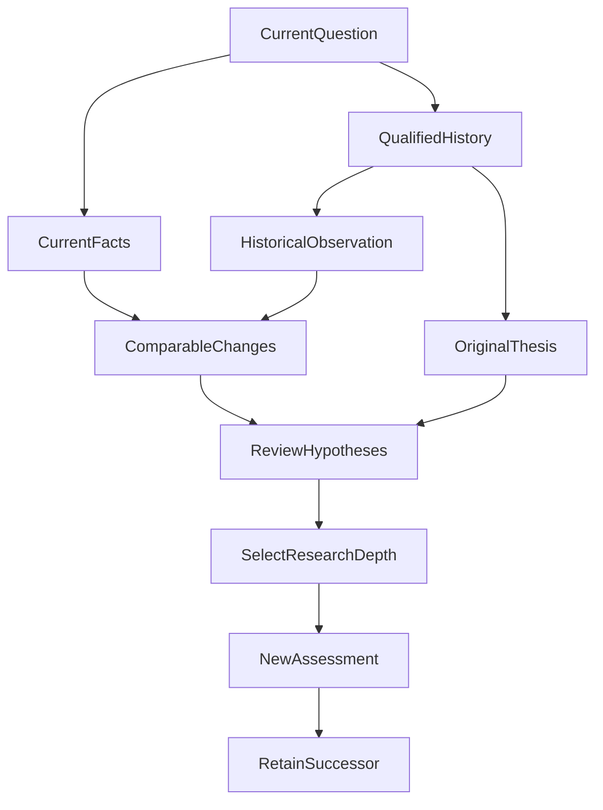

# 一份周报过去后，Agent 还记得当初为什么这样判断吗？

*从跨期历史、原始投资论点到版本化修正：ETF Agent 的持续投研工程实践。*

假设三个月前，Agent 根据基金组合的实际资料，认为当前配置总体合理，但需要持续关注科技板块的集中度风险。

三个月后，用户再次问它：“现在的风险，与当时相比有什么变化？之前支持继续持有的理由还成立吗？”

如果系统只有当前持仓和一份三个月前生成的 HTML 报告，它也许能够重新分析一次，却不一定记得**当时依据了哪些数据，提出过什么假设，又约定了什么条件来检验这个判断**。更糟的是，它还可能根据今天的结果，重新编出一套看似合理的历史理由。

在 ETF Agent 的周报开发进入第二、三期时，我们逐渐将问题从“每周能不能生成报告”改成了“**一次投资研究发生过的事实，能否在以后被准确找回、比较、修订和继续检验**”。

这不是给模型加一段更长的 Memory，也不是把每期报告都塞进新对话。我们需要保存不同层次的历史：组合事实、研究方法产生的原始判断、后来发生的用户修正，以及它们分别具有的来源与访问资格。

## 一、第一份报告交付以后，真正的问题才出现

一开始，周报的目标比较直接：Agent 获取获准资料，完成研究，生成 HTML，让用户在聊天中拿到真实可下载的文件。

但连续生成报告后，过去的内容开始成为下一次研究的输入。

第一期，模型关注某种资产配置结构；第三期，组合仓位发生变化；第五期，若干基金的底层暴露可能发生重叠。用户不只希望得到三份各自完整的报告，还希望知道“**与上次相比，究竟有什么值得重新判断**”。

于是第二期先建立历史观察及跨期比较的基础。

我们保存经过资格确认的 Portfolio Observation、报告版本、实际日期、数据时点、相关来源与方法身份。这些记录是**当时的研究快照**，不是另一套实时 Portfolio 或 Ledger。

原因很具体：一份两个月前的持仓快照，不能在今天被当成当前持仓；当时可读的来源，也不等于今天的新 Run 自动获得原始来源的读取权限。

投资数据还要求特别严格的可比口径。

假设组合市值从 100 万元变为 110 万元，不能直接宣称收益率是 10%。期间可能有申购、赎回、现金流、价格与汇率变化。货币、份额类别、观察区间、方法和数据完整性不相容时，只能限制受影响的比较。

首次复核没有“上周变化”；隔了三周再复核，也不能硬写“本周环比”。如果合格的历史观察不连续，我们写“较上次复核”，保留原始日期。缺少现金流资料，就不能把资产变化冒充投资回报；但别的有证据支撑的风险观察仍可保留。

这一步解决的是**跨期事实能否被正确比较**，还没有解决**原来的投资理由是否仍然成立**。

## 二、真正的转折：报告存下来了，原始投资理由却没存完整

为了避免把任意 Python 输出、临时脚本日志和不可信内容全部复制到长期存储，原来的周报研究快照刻意只保留合格 Portfolio 观察与来源定位符。

这个选择当时合理：保留有资格的事实，而不是把所有执行副产品都当成可以长期继承的研究依据。

但后来我们拥有了受支持的内置周报和战略配置研究方法。它们不仅生成文字，还可能输出结构化的 Investment Thesis，包含假设、预期、适用对象、证据和复核条件。

这时出现了一个真实的工程缺口：**合法的内置方法成功执行，HTML 报告也可以保存；后续的历史读取却拿不到它完整的原始方法文档。**

如果以后只剩一段报告摘要，再让模型把摘要重新解释成结构化 Thesis，那么今天模型写出的假设，未必是当初实际提出的假设。

我们没有选择扩大成“保存所有脚本结果”。最终只允许满足原始受信条件的内置周报/战略方法结果，带着原本的 `record`、`context`、`results` 一起进入原有 research snapshot，再由 History workspace 暴露精确的 `method` 定位符。

这份资格不是仅凭 JSON 形状判断的。系统还核对原始内置脚本执行、真实 Host 回执、发起模型轮次的封存调用、既有授权与分析来源谱系，以及模型实际可见的对应结果。

这里也有一个容易踩到的身份陷阱：方法自己的 `context.run_id` 与 Host Run UUID 可能处在不同命名空间。不能直接因为两个字符串不相等，就否定一次真实合格的调用。更重要的是核对完整、受信的实际执行关系。

测试先在原始生产接缝中复现缺失，修复后才允许对应原方法内容被历史读取。任意、伪造、跨范围或来源不明的脚本输出仍被拒绝。

**我们保留的是原始推断材料，而不是赋予这份材料永久正确的金融结论。**

## 三、Investment Thesis：把“看好”变成可以复核的假设

一句“继续看好科技资产”很难长期验证。价格上涨可以被解释成判断正确；价格下跌又可能被解释成长期逻辑尚未改变。如果原始理由没有保存，结论总有机会被事后改写。

因此，结构化 Investment Thesis 不只保存结论，还需要保存当时的论证条件。

| 记录内容 | 示例含义 | 留下它的目的 |
| --- | --- | --- |
| 适用对象与日期 | 哪些基金、指数或组合，何时判断 | 不把局部观点扩展为全局结论 |
| 原始假设与预期 | 为什么这样判断，预期怎样发展 | 避免重新编造历史理由 |
| 期限与复核条件 | 何时复查，什么情况值得重评 | 让持续跟踪有明确边界 |
| 证伪条件 | 什么证据可能推翻原假设 | 允许被证明错误 |
| 支持与反对证据 | 关联的来源和结果身份 | 区分原依据与新证据 |
| 归属及版本 | 模型推断、用户确认、后继修正 | 不把模型猜测变成用户意图 |

下面是一条**合成教学示例**，不是任何真实个人持仓结论：

> 当前几个基金的底层行业可能存在重叠。若未来合格的穿透观察显示重叠明显扩大，需重新评估组合的分散化效果，而不能只数持有多少只基金。

下次研究至少有机会检查：原来看的是什么组合、当时有哪些证据、复核条件是否出现以及新资料是否足够可比。

原设计也允许模型给出有归属的整体研究判断：`Supported`、`Challenged`、`Invalidated`、`Inconclusive`。这些是研究评估，不是交易指令。

必须特别区分两个事实：**尚未执行整体评估**，与**执行了评估但结果是 Inconclusive**。历史缺一个评估，不意味着模型当时明确得出了“证据不足”的判断。

同样，某段时间赚钱不自动证明原假设成立；亏钱也不直接否定原来的每个风险判断。财务结果和原假设的成立条件不是一回事。

此前 `allocation-rationale-review@1` 已有五类局部标签（`supported`、`weakened`、`mixed`、`unchanged`、`not_assessed`），我们也没有把这些标签机械投票转换成新的整体 Thesis 状态。两套标签的对象和资格不同，历史读取应当保留它们的原意。

## 四、模型推断和用户确认，必须留下不同的版本

假设 Agent 认为：“用户持有成长资产，所以具有长期成长投资偏好。”

这可能是一个研究假设，但不等于用户已经确认自己的长期投资目标。仓位可能只是阶段配置，也可能正在准备退出。

因此内置方法形成的 Thesis 可以标记为 `model_inferred`，真正的 `user_confirmed` 则必须来自认证用户的实际确认或修正。

假设用户随后说：“这是过渡仓位，不是我长期想保留的配置。”

正确处理不是把三个月前的报告悄悄改写成“用户从未偏好成长资产”，而是给原研究追加**明确有作者、有时间和前驱关系的后继版本**。

第三期沿用既有 Artifact Archive 的管理能力来实现这种修正：

- 原始 HTML 的字节和哈希继续不变，让读者能看到当初发布的报告；
- 认证用户的修正单独记录，绑定原报告、作者、时间和版本；
- 修正提交会改变研究快照版本，旧句柄不能借用旧版本身份读取新附件；
- 当前合法句柄可读取新版本；原有删除和到期规则仍作用于托管内容。

这里不是把所有变化都复制成一套新的 Event Sourcing 平台。Martin Fowler 在 [Event Sourcing](https://martinfowler.com/eaaDev/EventSourcing.html) 中讨论过“如何到达当前状态”的历史价值；W3C 的 [PROV-DM](https://www.w3.org/TR/prov-dm/) 则为来源、生成活动和责任主体提供了更一般的概念。

我们的方案使用其中相近的思想，做的是局部版本化历史与来源归属，并不宣称已经完整实现 Event Sourcing 或符合 PROV 标准。

最实际的效果是以后可以分别问：

“当初 Agent 说了什么？”

“用户后来纠正了什么？”

“这次研究应该以哪些当前获准的事实重新判断？”

这三种答案不该被一条永远覆盖旧值的 Memory 混成同一个当前结论。

## 五、下一次研究，应该怎样消费上一次留下的材料？

有了历史，并不意味着每次都应把全部旧报告塞回模型。

原有 History workspace 可以先列出有资格的历史候选，再由后续研究选择确实有关的报告、快照和方法定位符。目录有容量上限，**没列出来不等于历史不存在**；有旧定位符，也不等于旧资料的原始来源今天仍能读取。

比较必须回到当前获准 Portfolio 事实与历史中同口径的观察。复用以前的研究结论时，仍要保留当时的日期、方法和归属。旧报告的观点只是过去的评估，不是当前投资真值。

合理的研究路径可以是：

这张图只是帮助理解的路径，**不是系统要求每期周报依次运行的固定 DAG**。

如果历史观察充分且变化很小，Agent 可以简洁复盘、复用已有的合格结果。出现重要的风险变化、指数编制变化或原投资论点的反证时，才选择相关的深入研究；资料不足时保留未知，而不是把“没有证据”写成“没有变化”。

这里同样要分清设计和效果：第三期的 Runtime 已验证模型能够在原有 Deep 及历史读取接缝下获得必要承载，却**尚未证明模型确实会长期正确选择深度，也未测得节省了多少研究成本**。

## 六、订阅与通知只是持续研究的节奏，不是投资结论

要持续复核，还需要周期执行。第三期复用原 Schedule、Task History 与 App notice，不让一个聊天 Run 永久挂着。

每个周期发生新的有限研究，只有用户实际确认的周期定义可以产生后续执行机会；一次临时请求或模型主观决定不能自动创建长期订阅。

而且“每期留下一份报告”和“每期都提醒用户”是两件事。

受控验收中，`quiet` 信号可以保留报告而不发送普通通知，`material` 产生对应 App 通知，`unknown` 不能被悄悄当成没有重要变化。通知失败可以沿原通知身份重试，不应因此重跑研究。

这些结果来自固定重要性输入下的真实应用接线。它们证明有限周期执行、报告历史和通知偏好能协作，并**不证明模型能准确识别哪些投资变化足够重要**。

长期陪伴用户，还需要研究质量；调度器只是提供定期开展研究的机会。

## 七、实际工程结果与尚未解决的业务问题

这次修改有可追溯的工程证据，而不只是纸面 Schema。

一方面，原内置投资方法的完整结果此前无法从 History 取得。修复后，正常应用、认证入口、真实 PostgreSQL、实际注册的内置 Python 方法与固定模型网关，已经走通过“原始方法 → HTML/Archive → 历史读取 → 用户修正 → 新旧版本隔离 → 受管删除”的有限链路。真实测试也保留了伪造来源、跨范围和错误句柄的拒绝路径。

另一方面，周报持续研究的真实模型运行仍发生过组装失败与用户取消，没有生成完整报告。此前某次真实 HTML 导出还出现过分析来源身份缺失。这些失败有各自的原责任归属，不能因为三期 Runtime 正式关闭，就写成真实多期投资研究已经稳定成功。

第三期在 2026 年 10 月 22 日完成了声明范围内的 provider-free Runtime 正式关闭。这里的“完成”是原协议、应用、数据库和测试条件下的工程结论，不是模型语义质量、一般生产部署、投顾能力或投资收益的认证。

还有一个特别值得保留的边界：即使原始方法记录已经成功保存，如果这次没有取得合格的 Portfolio Observation，对应的数值观察仍可能是 `partial`。保存了一份完整方法文档，也不能借此伪造完整金融事实。

## 八、周报真正可以进化成什么？

回头看，这套系统经历了三次不同的能力推进。

第一期解决**让研究成果能够实际交付**。

第二期解决**让具有资格的历史观察可以被跨期比较**。

第三期才进一步解决**保存原始投资理由、允许用户修正，并为后续复核保留可读取的历史**。

这让一份周报有机会成为持续研究的一环，而不是每次从零开始写出的独立文档。

但我们还不应该宣称“Agent 已经拥有可靠的长期投资判断能力”。要真正验证这一点，还需要多期相同研究对象的真实运行、合格的跨期比较、模型对假设变化的独立复核，以及用户能否据此获得有价值的决策信息。

**一份周报真正值得被保存的，不只是当期结论，而是它为什么那样判断，以及未来什么事实能证明需要改判。**

### 敬请期待：从历史可读，到持续研究真正有用

这篇记录的是已经实现并在限定环境中验证的历史与版本能力。接下来我们还会围绕**真实连续多期的基金组合复核、投资假设被新证据挑战后的处理、重要变化的自主识别，以及用户是否真正获得决策帮助**继续完善和取证。

当这些结果有了足够真实的证据，我们再回来更新这篇文章。那时要回答的问题将不再只是“Agent 记得过去吗”，而是：**它能否凭借过去，做出更有价值的下一次研究？**

---

相关阅读：[周报项目为什么拆成三期？](https://hpoenixf.github.io/eff-agent-article/articles/agent-weekly-review-staged-delivery)聚焦研发交付顺序；[金融 Agent 的可信证据链](https://hpoenixf.github.io/eff-agent-article/articles/financial-agent-trustworthy-evidence-chain)聚焦来源身份与消费资格。本文只讨论跨期投资观察、原始论点及后续修正，不构成任何具体投资建议。

更多工程文章见 [ETF Agent 工程文集](https://github.com/hpoenixf/eff-agent-article)。如果这些实践对你有帮助，欢迎在 GitHub 点个 **Star**。
