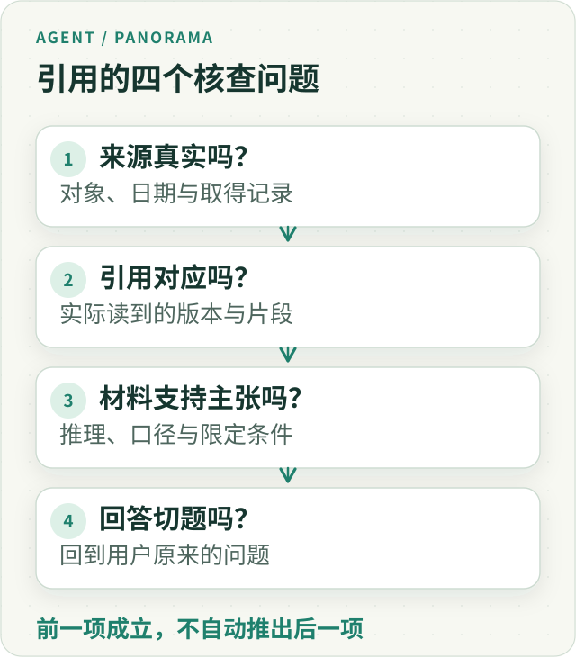
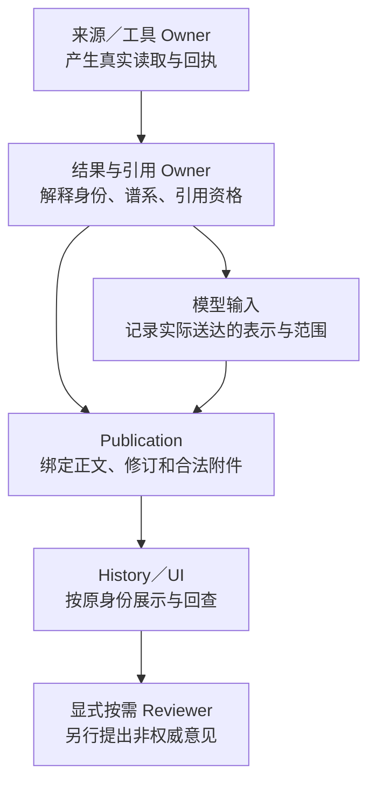
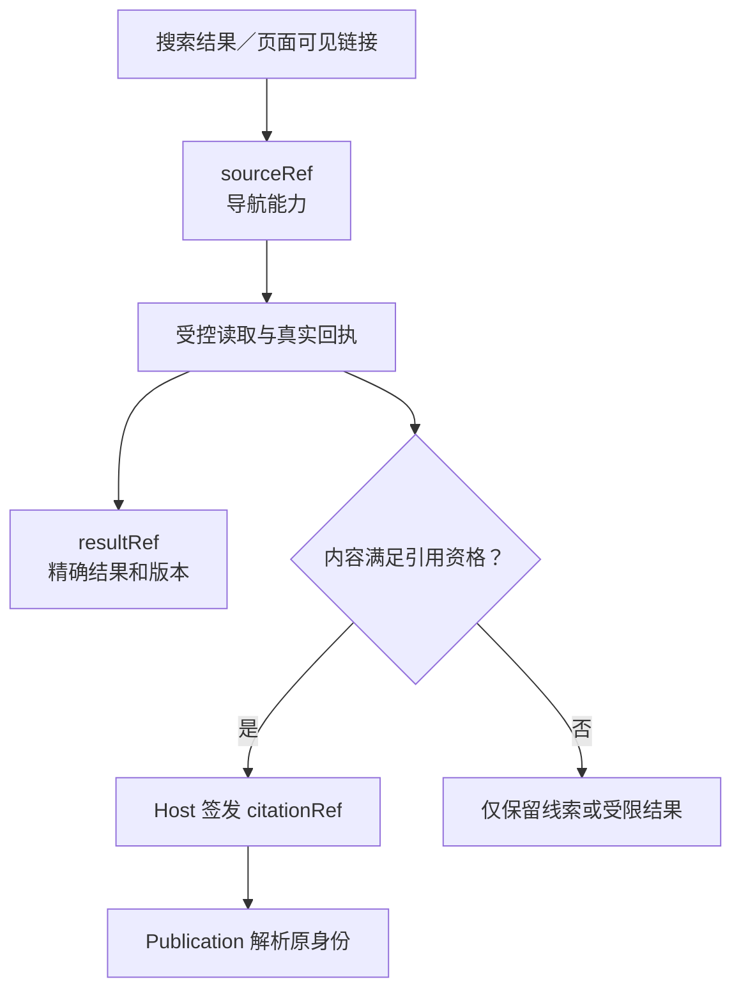
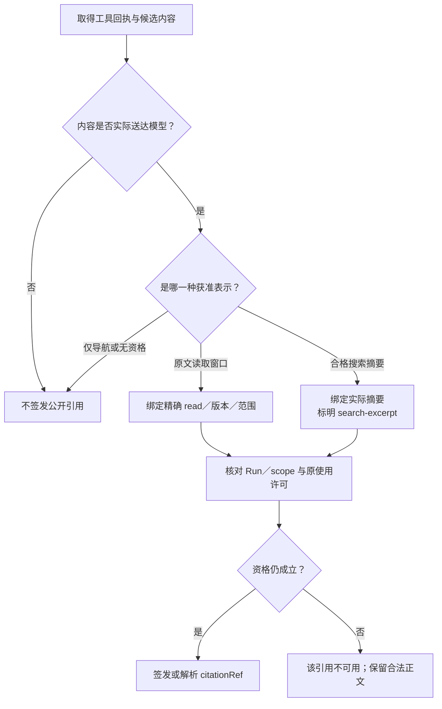
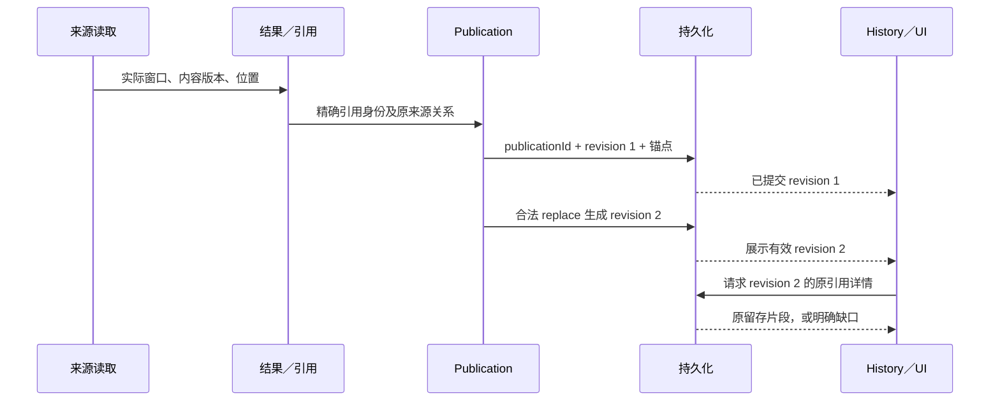
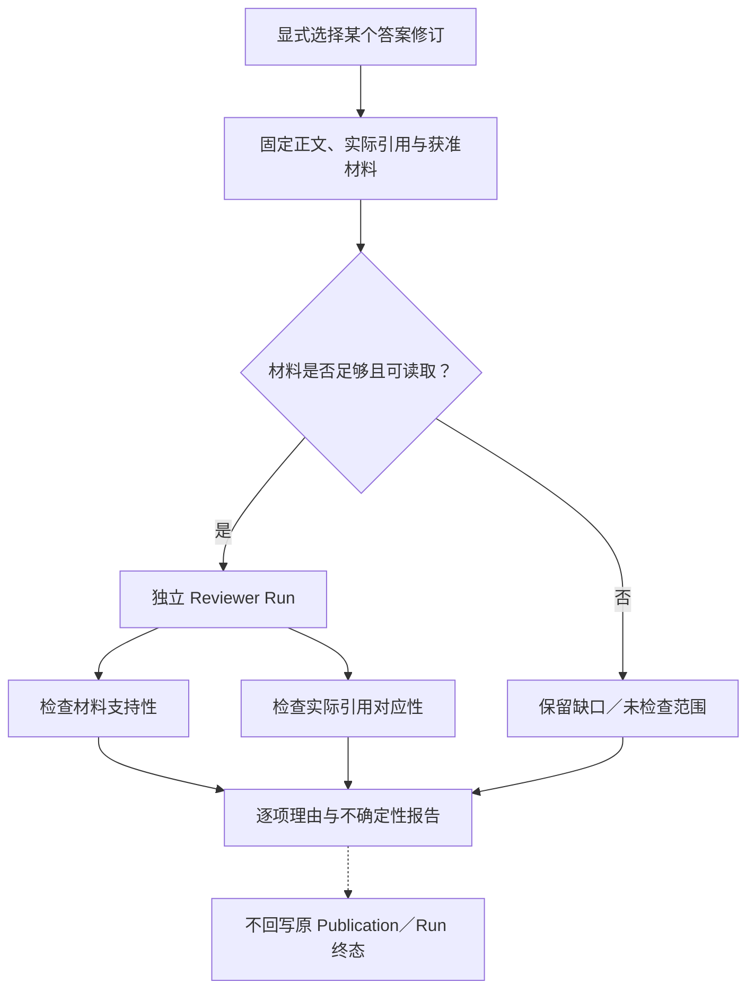

---
readingBrief:
  takeaways:
    - "来源身份、引用对应、材料支持和任务相关性是四个独立问题；有效引用只能建立核查关系，不能自动证明结论。"
    - "Host 按真实读取、实际送模范围和使用资格签发引用，搜索摘要保留摘要身份；修订与历史回查绑定原内容版本而非当前网页。"
    - "坏公开附件只影响相应引用，私人依赖仍受保护；独立 Reviewer 分开检查支持性与对应性，不接管原回答发布或终态。"
  appliesTo:
    - "构建引用签发、版本绑定、原文回查与按需独立评审，定位真实链路里的错引和身份漂移。"
  notFor:
    - "用引用数量、覆盖率或评审报告认证答案正确；本文未证明真实模型评审准确率或生产启用。"
---
# Agent 引用系统设计：从来源签发、版本绑定到独立复核

**引用是一条核查路径，不是一张正确性证书。** 一条链接能带读者抵达某个网页，却不能证明 Agent 当时读过那一版；一个有效的引用标记能证明材料关系，却不能证明结论从材料中正确推出。

研究型 Agent 需要的不是“尽可能多的引用”，而是一套回答得出具体问题的机制：**谁允许引用、引用的究竟是哪一份材料、改稿后还能否准确回查，以及判断错误时由谁负责。**

这篇文章只讨论通用引用基础设施。它来自一次真实工程演进：我们先让模型自己选择证据 ID，后来由 Host 签发引用资格；曾让资料齐全程度影响回答等级，后来撤掉语义评分；又在持久化、修订和独立评审中补齐了不同的责任。基金计算、金融时点与投资方法留在另一篇金融证据链文章。

## 一、一个 URL，为什么不足以说明引用了什么？

先看一个**合成的教学场景**。用户问：“SDK 2.4 还支持 `legacyLogin()` 吗？”

同一个文档地址 `docs.example.invalid/sdk/auth`，在两个时间点出现过不同内容：

| 当时读到的版本 | 文档中的实际表述 | 能支持的回答 |
| --- | --- | --- |
| SDK 2.3 文档 | `legacyLogin()` 仍可用，但已弃用 | “2.3 仍支持，建议迁移” |
| SDK 2.4 文档 | `legacyLogin()` 已移除，改用 `loginWithToken()` | “2.4 不再支持” |

假设模型回答“2.4 仍支持 `legacyLogin()`”，并附上这个真实文档 URL。链接存在、域名正确，甚至当前页面就写着 2.4 的移除说明；这条引用仍无法解释模型为什么得到了相反结论。它可能用了旧搜索摘要，可能绑定错了版本，也可能读到了正确原文却理解错了。

这里有四个不同的问题：

*图 1 · 四层核查不是一条“前面通过、后面自然通过”的证明链。*

**来源身份**询问是否真的取得、保存和获准使用某次读取；**引用对应**询问正文标记是否指向那次读取；**材料支持**询问原文能否推出这句话；**任务相关性**询问回答是否解决“2.4 还能不能用”的问题。

前两层可以大量依靠确定性协议。后两层需要理解内容和提问目标，不能由引用数量或一个通用布尔值替代。为此，引用系统要先把自己的职责收窄，再把基础事实做深。

## 二、不要做一个替所有人宣布“可信”的管理器

“引用”横跨读取、工具回执、结果保存、模型输入、正文发布与历史查看。如果每个消费者都重新解析来源 URL、版本和授权，规则会漂移；如果交给一个 `trusted=true` 的中央管理器，又会把完全不同的权力压在一起。

我们最终采取的是**统一结果与引用的机械解释，保留各环节的实际决定权**。

*图 2 · 关系是事实消费，不是把授权、发布和语义评判交给新中心。*

这张图里的分工很重要：

- **来源生产者**回答“实际发生了哪次读取”，拥有原始内容、时间、范围和工具回执；一个 URL 不能代替它的证明。
- **结果与引用 Owner**使用这些事实，统一解释结果身份、派生关系、实际表示及可引用资格；不重新授予来源访问权，也不判断整句是否真实。
- **模型输入链路**记录模型最终实际收到的窗口。完整工具返回、摘要、裁切后的文本和模型真正见到的内容，不一定相同。
- **Publication**负责正文的接纳、附件绑定、替换修订与真实提交。引用错误不能天然取得整段正文的否决权。
- **History／UI**根据原提交和当前查看者权限读回，不猜 URL，也不以显示成功冒充论证成立。
- **Reviewer**可以指出错引或过度推断，但不能反向改写发布记录或取得原 Run 的执行权。

2026 年 10 月的结果治理把散落在计算、恢复、Native 读取和发布适配器中的重复身份解释收进同一个逻辑 Owner。它不是新增一层只转发调用的 `CitationManager`：原规则和真实调用者迁入共同实现，消费者不再复刻同一快照的资格判断。不同时间、不同效果需要的授权检查仍留在原负责者手中。

## 三、`sourceRef`、`resultRef`、`citationRef` 为什么必须分开？

一套系统里出现三个 `Ref`，很容易让人觉得应该合并成一个 ID。但这三个标识回答的问题完全不同。

| 标识 | 它指向什么 | 它没有授予什么 |
| --- | --- | --- |
| `sourceRef` | 本 Run 已登记、可按规则导航或读取的来源 | 不等于已读内容，更不等于可发布证据 |
| `resultRef` | 具有精确版本、选择范围和回执的某个结果 | 不等于读取权限，也不等于原始出处 |
| `citationRef` | Host 根据现有证据资格签发的引用身份 | 不证明材料支持正文语义，不跨 Run 自动复用 |

*图 3 · 读取结果可以用于分析或继续导航；是否能挂在公开结论上，是另一项资格。*

例如，`find_in_public_source` 在已获准材料中寻找关键词，可以返回新的定位游标，却不因此创造一份新证据。`run_analysis_python` 的结果可以有 `resultRef` 和完整输入谱系，却不能因为算出了数字就自称网页原句。Artifact ID 又指向另一种真实文件成果：有下载回执也不自动等于原始出处。

**不要把标识的存在、对象的可读取性和对外引用资格合成一个永久有效状态。** 同一来源在另一个 Run 里、被撤销以后或内容版本变化以后，原来的决定不一定仍适用。

这里还要分开两种“相同”：两次读取可能 URL 相同但内容版本不同；两个来源也可能字节哈希相同却授权不同。前者不能按 URL 合并，后者不能以哈希相等继承权限。

## 四、从“模型猜证据 ID”到“Host 签发”，又经历了一次修正

早期模型需要在发布时填写内部风格的 `evidenceIds`。问题是：模型即使知道一个来源编号，也不知道该编号是否对应真实可发表的材料。它可能把搜索结果编号、部分读取的导航标识甚至别的观察 ID 填进去，再由 Runtime 拒绝。

2026 年 9 月 28 日的 Q17 诊断恰好展示了这种混淆：一次尝试使用搜索／市场 ID，一次使用不具资格的部分读取 ID，都遭到拒绝；当模型改用已获准的真实读取标识后，首次发布获得接纳。这里能证明的是**协议区别和拒绝路径**，不是整份研究的质量。

于是改为：模型只使用由 Host 提供的 `citationRef`；签发时由程序验证 Run／scope、来源身份和实际读取资格，模型不再自己声明 `evidenceId` 或来源权威。

但这里不能停在 9 月的规则上。**10 月 6 日我们又发现，受控搜索摘要也可能是用户明确允许使用的证据。** 如果它已经真实进入模型输入，却一律被当成“只可导航、不可引用”，原页面抓取失败会无谓阻断有价值的有限回答。

新的做法是保留来源类型的差异：获准且实际送模的搜索摘要可取得**受限的摘要引用**，其 `representation` 明确是 `search-excerpt`；它支持“某搜索结果摘要报告了什么”，不冒充模型读过网页全文。

*图 4 · 资格由真实回执、实际暴露和原使用规则决定，而不是模型的 URL、标签或“我读过”。*

搜索摘要需要自己的逐项来源身份、时点、真实提交片段和受限表示；只有 URL、标题、未提交的原始响应或一个检索动作名称，都不能签发。网页后续读取可以提升**新取得材料**的粒度，但不会悄悄把旧摘要标记成网页原文。

这一改动也解释了为什么不要简单规定“凡 `discovery` 都不能引用”或“凡 `discovery` 都能引用”。动作名称描述做了什么；**有资格对外表述的，是实际送达且获得当前用途许可的那部分内容。**

## 五、引用错误为什么不该让整份答案消失？

把引用当成发布前置门，最容易在失败时暴露代价。2026 年 10 月 6 日的源码审计发现过一种可达路径：正文已经生成，但一个错误 `citationRef`、第九个引用或不可用的公共来源附件，可能触发整块拒绝，甚至让模型再次消耗轮次尝试修引用。

这不是说任何正文都应无条件展示。正确的修复是区分**可选核查附件的错误**与**真实受保护内容的拒绝**。

| 情况 | 处理对象 | 不应发生的事 |
| --- | --- | --- |
| 公开引用语法坏、跨 Run 或资格不足 | 只省略／标记该引用附件，留下可辨识的限制 | 不能把它伪装成可信来源，也不应抹掉独立合法正文 |
| 引用超过可展示数量 | 降级超出部分，保留容得下的合法附件 | 不因第九个引用否决几千字正文 |
| 原读取窗口缺失、哈希不符、旧 URL 已变 | 详情明确“无法核对当时原文” | 不能抓取现网页冒充旧证据 |
| 真实私有依赖未授权、账户／scope 不符 | 拒绝受保护的内容效果 | 不能通过删掉引用或改模型标签洗掉实际依赖 |
| 修订目标版本冲突、提交失败 | 保留旧有效修订并准确报告交付状态 | 不能把未保存说成已经持久化 |

10 月 16 日的治理调整把正文处置重新收拢到原 Publication Owner：Runtime、引用适配、恢复和投影只提供各自已知的客观事实，不再在外围形成额外的“修好引用才能结束”的整轮门。权限、真实依赖、版本 CAS 和存储提交仍维持原保护。

这是一条容易迁移的原则：**坏引用不能证明正文错了；坏引用也不能证明正文安全。** 先限定失效的效果，再由各自有权的模块作决定。

## 六、引用要绑定最终修订，而不是绑定一个可变网页

研究答案不是只有“生成一次、结束”两步。它可能分段送达、替换原段、经过持久化，再由另一个进程的 History 读取。引用若只记录字符串偏移或 URL，就很容易在这些步骤中换了对象。

*图 5 · 新修订重新绑定自己的正文范围；旧修订保留原有历史，不把旧偏移平移到新正文。*

这条链上有四种不该互相替代的身份。

**来源版本**说明当时到底读到哪份字节或规范化内容；**精确 read-item ID**指向这次读取的具体片段或表格；**父工具 observation ID**说明哪个调用产生了它；**`publicationId / revision`**说明这条引用附着于哪一版正式正文。一个父观察可以有多个具体读取项，不能为方便恢复就把子项 ID 换成父项 ID。

这并非纸面上的担忧。10 月 21 日的真实 PostgreSQL 回查揭示：JSONB 对象键顺序变化，让基于序列化顺序的 PDF 表格 read-item 哈希不再匹配；修复保持原生产 DTO 的稳定顺序和读取身份，而不是取消哈希保护。

另一条实际浏览器链路里，SSE 已经交付正文，稍后到达的空 History 保存投影却覆盖了画面；修复的是同 Run 的交付与读取协调，而不是让模型重发答案。10 月 24 日又发现结论复核附件未被实时事件转发，以及冷 History 把精确 read-item ID 写成父 observation ID；修复发生在原生产和传递位置，保留了两种身份。

这些案例的共同点是：**存进数据库、传过 SSE、页面上有链接，都不等于“重新打开后还能按原身份核对”。** 验证必须跨过生产、提交、传输、冷读和点击详情，而不是只测一个引用组件。

历史读回还有一项安全区别：保存的 citation receipt 可以解释过去的引用，却不能让旧 `sourceRef` 在新进程中重新取得 read／find 权限。历史回放遵守当前查看者的入口准入；新 Run 如需继续读取，要通过新的授权和真实能力登记。

## 七、为什么最后撤掉了 Runtime 的“答案可信等级”？

早期系统曾试图按“必需资料是否齐全”给出 `grounded_answer` 与 `advisory_answer` 等终态。动机合理：模型做长研究，需要知道核心资料、辅助资料和可选资料是否拿到。

真实诊断却留下一个尖锐反例：四次研究、57 次资料读取，**57/57 都被标为 required**。我们提醒模型这个字段会影响最终等级，分类仍没有明显变化。模型自报的材料需求无法稳定地承担终态真值。

但即使分类完美，也只能证明材料组织得怎样；不能证明模型没有误解 SDK 版本、比较方法正确或回答了问题。用“引用覆盖率”取代“资料完整度”同样无济于事：给错误结论挂满正确来源，并不会让它成立。

因此，10 月 1 日的协议清理撤回了这类 Runtime 权威语义等级，保留真正可核对的技术事实：模型请求、Host 读取、具体引用、权限、预算、提交回执和已接受正文的修订身份。

**机械事实越坚固，越需要克制它能宣称的范围。** `citationRef` 有效说明关系成立；是否“支持结论”仍要由具备原文和上下文的读者或独立评审判断。

## 八、独立 Reviewer 检查两件事，但不能接管 Publication

独立评审看似只需问另一个模型：“引用对不对？”实际上至少要拆成两个问题。

仍用 SDK 的教学例子：回答声称“2.4 已移除 `legacyLogin()`”，这句话有 2.4 原文支持，却错误引用了 2.3 的材料。若 Reviewer 手里还收到 2.4 的额外文档，它应当报告：**材料集合支持结论，但实际挂载的引用不对应**，不能因为“别处有证据”就帮原引用洗白。

*图 6 · Reviewer 是另一次有界工作，不是原研究的默认“最后一道发布门”。*

我们的按需评审入口先把答案、已引用材料、额外材料、实际映射、来源表示、版本和缺口固定成输入包，再由独立模型提出意见。它不重跑研究，不替用户搜索补证，不读取输入包随意指定的私有路径，也不沿用被评 Run 的权限和预算。

输出不仅区分“支持／矛盾／证据不足／无法判断”，还要定位论断、原句和真实引用关系。若模型捏造摘句、位置有歧义、响应截断或调用结果未知，报告应保留不可核对和未检查区域，而不是生成“零问题”或总可信分。

这项机制的独立 JSON／Markdown 报告、默认关闭与资源回执经过限定的离线／PostgreSQL 验证；但**没有由此取得真实模型评审准确率、误报率或生产启用的结论**。评审对原答案的影响应是可见的参考意见，而不是自动修订或隐形否决。

## 九、怎么验证这套架构，不靠一张漂亮的图？

最有价值的验证不是数引用个数，而是从真实失败反推具体不变量。

1. **身份不串线**：同 URL 不同版本、同数值不同来源、跨 Run／scope、错误哈希，均不能被合并或“修复”为另一个看起来合理的引用。
2. **暴露不补造**：模型只收到摘要，就只能按摘要的表示核查；未读 PDF 页、未送模文本、父 observation 都不能冒充精确 read-item。
3. **失效影响局部**：坏公开附件可明确不可用，独立合法正文继续；真实私有依赖、修订冲突或账户隔离仍准确拒绝它们保护的效果。
4. **版本与读回一致**：发布时、替换后、实时流、PostgreSQL 提交、新进程 History 和浏览器点击必须保持同一引用／修订关系。保存成功和实时可见要分别观察。
5. **评审不越权**：不开启时没有额外模型请求；开启后只读固定输入，超时保持 unknown，报告与原 Publication、预算和终态分开。

这些不变量已经在结果归属收拢、原文片段查看、结论复核和按需 Reviewer 等变更中留下限定范围的源码、合同、隔离数据库与浏览器验证。它们证明的是**机制如何保护身份、权限和交付**，不能外推为真实模型一定善于理解文档，更不能证明所有线上来源长期可用。

我们没有再造一份全局“可信证据库”，也没有让 Reviewer 变成终态授权器。这样的取舍降低了单个功能的宣称范围，却让每一条可以验证的事实更值得信赖。

## 十、结语：引用系统该证明什么，不该证明什么

一个可复用的引用系统，首先要把对象说清：模型用的是导航线索、原文读取窗口、搜索摘要、派生结果，还是已提交的历史引用；然后让每一种对象只提供自己的能力。

接着，它要把决定权说清：Host 与结果／引用 Owner 核对身份和资格，Publication 管正文与修订，History 管按原身份回查，Reviewer 管独立意见。它们协作，但不互相代替。

最后，它必须正视失败：**引用坏了，不能造证据；详情缺了，不能换成当前网页；Reviewer 不确定，不能说检查通过；正文已经合法，不能因为一个辅助附件损坏就无故消失。**

回到 SDK 2.4 的问题，读者真正需要的不是九个尾标，而是能打开**当时那一版、实际被读取的材料**，看清哪些句子支持“已移除”，以及有哪些仍未验证的前提。

**引用让判断能够被复核；复核之后，才有资格讨论这份判断是否可信。**

### 延伸阅读

[金融 Agent 的可信证据链](financial-agent-trustworthy-evidence-chain.md)讨论另外一个层次的问题：当来源经过金融数据口径、计算方法、子代理与交付时，怎样留下足以复算业务判断的完整关系。它不替代本文的通用引用签发与回查机制。

[Agent 引用全景的英文版](/en/articles/ai-citations-do-not-prove-reliability) · [全景系列](/panorama) · [ETF Agent Engineering Notes](https://github.com/hpoenixf/eff-agent-article)。

欢迎通过 [GitHub Issues](https://github.com/hpoenixf/eff-agent-article/issues) 反馈反例；如果这些工程复盘对你有帮助，也欢迎为文集点个 Star。
