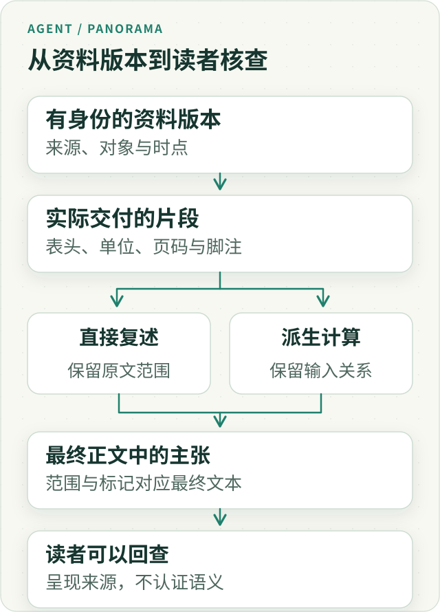

# Agent 引用全景：从原始资料到可核查的结论

**引用是一条核查路径，不是一张正确性证书。** 它能帮助我们找到模型依据了什么，却不能单独证明资料支持结论，更不能证明结论回答了用户的问题。

这一区别决定了研究型 Agent 应该怎样设计：把来源和引用关系做扎实，把内容判断单独留下；不要用引用数量、资料齐全程度或一个漂亮分数，代替真正的推理检查。

我们在 ETF Agent 中走过一段弯路。最初只是想知道研究材料是否齐全，后来却逐渐让这些机械状态替最终回答作出质量判断。真正需要改变的，不是再设计一个更复杂的引用评分，而是停止让一种证据回答另一种问题。

## 一、四个都成立的问题，才接近一份可靠回答

假设用户问：“基金 A 和基金 B，是不是重复配置比较严重？”Agent 读取了两只基金的持仓，给出带引用的回答。这里至少有四件需要分别确认的事：

| 问题 | 真正检查的内容 |
| --- | --- |
| 资料真实吗？ | 是否确实取得相应来源，身份、日期与访问资格是否适用 |
| 引用对应吗？ | 这句话关联的是否是实际读取的那份资料 |
| 资料支持结论吗？ | 原文、数字及其限制是否足以支持这项推断 |
| 回答解决问题了吗？ | 用户关心的重复暴露是否得到了有条件、有依据的解释 |

下面的图表达的是检查层次，不是“前一步通过，后一步就自动成立”的推导链。

*图 1 · 这是一组逐步深入的核查问题。来源真实不会自动推出推理正确，推理正确也不会自动推出回答切题。点击可查看完整图。*

前两步主要建立可追溯关系，后两步需要理解内容与用户目标。我们曾把前面的基础设施越做越完整，却误以为后面的判断也随之解决了。

引用的价值并没有因此降低。它让“模型说自己查过”变成“我们能找到它实际查过什么”。只是这个入口之后，仍然有工作要做。

## 二、一个真实引用，怎样支持了一个过头的结论？

用一个教学例子说明。资料写着基金 A 的科技、金融、工业占比分别为 30%、20%、10%，模型却回答：“基金 A 的风险很低。”引用即使真实、对应、未过期，也没有提供足够依据。

行业分布描述了资产投向；“风险很低”还取决于资产类别、集中度、波动、回撤，以及用户所说的风险是什么。问题不在引用格式，而在结论越过了材料能够支持的范围。

回到两只基金的比较。假设资料显示，两者前十大持仓有 6 只股票相同。这可以支持“前十大持仓存在重叠”，却不能直接回答整个组合是否严重重复。还需要看重合持仓的权重、前十大之外的披露范围，以及用户在两只基金中分别投入了多少。

更隐蔽的情况是，回答里的每句话都正确，却依然没有回答问题。比如模型列出两只基金的科技占比为 30% 和 28%、规模为 50 亿和 80 亿，四句话都有来源；用户仍然不知道是否存在值得调整的重复暴露。

**核查时应当从影响判断的结论出发，回到原材料，而不是从引用数量出发，猜测回答质量。** 对一句直接复述的数据，核对对象、日期与数值；对一句分析或建议，还要检查推理增加了哪些前提。

## 三、一条引用要走过哪些交接？

把引用理解成“生成答案后附几个链接”，会漏掉它最难的部分：同一份资料经历提取、切片、计算、压缩和多 Agent 交接之后，究竟还对应哪个原对象？

下面用信息的生命周期重建这条路径。这是职责地图，不要求为每一步新建一个服务。

*图 2 · 原文身份沿交接保留。计算结果保留自己的输入关系；模型的分析仍是分析，不会因为挂上引用而变成原始资料。*

**第一步，取得有身份的资料版本。** 网页地址说明去哪里找，内容版本说明当时读到什么。相同 URL 明天可能更新；同名 PDF 也可能属于不同日期。引用应尽可能携带对象、来源与时点，内容哈希可用于比较字节身份，但哈希本身不是授权凭据，也不会自动成为可引用来源。

**第二步，保留实际交付的片段。** PDF 页码必须能对应模型真正收到的文本或页面图像。抽取器读完一页，后续投影却只保留半段，不能仍声称模型读过整页。网页只留下检索摘要，也不能在最后把整份报告描述为已核对。表格的列名、单位与脚注经常比单个数字更重要。

**第三步，让分析能回到输入。** 派生结果需要自己的计算方法和输入关系。“Python 算过”只说明有执行；还要知道算的是哪一列、哪个区间、如何处理缺失，以及报告是否正确解释结果。原始表、计算产物和模型解释应保留不同身份，避免一份摘要在下游被当成第二个独立来源。

**第四步，把引用关联到最终正文。** 正文经过格式化、数值替换或分段重组，旧字符偏移可能不再适用。标记和范围应根据最终变换后的正文处理；不能把上一版位置机械贴到下一版，更不能为修显示错误而重写原始资料。需要引用的主张在语义上可能跨句，应让读者看清依据支持的是哪一部分。

**第五步，让读者真正回查。** 卡片或尾标应呈现可理解的名称、日期、定位与访问限制，而不是一串看不懂的内部 ID。键盘、触摸和窄屏都要能够打开核查入口。界面只展示已有引用关系，不能因为卡片渲染成功，就替正文盖上“语义已验证”的章。

这五次交接中，每次都可能丢失信息。正确的修复位置通常在丢失的生产者：补回原表头，保留实际片段身份，修正变换后的坐标。让模型重新猜 URL、补一个看起来像真的 ID，或者给整篇加满尾标，都不能恢复已经断开的关系。

### 同样的两条引用，可能对应三种完全不同的计算

下面是**完整持仓的合成教学数据**，所有权重都使用同一日期、同一口径。它只用于说明怎样从数据推到主张，不涉及真实组合建议。

| 标的 | 基金 A 权重 | 基金 B 权重 | 两边较小权重 | 按 A 60%、B 40% 合成后的暴露 |
| --- | --- | --- | --- | --- |
| X | 40% | 20% | 20% | 32% |
| Y | 30% | 50% | 30% | 38% |
| Z | 30% | 0% | 0% | 18% |
| W | 0% | 30% | 0% | 12% |

两份持仓可以支持三种不同表述：共同名称有 X、Y 两个；按逐项较小权重求和，完整持仓的重叠度为 50%；按给定组合权重合成，用户对 Y 的暴露为 38%。三句话都来自同两份资料，回答的却是三个问题。

如果实际材料只披露前十大，应按原权重报告已知重合贡献并说明覆盖范围，不能套用上面的完整持仓 50%，也不能把部分数据重新归一化后称为整个组合的精确重叠；如果用户没有提供两边投入比例，也不能把教学中的 60% 和 40% 补成真实配置。一个正确尾标，无法替我们补齐这些前提。

## 四、我们为什么放弃用“资料齐全”认证答案？

早期设计的动机并不离谱。一次研究会读很多资料，我们希望区分必需、辅助和可选材料，也希望知道用户提出的几个子问题答到了哪里。

例如比较两只基金的持仓，双方的持仓和数据日期是核心材料；基金经理背景或相关新闻可能只是辅助。分类原本服务于研究组织，并不是想预测“这个答案有 85% 概率正确”。

问题出在后续解释。历史上，系统出现过 `grounded_answer`、`advisory_answer` 这类状态，用来区别材料依据较充分与不完整的回答。这些字段已经退出当前终态契约，这里保留名称只是解释设计来路。

当“核心资料已取得”被进一步理解为“最终回答已有充分依据”，系统就跨过了它没有验证的那段推理。模型拿到了两份持仓，不代表它正确比较了权重；拿齐产品资料，也不代表它有条件宣布某只基金明显优于另一只。

真实运行又暴露了一个反例：连续 4 次研究，共 57 次资料读取，57 次全部被标为“必需”。我们提醒模型分类会影响最终回答状态，分布仍没有明显改善。分类几乎失去了区分作用。

不过，真正改变方向的不是这个分类效果不好，而是更深的一点：**即使必需、辅助、可选分得完全正确，也仍然只能说明材料取得情况，无法认证最终推理。**

因此，我们不再继续优化这个分类来替答案作判断。资料状态仍有用途，但只描述它真正知道的事实。

## 五、换成“引用覆盖率”，为什么还是同一个问题？

资料完整度不合适，能否直接统计回答有多少段挂了引用？例如四段中三段有引用，覆盖率为 75%。

这项统计可以描述关联情况，却仍然测不到材料是否支持内容。假设来源只说“过去一年上涨 15%”，回答却写“适合保守型投资者”，加上正确引用也不能补齐适当性判断。

机械追求覆盖率还可能改变模型的优化方向。组织性语句并不都需要引用；分析意见也要结合上下文判断依据。如果一律把没有引用视为没有根据，模型可能学会给每句话挂一个链接，而不是更认真地推理。

所以我们没有把一个资料完整度分数换成另一个引用分数。**容易统计的信号可以帮助诊断，但不应因为容易统计，就被提升为我们真正关心的质量。**

这不是反对指标。它要求先说清指标测量什么，再决定它能支持哪一种结论。

## 六、引用失效时，怎样保留用户已经取得的内容？

来源暂时打不开、某个标记格式错误、附件缺少绑定，与正文没有资格展示，是不同的问题。把它们都升级成“整份回答不可发布”，会让一个辅助核查入口取得不相称的控制权。

我们的现行分工强调局部处理：显示层可以省略坏附件、标明暂时无法打开的来源；来源生产与传递模块应修复自己的遗漏；已经独立获准展示的正文和其他合法内容继续保留。语义质量不足应由研究者解释、限定或更正，不能由引用数量规则替代判断。

真实的权限、隐私、账户隔离和内容身份问题仍由原责任方保护，影响范围应限定在相应内容或效果。保留正文不意味着删除真实私人依赖、绕过权限，或者把未核查的材料显示成核查成功。

还有一个时间上的区别：**旧资料可以解释过去，不能自动证明现在。** 用户问“当时为什么作出那个判断”，可以沿保存的历史版本解释；用户问“现在是否仍成立”，则应核查会改变结论的现行事实。不必为了读一份历史报告重取所有数据，也不能因为原报告有引用就把旧持仓当成实时持仓。

若来源更新，读者应能区分“当时引用的版本”和“当前页面”。若之前的结论被证据推翻，应保存更正及其关系，而不是悄悄把旧回答改成一直正确。引用体系的长期价值，正体现在变化之后仍能说明原来依据了什么。

## 七、那就让另一个模型检查？可以，但要保留判断的身份

让独立模型检查“原文是否支持这句话”“答案是否回应用户问题”，比数引用和匹配关键词更接近任务本身。但评审模型仍可能漏读材料、误解限定条件，或者对模糊推断给出不同意见。

我们因此把机械检查与语义评审分开。程序保留来源身份、读取记录、适用日期、引用对应与受影响内容；评审则针对具体结论检查支持、矛盾、缺失的前提，以及是否回答了问题。

后一类结果是有理由、可复核的意见，不是不可质疑的系统真值。材料不足时应当明确不足，而不是把“没有发现错误”当成“已经证明正确”。

这种分工没有削弱引用系统。恰恰因为来源关系能够回查，评审者才有机会判断模型在哪里曲解了资料、哪里作了合理推断、哪里根本没有回答用户。

它也不要求对每一句话都追加模型调用。查一个明确字段，与比较两套投资方案，需要的审查投入不同；关键在于把检查放到真正影响结论的地方。

## 八、读者应该带走的，不是“不要相信引用”

我们最终保留了来源与引用基础设施，撤回的是它们不应承担的质量认证。资料读过什么、对应哪个版本、哪句话用了它，仍然值得认真维护。

**对产品设计者，引用应当成为能够展开原文与限制条件的核查入口，而不是“已验证”的装饰。对研发与评审者，应该挑出决定结论的主张，检查材料是否支持它，再检查它是否回应了用户的真实问题。**

这两步需要分别留下判断：来源与对应关系检查到了哪里；内容解释还有哪些依据和疑问。既不让一个合法引用替推理背书，也不因为语义判断困难而放弃可以自动核实的事实。

回答可靠性的提升，不在于引用尾标越来越密，而在于读者能顺着关键结论找到依据、理解推理，并识别它的适用范围。

**有引用，意味着回答更容易被核查；核查之后的内容判断，才决定它值得相信到什么程度。**

### 延伸阅读

[全景系列](/panorama) · [完整英文版](/en/articles/ai-citations-do-not-prove-reliability)。

[AI Coding 最贵的不是写代码，而是决定什么值得验证](ai-coding-judgment-and-verification.md)讨论如何分配验证资源；[金融 Agent 的可信证据链](financial-agent-trustworthy-evidence-chain.md)展开原材料跨越工具、计算与交付的具体机制。

更多实践见 [ETF Agent Engineering Notes](https://github.com/hpoenixf/eff-agent-article)。欢迎 Star 或提供能挑战这些判断的反例。
