# Agent 引用系统设计：从来源签发、版本绑定到独立复核

Agent 回答“这只基金的费用是 0.15%”，附上一条真实链接。链接没造假，却可能指向别的份额类别、另一期披露，或模型根本没读到的搜索结果。更离奇的是，引用看上去一切正常，进程重启后却无法打开原摘录；反过来，一条坏引用曾经可能让整段合法正文一起被拒绝。

**引用系统最有趣的难点，不是怎么把 URL 放到句子后面，而是怎么在有权限、有版本、有上下文截断和历史恢复的 Agent 里，保证引用对应当时真的交给模型的那份材料。**

## 一、意外一：URL 对了，引用仍可能是错的

以一个合成 SDK 文档为例：同一个 URL 在 2.3 版写着某接口仍可使用，在 2.4 版改成了“已移除”。如果模型回答“2.4 支持该接口”，后面贴着正确的网址也没有用。URL 只能帮助今天导航，不能证明**当时的读取版本、哪段内容进入模型、结论有没有被原文支持**。

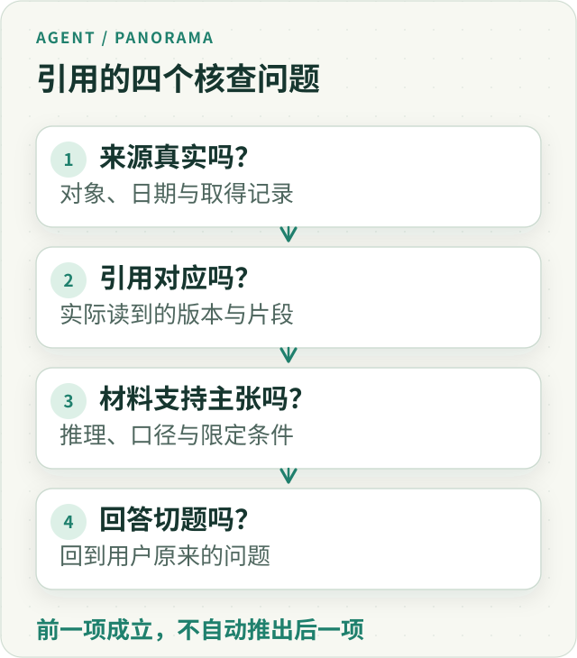

我们把核查拆成四个独立问题：**来源身份**是不是原读取，**引用对应**是不是这份材料，**内容支持**能不能推出这句话，**任务相关性**是不是回答了用户的问题。程序容易做深的是前两层；后两层还需要领域规则、复算或人工／受控 Reviewer。

## 二、不要让一个“引用管理器”替所有模块宣布可信

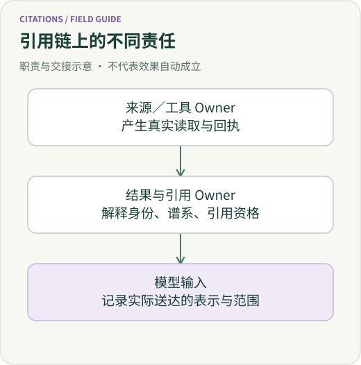
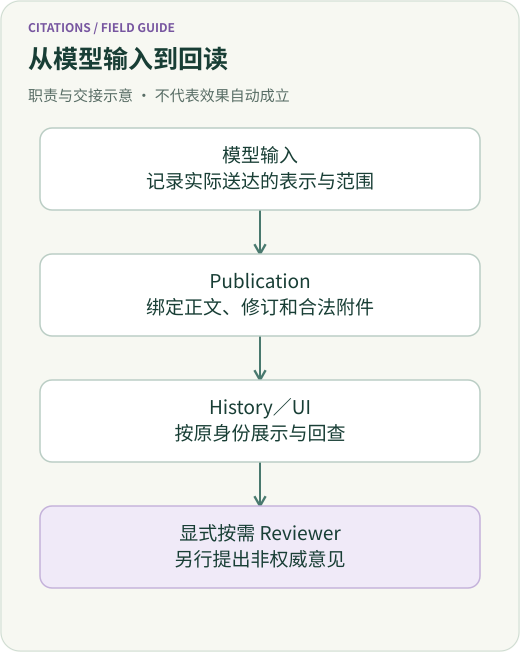
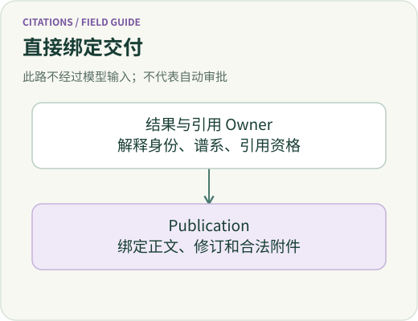

当前设计不新增统一的“可信回答裁判”。Host 记录哪些受控来源真实取得、实际送入哪个 Run；原 Source / Result Owner 保留来源、权限与可回读表示；Publication 处理正文版本和已授权的引用附件；Reviewer 可以质疑证据对应与论证充分性，却不能改写已发生的工具效果或越过发布权限。

三个最容易混淆的身份必须分开：

| 身份 | 表示什么 | 不表示什么 |
| --- | --- | --- |
| `sourceRef` | 原始来源、版本与所属范围 | 模型已经读完这一来源 |
| `resultRef` | 某次获准工具输出的可回读结果与选区 | 该结果一定进入了后继模型输入 |
| `citationRef` | Host 基于原回执签发的受限引用句柄 | 结论已经被证明成立 |

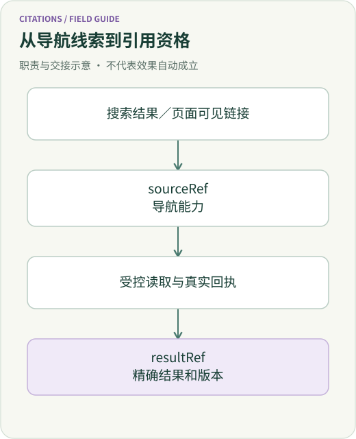
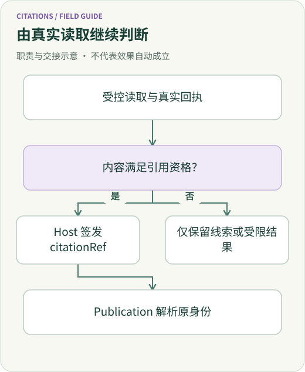

## 三、意外二：搜索找到了证据，模型却可能从没看到它

最初我们让模型在发布时填写内部 `evidenceId`。模型可能猜中搜索编号、部分读取 ID，甚至只知道一个链接；但它无法替 Host 确认该编号是否有发表资格。后来改为 Host 签发 `citationRef`，并保留一个重要细节：**获准的搜索摘要可以被引用为摘要，而不能冒充已读网页全文**。

真正难的是结果外置后的第二次交接。搜索命中 A、B、C 后，系统把候选留在受控结果库，模型在下一轮选择 B。此时“搜索结果有 B”“读取过 B”仍不表示**最终拟合请求**包含 B：容量裁剪或 Hook 可能把 B 挤掉，或者只保留了不含原来源身份的字段。

现行策略只在两个条件同时成立时激活该受限引用：**选中的完整摘要精确关联到同一原 Host 回执的来源绑定**，而且**实际送给模型的最终请求同时包含摘要与对应引用身份**。不能靠 URL 相等、模型自报或另一次 Run 的候选补签。

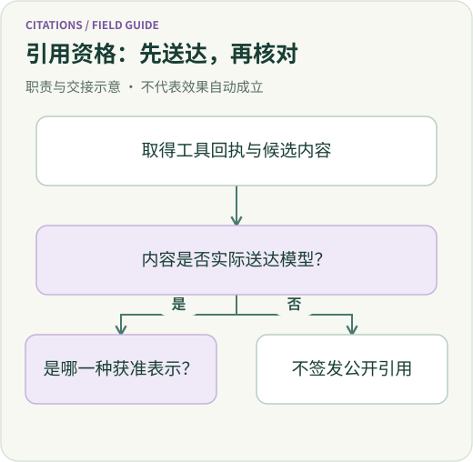
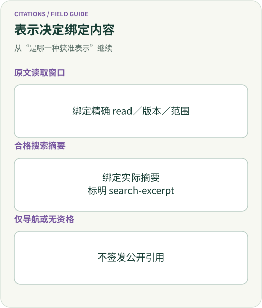
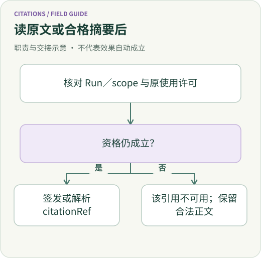

这项规则没有强迫每个搜索都抓完整页面。只有摘要足够支撑有限表述时，才保持 `search-excerpt` 层级；需要详细条款、数值或时点时，再通过原授权路径读具体页面。**动作名称和网址不是证据等级，真正送达的表示才是。**

## 四、意外三：材料其实保存了，重启后引用仍然打不开

History 的正文、引用附件和工具面板有不同生命周期。我们遇过页面上引用只显示“Structured source”，因为结构化金融数据装在 MCP 文本块中的 JSON，展示投影没有保留来源提供方与指标字段；也遇过原材料在 PostgreSQL 里，读回时 JSONB 重排对象键，序列化哈希重新计算竟导致原读取 ID 不匹配。

这不是让前端多写一个链接能解决的。修复应沿**来源生产 → 真实暴露 → 发布修订 → 历史回读**传同一个原始身份，序列化按原生产 DTO 的稳定约定处理，而不是在恢复时按新对象顺序猜哈希。同一个 URL 两次读取也必须仍是两个版本化来源。

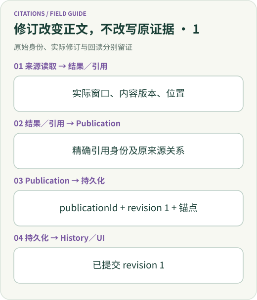
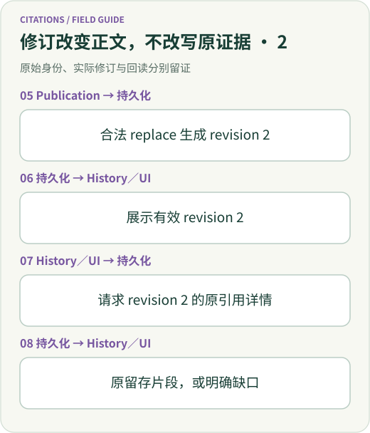

所以当前的阅读详情沿原 Publication 修订与 Source/Result 版本展示：旧页改变时不去抓今天的新网页补旧正文；原来源未知时明确不可核验。模型也不需要为“打开一次引用”重新研究一次。

## 五、为什么一条坏引用不应该吃掉整份好答案

更早的实现把引用资格过度并入发布 Gate。一次非法公开 `citationRef`、第九个超展示限额的引用，甚至一个缺失的可选来源附件，都可能让**几千字独立合法的正文整个被拒绝**，迫使模型再耗轮次修一个链接。

我们最终撤掉外围“修好引用才能发布”的决定权，按影响范围处理：

- **坏公开引用**：仅该附件不可用或标示缺口；独立合法正文继续。
- **真正未经授权的私有依赖**：仍拒绝受保护的内容效果，不能靠删除引用洗掉越权。
- **发布修订冲突或保存失败**：由 Publication 保留原合法版本与准确结果，不把预览说成已持久化。
- **旧来源失效**：History 明确当时的来源无法回查，不用当前 URL 补造历史。

这种区分比“所有引用必须好”更严格：它不让附件失败变成整篇内容的否决权，也不把真实的权限拒绝变成宽松显示。

## 六、别人的实现怎么做，我们为什么这样选

[LlamaIndex 的 CitationQueryEngine](https://developers.llamaindex.ai/python/framework-api-reference/query_engine/citation/)围绕检索节点建立引用片段并控制块粒度，非常适合一般 RAG 问答。常见的检索增强生成方案也会把 source nodes 或文档 URL 带进回答。它们解决了**怎样让读者找到材料**，但在长期、多 Run、多次修订、外置结果与动态授权并存时，应用仍需自己定义“什么被实际送模、怎样恢复原授权、何时允许历史展示”。

我们不是要替代检索器，也不认为 Host 签发后结论就一定正确。我们选择的是：**把可验证的引用资格放在 Host 的真实回执和模型实际输入上，把正确性判断留给独立复核**。这样引用是核查路径，不是正确性证书，也不会因为一个可选附件坏了就让原回答消失。

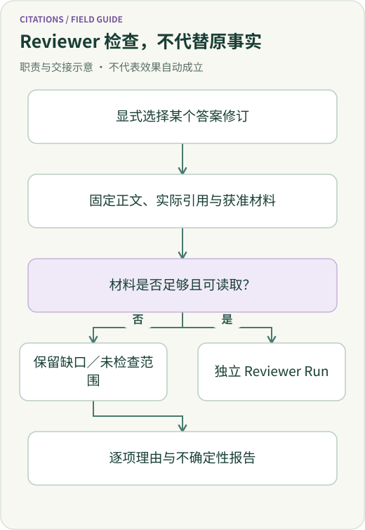
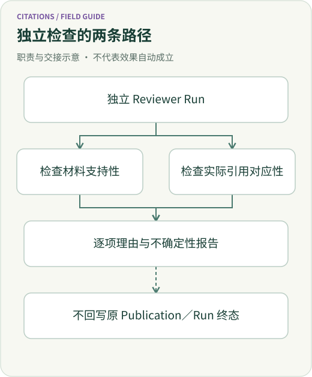

## 七、下一次你应该先检查哪个环节

面对一条看似有据的回答，先查它指向的是**哪份原来源和哪次读取**，接着核实那段文本与引用身份是否真的进入后继请求，再核已保存修订，最后检查材料是否支持句子。任何一步失败都应定位具体附件、来源或论证，不得跨层补造权威。

**一个引用系统最有价值的能力，是让错误可以被准确归属、让合法正文可以继续交付，而不是把所有页面都标成“可信”。**

延伸：[金融 Agent 可信证据链](financial-agent-trustworthy-evidence-chain.md)讨论金额、时点、计算与研究交接的领域级复算；[测评全景](honest-agent-evaluation.md)讨论怎样评价引用是否支持结论。更多文章见 [ETF Agent Engineering Notes](https://github.com/hpoenixf/eff-agent-article)。