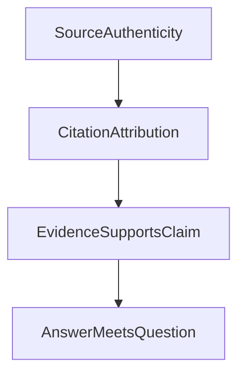

# 为什么 AI 明明有很多引用，回答还是不够可靠？

写过毕业论文的人大概都知道一件事：

**论文有引用，不代表引用真的支持前面那句话。**

赶 Deadline 的时候尤其如此。

先写一句：

> 数字化转型能够提升企业项目管理效率。

然后去搜“数字化转型”“项目管理”“效率”，找一篇标题看起来差不多的论文，引用一挂：

> ……能够提升企业项目管理效率 [12]。

参考文献是真的，格式也没问题。

至于第 12 篇论文到底有没有证明这句话，那是另外一回事。

人会这么干，AI 当然也可能。

现在很多 AI 回答后面都会跟着一排引用。看到 `[1][2][3][4]`，确实很容易产生一种安全感：

> 查了这么多资料，这次应该靠谱了吧？

我们做研究型 Agent 一度沿着这个思路继续往前走：既然系统知道模型查了哪些资料、哪些资料比较重要、最后引用了什么，那是不是可以进一步判断：

> **这篇回答是不是有足够依据？**

甚至再往后一步：

> **用户的问题是不是已经回答好了？**

后来发现，这几件事之间，比想象中隔得远得多。

---

## 一、引用首先解决的，其实只是“你从哪里看到的”

假设用户问：

> 我持有的基金 A 和基金 B，是不是重复配置比较严重？

Agent 为了回答这个问题，先去读两只基金的持仓。

系统会留下类似这样的资料记录：

```text
基金 A 持仓
来源：基金持仓接口
数据日期：2026-09-30
记录 ID：ev-a
```

```text
基金 B 持仓
来源：基金持仓接口
数据日期：2026-09-30
记录 ID：ev-b
```

最后模型回答：

> 基金 A 和基金 B 的前十大持仓存在一定重叠，因此两者可能存在重复暴露。[资料 A][资料 B]

这时候系统可以确认很多事情：

```text
资料 A 确实读取过
资料 B 确实读取过
引用不是模型凭空编出来的
资料属于当前这次研究
来源目前仍然有效
```

这已经很有价值。

否则模型完全可能写：

> 根据某基金 2026 年年报……

但实际上系统根本没读过这份年报。

所以引用最直接解决的是：

> **这句话用了什么资料，我们能不能顺着引用找回去？**

可以理解成：

```text
回答
  ↓
引用
  ↓
实际读取过的资料
  ↓
真实来源
```

这解决的是**可追溯**。

但“可追溯”和“结论正确”还不是一回事。

---

## 二、资料是真的，不代表它支持模型的结论

来看一个简单例子。

Agent 实际拿到的是：

```text
基金 A 行业分布

科技：30%
金融：20%
工业：10%
```

模型回答：

> 基金 A 的风险很低。[资料 A]

这个引用从系统角度可能完全合法：

- 资料是真的；
- 来源是真的；
- 数据没过期；
- 引用也挂对了。

但问题是：

> **行业分布能直接证明“风险很低”吗？**

显然不能。

还可能需要看：

- 波动率；
- 最大回撤；
- 持仓集中度；
- 资产类别；
- 底层证券特征；
- 用户这里说的“风险”究竟是哪一种风险。

所以这里其实有两个问题：

> 这个引用是真的吗？

和：

> 这个资料真的支持这句话吗？

前一个很好检查。

后一个已经需要理解资料内容和自然语言结论。

因此：

```text
引用正确
≠
结论正确
```

引用正确最多证明：

> **模型确实把这句话关联到了这份资料。**

---

## 三、从“有引用”到“有依据”，中间还隔着一次理解

整个过程其实应该拆成：

```text
资料真的存在
    ↓
回答正确引用了资料
    ↓
资料是否支持这个结论
```

有些关系很直接。

资料写：

> 基金 A 近一年最大回撤为 8%。

模型回答：

> 基金 A 近一年最大回撤为 8%。

比较容易核对。

但如果模型继续写：

> 因此基金 A 很适合保守型投资者。

就已经多了一层分析。

再比如资料写：

> 基金 A 和基金 B 有 6 只前十大重仓股相同。

模型回答：

> 两只基金存在明显重复配置。

这个结论也许合理，也许过头。

因为还要看：

- 重合股票各自占多大权重；
- 是不是只有前十大重合；
- 其他持仓差异有多大；
- 用户关心的是股票重合，还是行业暴露。

所以从资料到结论，中间始终存在一次真正的理解和推理。

这一步不是检查一个引用 ID 就能完成的。

---

## 四、而且，结论有依据，也不代表回答了用户的问题

再回到最开始的问题：

> 基金 A 和基金 B，是不是重复配置比较严重？

模型回答：

> 基金 A 的科技行业占比为 30%。
> 基金 B 的科技行业占比为 28%。
> 基金 A 规模为 50 亿。
> 基金 B 规模为 80 亿。

假设四句话全部有正确引用。

数字也全是真的。

如果问：

> 有没有胡编数据？

这个回答表现不错。

但用户真正想知道的是：

> **到底算不算重复配置？**

它其实没有回答。

所以完整链路还要再加一步：

```text
资料真实
    ↓
引用正确
    ↓
资料支持结论
    ↓
结论回答了用户的问题
```

这四步是不同的事情。

而我们后来发现，系统很容易把前两步做得越来越完善，却误以为后两步也跟着解决了。

---

## 五、我们一开始真正想解决的，并不是“答案置信度”

这里需要纠正一个很容易产生的误解。

我们最早做相关字段，并不是想算：

> 这个答案有 85% 概率是正确的。

也不是想给模型做一个“置信度分数”。

当时主要想解决两个更具体的问题。

### 第一，研究需要的资料是不是拿齐了？

一次研究会查很多东西。

有些是核心资料，有些只是辅助。

所以我们曾经把资料分成：

```text
必需资料
辅助资料
可选资料
```

例如用户问：

> 基金 A 和基金 B 的前十大持仓是否重叠？

可能会这样分：

```text
必需：
- 基金 A 持仓
- 基金 B 持仓
- 两份数据的日期

辅助：
- 产品说明书
- 指数行业分布
- 投资策略说明

可选：
- 基金经理背景
- 基金规模
- 相关新闻
```

这个分类本身很好理解。

如果连基金 A 的持仓都没拿到，当然没法认真比较。

于是系统自然会想知道：

> 核心资料到底齐不齐？

### 第二，用户问的内容是不是答到了？

后来系统里还出现过“回答完成度”一类的信息。

比如用户一次问：

```text
1. 两只基金持仓是否重叠？
2. 风险分别来自哪里？
3. 是否建议同时持有？
```

理想状态下，希望能知道：

```text
1 已回答
2 已回答
3 未回答
```

所以最开始真正关心的是：

> **资料依据够不够？**

以及：

> **用户的问题答到什么程度？**

不是“模型有多大把握自己是对的”。

---

## 六、问题出在我们开始把“资料齐全”理解成“回答有依据”

既然已经知道哪些资料是必需的，就很自然会出现这样的规则：

```text
必需资料全部拿到
    ↓
回答依据充分

关键资料存在缺失
    ↓
回答依据不足
```

于是历史上系统里出现过类似：

```text
grounded_answer
advisory_answer
```

这样的状态。

这两个是历史字段，当前终态契约已经撤除；这里保留它们，只是为了说明当时的设计是怎样一步步走到这个问题的。

翻译成人话，大概就是：

```text
资料依据比较充分的回答
资料依据不完整的回答
```

如果它只表示：

> 这次研究计划里的核心资料拿得怎么样？

问题还没那么大。

但它非常容易被继续理解成：

> **所以这篇最终回答本身是有依据、是靠谱的。**

这一步就跨远了。

因为：

> 资料是否齐全，是在描述模型拿到了什么。

而：

> 回答是否正确，是在描述模型如何理解和使用这些资料。

中间隔着整个推理过程。

---

## 七、资料全部齐全，模型照样可以推错

假设为了比较两只基金，我们确实需要：

```text
基金 A 持仓
基金 B 持仓
基金 A 产品资料
基金 B 产品资料
指数资料
```

五份资料全部读取成功。

这可以说明：

> 研究需要的主要材料已经拿到了。

但模型最后仍然可能写：

> 因此基金 A 明显优于基金 B。

而前面的资料可能根本没有比较：

- 收益；
- 风险；
- 适配人群；
- 费用；
- 未来预期。

所以：

```text
资料齐全
≠
推理正确
```

同样：

```text
资料齐全
≠
回答完整
```

如果系统把“资料齐全”直接升级成：

> 这是一个有充分依据的回答。

其实已经替模型完成了一次它自己并没有能力证明的质量判断。

---

## 八、57 次读取全部变成了“必需资料”

后来实际跑研究任务时，还出现了一个很有意思的现象。

连续 4 次运行，一共发生：

```text
57 次资料读取
```

结果：

```text
57 / 57
全部被标成“必需资料”
```

原本我们希望区分：

```text
这是核心资料
这是辅助资料
这个只是顺便看看
```

结果慢慢变成：

> 所有东西都很重要。

我们甚至尝试提醒模型：

> 这个分类会影响最终回答状态，请谨慎判断。

实际分布仍然没有明显改善。

这至少暴露了第一个问题：

> 如果所有资料都是“必需”，这个分类已经没有多少区分能力。

但继续往后看，我们发现更深的问题是：

**哪怕“必需 / 辅助 / 可选”分类做得百分之百正确，它依然无法证明最后的回答是对的。**

所以继续优化这个分类，并不能解决真正的问题。

---

## 九、那干脆直接统计引用，不就好了？

发现资料完整度不适合判断回答质量以后，一个很自然的想法是：

> 那别管资料等级了，直接看引用。

比如：

```text
回答有 4 段
3 段有资料引用

引用覆盖率：75%
```

甚至可以简单规定：

```text
有引用
    ↓
有依据

没有引用
    ↓
依据不足
```

看起来更加直接。

但马上还是会碰到同一个问题。

资料写：

> 基金 A 过去一年上涨 15%。

模型回答：

> 基金 A 很适合保守型投资者。[资料 A]

引用是真的。

资料也是真的。

但资料没有支持这个结论。

所以“引用覆盖率”真正统计的是：

> **有多少内容挂上了资料。**

它仍然测不到：

> **资料是不是真的支持这些内容。**

于是最后我们也没有把一个“资料完整度分数”，换成另一个“引用分数”。

---

## 十、甚至引用越多，也不代表回答越好

还有一个很现实的问题。

不是所有句子都需要引用。

比如：

> 下面分别从行业和持仓两个角度来看。

这只是一句组织语言。

再比如：

> 如果你主要担心行业集中度，可以重点看两只基金在科技行业的合计暴露。

这是结合资料做出的分析。

它是否需要单独挂一个引用，本身就需要理解上下文。

如果简单规定：

```text
没有引用
=
没有依据
```

模型最容易学会的，很可能不是：

> 推理得更严谨。

而是：

> 每句话后面都挂一个引用。

最后：

```text
引用覆盖率：100%
```

看起来很好看。

但回答是不是更正确，并没有因此得到证明。

所以后来我们越来越明确：

> **引用首先是一种追溯关系，不是答案质量分数。**

---

## 十一、真正困难的，其实是后面两步

现在重新看整条链：

```text
资料真实
    ↓
引用正确
    ↓
资料是否支持结论
    ↓
结论是否回答用户问题
```

真正难的是后两步。

### 资料是否支持结论？

需要理解：

> 资料到底说了什么？

以及：

> 模型这句话到底在表达什么？

### 有没有回答用户的问题？

需要理解：

> 用户到底想知道什么？

以及：

> 当前答案有没有真正回应它？

这些都是语义问题。

不能写成：

```text
引用数量 > 3
→ 结论成立
```

也不能写成：

```text
必需资料读取成功
→ 用户问题已经解决
```

---

## 十二、这也是为什么后来不再让程序自己判断这些语义问题

我们早期曾经做过不少类似尝试：

- 根据资料状态判断回答是否“有依据”；
- 根据引用情况判断回答质量；
- 根据固定字段判断用户问题是否被满足；
- 根据回答里的关键词判断它是不是某种类型的陈述。

这些方案共同的问题是：

> 它们都试图从一些比较容易检查的信号，推导一个更难的语义结论。

后来我们逐渐把这些东西拆开。

程序仍然可以确认：

```text
资料有没有读取成功
来源是否存在
数据有没有过期
引用是不是有效
某段回答依赖了哪些资料
```

但：

```text
这份资料是否支持这句话
这篇回答有没有真正回答用户
```

不再从前面的信息自动推导。

---

## 十三、那是不是交给大模型判断就好了？

到这里很容易走到另一个极端：

> 既然只有模型能理解语义，那让大模型来判断不就好了？

例如再调用一个模型，问：

> 这份资料是否支持这个结论？

或者：

> 这篇回答是否完整回答了用户的问题？

这当然比简单数引用、看关键词，更接近问题本身。

但它仍然不是绝对可靠的。

因为负责评判的模型自己也可能：

- 看漏资料；
- 误解用户问题；
- 对模糊结论判断不一致；
- 被看起来很专业的引用迷惑；
- 换一个模型就给出不同结论。

于是：

```text
模型 A 生成回答
        ↓
模型 B 判断回答
```

并不会突然产生一个绝对正确的裁判。

它只是多了一次更适合做语义判断、但仍然可能犯错的评价。

所以这种判断可以作为：

> **回答质量评价。**

但不能变成：

> **系统已经证明这个答案正确。**

---

## 十四、我们最后保留的，是一条更诚实的链路

最后，底层的资料和引用能力并没有被删除。

系统仍然会记录：

```text
读过什么资料
资料从哪里来
是什么时间的数据
回答引用了哪些资料
哪一段回答依赖哪些资料
来源失效后哪些内容需要重新检查
```

这些都很重要。

它们让：

> 模型说自己查过。

变成：

> 我们真的能找到它查过什么。

但系统不再继续自动宣布：

> 所以这篇回答是有依据的。

或者：

> 所以用户的问题已经回答完整了。

现在更准确的分层是：



前两步主要建立追溯关系。

后两步是真正的内容质量判断。

而且后两步即使交给模型来判断，也仍然只能是一种评价，而不是证明。

---

## 最后

所以回到标题：

> 为什么 AI 明明引用了很多资料，回答还是不够可靠？

因为：

**找到资料、引用资料、理解资料、回答问题，本来就是四件不同的事。**

引用多，只能说明前面的链路做得比较完整。

它并不能保证模型没有曲解资料，也不能保证模型真正理解了你想问什么。

所以我现在更愿意把“有引用”理解成：

> **这个回答更容易被核查了。**

而不是：

> **这个回答已经被证明可信。**

至于资料是否真的支持结论、结论是否真正回答了用户的问题，最终还是需要语义判断。

大模型比简单规则更适合做这件事。

但大模型也会错。

因此真正值得追求的，不是再造一个看起来很权威的“回答质量标签”，而是始终分清：

> **哪些事情已经被系统验证，哪些事情仍然只是模型的判断。**
