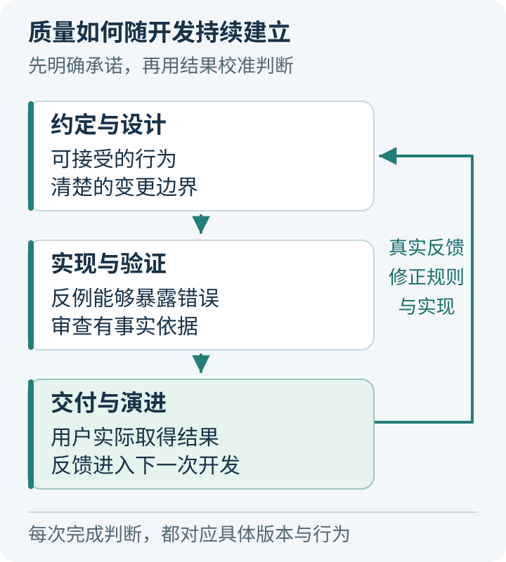
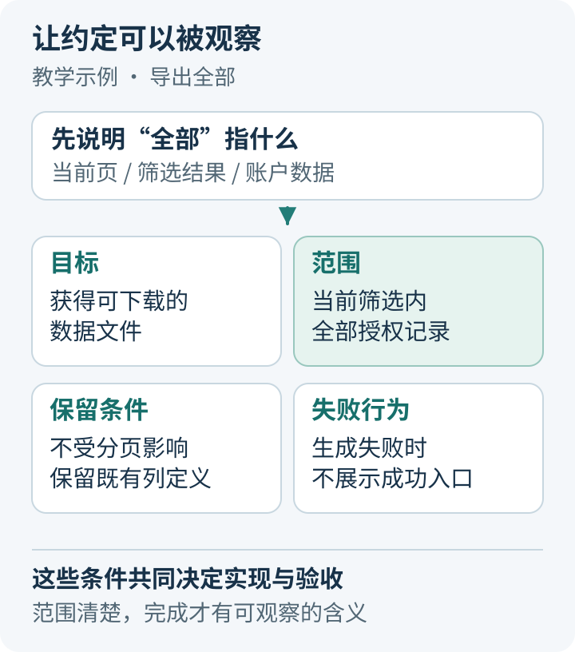
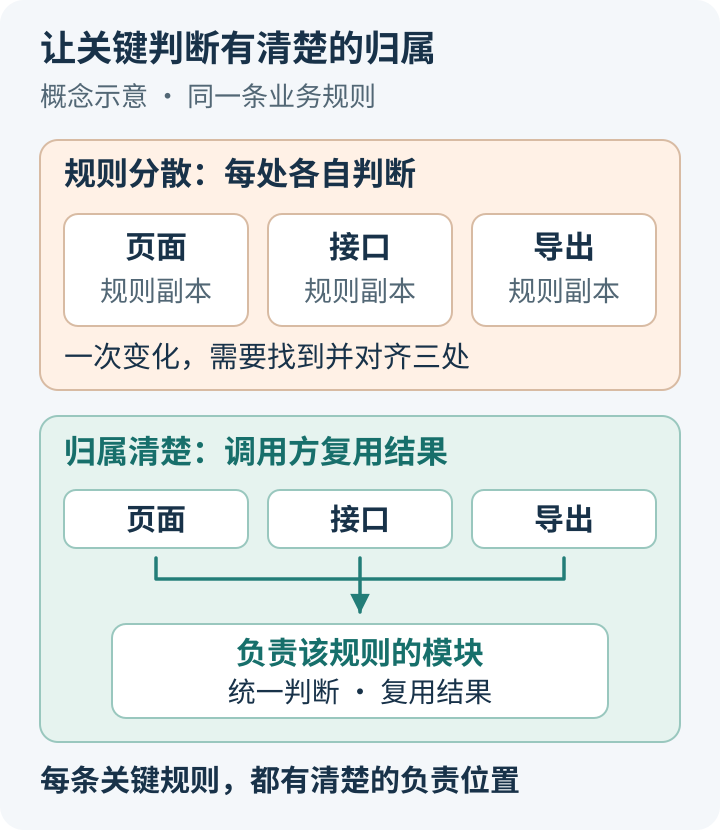
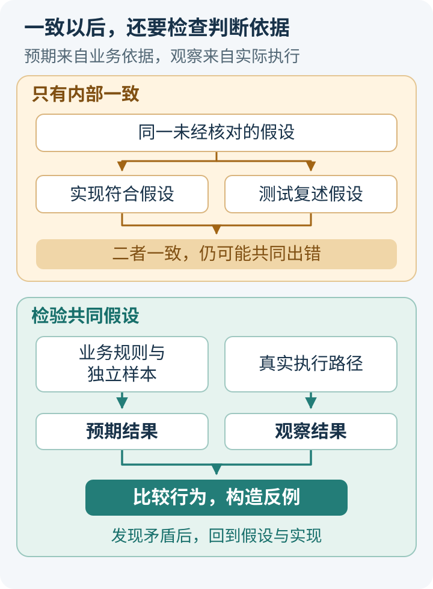
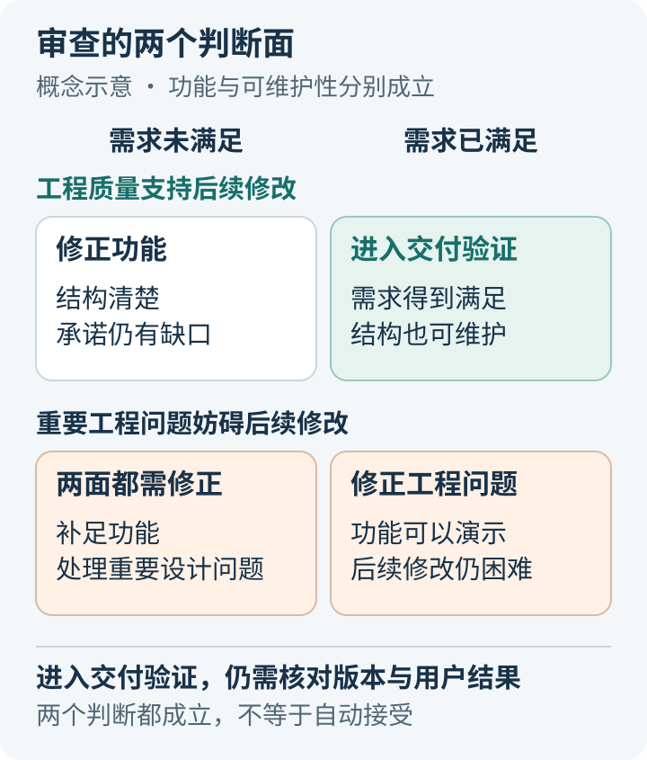
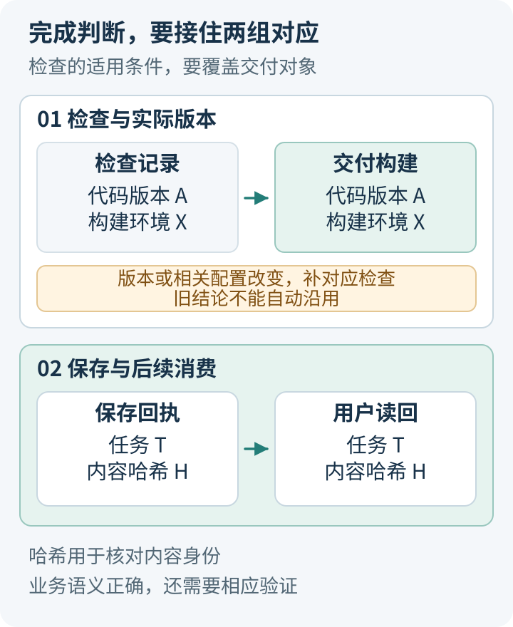
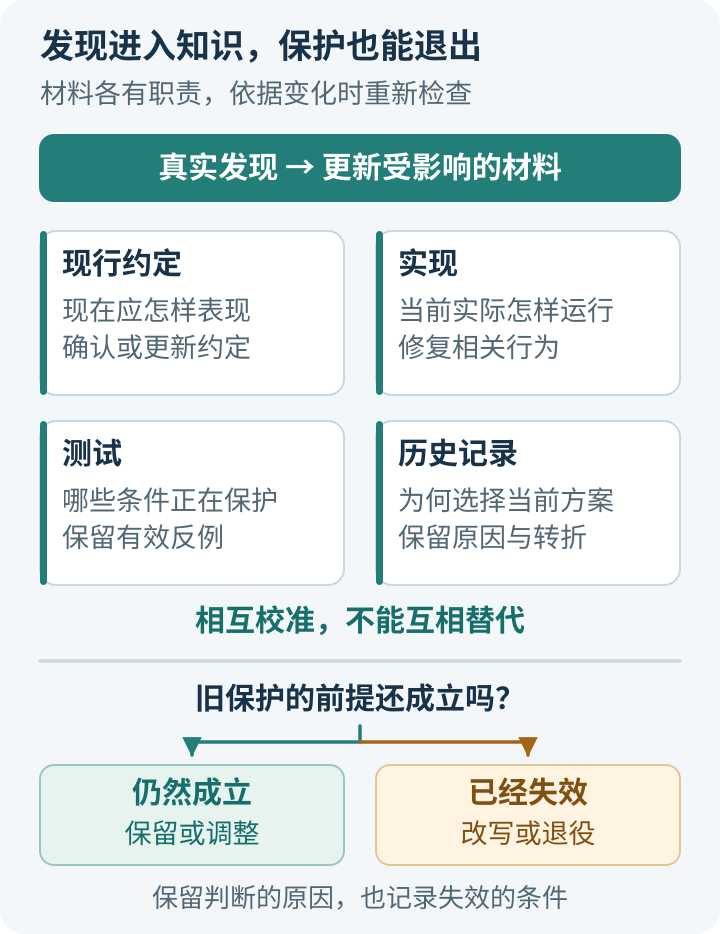

# AI Coding 质量全景：当代码大多由 AI 编写，怎样对整个项目负责？

当 AI 能同时写实现、补测试、更新文档时，一个项目可以很快变得“看起来很完整”。但这几份产物也可能共同沿用一个错误理解：把当前页当成全部数据，把未知值当成零，把任务结束当成交付成功。

因此，对质量的判断，需要同时回答三个问题：**我们承诺的行为是否清楚，现有检查是否有能力发现关键错误，系统是否还能在下一次变化时被理解和修正。**

这让工程师的注意力从某一段代码，延伸到完整的研发过程。需求定义了什么值得接受，架构决定变化如何落地，测试与审查提供判断依据，实际交付检验这些依据是否接到了用户结果，运行反馈则修正下一轮工作。

下文沿这条关系展开。我们的 Agent Engineering Suite、Open ETF Agent，以及行业里的规格驱动、测试和审查方案，会在相应位置作为具体参照。文章的中心始终是：**对于这次改动，我们为什么有理由接受它；下一次条件变化时，这些理由能否重新检查？**

## 一、先定义什么值得接受，才能讨论实现是否正确

“代码能运行”和“功能符合要求”之间，隔着一层业务含义。

假设一个页面要增加“导出全部结果”。全部是当前页、当前筛选结果，还是账户下所有有权访问的数据？用户点击以后，数据继续变化，导出应反映哪个时点？一部分内容不可用时，是整体失败，还是交付能够独立成立的部分？

这些选择会改变实现，也会改变测试。如果没有提前说明，AI 仍然可以写出自洽的代码，并为它配上一组自洽的断言。此时，团队很难分辨实现遗漏与需求变化。

**约定的作用，是让重要的分歧在编码之前就有可以讨论的对象。**

### 把目标写成可以观察的行为

一份有用的约定，不必很长，但应交代输入范围、预期结果、需要保留的条件，以及失败时的处理。

例如，导出任务可以明确为：结果覆盖当前筛选条件下所有有权访问的记录，不受页面分页影响；保持既有列定义；生成失败时不展示成功下载入口。这样的描述已经能导出几项具体判断，而“优化导出能力”很难。

失败边界尤其值得提前讨论。可选附件缺失是否影响正文？外部请求超时能否重试？用户取消之后，已经发生的副作用怎样处理？这里没有脱离业务的统一答案。关键在于把决定放到能够对它负责的人和模块中。

在 AI 参与实现之后，这份约定还承担了另一项作用：让工程师能够看出，某次修改是在实现目标，还是悄悄改变目标来迁就当前代码。

### 规格帮助保存判断，但判断仍需要事实

行业里的 [GitHub Spec Kit](https://github.github.io/spec-kit/reference/agentic-sdd.html) 提供了一个清楚的分工：Spec 描述用户行为与目标，Plan 承接技术方案和约束，Tasks 再组织执行工作。它也检查这些材料之间的冲突与遗漏。这种结构保留了从意图到实现的中间判断；原始需求是否合理，仍需要业务事实来确认。

我们在 [Agent Engineering Suite](https://github.com/hpoenixf/agent-engineering-suite) 中，用 Grilling 和 Spec 工作方法处理相近的问题：先找出会影响范围、兼容性和交付的歧义，再形成可验证的任务。它们指导 Agent 组织工作，不能替团队决定业务答案。[相关实现](https://github.com/hpoenixf/agent-engineering-suite/blob/89c272c22c19f79582fde01eb25859547b6ac3ff/skills/aes-spec-flow/SKILL.md)

这里需要控制投入。简单的文案或样式修改，现有 Issue 中几条明确条件就可能足够；跨模块行为、外部副作用或长期兼容性变化，才更值得留下完整的规格与设计决定。文档的价值取决于它减少了多少重要歧义。

## 二、让变化保持可理解，才能长期负担质量检查

约定清楚之后，质量工作并不会自动转入“多跑一些测试”。还要看这次行为应由哪里负责，变化会经过哪些边界。

如果同一条业务规则同时出现在页面、接口、后台任务和导出器里，一次修改就需要同时理解多个位置。某一处漏改，可能不会立即触发异常，却会让不同入口表现不一致。

这种结构还会影响测试。测试越来越依赖复杂装配，排查失败越来越需要整仓上下文，团队便容易只运行成本最低的一部分。**可维护性会影响未来发现错误的能力，因而本身就是质量的一部分。**

### 让关键决定有清楚的归属

职责划分首先要回答：谁有资格对某个事实作最终判断。

例如，页面可以展示任务已取消，但能否阻止后台继续发布结果，需要由真正控制执行与发布的逻辑决定。调用方可以提交查询条件，哪些数据有权访问，则应在相应的授权边界内解释。

好的接口会隐藏内部协调细节，同时保留有意义的结果。已接纳、执行成功、结果不可用、状态未知，可能需要调用方采取不同动作；全部压成一个 `success`，会把必要判断转移到猜测中。

这并不要求马上拆微服务、增加管理器或重建平台。已有模块内部的一次职责收拢，可能就能减少重复状态。只有现有边界无法承载真实需求时，新增机制才有充分理由。

Open ETF Agent 的一个公开提案体现了这种取舍：把原始资料中的指定值用于计算，再进入报告和 CSV，继续复用原来的结果、工具执行与文件交付职责，没有为了这项需求另建一套结果仓库。[公开设计](https://github.com/hpoenixf/open-etf-agent/blob/afbfb9865539c18c9358ac65c822f929aaa6e872/openspec/changes/result-reference-consumption/proposal.md) 这个选择的可取之处，是让来源和比较条件有统一的判断位置，后续消费者能够复用同一结论。

### 让改动围绕一个完整行为，也让约束能够执行

“小改动”应围绕一个能够解释、验证和撤回的行为变化。它可以跨几个文件，但不应顺带混入无关依赖升级、目录重排和通用抽象。审查者由此能够把每处变化对应到同一个目的。

上下文也应按这种边界组织：让 AI 找到当前约定、相关实现、真实入口和验证方式；需要解释某个特殊分支时，再查它的历史原因。把全部旧材料一次塞进上下文，反而会增加识别现行要求的难度。

OpenAI 在 [Harness engineering](https://openai.com/index/harness-engineering/) 中公开了一个值得借鉴的做法：用简短的仓库入口指向详细知识，并用自定义 lint 与结构测试约束依赖方向等架构规则。这样，部分设计要求能够被工具检查，Agent 也能从失败反馈中找到修正方向。

对普通团队，可迁移的是这个机制：把反复出现、含义明确的约束逐渐变成自动检查。架构本身仍需判断，不必照搬其他团队的分层，更不应把所有风格偏好都变成阻塞开发的规则。

## 三、让检查有机会推翻错误，而不只是确认实现能够运行

有了约定与结构，下一步才是判断实现是否兑现了它们。

测试通过，只说明当前输入、执行路径与断言之间没有发现矛盾。如果预期本身来自错误实现，测试可能非常稳定，却没有提供新的判断依据。

例如，被测逻辑把未知金额转换成零，测试又调用同一个转换函数来生成预期；或者实现只导出当前页，测试也从当前页取得“应导出的记录”。这类检查能够证明内部一致，无法检验最初的业务理解。

**有辨别力的检查，需要能够说明：如果实现以某种重要方式出错，它会在哪里失败。**

### 预期依据和执行结果，应有不同的来路

独立预期可以来自明确的业务规则、人工可核对的小样本、可信的参考实现，或不依赖当前实现的不变量。

例如，集合导出可以检查记录身份与目标集合一致，而不仅是总条数相同；排序可以检查顺序与元素保留；金额计算需要明确币种、精度和舍入规则。预期不一定复杂，关键是它能约束被测实现，而不是复述实现。

我们的 [Open ETF Agent 选行测试](https://github.com/hpoenixf/open-etf-agent/blob/afbfb9865539c18c9358ac65c822f929aaa6e872/test/result-consumption.test.mjs) 使用一个很小的合成表格：100、999、250，约定比较第一行与第三行。若本次读取窗口只有前两行，即使窗口完整返回，也必须拒绝比较，不能用 999 顶替 250。这个反例检验的是操作数是否真正进入选区；只断言“读取成功”就会漏掉关键条件。

这里的独立性来自判断依据，而不只是另开一个 Agent。不同审查者如果都只拿到相同的错误摘要，仍可能重复同一个误解。

### 用反例扩大检查的信息量

反例可以从目标的反面推导：什么情况下，系统会看起来成功，实际却违背约定？

常见情况包括漏掉尾部数据、重复提交、错误币种、过期版本，以及取消和完成的不同到达顺序。时间顺序也是输入；如果一个功能的正确性依赖先后关系，只测试固定的成功顺序就不够。

行业工具能够帮助扩大这种检查，但各自解决的问题不同。

[fast-check](https://fast-check.dev/docs/introduction/why-property-based/) 的属性测试先由作者写出一类输入应满足的性质，再生成多组输入；发现失败时，缩减成更容易理解的反例，并提供重放信息。它能补充手选样例没有覆盖的组合，性质和输入范围仍需工程师决定。

[Stryker](https://stryker-mutator.io/docs/) 则对实现作小幅变异，再运行现有测试，观察测试是否能识别变化。它直接追问“这处逻辑被改坏，测试会不会仍然通过”，因此能补充代码覆盖率没有回答的问题。部分变异不改变可观察行为，需要分析，不能把每个存活项都认定为缺陷。[等价变异说明](https://stryker-mutator.io/docs/mutation-testing-elements/equivalent-mutants/)

不必给所有代码都加上这些工具。对关键规则、复杂状态变化，或覆盖率很高却仍然容易漏错的模块，它们更值得投入。普通低风险修改，清楚的样例与针对性检查往往已经足够。

### 再看结果有没有进入真正的消费者

函数正确，不代表组合后的行为正确。一个计算结果可能已经写入存储，却没有进入下一次模型请求；页面显示保存成功，下载入口却仍然返回旧文件。

因此，验证应沿关键交接继续前进。既检查生产者输出什么，也检查下一位消费者实际使用了什么。适当的模拟可以帮助隔离问题，但模拟返回成功，并不等于真实外部系统已经完成操作。

这同样提醒我们区分两类工作：用 AI 开发普通软件，可以主要验证确定的产品行为；产品运行时也包含模型时，还需要检查模型选用资料、组织论证和处理未知的表现。工程链路正确与答案语义正确，需要各自合适的证据。

## 四、审查实现，也审查我们凭什么相信它

自动检查适合执行已经表达清楚的规则。审查还要处理另一类问题：规则是否遗漏了重要条件，当前测试是否真的覆盖了承诺，这次设计是否让未来修改更困难。

因此，审查者需要接触原始需求、真实改动和相关执行结果。只阅读实现者整理的“已完成事项”，容易继承同一套选择与解释。固定比较基点、纳入实际变更范围，才能知道究竟审查了什么。

### 功能判断与工程判断，需要分别成立

需求实现关注用户承诺：是否漏做、做错、扩大范围，关键失败条件是否处理。工程质量关注系统本身：职责、复杂度、依赖、重复状态，以及未来维护的难度。

这两个判断面不能相互替代。代码很整齐，仍可能漏掉业务条件；功能能够演示，也可能依靠一组难以继续修改的特殊分支。

[Google 的代码审查指南](https://google.github.io/eng-practices/review/reviewer/looking-for.html)同时讨论功能、设计、复杂度、测试和文档；其[审查标准](https://google.github.io/eng-practices/review/reviewer/standard.html)又强调，应让整体代码健康得到改善，同时允许有益改动持续进入。这个平衡很重要：审查需要保护未来，也不能因个人偏好和局部不完美无限拖延。

我们在 Suite 的[双轴审查方法](https://github.com/hpoenixf/agent-engineering-suite/blob/89c272c22c19f79582fde01eb25859547b6ac3ff/skills/aes-code-review/SKILL.md)中，分别保留工程规范与需求实现的结论，并要求问题有具体位置、触发条件和依据。它帮助组织审查，最终是否发现了有价值的问题，仍取决于实际判断。

### 特别审查测试和失败边界的变化

AI 很容易同时修改实现与测试。因此，“现在全部通过”还需要再追问：原来失败的原因是什么？修复保留了约定，还是把断言改成了当前实现的行为？

测试可以修改，但理由应该明确。业务约定正式变化，旧断言需要更新；如果只是为了让候选实现通过而删掉关键条件，就失去了保护。

审查还需要寻找已有测试没有覆盖的失败边界。Open ETF Agent 的一段[公开开发记录](https://github.com/hpoenixf/open-etf-agent/blob/afbfb9865539c18c9358ac65c822f929aaa6e872/openspec/changes/result-reference-consumption/evidence.md)展示了这种价值：正常路径的相关检查通过后，后续审查仍发现，可选计算或附件的错误引用会使整次运行失败，连独立有效的正文也无法交付。修复把这类失败限定在局部不可用，同时保留了独立正文的交付能力。

这项发现的价值，在于它提出了原有检查没有覆盖的条件，并说明为什么该条件违背任务约定。它也提示我们：增加 Reviewer 的数量，只有在带来新的依据、视角或反例时，才增加了判断的信息量。

审查应当允许修复完成后结束。格式、命名等已由可靠工具覆盖的问题，不必反复消耗人工注意力；有依据的功能错误和重要设计问题优先处理，普通建议可以留给合适的后续改进。

## 五、把完成落实到同一版本的用户结果

即使设计、实现、测试和审查都做了，仍然可能在最后一步失去对应关系。

测试运行后代码又发生了变化；本地验证的是一组依赖，发布构建使用另一组；后台任务完成了，用户下载的却是之前的文件。此前的检查可能完全真实，只是没有检查到最终交付的对象。

所以，完成判断需要接住两件事：**被检查的版本是否就是被接受的版本，用户取得的结果是否就是这次任务的结果。**

### 让检查结论保留它的适用条件

一条“测试通过”的消息，应当能够回到具体的代码版本、运行环境、输入条件与实际输出。记录不一定复杂，现有 CI、构建信息和 PR 已经能表达时，就继续使用它们。

关键是不能把旧结果悄悄改名为新验证。某个版本通过，并不能自动说明后来的改动也通过；调整了直接影响行为的配置，也可能需要补相应检查。

Suite 的[证据工具](https://github.com/hpoenixf/agent-engineering-suite/blob/89c272c22c19f79582fde01eb25859547b6ac3ff/skills/aes-spec-flow/toolkit/docs/evidence-format.md)在这里承担有限但明确的工作：检查任务、观察记录和引用产物之间的结构关系，检查汇总视图是否与输入一致，并保留历史完成记录的原版本。它不运行测试，也不把格式正确当成业务正确。

这个分工可以推广到其他工具：程序适合维护确定的对应关系；检查是否充分、剩余风险是否可以接受，仍然需要项目判断。把所有结论压缩成一个绿色状态，会隐藏这些差异。

### 用用户的消费方式检验交付

对于页面功能，验收应走到页面上的实际操作与结果；对于报告任务，至少要读到报告内容和附件；对于异步任务，还要检查重新查询后能否取得原结果。

[Playwright 的最佳实践](https://playwright.dev/docs/best-practices)强调用户可见行为、面向用户的定位方式，以及测试之间的隔离。它让前端检查接近用户实际操作的路径。断言仍然需要对应业务结果：按钮出现、请求返回成功，未必代表业务已经完成。

我们在 Open ETF Agent 的[交付检查](https://github.com/hpoenixf/open-etf-agent/blob/afbfb9865539c18c9358ac65c822f929aaa6e872/test/result-consumption-cli.test.mjs)中采用了另一个具体做法：生成进程退出后，另一个进程通过原读取入口取回报告和 CSV，并确认它们对应同一次计算和原始来源。这比内存里得到一个成功结果，多检查了保存与后续消费之间的交接。

内容身份也有边界。读回内容的哈希与保存回执一致，可以核对取得的是保存时对应的内容，却不能证明报告中的全部文字正确。前面的取数、计算与语义检查，仍然各有作用。

上线后，验证还需要连接监控与恢复。观察应覆盖本次变化承诺的结果；灰度范围要能触发改变的条件；回滚软件之外，还要考虑已写入的数据或已发送的内容怎样修正。这些投入由实际副作用决定，不需要每项小修改都建设完整发布平台。

## 六、让发现改变下一次开发，也让过期保护退出

如果一次修复只留在聊天记录里，下一次 Agent 可能无法知道：某个分支为什么存在，某条规则曾经排除过什么错误，哪个旧方案已经退出。

质量因此还取决于知识怎样保存和更新。规范、代码、测试与历史都很重要，但它们回答的问题不同。

| 材料 | 主要回答的问题 |
| --- | --- |
| 现行约定 | 系统现在应该怎样表现 |
| 实现 | 当前实际怎样完成这个行为 |
| 测试 | 哪些条件和反例正在保护它 |
| 历史记录 | 为什么选择当前做法，哪些旧假设已经失效 |

这四者需要相互校准，但不能互相替代。代码存在某个行为，不代表它已经成为业务承诺；历史中记载过一个限制，也不代表该限制永远有效。

### 保留原因，更新现状

一项真实发现，通常会带来几种不同变化：实现修复错误，测试保留有价值的反例，当前文档说明现在怎样使用，历史记录解释重要取舍的来路。

我们把这类工作分别放进 Suite 的 [History](https://github.com/hpoenixf/agent-engineering-suite/blob/89c272c22c19f79582fde01eb25859547b6ac3ff/skills/aes-history/SKILL.md) 与 [Docs 维护方法](https://github.com/hpoenixf/agent-engineering-suite/blob/89c272c22c19f79582fde01eb25859547b6ac3ff/skills/aes-docs-maintenance/SKILL.md)中。值得保留的是会影响以后判断的原因，而不是每次命令执行的流水账；使用说明则应跟随现行实现和实际验证更新。

例如，可选附件失败仍允许独立正文交付，现行约定应说明这个行为，测试保护它，历史再解释为什么需要这个区分。下一次重构时，Agent 才能理解这个分支的作用，并判断它是否仍然必要。

同样重要的是退出过期保护。业务约定已正式变化，旧测试可能需要改写或删除；一个临时兼容层的使用方已经退出，也不应永久保留。每一项保护都会增加运行、理解和维护成本，保留它需要一个仍然成立的理由。

### 按错误后果分配投入，并保留停止条件

质量工作无法穷尽所有可能错误。合理的投入，需要考虑错误发生后的影响、是否容易发现，以及能否恢复。

一个可撤回的样式调整，通常不需要完整的架构评审；金额、权限、持久化状态和不可逆副作用，则值得更强的依据、反例和人工判断。对重复而稳定的规则，可以逐步自动化；对仍有实质分歧的决定，应保持明确讨论。

一次改动可以在这些条件成立时结束：关键承诺得到验证，重要反例能够被正确处理，审查发现的实质问题已解决，用户路径在相应版本上成立。尚未覆盖的相关风险，也应通过限制使用范围、补充观察或明确接受来处理。继续检查应由新的问题或证据缺口推动。

工程师可以把大量实现与执行工作交给 AI，同时继续掌握目标、关键取舍和接受标准。核心逻辑无法解释、检查为何有效无法说明时，就需要回到相应代码和依据，而不只是再获得一次“通过”。

**一个能持续负责的项目，应让今天的接受理由清楚，也让明天的变化有条件重新检验这些理由。** 这条能力贯穿约定、设计、验证、审查与交付，最后由真实反馈继续修正。

## 实现与延伸阅读

[Agent Engineering Suite](https://github.com/hpoenixf/agent-engineering-suite) 提供本文涉及的任务组织、审查与证据维护方法；[Open ETF Agent](https://github.com/hpoenixf/open-etf-agent) 提供对应的公开设计、实现与检查。两者分别承载研发方法与可运行案例。

希望动手的读者，可以下载配套的<a href="/eff-agent-article/downloads/ai-coding-quality-panorama/practice-guide.zh.md" download>实验说明</a>与<a href="/eff-agent-article/downloads/ai-coding-quality-panorama/readback-result-consumption.mjs" download>读回脚本</a>，运行合成数据案例、查看实际报告与 CSV，再检查历史任务记录。正文中的行业方案按各节的一手链接继续阅读即可，无需一次采用全部工具。

相关专题：[文档、代码与测试共同演进](docs-code-tests-evolve-together.md) · [判断什么值得验证](ai-coding-judgment-and-verification.md)。如果这些方法与教学实现对你有帮助，欢迎为上面的开源项目点一个 Star。
