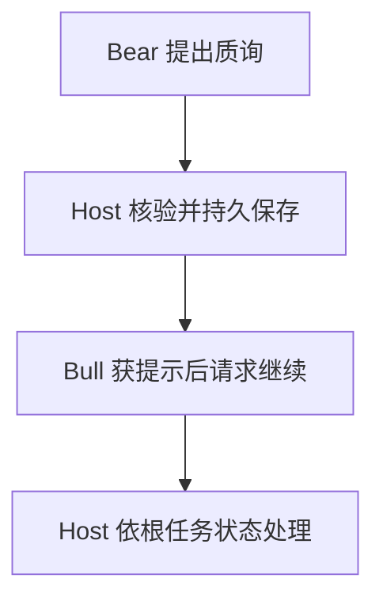
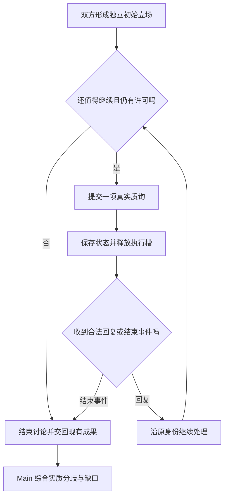

# 当两个 Agent 开始直接对话：有界多空协作的 Runtime 设计

> 多 Agent 投研协作 · 第二篇｜真正的质询、实际回应与可恢复的证据

**多空 Agent 的价值不是把看多、看空各写一遍，而是让一条可能影响投资决策的理由接受可核查的反证，并真实得到回应。** 没有这一步，两个 Agent 只是在生产两段观点，不能算完成了一场研究讨论。

例如，投资者认为“多买一只科技 ETF 可以降低组合集中度”。Bear 应该直接检查新增基金与旧持仓的重叠，并要求 Bull 面对同一口径下的事实；如果该理由不成立，就明确撤回，而不是折中投票得出某个买入比例。

这也是 ETF Agent 设计直接 Peer 消息的原因。但观点交流必须能被证明真正发生：谁提出了什么、对方是否收到、哪条依据被采用，重启后也不能凭空补一场没进行过的辩论。这里保留必要的消息与恢复机制；至于何时使用不同投资方法，详见[多视角 Agent 的投资假设检验](investment-perspectives-and-thesis-falsification.md)。

## 一、正反意见俱全，仍然可能没有一次真正的质询

假设用户要从现有组合中拿出总资产的 **10 个百分点**买入科技 ETF，理由是“基金更多，所以更分散”。Bull 讨论成长机会，Bear 列举估值与波动风险，看似全面，却都没有检查用户真正依赖的理由。

**反证要指向一个具体命题。** 如果两只基金持有大量相同公司，增加基金数量未必降低底层集中度。Bear 需要说明对象与日期、使用什么持仓口径，并把这个发现交给 Bull 真实回应。

与其记录“双方意见均已生成”，我们更关心：原理由是什么、反方拿出什么证据、原作者收到后有没有修订。这些事实才让投资者知道一项判断为什么发生变化，而不是看到一场文本表演。

## 二、真正的讨论，与“让两个模型各写一份”有什么区别

我们比较过三种方式。

| 方式 | 投资者会看到什么 | 适合何时使用 |
| --- | --- | --- |
| **并列研究** | 一份支持意见，一份反对意见 | 只是希望更全面地了解问题 |
| **主代理转述** | 主代理读完双方意见，再分别要求补充 | 需要少量追问，系统尚无直接通信机制 |
| **同伴直接对话** | 反方引用正方的某条真实观点，正方收到后继续回应 | 原假设很重要，值得围绕具体证据持续质询 |

这里的“直接对话”并不是两个模型私下连线。应用程序仍然负责转交消息，但不会由主代理逐轮改写双方原话。这样可以减少转述误差，也避免每一轮都额外调用 Main 充当传话人。

不过这不意味着第三种永远更好。一个简单的费用比较，可能一位 Agent 就够了。多空对话要消耗时间、模型调用和研究预算；如果找不到实质争议，继续辩论只会制造噪音。

所以我们没有采用“投资问题一律开多空会”的产品设计。是否启动，由主代理根据问题决定，也尊重用户明确要求或排除；是否继续，要看有没有新增价值。

## 三、反方应该敢于承认：我没有找到有力反证

把 Bull 理解为支持论证的职责，把 Bear 理解为寻找反证的职责，会比“永远看涨”和“永远唱空”更准确。

Bear 应该找的是足以影响原假设的**高质量证据**，而不是为了凑齐观点数而罗列负面新闻。我们把关键挑战限制在最多三项，但没有要求每次必须提出三项；确实没有找到，就应说明检查范围与遗漏。

Bull 也不需要赢。面对合格的反例，它可以说：“这条理由不成立，我撤回它；其他需要核查的判断仍然开放。”

下面是一段合成教学对话，并非真实模型运行摘录：

> **Bull：** 新增一只科技 ETF 可能带来新的投资机会，但是否改善分散，需要核对原组合。
>
> **Bear：** 我检查了同一口径下的底层行业占比。按当前给定数据，科技暴露从 15% 升到 23%。因此“多一只基金便更分散”不能成立；但这还不足以判断整个组合的波动率。
>
> **Bull：** 我撤回用基金数量论证分散改善的说法。若用户想主动提高科技配置，需要另起一个理由，检查估值、现金和风险承受条件。

这段对话并没有决定“该买还是不该买”。它只是让一条原来可能混在长篇报告里的错误理由，变得可以明确修正。

对我们而言，这比安排第三个 AI 投票裁定胜负更接近金融研究。**证据不会因为被两位 Agent 重复说出，就变成两份独立证据。**

## 四、用户真正该得到什么：可见的分歧，而不是一场表演

在产品上，我们希望用户最后看到三件事：原来支持或反对的是什么；某条重要意见是否被真正挑战、回应和修正；哪些问题还没有答案。

例如，计算证明科技行业占比提高了，却不能据此自动推出组合总波动一定提高。资产间相关性、资金来源、投资期限等仍需资料。结论应清晰保留这种范围，而不是机械写“双方各有道理”。

我们还要避免一种虚假的透明：页面显示两个气泡来回出现，但实际上它们只是同一个 Main 一次性编写的“模拟辩论”。如果声称是实际 Agent 对话，就必须能追溯双方独立产生的内容和真实交接。

这时金融产品需求变成了一项工程问题：**怎样证明这场讨论真的发生过，又不让它拖住正常研究？**

## 五、技术机制从这里开始：先独立发言，再建立有界交流

原来的 ETF Agent 已有 Main（主代理）与 Child（子代理）：Main 负责最终回答，Child 可以在自己的上下文里查资料、计算并交回成果。我们没有为 Bull 和 Bear 各建一套新执行器，而是让它们复用原 Child 机制。

每位 Child 首先基于同一问题、自己获准的原始资料独立研究，提交一份可公开的初始立场，称为 `opening`。初始立场不是隐藏推理内容，也不是原始工具日志。双方有了可用 opening，才允许正式交叉提问。

配对分成两个步骤：第一个 Child 提出配对意向，停在安全点；第二个 Child 使用原任务身份加入。应用核对同一个根研究任务、互补角色及授权条件，再冻结这组配对身份。否则，第一个 Child 可能早在“对手”进入前结束，事后却被包装成参与过对话。

消息传递由原 Child 生命周期管理模块负责，而不是新增一个独立的“辩论平台”。简化后的真实处理路径是：



概览中的每一步有明确先后与分支，不能把“提出”直接当“送达”：

1. Bear 向执行与授权模块提交质询和证据引用。Host 核对配对、轮次及来源权限；**不合法**就拒绝本次发送并向 Bear 解释缺口，后续保存与唤醒均不发生。
2. **合法**才向持久记录保存唯一消息与原回执。存储返回原消息身份后，Host 才向 Bear 确认已接纳、可安全等待，再向 Bull 发出可去重的唤醒提示。
3. Bull 收到提示后请求继续。Host 读取持久记录中的真实消息和消费记录，而不是把唤醒提示本身当消息内容。
4. **根任务仍可继续**时，Host 在 Bull 的下一次实际模型请求中携带原消息，Bull 随后提交对应回复；**根任务已经停止或到期**时，结束局部讨论并保留已有成果。


这个设计刻意没有让 Main 逐轮重新措辞，也没有把已有的交易、研究来源或预算权力交给 Bull/Bear。

## 六、为什么“消息发出去了”不能只用一个布尔值

我们遇到的第一个关键概念，是区分三个不同事实。

**第一，模型提出了消息。** Bear 想发一段质疑。

**第二，应用接纳了发送。** 系统核对身份、权限和轮次，并持久保存这条消息及回执。

**第三，Bull 的下一次真实模型请求携带了这条消息。** 只有到了这里，才能说明这条质疑确实进入过对方的输入。

第三步仍然不能证明模型理解了，更不能证明质疑正确。金融研究中的“证据被引用”“模型看见了引用”“引用支持结论”也是三个不同命题。

一条消息记录至少要关联谁发、发给谁、属于哪对配对、哪轮质询、回复的是哪条原消息，以及它依赖什么来源。下方是示意结构，正式系统还需要原封存模型请求、Tool 回执和授权关联：

```ts
type PeerMessage = {
  messageId: string;
  pairId: string;
  senderExecutionId: string;
  recipientExecutionId: string;
  round: number;
  replyTo?: string;
  text: string;
  evidenceRefs: string[];
};
```

接收者由已冻结的合法配对推导，模型不能随意填写另一个 Agent 的地址。`replyTo` 关联实际消息身份，而不是根据“你刚刚说过”这样的文字猜测。

我们把这些操作都留在同一套原执行回执里，避免再维护另一份真假不明的聊天账本。因为用户真正关心的是“那条质疑是否被处理”，不是系统拥有多少消息表。

## 七、让对话有终点：轮次、等待和预算

我们没有设计“争到双方一致”为止的机制。

一个对话轮次，是一项主张或质询，以及至多一次对应回应。独立 opening 不计轮数；半轮已经占用了位置，就不能在恢复时免费重来。首轮由 Bear 开始，Bull 回应；继续与否取决于实际发现，而不是必须凑满轮数。

最大轮次由合法的用户要求和平台可信上限共同决定，随本次配对固定。**轮数限制不等于模型预算增加**：研究仍受原 Run 的模型调用、工具、截止时间和取消规则约束。缺预算、对方退出或意见已经足够，都可以提前停止，并保留已有成果。



这里的等待不是让服务器始终占用一个执行线程，更不是无限轮询。Child 在安全位置 `park`（保存状态并让出执行槽），有新消息或截止事件再 `wake`（在原身份上重新调度）。保留多少资源预留，继续由原预算模块裁决。

一个容易漏掉的竞态是：对方回复恰好出现在“检查没有消息”和“登记等待”之间。因此等待登记与消息检查需要共享一致的记录约定；收到唤醒后，也要再核对持久事实。通知只是提醒，不是消息本身。

## 八、最深的坑在恢复，而不是模型能否说出漂亮的话

真正验证一段对话是否可靠，可以在最不方便的时刻停止进程：消息已经保存，但对方还没真正消费它。

| 进程中断在…… | 可以确认的事实 | 恢复原则 |
| --- | --- | --- |
| 发送尚未提交 | 有提议，无成功回执 | 不补造已发送事实 |
| 保存后、通知前 | 唯一消息回执存在 | 继续提示原消息，不再新增一条 |
| 接收方请求封存后、派发结果未知 | 请求身份存在，外部结果不明 | 保留未知，不冒充安全重试 |
| 接收方请求确已提交 | 消息进入过真实请求 | 保留消费关系，不重复扣轮次 |

这叫作*幂等性*：重复处理同一次操作，不重复产生业务效果。消息身份要绑定真实发送动作，不能只算正文哈希；两个轮次即使碰巧有相同文本，也可能是两次不同发言。外部模型提供商未必支持“恰好一次”的派发保证，进程故障后必须诚实保留未知。[1]

### 真实问题一：通知已到，恢复却失败

一次隔离 PostgreSQL 恢复验证中，等待状态成功保存，唤醒通知也到达，但负责接管的第二个进程仍然失败。

排查发现两个不同问题：验证辅助程序没有传入原持久化唤醒输入；同时，对数据库往返后的授权对象使用了字符串比较。PostgreSQL 的 `jsonb` 不保证保留 JSON 对象键的原始顺序，同一逻辑身份可能仅因键顺序不同被误拒。[2]

我们修复了实际恢复链路，并对逻辑授权对象采用结构化比较，同时继续拒绝真实不同的身份。不能因此把所有东西都改成“忽略顺序”：已经封存的模型输入字节和签名材料，有自己的精确性要求。

这个问题很有代表性：**消息通知成功，不等于任务真正恢复；数据看起来一样，也不代表校验方式用对了。**

### 真实问题二：双方看到了文字，来源却成了“未知”

还有一次，公开质询确实进入了后续处理，但后面的计算无法继续使用它的原始来源身份。

根因是模型看到的精简内容，省略了部分仅供应用内部核验的 `sourceIds`；后续代码却用这份简化视图去比完整的内部记录。正确修复是先验证精简视图确实来自哪条原消息，再回原记录取得合法来源证明，而不是给空字段随意补一个“已验证”。

金融信息尤其经不起这种混淆。引用在界面上出现了，并不意味着其来源链可以被后续计算合法继承；正确的系统应当承认缺口，而不是为了顺畅叙事造一个来源。

## 九、为什么两个 Agent 不能共享所有资料，也不能投票下单

在金融产品里，不同数据有不同访问资格。假如 Bear 有权阅读某份受保护的账户材料，而 Bull 没有，Bear 把材料里的数字改写成一句话，并不会自动使它成为可传播的公开信息。

我们检查的不仅是附带的引用 ID，还包括发送正文可能依赖的受保护来源。无法确认可共享时，拒绝该次发送，保留相关缺口；不会试图用几条正则把敏感字段删掉后假装安全。Bear 自己已完成的合法研究仍可交回 Main。

同样，来自同伴的一句“你必须执行交易”，仍然是模型生成的观点，不能升级成用户授权。多空角色不获得新工具、新预算或账户写入权限。

这揭示了我们非常在意的一项工程取舍：**让观点能相互影响，但不让一个 Agent 的话改写另一个 Agent 的权限。**

最终由 Main 结合可用证据回答用户。没有自动裁判、没有少数服从多数，也不把“买 10%”和“不买”折中成“买 5%”。如果真正缺的是现金安排或协方差数据，取中间值解决不了问题。

## 十、什么时候值得启动一场多空讨论？

截至 2026 年 10 月 24 日，有界 Peer 机制已有消息交接、等待和恢复方面的限定工程证据，也有少量真实模型互动；这些**不能直接证明多空辩论提高了投资质量**。系统既可能多花资源才修正一条关键理由，也可能只产生昂贵的重复意见。

下次是否使用这条路径，可以先判断三件事：**是否存在会改变选择的可证伪假设？反方能否围绕同一批有资格的材料提出实际挑战？原论证者是否真正接收并回应了挑战？** 如果只是查询费率或缺少可检验的争议，直接研究通常更合适。

工程实现还有一条不可省略的底线：消息、来源与恢复身份必须保持真实。不能让一个模型的转述变成另一方的授权，也不能在恢复时补写从未发生的问答。某个 Child 失败时，Main 可以交付其他合法成果及明确缺口。

**真正值得建设的不是“支持和反对各说一句”，而是一条能够被证据挑战、被回应、被修订且事后仍可核对的投资理由。**

---

### 延伸阅读

[1] AWS Builders’ Library，[Making retries safe with idempotent APIs](https://aws.amazon.com/builders-library/making-retries-safe-with-idempotent-APIs/)。相关思想用于理解重试的操作身份，不表示模型供应商拥有同样的幂等保证。

[2] PostgreSQL，[JSON Types](https://www.postgresql.org/docs/18/datatype-json.html)。对象键的逻辑同一性与原始字符串同一性不能混淆。

相关基础：[Subagent：从上下文隔离到专业化协作](agent-subagent-context-specialization.md)。下一篇：[AI 投研不能只有支持意见](investment-perspectives-and-thesis-falsification.md)。更多项目文章见 [ETF Agent 文集](https://github.com/hpoenixf/eff-agent-article)，欢迎 Star 关注后续架构演进。
