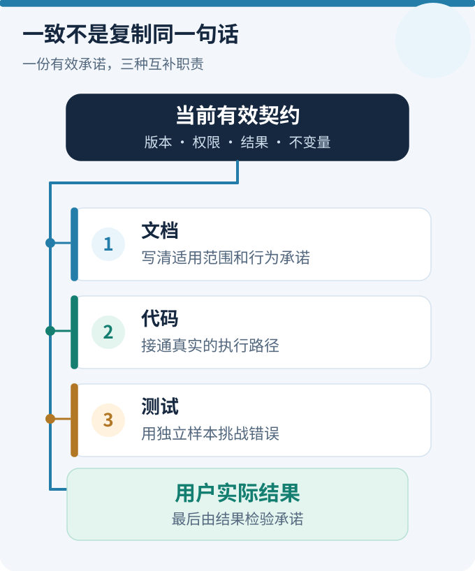
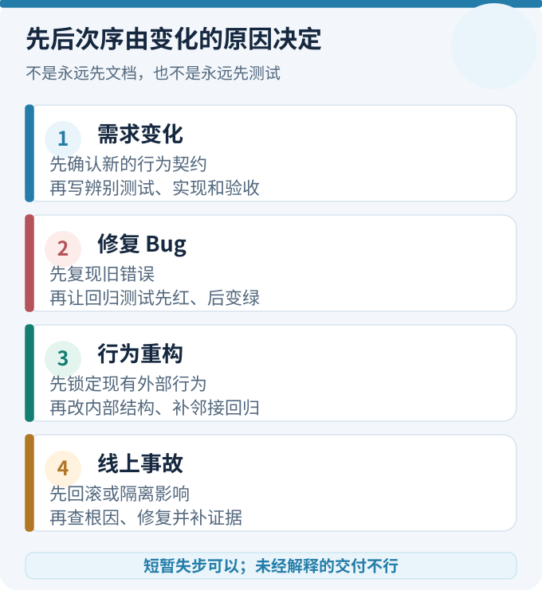
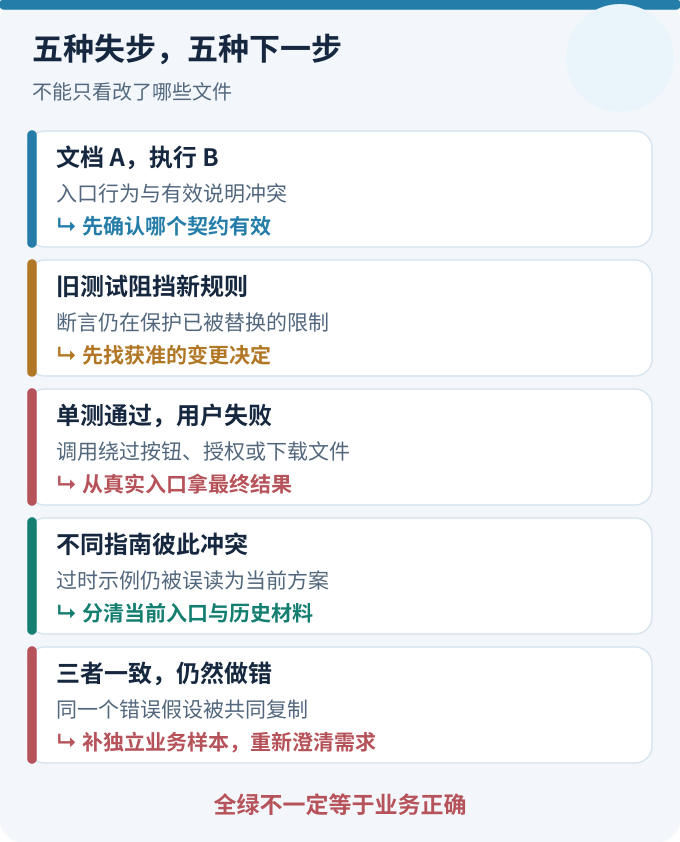
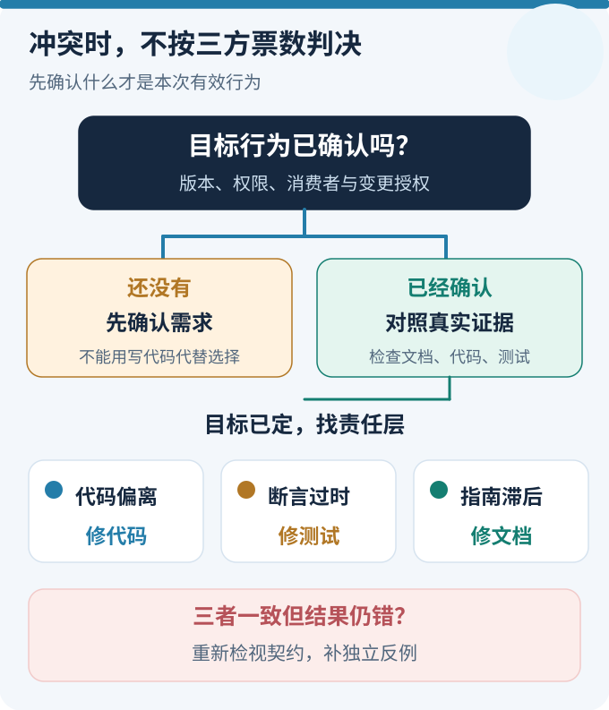
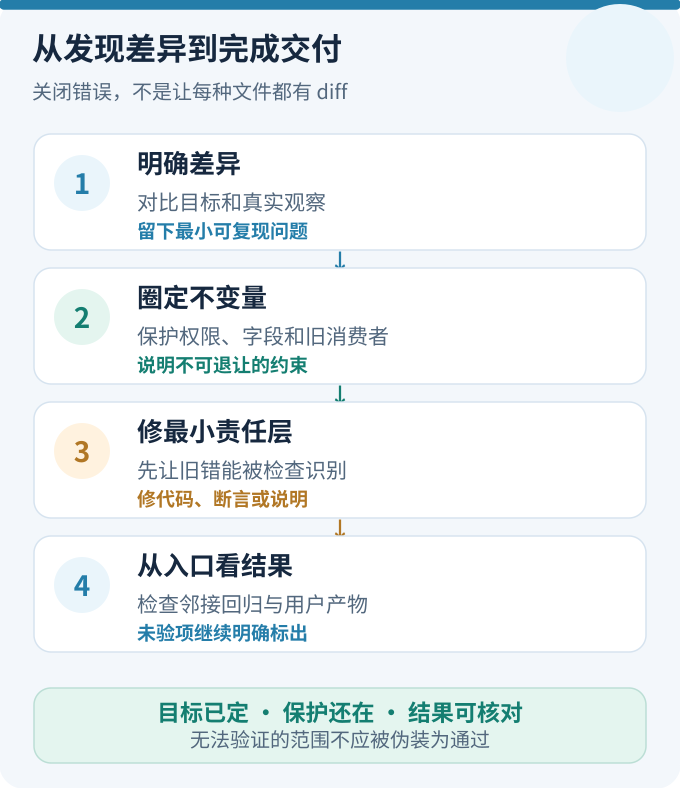

# 测试比实现还多之后：怎样让文档、代码和测试一起向前

一次需求变更之后，文档说“导出全部”，代码只导出当前页，测试却全部通过。应该先改代码、先改测试，还是先更新文档？如果三者的描述都一样，却都误解了用户需求，又该听谁的？

这类问题难在**三者没有固定的主从关系，也没有永远正确的修改顺序**。文档表达约定，代码负责执行，测试用样本提出可证伪的预期；真正决定它们应该维护什么的，是当前有效的行为契约和实际观察。开发过程允许短暂不同步，但一次变更准备交付时，必须能解释差异为何消失、哪些保护仍在。

本文给出一套能直接用于需求、Bug、重构和迁移的工作方法：先判断变化类型，再确定先后次序；用几种互补的检查定位失步；找到冲突的责任层；最后把检查嵌入日常 PR，而不是依靠一句“记得同步”。

## 一、先回答一个问题：究竟以谁为准？

最容易犯的错误，是默认“文档是标准答案”“测试都过了就对”或者“现有代码才是真相”。三者提供的证据不同。

<figure>
  
  <figcaption style="text-align:center;color:var(--vp-c-text-2);font-size:.88rem;line-height:1.6">图 1｜三种职责，不是一条固定流水线 · <a href="../visuals/docs-code-tests-evolve-together/contract.svg">放大查看</a></figcaption>
</figure>


| 对象 | 能回答什么 | 不能单独证明什么 |
| --- | --- | --- |
| 当前有效的需求、设计决策或接口契约 | 系统**应该**怎样表现，哪些旧行为被替代，哪些保护不能退让 | 代码已经按约定工作 |
| 当前文档（规范、指南、示例） | 约定怎样向开发者与使用者表达 | 文字仍适用于今天的版本 |
| 当前代码及真实执行路径 | 系统**实际**调用了什么、返回了什么 | 该行为符合用户需要 |
| 测试及其预期样本 | 哪些具体情形已被检查，能否识别某类错误 | 预期一定正确，也不证明未测路径 |
| 用户操作、生产现象或受控端到端观察 | 结果是否从实际入口到达使用者 | 所有其他条件与长期场景均正确 |

第一行是**判断目标**，其余是**实现与观察证据**。这里的“有效契约”不是特指一份命名为 Spec 的文件；它可能是已确认的业务规则、API 兼容承诺、ADR 或任务中的明确验收条件。版本、适用对象与批准状态必须先对齐。历史需求不因为曾经写进文档就继续生效，未获确认的新想法也不因为代码已写出来就自动成为契约。

一个可操作的判断顺序是：

1. **先定范围和时点**：讨论的是哪个版本、用户入口、功能模式与消费方？是既有行为修复，还是获准修改行为？
2. **找到可追溯的有效约定**：哪句话规定了预期？由谁确认？若不同文档矛盾，查看决策或变更记录，不靠文件修改时间投票。
3. **收集三个独立视角**：文档怎样说，代码真实怎样做，测试究竟断言了什么；必要时补上用户结果。
4. **若找不到有效约定，先解决业务歧义**。不能让修改代码或调整断言代替业务决策。

因此，“保持同步”不是让三份材料逐字相同，而是让它们分别回答自己的问题，同时支持**同一份当前有效的行为承诺**。

## 二、到底谁先谁后？按七类变更选顺序

先后顺序由**变化的来源**决定，不由文件类型决定。下面的“先”指取得下一步决策所需的依据，并非强制所有团队采用同一种 TDD 仪式。

<figure>
  
  <figcaption style="text-align:center;color:var(--vp-c-text-2);font-size:.88rem;line-height:1.6">图 2｜判断变更类型，再决定先后顺序 · <a href="../visuals/docs-code-tests-evolve-together/sequence.svg">放大查看</a></figcaption>
</figure>


| 变更类型 | 最先做什么 | 随后的主要动作 | 交付前还要确认 |
| --- | --- | --- | --- |
| 新功能或业务规则变化 | 确认新契约及不变的约束，更新对应规范 | 写能区分新旧行为的测试，实施代码；允许小步交替 | 新预期通过、旧保护仍在，用户入口可用 |
| 修复违反已有规则的 Bug | 从故障现象复现，找到**现行**预期 | 先添加能失败的回归用例，再修代码 | 证明原故障会被用例抓到；文档若本来正确不必改 |
| 保持行为不变的重构 | 锁定现有外部行为、消费者与回归基线 | 必要时先加特征测试，再重构内部实现 | 合同未变；仅更新过期架构说明，不改业务预期 |
| API、协议或数据迁移 | 明确新旧并存窗口、兼容消费者和退出条件 | 先保兼容检查，再分阶段改实现与契约说明 | 旧消费者是否退出、旧测试是否可安全退役 |
| 发现旧测试断言过时 | 查清需求版本与测试所保护的行为 | 修正、拆分或删除过期断言；仅对真实缺陷改代码 | 新测试能抓住错误，旧的独有保护没有丢 |
| 发现文档错误或示例落后 | 检查代码、测试、当前契约与公开入口 | 修正文档或生成物 | 若只是说明错误，不为“对齐”改正确代码 |
| 线上事故或高风险安全问题 | 先止损：回滚、隔离或限制影响 | 记录可复现证据，补回归、修实现与适用说明 | 止损不冒充根因修复；补齐正式验收和影响范围 |

例如，**需求改变时通常先改契约；已有需求没变、代码却出错时，通常先有复现和失败测试；纯重构时，先固定旧行为**。紧急故障可以先止损再补测试，这是有理由的顺序例外，不是放弃验证。

测试驱动开发（TDD）可以让“先定义可观察失败，再实现”变得自然，但不是所有任务都必须先写测试。探索阶段可能需要先验证技术可行性；不可复现的线上故障可能先增加观测；UI 文案修改可能只需要较轻的检查。关键是**准备合并时能说明，正确行为由什么证据支持**。

还要区分开发中和提交后的状态：写代码到一半时，测试先红、文档尚未更新，可以是有意的短暂失步。主分支上长期保留互相矛盾的有效约定，则是未处理的维护问题。顺序是工作的工具，**合并时的可验证一致性才是结果**。

## 三、怎样发现不同步？从四个方向同时检查

不能仅靠搜索“文档和代码的文字是否相似”。最有效的排查从一次真实变更或一次用户失败出发，追到相应的契约、断言、代码路径和输出。

<figure>
  
  <figcaption style="text-align:center;color:var(--vp-c-text-2);font-size:.88rem;line-height:1.6">图 3｜从症状进入下一步诊断 · <a href="../visuals/docs-code-tests-evolve-together/drift.svg">放大查看</a></figcaption>
</figure>


### 1. 先定位改动范围，不要全仓盲扫

拿到 PR 后先读变更目的，再比较基线与当前分支。例如：

```bash
git diff --name-only origin/main...HEAD
git diff origin/main...HEAD -- src/ tests/ docs/
rg -n '旧字段名|旧错误码|旧规则文本' src tests docs
```

这是通用命令示意，目录与关键字应替换成实际仓库结构。`rg` 命中只是候选，不是证据：一段历史记录提到旧字段，不能说明生产仍在使用它；相反，重命名后没有关键词，也不能证明行为正确。

从变动的**行为契约**倒查，而不是简单要求“改了 `src/` 就必须改 `docs/`”。一次纯内部重构，用户指南可以不动；但权限范围、公共 API、错误语义或持久化格式变化，就需要检查相应的消费者、测试和文档。

### 2. 看五种不同的失步信号

| 信号 | 从哪里发现 | 典型误判与下一步 |
| --- | --- | --- |
| 文档写 A，代码执行 B | 查当前说明、入口调用及实际响应；必要时从 UI 触发 | 不急着选 A 或 B，先确认哪一个符合有效契约 |
| 测试要求旧行为，新需求已替代它 | 运行受影响测试，对照需求变更与原断言 | 失败不等于代码回归；保留断言里的其他有效保护 |
| 代码与单测一致，用户仍拿到错结果 | 模拟真实入口，检查请求、异步步骤、最终产物 | 单测可能绕过页面接线、授权检查或真实依赖 |
| 文档互相矛盾，旧示例仍可搜索到 | 查同一概念的当前入口、历史页、版本与跳转 | 历史设计应标注适用时间，不必当成错误删掉 |
| 三者一致，却一起误解业务 | 用独立业务样本、消费者反馈和反例挑战预期 | 不能用“全绿”批准错误需求；重新澄清契约 |

这里至少有三种互补的检查：**差异检查**找可能遗漏的修改，**契约检查**核接口和断言，**结果检查**核真正交付给使用者的东西。它们不是互相替代关系。

### 3. 能自动化什么，什么仍需人判断？

静态检查适合发现断链、失效引用、旧符号、示例不能运行或生成文件未更新；类型检查、Schema 校验、消费者契约测试能检测某些接口不兼容；少量真实入口测试能捕捉接线遗漏。采用 [Pact](https://docs.pact.io/) 一类消费者驱动契约测试时，尤其要关注**消费者实际依赖的请求和响应**，而不是把整个后端实现复制为预期。

但 CI 很难自动回答“用户今天究竟应该导出一页还是全部”，也不能由两份文件同意就认定第三份错。把“语义是否发生改变、哪些旧要求仍然有效”保留为评审判断；把结构一致性、行为回归、执行证据交给自动化。两者合起来比一个巨大而脆弱的“文档同步率”分数更有用。

### 4. 让测试具有辨别力，而不只是与实现相同

验证测试有没有价值，可以做一个反向提问：**如果旧实现再次出现，这条测试会失败吗？**

例如，旧导出代码只支持当前页，而新需求要求跨页。只用 10 条数据跑测试，新旧实现都可能通过；用 50 条、跨三页的样本才能区分它们。只断言文件有 50 行也不够，因为重复页可能凑数；应以预先准备的订单 ID 集合核对缺失与重复。

预期不能完全由被测实现的同一个函数生成。生产字段定义可以让前后端共用，但测试对关键列名与顺序需要有独立业务断言；否则生产定义漏一列，代码、文档和测试就可能**一起漏掉**。

## 四、已经不同步了，到底改谁？不要少数服从多数

发现差异后，先列出两行：**当前获准的目标行为是什么**、**观察到的行为是什么**。然后判断差异落在哪里。下面是常见的处置，不是自动判决表。

<figure>
  
  <figcaption style="text-align:center;color:var(--vp-c-text-2);font-size:.88rem;line-height:1.6">图 4｜不是多数服从少数 · <a href="../visuals/docs-code-tests-evolve-together/triage.svg">放大查看</a></figcaption>
</figure>


| 看到的状态 | 先验证什么 | 主要修复动作 |
| --- | --- | --- |
| 新规则获准，旧代码与旧测试彼此一致 | 新规则是否已明确替代旧限制 | 更新对应文档与测试，按新规则改实现 |
| 文档是当前约定，代码偏离，测试能抓出偏离 | 失败是否来自真实调用路径 | 修代码，保留有效测试；无需改正确的文档 |
| 代码与当前约定一致，旧测试仍要求旧行为 | 断言是否还有独立保护价值 | 重构或替换该断言，不把代码倒退 |
| 代码和测试正确，操作指南还讲旧入口 | 指南读者与适用版本 | 更新指南、命令与示例，必要时修跳转 |
| 三者都一致，但用户结果仍不正确 | 约定是否有歧义、测试是否绕过真实入口 | 重新确认需求，补独立样本和端到端观察 |
| 新旧消费者同时存在，旧检查开始失败 | 兼容窗口及真正的退出条件 | 保留过渡保护，迁移消费者；满足退出条件后退役 |

其中最关键的一条是：**不按“文档、代码、测试三方二比一”决定正确性**。两份旧材料一致，也可能是在共同维护一个已过期的限制。反过来，新实现也可能偷偷改变了原有权限边界，而测试只是照着它的结果写。

真正冲突时，给冲突标出“目标未决定”“实现不符”“断言过期”“文档过期”“证据不足”之一。目标未决定时先做产品或兼容性决策；证据不足时补样本与真实执行观察。不要为了赶紧变绿，把不确定性藏进更宽松的断言。

## 五、从发现差异到关闭：一个完整修复闭环

面对任何一类失步，可以按以下顺序做一次小闭环：

<figure>
  
  <figcaption style="text-align:center;color:var(--vp-c-text-2);font-size:.88rem;line-height:1.6">图 5｜可验证的修复闭环 · <a href="../visuals/docs-code-tests-evolve-together/closure.svg">放大查看</a></figcaption>
</figure>


1. **写出差异**：例如“契约要求所有筛选结果，但实际文件只有当前页”，而不是“测试失败”。
2. **圈定不变量**：明确本次不能退让的权限、筛选条件、字段、错误语义与旧消费者。
3. **安排一个能失败的检查**：尽量用最小输入复现旧行为；做不到时记录是数据、环境还是入口限制。
4. **改最小责任面**：页面没传筛选条件，就修页面调用；导出器本身少取页，才改导出器，不整链重写。
5. **跑受影响检查和必要的邻接回归**：不仅看修改过的单测，也检查可能受影响的消费者和权限路径。
6. **更新对外说明和迁移信息**：只改真正受影响的当前文档，保留历史原因，删除或标记过时的当前指引。
7. **沿用户入口取得结果**：如需浏览器、真实依赖或有费用的验证，就说明实际验证到哪层，不能拿 mock 成功冒充最终交付。

关闭条件不是“文档、代码、测试都有 diff”，而是：**目标已定、行为有证据、旧保护未丢、当前指引不误导、例外和未验项可见**。

如果某项只能在生产环境确认，PR 可以明确留下上线后的观察条件；不能因为一个任务单有了“通过”字样，就声称尚未执行的真实场景已验收。

## 六、用一个教学案例把顺序、检测与修复串起来

这里仍用订单导出，但只保留足以解释决策的部分。**以下业务与数量均为教学构造，不是 ETF Agent 的真实订单业务。**

最初约定“导出当前页”，页面有 20 条，文档、代码、测试都按这一条工作。后来获准改为：**导出当前用户有权查看的全部筛选结果，不受页码影响；字段与顺序不变；无数据时明确提示。**

这一变更按第二节的“需求变化”处理：先确认新规则和保留项，再把“最多 20 条”的旧测试替换为跨页用例，接着修导出器及按钮调用。测试数据准备 50 条符合条件的订单，分布在 20、20、10 三页，同时放入不符合筛选条件或无权查看的订单。

合格的检查不只断言导出文件行数为 50，还应核对**恰好这 50 个订单 ID**、字段顺序、排除项与空结果提示。否则程序重复前两页、遗漏第三页，仍可能凑出正确行数。

假设后台模块测试绿了，但页面按钮仍把当前页数组传给旧函数。此时是“**代码的两条调用路径失步**”，不是业务规则又变了。修复应落在按钮调用，增加一次从真实按钮到下载文件的检查，不能把测试预期改回 20。

再假设只有旧测试仍要求 20 条，而代码已满足新规则。此时改测试，不动正确实现；但原有“不能导出无权订单”和“只导出符合筛选条件的订单”必须继续生效。**更新一个过时限制，不等于整组测试都可以删除。**

这一个例子同时展示了四类决策：谁先写、在哪发现差异、怎样判断责任层，以及哪些旧行为不能一起丢。

<!-- 兼容旧合稿链接的章节锚点；当前正文只维护一份。 -->
<a id="旧测试不能整组推倒-先分清它保护什么"></a>

## 七、旧测试该保留、重构、合并、退役还是删除？

测试不能因为失败就删除，也不能因为曾经重要就永久保留。每次规则变化后，按它保护的**当前有效行为**决定去向：

| 处置 | 适用条件 | 动手前的检查 |
| --- | --- | --- |
| 保留 | 仍保护有效要求或独有风险 | 是否能发现真实回归，而非只重复实现细节 |
| 重构 | 业务要求没变，断言却绑死内部调用或旧结构 | 换成行为断言后，原错误仍能被识别吗 |
| 合并 | 多条测试重复检查相同效果 | 合并后，原先不同的失败分支是否仍被覆盖 |
| 延期退役 | 旧入口、旧协议或消费者仍真实存在 | 迁移窗口和退出条件是否写清 |
| 删除 | 旧要求确已撤销、全冗余，或迁移退出条件已证明成立 | 是否有其他有效保护承担剩余风险 |

ETF Agent 的一个真实边界可以帮助理解为什么“旧断言不成立”不等于“取消安全保护”：任务的执行占用记录缺失或过期，可以使它进入**进一步检查候选**，却不证明原执行者已停止，更不等于批准恢复执行。旧恢复断言调整时，活动执行保护和后续资格检查仍要保留。

同样，在退出旧运行层的迁移中，专门扫描旧依赖的检查能否退役，要看生产接线是否已经移走、当前入口是否有相应行为保护、仍需读取的历史数据是否安全；注释里仍出现旧名称，或新测试全绿，都不足以单独判定迁移完成。若使用模拟时钟测试到期逻辑，还应确认执行判断的数据库时钟与测试时间条件一致。

这些真实例子说明的是**退出条件与不变量**，而不是要求把每一次迁移修复都写成新制度。

<a id="六、同步工作为什么也会拖后腿"></a>

## 八、怎样减少未来的同步工作，而不是无限加检查？

最经济的办法不是让三份材料每次一起人工改，而是**减少不必要的重复事实，保留必要的独立判断**。

能由同一来源机械派生的内容，适合生成或引用：API Schema、类型声明、字段映射、命令选项和某些参考文档可以尽量由既有权威定义生成，并在 CI 中检查生成物差异。不能由代码自动推导的内容——为什么允许此行为、业务权限边界、变更取舍——仍要在适当的文档中明确写出。

测试则不能完全共享自己的“答案”。例如生产字段表可以共用，但关键业务案例仍要独立断言“导出包含这些列并按此顺序”。这也是 [Google Testing Blog 关于测试行为而非实现](https://testing.googleblog.com/2013/08/testing-on-toilet-test-behavior-not.html)的工程启发：减少绑定内部实现的断言，保留能够区分对错的行为观察。

把日常检查分成三个层次即可：

1. **低成本、持续运行**：类型、Schema、链接、示例命令、生成物和受影响的单元测试。
2. **变更触发、按风险运行**：接口契约、消费者兼容、权限回归、迁移检查、关键入口集成测试。
3. **合并评审中的人工判断**：契约是否真的改变、历史行为是否仍有效、测试预期是否独立、用户是否能取得正确结果。

不必为每次改动制作一份“同步审计报告”。在 PR 描述里交代关键决策，比新增第三份长期维护表格有效。Tom Manshreck 在 [《Software Engineering at Google》的文档章节](https://abseil.io/resources/swe-book/html/ch10.html)讨论了将文档纳入工程工作流；这里的进一步实践是**把容易自动验证的关系变成检查，把需要判断的关系留在评审中**。

### 我们在 ETF Agent 中有哪些可借鉴实践

从当前工程规范、实现和测试可以核对到三项具体做法：

- **用 Scenario 约束变更。** OpenSpec 场景写出输入、预期行为与保留条件；一些任务还用 RED/GREEN 观察与验证记录对应实现。自动汇总验证记录不等于重新执行测试。
- **把测试层级写成可检查的清单。** 静态、单元、集成、Smoke、E2E 各有入口；日常测试使用 Fake Gateway，避免依赖付费模型，并区分模拟验证与真实用户路径。
- **来源漂移默认只读诊断。** 部分研究验证流程分别报告来源缺失、过期哈希和意外来源；只有显式授权的活动计划才允许修正，冻结的历史证据不会被自动改写。

这三项解决的是职责、来源与验证层级的**可追踪性**；它们本身不能证明所有规范都正确，也不能代替真实模型或生产验收。多数团队可以先借鉴场景反例、测试分层和 PR 中的差异说明，无需复制完整治理流程。

原稿曾统计 ETF Agent 截至 2026 年 10 月 27 日的已提交工作集：现行研发文档与指令 49,425 非空行、实现与脚本 248,636 行、测试及辅助代码 380,853 行；后者约为实现的 1.53 倍。这个时点的规模说明维护负担可能很重，**不能用行数反推测试质量、覆盖率或理想比例**。真正重要的是，每条保留的保护能否指出一种仍可能发生的错误。

<a id="七、明天接到需求-可以怎样开始"></a>

## 九、下一次提交 PR，可以直接照着这样检查

无需创建新系统，在原任务或 PR 描述中写清五项就足够启动：

```text
变化：导出范围由“当前页”改为“当前筛选结果的全部有权限订单”。
保留：筛选条件、权限范围、文件字段与顺序。
受影响：用户按钮 → 导出入口 → 跨页取数 → 下载文件；相关说明和旧数量断言。
反例：准备跨三页的 50 条合法订单，另有不符合筛选或无权订单。
验证：旧路径应被新测试抓到；模块及按钮路径都要检查；
      比较实际文件的订单 ID 集合；未执行的真实环境验证明确标出。
```

实施中发现“只有测试过期”，就只修测试；发现“实现正确、说明过期”，就只修说明。每项可以明确写“已核对，无需更改”，不要为了让三列都出现绿色勾选而制造无意义的 diff。

评审者依次看：**目标契约有没有依据？反例能否区分旧错与新对？用户入口是否真正接通？权限等不变量是否还在？遗留的不确定性是否准确记录？** 答得出来，才叫这次演进有据可查。

## 十、结语：不要同步文件，要同步有效承诺

文档负责把当前约定讲清，代码负责执行，测试负责用独立样本挑战它们，真实用户路径则检查结果有没有走到最后。谁先改，取决于本次变化究竟是需求、缺陷、重构、迁移还是文档纠错。

三者可以短暂失步，也可能一起错。好的维护方式，不是让所有文件永远同步变化，而是能在冲突发生时辨认哪条承诺仍然有效、知道该修哪一层，并在合并前留下足以证明关键行为的证据。


<!-- agent-article-sync:guidance:start -->
## 延伸阅读与交流

- [Spec、Evidence 与可验证研发关闭](026-agent-spec-evidence-workflow.md)：把行为约定、实际观察与完成判断分别维护。
- [工程知识：按需加载、长期记忆与退役](027-agent-context-document-history.md)：哪些知识应继续指导当前研发，哪些适合留作参考。
- [English edition](/en/articles/docs-code-tests-evolve-together) · [架构原则与工程方法](/principles)

欢迎在 [GitHub 文集](https://github.com/hpoenixf/eff-agent-article)交流；如果这些工程案例对你有帮助，也欢迎点一个 Star。
<!-- agent-article-sync:guidance:end -->
