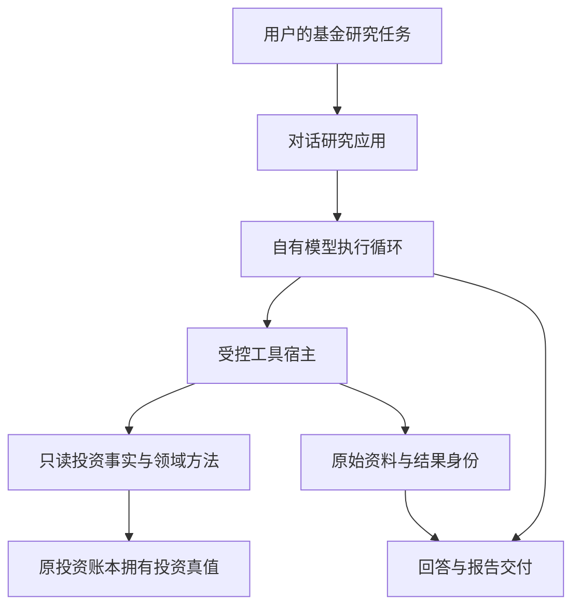
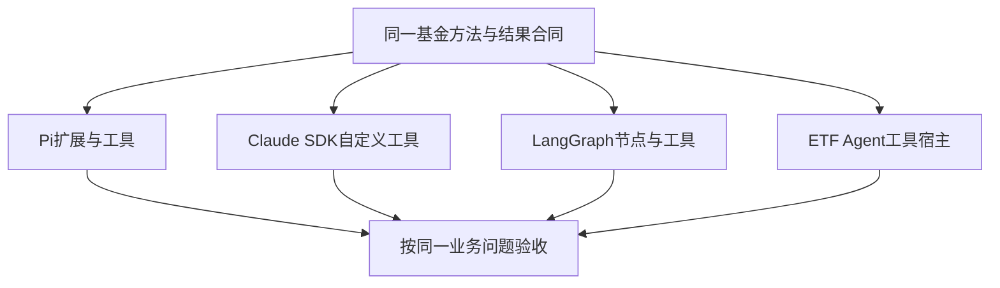
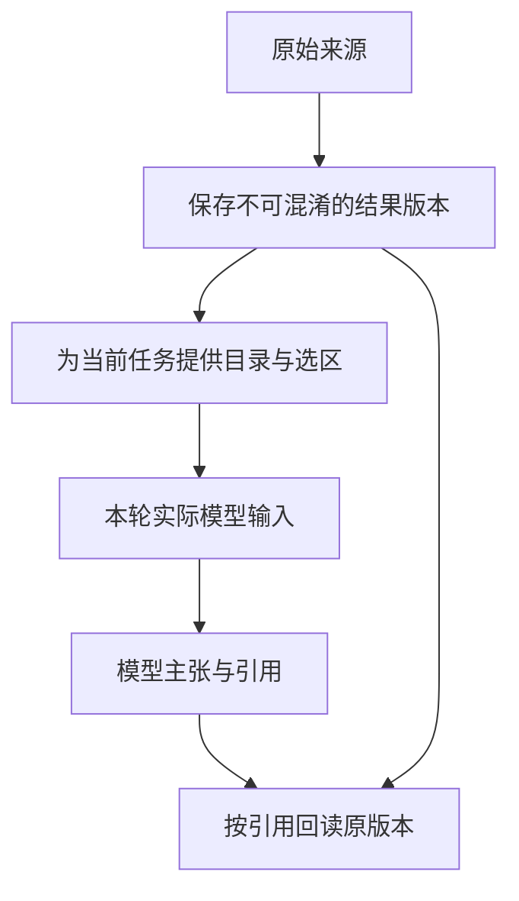
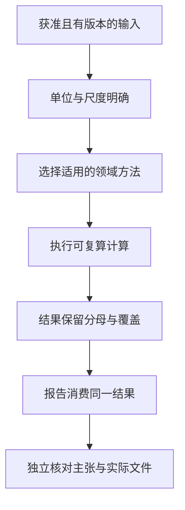
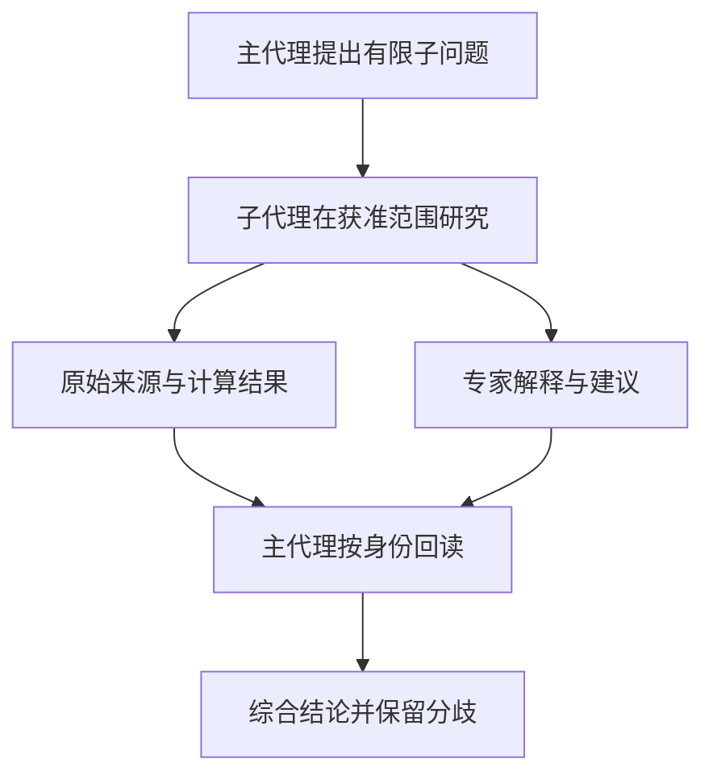
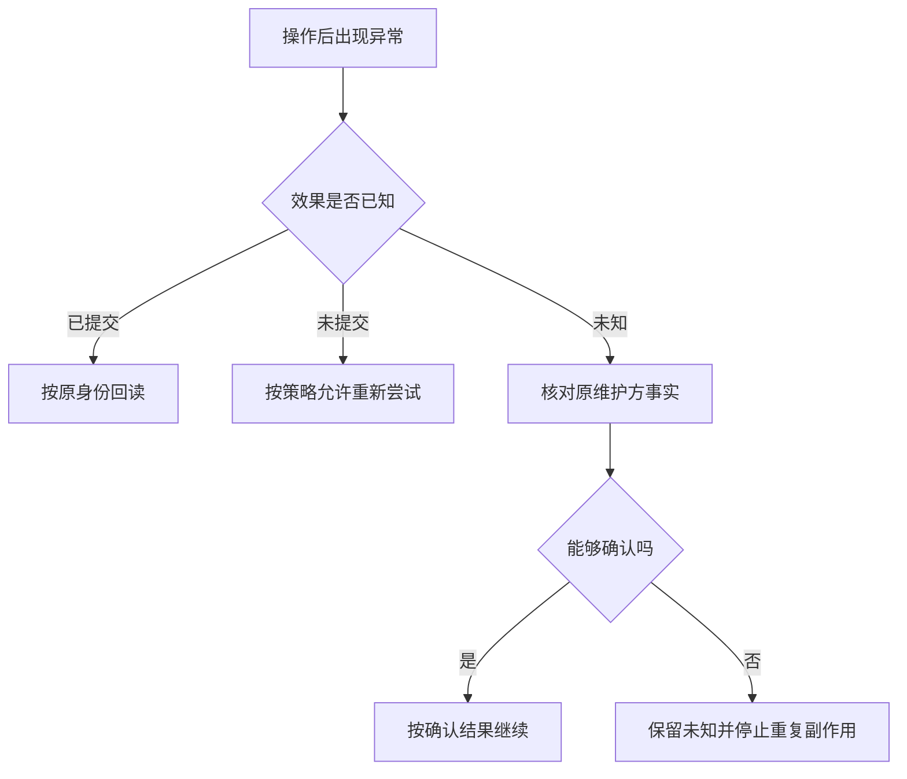
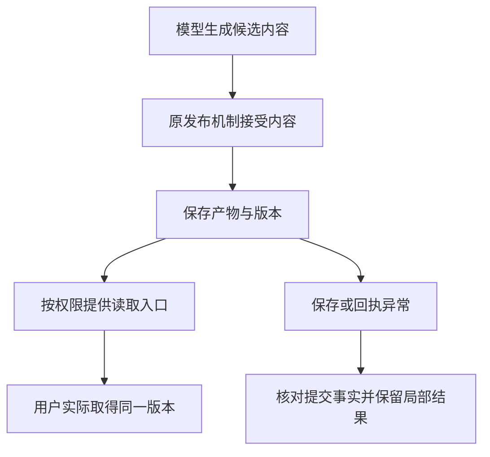
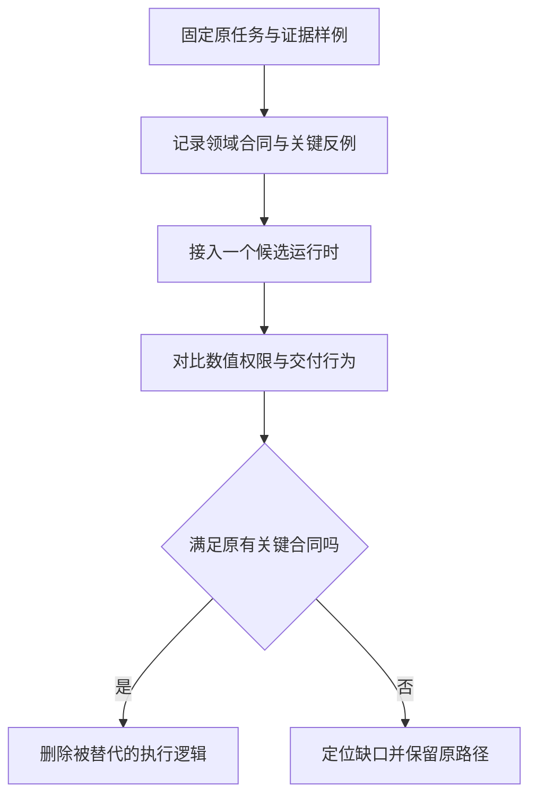

# 从通用 Harness 到金融研究系统：ETF Agent 的四方架构对照

> 工程篇｜沿一条基金研究任务，检验自研系统到底增加了什么，又承担了什么。

“为什么要做金融垂类 Agent”可以在原则层回答，但工程团队最终还要面对更具体的问题：既然 Pi、Claude Agent SDK、LangGraph 已经提供了大量执行能力，ETF Agent 为什么还存在自己的运行时、结果存储、发布和恢复机制？哪些是合理差异，哪些只是需要持续偿还的工程成本？

本文不做四个产品的分数排行榜。我们没有让它们在相同模型、资料窗口、预算和题集下完成一次横向实测，因此不能给出胜率、金融准确率或成本排名。比较采用两个坐标：通用框架官方提供的机制，以及 ETF Agent 已核对实现与原始验收能够支持的具体行为。

本文取材截至 2026 年 11 月 2 日。私有 ETF Agent 是持续演进的研究应用；公开的 Open ETF Agent 是独立的教学实现，本文可复现入口固定在 v0.15.2 的对应提交。两者不能互相代替，更不能把私有实现的全部能力写成开源读者下载后立即可用。[8]

最重要的结论先放在前面：**ETF Agent 最值得保留的是金融方法、事实与权限关系、研究结果身份以及可核对交付；自有执行内核则应持续接受 Pi、Claude Agent SDK 和 LangGraph 的替代性检验。** 自研代码存在，不是它必须永久存在的理由。

## 一、把四套系统放回同一个比较坐标

### 1. 我们比较职责，不比较功能清单的长度

Pi 是轻量、可编程的 Agent Harness；Claude Agent SDK 提供成熟的 Agent Loop 及工具、权限、会话和子代理能力；LangGraph 侧重有状态编排与持久执行；ETF Agent 则是围绕基金研究形成的应用与领域能力集合。[1][2][3]

因此，前三者主要回答“怎样执行”，第四者还要回答“执行什么业务、按什么口径、怎样交付”。不能因为第四者带有基金数据工具，就给它的通用框架能力自动加分；同样也不能因为通用 SDK 不附带基金份额模型，就认为它无法构建金融应用。

| 观察点 | Pi | Claude Agent SDK | LangGraph | ETF Agent |
| --- | --- | --- | --- | --- |
| 核心定位 | 可扩展的轻量执行环境 | 可编程的完整 Agent 执行能力 | 有状态编排与运行时 | 基金研究应用与领域能力 |
| 主要复用单位 | 扩展、Skill、SDK、RPC | 工具、MCP、Hook、子代理、会话 | 图、节点、状态、持久化 | 领域方法、结果、授权、交付合同 |
| 金融规则从哪里来 | 应用提供 | 应用提供 | 应用提供 | 项目自己的领域实现 |
| 本文证据性质 | 官方机制 | 官方机制 | 官方机制 | 固定源码与有限原始验收 |
| 是否进行了四方实测 | 没有 | 没有 | 没有 | 没有与前三者配对实测 |

表中的“应用提供”不是缺陷判断。一个好的通用框架本来就不应替所有金融业务决定收益率公式、账户权限或数据供应商。

### 2. 当前 ETF Agent 并非套在 Claude Agent SDK 外的一层皮

在已核对的私有实现中，对话研究由自有 Native ModelTurn 循环驱动，模型网关接入多个协议与供应商适配，工具由服务端宿主管理。代码中出现 Claude、Pi 或兼容扩展概念，不代表核心执行自动由相应 SDK 接管。

这一点影响整个比较：把 ETF Agent 简单画成“Claude SDK 加金融插件”，会隐去它实际承担的协议、资源、恢复和交付成本；把它画成已经全面替代三个框架，又会夸大当前证据。它是一套有明确领域目标、同时仍在承担较多通用工程责任的系统。

下面的图描述职责关系，不是新增部署服务的建议。图中每一个框都可以由同一进程中的既有模块承担。

### 图 1：当前系统的关键责任，而非四方叠装



## 二、沿一条完整任务定义验收，而不是先画模块图

### 1. 教学输入与预期结果

使用一个模拟组合：总资产 120,000 元，A、B、C 基金分别占 45%、30%、15%，现金占 10%；A 与 B 跟踪同一个指数，用户另投入 20,000 元，希望降低集中度并保留 10% 现金，明确不授权交易。

这项任务至少需要交付四个结果：解释同基准配置，计算可支持的底层暴露，给出新增资金情景下的现金约束，说明仍缺哪些资料和用户条件。报告可以部分完成，但不能遗漏用户问题后仍把整题标成成功。

此处的模拟输入不来自真实账户。下面讨论的四种实现路径是设计对照，而非声称已经分别运行过四套系统。案例里的确定性算式可以独立检查，框架之间的质量差异仍需要真正的配对实验。

### 2. 最小可用基线其实很小

先只用一个主代理、一组只读资料工具、一个组合计算方法和一个报告保存接口。不要默认启用专家、长期记忆、自动审批或后台调度。这样我们能先判断基本研究是否成立，也能知道以后新增机制究竟改善了什么。

同基准配置可以先确认到 75%。若三只基金对公司 X 的已知底层权重分别为 8%、10%、6%，则总资产已知暴露为 7.5%，对应 9,000 元。新增资金后总资产为 140,000 元，目标现金为 14,000 元，因此可新增投入基金的是 18,000 元。

以上算式都附带教学前提：没有市场变化、费用与其他资金流，底层权重具有可比较的定义。真正的系统需要把这些条件带进结果，而不是只把三个正确数字写进一份没有输入身份的报告。

### 3. 验收也要覆盖不能算的情形

如果 C 的底层资料缺失，系统仍然可以确认 A、B 的基准重复和现金约束，但不能编造精确公司级重合度。如果用户改变新增资金来源，原现金算式需要重新确定。如果账户授权撤回，后续读取和计算应在原权限入口受到限制。

这些分支比主流程多调用几个工具更能检验设计。它们要求研究过程能够根据观察修正计划，也要求相关限制只影响真实依赖，不能把独立成立的分析全部清空。

## 三、同一任务交给四套技术，代码分别应该放在哪里？

### 1. 使用 Pi：把稳定业务能力做成工具，保持研究自由

一种合理方案是将基金资料读取、组合计算和产物保存接入 Pi 的工具或扩展，通过 Skill 告诉模型研究步骤与方法选择条件。Pi 负责模型与工具的循环，应用负责真实权限、来源存储和业务数据。

Pi 官方强调扩展能力，并明确区分核心内建与用户自行添加的 MCP、子代理及确认流程。选型时应当把需要自行完成的工作列出来，而不是在能力矩阵中把所有扩展可能性都当作开箱即用。[1]

对单用户、短时、只读研究，这可能是很好的起点。进入多用户服务、持久后台任务和复杂交付后，需要重新检查部署与生命周期合同，而不能从终端演示顺利就推断生产服务条件已经满足。

### 2. 使用 Claude Agent SDK：复用成熟执行机制

另一种方案是用 SDK 运行主代理，通过自定义工具或 MCP 调用同一组领域方法，使用权限和 Hook 接入应用检查；需要独立资料核对时，再定义子代理。会话继续和工具执行的很多基础工作无需重新开发。[2]

应用仍然需要定义哪个客户可以访问哪份持仓，以及结果如何发布到自己的产品。允许某个工具运行不等于工具内部可以访问所有账户；会话恢复也不等于旧授权永远有效。通用机制提供控制入口，业务含义必须由系统补充。

这条路线的主要判断不是“SDK 会不会金融”，而是其执行语义和部署方式能否在实际条件下承载我们的工具、权限与交付要求。若能，保留领域核心而删除重复运行时，是值得认真考虑的选择。

### 3. 使用 LangGraph：显式组织状态与等待

可以把资料取得、确定性计算、模型分析和用户补充条件组织成图。模型节点仍可包含自主工具循环；图负责阶段关系、状态和等待，不必把每一个搜索动作都固化成一个节点。[3]

图状态中宜保存必要的目标、版本和结果引用，不必把所有 PDF 原文和全部工具结果无限堆入状态。大资料由适当存储维护，图中保留能够恢复正确工作所需的身份。选择内存或持久化 Checkpointer 也必须与重启恢复要求匹配。[4]

这条路线的优势来自对状态交接的明确控制，代价是状态结构、节点边界和恢复行为同样需要维护。一个巨大状态对象和几十个过细节点，不会仅因为使用了图框架就自动成为好的架构。

### 4. 使用 ETF Agent：承担更多执行责任，换取现有合同的一致性

ETF Agent 已有自己的读取、结果身份、领域计算、回答发布和恢复接缝。将同一任务放进去，可以复用这些现有规则；但它也必须自己处理模型协议差异、工具生命周期、预算预留和异常结算。

这不是天然优势或天然错误。关键是领域任务是否真正消费了这些机制，以及维护成本是否合理。已有系统已经深入运行时的情况下，局部收敛可能比整体迁移更安全；从零开始的新应用则不应因为案例项目自研，就照抄全部结构。

### 图 2：四条路径共享的，应当是领域合同



## 四、最先需要守住的，是投资真值不被对话层复制

### 1. 研究应用不能拥有另一套偷偷变化的账本

ETF Agent 的既有设计把投资状态与对话研究分开。根投资模块维护账本、分配和确认等权威事实，对话层通过获准的只读入口消费报告与资料。生成一份分析，不应自动产生真实执行记录。

这条分离对迁移很重要。如果未来替换模型或运行时，账本不应该跟着迁移到另一个 Agent 存储里。新的执行器只需要满足原有只读与结果合同，而不是取得修改资金真值的额外权限。

同样，研究里的情景组合与实际持仓必须分开。模型可以模拟“新增资金投入某类资产之后会怎样”，但不能让该情景覆盖实际账户快照。情景的价值来自比较，不来自把假设写成已经发生。

### 2. 同一对象可能具有多种合法投影

用户界面看到的是金额与比例，计算方法可能需要份额、净值和币种，模型只需要当前任务相关的摘要。不同投影可以来自同一权威事实，但它们不能各自重建一套互相漂移的数据。

投影时还要保留关键未知。例如某项估值不可用，不应在给模型的摘要里变成零；某个账户没有授权，不应在报表里显示成“没有持仓”。业务含义一旦在投影时丢失，后续模型再聪明也难以恢复。

这也是适配层真正值得存在的地方：把上游原始表示转换为下游所需结构，同时保留身份、口径和限制。仅仅转发 JSON、让每个调用者重新理解所有字段的包装，往往没有足够深度。

### 3. 把授权放在消费接缝，而不是只放在入口

入口确认了用户身份，并不保证长任务后续所有动作都仍然适用。来源可能撤回、Run 可能变化、用户可能提交纠正版数据。真正访问或导出资料时，需要按原合同确认具体身份与范围。

在已核对的 ETF Agent 原始验收中，曾出现纠正后的来源已拒绝，但替代占位内容仍进入 Python 输入的受控反例。修复应当发生在原来源消费接缝，让不合格材料不进入计算，同时允许合法的新读取继续。这证明的是那条输入路径，而不是整个系统已经获得金融正确性认证。

## 五、结果存储的价值：让模型用到的事实能够回读

### 1. 工具取得资料，与模型实际看到资料，不是一回事

搜索返回链接不等于读取正文；读取正文不等于完整表格进入上下文；结果已经保存也不等于后续模型真的消费了它。对于金融任务，这些差异可能改变结论。

例如工具取得了一份包含全部持仓的资料，送入模型的却只是前几行摘要。此时报告若写“已分析全部底层持仓”，就超出了实际输入。仅靠工具日志里的一次成功，无法证明这个主张。

ETF Agent 的结果身份与读取关系，值得被理解为连接原材料、投影、选区与后续消费的机制。它提供可回查的基础，但不证明模型理解了内容，更不证明引用与论点之间已经建立正确支持关系。

### 2. 大结果外置，不等于把证据扔掉

将原始结果放在存储中，让模型按需读取，可以减少上下文负担。但模型必须知道有哪些可读内容、读到哪里、还有什么没读，以及怎样取得需要的选区。

如果只把一个 opaque ID 塞给模型，却没有清楚的可读目录与工具，结果虽然“外置”了，研究反而可能更困难。存储机制与可发现的读取界面需要一起设计，不能把节省上下文当成唯一目标。

原始内容、工作笔记和长期记忆也不应混在一起。笔记可以帮助继续任务，不能取代原始事实；长期偏好需要自己的有效性与授权条件，不能因为一次工具返回就永久进入用户画像。

### 图 3：结果外置之后，仍要追到实际消费



### 3. 迁移时应保留什么

无论底层使用 Pi、Claude Agent SDK 还是 LangGraph，原始结果版本和领域来源关系都值得保留。需要变化的通常是怎样把结果目录、工具观察和选区反馈给执行框架，而不是重新定义基金事实。

但也不要要求执行框架替业务存储承担所有责任。会话消息、图状态、报告文件和来源版本各有生命周期。一个框架已经提供了合适的存储接缝时，优先接入，而不是在旁边再建一个竞争的状态真值。

## 六、金融计算应当从原始输入一直走到报告

### 1. 精确数值核不应决定业务方法

ETF Agent 已核对的计算设计采用明确分工：数值核处理单位、十进制运算、舍入与残差，组合、费用、收益和穿透方法由各自领域维护。它不是一个可以批准全部金融结论的中央计算机构。

这个分工避免两类问题。第一类是每个方法自己猜测单位和重复实现金额运算；第二类是为了统一，把不同收益口径、费用政策和领域前提全部藏进一个不可理解的全局接口。

统计计算仍可能采用浮点数和明确容差，交易结算精度与展示精度也不应强行统一。十进制并不自动保证来源真实，固定保留两位小数也不代表适用于全部指标。

### 2. 同样的 0.02，可能需要不同显示规则

一个来源直接报告 2 个百分点，和一个旧方法用 0.02 表示小数差值，需要不同的显式转换。如果只看字段叫作“percentage_points”，然后统一乘以 100，第一种输入就可能显示成 200 个百分点。

正确做法是保留来源表示和生产方法的尺度合同，而不是根据数值大小猜测。这类错误非常适合用确定性样例验证，因为它具有明确输入和独立期望结果。

但修复一个尺度转换不意味着自然语言里的所有数字都已认证。结构化金额可以直接消费结果，普通解释仍需要语义质量检查。把局部计算增强升级成全局金融发布门，反而可能制造新的职责冲突。

### 3. 模拟组合中的覆盖不能被归一化抹平

假设 A、B、C 的底层覆盖为 60%、70%、40%，总资产的已披露基金底层覆盖为 54%；现金占 10%，其余 36% 是未由这些资料解释的基金底层。公司 X 的 7.5% 暴露不能除以 54% 后再当成总资产暴露。

领域方法需要把覆盖与计算结果一起交付。下游渲染器若只拿到一个裸 `weight`，很容易在格式化或排序时丢掉分母。结果合同应当让调用方能知道指标属于整个组合、基金部分还是披露样本。

### 图 4：算式正确只是中间一环



### 4. 一个真实工程增量：让原结果真正进入交付

在已核对的受控验收中，ETF Agent 把合成组合来源经原 MCP 接缝送入真实 Python 方法和渲染器，再通过原 Artifact 仓库保存 HTML，最后经实际 HTTP 处理入口读回相同字节与哈希。

这个增量的意义不是测试数量，而是打通了“工具有结果，但最终报告是否真的使用它”的间隙。它能够支持特定链路中的身份与交付判断；由于使用合成数据且未完成完整自然任务的独立金融审查，不能进一步宣称私人账户研究已经可用。

同一份验收还保留了缺目标输入、来源不适用等分支。合理的结果并非每个字段都有数字，而是能表达已知值、缺失条件和局部不足，同时不伪造一个全通过的报告。

## 七、Subagent 的工程难点不在“能不能启动”

### 1. 启动能力已经可以从通用框架取得

Claude Agent SDK 支持独立上下文、专门指令和工具限制的子代理；Pi 可以通过扩展或组合实例实现相应模式；LangGraph 可以使用子图与其他组合方式组织分工。ETF Agent 不应把“能够发起第二个模型任务”本身视为金融差异化。[1][6]

真正值得分析的是：谁拥有子任务身份，子代理可以读什么，预算从哪里来，取消后如何结束，返回的内容怎样进入主代理，以及研究结论是否因为这次分工而改善。

把这些问题全放进一个“专家系统”大模块，也不一定更清楚。身份、资源与来源事实通常已有维护方，专家协作应复用这些职责，而不是为每位专家复制一套权限和预算。

### 2. 原始证据与专家意见需要分别交接

子代理可能读取了一份来源，又给出“建议继续核对”这样的派生意见。主代理应能区分来源本身与专家解释，不能因为意见来自一个叫作“审核员”的角色，就自动把它当成事实认证。

公开 Open ETF Agent 的串行来源核对 Child 示例，明确把原始结果与派生意见区分；主代理消费二者时，派生意见不获得原始来源权威。这是一个适合教学的有限机制，不等于完整并行专家平台。[8]

Claude SDK 默认的上下文隔离使主代理不必承受全部中间材料，但在需要精确金融证据的应用中，还需要设计受控的来源引用或产物交接。摘要有助于效率，不能替代需要独立核对的原始数字。[6]

### 图 5：专业分工必须回到可检查的交接



### 3. Reviewer 不是新的全局否决者

自动 Reviewer 可以发现遗漏、提出反证或提示数值风险，但其意见不应未经设计就改写来源真值、投资账本或所有发布决定。否则一个辅助模型临时不可用，就可能让本来有效的研究完全停摆。

在 ETF Agent 已核对的近期工程中，Reviewer 的可用性需要与原资源维护方实际预留的 Child 请求容量一致。这个修复解决的是资源口径和触发条件，而不是证明 Reviewer 的金融识别能力提高。

这类例子说明，额外专家机制有真实的正常路径成本。若预算不足或任务没有独立复核价值，允许不启动可选 Reviewer，往往比强迫每轮都经过它更合理。不可省略的权限检查则不能借此关闭。

### 4. 多代理有效性需要自己的分母

观察到 Child 结束，只说明子任务有终态；观察到其文本进入主代理输入，说明交接发生；主代理最终引用了意见，也不证明意见正确。是否改善研究，需要独立审查和合理基线。

ETF Agent 的已有真实模型观察与受控验证应被分别保留。没有完成配对质量、费用与自然用户任务的核验时，不能把专家运行次数写成投资研究成功率，也不能把多输出文件算成多个独立成功样本。

## 八、恢复不是把消息重新喂给模型，而是处理未完成的事实

### 1. 四种“继续”有不同含义

会话继续关注对话上下文；图恢复关注执行状态；长任务继续关注剩余目标与阶段成果；报告回读关注已经交付的具体版本。它们可以协作，但不能用同一个“支持恢复”勾选框代替所有行为。

Claude Agent SDK 的会话能力可以继续或分支对话。其文件 Checkpoint 则主要追踪特定文件编辑工具造成的变化，并不是通用外部事务回滚，也不会回滚会话本身。把这类文件恢复与金融账本或外部指令撤销混为一谈，是选型中的常见误读。[7]

LangGraph 的 Checkpoint 保存图状态，并支持人工中断等行为；中断恢复可能重新执行节点前部，所以副作用仍要按文档要求设计幂等。框架保存了状态，不等于所有外部系统的效果都能自动回滚。[4][5]

### 2. ETF Agent 的恢复价值，要落到具体效果上

自有运行时的合理增量，是把已经取得的来源、已经提交的回答和仍待处理的交互关联到原任务，避免无依据地重新生成或重复执行。它不能只通过“有一张 Run 表”来证明。

例如，用户的澄清问题已经持久接受，任务准备停放等待。停放确认尚未取得时，应当区分真正提交、明确未提交和状态不确定，不能同时让旧执行器继续与新执行器接管。这里处理的是执行所有权，而不是让模型根据文字猜测任务状态。

同样，用户关闭前台连接、显式取消研究和进程崩溃是不同事件。系统应根据任务已承诺的前台或后台语义处理，不能把所有断线都说成需要恢复，也不能把宿主停止一律解释为用户取消。

### 图 6：失败之后，先确定效果，再决定动作



### 3. 没有必要恢复整个旧执行图

有时用户只需要拿回已提交的报告，或者开始下一轮研究。此时按原身份读取已完成产物，比恢复全部历史调用更简单。只有未完成动作确实需要继续，才进入对应恢复协议。

恢复设计应围绕承诺的用户结果，而不是追求把每一次内部状态都原样复活。越多内部对象成为跨版本恢复合同，升级与退役成本通常越高。能保留结果身份而不保留过度细碎执行状态的地方，应当认真比较。

## 九、交付需要自己的事实，但不应演变成处处设卡

### 1. 模型说“已保存”，不代表文件真的可取

报告交付跨越模型、工具、存储、HTTP 路由与界面。模型可能已经收到保存成功的文字，用户却没有可访问链接；或者流式页面展示了新版内容，下载端仍返回旧版文件。

ETF Agent 对 Artifact 与 Revision 的关注，正是为了让用户得到可辨认、可回读的产物。公开教学实现也区分执行完成与语义尚未复核，避免将一个 `completed` 字段解释为全部研究质量已经通过。[8]

但专门交付机制的价值要按规模判断。一个本地一次性脚本写好文件并实际打开，可能已经满足需求；多会话、多版本、异步恢复和授权下载出现时，独立的版本与回执关系才更值得建设。

### 2. 丢失保存确认，是一个有解释力的真实反例

已核对的受控验收将写入前失败与已经写入、确认却丢失区分。前者不能生成假链接，后者不应不加判断地再保存一份。需要从原写入维护方取得提交事实，并以原产物身份尝试回读。

这个设计没有创造跨所有外部系统的恰好一次语义。它只是让报告写入这条具体链路的结果更明确。若实际存储状态仍未知，应保留未知，而不是为了让任务看起来完整就宣布成功。

用户已经取得的独立有效正文也不必因可选导出失败而消失。报告文件与文本回答可以有不同的完成状态，关键是如实说明各自产物，而不是伪造一个全有或全无的整体结果。

### 3. 发布只处理自己拥有的决定

金融方法可以返回缺失、代理口径和诊断，Reviewer 可以给建议，权限模块可以拒绝未授权读取；它们不应各自增加一个可以取消所有回答的全局否决开关。

必要约束仍然必须执行，例如不把未经授权的私人来源发送出去，不把失败保存说成成功。但额外金融诊断不可用，并不自动使其他已成立结论失效。每项限制需要指向具体受影响结果和真实责任。

### 图 7：交付从“生成了”走向“用户拿到了”



## 十、长研究的上下文管理，不是把所有东西压成摘要

### 1. 对话、来源、目标与偏好不能互相替代

ETF Agent 已有的上下文与 Workspace 方向，试图支持跨 Run 的目标和原材料复用。理解这种能力时，需要分清：历史对话帮助理解用户原意，工作摘要帮助继续任务，原始来源用于证据，稳定偏好用于个人适配。

如果把旧助手回答当成用户原话，或者把压缩摘要当成原始来源，就可能在研究继续时改变问题。一个系统即使保存了完整历史，也仍然需要选择本轮适合消费什么，而不是默认全部注入模型。

同样，跨 Run 复用原资料需要确认权限和版本，不能因为工作区记住了一个引用，就让新任务自动取得旧任务的全部访问权。记忆的存在与当前可使用资格是两个事实。

### 2. 压缩应保留重新取得依据的路径

对于长报告和大量工具结果，摘要可以降低上下文负担。但摘要应标明自己是派生材料，保留原始版本引用，遇到关键数值或争议时能回读，而不是用一句压缩后的结论彻底覆盖原文。

短任务没有触及上下文瓶颈时，额外压缩可能只增加模型调用和信息损失风险。按需回读比生成摘要更便宜时，也不必压缩。设计应允许绕过这些增强机制，而不是让每次简单查询都支付完整治理成本。

### 3. 与三套通用框架怎样对齐

Pi 的会话树和可扩展压缩、Claude SDK 的会话与上下文管理、LangGraph 的线程状态与存储，都能成为这条链的一部分。ETF Agent 需要保留的并不是一个与它们竞争的“记忆”名称，而是目标、来源和权限不被摘要改写的领域合同。[1][2][4]

是否值得继续维护自有上下文装配，应看现有框架扩展点是否足够，以及迁移是否保留实际输入行为。一个抽象接口声称支持多个运行时，不等于已经验证了它们在压缩、恢复和引用上的语义一致性。

## 十一、预算与可观测性：重要，但不是金融价值本身

### 1. Token、请求容量和投资资金是不同预算

模型调用预算限制研究资源；并发容量决定任务能否派发；用户的新增资金决定组合情景。它们可能都叫“budget”，却不能放进同一套含糊的状态里。混淆后，系统可能在研究资源不足时误改投资方案，或在恢复时重复取得调用额度。

自有运行时需要认真处理预留、实际派发、完成和未知结算。通用框架提供的用量事件可以复用，但缺失用量不能被当成零费用，外部请求超时也不能自动被视为未发送。

这类能力对长期研究有价值，却依然是通用执行基础。文章不应因为任务叫基金研究，就把每一次协议修复都说成金融方法创新。

### 2. Trace 完整，也可能没有好的研究结论

记录模型请求、工具结果、Child 交接和报告身份，有助于定位缺口：资料没取到、结果没送入模型、模型没有采用、发布失败，分别属于不同问题。观察细节可以减少错误归因。

但是，完整 Trace 不能替代独立数值复算，也不能证明模型的推理合理。一个系统可以把错误全过程记录得非常完整；这仍然有诊断价值，只是不能被写成投资研究质量已提高。

ETF Agent 的 Scorecard 将工程能力与金融自用价值分开，正是在避免这种偷换。观察工具变强，应记录为可观测性进展；自然任务更好完成，则需要另一组证据。

### 3. 隐私同样进入观察设计

为了调试方便而收集全部原始持仓、图片和模型载荷，可能扩大不必要的数据暴露。观测应保留足够的身份与行为事实，并按实际准入处理敏感内容；没有完整正文时也要说明观察是不完整的。

脱敏记录不能反过来冒充模型实际输入。比如只记录“某张图片被发送”，并不能证明模型读取到了图片里的全部数字。合理的诊断系统应容许这类未知，而不是为了报表整齐把缺失字段补成“已验证”。

## 十二、公开版的一个小修复，说明自研运行时为什么昂贵

### 1. 工具调用的流式 ID 可能跨多个分片出现

Open ETF Agent v0.15.2 的公开修复处理一个窄场景：同一工具调用索引已经收到非空 ID，后续 SSE 分片的 ID 为 `null` 时，保留原有身份，不把它当成新的非法身份。首次为空、换索引为空、冲突字符串以及最终参数无效等情形仍然应拒绝。[9]

这个变化看起来很小，却位于模型网关和执行器的关键交接处。过严会拒绝可接受的延续分片，过松又可能让两个调用混淆。正确修复需要同时保留正常路径与反例，而不是简单删除 ID 校验。

公开记录区分实际执行的代码版本、受控 null 分片测试和真实模型批次。真实流式请求成功，不代表该批次一定出现了 null 延续；历史复合错误也不能事后全部归因于同一个原因。[9]

### 2. 这不是金融差异化，却是自研必须承担的责任

无论研究基金还是阅读普通文档，工具调用身份都必须可靠。这个案例适合说明自研执行内核的维护成本，而不适合证明 ETF Agent 比通用 SDK 更懂金融。

当成熟框架已经承担类似协议兼容时，直接复用可能减少工作；当项目必须支持特殊网关或协议时，局部自研也可能合理。真正的选择依据应是实际兼容需求与维护成本，而不是自研或第三方的标签。

因此，评估迁移时应该列出这些具体执行责任。若替换后能够删除协议适配和流式状态维护，又不损害领域行为，那就是可量化的维护收益；没有实验前，则只能把它列为待验证假设。

## 十三、怎样读 ETF Agent Scorecard，才不会把自己说得过满？

### 1. 能力包络不是竞品实测分数

ETF Agent 的现有对标方法包含基金研究、Claude SDK 能力包络、Pi Harness 能力包络，以及独立的工程和战略维度。这里的参考满分描述一组能力目标，不代表对应产品真的在同一测试里得了满分。

因此，不能把一个内部候选分数解释为“我们已达到 Claude 的某个百分比”，更不能把基金研究轴分数解释为真实答案正确率。不同轴也不适合简单平均成一个看起来权威的总冠军分数。

本篇采用量表的观察维度，但不新增一轮正式评分，不修改冻结权重，也不把文章写作本身计为工程进步。最新已归档候选与当前代码头部可能不是同一个版本，应当分别辨认。

### 2. 实现、验证与业务结果应该并列记录

某项能力可以已经集成，但只有受控验证；另一项可能观察到真实模型使用，却没有完成金融独立复核。它们不是同一条线性分数尺上的不同小数点，而是不同证据面。

| ETF Agent 的观察对象 | 已核对材料能支持什么 | 不能据此推出什么 |
| --- | --- | --- |
| Native 研究入口与工具宿主 | 相应执行结构与责任分离存在 | 全部模型和协议都长期可靠 |
| 合成组合经 Python 到 HTML | 特定来源、计算、保存与读回接缝成立 | 真实账户研究已独立合格 |
| 写入确认丢失的受控修复 | 该提交事实与回读分支被检查 | 通用外部效果恰好一次 |
| Child 结果进入主代理 | 相应交接被观察 | 专家意见正确或有投资增益 |
| 研究工作区复用 | 有界跨 Run 原材料与目标继续 | 多周自然用户价值已证实 |
| 公开 v0.15.2 示例 | 固定版本的教学机制与窄修复 | 私有系统全部能力已开源 |

这张表不是为了每个优点都附一长串免责，而是为了把实际增量放回它能够证明的位置。工程基础可以很有价值，同时金融任务仍有待完成的独立验证。

### 3. 当前最重要的缺口不应被更漂亮的图掩盖

在已核对的基金研究资格任务中，已有公开案例和独立检查的历史记录，也仍有原题与未调试变体复验、真实个人组合、自然用户接受等未完成范围。手工修订一份报告不能自动勾选 Agent 自主完成。

因此，下一步最值得投入的未必是更多模块，而可能是一项完整公开基金任务：从正常入口取得报告，独立检查身份、时点、费用、现金、覆盖与关键主张，再用未用于调试的变体复验。

如果这条路径仍然需要开发者补位，就保留真实缺口。把工程问题修好与把用户任务做完分别记录，反而能更准确地决定下一轮工作。

## 十四、如果今天重建，哪些应该删除，哪些必须保留？

### 1. 优先保留领域事实与业务责任

保留投资账本的唯一权威、只读研究边界、基金身份与份额关系、时点和口径、可复算方法、来源与派生结果身份，以及实际交付的版本关系。这些直接影响研究含义和用户结果。

这里的“保留”不等于保留原文件和原类名。可以在新的 SDK 工具或图节点里消费相同领域能力，只要行为合同保持清楚。迁移的目标是减少不必要实现，而不是保全每一段历史代码。

### 2. 优先评估替换通用执行复杂度

模型回合循环、协议拼接、会话存储、一般子代理启动和通用 Hook 生命周期，都值得对照成熟框架。若现有能力满足要求，应认真考虑复用，而不是因为已经投入很多就继续扩张自有内核。

但替换不应只看 API 是否都有同名函数。取消、预算、恢复与产物身份的细微差异，可能改变实际行为。迁移前要用原有正反例刻画合同，再决定哪些适配保留、哪些旧逻辑删除。

### 3. 可以延后的，是尚无稳定消费者的高级能力

跨业务多主体交接、无限层级专家、复杂长期记忆和自动化决策，都不应该成为首份基金研究交付的前置条件。它们可能有价值，但需要各自独立的任务与授权依据。

同样，不应为适配三个运行时提前维护三套完整实现。先选择一个真实候选，完成有限任务的等价验证；第二个真实消费者出现后，再决定共同接口。没有实际替换需求的“未来可插拔”，可能只是在提前支付兼容成本。

### 图 8：迁移关注合同，不追求逐字相同



## 十五、一个可执行的迁移与验证顺序

### 1. 先固定研究输入，不先固定模型措辞

准备合成组合、产品身份、披露时点、完整与不完整持仓、费用假设和预期计算结果。把用户问题完整保留，让不同执行器面对同一业务条件。无需要求最终报告逐字一致，但关键数字、限制和权限行为应可比较。

然后保留一份未用于调试的变体，例如把新增资金改成已有现金划转，或改变目标现金比例。变体应改变实际方法前提，而不只是更换产品名称。调试暴露后，它就不再是独立保留题，应如实更新身份。

### 2. 分开运行三类检查

第一类是不调用模型的领域测试，验证单位、公式、覆盖与授权反例。第二类是执行集成检查，验证工具结果、取消、恢复和报告读回。第三类是真实模型任务，检查模型是否选择了适用方法、消费了关键结果并完成研究。

这些层次可以逐步推进，不必一次取得所有证据，但不能互相冒充。领域测试通过不证明模型会调用正确方法；真实模型输出流畅也不能覆盖确定性算术错误；网页能下载文件不证明文件结论正确。

### 3. 比较质量、时延和资源，而不是只统计成功数

保持可比的资料窗口与运行配置，记录任务是否完整、是否需要补问或人工补位、关键错误、可取得产物、时间和费用。成本缺失就保留未知，不能根据没有账单字段推断免费。

失败也要保留。外部来源不可用、模型选择错误、权限阻断、交付失败属于不同类别；它们都影响用户体验，但对应不同的修复方向。准确归因比把所有失败都算给“模型不够聪明”更有用。

### 4. 迁移也要允许得出“不值得”

如果候选 SDK 减少了大量协议代码，却需要更复杂的恢复适配，最终净收益可能不明确；如果业务任务很短，LangGraph 的额外状态建模也可能没有实际收益。合理结论可以是继续保留现有有限实现，等待更清晰的触发条件。

反过来，如果成熟框架已经满足大部分合同，继续维护重复内核就需要更强理由。架构选择应当能被证据改变，而不是先决定“必须自研”，再从每个差异中寻找支持。

## 十六、公开代码怎样用于学习，而不被误认为金融产品承诺？

### 1. 固定版本比浮动截图更有用

本文公开实现入口固定在 Open ETF Agent 提交 `34124cefc6df289e08518173789210b45a716451`，其 package 版本为 0.15.2。公开 README 把它定位为逐模块构建研究 Agent 的教学项目，默认示例采用合成资料；它不是实时基金研究或交易服务。[8]

读者可以按仓库支持的 Node.js 版本准备环境，再运行默认文档比较示例。依赖安装可能访问网络，示例本身不需要模型密钥。下面是固定版本的复现入口，不是本文重新执行过的运行回执。

```bash
git clone https://github.com/hpoenixf/open-etf-agent.git
cd open-etf-agent
git checkout 34124cefc6df289e08518173789210b45a716451
npm ci --ignore-scripts --no-audit --no-fund
npm run build
npm test
npm run demo -- --case document-compare
```

观察重点是原始来源、报告、运行记录与实际回读关系，而不是从演示输出推断投资建议质量。受限真实模型入口还有独立的数据与费用准入，不能继承其他人的授权。

### 2. 私有案例和公开教学应各有身份

私有系统提供更丰富的研究应用背景，公开版帮助读者检查部分机制。文章可以解释两者之间的工程关系，但不能把私有验证结果直接贴到公开版本上，也不能用公开模块数量证明私有系统的真实用户价值。

公开读者无法访问的原始验收，不应被包装成人人可复现的源码教程。本文因此保留可公开阅读的机制文章与固定代码入口，涉及私有实现时明确是经核对的项目案例，且不附个人持仓、运行载荷或私有文件链接。

### 3. 好的工程文章应该允许读者反驳

读者应当能够指出：某项自有机制其实可以被现成 SDK 取代，某个错误不属于金融领域，某份报告还没有独立质量证明。这样的反驳不是削弱项目，而是在帮助识别真正值得投入的部分。

最有说服力的比较不是列出自己拥有多少模块，而是承认替代方案的合理性，并给出在具体条件下仍选择当前方案的理由。缺少实验的地方，保留设计判断和待验证假设，比制造精确分数更诚实。

## 结语：ETF Agent 的价值，应当经得起删除执行代码的检验

沿着同一项基金研究，我们看到三套通用框架已经提供了大量可复用机制。Pi 提供轻量和扩展空间，Claude Agent SDK 提供成熟执行能力，LangGraph 提供有状态编排；它们都能够承载金融领域逻辑，而不是需要被金融框架整体替代。

ETF Agent 已有的工程工作，真正有辨识度的部分，是围绕投资真值、来源身份、金融计算、研究结果和实际交付形成的责任关系。受控验证能够说明这些接缝怎样工作，也揭示它们仍然不能替代独立金融质量与自然用户任务的验收。

与此同时，自有运行时承担的协议兼容、生命周期和恢复成本也必须被认真计算。一个 null 分片、一份丢失确认的报告、一个没有真正进入主代理的专家结果，都提醒我们：通用执行基础并不是写完循环就结束的工作。

因此，下一阶段最重要的不是宣布自己已经超过某个框架，而是完成两件能够互相检验的事：让更多真实基金问题在正常入口下得到可复核、可取得的完整结果；同时持续尝试用成熟机制替换不必要的自研执行复杂度。

**当运行时可以更换，金融语义仍然清楚；当专家可以关闭，研究仍有可靠基线；当报告受到质疑，来源、计算和交付仍然能够逐项检查——这时，垂类系统才真正形成了值得积累的工程能力。**

---

## 参考资料与继续阅读

[1] [Pi 官方](https://pi.dev/)：区分轻量核心、扩展能力与明确未内建的功能。

[2] [Claude Agent SDK overview](https://code.claude.com/docs/en/agent-sdk/overview)：SDK 不等于直接 API Client SDK，也不等于托管 Managed Agents。

[3] [LangGraph overview](https://docs.langchain.com/oss/python/langgraph/overview)：确定性步骤与模型驱动步骤可以组合。

[4] [LangGraph persistence](https://docs.langchain.com/oss/python/langgraph/persistence)：Checkpointer 与跨线程 Store。

[5] [LangGraph interrupts](https://docs.langchain.com/oss/python/langgraph/interrupts)：恢复与副作用的幂等要求。

[6] [Claude Agent SDK subagents](https://code.claude.com/docs/en/agent-sdk/subagents)：独立上下文、工具限制与主子代理交接。

[7] [Claude Agent SDK sessions](https://code.claude.com/docs/en/agent-sdk/sessions)；[file checkpointing](https://code.claude.com/docs/en/agent-sdk/file-checkpointing)：会话恢复、文件回退与外部事务不是同一个概念。

[8] [Open ETF Agent 固定版本 README](https://github.com/hpoenixf/open-etf-agent/blob/34124cefc6df289e08518173789210b45a716451/README.zh-CN.md)；[package.json](https://github.com/hpoenixf/open-etf-agent/blob/34124cefc6df289e08518173789210b45a716451/package.json)。

[9] [v0.15.2 流式 ID 延续修复与验证边界](https://github.com/hpoenixf/open-etf-agent/blob/34124cefc6df289e08518173789210b45a716451/docs/verification/v0152-stream-null-continuation.md)。

本系列原则篇：[通用 Agent 框架之后，为什么还需要金融垂类能力？](./vertical-financial-agent-principles-panorama)。相关机制可继续阅读[金融 Agent 全景](./financial-agent-system-panorama)、[精确数值与领域计算](./agent-numeric-kernel-exact-units-rounding)、[子代理全景](./agent-subagent-context-specialization)和[回答发布](./019-agent-answer-publication)。

欢迎到 [Agent 工程文集](https://github.com/hpoenixf/eff-agent-article) 讨论具体取舍，也可以 Star 保存阅读入口。公开教学代码与私有研究系统的证据范围请分别理解。
