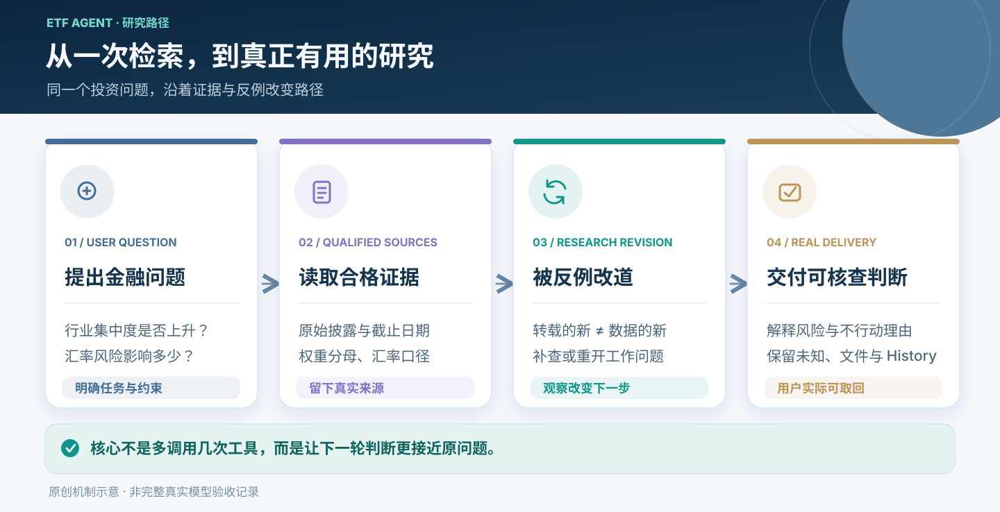
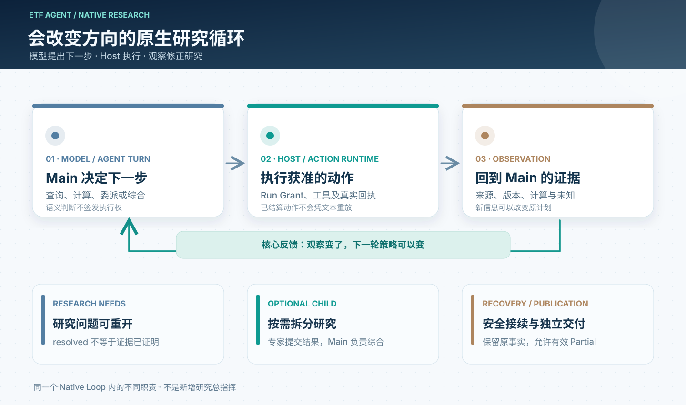
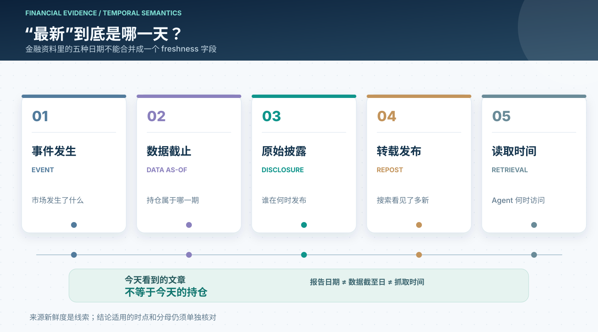
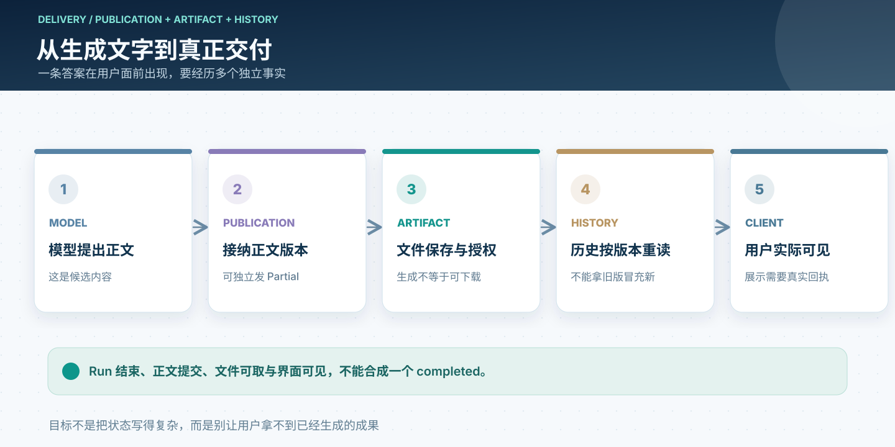

# 投研 Agent 的关键不是多调用工具：从 Model、Harness 到会修正判断的 Loop

> 一张[六层全景图](/articles/017-prompt-to-answer-six-layer-panorama-v3)能告诉我们 Agent 的能力分别归谁负责。但若想理解一个 Agent 为什么会查下去、改方向，甚至推翻自己的初步判断，还要换一个视角：看它怎样**持续研究一个问题**。下文以 ETF Agent 已有的执行与投研能力为原型；基金情节为方便理解而组合的示例，不是一次真实运行的逐字记录。

## 一、用户想要的是判断，不是十次搜索

假设用户问：“我的基金组合行业集中度是不是上升了？考虑汇率变化，现在有必要调整吗？”

这句话里藏着几个完全不同的问题：持仓对应哪个披露日？单只基金的行业占比，怎样换算成用户整个组合的暴露？跨币种资产按哪天的汇率比较？如果上升了，究竟是价格变化、基金换仓，还是组合权重变化？维持原配置有没有合理理由？

如果 Agent 只是在 Prompt 里写“请充分研究”，然后循环调用搜索与摘要工具，很容易得到一份看似充分、却把不同日期和不同分母拼在一起的报告。

**我们设计 ETF Agent 时逐渐形成的认识是：工具调用扩大了可获取的信息，研究循环才有机会改善判断；而可信的执行和来源关系，决定这种改善能不能被核查。**

这里有一个值得先区分的概念：**更多信息，不等于更好的研究；更长的运行时间，也不等于更深入的思考。** 只有新观察能够改变下一步行动、修正既有结论，Loop 才不是机械重复。

## 二、Model 负责判断，Harness 负责让判断落到真实世界

一个开放式投研问题很难预先写成固定步骤。例如，读到一份基金报告后才发现行业口径不同；找到两份资料后才发现它们都引用了同一个旧来源。下一步是继续搜索、换一个指标、让 Child 核对原文，还是把结论限定在历史时点，应由 Main 根据实际内容来决定。

这正是 **Model** 的工作：理解用户的意图，选择研究方法，比较证据，提出假设并接受反证。

而 **Harness** 是让这些决定能够安全执行的环境。它管理本次模型看见什么、能调用什么；工具是否真的被派发、回执属于哪一次 Run；资源不足或进程消失后怎样继续；哪些内容才算已经发布。Harness 可以承载 Loop，本身不必被描述成与 Loop 对立的一层。

金融应用还需要第三类责任：**事实与计算的权威**。基金披露、资产持仓、汇率时点和确定性汇总都有自己的来源或计算合同。模型可以解释这些材料，却不能靠一句“我确认了”更改原始数字，更不能用分析意见替用户批准交易。

因此，ETF Agent 的关键不是设置一个全知的“主管 Agent”，而是让三种职责各守其位：

| 该决定什么 | 由谁负责 | 留给读者的启示 |
| --- | --- | --- |
| 下一步研究什么、怎样理解反证 | Main 模型 | 把开放问题留给有语义判断能力的一方 |
| 工具权限、运行回执、预算与接续 | 既有 Host / Runtime / Recovery Owner | 让执行行为有可核查的事实，不依赖模型自述 |
| 数据来源、数值口径与真正的业务效果 | Source/Result、金融工具与业务 Owner | 生成一个数字或建议，不等于它已获得事实或执行权威 |

**模型不应充当数据库事务管理器，Harness 也不应假装自己懂投资。** 这条分工减少的不是代码行数，而是互相矛盾的判断来源。

## 三、Loop 的核心不是重复，而是让观察改变策略

ETF Agent 的 Native Research 没有为了复杂研究再引入一套通用图工作流。核心执行节奏是 `AgentTurn → ActionRuntime → CompletionGate`。

`AgentTurn` 让 Main 基于当前获准上下文提出下一步；`ActionRuntime` 负责实际执行或消费合格结果；`CompletionGate` 依据已结算的运行事实处理继续、资源边界和结束。工具观察再进入下一轮 Main，原来计划好的动作就可以被修改。

这套机制有三个很实用的时间尺度。

**第一，单轮观察改变行动。** Main 发现基金净值已经更新，却只有上季度持仓，就不能自然得出“今天行业暴露上升”。它可以追索披露、采用明确的历史口径，或者承认当前数据不足。

**第二，同一个 Run 可以修正研究问题。** ETF Agent 的 `researchNeeds` 是一组可选的模型工作问题。例如“确认行业集中度变化”一度被标记为 `resolved`，后来发现持仓覆盖率太低，模型可以重新打开它。这种设计给研究过程留出反悔空间，却不把工作问题的状态升级成自动完成认证。一个 `resolved` 标签不是一张“金融研究正确”的证书。

**第三，跨时间继续不需要重新编造过去。** 我们已经有持久运行与恢复机制：Run 保留原身份、授权、预算和已结算的工具回执；进程中断后沿原位置继续，而不是再次调用那些已经成功的动作。若用户在后台研究时提出明确纠偏，原控制机制负责接纳并交给目标 Run；原 Run 结束后的显式 Continue 则是有来源关联的新研究。

这也是为什么我们把 Main、Child、Memory、Recovery、Publication 的职责反复收敛回各自 Owner：**研究可以动态变化，执行历史不能跟着模型的想法随意改写。**

## 四、金融研究的难点：一条“最新消息”有好几个时间

技术文章里常把“新鲜度”视为一个时间戳。但金融研究的时间至少有不同含义：市场事件发生时间、报告持仓截止日、原始披露日、修订日、媒体转载日，以及 Agent 读取资料的时间。

设想一篇今天刚发布的报道引用半年前的基金持仓。搜索结果显示“今天”，并不代表投资组合的行业暴露来自今天。再比如，一份基金季报与一条较新的净值数据都是真实来源，却不能直接拼成“同一天的持仓”。

ETF Agent 已有的 Web/PDF 阅读、研究来源身份、ResultRef、时间语义与市场工具，为这种研究提供了各自的基础。Source/Result 管来源和派生关系，时间语义解释“今天”与市场 Session，金融事实工具持有真正的持仓或行情口径。模型消费这些事实、发现矛盾，并决定怎样措辞或补查。

再往下，还有一个容易忽略的金融计算问题：

`组合的某行业穿透暴露 ≈ Σ（用户对基金的配置权重 × 基金在该行业的持仓权重）`

这只是说明分母关系的简化表达；真实研究还要处理现金、非股票资产、底层覆盖、重复暴露、不同披露期与币种。如果从基金层数字跳到组合层数字，却没把来源和假设带过去，Python 算得再准确，结论也可能错。

这给我们的启示是：**金融 Agent 需要同时保留数字、数字的分母，以及数字在什么时点成立。** 引用链接只是入口，来源与计算之间可追溯的关系才是可复查研究的基础。

## 五、Subagent 应该帮研究分工，而不是给结论投票

复杂研究确实可能需要专家协作。我们在 ETF Agent 中已经有 Child 生命周期、不同研究方法、投资视角与有界多空对话。但它们并不意味着每项问题都要派出一支固定专家队伍。

更合适的理解是：Main 遇到一个值得独立处理的研究分支，才委派 Child。例如让一个 Child 阅读两份原始披露的差异，让另一个在授权范围内复算行业穿透；不同投资视角可以挑战“集中度上升就应该减仓”这一推断。

Child 提交的是**自己的结果和引用关系**。Main 看到 Child 的摘要，不等于 Main 已经阅读了 Child 看到的全文。Reviewer 指出潜在错误，也仍是一份供 Main 考虑的审阅意见，并不自动成为拒绝发布或执行交易的权限。

因此，衡量多 Agent 协作的合理问题并不是“用了几个角色”，而是：**新分支有没有带来 Main 原本缺少的事实、计算或真正影响判断的反例？** 如果没有，少一个 Child 反而更清楚、更便宜、更容易恢复。

## 六、结束研究，不等于用户已经拿到结果

研究系统很容易把完成看得过于简单：模型没有继续调用工具，于是 Run 结束；报告文本生成，于是任务标记为成功。

但用户真正关心的是：报告说的是否是他的组合，现金和总额是否对得上，为什么给出这个建议，文件能不能打开，下次回来还能不能看到同一版依据。

ETF Agent 的 Publication、Artifact、History 与渐进式回答已经把这些事实拆开：可用的阶段性结论可以先交付，最终结论可以另行提交，报告文件有自己的保存和访问身份，历史重放也应引用正确的版本。后台研究可以继续，用户仍能提出另一条简短问题。

这并不是要求每个输出都有复杂的审批链。恰恰相反，**能独立成立的部分，就应允许独立交付；暂时无法核实的部分，就明确说清未知。** 研究停止可能是足够回答、资源用尽、等待外部动作或用户取消；不能用同一个漂亮的 `completed` 抹掉这些差别。

## 七、这些实践最终指向一个简单的架构判断

把这几年的 Agent 工程经验压缩到一次投资研究，我们最想分享的不是有多少模块，而是三个选择。

**第一，让模型保持可改变主意的能力。** 别把模型当成固定流程的自然语言包装器。新的披露、冲突来源和反证可以改变下一轮研究；但模型更新策略不需要重写执行历史。

**第二，让每项确定性事实有唯一负责者。** 授权、数据来源、数值计算、工具回执、恢复与发布，各自由真正的 Owner 结算。不要因为需要串起一条研究链，就创造一个能替所有模块签字的总控层。

**第三，用交付倒推架构，而不是用架构复杂度证明价值。** 一套 Loop 能恢复、Child 能协作、引用能定位，当然重要；它们的意义最终还是让投资者拿到一份说得清数据时点、计算口径、证据与反对理由的研究。

一个好的投研 Agent 未必知道所有答案。但它应该知道什么时候需要继续研究、什么时候应该改变判断、什么时候只能给出有条件的结论。**最值得建设的不是“永远不停的 Loop”，而是一个会被事实纠正、又不会丢失事实的系统。**

---

[六层调用全景 V3](/articles/017-prompt-to-answer-six-layer-panorama-v3) · [金融证据链](/articles/financial-agent-trustworthy-evidence-chain) · [研究结果与引用](/articles/tool-results-outside-model-context) · [异步研究与交付](/articles/agent-asynchronous-research-time-bound-delivery)

[ETF Agent 技术文章集 · GitHub](https://github.com/hpoenixf/eff-agent-article) · 如果这些工程选择对你有启发，欢迎 Star。
