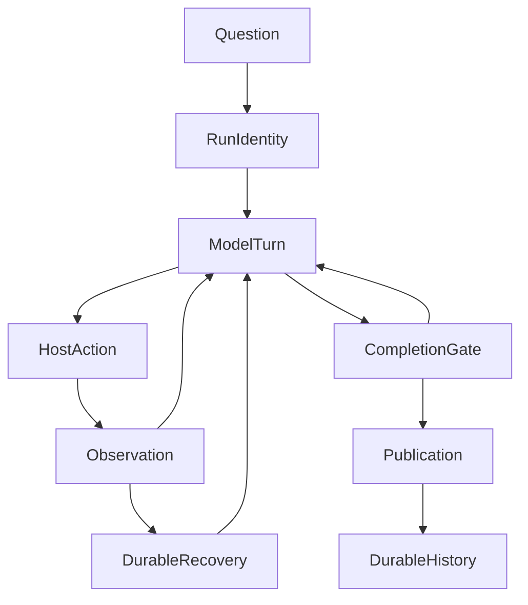

# 从一次检索到持续研究：ETF Agent 的模型、Harness 与 Loop

> 本文以 2026 年 10 月下旬的 ETF Agent 工程状态为界。文中的基金研究过程是**根据现有机制构造的教学案例**，不是一段未经剪辑的真实模型 Trace，也不等于整题已达到金融质量验收。先从[六层调用全景 V3](/articles/017-prompt-to-answer-six-layer-panorama-v3)认识系统分工，再看这里的研究推进过程，会更容易理解。

## 一、为什么查到了资料，问题仍然没有解决

设想一个投资者问：“我的基金组合行业集中度是否上升？结合最新披露和汇率变化，解释风险，并给出调整与不调整的理由。”

一次搜索可能很快找到几份基金报告，工具也成功返回数字。可是这些材料未必回答了问题。两份报告的持仓截止日可能不同；有的数字是基金自身持股权重，有的却是用户组合的基金配置比例；一篇今天出现的转载内容，可能引用数月前的数据。

真正的任务既不是“找到更多网页”，也不是“生成一篇长报告”。它需要对原问题反复做判断：**现在知道了什么？缺什么？出现了什么冲突？下一步还值得查什么？哪些结论有条件成立？最终用户实际得到了什么？**

ETF Agent 走的是一条逐步形成的工程路线：尽量让模型负责研究判断，让既有执行体系负责真实回执与安全接续，让金融数据和确定性计算负责各自的事实。我们把这套组合称为 Model、Harness 与 Loop，但它们不是需要叠加的三个新平台。

## 二、先分清谁在做判断，谁在保证事情真实发生

**Model（模型）**负责语义决策。它可以把问题拆成行业穿透、资料日期、汇率敞口和备选方案，选择工具，依据新证据修订判断，决定要不要请子代理检查反例。不能因为它说“我查过”就认定工具执行过，也不能因为它说“已完成”就跳过执行端的结算事实。

**Harness（Agent 执行底座）**不是单独的一段 Prompt，也不是另一个替模型思考的“大脑”。它包含模型请求装配、获准工具、预算与容量、生命周期回执、上下文拟合、持久身份、恢复和发布接缝。它让模型的提议在真实权限、可观察结果和可接续状态中运行；它本身也包括 Loop，不能把 Harness 与 Loop 强行定义为互斥的两层。

**金融能力**则提供独立的约束：哪些数据来自原始披露，截止日是什么，权重的分母是什么，币种与汇率口径如何，计算是否可复现。模型可以解释数字，但源数据、算式和真实写入不能仅靠语言生成获得权威。

| 面对的问题 | 主要判断或权威 | 典型误区 |
| --- | --- | --- |
| 下一步查什么、是否需要反证 | Main 模型的研究判断 | Runtime 用固定字段规则代替研究策略 |
| 工具是否获准、确实执行并结算 | Run Grant、Host、ActionRuntime 等原 Owner | “模型提了工具调用”当成“工具执行成功” |
| 结果引用哪版材料、数字从何得来 | Source/Result、金融数据与计算 Owner | Python 返回数值后自动视为投资结论 |
| 是否停放、恢复、提交正文 | Recovery/Control、CompletionGate、Publication 等原 Owner | 一个 `completed` 同时证明全部环节成功 |

所以我们的基本选择不是“让 Harness 管理一切”，而是**把确定性权威留在原 Owner，把研究策略留给模型**。多加一个总控模块往往只会让授权、恢复和结果版本出现第二份解释。

## 三、Loop 不是一张无限循环的流程图

从代码执行看，Native Research 使用一条简洁的主循环：模型回合 `AgentTurn` 提出下一步，`ActionRuntime` 运行获准动作并留下回执，`CompletionGate` 按既有运行事实决定接续或终止。

这张图展示**可能的回访关系**，而非每条边都在每次任务中发生。没有工具需求时可走 Direct；资源或安全条件不满足时可以停下并诚实交付部分结果；持久恢复不是反复重放已有工具；正式正文走 Publication，而不是由模型直接宣布已经送达。

更值得注意的是：同一个循环可以按三个时间尺度阅读。

### 1. 一个模型回合：观察驱动下一步

例如 Main 先拿到基金净值，再请求披露资料。资料的截止日期比预期早，下一轮 Main 就可以改变策略：先查原始披露、改用历史口径，或明确当前持仓不可得。

这不是预先写死“查 A、查 B、查 C”的 DAG。**工具观察有能力改变计划**。同时，模型只能消费当前获准的真实回执；Child 曾读过的全文和 Main 实际看到的摘要，也要区分。

### 2. 同一个 Run：研究目标可以重开

ETF Agent 的 `researchNeeds` 是可选的模型工作问题列表，可以从 `open` 变成 `resolved`，新证据出现后也可以重新打开。它帮助 Main 在长任务里追踪尚未解决的疑问，但不是确定性的证据覆盖仪表盘。

比如“确认最新行业暴露”原本看似解决，后来发现行业分类口径发生了变化，Main 可以重开。反过来，所有工作问题都标记为 `resolved`，仍不能证明引用、金融数字、原题要求与实际交付完整。模型负责判断是否足够；既有 CompletionGate 和 Publication 只结算自己的事实，不代替独立金融质量评价。

### 3. 跨越时间：等待与恢复不是重新开始

长任务会遇到上下文耗尽、工具失败、进程退出、需要用户回应或后台定时继续。恢复应沿原 Run 的身份、授权、预算与已结算回执前进；用户的合法纠偏通过原 Control 接缝，由目标研究采纳之后才产生效果。

当原 Run 已经终态，显式 Continue 是**关联的新 Run**，不是把旧研究悄悄改成从未结束。未来的定时再研究还要保留旧结论及其原判断条件，不能把“再次启动”误认为“自动更新了正确投资观点”。

这种跨时间的连续性是工程能力，也是另一类需要真实验收的产品体验：后台确实可以运行，与用户最终拿到一份值得信赖的研究，是两件事。

## 四、用一条基金研究任务贯穿这三个尺度

下面是一条**设计上的合理执行路径**，不是我们声称已完整跑通的生产记录。

**第一步，冻结题目和权限。** 用户希望比较行业与汇率风险。账户身份、原 Run Grant、可访问组合和研究工具在执行前分别确认；Main 可以选择 Research，不能自行扩大数据权限。

**第二步，收集适用资料。** Main 通过只读金融工具取得组合与基金事实，必要时让 Web/PDF Child 核对报告原文。搜索摘要只给出候选，不能替代报告正文、表格、截止日与适用说明。

**第三步，处理时点冲突。** 今天转载的一份“最新持仓分析”实际引用的是更早报告。Main 需要区分事件/披露/转载日期和持仓 `dataAsOf`。如果只有历史样本，就明确写“截至某次披露”，而非编造当日资产暴露。当前 A36 时间语义已有局部实现，但实际合格日历来源、普通认证研究消费与端到端验收仍开放。

**第四步，计算并保留不确定性。** 比较组合行业占比时，必须确认基金配置权重、底层持仓覆盖、分类和汇率转换时点。确定性工具可以算乘积与汇总；缺失持仓、重复穿透、费用与币种口径仍须单独解释。一个精确小数不代表方法和原始数据都正确。

**第五步，按价值选择协作。** 如果两份披露互相矛盾，Main 可以委派 Child 深读，或请 Reviewer 检查遗漏。两个子代理争论有用与否，要看它是否带来不同证据或反例，而不是角色数量。Reviewer 的意见是意见；人类回复、真实金融审批和交易执行分别保有自己的权威。

**第六步，交付可能是完整、部分或未知。** 研究过程中已经成立的解释可经 Publication 发布为阶段内容。最终应在正文说明事实时点、集中度计算分母、主要风险、可能不调整的原因及缺口；可下载报告、持久保存与 fresh History 由各自交付链确认。工具成功、模型结束、文件生成和用户可取回，四者不能合成一个成功标记。

这里最重要的不是六步顺序，而是**第三步可以使第二步重做，第五步可以发生在任何一轮，第四步发现数据不足可以让第六步保持 Partial**。真正的研究是被观察与约束不断修正的过程。

## 五、为什么我们没有再造一个“研究总指挥”

固定工作流适合稳定、可枚举的流程；开放式研究则有大量无法提前列出的发现与反证。如果让一份外部 DAG 预先决定“先找十篇报告，再由三个专家评分”，当源日期不适用或关键数据缺失时，流程仍可能机械走到漂亮的终点。

另一种极端是把所有控制都交给 Prompt：它要求模型“必须认真检查”“必须合规”，却没有办法确保某次金融效果真的被用户批准、已结算工具不会在重启后重放、发布的文件在另一个会话仍可取回。

我们的取舍在两端之间：**一个 Main 研究循环，按需调用少量 Child；方法可以来自 Skill；工具与恢复遵守原来的确定性权威；业务判断仍回到真实事实。** 如果两项能力只需共享工具与材料，就没必要为了结构好看再增加一个 Agent。

这个判断也有外部技术背景。Anthropic 在 [Building effective agents](https://www.anthropic.com/engineering/building-effective-agents) 中强调简单可组合的工作流与动态 Agent 之间的取舍；其 [long-running agent harness 实践](https://www.anthropic.com/engineering/effective-harnesses-for-long-running-agents) 讨论了跨上下文交接的重要性。这些是外部先例，不是 ETF Agent 成果的证明，也不能替代我们自己对金融研究质量的验证。

## 六、截至目前：能力在增长，但复杂基金研究仍是硬题

回看现有工程，不是从零开始搭 Model / Harness / Loop。

- **已经有明确机制的部分**：无通用图框架依赖的 Native Loop、Main/Child 的局部生命周期、原 Run 资源与授权、工具真实回执、研究结果引用、Publication、持久接续，以及可选的研究工作问题。异步交付和前台短答并发也已有明确范围内的工程验证。
- **有代码或受控证据、但仍有限制的部分**：市场时间解释、人工接入、研究进度展示、投资视角协作与恢复的不同路径，存在默认关闭、来源接入或独立真实场景验收差异；不能用功能目录里的“有”来代表全部用户都可使用。
- **仍未证明的最终结果**：一项复杂基金研究从正常入口自主完成资料核验、正确计算、符合用户问题的结论，以及可下载正文/报告和新会话 History 的连续可用。已有研究样本暴露了现金、合计、分类与实际文件取得等缺口；不能用工程局部验证覆盖这些失败。

截至本文写作时，团队已明确**停止自动追加付费金融质量复测**，优先修订现有报告、核对文件可取得性；原金融质量后续阶段保留未验证状态。进一步真实模型对照需要新的明确授权，不是本文发布后的自动待办。

这就是我们对“已经做得差不多”的更精确说法：**关键执行骨架已存在，瓶颈正在从“能调用能力”转向“能否持续修正研究并实际交付有用结论”**。

## 七、下一步不扩层：只把原研究中的四件事做扎实

| 要补的能力 | 更有价值的验证问题 | 沿用的责任归属 |
| --- | --- | --- |
| **金融时点** | 转载日期、披露日期、数据截止日冲突时，能否正确拒绝“最新持仓”措辞，同时允许历史研究？ | 既有时间语义、市场来源与基金事实 |
| **研究结论修订** | 新证据推翻先前推断后，能否留下原结论、修订原因与引用，而不把旧版重签为最新事实？ | Research、Source/Result、Publication、Thesis/History |
| **真正的交付** | 用户是否取得正确的现金/总额分类、正文、报告文件及可复查 History？ | 原金融计算、Publication、Artifact 与会话交付 |
| **审阅与人类接管** | Reviewer 意见、用户答复、业务批准与实际效果能否在日志和界面上分别辨认？ | Reviewer、HIO、Run Control 与业务效果 Owner |

这些是**深化既有 Owner 的验证问题**，不是新增四个模块或另一个合规守门员。先用已有失败、已获准样本和局部确定性验证推进；没有授权的付费模型实验和生产金融动作都不自动启动。

一个成熟的投研 Agent，不是 Loop 转得越久、叫来的专家越多越好，而是每一轮都能根据可靠观察靠近原问题；无法继续时，仍能准确说明已知、未知，并把真实产物交到用户手里。

---

[六层调用全景 V3](/articles/017-prompt-to-answer-six-layer-panorama-v3) · [研究结果与引用](/articles/tool-results-outside-model-context) · [投资研究的可信证据链](/articles/financial-agent-trustworthy-evidence-chain) · [异步研究交付](/articles/agent-asynchronous-research-time-bound-delivery)

[GitHub · ETF Agent 工程文章集](https://github.com/hpoenixf/eff-agent-article) — 如果这些真实工程取舍对你有帮助，欢迎 Star。
