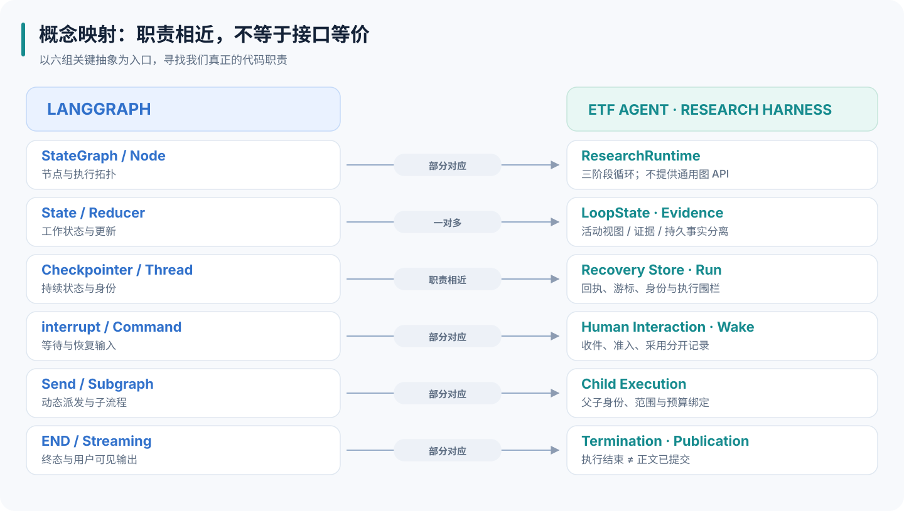
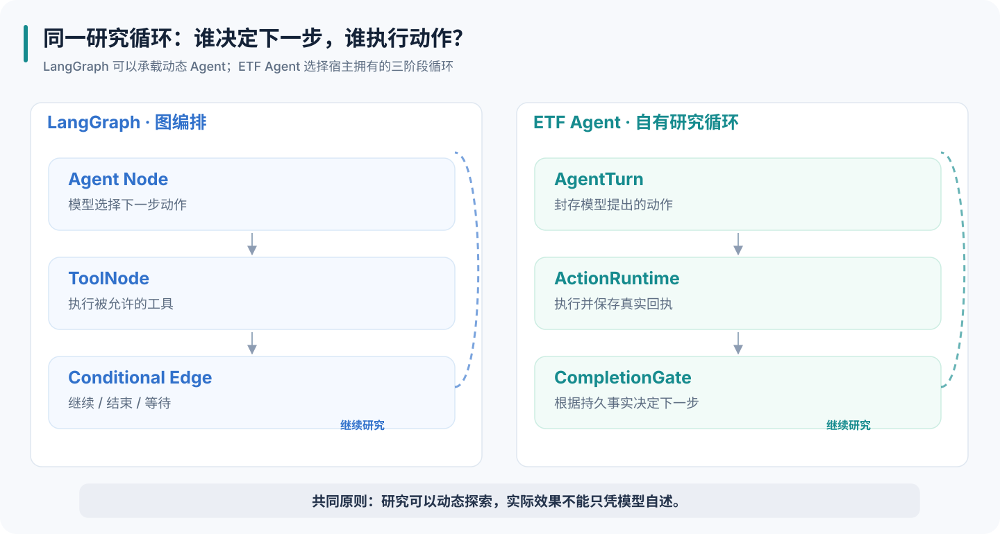
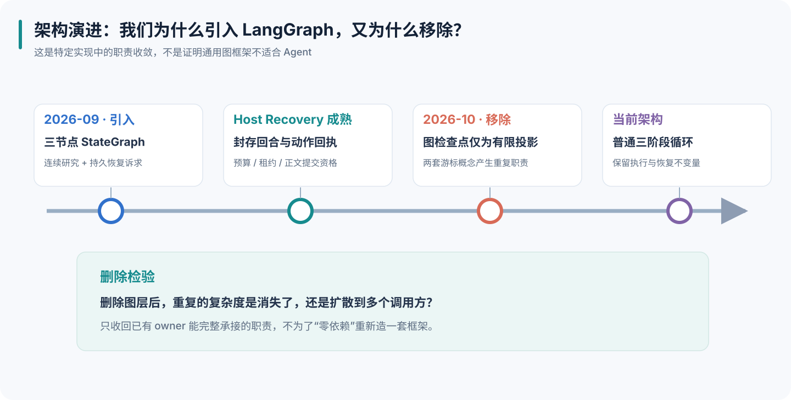
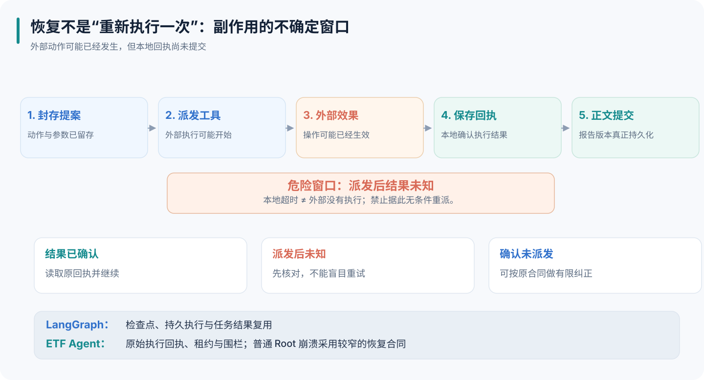
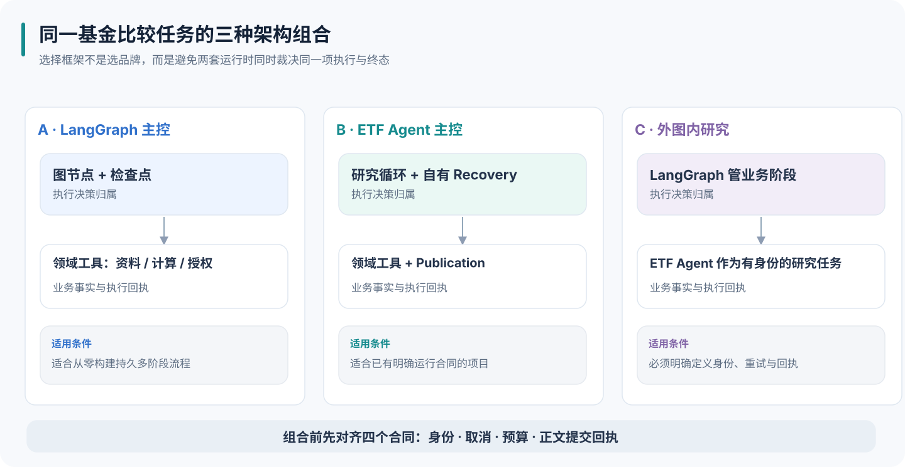

# ETF Agent 与 LangGraph 深度对比：概念映射、状态恢复与研究交付

ETF Agent 和 LangGraph 有一段直接的技术关系：我们曾经使用 LangGraph.js 组织研究循环，后来又把这层移除了。

这段经历容易引出两个过快的结论：既然移除了，是否说明图不适合自主研究？既然我们自己也保存状态、处理恢复，是否只是重新实现了一套 LangGraph？把当时的设计和今天的代码放在一起看，答案都需要更具体。

**LangGraph 提供通用的有状态执行机制；ETF Agent 围绕研究任务，把执行、资料、授权和交付组织成一套应用框架。两者有明显重叠，也有不同的责任范围。** 判断是否采用 LangGraph，要看哪些执行职责真正交给了它，以及它是否减少了应用必须自己承担的工作。

本文以 **2026 年 11 月 8 日核查的 ETF Agent 私有主工程**为比较对象；公开示例单独以 **Open ETF Agent v0.25.0** 为边界。LangGraph 的机制说明依据同日官方文档，API 示例采用 Python 术语；项目历史采用的是 LangGraph.js，不能混用两种语言的版本号和接口细节。


**公开范围说明：** 私有主工程的代码符号在下文仅用于说明职责位置，不提供私有仓库或未公开实现的访问链接；可独立运行的公开教学样本放在文末，并明确与主工程不同。

沿用一个教学任务：**比较两只基金的持仓重叠，发现口径冲突时补查，必要时询问用户，最后保存一份带来源的报告。** 这是用来解释架构的合成场景，不是一份真实投资建议。

## 一、先把比较对象放在同一层

LangGraph 官方将它定位为面向长时间、有状态 Agent 的底层编排框架和运行时，提供持久执行、中断、流式输出等能力，允许确定性步骤与模型决策混合。它不要求应用采用特定提示词或研究架构。[LangGraph 官方定位](https://docs.langchain.com/oss/python/langgraph/overview)

同一生态还有不同层次的产品：

| 层次 | LangChain 生态中的主要对象 | 在 ETF Agent 中应比较的范围 |
| --- | --- | --- |
| 执行与恢复 | LangGraph | 研究循环、运行控制、恢复游标与持久化接缝 |
| 模型和工具抽象 | LangChain | 模型网关、工具呈现、工具执行与扩展接线 |
| 完整 Agent 运行环境 | Deep Agents | 方法加载、上下文管理、子代理、执行环境等组合 |
| 服务与运维 | LangSmith / Agent Server | 后台任务、服务接口、观测、评测与部署 |

这是用于比较的职责划分，实际能力存在交叉。Deep Agents 已经包含规划、子代理、文件工具和上下文管理；Agent Server 也有持久化和任务队列。不能拿一个裸 LangGraph 库，与我们的整套研究服务逐项数功能。[官方分层](https://docs.langchain.com/oss/python/concepts/products) · [Agent Server](https://docs.langchain.com/langsmith/agent-server)

我们当前的主研究循环由自有运行时驱动，模型网关使用 Vercel AI SDK 的提供方适配。代码中存在 Claude 或 Pi 的兼容概念，并不表示主循环交给了 Claude Agent SDK 或 Pi。这一点决定了比较的成本：我们实际承担着模型循环、执行控制和恢复接线的维护工作。当前模型网关

## 二、LangGraph 的概念，在我们的代码中对应什么



*图 · 机制与职责示意，不表示两种实现具备完全相同的运行语义。*


先约定“对应”的含义：它表示解决相近问题的代码位置，**不自动表示接口相同、覆盖范围相同，或能够直接替换**。有些概念对应一个模块，有些需要几个模块协作，还有些能力当前没有通用对应物。

### 1. 执行、状态和依赖注入

| LangGraph 概念 | ETF Agent 当前对应模块或对象 | 对应程度与关键区别 |
| --- | --- | --- |
| `StateGraph`：声明状态、节点和边的构建器 | `research-runtime.ts` 的 `createResearchRuntime` 与三阶段循环 | **部分对应**。我们没有通用图定义、编译和任意拓扑 API。 |
| `CompiledStateGraph` / `Pregel`：编译后的图与执行引擎 | 研究主循环、工具执行和 Child 调度共同承担推进职责 | **没有通用对应物**。Main 的一轮不是超步，我们没有通用通道与批量同步调度引擎。 |
| `State`：图内演进的数据 | `ResearchLoopState`、`ResearchRun`、`createResearchRunEvidenceContext()` 创建的证据上下文，以及各职责模块的私有状态 | **一对多**。活动状态、持久事实、证据视图和已发布正文分别管理。 |
| `Node`：一次可调度工作 | `onNativeAgentTurn`、`onNativeActionRuntime`、`onCompletionGate` | **职责相近**。这是生命周期阶段；一个阶段会调用多个模块，工具也不自动各算一个节点。 |
| Edge / conditional edge / `Command(goto=...)` | 主循环中的 `nextNode`、`requestedRoute` 与条件转移 | **部分对应**。只有既定阶段转换，没有通用任意节点跳转命令。 |
| Reducer：合并状态字段更新 | `mergeResearchObservations` 及各模块自己的更新方法 | **职责相近**。没有通用 channel reducer 注册；合并逻辑也不能取代证据校验。 |
| 节点 `Runtime` 及其 `context`；另行注入的 `RunnableConfig` | `ResearchRuntimePorts`、`ResearchProductionRuntimeOptions`、`ResearchTurnContext` 等 | **一对多**。依赖、当前观察与授权分别建模，不能把它们合称“运行状态”。 |

对应源码集中在研究主循环、运行时接口与证据上下文。

这里有一个同名陷阱：`StateGraph` 是构建器，`compile()` 返回可执行的 `CompiledStateGraph`，后者基于 Pregel 执行。注入节点的 `Runtime` 对象则是上下文、存储句柄和流输出等运行依赖的容器。节点的 `RunnableConfig` 独立注入，并不属于这个 `Runtime` 对象。我们的 `ProductionRunContext` 是各模块状态与操作的装配对象。两者都带有 Context 或 Runtime 字样，职责并不相同；授权还需单独看 `ResearchGrantedAuthorization`，不能由“已经放进 context”推导。[LangGraph Runtime 定义](https://github.com/langchain-ai/langgraph/blob/e5e37b5d70dbfd93c7006bd90a658c6179a95946/libs/langgraph/langgraph/runtime.py) · 我们的装配上下文

### 2. 身份、检查点和长期存储

| LangGraph 概念 | ETF Agent 当前对应模块或对象 | 对应程度与关键区别 |
| --- | --- | --- |
| Thread / `thread_id`：跨调用保存连续状态的身份 | 用户讨论容器最接近 `StoredConversation.id` | **部分对应**。我们的执行恢复按 `scopeId + ResearchRun.runId` 组织，不能直接把 thread 改名成 conversation。 |
| Run / `run_id`：一次执行的身份 | `StoredRun`、`ResearchRun.runId` | **职责相近**。一个 Conversation 可以有多个 Run，各有原始准入与预算；还应区分 LangGraph 调用追踪 ID 与部署平台的 Run 资源。 |
| `checkpoint_id`：定位一个历史检查点 | `ResearchCheckpoint.revision` 与相应内容身份 | **部分对应**。没有等价的通用历史分叉定位符；检查点修订、执行围栏和正文修订是不同编号。 |
| Checkpointer / PostgresSaver：保存并读取执行检查点 | `ResearchCheckpointRecoveryStore`、`createPgResearchCheckpointRecoveryStore` | **职责相近，范围不同**。我们的存储还维护回执、预算、租约与围栏，不能简单换成图状态保存器。 |
| `StateSnapshot`：某个执行位置的状态快照 | `ResearchCheckpoint`、`ResearchRuntimeResumeState`、`ResearchRecoveryContinuation` | **一对多、有限对应**。没有一个快照统一承担任意节点恢复、业务效果重放和历史分叉。 |
| Store：跨线程保存应用数据 | 记忆用途最接近 `MemoryRepository`、`PgMemoryRepository` 与 Memory 路由 | **部分对应**。LangGraph Store 是通用存储能力；我们的记忆有作用域和生命周期，结果存储与会话历史又是另外的职责。 |
| Time travel / checkpoint fork | 历史回读、显式新 Run 继续只有局部相似体验 | **当前没有通用对应物**。读取旧正文不等于修改旧状态后重新执行。 |

主要落点是Conversation 与 Run 类型、恢复合同、PostgreSQL 恢复存储与记忆仓储。LangGraph 自身也区分检查点与跨线程 Store，不能因为历史类名里有 `MemorySaver`，就把它对应为我们的长期记忆系统。[持久化分层](https://docs.langchain.com/oss/python/langgraph/persistence)

最实用的理解是：**同一个 Conversation 里继续聊天，可以产生新的 Run；同一个 Run 里又有模型回合、动作回执、检查点与正文版本。** 这些身份服务于不同的重试、准入和回读边界。

### 3. 工具、人工交互和子任务

| LangGraph 概念 | ETF Agent 当前对应模块或对象 | 对应程度与关键区别 |
| --- | --- | --- |
| `ToolNode`：执行模型提出的工具调用 | `researchToolContracts`、`ProductionNativeState`、`NativeReadInvocationExecutor`、MCP Host | **一对多**。工具定义、调用派发、控制动作和实际效果由不同接缝承担。 |
| `interrupt()`：停放并等待外部输入 | blocking 人机交互、`ResearchNativeParkControl`、`ResearchControlPark` | **部分对应**。默认非阻塞问题不等价于中断；必须等待时才进入相应停放路径。 |
| `Command(resume=...)`：向中断提供响应 | HIO 回复接纳、`ResearchControlWakeProof`、原 Store 的 `resumeRun` | **一对多**。收件、合法唤醒和模型采用是三个事实。 |
| `Send`：携带独立输入动态派发节点 | `spawn_subagent`、`createNativeSubagentExecution().spawn` | **部分对应**。我们动态委派受原 Root 约束的 Child，并未提供任意节点的通用扇出接口。 |
| Subgraph：组合一个子流程 | Child execution 及其独立上下文、结果交接 | **部分对应**。子图未必是 Agent；我们的 Child 也不是任意嵌套图。 |
| Functional API `task`：可保存返回值的工作单元 | 模型回合、动作提议、执行回执与恢复消费共同覆盖部分职责 | **没有统一对应 API**。不能将它直接对应成研究计划项、定时任务或 Child。 |

对应实现可从原生工具执行、人机交互、停放控制与Child 执行进入。`Send` 与 `Command` 的原始含义，可对照[官方控制流说明](https://docs.langchain.com/oss/python/langgraph/graph-api-send-command)。

### 4. 运行策略、输出和终态

| LangGraph 概念 | ETF Agent 当前对应模块或对象 | 对应程度与关键区别 |
| --- | --- | --- |
| `RetryPolicy`：按条件重试执行单元 | 主循环重试、`ResearchMainRetryIntent`、`ResearchNativeRetryAdmission` | **一对多**。还要看真实派发、结果未知与已扣减资源，不能只移植次数和退避参数。 |
| `recursion_limit`：限制图超步数 | 轮次政策、`RunResourceAdmission` 与运行终结模块 | **部分对应**。我们另外控制请求、动作、时间及收尾预留；轮次不等于总成本。 |
| `durability`：检查点写入时机 | 回执、检查点、终态和正文提交各自的持久化合同 | **没有同名全局开关**。不同对象不能一起切成“异步保存”而忽略各自承诺。 |
| `messages / updates / values / custom` 流 | `ChatModelEvent`、公开 `StreamEvent`、进度事件与 Publication | **一对多、部分对应**。内部模型事件不等于公开正文，我们也不暴露任意图 State 的通用流。 |
| `END`：当前路径没有后继 | `finish_research`、终结负责人、Store 的 `finishRun` | **部分对应**。模型提出结束、运行终态、正文保存和问题已解决需要分别判断。 |
| Node cache / `CachePolicy` | 同 Run 结果回读、已结算回执复用只有局部相似性 | **当前没有通用对应物**。结果重读不等于按节点输入做缓存，模型提示词缓存也属于另一层。 |

相关源码见资源管理、终结决策、公开事件类型和正文发布。这些链接对应主工程，公开教学代码入口在文末单列。

这张映射最重要的用途，是帮助我们找到真正需要比较的接缝。例如，讨论 `interrupt()` 时，应同时看人机交互记录与运行停放；讨论 `Checkpointer` 时，应看恢复游标和存储；讨论最终答案时，则必须继续看 Publication。仅凭一个名称相似的类，很容易遗漏实际责任。

## 三、图表达执行结构，模型仍然可以决定研究路线



*图 · 机制与职责示意，不表示两种实现具备完全相同的运行语义。*


### 1. 节点的粒度决定图管到哪里

在 LangGraph 中，节点是执行函数，边组织后续执行，状态承载节点之间的数据。条件路由、循环、`Send` 动态派发和 `Command` 更新状态并转移控制，都属于它的能力。因此，一张图完全可以在运行中根据模型输出选择后续路径。[Graph API](https://docs.langchain.com/oss/python/langgraph/graph-api)

同一个基金比较任务，可以采用两种合理的图设计。

一种把“读取披露、核对口径、询问用户、计算、生成报告”分别建成节点。应用显式描述阶段关系，阶段内部仍可使用模型。这适合流程本身有稳定业务含义、各阶段需要单独管理的任务。

另一种只保留“模型决策、工具执行、是否继续”几个节点。模型发现持仓日期不一致，可以再次读取资料、换一个来源、收窄问题，也可以提出询问。图控制循环边界，研究内容仍然开放。

**ETF Agent 当年采用的正是第二种薄图。** 它并未把某种基金研究顺序固定成业务 DAG。今天移除图层后保留的三阶段循环，也继续表达相同的职责：模型提出下一步，宿主执行获准动作，运行时根据执行事实决定后续推进。三阶段退役设计

节点粒度同时决定框架能看见多少执行细节。如果把整次研究包进一个 `research` 节点，图外看起来很简洁，但节点内部的每次搜索、计算和工具回执，不会自动成为独立检查点。要获得更细恢复能力，需要进一步拆分节点、使用任务单元，或者由内部运行时承担。

反过来，把每次细小动作都建成节点，可以增加执行可见性，却会扩大状态模式、路由与兼容面的维护范围。**选节点粒度，本质上是在选择希望框架独立管理、重试和观察哪些工作。**

### 2. Pregel 提供的是并行与状态可见性的规则

LangGraph 的运行核心 Pregel 把执行组织成超步：选出本步应运行的节点，执行，再更新通道。同一超步中的节点可以并行运行，本步写入在后续超步可见。这使“哪些结果已经可以被下一步消费”具有明确语义。[Pregel 运行模型](https://docs.langchain.com/oss/python/langgraph/pregel)

放进基金案例：两个研究分支分别读取 A、B 的资料，后续比较节点需要使用合适的汇总结果。LangGraph 能组织这些分支和汇合；我们也必须管理 Child 的运行、返回和消费，只是相关责任位于自己的执行与交接模块。

但并行结果到齐，并不说明两份持仓具有可比较的截止日。把两个数组合并，也不会自动识别同名基金、不同份额或重复来源。执行组织与研究判断在这里相遇，仍需各自清楚负责。

### 3. 普通循环也能使用 LangGraph

LangGraph 还有 Functional API，通过 `entrypoint` 和 `task` 给普通函数增加运行能力，允许使用原语言的条件、循环和函数调用。它与 Graph API 共用底层运行时，差别包括状态组织、检查点粒度和可视化方式。[Functional API](https://docs.langchain.com/oss/python/langgraph/functional-api)

因此，“我们用 `while`，他们用图”最多描述代码外观。更有价值的问题是：循环中的哪些调用被独立保存？恢复时哪些代码会重新执行？谁负责判断一个结果已经生效？

## 四、我们为什么采用过 LangGraph，又为什么移除了它



*图 · 机制与职责示意，不表示两种实现具备完全相同的运行语义。*


最初引入 LangGraph 的理由是合理的：研究需要从固定语义链走向连续决策，并获得持久恢复的基础。三节点图为“继续研究还是结束”提供了清晰结构。

随后，应用自己的恢复机制逐步承担了更具体的事实：已封存的模型回合、有序工具提议、动作回执、发布回执、预算、租约、执行围栏，以及下一步从哪里继续。与此同时，项目为控制图状态的大小和内容，刻意只把有限引用与投影写入图检查点，真实活动状态仍有一部分依赖进程内对象。

于是出现了一个局部矛盾：**图层保存着一套执行位置，但真实恢复仍要依赖应用自己的完整记录。** 维护者需要理解两套执行状态概念，图检查点却没有成为可以独立依赖的恢复入口。

这里必须准确归因：有限投影是我们的接法，不能据此说 LangGraph 的检查点天然不完整。LangGraph 检查点与业务数据库同时存在也很正常；问题在于它们是否各有明确职责，以及同一项执行决定是否被重复表达。退役问题与范围

当时比较了三个方案：保留图，只关闭图存储；另建一层循环封装；把固定的小循环放回 ResearchRuntime。最终选择第三种，保留三阶段含义与已有执行保护，删除不再承担独立责任的图和检查点接线。备选与删除检验

这个决定有严格前提：循环拓扑很小，应用恢复机制已经存在，而且图层提供的额外价值不足以覆盖维护成本。一个尚未建立持久执行基础、拥有大量显式分支与人工等待的新项目，条件完全不同。直接复用 LangGraph，很可能比先自建恢复系统再删除图层更省事。

我们的经验可以转化为一个删除检验：**拿掉框架以后，它承担的复杂度是消失了、被已有模块合理吸收了，还是转移给每个调用方？** 最后一种情况往往说明删早了。

## 五、State 与我们的状态模块，差在谁有权解释数据

| 状态职责 | 需要回答的问题 |
| --- | --- |
| 活动研究状态 | 当前循环执行什么，模型下一次能看到什么？ |
| Recovery | 哪些行为已发生、已提交，哪些效果仍未知？ |
| 来源与结果 | 资料来自何处，哪些证据可以用于当前结论？ |
| 授权 | 当前 Run 可以访问什么、执行什么？ |
| Publication | 哪个正文修订已经正式提交？ |


LangGraph 的 State 是节点之间共享的数据模式，reducer 决定更新怎样归并。它可以保存消息、来源引用、权限标识和业务字段，并不局限于聊天记录。reducer 的直接责任是更新数据；某个字段具有怎样的业务效力，需要应用定义。[State 与 reducer](https://docs.langchain.com/oss/python/langgraph/graph-api)

ETF Agent 把相关状态分散到明确的职责中：活动研究状态供当前循环使用，Recovery 保存执行事实，结果与来源模块管理资料身份，授权模块管理允许范围，Publication 管理正式正文。这些状态可以关联，但不能互相替代。

例如，模型工作区里出现一句“已经读取基金 A 的最新持仓”，实际可能对应三种情况：只见过搜索摘要；工具已经读取原文，但结果尚未进入当前模型输入；模型已消费原文，但持仓截止日其实属于上一季度。

这三种状态会改变可做的推断。来源是否真实取得、模型是否实际消费、资料是否适合回答当前问题，需要沿不同记录判断。一个 `hasEvidence: true` 无法独自表达这些含义。[研究循环中的来源与消费](https://hpoenixf.com/eff-agent-article/articles/etf-agent-model-harness-research-loop)

同样，模型可以提出“研究已足够”，但它不能靠修改某个状态字段证明文件已经保存，或扩大账户访问范围。执行记录也不能反过来认证投资判断正确。

这组区分完全可以建立在 LangGraph 上：State 保存业务记录的稳定引用，节点调用对应模块核验，reducer 合并工作数据，真正的授权与提交仍由相应服务完成。**通用状态容器和领域事实管理可以协作；选择图框架，不会自动消除领域建模工作。**

## 六、断点续跑需要先说明恢复的究竟是什么



*图 · 机制与职责示意，不表示两种实现具备完全相同的运行语义。*


### 1. LangGraph 的检查点有明确恢复粒度

LangGraph 通常在超步边界形成完整检查点；同一步中已成功节点的中间写入，可以帮助恢复时复用已完成工作。失败节点则可能从函数开头重入。`sync`、`async`、`exit` 三种持久化模式，分别在逐步同步保存、异步保存与退出时保存之间取舍；使用持久存储仍是跨进程恢复的前提。[Checkpointers](https://docs.langchain.com/oss/python/langgraph/checkpointers)

这已经比“保存聊天历史”多得多，却也不同于把进程停住后从原来的机器指令继续。节点怎样切分、哪些动作可以重做，会直接影响恢复行为。

考虑一个教学故障窗口：报告保存接口已经写入成功，进程在本地记录成功之前崩溃。恢复代码只看到“没有成功记录”，却不知道外部写入是否发生。若重新发起保存，可能生成第二份报告；若直接当作成功，又可能引用不存在的文件。

LangGraph 官方明确要求处理这类边界：节点重试可能再次执行外部动作，幂等键应来自已经持久的身份，外部服务也必须真正支持去重；确认丢失应保留为未知。把调用包进 `task`，能帮助复用已经保存的结果，但不能自动消除“效果已发生、结果还没保存”的窗口。[重试、幂等与未知结果](https://docs.langchain.com/oss/python/langgraph/fault-tolerance)

Open ETF Agent 提供了一个可读的对应实现：它区分模型请求已保留、提案已封存、工具已派发、结果已提交、结果已消费等阶段。遇到派发后结果未知的工具，恢复需要原执行方提供可核对依据；不能靠再调一次工具来制造一条新的成功历史。[公开运行时](https://github.com/hpoenixf/open-etf-agent/blob/99485ed3e7d45d462f9908e53ff5653a8c0791c1/src/runtime.mjs)

公开教学实现借此展示有界恢复；当前主工程对普通 Root 崩溃采用下一节所述的较窄合同。这是两个实现各自明确的范围。

这说明双方都必须面对同一个分布式系统问题：本地状态与外部世界不天然处于同一事务中。真正应比较的是幂等身份、未知结果处置和允许继续的条件。

### 2. 当前主工程主动选择了较窄的恢复承诺

ETF Agent 主工程后来进一步区分了三条路径：

| 情形 | 当前主工程的处理 | 保留的边界 |
| --- | --- | --- |
| 已获准后台继续，或使用已接纳的并发会话模式；浏览器订阅断开 | 原服务端执行继续，重连读取同一 Run 的进度和正文 | 原准入、预算与期限继续有效；重连不新建执行 |
| 服务进程中断，普通 Root 没有获准控制唤醒 | 由原负责人结算中断，返回已经保存的成果 | 不默认重建旧执行图或重派旧调用 |
| 人工或 Child 等待取得合法唤醒 | 在支持的安全点、原身份与资源约束下接续 | 唤醒只允许原合同覆盖的动作 |

旧交互模式下，未获准后台或定时执行的前台 Run 在断线时仍取消；新的并发会话模式默认关闭，需按其合同接纳。交付与并发模式

用户显式继续中断研究时，会开启重新准入的新 Run，复用仍然合法的旧材料。我们接受部分未提交进度丢失，以减少重建全部历史执行关系的承诺。[当前恢复合同](https://hpoenixf.com/eff-agent-article/articles/agent-disconnect-is-not-crash-recovery-contract)

因此，不能把我们的 Recovery 直接标成 LangGraph Checkpointer 的等价替代。两者都保存执行事实，但当前提供的产品承诺不同。需要跨重启持续推进复杂流程的系统，应认真评估 LangGraph 一类持久运行机制；允许研究中断后显式继续的产品，可以选择较窄的恢复范围。

### 3. 历史回读、重新执行与时间旅行也不同

LangGraph 的时间旅行允许从旧检查点重放或修改状态后分叉；检查点之后的节点会重新执行，模型与外部请求可能产生不同结果。它适合比较不同路线，但不能视为只读历史。[Time travel](https://docs.langchain.com/oss/python/langgraph/use-time-travel)

我们的 History 回读主要取回已经提交的结果；新 Run 继续则是一次新的执行授权。两者都不等价于通用的检查点分叉 API。

长任务还带来代码版本责任。LangGraph 官方说明，恢复通常使用当前部署的图，开发者需要处理旧状态与新代码的兼容。对基金研究而言，旧字段能被读取，不代表旧资料、旧权限或旧计算口径今天仍适用。这也是我们的恢复与交付模块需要保留原身份、版本及重新准入规则的原因。[运行中的版本兼容](https://docs.langchain.com/oss/python/langgraph/backward-compatibility)

## 七、interrupt 对应人机交互链路，审批还需要业务身份

假设 Agent 发现两份材料的统计范围不同，询问：“按完整组合比较，还是只比较已有披露的股票部分？”

LangGraph 可以用 `interrupt()` 停放执行，再通过同一线程的 `Command(resume=...)` 带回用户输入。恢复时，所在节点会从开头重新执行，暂停前的代码也可能再次运行，因此副作用需要适当拆分或幂等处理。[Interrupts](https://docs.langchain.com/oss/python/langgraph/interrupts)

在 ETF Agent 中，这个对应关系横跨几项职责。人机交互模块保存原问题和回复，Conversation 接纳用户消息，控制唤醒与 Recovery 决定能否回到允许的执行位置，模型再消费这次回复。收到消息只是其中一步。

当前主工程区分普通问题、权限申请与效果审批。普通问题可以非阻塞，助手等待回复期间仍可研究无关的部分；必须等待的请求，则在合法安全点停放。回复需要绑定原问题及修订，不能把后来一句脱离对象的“同意”，解释为对任意操作的批准。现行人机交互合同

仍用这个例子：用户选择“只比较已披露部分”，只是在补充研究范围，并没有授予读取另一账户的权限，更没有批准买卖。问题类型、请求对象和原始授权必须保留。

LangGraph 应用也能够用状态和业务接口实现这些规则。它提供通用暂停原语，我们选择把完整的人机交互合同做进应用。**这里真正要比较的是暂停之外的请求身份、回复采纳、过期与授权规则，而不只是两边都有一个“问用户”函数。**

公开版的范围更窄：v0.25.0 保留普通阻塞问答、回复收件与采用状态，不包含主工程全部非阻塞交互、权限申请或效果审批。[公开人机交互范围](https://github.com/hpoenixf/open-etf-agent/blob/99485ed3e7d45d462f9908e53ff5653a8c0791c1/docs/human-interaction.md)

## 八、Skill、MCP 和 Node 分别组织不同的东西

“我们用 Skill，LangGraph 用节点”把三种不同的抽象放在了同一条轴上。

| 概念 | 主要组织什么 | 基金比较中的例子 |
| --- | --- | --- |
| Skill | 可按需加载的方法说明、参考资料与脚本资源 | 如何区分披露日期、覆盖率、组合权重与底层持仓权重 |
| Tool / MCP | 可调用能力及其输入输出协议 | 读取某份披露、运行计算、保存报告 |
| Node / 控制循环 | 何时执行工作、结果怎样流向下一步 | 读取后继续研究、等待用户或进入成稿 |

一个 LangGraph 节点可以加载 Skill，再调用多个工具。一个 Skill 也可以指导模型选择由图封装的业务能力。二者可以组合。

当前 Deep Agents 已经支持 Skill 的渐进加载：先提供名称与描述，需要时读完整说明，再读取相关资源；LangChain 也提供 MCP 接入。因此，Skill 和 MCP 不能被当作 ETF Agent 独有、而 LangGraph 生态天然缺失的能力。[Deep Agents Skills](https://docs.langchain.com/oss/python/deepagents/skills) · [LangChain MCP](https://docs.langchain.com/oss/python/langchain/mcp)

我们实际需要维护的是方法、能力和权限之间的关系。Skill 可以教模型“用哪种口径核对持仓”，却不能仅凭文档内容授予账户权限。脚本的包路径与内容校验，也不能代替操作系统层面的执行隔离。ETF Agent Skill 合同

如果某项步骤必须无条件执行，例如每次提交都检查当前权限，就应放在真实执行或提交入口。Skill 中的说明更适合帮助模型选择研究方法。即使底层换成 LangGraph，这个判断仍然成立。

## 九、Subgraph 与 Child 有交集，子流程和子代理仍需区分

LangGraph 的子图是可被其他图调用的子流程，可以拥有不同的状态模式，也可以被用于多 Agent。普通数据处理流程同样可以做成子图，因此 Subgraph 的范围比 Subagent 更广。[Subgraphs](https://docs.langchain.com/oss/python/langgraph/use-subgraphs)

对应我们的基金任务，Main 可以委派 Child 专门核查某份披露，Child 使用限定的材料和独立上下文，返回结果，再由 Main 综合。这个职责与“把一个研究代理包装为子图”有交集，但我们的 Child 还包含父子身份、资源约束、结果交接和发布权限规则。

最容易被忽略的地方在返回之后：Child 已经读完原文，不等于 Main 自动读过全部原文；Child 返回了摘要，也不等于其中的结论可以跳过来源检查。多 Agent 的价值，需要通过新事实、计算或反例进入最终研究才能成立。主工程子代理合同

这类规则可以在 LangGraph 子图之外、调用它的边界上建立，也可以分解到相应节点中。困难在于把权责和消费关系写清楚。

在公开 v0.25.0 中，Child 仍是有界、只读、串行的执行切片，不能据此宣称已经具备任意嵌套、并行协作或通用子图组合能力。[公开 Child 范围](https://github.com/hpoenixf/open-etf-agent/blob/99485ed3e7d45d462f9908e53ff5653a8c0791c1/docs/child-execution.md)

## 十、Streaming 和 END 之后，还要判断报告是否真正交付

| 输出对象 | 实际证明什么 |
| --- | --- |
| 研究进度 | 此时正在执行或观察什么工作 |
| 候选正文 | 当前已有怎样的预览内容 |
| Publication 回执 | 哪个正文版本已正式持久化 |
| Artifact / History | 用户能够读回哪份文件与历史正文 |


LangGraph 可以分别输出模型消息、状态增量、自定义事件等内容，也能够过滤特定节点的流。因此，它并不要求把所有模型 token 都直接呈现为正式答案。[Streaming](https://docs.langchain.com/oss/python/langgraph/streaming)

ETF Agent 在这些流式能力之上，明确了几种应用事实：研究进度用于说明正在做什么；正文预览用于实时呈现候选内容；Publication 的提交回执说明某个正文版本已经保存；Artifact 与 History 再承担文件和历史读取。

对应到模块，`answer-publication.ts` 先准备、校验和渲染候选，再调用存储提交或修订，取得合格回执后派生正式发布事件。预览和提交并不共享一个“已经完成”的含义。正文发布实现

回到基金报告：某份资料暂时打不开，可能影响重叠率的精度，却不一定妨碍交付已经核实的份额与披露日期。运行过程中一个局部问题，是否要求继续、转入收尾或终止，由运行终结负责人根据原资源与执行事实决定。正文已经提交后，一次普通通知失败，也不应把那份正文改写成从未存在。运行终结实现 · [公开版交付与通知合同](https://github.com/hpoenixf/open-etf-agent/blob/99485ed3e7d45d462f9908e53ff5653a8c0791c1/docs/run-control.md)

放进 LangGraph，也可以设计一个发布节点，取得业务提交回执后再结束相应路径。但 `END` 本身只表达控制流的结束，不能替代这个业务提交。

同时，正式保存的报告仍可能研究不足。交付机制证明“用户能够取得哪份内容”，结论质量需要另外看证据、计算、问题覆盖和评估。两种框架都不能用运行成功直接认证研究正确。

## 十一、如果重新组合，两种合理路线各自承担什么



*图 · 机制与职责示意，不表示两种实现具备完全相同的运行语义。*


这里讨论的是可行设计，并非当前已经完成的集成。

### 路线一：LangGraph 管理流程，领域模块提供事实与效果

对于新项目，可以由 LangGraph 管理阶段、分支、暂停和检查点，领域模块提供基金资料、计算、授权和报告提交。图状态保存所需工作数据及稳定业务引用。

这条路线的关键收益，是不用先重建完整的执行编排。前提是团队确实接受并使用其恢复语义，按合适粒度划分工作，并处理外部幂等和版本兼容。

对 ETF Agent 而言，若采用这种路线，就应判断哪些自有循环、游标与恢复接线能够删除，而非在原有内核外再叠一套同样的控制。保留下来的领域模块，应提供清晰操作和回执，使图节点不必知道其全部内部状态。

### 路线二：LangGraph 管外层流程，ETF Agent 提供研究执行

例如一个较大的业务流程包含“接收需求、准备资料、开展研究、人工复核、归档”。其中研究可能长时间探索，其他阶段则有稳定结构。可以将研究 Run 作为外层流程中的一个有身份的工作单元。

但不能在节点里每次都无条件调用 `startResearch()`。节点可能重入，此时应按稳定任务身份查询原 Run：已经完成就取回成果，仍在执行就等待或接续交互，结果未知就进入核对路径。需要重新研究时，必须明确那是一次新 Run。

组合时要先定清四件事：

1. 外层节点重入，是重新提交研究，还是读取同一次研究的状态？
2. 谁接收取消，怎样传递给原 Run，又怎样确认执行已停止？
3. 请求预算和截止时间由谁持有，内层失败后外层重试是否会偷偷刷新？
4. 对外成功依据哪份提交回执，谁能最终发布报告？

两层运行时可以拥有不同层次的状态机，前提是各自负责不同生命周期。外层管理业务流程、内层管理一次研究，通常比两层同时决定同一工具调用是否重试更容易解释。

如果外层最终只剩“启动研究、等结果、返回”三个薄包装，没有独立的业务分支、等待或复用价值，那么增加一层图的收益就应重新计算。

## 十二、怎样判断应该复用 LangGraph，还是保留自有循环

LangGraph 值得认真复用的场景，是流程有多个明确阶段、并行与汇合关系重要、人工等待需要持久化，或者希望把执行检查点、调试和流程演进建立在通用机制上。使用它不必牺牲研究的动态性，模型仍可在节点和分支中决定下一步。

自有循环更适合的条件，是核心拓扑简单，执行状态已经由现有系统可靠持有，而且引入图层会重复表达相同责任。即便如此，也要继续承担故障窗口、取消、资源核算、存储升级和观测接缝的维护。

| 当前约束 | 更值得优先评估的方案 | 需要承担的代价 |
| --- | --- | --- |
| 从零建设，需要通用持久执行与流程组合 | LangGraph 加最小领域适配 | 学习执行语义，设计节点粒度和状态兼容 |
| 标准模型工具循环已够用 | 现成 Agent 框架或 Harness | 适配自己的权限、结果和交付规则 |
| 已有自有恢复和简单研究循环，图层职责重复 | 维持或收敛自有循环 | 自行维护运行可靠性，持续检验自研必要性 |
| 稳定业务流程中嵌入开放研究 | 外层编排与内层研究组合 | 明确任务身份、重试、取消、预算和提交边界 |

我们没有在相同模型、资料、预算和题集下完成两套框架的配对实测，因此不据架构形式判断谁更快、更省或研究更准。减少一个依赖，是可观察的设计变化；由此节省了多少成本，需要实际任务数据回答。

对已有 ETF Agent，最有价值的工作也不是为了保持“自研”而继续增加运行时。应持续检验：某项通用能力能否由现成机制可靠承担？接入后能删除哪些自己的代码？保留的领域规则是否仍然清楚？

## 公开代码阅读入口

如果想把文中的概念落到可读取的代码，可从 [Open ETF Agent v0.25.0 固定实现](https://github.com/hpoenixf/open-etf-agent/tree/99485ed3e7d45d462f9908e53ff5653a8c0791c1) 的运行时、会话、交互和发布代码入手，再通过[当前 main](https://github.com/hpoenixf/open-etf-agent)查看后续变化。它是独立的教学实现，文中的主工程模块表不能直接套用到它的目录。

固定版本 README 提供的最小文档比较示例如下，要求 Node `>=26.8.1 <27`：

```bash
git clone --branch v0.25.0 --depth 1 https://github.com/hpoenixf/open-etf-agent.git
cd open-etf-agent
npm ci --ignore-scripts --no-audit --no-fund
npm run build
npm run demo -- --case document-compare
```

这是使用脚本化模型响应与合成资料的离线演示，文档列出的产物包括 `report.md`、`manifest.json` 与 `run.jsonl`。它适合观察调用、来源和报告如何关联；真实模型研究走独立入口。[固定版本 README](https://github.com/hpoenixf/open-etf-agent/blob/99485ed3e7d45d462f9908e53ff5653a8c0791c1/README.md)

## 让每层承担清楚的承诺

回到最初的基金比较任务，执行框架可以组织搜索、并行核查和人工等待；领域模块保存资料身份、计算口径与授权；模型负责发现问题、选择方法和形成解释；交付模块确认哪份报告真正成为用户可取得的成果。

LangGraph 和 ETF Agent 的联系，就在这些职责可以由不同组合实现。我们曾把通用执行交给 LangGraph，后来在特定条件下收回这一层；未来仍可能在有独立价值的流程边界上再次复用它。

**值得长期保留的，是每项执行与业务承诺都有明确负责者。具体由图、循环还是现成 Harness 承担，应随着任务约束和可验证的维护收益调整。**


---

[English edition](/en/articles/etf-agent-vs-langgraph) · [工程文集](https://github.com/hpoenixf/eff-agent-article) · [Open ETF Agent](https://github.com/hpoenixf/open-etf-agent) · 如果本文帮助你理解 Agent 的架构取舍，欢迎 Star 并交流真实案例。