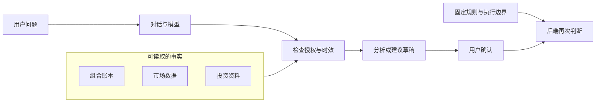

---
readingBrief:
  takeaways:
    - "首周故障说明最小模型探针能通，不代表完整研究能走完；工具完成、文件存在与页面返回成功也不能互相证明。"
    - "份额、当前净值与资料日期各有事实来源；缺少当日依据时，不能用旧快照或一般知识回答真实组合问题。"
    - "确认按钮只提交建议身份，服务器仍须核对权限、版本和时效；当时未写真实账本，模型建议不等于交易执行。"
  appliesTo:
    - "想理解 ETF 助手在 2026 年 8 月 26 日至 9 月 2 日为何先遇到数据、交付与授权问题的读者。"
  notFor:
    - "不是当前架构规范、自动投资产品介绍或真实交易安全验收；文中能力只属于首周历史。"
---
# 一个 ETF 投资助手，为什么先变成了工程问题

> 第一篇技术分享｜2026-09-03
>
> 本文根据 2026-08-26 至 2026-09-02 的开发记录整理。

这是一篇项目起点故事，不是当前架构规范。当前能力和授权边界见 [模型会理解，代码才授权](./011-model-understands-code-authorizes.md)；系列总览见 [一个 Agent 为什么必须先装刹车](./011-model-understands-code-authorizes.md)。

我本来以为，我只是要做一个 ETF 投资助手。

不是让它替我炒股，只是希望我问“现在持有什么”“今天发生了什么”“要不要定投”时，它能查到资料，再用人话告诉我。

听上去像个小项目：问一句，查数据，模型组织成中文，最后放一个确认按钮。

结果第一条消息都没能顺利回来。

## 第一幕：一个聊天框，先从超时开始

8 月 26 日，页面直接报错：“Chat model request timed out”。

我第一反应是模型挂了。可把问题缩到最小，绕开资料库和工具，只发一个简单请求，它又回来了：“probe-ok”，大约用了 5.9 秒。

模型没死。死掉的，是“完整请求一定能走完”这个想当然的判断。

那一刻我才发现，所谓“问一句就得到答案”，中间其实藏着很多段路：取资料、查数据、让模型组织答案、把过程送回页面。

任何一段卡住，用户看到的都只是同一句话：系统超时。

理想路线是：提问，读到当前数据，得到建议，用户确认。

真实路线却是：超时，拆开排查，发现资料缺失，修复输入，然后才有资格继续谈建议。

一周的故事，从“怎么让它更聪明”，变成了“怎么让它在不确定时踩刹车”。

## 第二幕：它能回答，不代表它知道

投资助手最危险的地方，不是算错一个加法，而是把旧数字说成新数字。

持仓的底层事实是份额。当前市值应该用“份额 × 当前净值”重算，不能拿旧快照里的金额倒推今天的持仓。

有一次测试很简单：问它“我的组合里有没有黄金敞口”。这句话看似不会直接下单，却可能影响下一步决定。

如果当天没有可靠的持仓资料，连“没有”都不能随便说。最好的回答不是硬凑一个结论，而是承认：今天的资料还不够。

另一次，我问的是美联储议息日程，回答却把 2025 年的日期抬了出来。

搜索词没错，问题在于系统忘了把“今天是 2026 年”带进去，后面的搜索也没有继续传递年份和时间范围。

文字可以很像真的，时间却已经错了。资料库能解释 ETF 是什么，却不能冒充实时持仓。

## 第三幕：最吓人的，是看起来成功

8 月 30 日，页面显示工具调用完成，结果却是“NOT_FOUND”。

我先把问题归给工具。顺着“页面 → 工具 → 报告目录”往回查，才发现正式日报只认按日期命名的 JSON 文件，目录里却只剩一个旧 HTML。

再往下追，根因不是模型，也不是工具协议，而是清理脚本把报告目录删掉了。输入已经不在，后面再聪明也只能说找不到。

还有一种更隐蔽的失败：文件确实存在，但完整日报被另一份轻量报告覆盖了，系统于是显示“今天没有定投动作”。

文件在，不代表它是对的文件；调用完成，也不代表答案可信。

外部服务同样不会按剧本来。有时数据源返回空值，有时模型服务返回 403。一次连通性测试成功，只能说明这一回成功，不能保证下一次也成功。

到了 9 月 2 日，前端又给我上了一课：根目录检查通过，页面却稳定返回 HTTP 500。修好页面回到 200，也不能顺手把“浏览器完整交互已验证”写成事实。

我还开始追一条资料能不能完整走完：从日报生成，到传给助手，再到保存、回放和读回来。只测其中一段，很容易得到一个漂亮但假的“通过”。

我开始把三个问题分开看：能不能调用，结果能不能信，流程能不能正常结束。

## 第四幕：确认按钮离一笔交易，还有很远

最让我紧张的不是回答，而是“确认”按钮。

回答里一旦出现“建议买入”，页面上的按钮就很像下一步动作。可按钮能点，不等于系统应该下单。

浏览器只能提交这条建议的身份和一次请求编号。金额、上限、预留金额、净值等关键数据，不能由浏览器自己说了算。

服务器要重新读取建议，再检查权限、是否过期、版本有没有变、资料是否还新鲜。任何一项不对，确认就停在这里。

目前这条链路不会直接写真实账本。离“点一下就真的改变持仓”，还差最后一大步，而且这一步不能靠模型补上。

这就是我这一周反复遇到的距离：页面上的一个按钮，和真实世界里的一笔交易，中间必须隔着一层冷静的检查。

## 上下文先变得臃肿

模型反复读取项目背景、历史记录、评测样例和生成文件，输入很快就变得臃肿。

代码变多之前，输入已经先变长了。

后来我把材料分成三类：每次都要看，需要时再看，归档后不主动看。重点不再是让模型读更多，而是让它只读眼前真正需要的东西。

所以，这周我一边搭助手，一边给自己的工作方式减肥。

## 大概架构：模型在上面，事实在下面

模型负责理解问题、查询资料和组织语言；真正决定份额、金额、上限和能不能执行的，是下面那套固定规则。

模型可以提出建议，但不能因此改写账本或执行操作。

局部测试通过，和整个产品可以交付，是两件事。能把这两件事分开，也是这周很重要的一点收获。

## 一周后，它到底是什么

它还不是一个自动替我投资的机器人。

它更像一个谨慎的投资副驾驶：能把有来源的资料摆到桌面上，能告诉你资料是哪一天的，证据不够时会停下来，也能把需要你确认的动作单独摆出来。

它不能保证外部服务永远在线，不能把旧数据装成新数据，不能绕过确认直接执行，也不能因为本地测试通过就证明真实交易已经安全。

所以，这一周真正做出来的，不是一个“会投资”的模型，而是一套尽量不让它自信犯错的框架。

## 这一周留下的教训

小领域不等于小系统。ETF 看起来只是几只基金，但一旦涉及当前持仓、净值、日期、确认和执行，任何一环不可靠，结论都可能失真。

最值得分享的也不是“模型答对了”，而是“它为什么差点答错”：超时、旧年份、报告被删、文件被覆盖，以及按钮和真实执行之间的断层。

先确认数据、授权和执行边界，再增加模型能力。资料不够时，应说明缺口，不要把估计写成事实。

后面我会继续从 time 和 daily 里挑现场来写。下一篇，先讲那个“浏览器超时，但最小探针能通”的晚上。

先把这一周讲清楚。后面再看，一个看似简单的 ETF 助手，为什么会慢慢长成这样。
