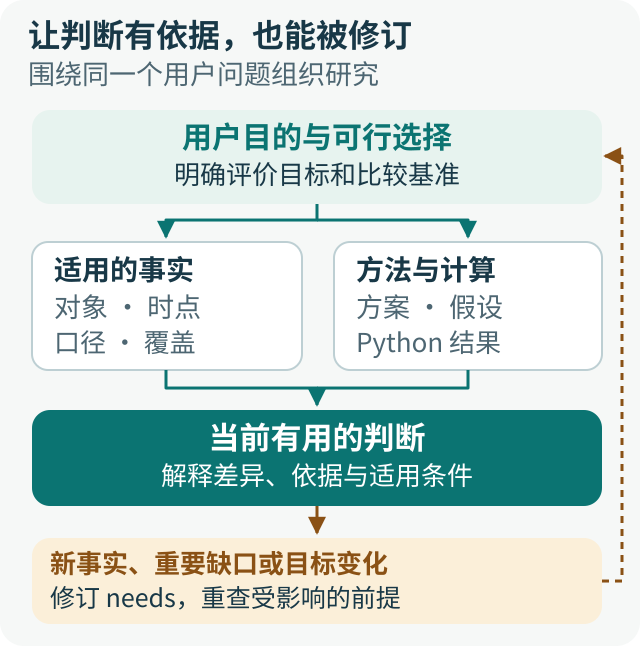
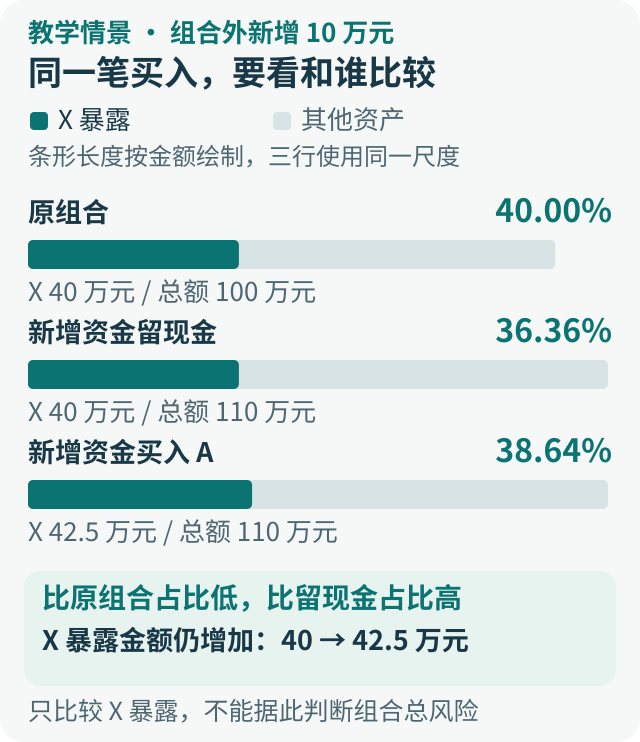

# 金融 Agent 如何成为专业研究者：从用户目的到研究系统

## 一、什么是专业金融研究？

本文讨论的专业金融研究，可以先作一个明确的定义：

**围绕一个具体问题和使用目的，建立适用的事实，选择合适的方法，比较可能的解释或方案，形成有依据、可核查，并且知道何时需要修订的判断。**

这个定义里，核心产物是“判断”。它可能解释一家公司的增长来自哪里，可能比较两只基金承担了什么不同风险，也可能说明一笔新增资金会怎样改变现有组合。

研究当然需要资料、数字和报告，但这些东西的价值，要放回它们支持的判断中理解。

一份资料齐全、计算精确的报告，仍可能没有回答用户的问题。相反，一项篇幅很短的研究，如果找到了改变判断的关键事实，讲清了推导和适用条件，就可能很有用。专业程度不能仅由篇幅、指标数量或措辞决定。

### 研究连接着三件不同的事

首先是**事实**：现在有什么，过去发生了什么，资料实际披露了什么。

其次是**分析**：这些事实之间有什么关系，在某种方法或假设下，会产生什么结果。

最后是**判断**：这些结果对当前问题意味着什么，对用户面对的选择有什么帮助。

例如，“某只基金持有大量科技公司”是一项需要核实的事实；“买入它以后，组合对这些公司的暴露会怎样变化”需要分析；“这种变化是否符合用户的目的”才进入判断。

这三件事不能互相替代。查到真实持仓，不会自动得到合适的配置结论；执行了正确的公式，也不会自动知道用户更在意长期增长、短期波动，还是半年后的一笔支出。

**专业研究要对事实到判断之间的推导关系负责。**

这也解释了为什么金融研究很难被“预测对了没有”概括。预测可以属于研究，但未来结果还受到未知事件和随机变化影响。我们既要观察长期判断表现，也要检查当时的方法和依据：是否遗漏了重要事实，是否选择了错误的比较，是否把假设说成了已经发生的事情。

一份研究无法保证未来按预期发生。它应当帮助使用者理解：当前为什么这样判断，最重要的依据是什么，哪些变化会让这个判断需要调整。

## 二、用户真正需要的是什么？

有了这个定义，才能进一步讨论用户需求。

用户说：“我已经买了几只科技基金，再买十万元基金 A，会不会更分散？”

表面上，他问的是一只基金。实际需要解决的，是一项与自己处境有关的选择。

他可能担心，多买了几个产品名称，底层仍然是同一批公司；也可能希望降低波动，却不愿意大幅减少股票资产；还有可能只是希望配置看起来更均衡。不同目的，会导向不同研究。

因此，“更分散”不能直接翻译成“基金数量增加”，也不能默认翻译成某一个集中度指标。降低单一公司暴露、降低行业集中度、增加地区配置和保留流动性，分别回答不同问题。

### 用户需要看清的是选择及其后果

一项有帮助的研究，至少要让用户逐步看清四件事：

| 用户需要理解的内容 | 在这个案例中的含义 |
| --- | --- |
| 自己处于什么状态 | 现有组合到底集中在哪里，已知范围有多大 |
| 面前有哪些可比较的选择 | 买入 A、暂留现金，或投入其他资产，各改变什么 |
| 为什么某种变化值得关注 | 它与降低集中度、保留流动性等目的有什么关系 |
| 哪些条件仍会改变判断 | 资金来源、披露时点、未展开持仓，或用户目标变化 |

这里最容易被忽略的是“比较什么”。

“买入以后比原来更分散”和“这笔新增资金买 A 比留现金更分散”，并不是同一个问题。前者比较两个不同时点的组合，后者比较同样拥有这笔新资金时的两种安排。

如果没有弄清比较对象，Agent 完全可能算出正确的数字，却给出对用户没有帮助，甚至引人误解的结论。

用户也未必能一开始就把这些条件表达完整。研究者的工作包括识别歧义，优先确认会实质影响答案的条件。可以先说明分析范围，再推进能够独立完成的部分，无须把每次提问都变成一份冗长问卷。

对于这个案例，可以先确认：用户最关心的是哪种风险，以及十万元来自新增资金、现有现金，还是卖出其他资产。研究其他问题时，关键条件会不同。

由此可以得到一个更高层的关系：

**目标决定什么变化值得关注，事实决定当前处境，方法决定怎样比较。专业判断来自三者的结合。**

目标没有明确，容易算很多不重要的指标；事实没有建立，容易把常识套在错误对象上；方法没有选对，容易用一个真实数字回答另一个问题。

## 三、普通回答提供了什么，又缺少什么？

普通回答往往会说：注意分散投资，关注相关性，结合风险承受能力，避免过度集中。

这些内容有价值。它们提供了一套理解金融问题的通用知识，帮助用户知道应该考虑哪些因素。对于“为什么要分散投资”这样的知识问题，清楚解释这些原则，本身就完成了任务。

但当问题变成“我的这笔钱投进去会怎样”，需要增加一段工作：**把通用原则与这个用户的事实、可行选择和目标连接起来。**

这段连接不会因为回答更长、引用更多、语气更像分析师，就自然成立。

### 普通回答容易在语言上完成，在研究上停住

大模型擅长生成连贯的解释。只要识别出“基金”“集中度”“风险”等主题，就能组织出结构完整的回答。

而研究是否完成，要检查另外一些条件：是否取得了这个组合的真实材料，是否理解数据适用的时期，是否选对比较基准，是否计算了有关后果，是否解释了这些后果与用户目的的关系。

因此，一份回答可以读起来十分完整，却仍然没有建立核心判断。

我们在 ETF Agent 私有项目中看到过这种差距：脚本已经被多次调用，报告里的某些精确风险描述仍缺乏相应输入和计算支持。工具调用记录说明系统做过动作，却不能单独说明动作支持了最后那句话。[Python 结果消费实践](https://hpoenixf.com/eff-agent-article/articles/financial-agent-python-result-consumption)

外部研究也提供了相近观察。2025 年发布的 FinSearchComp 将金融任务放到实际搜索与推理过程中评测，归纳的失败包括证据过时、时间错位、单位或币种聚合错误，以及报告期间没有对齐。这些问题发生在取得和使用事实的过程中，单纯展示金融知识很难暴露它们。[FinSearchComp 原论文](https://arxiv.org/html/2509.13160v1)

需要明确，这里描述的是一种回答方式，并不意味着大模型只能讲常识。模型可以参与专业研究；但产品需要让它真正取得个案事实、实施分析、观察结果，再修订判断。

从这个角度看，普通回答与专业研究的距离，主要体现在工作是否走到了用户的问题上。通用知识是起点，研究负责完成剩下的连接。

## 四、怎样让 Agent 完成这个目的？

现在才适合把 needs、时间、Python 等工程实践放进来。

它们应当共同服务于一项工作：**形成并维护一个针对用户问题的判断。**

这里的“维护”，意味着判断有明确前提。新事实出现、比较方案改变、用户目标变化时，系统能够找到受影响的部分，重新研究，而非继续沿用原来的结论。

下面仍用基金案例，走完这项判断的形成过程。组合、金额与权重均为教学假设，用来说明方法。

<figure id="research-judgment-figure" style="margin: 24px 0;">
  
  <figcaption>图 1：围绕一项判断组织研究。图中展示职责及修订关系，不表示必须按固定顺序执行，也不表示持续研究已完成端到端验收。 <a class="diagram-original" href="../visuals/financial-agent-from-talk-to-research/research-judgment.svg" target="_blank" rel="noopener noreferrer">放大查看图表</a></figcaption>
</figure>

### 1. 从用户的问题中，找出真正需要检验的判断

“研究基金 A”过于宽泛。它既能导向基金经理履历，也能导向市场新闻，却没有指出什么结果算回答了用户。

更明确的研究问题是：

> 在当前组合和约定的资金来源下，买入基金 A，是否会降低用户关心的公司 X 集中度？与其他可行安排相比，差别在哪里？

这个问题提出后，许多工程动作才有了目的。

需要取得原组合对 X 的总暴露，因为它决定基线；需要知道 A 对 X 的权重，因为它决定新增部分；需要确认资金来源，因为它决定总额和被替换的资产；需要确认资料时点，因为旧权重未必适合估计当前结构。

这就是 needs 可以发挥作用的地方：记录形成判断还缺少什么，以及随着研究推进，哪些问题需要修改。

它的价值不在于列出“搜索—计算—写报告”三个待办，而在于让模型保留判断的依赖。比如，已经读到 A 的持仓，仍可能没有解决全组合集中度的问题；发现不同披露期不能直接比较后，先前认为解决的问题又需要打开。

我们现有的 needs 允许这样的修订，也会在新的知识结果进入模型输入时，提醒模型区分直接支持、部分支持、仅主题相关和冲突。但这些记录不认证判断正确，不要求全部标成已解决才能交付，也不取代原始用户问题。[needs 与研究问题的实践](https://hpoenixf.com/eff-agent-article/articles/agent-thinking-fast-slow-research-needs)

这样的设计保留了研究应有的可变性：目标保持清楚，通向目标的路线可以被事实改变。

### 2. 把取得的材料，组织成适用于同一个问题的事实

假设当前组合总额为 100 万元，其中基金 A 为 20 万元。已取得的披露显示，公司 X 的持仓市值占 A 的资产净值的 25%。

在统一净值口径、忽略溢折价，并沿用这期披露权重的前提下，A 对组合形成的 X 暴露为 5 万元，占总组合的 5%。

但这只能描述经 A 这一条路径形成的暴露。其他基金可能也持有 X。要回答全组合集中度，研究还得继续。

这是一个很重要的区别：**拿到的信息是否完整，要相对于正在作出的判断来评价。**

网页可以全文读完，里面却只有部分持仓；一张表可以被完整解析，却没有覆盖整个组合。我们在私有项目的受控合成链路中保留过这样的部分覆盖状态。在实际报告的事后审查中，也曾通过与已知披露相容的假设补全，说明“已披露范围内最大”不足以支持“全组合最大”。[研究结论边界的实践](https://hpoenixf.com/eff-agent-article/articles/financial-agent-research-claim-boundaries)

时间承担的是同一类责任：确定这个事实能否进入本次判断。

private 的一条历史记录中，风险指标描述的是 9 月 30 日，消费方却借用了另一项净值的日期，使它错误通过 9 月 29 日的截止条件。数字和日期分别存在，错误发生在它们的对应关系上。

因此，给模型一个“现在几点”的提示仍然不够。任务参照哪一天、用户限定哪段时间、每条数据描述哪一天、资料何时公开，都需要按各自含义处理。今天取得旧披露，不会让旧持仓变成今天的持仓。我们已经将部分时间事实分开处理，市场日历接入普通研究请求的真实端到端验收仍未完成。[时间语义实践](https://hpoenixf.com/eff-agent-article/articles/agent-temporal-semantics-market-calendar)

这些看似细节的要求，服务于同一个目标：让参与分析的数据确实在回答同一问题。

金融数字的意义，依赖对象、时点、口径与覆盖之间的关系。只保存数值，等于把后续推理需要的前提丢掉了一部分。

### 3. 选对比较，再让计算展开不同方案的后果

继续这个教学案例。经过补充研究，假设我们现在已经取得足以计算的完整材料：原组合对 X 的合计暴露为 40 万元，占组合的 40%。

用户又确认，十万元是组合外的新资金。

此时至少存在两个可比较的安排：把新资金暂留现金，或者全部买入基金 A。下面假定持仓权重不变，采用同一净值与币种口径，现金不产生对 X 的直接持仓暴露，忽略费用和价格变化。

| 状态或方案 | 组合总额 | 对 X 的合计暴露 | X 占组合比例 |
| --- | ---: | ---: | ---: |
| 新资金进入前的原组合 | 100 万元 | 40 万元 | 40.00% |
| 新增十万元暂留现金 | 110 万元 | 40 万元 | 约 36.36% |
| 新增十万元全部买入 A | 110 万元 | 42.5 万元 | 约 38.64% |

<figure id="comparison-baseline-figure" style="margin: 24px 0;">
  
  <figcaption>图 2：三行按同一金额尺度绘制。假设外部新增 10 万元、A 中 X 权重为 25%，持仓权重不变，净值与币种口径一致，忽略费用和价格变化，现金不产生 X 的直接持仓暴露。比例仅描述 X 暴露，不能代表组合总风险。 <a class="diagram-original" href="../visuals/financial-agent-from-talk-to-research/comparison-baseline.svg" target="_blank" rel="noopener noreferrer">放大查看图表</a></figcaption>
</figure>

这张表里有两条同时成立的判断。

相对于原组合，买入 A 以后，X 的占比从 40% 降到约 38.64%。因为新增资金中只有 25% 对应 X，低于原组合的 40%，所以它稀释了这一占比。

相对于“同样拥有新资金、暂时留作现金”的方案，买入 A 又使 X 的占比从约 36.36% 上升到约 38.64%。

目标本身也会改变评价。若用户希望降低 X 在总资产中的比例，买入 A 相对原组合有所改善；若希望减少投在 X 上的金额，这笔买入却没有完成目的，因为对应金额从 40 万元增加到了 42.5 万元。研究需要确认用户究竟想控制什么。

**同一笔买入，换一个合理的比较基准，判断方向就会变化。**

所以，“买入 A 有助于分散”不能脱离比较对象单独成立。更准确的说法是：它能降低相对原组合的 X 占比，但在这两种新增资金安排中，留现金的 X 占比更低。至于用户是否愿意为此保留更多现金，还要结合其收益目标、投资期限和其他风险考虑。

这正是研究方法比计算精度更上游的地方。

Python 可以精确执行所选比较。它无法仅凭一个输入数字，决定我们应该比较原组合、现金方案，还是卖出另一只基金后的组合。模型需要理解用户目的，选择适用方法，再解释计算结果。

在 private 的研究方法和结果消费实践中，我们把对象、窗口、单位、方法前提和缺失项随结果保留下来，目的就是让模型拿到一个有含义的研究结果。稳定的方法可以复用，临时整理和探索可以交给隔离 Python 工作台。结果最后是否进入主 Agent 的分析，又需要在实际交接中确认。[Python 工作台实践](https://hpoenixf.com/eff-agent-article/articles/agent-python-compute-workbench-evolution)

Skill 则适合沉淀这种“什么时候用什么方法、需要哪些输入、应该交付什么产物”的经验。它指导模型执行专业工序；仅有一段专家身份提示，不会自动完成这些工作。[Skill 的实现与职责](https://hpoenixf.com/eff-agent-article/articles/agent-skill-from-markdown-to-callable-research)

一个可比较的外部事件，是 Anthropic 在 2025 年 10 月扩展金融服务能力时，同时推进数据连接器、Excel 与金融 Skills，其中现金流折现方法被落实为预测、情景切换和敏感性表等产物。产品发布本身不证明研究准确率，但它呈现了一条值得参考的方向：让知识进入可以实施和检查的研究工序。[Anthropic 金融服务发布](https://www.anthropic.com/news/advancing-claude-for-financial-services)

至此，资料、时间、方法、Python 与模型解释有了共同对象：它们在共同回答同一项比较，而不是分别完成各自的功能演示。

### 4. 根据判断的关键依赖，决定下一步研究什么

到这里，还会遇到一个现实问题：金融资料永远可以继续找，研究应该把时间花在哪里？

可以从刚才的计算反推。

要判断外部新增资金买 A 后，X 的占比相对原组合会升还是降，关键是比较两个比例：A 对 X 的权重，以及原组合对 X 的总权重。

如果后者尚未查明，补齐其他基金对 X 的暴露，就可能改变主要判断。此时继续收集基金经理的一般履历，未必有同样价值。

如果资金来源还不清楚，优先确认它也可能很有帮助：外部新增资金会扩大总资产分母，使用原有现金则不会；卖出另一只基金筹款，还会减少被卖出部分的暴露。

这使研究优先级有了一个可解释的原则：

**优先调查那些可能改变主要判断，而且能够以合理成本查清的未知。**

这里需要区分三类不确定性。资金来源、已披露持仓等事实，可以通过询问和取证减少不确定性；未来不同情景下的结果，可以通过明确假设进行比较；市场未来究竟怎样变化，则不会因为多搜索几次就变成确定事实。

它们分别需要确认、分析和条件化表达。若把它们混在一起，Agent 要么不停查资料，要么用“存在风险”把所有未解决问题笼统带过。

needs 提供了记录和修订这些研究问题的基础，时间与来源决定新材料有没有改变事实，Python 用来展开新假设的后果。怎样判断哪项未知最值得继续追查，仍然属于模型的研究能力；当前工程机制不能替代这项能力的实际评测。

同样，多 Agent 是否必要，也应服从这项研究选择。需要独立核对披露、复算关键结果或挑战主要假设时，分工有明确用途。单个主 Agent 已能完成的小问题，没有必要仅为呈现专家团队而增加协调成本。

从这个视角看，研究深度体现在对问题结构的理解：越来越清楚什么决定结论，哪些材料可能改变它，哪些信息只是增加篇幅。

### 5. 交付当前有用的判断，并保留重新研究的入口

完成上述工作后，Agent 可以给出这样的回答：

> 若您关心的是公司 X 在总组合中的占比，按本次披露权重与估值假设，新增十万元买入 A 后，该比例由 40% 降到约 38.64%；如果新增资金先留现金，则约为 36.36%。
>
> 因此，买入 A 能稀释原组合对 X 的占比，但留现金在这一维度上的占比更低。两者还改变了现金与权益资产的配置。是否选择 A，需要进一步结合您希望保留的权益敞口、资金使用时间，以及对其他风险和收益的判断。
>
> 如果资金来源改为卖出其他基金，或新的持仓披露改变了 X 的权重，需要按新条件重新比较。

这份回答依然有尚未解决的问题，但已经提供了普通原则没有提供的帮助：建立了个案基线，比较了明确方案，解释了差异，以及差异与用户目的的关系。

如果用户只要求看清公司集中度变化，研究可以在这一范围内交付。如果进一步要求“这笔钱最终应该配置在哪里”，就需要扩大比较，研究其他方案、成本、流动性和收益假设。研究范围应随着用户目的扩大，不能把一项局部计算包装成完整投资结论。

这也给“什么时候结束”提供了依据。研究不需要等所有未知消失；它应当在当前用途所需的关键依据已经足够时交付，或者明确说明哪项关键证据暂时无法取得，以及这如何限制结果。

我们的 needs 不作为发布或结束的硬性门禁，正是为了保留这种空间。模型可以交付已经成立的部分，也可以继续调查会改变主要判断的缺口。进度可以及时反馈，最终结论则应随着关键依据逐步稳定。

再往长期看，值得保留的研究成果应当包含结论及其成立条件。下次资料更新时，要知道哪条依据变了、影响哪项计算、需要修订哪句话。只记住“上次建议增持”，会失去最有价值的判断来路。

这是一条持续研究的设计方向：让新研究接着检查旧判断的前提，而不只是定期再生成一篇同主题报告。

## 以用户得到的判断，检验系统是否真的进步

按照前面的定义，专业性最终要回到用户的使用结果来验收。

可以保持提问不变，改变一个关键条件：把外部新增资金改成原有现金，把比较基准从原组合改成新资金留现金，把完整披露改成部分披露，或把用户目标从降低公司集中度改成保留半年后的流动性。

系统应当在相关条件改变时，调整方法、计算、研究范围或结论。与此同时，无关的宣传文案不应改变主要判断。

这比只检查“调用了多少工具、报告有多少引用”更接近我们要完成的目的。执行与计算仍需单独验证，但研究质量还要回答：比较的问题是否正确，依据是否支持判断，以及用户是否更清楚自己的处境与选择。

一份可追溯的报告也可能肤浅，一次可复算的分析也可能没有重点。专业能力仍然需要金融方法、问题理解和判断训练。工程系统的责任，是让这些能力能够实际发挥、留下依据，并在出错时找到可以改进的位置。

对 ETF Agent 来说，needs、时间、Python、Skill 和证据消费之所以值得放在同一篇全景文章里，是因为它们共同支撑了这项工作：从用户的目的出发，把相关事实组织起来，通过适用的方法形成判断，再允许新的事实修正它。

模型越强，这项工作越有机会做得深入。系统也可以随之减少补偿模型弱点的临时规则。但用户的目标、外部事实、比较基准和真实研究产物，仍然需要在具体任务里建立。

**判断一个金融 Agent 是否走向专业，最有价值的问题是：经过这次研究，用户对自己的具体选择，多知道了什么？其中哪项发现最可能改变他的判断？**

从这个问题反推设计，工具和模块才会各有位置。最终交付给用户的，是一项有来路、能使用、也能被继续修正的研究成果。
