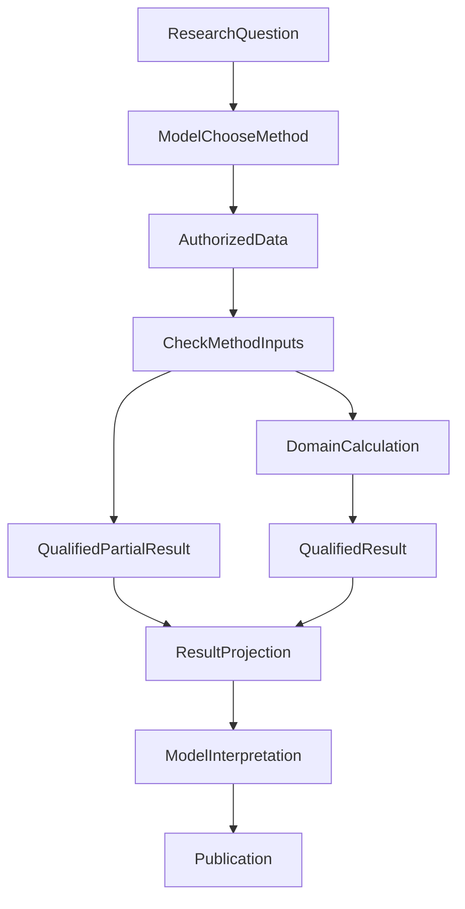

# Agent 明明调用了 Python，为什么投研报告还是会算错？

> 系列归属：**金融科技与合规（主）** · 系统架构与工程观点（兼） · 模块精讲（兼）
>
> 工程取材截至 2026 年 10 月 21 日。文中的数字反例是明确标注的安全测试/教学输入；限定的工程回归不等于真实模型已稳定完成自主投研。

**把算术交给 Python，并没有把金融判断一起交出去。** 可靠的投研结论仍要求选对方法、满足输入条件，并按原口径解释结果。脚本执行成功，只回答了其中一个局部问题。

我们遇到过有市场数据、有 Python 调用，报告却遗漏组合整体年化收益、缺少协方差分析，甚至将计算结果解释反了的情况。继续增加脚本调用或一个万能 Reviewer，都不是明确的修复方向。

更有用的起点是沿一条关键结论追问：方法适用吗？输入够吗？计算结果及其限制真正送到模型了吗？最终文字保留了它们的含义吗？

## 一、脚本跑过，不等于目标问题被回答

以“这几只基金组成的组合，整体收益和风险究竟怎样？”为例。研究系统可以分别取到净值、价格、权重和历史区间，也可以调用不同的 Python 方法。即使每次调用都返回成功，用户最终需要的比较仍然可能不存在。

我们曾观察到一条真实自主研究路径：它调用了多次脚本，最后却没有形成完整的协方差分析。另有报告遗漏组合整体年化或出现数值解释问题。这些是**最终产物的可观察缺口**，并不自动证明某个 Planner 故意跳过了方法，更不能凭脚本次数倒推最早故障。

原始问题的部分工具参数和模型实际可见请求后来没有完整保留。因而我们把“当时报告缺了什么”和“具体是哪一环造成的”分开记录，随后用可复现、安全的输入检查当前生产接缝；不把新造的测试替身说成历史事故现场。

可以把一条结果的旅程拆成六步：

| 环节 | 真正要确认的事实 | 典型失败 |
| --- | --- | --- |
| 研究选择 | 模型是否识别了需要收益、协方差或风险贡献等方法 | 只整理行情，未提出必要计算 |
| 数据准备 | 对象、共同样本、币种、窗口和收益口径是否适用 | 价格指数冒充含分红的总收益 |
| 领域计算 | Python 是否用原方法与合格输入产生结果 | 关键字段缺失，计算只能给局部值 |
| 结果交接 | 数值、单位、版本、分母和局限是否进入下一次模型请求 | 工具成功，但关键字段没投影到模型 |
| 模型解释 | 文字是否忠实使用计算所得的方向和资格 | 有正确值，却写成相反含义 |
| 最终交付 | 正文、图表、文件和历史是否保留同一口径 | 展示二次算数或把代理指标写成正式结论 |

前四步可以用有界工程测试验证许多行为；第五步包含自然语言判断，不能只靠一次接口测试盖章。第六步的文件保存与下载，也有独立的交付事实，不能反过来证明研究结论正确。

## 二、先选方法，再交给 Python；不是先执行脚本，再期待答案自动变对

我们的基金研究已经拥有专业方法，包括组合收益、跟踪表现、协方差、风险贡献和收益归因等。问题不在于再造一套公式目录，而在于把这些方法从“系统里存在”推进到“当前问题确实使用了适用结果”。

实际职责可以这样理解：



图中的两条结果路径有不同前提：输入满足方法契约时，计算可以形成限定的正式结果；缺少关键数据时，只能返回受影响指标的代理结果、不足状态或原因，并保留其他仍有价值的研究。图没有暗示每个研究请求都必须走 Python，也没有暗示所有方法都已经在真实自然模型运行中稳定选中。

这里最容易犯的架构错误，是用规则强制“凡是提到收益率，都调某个脚本”。用户问“全天候策略是什么”，完全可能直接解释；只有当用户要求具体组合的数值比较时，才需要选择合适方法、检查输入，然后决定是否执行。

我们最终保留了**模型动态选择研究方法、领域模块拥有计算公式、运行时保留已发生的客观事实**的分工。模型不能自己伪造数据资格，运行时也不应该根据几个金融关键词替模型设计研究路线。

## 三、Python 给出了数字，数字仍可能没有金融资格

一个数字可以在算术上完全正确，同时不具备报告里所写的含义。

**价格变化不等于含分红的总回报。** 基金净值、跟踪指数价格、总收益指数和不同复权序列，有不同适用范围。若缺少完整分红事件，研究可以陈述已观察到的价格走势，但不能把它升级成已核实的总收益排名。我们保留原 Python 方法的代理标记和原因，而不是给缺失数据填零，或仅凭字段名带有“total return”就认证完整性。

**“运行成功”不等于“风险贡献可精确计算”。** 协方差、风险贡献需要相应的共同样本及方法假设。若缺少相关性或合格的同期观测，可以解释已有权重和已知暴露，却不能在报告里生成精确的风险贡献百分比。

因此，系统中至少有三种不能合成一个布尔值的事实：

- 工具是否成功执行、结果是否可读；
- 方法前提是否满足，结果属于正式计算、代理估计还是数据不足；
- 所用来源的身份、读取权限与实际支持范围是否成立。

一次 Python 进程退出码为零，至多直接支持第一项中的执行事实。它不能给第二项补齐分红，亦不能替第三项认证市场来源。已归档的结果消费工作专门验证了不完整分红的限定能够穿过脚本输出和下一次模型请求；这证明交接保真，不证明自然模型必然按此解释。

## 四、最危险的错误，有时是一句解释而不是一个公式

下面是此次工程回归采用的两类安全数值反例，它们说明**派生比较也应该由了解分母的原领域计算负责**。

第一类是组合增值贡献。

假设同一期间组合净增值为 10，其中一项贡献 +15，另一项贡献 −5。按“单项贡献 ÷ 组合净增值”计算，前者占 150%，后者占 −50%，相加仍为 100%。负项抵消存在时，贡献份额超过 100% 不一定是错误；关键是分母必须明说。

同理，领域方法给出 `0.602`，在这个口径下就是 60.2%，不能在文字里把它描述成超过组合净增值的全部。净增值为零或负值时，这个以**正净增值**为条件的份额方法没有定义；正确结果是说明不足，而不是继续除或偷偷改成“正贡献之和”作为分母。改分母就是另一个金融方法。

第二类是比较单位。

同一窗口的 +7.43% 与 −5.88% 相差 **13.31 个百分点（pp）**。这不是“领先 13.31% 的相对收益增长率”。差值符号、计算单位和比较基准，都应随同原结果进入模型，而不是由最终写作者临场重造。

我们的修复不是让发布系统逐句搜索“超过”“领先”或“收益率”，而是在原归因/比较方法中生成具有明确分母与单位的派生结果，复用既有结果身份进入模型请求。金融判断仍需要模型负责解释，但可以少一次脱离方法口径的即兴重算。

## 五、把结果送到模型，不是把 Python 输出复制成一段文本

一条研究结果能被后续消费，需要保留的不只是 `value`。至少还包括对象、窗口、币种、收益基础、单位/尺度、方法版本、输入来源以及 `proxy`、`insufficient` 等资格限制。

当前接续路径大致是：原 Python 研究方法产出结构化结果，包装后的技能在原 Run 授权范围内交付，既有 Result/引用能力保存结果身份并投影必要内容，下一次 Main 模型请求再消费这个结果，最后由原 Publication 决定独立有效正文的交付。

在受控接续路径中，领域方法能把带分母、口径以及 `proxy` / `insufficient` 标记的结果经 Skill 和 Result 投影交给下一轮 Main，局部指标不足也不会抹掉独立有效的正文。这个工程结果说明结果可以正确交接，不等于自然模型每次都会选对方法、忠实解释数字或完成整题自主研究。

这也解释了为什么“新增一个总审查模块”不是自然的下一步。统一检查看似更安全，却可能把一个局部指标的数据不足升级成整篇文章不能发布，还会让新模块重复解释来源、公式和 Run 状态。我们选择先修原方法和真实消费链，把权限、算术、方法资格、结果身份和正文处置留给各自的归属方。

### 用公开代码观察一次结果消费

这条交接问题也能缩小成不依赖 Python 的例子。[Open ETF Agent 的固定公开候选](https://github.com/hpoenixf/open-etf-agent/tree/e442f600891be79625fc78751e2d9f39905920da)从一份不可变合成表选取明确行，再由既有计算器比较 100 与 250。原行身份、USD 币种和数据截止日随计算引用一起进入后续请求；报告与 CSV 读取同一引用，不各算一遍。按该快照 README 安装后运行：

```sh
node src/cli.mjs --case result-consumption --output runs/result-consumption
```

CLI 会给出本次运行目录，其中报告、CSV 附件与 manifest 可以相互核对。[来源与消费反例](https://github.com/hpoenixf/open-etf-agent/blob/e442f600891be79625fc78751e2d9f39905920da/test/result-consumption-delivery.test.mjs)进一步检查：所需尾行不在选区、币种或日期不一致、分母未知时，只让对应数值或附件不可用，不吞掉独立合法正文。示例动作是合成脚本；下一请求的检查使用生产 Gateway 编码和离线注入的传输，不是自然模型投研。它提炼的是结果交接合同，既不公开 Python 工作台或 A33，也不把这组数解释为投资收益。日常入口仍见[当前 main](https://github.com/hpoenixf/open-etf-agent/blob/main/README.md)；这里的固定候选未被赋予新版本号，升级恢复协议的限制见[兼容说明](https://github.com/hpoenixf/open-etf-agent/blob/e442f600891be79625fc78751e2d9f39905920da/openspec/changes/result-reference-consumption/design.md)。

## 六、A33 精确数值运算在这里处于什么位置？

最新架构增加了 **A33 Numeric**，负责显式十进制加减/比较、受单位绑定的乘法、比例缩放、指定舍入和残差。这是很必要但范围刻意有限的能力。

它能解决“确定算 2.055 时，在明确舍入政策下是否应显示为 2.06”这样的算术问题；它**不决定**某项费用适用于哪个渠道、不决定是否有足够历史数据计算协方差，也不决定组合收益贡献应该采用哪个分母。后者分别是费用、投资研究和归因方法自己的业务契约。

同样，隔离执行、结果身份、研究综合和正文发布各有自己的责任。把它们统称为“Python 正确性”，再交给一个新的总管模块，只会掩盖真正应该修复的环节。

十进制修复、资金守恒与费用估算的具体案例另见[《金融 AI 最危险的“专业感”：数据是真的，数字却算错了》](031-fintech-data-time-and-reproducible-numbers.md)。那篇讨论**算术与金融指标怎样保持正确口径**；本文只聚焦**一个正确或限定的研究结果为何仍可能被错误消费**。

## 七、真正的验收还在金融问题本身

**金融 Agent 的关键，不是“会不会用 Python”，而是能否把适用的方法、合格的输入、可核查的结果和忠实的解释连接起来。**

复核组合报告时，先选择一条会改变决策的结论，回到原始结果核对对象、共同区间、分母、单位与代理估计的限制。缺少分红数据，就保留价格表现的适用范围；贡献份额超过 100%，先核对净增值分母；工具算对而文字写反，就修解释与结果消费环节，不要急着重写计算器。

研发验收也可以这样分工：计算与数据交接使用定向检查，研究方法选择和解释质量使用真实任务评估。原历史自主研究的最早失败位置仍没有完整确定，不能从局部修复推导稳定完成率或投资回报改善。

**下次看到“Python 已执行”，更值得问的是：这个结果凭什么支持报告里的那个判断？** 这才把工具能力转化成研究能力。

## 延伸阅读与交流

- [金融数字的时点、精度与可复算](031-fintech-data-time-and-reproducible-numbers.md)：数据及算术为什么会出错，A33 与领域规则如何分工。
- [金融 Agent 的可信证据链](financial-agent-trustworthy-evidence-chain.md)：来源、计算与报告之间的完整证据关系。
- [Python：从工具到计算工作台](agent-python-compute-workbench-evolution.md)：隔离执行与工作区本身怎样建设。

更多文章见 [ETF Agent 独立阅读站](https://hpoenixf.com/eff-agent-article/)和 [GitHub 文章仓库](https://github.com/hpoenixf/eff-agent-article)。如果内容有帮助，欢迎 Star 或提出反例交流。