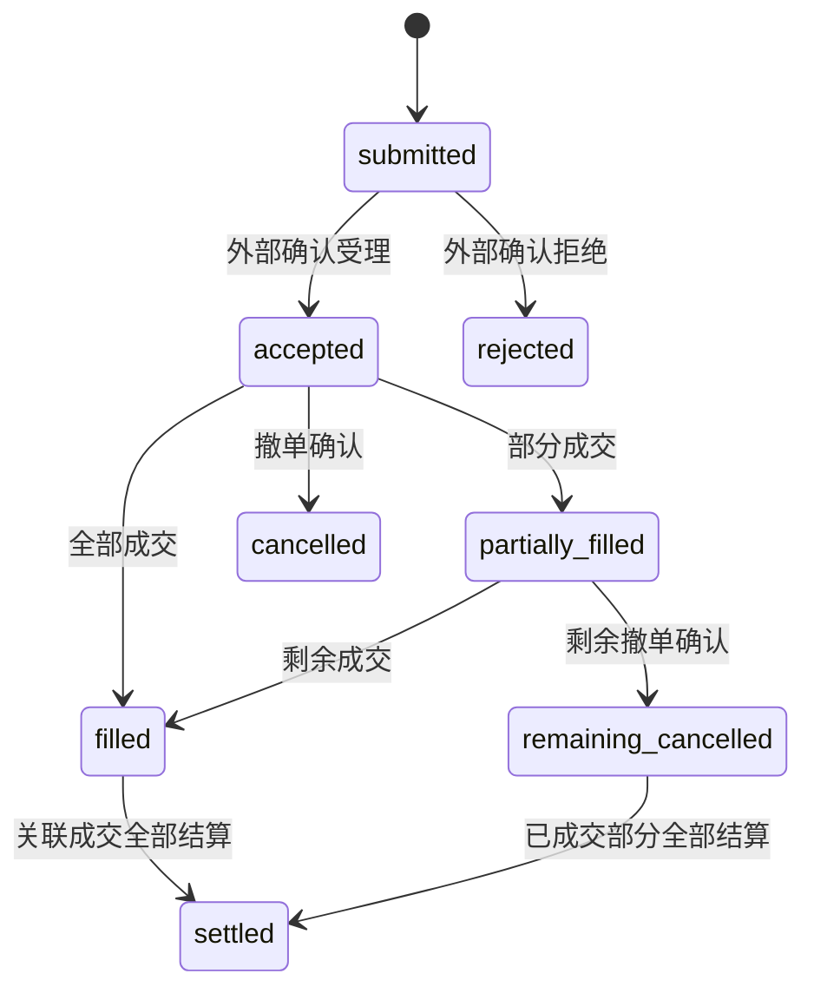

# 金融 Agent 全景：连接研究、业务与责任的系统架构

*从用户委托，到可复核的研究，再到独立授权的业务效果。*

> **适用范围与工程边界（2026 年 10 月 27 日）**：ETF-Agent 是个人基金研究与投资工具的工程实践。三张图中的实线描述现有职责，橙色虚线描述机构目标能力（投顾准入、交易、结算与正式审计等）。现有确认记录属于个人投资状态管理，并非券商成交回报。下文授权、订单与审计结构均为合成的设计示意，具体业务准入仍以适用制度和机构系统为准。

用户问：“我持有的两只科技基金，底层是不是买了很多相同的公司？继续增加投入，会不会只是把同一种风险买了两遍？”

一个大模型可以查资料、读基金报告、运行计算，再写出一份有图表的分析。但金融服务还需要回答：它分析的是谁的持仓、哪一期披露？结论依据什么口径？用户随后说“按这个方案调整”，系统能否直接执行？三个月后复核时，还找不找得到当初的依据？

**金融 Agent 的核心架构问题，是让探索性的研究与具有明确责任的金融业务长期协作。** 研究提出假设，投资核心维护账本；模型提出行动方案，业务系统独立核验授权、成交和结算。

本文沿一项基金组合复核展开。先说明提供什么服务，再画清有哪些系统，随后走过研究与业务两条生命周期，最后讨论监管、审计和机构落地。三张主图分别回答：**系统怎样连接、任务怎样推进、结果怎样追溯。**

## 一、先确定服务承诺，再选择 Agent 能力

对投资者来说，系统首先是一项服务，而不是工具集合。解释产品、分析个人组合、提供个性化建议和办理投资操作，可能出现在同一个聊天窗口，但不能因此共用一份模糊的授权。

下面按产品设计所需的服务承诺划分；是否属于受监管的投顾、销售或其他业务，仍须结合服务主体、内容、方式和适用规则判断。

| 用户的请求 | 应交付什么 | 对应的权限与效果范围 |
| --- | --- | --- |
| “这两类基金有什么区别？” | 有来源的公开产品解释 | 仅使用公开或获准的产品资料 |
| “结合我的持仓分析重叠” | 在获准数据范围内形成组合研究 | 读取获准快照并保留披露时点与缺口 |
| “比较维持、减仓和继续定投” | 有前提、约束和局限的情景分析 | 仅产生情景成果；操作另行准入 |
| “按这个方案办理” | 进入另行定义的业务准入与执行流程 | 业务系统核验准确对象、授权与真实回报 |

贯穿全文的例子是前两类服务的组合：**研究已指定基金的重复暴露，必要时比较情景，但不操作账户。** 这是合成教学场景，不使用真实客户持仓，也不是一次完整线上验收的复述。

服务范围一旦明确，用户体验就有了判断标准：系统给出可读结论、依据和缺口，按需选择工具，并将账户访问限制在准入授予的范围内。

## 二、系统全景：四个责任领域与事实权威归属

ETF-Agent 从持仓导入、定投计算和确认记录等确定性投资工具起步，后来增加了对话研究、MCP、Skill、子代理、Python、知识检索和报告交付。投资账本仍由原投资核心维护，智能能力通过受控读取参与研究。

项目采用四个责任领域：投资核心、受控数据边界、Agent 研究与交付、运行观察。它们按照**事实原记录与决定权的归属**划分，部署上可以由不同模块或同一服务承载。

判定一项职责归属时，问三个问题：**这条事实的原记录由谁写入，谁有权更正，谁负责保留和访问控制？** 投资份额与确认记录归投资核心；来源读取及其时点和覆盖归数据接入；研究 Run 与交付版本归 Agent；运行事件与诊断记录归观察系统。运行观察虽然横跨各环节，但拥有独立的诊断记录及留存责任。身份认证和授权则是跨域控制：由可信接纳及机构 IAM 等权威系统授予，在访问点校验，而非为凑齐领域数量再造第五套业务事实。


[放大查看系统全景图](../visuals/financial-agent-system-panorama/system-map.svg)

**读图方法：** 蓝绿实线表示主要请求、数据或结果交接；灰色虚线表示受限观察；橙色虚线框是机构化目标。顶部监管视角表示规则如何由机构落实，不是每次研究都要调用的“监管 API”。外部供应商与研究资源也不属于机构自动拥有的数据或权限。

| 责任领域 | 持有的核心事实 | 向其他系统提供什么 | 权威范围 |
| --- | --- | --- | --- |
| **投资核心（Investment Core）** | 已接受持仓、确认记录、预算及确定性投资规则 | 可核对的投资结果和报告快照 | 维护投资事实，由研究侧产生开放判断 |
| **受控数据边界（Data-Source Boundary）** | 受约束的读取与投影，来源、时点、覆盖和可用状态 | 投资事实和外部证据的有界视图 | 维护投影元数据，原账本留在投资核心 |
| **研究与交付（Agent Copilot）** | 对话、Run、工具回执、研究结果和交付版本 | 解释、研究成果、情景与可读报告 | 持有研究与交付版本，投资写入和交易由原业务系统负责 |
| **运行观察（Operational Monitoring）** | 脱敏运行记录、异常和报告健康观察 | 排障与运行复核材料 | 负责诊断记录，投资决定、源数据修复及正式审计各归原权威 |

### 事实读取与写入权分离

投资核心通过只读投影向 Agent 提供数据。Agent 解释持仓与确定性计算结果；实际份额、已确认计划及执行记录只接受原权威写入流程，研究记忆与子代理结论按证据引用。

投资核心的独立确认与执行记录入口，是个人投资状态管理工具。它记录用户确认的状态，**并未接通券商自动下单及外部成交回报**；图中“确认记录”和“真实交易”因此分属不同的事实。

市场数据、网页、PDF 和知识检索保留各自的读取实现。图中将其归入受控输入，是为了说明访问、时点和事实如何交接；实际接入可以通过不同适配器完成。

### 机构接入：Agent 通过受控接口协作

机构场景还需要连接客户与账户、KYC及适当性、产品主数据、风险管理、审批、订单和结算等能力。不同机构的系统名称和组织形态可以不同，但至少要明确：谁维护客户状态，谁决定业务准入，谁提交订单，谁根据真实回报更新资金与份额。

图中将这些能力明确列为机构目标。Agent 提供受控研究与协作入口，客户、风险、订单与结算的原始记录继续由相应机构系统维护。

我们已有的[六层调用全景](https://hpoenixf.com/eff-agent-article/articles/017-prompt-to-answer-six-layer-panorama-v3)描述请求怎样从输入走到用户界面；这里的四个领域回答的是：**无论请求经过多少技术环节，原事实和决定权应当归谁。** 两种视角互补，分别用于追踪调用路径和事实权威。

## 三、研究生命周期：自主补查与局部交付

系统边界说明“谁负责什么”，生命周期则说明“事情怎样发生”。金融 Agent 需要先完成一个研究闭环：接纳问题、形成研究策略、取证与计算、综合结论、交付与复核。

研究沿证据循环推进：模型读完材料后可以改变问题分解并补查；独立成立的部分结果可以先交付。涉及业务效果时则进入单独准入的业务闭环。


[放大查看双生命周期图](../visuals/financial-agent-system-panorama/lifecycle.svg)

**图的上半部对应当前研究机制，下半部对应机构业务目标。** 用户阅读报告即可完成只读服务；只有提出新的具体业务请求并通过独立准入后，橙色连线才发生交接。审核顺序由适用机构业务规则决定。

### 1. 接纳一项研究，而不只是一条消息

Conversation 是对话，Run 是一次具体的研究尝试。同一对话可以包含多个问题；同一研究也可能经历工具调用、子代理协作、用户补充、断线和恢复。

对于贯穿例子，研究开始前至少要弄清目标基金、所用账户或持仓来源、研究时段，以及“只分析、不执行”的约束。身份与来源许可由系统负责；“用户真正想比较什么”由模型理解，不能用几条关键词规则代替。

下面区分**请求意愿**和**接纳后可信授权**，两者均为设计示意，并非现行 API 字段契约。研究请求只表达对象和期望效果：

```json
{
  "question": "比较基金 A 与 B 的重复暴露",
  "fund_refs": ["A", "B"],
  "portfolio_snapshot_ref": "P1",
  "requested_effect": "report_only"
}
```

可信接纳过程校验主体、可访问资料及服务范围，再为 Run 绑定只读 grant：

```json
{
  "run_ref": "R1",
  "grant_ref": "G1",
  "subject_ref": "USER-DEMO",
  "scope": ["portfolio:P1:read", "research-report:create"]
}
```

`grant_ref` 是 Host 在初次准入时保存的 **Run 授权记录引用**，不由用户输入或模型声明赋权。**同一逻辑 Run（包括暂停与恢复）持续使用这份已记录的授权**，不因外部 ACL、角色或资源权限后来变化而重新查询或在 Run 中撤权。每次受保护操作仍须核对已记录的主体、Run、工具、资源及操作范围，并遵守预算、取消、执行身份和来源内容可用性等独立约束；内容遗忘或丢失导致不可用，不等于收回 Run grant。超出范围须经明确追加准入，新 Run 则须独立准入；子代理只继承获准子集。后续机构业务操作另行核验自己的业务授权和真实执行回报。

### 2. 把专业方法交给 Skill，把研究选择留给模型

模型判断接下来要读什么、是否需要计算、何时委派子代理；Skill 提供一类问题怎样研究的方法；工具承载真实能力；运行时管理执行身份、资源、回执和恢复。

基金重叠研究核对基金和份额、披露期、权重分母及未披露部分；跟踪质量研究区分基金净值收益、基准收益及相应计算口径。Skill 将这些规则表达为可复核的方法输入与输出。

ETF-Agent 的基金方法包、iARK 深度研究以及相关计算工具提供了方法组织基础。方法选择是否恰当、报告是否具备稳定的金融研究质量，仍须通过独立评价验证。

主代理按资料读取、计算或独立观点的实际收益选择是否委派子代理。子代理在原研究的授权与资源子集内工作，提交结果和来源；权限来自 grant 而非角色名称。

### 3. 从数据到结论，需要保留金融含义

假设组合快照 P1 中基金 A、B 分别占总资产的 40% 和 20%；两份披露在可比口径和期间内，公司 X 分别占基金资产的 8% 和 12%。这是合成数据。

已观察部分对公司 X 的组合暴露贡献为：

**0.40 × 0.08 + 0.20 × 0.12 = 0.056 = 5.6%**

算术结果是确定的，结论范围却必须受输入覆盖约束：**5.6% 只是上述可比披露部分的观察贡献**。其他资产、未披露证券，以及穿透或衍生品敞口可能仍在覆盖范围之外。

数据时点应取实际披露期而非下载时间；份额币种与底层风险币种分别记录；当前报价与历史持仓快照仍保留各自时间身份。

因此，受控结果至少应保留对象、来源身份、数据时点、单位、覆盖和方法。模型再解释这些结果与用户目标之间的关系。**来源真实、算术正确、方法适用、结论忠实，是四个需要分别核对的问题。** 相关机制可结合[金融数值与复算](https://hpoenixf.com/eff-agent-article/articles/031-fintech-data-time-and-reproducible-numbers)和[研究证据链](https://hpoenixf.com/eff-agent-article/articles/financial-agent-trustworthy-evidence-chain)阅读。

相应输出可以概括为下面的结构；它仍只是教学示意，而非来源资格的证明：

```json
{
  "observed_exposure_pct": 5.6,
  "basis": "A、B 已取得且口径可比的披露部分",
  "complete_portfolio_exposure": null,
  "limitation": "其余资产与未披露部分尚未覆盖",
  "business_effect": "none"
}
```

**反例：不可比时保留观察，停止汇总。** 若 A 披露截至 2026 年 6 月 30 日，按净资产计算公司 X 权重；B 披露截至 2026 年 9 月 30 日，按另一种包含衍生品敞口的分母报告权重，则原先的 5.6% 跨基金汇总口径失效。此时可以保留带有双重时点身份的 A 计算片段：P1 所记录的 A 权重 40% × A 历史披露的公司 X 权重 8% = 3.2%。它用于解释输入数据，而非声称某一日期的完整真实暴露；B 仍需补查同一期间和权重分母的数据：

```json
{
  "observed_exposure_pct": null,
  "status": "not_comparable",
  "reason_codes": ["disclosure_period_mismatch", "denominator_mismatch"],
  "partial_observations": [
    {"fund_ref": "A", "portfolio_snapshot_ref": "P1", "contribution_pct": 3.2, "disclosure_as_of": "2026-06-30"}
  ],
  "complete_portfolio_exposure": null
}
```

币种不同也需要明确估值和汇率口径，但份额币种不同本身并非拒算条件；只有缺乏可信的同口径转换时才降级。**`null` 表示当前证据无法支持该指标，不表示零暴露。**

### 4. 局部失败，要限制在对应结论或效果

基金 B 的披露暂时不可用时，完整重叠率输出 `null` 并标记缺口，A 的已知产品信息、方法解释和后续待取得资料仍可独立交付。

公开来源的一条引用格式错误，应定位修复该引用并保留独立获准的成果；“私人来源”标签必须随内容传播，防止未获准内容被洗成公开资料。

这个区分决定了系统既能保留研究价值，又不牺牲真实权限。运行时限制的是自己能够确定的执行与受保护效果，不冒充判断“研究已经足够好”的金融裁判。

### 5. 交付一个有版本的成果，而不只是结束 Run

ETF-Agent 将正文发布、历史交付和文件产物分别处理。模型生成了文字，不代表正文已经持久提交；文件出现在工作区，不代表它已经保存为可下载产物；服务端发送事件，也不证明客户端已经显示。

对于用户，报告呈现结论、依据、计算口径和关键缺口。对于系统，已发布版本、文件身份和交付回执分别可回读。研究继续时可以先交付已成立的部分，后续局部失败按影响范围记录。

因此，“研究完成”要具体到对象：执行结束、成果保存、用户可见和研究质量达标分别验收。

## 四、业务生命周期：让研究可以影响行动，但不能冒充行动

假设用户看完报告，提出“减少基金 A 的投入，把一部分预算转向其他资产”。系统应把它接纳为新的业务请求，使用独立的业务身份、检查和授权。

在机构目标架构中，研究产物作为可引用的方案输入，业务系统负责交易授权和执行。这里需要区分三种交接事实。

**第一，意愿进入独立授权。** 一句“照做”须关联准确的账户、产品、金额、方案版本和授权范围；实际适用的检查、风险揭示及人员复核由业务制度和系统执行。

**第二，不同交互对应不同效果。** 用户补充投资期限属于研究信息，确认报告分享属于内容访问授权，批准特定操作属于业务授权。应分别记录效果类型、对象和版本，避免统一用 `approved=true`。

ETF-Agent 的持久人机交互提供了请求、回复及向原消费者交接的工程基础；机构适当性、投顾审批及交易授权则需要独立业务系统和真实岗位履责。

**第三，按真实回报确认业务效果。** 订单提交、受理、部分成交、全部成交、结算、撤单和拒绝分别记录。实际资金与份额由相应业务规则及权威回报更新。

### 可核验的业务请求与状态

以下结构仅用于**机构目标架构的概念示意**。例如用户另外确认申购基金 B 的 1,000 元业务请求，业务系统在完成适用准入后生成带有授权关联的请求快照；定投计划的参数修改则应使用该业务自己的效果状态，勿直接混同于证券订单：

```json
{
  "business_request_ref": "B1",
  "proposal_ref": "REPORT-1:v1",
  "account_ref": "ACCOUNT-DEMO",
  "operation": {
    "type": "fund_subscription",
    "fund_ref": "FUND-B",
    "amount": "1000.00",
    "currency": "CNY"
  },
  "authorization_ref": "AUTH-B1",
  "client_request_id": "REQ-B1",
  "order_state": "submitted",
  "effect_observation": "awaiting_receipt"
}
```

其中 `authorization_ref` 由业务授权系统关联到**准确的账户、产品、金额和方案版本**，并由提交方独立校验；模型输出或请求中出现一个同名字符串，并不构成授权。`client_request_id` 在重试、查询和回执中保持稳定，业务端仍须提供去重和对账机制。

对于**支持部分成交的场内交易订单**，可以用如下简化状态投影说明成功、部分成交和异常分支；上面的场外基金申购示例应根据实际受理、确认份额等规则单独建模：



这里 `settled` 仅表示这一示例订单对应的成交已全部完成结算；实际结算应按成交和资金/份额记录分别跟踪。部分成交后撤销剩余量时，已成交部分仍需单独结算。

**`unknown` 是本地对外部效果的观察状态，而非券商订单状态。** 提交超时、回报丢失或断线时，即使本地观察为 `unknown`，外部订单也可能已经 `accepted` 或 `filled`。恢复路线如下：

| 本地观察 | 可验证条件 | 系统动作 |
| --- | --- | --- |
| `awaiting_receipt` | 已发起提交，正在正常等待首次外部回报 | 维持原提交身份，等待回报并执行超时检测 |
| `known` | 有可信受理或成交回报 | 记录原回报身份并推进对应状态 |
| `unknown` | 提交后无法确认外部结果 | 冻结自动重提，保留原 `client_request_id` |
| `reconciling` | 按原请求/订单身份主动查询 | 查询权威回报并去重，持续未知则保持待核 |
| `resolved` | 对账取得可信回报 | 更新本地状态投影；需新提交则另按业务幂等规则判断 |

方案内容变化时，按准确版本重新判定原授权的适用性；账户、基金或金额变化都应触发相应业务校验。

上述为机构目标工作流的验收要求。ETF-Agent 当前研究侧保持只读，投资核心工具维护的个人确认记录仍与外部券商回报区分。

这种分离的代价是多了业务交接和状态关联；收益是研究可以快速演进，而不必让每次模型、Prompt 或 Skill 更新都隐式改变资金操作的权威。

## 五、跨期生命周期：旧报告、原研究与新判断必须分开

金融研究的价值往往在交付之后才继续显现。一个月后，用户可能问：“和上次相比，重复暴露扩大了吗？当初建议关注的风险还存在吗？”

此时存在三种不同的动作。

| 用户要做什么 | 系统应使用什么 | 不能偷换成什么 |
| --- | --- | --- |
| 打开旧报告 | 原来交付的固定版本和可访问内容 | 用今天的数据静默改写旧结论 |
| 接续仍可恢复的研究 | 原 Run 的授权、预算、检查点和真实回执 | 重置额度，或重做未知外部效果 |
| 根据新事实重新研究 | 独立准入的新 Run、合格历史材料和新证据 | 把历史持仓或旧来源许可自动当成当前事实 |

ETF-Agent 的周报、研究快照与 Investment Thesis 探索，让部分历史观察、原始方法结果、假设及用户修订能够按身份保存和读取。它们支持持续复核，但还不是一个已经完整验证的长期自动投研系统。

跨期研究应关联可复核的原始记录：Memory 可以保留偏好，摘要可以辅助思考；原始持仓、计算结果、用户确认和交付报告均以原记录解释。

跨期比较还必须控制金融口径。组合市值从 100 万增加到 110 万，若期间现金流未知，应保留收益率为 `null` 并补查现金流；两次披露期不同，变化应先标为观察差异，再核实是否真实调仓。

因此，持续研究的基本单位应是**带有原前提和适用范围、能够被新证据重新检验的判断**，而不是一段会不断覆盖旧值的“最新总结”。模型推断出的投资论点与用户实际确认的目标，也要保留不同的归属。

## 六、监管与审计视角：治理覆盖全程，而不是给模型再加一个最高层

监管视角首先问的是：谁在向谁提供什么服务，适用哪些制度，责任怎样落实。技术设计随后才把这些要求分解为身份、数据访问、方法管理、业务审批、实际执行和记录留存等能力。

本文以中国内地证券基金相关场景为例，规则适用范围须按主体、业务与地域逐项判断。

[《证券基金经营机构信息技术管理办法》](https://www.csrc.gov.cn/csrc/c106256/c1653896/content.shtml)第四十三、四十四条对适用机构的委托服务责任、重要系统的掌握与控制，以及更换服务提供方的安排提出要求。这支持的是**责任与实质控制不能因采购而消失**，不是“全部软件必须自研”的简单结论。

[《证券期货投资者适当性管理办法》](https://www.csrc.gov.cn/csrc/c106256/c1653849/content.shtml)第二、三条限定了相关产品销售或业务服务的适用范围，并要求经营机构履行相应匹配义务。研究解释、服务准入和实际交易需要结合具体业务判断，不能仅靠“金融知识问答”标签或免责声明规避责任。

[《生成式人工智能服务管理暂行办法》](https://www.cac.gov.cn/2023-07/13/c_1690898327029107.htm)第二条区分了向境内公众提供服务与未向境内公众提供服务的研发应用。内部工具不应机械套用公众服务的全部要求，但其他适用的行业、数据与个人信息义务仍需分别评估。

以下是依据所列规则提出的有限工程映射。它用于设计审查，具体合规清单仍须由适用机构依法建立。

| 治理问题 | 落到哪个事实或控制点 | 核对什么，而非只看什么 |
| --- | --- | --- |
| 谁可以使用哪些客户资料？ | 身份、账户归属、来源许可和最小披露 | 实际准入与读取，不只看 Prompt 声明 |
| 谁对某个方法负责？ | 方法版本、适用条件、变更与评估 | 具体输入和结果，不只看 Skill 名称 |
| 谁允许某项业务动作？ | 原业务检查、审批或委托 | 准确对象、版本和效果，不只看“用户同意” |
| 外部服务不可用怎么办？ | 替代、退出、恢复和对账安排 | 能否保留原事实，不只看供应商数量 |
| 事后怎样审查？ | 来源、执行、发布与业务回执的关联 | 可获得的原始记录，不只看 Trace 是否全绿 |

### 最小审计索引：把六个问题落到可回读的引用

机构至少需要串起**谁、什么对象、哪版方法、哪版来源、产生了什么效果、何时发生**。下面是关联索引的**概念 schema**，并非监管强制字段或当前 ETF-Agent 已有审计 API：

```json
{
  "audit_ref": "AUD-001",
  "actor_ref": "ACTOR-DEMO",
  "object_ref": "PORTFOLIO-P1",
  "run_ref": "R1",
  "grant_ref": "G1",
  "method_ref": "fund-overlap:v2",
  "source_refs": ["DISCLOSURE-A:v3", "DISCLOSURE-B:v2"],
  "publication_ref": "REPORT-1:v1",
  "authorization_ref": null,
  "business_effect_ref": null,
  "occurred_at": "2026-10-27T10:00:00+08:00"
}
```

这是一次**只读研究**的索引，所以业务授权和业务效果字段为 `null`；若后续产生业务请求，应新增独立业务审查与执行记录，并通过不可漂移的对象/版本引用关联，保留各自事件时间与回执。索引只持有可受控回读的引用，原始记录仍由来源、投资核心、发布与业务系统分别保存。正式审计还需按适用规则证明完整性、访问控制和留存策略。

### 可审查性来自事实交接


[放大查看证据与责任图](../visuals/financial-agent-system-panorama/evidence-map.svg)

图中横向表示有身份的关联，不是复制所有记录到一张万能日志表；向下表示在权限内读取或投影原记录，也不表示这些记录都在同一个事务中写入。橙色部分仍是机构目标能力。

发起身份关联原问题和 Run；来源记录解释实际取得了哪一版材料；计算关联输入、方法和输出；发布记录说明哪版正文或文件被提交；如进入业务操作，再关联准确的批准与实际回报。

这些记录可以帮助定位第一个失真的交接，却不保证恢复出模型不可观察的内部推理，也不保证重新调用概率模型得到一模一样的文本。若来源已不可取得，应按适用留存安排保留已有证据并明确缺口，不能从摘要重造“原文”。

ETF-Agent 的 Langfuse 和持久调用证据服务于运行诊断，Publication 与 History 保留交付事实，独立评估再讨论来源是否支持结论、方法是否适用、任务是否真正完成。**记录完整、语义正确、业务合规，仍然是不同判断。**

对于机构，正式审计还需要自己的职责分离、记录完整性和留存制度。普通日志应最小化；确有必要保存的敏感原文，应有单独的访问、保留和删除安排。可审查不是无限期收集全部客户材料，更不是把原始持仓和完整模型输入无差别发送到外部观测平台。

## 七、三个取舍，决定系统能否持续演进

画完全景图，下一步不应是把每个方框都自研一遍。更有价值的是识别哪些机制必须稳定，哪些行为应保留演进空间。

### 取舍一：自主研究，而不是无限增长的固定工作流

模型应根据问题和新证据调整研究路线；运行时只对真实权限、资源、执行身份和持久效果负责。把“材料够不够”“研究应不应该结束”等语义全部写成代码门禁，可能减少探索，而不是提高研究质量。

代价是研究路径具有变化性，需要用真实任务评价策略选择；回报是无需为每种金融问题新建一套固定流程。高风险业务效果仍由独立的业务规则控制，不因研究自主而放松。

### 取舍二：专业方法分工，而不是万能金融总管

精确小数运算、组合情景、基金收益分析、费用估算和确定性定投规则，处理的是不同金融问题。统一输入身份、单位和来源关系有价值；把所有指标和审批集中到一个 Financial Manager，则容易制造新的平行权威。

相应代价是跨方法需要清楚的契约和维护者；回报是错误能回到真正负责的领域。确定性代码也可能有算法或口径错误，不能因为“不是 LLM 算的”就免于复算与测试。

### 取舍三：掌握可迁移的事实与职责，而不是追求所有代码的所有权

模型网关、数据库、工作流引擎、解析器和观测平台可以采用外部产品。机构需要检验的是：重要系统逻辑是否掌握，业务权限是否由自己落实，源数据使用是否合规，历史成果及执行记录能否按约定保留、导出和迁移。

所谓替换能力，也不是承诺零成本或换模型后文字完全一致。一次有意义的退出演练，应能解释旧报告用的是什么、原批准对应哪版操作、未决效果怎样对账，而不是只证明另一个模型能连上 API。

## 八、落地路线：先证明研究有用，再扩大可产生的业务效果

对于 ETF-Agent，现有基础覆盖四个责任领域及多项研究执行、结果和交付机制；它们的机制接入不能整体替代真实金融质量、长期可靠性和机构合规验收。

从个人研究工具走向机构应用，我更倾向于按**可产生的业务效果**分阶段，而不是按接入多少模型或增加多少 Agent 角色来规划。

| 阶段 | 最先交付的用户价值 | 必须独立核对的完成条件 |
| --- | --- | --- |
| **只读研究** | 指定基金或组合问题的可读分析 | 身份和来源正确，口径与计算可核对，缺口真实，成果能回读 |
| **员工协作** | 研究人员或投顾的复核、纠偏与历史比较 | 岗位权限、版本关联、用户回复实际采用，以及合理的复核负担 |
| **受控业务效果** | 在明确业务范围内形成并处理操作请求 | 适用准入、有效授权、订单与回报对账、异常及未知状态处理 |

前两阶段不必等待自动交易才能产生价值。反过来，能生成报告、能弹确认框，也不足以进入第三阶段。具体机构应在产品和合规边界内决定适用范围。

评价也应拆开。工程看请求、数据和报告链路是否可靠；投研看对象、时点、方法、数字和结论是否正确；业务看人员是否真正使用成果、复核是否可承受；治理看是否越权、记录是否可追溯、供应商能否退出。这些维度应分别设定指标与验收条件。

一组有价值的验收题，应同时包含正常研究和关键反例：持仓缺失时能否限制个人化结论而保留公开研究；一份披露不可用时能否保留已知部分；报告已交付而业务请求被拒绝时能否正确保留两种事实；外部效果未知时是否避免盲重试。

这些是建议的验收设计，不是本文已经测得的通过率或投资收益。当前最值得继续投入的，是让已有能力在真实金融问题上形成稳定的整体效果，而不是继续扩大架构图。

## 九、结语：研究闭环可以自主，业务闭环必须有明确的责任

从用户视角，金融 Agent 应交付能理解、能复核、知道局限的金融研究服务。从机构视角，它应接入而非复制客户、投资、风险和交易系统的权威。从监管视角，机构仍需按适用规则承担责任，并把它落实到真实权限、效果和记录。

三张图描述的是同一个系统：系统图划清职责，生命周期图分开研究与业务效果，证据图让跨系统交接可以追溯。它们不是多建三套控制平台，而是帮助我们检验现有设计有没有把不同事实混在一起。

**给研究足够的探索空间，给金融事实明确的归属，让真实业务效果接受独立授权与核验。** 这比争论金融 AI 究竟应该有几层，更接近一套能够长期演进的架构。

模型会变化，工具协议和供应商也会变化。真正值得积累的是适用的金融方法、可核对的研究成果、被准确记录的业务效果，以及对这些结果承担责任的能力。

---

## 延伸阅读与交流

本文的工程基础可继续结合[六层调用全景](https://hpoenixf.com/eff-agent-article/articles/017-prompt-to-answer-six-layer-panorama-v3)、[金融研究证据链](https://hpoenixf.com/eff-agent-article/articles/financial-agent-trustworthy-evidence-chain)与[跨期 Investment Thesis](https://hpoenixf.com/eff-agent-article/articles/agent-weekly-thesis-history-continuous-research)阅读。它们分别展开请求路径、依据传递和持续研究，不代替本文的机构目标边界。

监管段落引用的是中国证监会与国家网信办公布的原文；架构映射是本文的工程判断，不是法律意见或合规认证。图例和数值均为教学示意，不构成投资建议。

[阅读金融科技专题](https://hpoenixf.com/eff-agent-article/fintech) · [English edition](https://hpoenixf.com/eff-agent-article/en/articles/financial-agent-system-panorama) · [在 GitHub Star 关注后续实践](https://github.com/hpoenixf/eff-agent-article)
