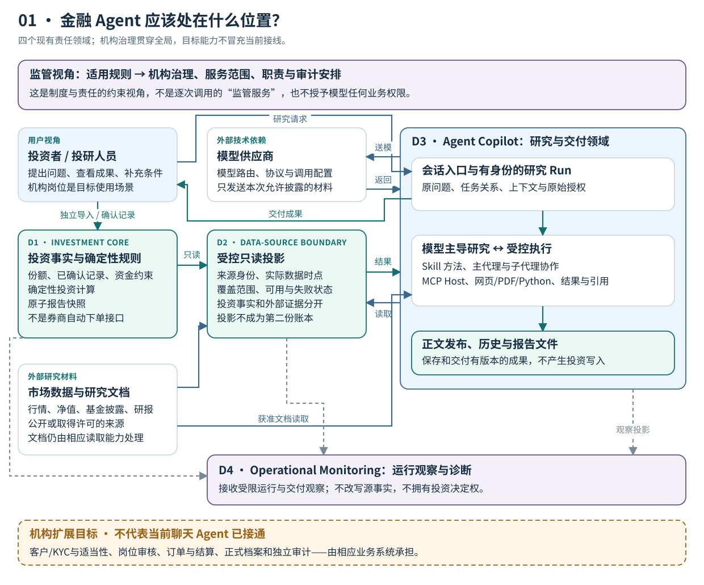
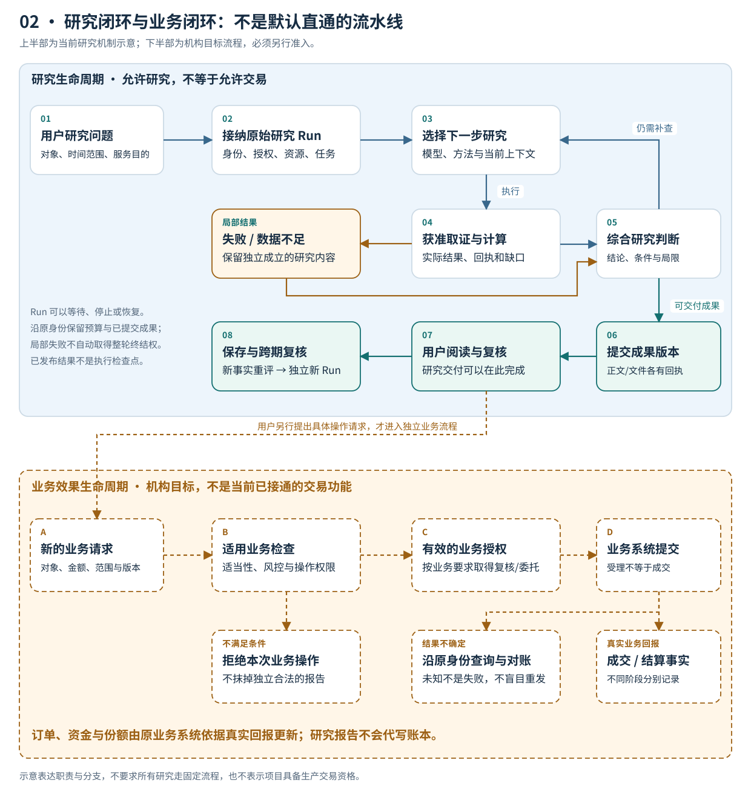
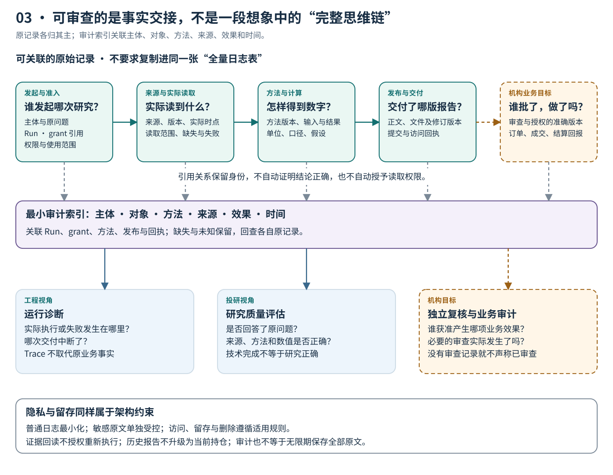

# 金融 Agent 全景：连接研究、业务与责任的系统架构

*从用户委托，到可复核的研究，再到独立授权的业务效果。*

> 架构观察截至 2026 年 10 月 27 日。ETF-Agent 是个人基金研究与投资工具的工程实践。文中以实线领域说明现有职责，以橙色虚线标出机构目标能力；后者不是已经上线的投顾、交易或合规系统。

用户问：“我持有的两只科技基金，底层是不是买了很多相同的公司？继续增加投入，会不会只是把同一种风险买了两遍？”

一个大模型可以查资料、读基金报告、运行计算，再写出一份有图表的分析。但金融服务还需要回答：它分析的是谁的持仓、哪一期披露？结论依据什么口径？用户随后说“按这个方案调整”，系统能否直接执行？三个月后复核时，还找不找得到当初的依据？

**金融 Agent 的核心架构问题，不是把模型放在哪一层，而是让探索性的研究与具有明确责任的金融业务长期协作。** 研究可以提出假设，账本不能跟着假设变化；模型可以提议行动，提议不能冒充已授权、已成交或已结算。

本文沿一项基金组合复核展开。先说明提供什么服务，再画清有哪些系统，随后走过研究与业务两条生命周期，最后讨论监管、审计和机构落地。三张主图分别回答：**系统怎样连接、任务怎样推进、结果怎样追溯。**

## 一、先确定服务承诺，再选择 Agent 能力

对投资者来说，系统首先是一项服务，而不是工具集合。解释产品、分析个人组合、提供个性化建议和办理投资操作，可能出现在同一个聊天窗口，但不能因此共用一份模糊的授权。

下面不是法律业务分类，而是设计产品时需要区分的服务承诺。具体是否属于受监管的投顾、销售或其他业务，仍取决于主体、内容、方式和适用规则。

| 用户的请求 | 应交付什么 | 不应顺手获得什么权力 |
| --- | --- | --- |
| “这两类基金有什么区别？” | 有来源的公开产品解释 | 自动读取个人账户 |
| “结合我的持仓分析重叠” | 在获准数据范围内形成组合研究 | 把历史披露当成完整实时持仓 |
| “比较维持、减仓和继续定投” | 有前提、约束和局限的情景分析 | 把研究方案变成已确认操作 |
| “按这个方案办理” | 进入另行定义的业务准入与执行流程 | 以聊天意愿替代完整业务授权 |

贯穿全文的例子是前两类服务的组合：**研究已指定基金的重复暴露，必要时比较情景，但不操作账户。** 这是合成教学场景，不使用真实客户持仓，也不是一次完整线上验收的复述。

服务范围一旦明确，用户体验就有了判断标准：系统应给出可读结论、依据和缺口；不必为了显得“智能”调用所有工具，更不能以生成报告为由扩大账户访问范围。

## 二、系统全景：四个责任领域，不是四个必须独立部署的服务

ETF-Agent 从持仓导入、定投计算和确认记录等确定性投资工具起步，后来增加了对话研究、MCP、Skill、子代理、Python、知识检索和报告交付。架构上的关键选择，是没有让新增智能能力接管原投资账本。

项目采用四个责任领域：投资核心、受控数据边界、Agent 研究与交付、运行观察。领域表示知识和决定权的归属，不等于进程、数据库或微服务的数量。



[放大查看系统全景图](../visuals/financial-agent-system-panorama/system-map.svg)

**读图方法：** 蓝绿实线表示主要请求、数据或结果交接；灰色虚线表示受限观察；橙色虚线框是机构化目标。顶部监管视角表示规则如何由机构落实，不是每次研究都要调用的“监管 API”。外部供应商与研究资源也不属于机构自动拥有的数据或权限。

| 责任领域 | 持有的核心事实 | 向其他系统提供什么 | 不应接管什么 |
| --- | --- | --- | --- |
| **投资核心（Investment Core）** | 已接受持仓、确认记录、预算及确定性投资规则 | 可核对的投资结果和报告快照 | 模型的自由研究判断 |
| **受控数据边界（Data-Source Boundary）** | 受约束的读取与投影，来源、时点、覆盖和可用状态 | 投资事实和外部证据的有界视图 | 第二份投资账本 |
| **研究与交付（Agent Copilot）** | 对话、Run、工具回执、研究结果和交付版本 | 解释、研究成果、情景与可读报告 | 根投资账本写入和真实交易权限 |
| **运行观察（Operational Monitoring）** | 脱敏运行记录、异常和报告健康观察 | 排障与运行复核材料 | 投资决定、源数据修复或法定审计结论 |

### 事实流可以开放，写入权不能跟着复制

投资核心通过只读投影向 Agent 提供数据。Agent 可以解释持仓和确定性计算结果，但对话、记忆、研究文档、子代理结论都不能自动改变实际份额、已确认计划或执行记录。

根工具中的独立确认与执行记录入口，是个人投资状态管理的一部分；**它不是已经接通券商的自动下单接口。** 把这点写清楚，才能避免一张架构图让“记录已发生的操作”看起来像“已经完成外部交易”。

数据边界同样不是万能金融数据中台。市场数据、网页、PDF 和知识检索仍有各自的读取实现。图中把它们归为受控输入，是为了说明访问和事实如何交接，并非声称所有资料都经过同一个接口。

### 机构接入时，Agent 不是新的核心业务系统

机构场景还需要连接客户与账户、KYC及适当性、产品主数据、风险管理、审批、订单和结算等能力。不同机构的系统名称和组织形态可以不同，但至少要明确：谁维护客户状态，谁决定业务准入，谁提交订单，谁根据真实回报更新资金与份额。

这些是图中单列的目标能力，不能由现有个人系统推导为已实现。Agent 更适合作为受控的研究与协作入口，而不是再建立一套平行的客户、风险和交易权威。

我们已有的[六层调用全景](https://hpoenixf.com/eff-agent-article/articles/017-prompt-to-answer-six-layer-panorama-v3)描述请求怎样从输入走到用户界面；这里的四个领域回答的是：**无论请求经过多少技术环节，原事实和决定权应当归谁。** 两种视角互补，不需要再拼成一套新的层级。

## 三、研究生命周期：围绕一个问题反复取证，不是按固定流程填表

系统边界说明“谁负责什么”，生命周期则说明“事情怎样发生”。金融 Agent 需要先完成一个研究闭环：接纳问题、形成研究策略、取证与计算、综合结论、交付与复核。

它不是只向前走的流水线。模型读完材料后可能改变问题分解，发现需要补查；独立成立的部分结果也可以先交付。研究闭环之外，还有一条必须单独准入的业务效果闭环。



[放大查看双生命周期图](../visuals/financial-agent-system-panorama/lifecycle.svg)

**图的上半部以当前研究机制为基础，下半部是机构业务目标。** 用户阅读报告就可以结束本次服务，不必进入投资操作。橙色连线只表示另行提出业务请求后的衔接，不代表 Agent 可以自动下单，也不规定所有机构必须采用同一审核顺序。

### 1. 接纳一项研究，而不只是一条消息

Conversation 是对话，Run 是一次具体的研究尝试。同一对话可以包含多个问题；同一研究也可能经历工具调用、子代理协作、用户补充、断线和恢复。

对于贯穿例子，研究开始前至少要弄清目标基金、所用账户或持仓来源、研究时段，以及“只分析、不执行”的约束。身份与来源许可由系统负责；“用户真正想比较什么”由模型理解，不能用几条关键词规则代替。

下面是**概念示意，不是现行 API 的字段契约**：

```json
{
  "question": "比较基金 A 与 B 的重复暴露",
  "portfolio_snapshot": "P1",
  "permitted_service": "read_only_research",
  "comparison_basis": "已取得披露的可比部分",
  "requested_effect": "report_only"
}
```

字段写得完整不等于已经获得权限。有效授权要来自真实接纳过程，而不是模型自己填写的 `permitted_service`。

### 2. 把专业方法交给 Skill，把研究选择留给模型

模型判断接下来要读什么、是否需要计算、何时委派子代理；Skill 提供一类问题怎样研究的方法；工具承载真实能力；运行时管理执行身份、资源、回执和恢复。

基金重叠研究需要核对基金和份额、披露期、权重分母及未披露部分。跟踪质量研究需要区分基金净值收益、基准收益及相应计算口径。它们不能都变成一句“你是一位资深基金经理”。

ETF-Agent 的基金方法包、iARK 深度研究以及相关计算工具，提供了这种方法组织的基础。但方法已注册、脚本已运行，不等于模型已经选对方法，更不等于报告具备稳定的金融研究质量。

主代理也不必每次组建一整队“专家”。当资料读取、计算或独立观点确有收益时，可以委派子代理；子代理仍在原研究的授权与资源内工作，提交自己的结果和来源，不能凭角色名称获得新的业务权力。

### 3. 从数据到结论，需要保留金融含义

假设组合中的基金 A、B 分别占总资产的 40% 和 20%；两份可比披露中，公司 X 分别占基金资产的 8% 和 12%。这是合成数据。

已观察部分对公司 X 的组合暴露贡献为：

**0.40 × 0.08 + 0.20 × 0.12 = 0.056 = 5.6%**

这一步的算术可以确定，但结论必须保留输入的范围。它不是“整个组合当前对 X 的完整暴露就是 5.6%”：其他资产、未披露证券以及适用的穿透或衍生品口径，可能尚未纳入。

同样，下载时间不是披露期；基金份额币种不自动等于全部底层风险币种；一份最新市场报价也不能把旧持仓快照变成当前持仓。

因此，受控结果至少应保留对象、来源身份、数据时点、单位、覆盖和方法。模型再解释这些结果与用户目标之间的关系。**来源真实、算术正确、方法适用、结论忠实，是四个需要分别核对的问题。** 相关机制可结合[金融数值与复算](https://hpoenixf.com/eff-agent-article/articles/031-fintech-data-time-and-reproducible-numbers)和[研究证据链](https://hpoenixf.com/eff-agent-article/articles/financial-agent-trustworthy-evidence-chain)阅读。

相应输出可以概括为下面的结构；它仍只是教学示意，而非来源资格的证明：

```json
{
  "observed_exposure_pct": 5.6,
  "basis": "A、B 已取得且口径可比的披露部分",
  "complete_portfolio_exposure": null,
  "limitation": "其余资产与未披露部分尚未覆盖",
  "business_effect": "none"
}
```

### 4. 局部失败，要限制在对应结论或效果

基金 B 的披露暂时不可用时，系统不能将其权重补成零。完整重叠率应当保留缺口，但 A 的已知产品信息、方法解释和后续需要取得的资料仍然有价值。

公开来源的一条引用格式错误，也不应默认删除独立获准的全文。反过来，不能通过删掉“私人来源”标签，把未获准内容洗成公开资料。

这个区分决定了系统既能保留研究价值，又不牺牲真实权限。运行时限制的是自己能够确定的执行与受保护效果，不冒充判断“研究已经足够好”的金融裁判。

### 5. 交付一个有版本的成果，而不只是结束 Run

ETF-Agent 将正文发布、历史交付和文件产物分别处理。模型生成了文字，不代表正文已经持久提交；文件出现在工作区，不代表它已经保存为可下载产物；服务端发送事件，也不证明客户端已经显示。

对于用户，报告应清楚呈现结论、依据、计算口径和关键缺口。对于系统，已发布版本、文件身份和交付回执应当能够分别找回。研究仍在继续时，可以先交付已成立的部分；后续局部失败不应抹掉已有独立成果。

这正是“研究完成”需要按对象说清楚的原因：执行结束、成果保存、用户可见和研究质量达标，不是一个状态。

## 四、业务生命周期：让研究可以影响行动，但不能冒充行动

假设用户看完报告，提出“减少基金 A 的投入，把一部分预算转向其他资产”。这已经是新的业务请求，不能直接复用“只读研究”的权限。

在机构目标架构中，研究产物可以成为业务流程的输入，但交易授权和执行仍由相应业务系统负责。这里尤其需要保留三道区别。

**第一，意愿不等于有效授权。** 一句“照做”需要关联准确的账户、产品、金额、方案版本和授权范围；哪些检查、风险揭示或人员复核适用，由真实业务和制度决定，不是由模型自由判断。

**第二，人工交互不等于金融审批。** 用户补充投资期限，是研究信息；确认报告可以分享，是内容访问效果；批准特定业务操作，是另一种业务效果。不能把这些都压缩成一个通用的 `approved=true`。

ETF-Agent 的持久人机交互提供了请求、回复及向原消费者交接的工程基础，但它不是机构级适当性、投顾审批或交易授权系统。一个“风险官 Agent”的赞同，同样不能替代真实岗位的职责。

**第三，提交不等于生效。** 机构的订单受理、部分成交、成交、结算、撤单和拒绝有不同含义。实际资金与份额如何变化，要依据对应业务规则和回报处理，不能在“模型提交成功”时统一记成已经买入。

外部返回未知时，先沿原请求或订单身份查询、对账，不能把超时当作没有执行而盲目重发。方案内容变化时，原批准是否仍适用也要重新核对；一份批准不应漂移到另一版金额或另一只产品。

这些都是目标机构工作流的设计要求，不是本文宣称 ETF-Agent 已经完成的交易功能。当前研究侧保持只读，根投资工具的确认记录也不等同于外部券商成交回报。

这种分离的代价是多了业务交接和状态关联；收益是研究可以快速演进，而不必让每次模型、Prompt 或 Skill 更新都隐式改变资金操作的权威。

## 五、跨期生命周期：旧报告、原研究与新判断必须分开

金融研究的价值往往在交付之后才继续显现。一个月后，用户可能问：“和上次相比，重复暴露扩大了吗？当初建议关注的风险还存在吗？”

此时存在三种不同的动作。

| 用户要做什么 | 系统应使用什么 | 不能偷换成什么 |
| --- | --- | --- |
| 打开旧报告 | 原来交付的固定版本和可访问内容 | 用今天的数据静默改写旧结论 |
| 接续仍可恢复的研究 | 原 Run 的授权、预算、检查点和真实回执 | 重置额度，或重做未知外部效果 |
| 根据新事实重新研究 | 独立准入的新 Run、合格历史材料和新证据 | 把历史持仓或旧来源许可自动当成当前事实 |

ETF-Agent 的周报、研究快照与 Investment Thesis 探索，让部分历史观察、原始方法结果、假设及用户修订能够按身份保存和读取。它们支持持续复核，但还不是一个已经完整验证的长期自动投研系统。

关键不在于把更多旧文字塞进 Memory。记忆可以保留偏好，摘要可以帮助继续思考；原始持仓、计算结果、用户确认和已交付报告，仍需由原记录解释。

跨期比较还必须控制金融口径。组合市值从 100 万增加到 110 万，若期间现金流未知，就不能直接写成赚了 10%。两次基金持仓披露期不同，也不应把披露差异全部解释为真实调仓。

因此，持续研究的基本单位应是**带有原前提和适用范围、能够被新证据重新检验的判断**，而不是一段会不断覆盖旧值的“最新总结”。模型推断出的投资论点与用户实际确认的目标，也要保留不同的归属。

## 六、监管与审计视角：治理覆盖全程，而不是给模型再加一个最高层

监管视角首先问的是：谁在向谁提供什么服务，适用哪些制度，责任怎样落实。技术设计随后才把这些要求分解为身份、数据访问、方法管理、业务审批、实际执行和记录留存等能力。

本文以中国内地证券基金相关场景为例，不把其中一项规定扩展成适用于所有金融机构和 AI 产品的统一规则。

[《证券基金经营机构信息技术管理办法》](https://www.csrc.gov.cn/csrc/c106256/c1653896/content.shtml)第四十三、四十四条对适用机构的委托服务责任、重要系统的掌握与控制，以及更换服务提供方的安排提出要求。这支持的是**责任与实质控制不能因采购而消失**，不是“全部软件必须自研”的简单结论。

[《证券期货投资者适当性管理办法》](https://www.csrc.gov.cn/csrc/c106256/c1653849/content.shtml)第二、三条限定了相关产品销售或业务服务的适用范围，并要求经营机构履行相应匹配义务。研究解释、服务准入和实际交易需要结合具体业务判断，不能仅靠“金融知识问答”标签或免责声明规避责任。

[《生成式人工智能服务管理暂行办法》](https://www.cac.gov.cn/2023-07/13/c_1690898327029107.htm)第二条区分了向境内公众提供服务与未向境内公众提供服务的研发应用。内部工具不应机械套用公众服务的全部要求，但其他适用的行业、数据与个人信息义务仍需分别评估。

这几项规则不是完整合规清单。下面是本文提出的工程映射，不是声称法规逐条规定了这些模块名称。

| 治理问题 | 落到哪个事实或控制点 | 核对什么，而非只看什么 |
| --- | --- | --- |
| 谁可以使用哪些客户资料？ | 身份、账户归属、来源许可和最小披露 | 实际准入与读取，不只看 Prompt 声明 |
| 谁对某个方法负责？ | 方法版本、适用条件、变更与评估 | 具体输入和结果，不只看 Skill 名称 |
| 谁允许某项业务动作？ | 原业务检查、审批或委托 | 准确对象、版本和效果，不只看“用户同意” |
| 外部服务不可用怎么办？ | 替代、退出、恢复和对账安排 | 能否保留原事实，不只看供应商数量 |
| 事后怎样审查？ | 来源、执行、发布与业务回执的关联 | 可获得的原始记录，不只看 Trace 是否全绿 |

### 可审查性来自事实交接，而不是所谓完整思维链



[放大查看证据与责任图](../visuals/financial-agent-system-panorama/evidence-map.svg)

图中横向表示有身份的关联，不是复制所有记录到一张万能日志表；向下表示在权限内读取或投影原记录，也不表示这些记录都在同一个事务中写入。橙色部分仍是机构目标能力。

发起身份关联原问题和 Run；来源记录解释实际取得了哪一版材料；计算关联输入、方法和输出；发布记录说明哪版正文或文件被提交；如进入业务操作，再关联准确的批准与实际回报。

这些记录可以帮助定位第一个失真的交接，却不保证恢复出模型不可观察的内部推理，也不保证重新调用概率模型得到一模一样的文本。若来源已不可取得，应按适用留存安排保留已有证据并明确缺口，不能从摘要重造“原文”。

ETF-Agent 的 Langfuse 和持久调用证据服务于运行诊断，Publication 与 History 保留交付事实，独立评估再讨论来源是否支持结论、方法是否适用、任务是否真正完成。**记录完整、语义正确、业务合规，仍然是不同判断。**

对于机构，正式审计还需要自己的职责分离、记录完整性和留存制度。普通日志应最小化；确有必要保存的敏感原文，应有单独的访问、保留和删除安排。可审查不是无限期收集全部客户材料，更不是把原始持仓和完整模型输入无差别发送到外部观测平台。

## 七、三个取舍，决定系统能否持续演进

画完全景图，下一步不应是把每个方框都自研一遍。更有价值的是识别哪些机制必须稳定，哪些行为应保留演进空间。

### 取舍一：自主研究，而不是无限增长的固定工作流

模型应根据问题和新证据调整研究路线；运行时只对真实权限、资源、执行身份和持久效果负责。把“材料够不够”“研究应不应该结束”等语义全部写成代码门禁，可能减少探索，而不是提高研究质量。

代价是研究路径具有变化性，需要用真实任务评价策略选择；回报是无需为每种金融问题新建一套固定流程。高风险业务效果仍由独立的业务规则控制，不因研究自主而放松。

### 取舍二：专业方法分工，而不是万能金融总管

精确小数运算、组合情景、基金收益分析、费用估算和根定投规则，处理的是不同金融问题。统一输入身份、单位和来源关系有价值；把所有指标和审批集中到一个 Financial Manager，则容易制造新的平行权威。

相应代价是跨方法需要清楚的契约和维护者；回报是错误能回到真正负责的领域。确定性代码也可能有算法或口径错误，不能因为“不是 LLM 算的”就免于复算与测试。

### 取舍三：掌握可迁移的事实与职责，而不是追求所有代码的所有权

模型网关、数据库、工作流引擎、解析器和观测平台可以采用外部产品。机构需要检验的是：重要系统逻辑是否掌握，业务权限是否由自己落实，源数据使用是否合规，历史成果及执行记录能否按约定保留、导出和迁移。

所谓替换能力，也不是承诺零成本或换模型后文字完全一致。一次有意义的退出演练，应能解释旧报告用的是什么、原批准对应哪版操作、未决效果怎样对账，而不是只证明另一个模型能连上 API。

## 八、落地路线：先证明研究有用，再扩大可产生的业务效果

对于 ETF-Agent，现有基础覆盖四个责任领域及多项研究执行、结果和交付机制；它们的机制接入不能整体替代真实金融质量、长期可靠性和机构合规验收。

从个人研究工具走向机构应用，我更倾向于按**可产生的业务效果**分阶段，而不是按接入多少模型或增加多少 Agent 角色来规划。

| 阶段 | 最先交付的用户价值 | 必须独立核对的完成条件 |
| --- | --- | --- |
| **只读研究** | 指定基金或组合问题的可读分析 | 身份和来源正确，口径与计算可核对，缺口真实，成果能回读 |
| **员工协作** | 研究人员或投顾的复核、纠偏与历史比较 | 岗位权限、版本关联、用户回复实际采用，以及合理的复核负担 |
| **受控业务效果** | 在明确业务范围内形成并处理操作请求 | 适用准入、有效授权、订单与回报对账、异常及未知状态处理 |

前两阶段不必等待自动交易才能产生价值。反过来，能生成报告、能弹确认框，也不足以进入第三阶段。具体机构应在产品和合规边界内决定适用范围。

评价也应拆开。工程看请求、数据和报告链路是否可靠；投研看对象、时点、方法、数字和结论是否正确；业务看人员是否真正使用成果、复核是否可承受；治理看是否越权、记录是否可追溯、供应商能否退出。它们不能被一个 `completed` 或一个总成功率替代。

一组有价值的验收题，应同时包含正常研究和关键反例：持仓缺失时能否限制个人化结论而保留公开研究；一份披露不可用时能否保留已知部分；报告已交付而业务请求被拒绝时能否正确保留两种事实；外部效果未知时是否避免盲重试。

这些是建议的验收设计，不是本文已经测得的通过率或投资收益。当前最值得继续投入的，是让已有能力在真实金融问题上形成稳定的整体效果，而不是继续扩大架构图。

## 九、结语：研究闭环可以自主，业务闭环必须有明确的责任

从用户视角，金融 Agent 应交付能理解、能复核、知道局限的金融研究服务。从机构视角，它应接入而非复制客户、投资、风险和交易系统的权威。从监管视角，机构仍需按适用规则承担责任，并把它落实到真实权限、效果和记录。

三张图描述的是同一个系统：系统图划清职责，生命周期图分开研究与业务效果，证据图让跨系统交接可以追溯。它们不是多建三套控制平台，而是帮助我们检验现有设计有没有把不同事实混在一起。

**给研究足够的探索空间，给金融事实明确的归属，让真实业务效果接受独立授权与核验。** 这比争论金融 AI 究竟应该有几层，更接近一套能够长期演进的架构。

模型会变化，工具协议和供应商也会变化。真正值得积累的是适用的金融方法、可核对的研究成果、被准确记录的业务效果，以及对这些结果承担责任的能力。

---

## 延伸阅读与交流

本文的工程基础可继续结合[六层调用全景](https://hpoenixf.com/eff-agent-article/articles/017-prompt-to-answer-six-layer-panorama-v3)、[金融研究证据链](https://hpoenixf.com/eff-agent-article/articles/financial-agent-trustworthy-evidence-chain)与[跨期 Investment Thesis](https://hpoenixf.com/eff-agent-article/articles/agent-weekly-thesis-history-continuous-research)阅读。它们分别展开请求路径、依据传递和持续研究，不代替本文的机构目标边界。

监管段落引用的是中国证监会与国家网信办公布的原文；架构映射是本文的工程判断，不是法律意见或合规认证。图例和数值均为教学示意，不构成投资建议。

[阅读金融科技专题](https://hpoenixf.com/eff-agent-article/fintech) · [English edition](https://hpoenixf.com/eff-agent-article/en/articles/financial-agent-system-panorama) · [在 GitHub Star 关注后续实践](https://github.com/hpoenixf/eff-agent-article)
