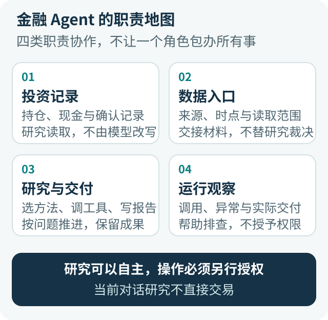
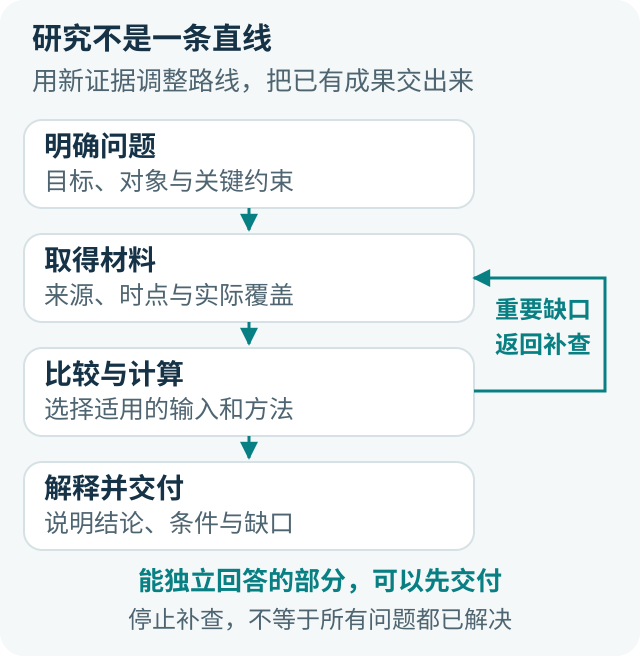
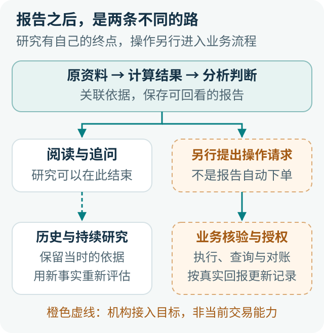

# 金融 Agent 全景：连接研究、业务与责任的系统架构

用户问：“我已经买了两只科技基金，再加一只，是增加分散，还是把同一种风险又买了一遍？”

模型可以解释分散投资，也可以调用工具查询基金、阅读持仓、计算重合。但这些动作做过一遍，并不意味着问题已经回答。系统还需要知道：读的是哪类基金份额，持仓属于哪一期，两份数据能不能比较，计算结果意味着什么，以及用户究竟在担心哪一种风险。

用户接着说：“那就按你说的调整。”事情又变了。前面是一项研究，现在可能涉及账户与资金。谁核对产品和金额？谁批准操作？没有收到明确结果时，应该查询，还是再提交一次？

**金融 Agent 的全景，不是把更多模型、工具和审核模块放在一起，而是把研究与业务接好：模型可以灵活探索，数据、计算、权限和真实操作分别有人负责。** 只追求自主性，会忽略行为后果；只追求控制，又可能让用户始终看不到有价值的结果。

下面用一个合成的基金组合案例，走过这条完整路径。ETF Agent 当前的对话研究层不直接交易；文中的订单、结算与机构审批，是接入业务系统时的目标分工。

## 一、金融场景为什么不能只换一套知识库？

不同领域的 Agent 都需要可靠性，代码和科研任务也可能产生严重后果。金融的特殊之处，不在于其他行业可以随便出错，而在于一个普通问题经常同时包含**精确事实、开放判断和可能影响资金的动作**。

“这只基金费用是多少”看似只需查一个数，实际上可能涉及份额、销售渠道、收费条件和生效时间。“这两只基金是不是买重了”又不只是数字相同：共同持有几家公司，是事实；这些重合是否值得调整，要看权重、其他资产、投资期限和用户目标。

因此，资料真实只是起点。今天下载的报告，持仓可能属于上个季度；基金净值的变化，也不等于投资者账户的实际收益。金融研究需要保留数字所处的条件，不能把所有信息都压成一段没有时间和口径的摘要。

### 同一个聊天框，可能承接不同责任

| 用户的请求 | 应当交付什么 | 不能悄悄发生什么 |
| --- | --- | --- |
| “这几只基金有什么区别？” | 有来源的产品解释与比较 | 混用不同份额、时期和统计口径 |
| “结合我的持仓看看有没有买重。” | 基于获准账户资料的组合研究 | 用聊天记忆冒充当前持仓 |
| “比较维持、减少和继续投入。” | 在允许的服务范围内做条件化分析 | 把模拟配置写成实际持仓 |
| “按这个方案办理。” | 进入独立的业务确认与执行流程 | 凭研究权限直接获得操作权限 |

区别并不只在最后有没有下单按钮。针对具体个人形成的建议，也可能有独立的服务责任。产品应当先说清楚自己提供什么，再决定开放哪些数据和操作；具体资格与审查要求，由相应机构按适用规则确认。

### 有些问题适合规则，有些需要研究

已经确定的费率如何乘以金额、账户是否拥有访问权限、一个订单是否超过明确限额，适合由程序执行。研究什么、先查哪份材料、怎样解释相互冲突的观点，则需要模型结合问题作判断。

不能因为金融重视控制，就把所有研究问题都改成固定表单。也不能因为模型善于理解语言，就让它自行决定权限和业务规则。两种能力合作的前提，是知道哪些决定可以探索，哪些决定必须依据已有规则。

关于研究、建议和交易的区别，见[《当 AI 开始谈“买什么”，研究助手离投顾和交易还有多远？》](030-fintech-from-research-to-investment-advice.md)。

## 二、先看整张地图：模型、工具与业务系统怎样分工？

可以把金融 Agent 想成一个研究团队，但不必给每项职责都配一个 Agent。账户系统保管持仓，数据工具取得资料，模型组织分析，计算程序执行明确的方法，交付系统保存成果。它们协作，却不能互相取代。

[放大查看系统分工图](../visuals/financial-agent-system-panorama/reader-system.svg)

**投资记录回答“用户实际上有什么”。** 份额、现金、已确认记录，应从负责这些事实的原系统读取。模型可以解释账户，却不能因为生成了一份新摘要，就改写账户。个人投资工具里记录的“已确认”，也不能被包装成券商的成交回报。

**数据入口回答“这次取得了什么”。** 网页、PDF、行情接口和内部知识库各有用途。入口需要把来源、资料时点、读取范围和失败情况准确交给研究者。它不应该在统一格式时，擅自决定“材料不够专业，所以整道问题不能回答”。

**研究与交付回答“怎样形成有用结果”。** 主 Agent 理解问题、选择方法、调用工具，必要时分派局部任务，再将结果组织成解释。计算完成、文字生成、文件保存和用户取得成果，需要真正接起来，而不是每个模块各自显示成功就结束。

**运行观察回答“哪里发生了什么”。** 某次读取为什么失败，模型有没有看到计算结果，正文是否保存，用户是否拿到文件，都需要可核对的记录。观察系统帮助排查，不负责替用户选基金，也不因掌握日志就获得全部私人材料的使用权。

这里划分的是职责，不是要求部署四个微服务。一个小团队完全可以把它们放在同一应用里。关键是别让一份模型回复同时成为研究意见、账户事实和操作授权，也别让一个数据适配器成长为隐藏的研究决策系统。

### 框架、工具和业务规则分别解决什么？

框架帮助安排模型调用、工具执行和运行状态；工具让模型读取资料、计算、生成文件；研究方法告诉它某类问题应该怎样分析。业务系统则维护账户、产品和真实操作。接通其中任何一项，都不能自动替代其他项。

例如，“查询基金持仓”工具提供材料，“穿透组合暴露”方法说明如何分析，“账户访问控制”决定可以查询谁。把它们都塞进提示词，看起来集中，实际会让模型同时承担它不该承担的职责。

工具也应尽量把问题说清楚。相比一个返回大量不明字段的万能接口，一个能说明数据日期、份额和缺失范围的查询，更容易被正确使用。

进一步的权责设计见[《模型会理解，代码才授权》](011-model-understands-code-authorizes.md)；接入层的取舍见[《一个金融数据 MCP，为什么长成了研究决策系统》](mcp-market-responsibility-retrospective.md)。

## 三、一次研究怎样推进：让新证据改变下一步

回到“两只科技基金是否买重了”。用户只说了一句话，研究却包含几项相关判断：已有资产是什么，新基金增加了什么，哪些风险没有变化，以及什么条件会改变结论。Agent 的价值，不只是依次调用工具，而是根据结果调整下一步。

[放大查看研究循环图](../visuals/financial-agent-system-panorama/reader-loop.svg)

### 先确定这次要回答到哪一步

用户只想知道产品区别时，公开资料就可以推进。到了“对我的组合有什么影响”，才需要读取获准持仓。缺少新增金额，可以先说明定性差异；缺少账户许可，仍可以研究公开产品，但不能声称已经分析了用户的实际配置。

澄清也要有取舍。半年后需要用钱，可能直接改变情景比较，应优先确认；报告偏好深色还是浅色，不该挡住研究。可以先回答的部分先做，只有真正影响关键判断的信息才值得让用户停下来补充。

好的开始不是把一张表填满，而是形成一个可推进的问题。例如：“先比较三只基金已披露的底层公司与行业，再看新增产品是否带来不同暴露；现金需求另行纳入情景。”这样既有方向，又允许材料改变路线。

### 读到什么，决定能回答什么

假设基金 A 有完整持仓，B 只有前十大，C 的名称又对应两个份额。直接把三张表拼在一起，很容易得到一个漂亮却含义不清的重合率。研究应先确认 C 的身份，说明 B 的披露范围，再决定是否寻找更完整材料。

如果补查发现 B 的完整披露存在，但属于更早期间，就要面对一个取舍：采用较早但可比的共同时间点，还是保留最新已知部分并限制结论？不存在对所有问题都正确的选择。用户问历史配置时，旧资料可能恰好合适；用户问当前风险时，就必须把时效限制放在结论旁边。

每次补查都应对应一个具体问题：补到什么，可能让哪个判断发生变化？

### 计算结果还要回到原问题

工具返回共同持仓、行业占比或相关性后，主 Agent 需要解释它们各自说明什么。共同股票少，不一定意味着风险来源不同；两只基金历史走势接近，也不能单凭这一点说它们持有同一批公司。

如果新结果暴露出重要问题，研究可以继续；如果剩余缺口暂时无法解决，就应交付已知部分。资源接近耗尽时，也应优先组织现有成果，而不是把最后的机会都花在价值很小的重复搜索上。

用户中途补充“我其实不是要加钱，而是替换一只基金”，研究目标也要随之更新。已经取得的资料不必全部作废，但情景计算需要按替换重新组织。能够利用前面成果又不沿用错误前提，比单纯多跑几轮更重要。

模型根据工具反馈继续行动，是通用 Agent 的常见组织方式；Anthropic 在[《Building effective agents》](https://www.anthropic.com/engineering/building-effective-agents)中也讨论了这种循环及停止条件。金融场景的关键适配，是让模型选择研究路线，同时由程序维护实际权限、资源和已发生的记录，而不是用程序判断每个投资观点的正确性。

更完整的推进机制见[模型与研究循环的协作机制](etf-agent-model-harness-research-loop.md)。

## 四、数据、计算、判断：三者接得上，报告才有深度

把算术交给 Python 很有价值，但“调用过计算工具”并不是研究质量的证明。我们真正需要接通的是：输入描述了什么，方法是否适用，结果保留了什么条件，最后的文字有没有改变它的含义。

### 先把数字放回对象和时间里

假设基金 A 占组合的 40%，B 占 20%；公司 X 在两只基金中的权重分别为 8% 和 12%。在披露时期、分母、资产范围和权重含义可比的教学条件下：

**40% × 8% + 20% × 12% = 5.6%**

这个结果说明，按这些输入，A、B 两只基金中已观察到的公司 X 持仓，对组合贡献了合计 5.6% 的暴露。它不是两只基金的整体重叠率，也不一定是 X 在整个组合里的最终暴露：其他资产或未披露部分可能还有贡献。

如果一个权重按基金净资产计算，另一个按股票资产计算，不能直接相加。若资料时点不同，也应选择可比数据，或把它标为基于不同披露的估计，不能写成当前精确持仓。

金融数据至少涉及三种时间：事情何时发生、资料何时披露、系统何时取得。今天读到一份旧报告，不会让报告里的旧持仓变成今天的持仓；回看过去的判断，也不能使用当时尚未披露的材料替它补理由。

### 模拟怎样变化，先说清资金从哪里来

研究新增基金 C 时，还有一个经常被忽略的问题：用户是在追加资金，还是从原资产里调出资金？两种方案的分母不同，不能只往原比例上加一个数字。

用简化单位说明：原组合总额为 100，从已有现金中转出 20 买 C，组合总额仍为 100，C 占 20%。若原组合不动，另外投入 20，组合总额变成 120，C 约占 16.7%，原资产的比例也要随之变化。这是忽略费用和价格变化的教学计算，不是具体操作建议。

同样，组合市值从 100 变成 110，期间若有新增投入，不能直接称为赚了 10%。费用估算也不能只看到一个费率，就忽略适用份额、持有期限或收费条件。许多金融错误并非不会乘除，而是选错了“这次在算什么”。

### 份额费用与分红：产品规则会改变答案

同一只基金的 A、C 份额，如果预计持有一年半，哪种总成本低？“A 适合长期、C 适合短期”不是可直接套用的结论。须先确认具体份额、申购渠道、折扣、持有期限和收费条款，再用确定性方法比较。中国证监会 2025 年 12 月 31 日公布的[基金销售费用新规](https://www.csrc.gov.cn/csrc/c101954/c7606091/content.shtml)自 2026 年 1 月 1 日施行，规定持有超过一年的非货币市场基金份额不再收取销售服务费；具体产品仍应核对合同、有效日期与过渡安排，不能凭一条规则代替实际费率。

持有期限也不是从点击申购按钮开始算。按[深圳证监局的说明](https://www.csrc.gov.cn/shenzhen/c105614/c7602071/content.shtml)，通常以申购和赎回**确认日**计算，交易确认一般为 T+1，特殊产品可更晚。基金[分红](https://investor.amac.org.cn/community/tzzhdzthd/ylj/202307/t20230706_14858.html)后单位净值通常相应下降，现金分红与红利再投资会改变现金或份额构成；只比较两天的单位净值，不能代表投资者真实回报。

### 程序算得准，模型还要用得对

金额和费用需要明确精度、舍入与入账方式；收益分析需要说明是否包含分红；风险情景需要给出假设。把这些方法放进可复用计算工具，可以减少重复实现，也让错误有机会被独立复算。

但返回一个裸数字仍然不够。结果应当带着方法、单位、输入范围和局限进入后续研究。只有前十大持仓得到的计算，要继续保留“已披露样本”；按假设冲击得到的损失，要继续保留“情景”，不能在报告里变成预测。

重要计算尽量复用确定性方法；[A33 精确数值核](agent-numeric-kernel-exact-units-rounding.md)负责显式单位、舍入与残差，不能替领域选择适用公式，也不要求普通正文逐数认证。计算失败影响依赖它的判断，不应让整篇报告失去发布资格。

### 多来源用于解决分歧，不用于凑数量

两家供应商的收益率不同，先检查份额、区间、币种和收益口径。一个是净值回报，另一个包含分红再投资，数值不同不一定是谁错了。两个一致数字也可能都转引同一份资料，不能只数链接来判断独立性。

更合理的做法，是让每个重要事实有适合它的来源，在冲突可能改变结论时深入核对。明确的官方费率条款，不必为了凑“至少两家”反复搜索；仍解释不清的冲突，应保留差异及其影响，而不是让模型任意选一个。

数据与精确计算见[金融数值的时点与口径](031-fintech-data-time-and-reproducible-numbers.md)；结果怎样被模型理解，见[《Agent 明明调用了 Python，为什么投研报告还是会算错？》](financial-agent-python-result-consumption.md)。

## 五、多 Agent 和人工复核：增加新的检查角度

单个 Agent 能处理的问题，没有必要为了架构完整而增加角色。查管理费、解释指标、比较一页资料，通常不需要同时召集多头、空头和裁判。

任务变复杂后，多 Agent 可以承担两类不同工作。一类是处理材料，例如分别阅读两份长报告；另一类是检验假设，例如分别研究“新基金带来分散”与“新基金只是增加同类暴露”。

在我们的例子里，支持方可以寻找 C 是否带来不同公司或行业；质疑方检查它与原组合的重合、近期用钱需求和集中风险。最后要讨论的是哪些依据成立、什么新证据会让判断改变，不是统计几位“专家”赞成。

### 交回来的应该是依据，不只是一句意见

一个子 Agent 只回复“重合不严重”，主 Agent 很难判断它看了什么。更有用的交接是：比较了哪些资料，采用什么方法，发现哪些事实，有什么缺口，以及这些结果支持到哪一步。

主 Agent 还需要处理冲突。一个助手说“科技占比高”，另一个说“底层公司不同”，两句话可能同时成立。它们讨论的是行业集中与公司重合，不能简单取平均，也不能让一个裁判用投票消掉差异。

这同样意味着并行不一定更省。任务划分、材料传递和结果综合都有代价。只有新增角色带来了原先没有的检查角度，或者确实分担了可以独立完成的材料工作，协作才值得。

### 人工介入也有不同含义

用户补充“半年后要用一笔钱”，是在修正研究条件；专业人员核查方法和建议，是复核研究；业务审批人批准明确操作，是允许产生受控效果。这三件事不应被同一个“确认”按钮混在一起。

复核界面应把需要判断的地方摆出来：争议结论、对应材料、计算假设、修改前后差异。只给人一份长报告和一个通过按钮，未必形成有效复核。反过来，普通研究也不必因可选 Reviewer 没运行，就让用户拿不到已经完成的内容。

多视角研究的方法取舍，见[《不止一个投资专家：多视角 Agent 如何共同检验投资假设》](investment-perspectives-and-thesis-falsification.md)。

## 六、安全与可用性：把限制放在真正有风险的地方

假设 A 的资料已经读到，B 的完整持仓暂时拿不到。两种极端都不好：一种编出完整重合率；另一种只说“信息不足，无法分析”。

更有用的回答是，先说明 A 的集中情况，比较双方已取得的投资范围和费用，再告诉用户完整重合率还缺什么。没有把缺失当成零，也没有因为一部分不能回答，就抹掉其他工作。

我们在发布治理中做过这样的调整：引用附件有问题，处理附件；某个指标缺输入，保留指标缺口；后面的工具调用失败，不清空前面已经交付的独立内容。**限制的范围应跟着真实依赖走，而不是让一个局部问题取得整场研究的否决权。**

| 遇到的问题 | 应限制什么 | 仍可继续什么 |
| --- | --- | --- |
| 完整持仓缺失 | 完整重合率及依赖它的确定性结论 | 已披露部分、产品差异与缺口说明 |
| 两份数据不可直接比较 | 无依据的合并或排名 | 分别展示，并解释口径差异 |
| 引用详情暂时打不开 | 不伪造原文，不冒充核查完成 | 权限与内容身份成立的独立正文 |
| 私人资料未获授权 | 对应访问、使用和依赖它的披露 | 不依赖该资料的公开研究 |
| 真实操作结果不明 | 不盲目重复可能产生资金效果的操作 | 查询原请求、核对并说明未知 |

### 材料可信，不等于它有权发号施令

研报可以真实，网页也可以来自知名机构，但其中的文字仍然只是研究材料。某个页面写着“忽略原规则”或要求发送客户资料，不应因此变成系统指令。来源是否适合引用，与它是否有权改变工具权限，是两件事。

OWASP 对[间接提示注入](https://genai.owasp.org/llmrisk/llm01-prompt-injection/)的说明，强调了外部网页和文件影响模型行为的风险。对应用而言，除了让模型区分材料与指令，还要把实际访问、发送和操作控制放在程序侧，不能只靠提示词中的一句提醒。

### 少暴露数据，不等于少提供帮助

组合研究可能需要权重，但未必需要身份证号、银行卡号或完整账户流水。读取来源时就控制范围，分派子任务时只传必要材料，记录诊断时避免无差别复制私人正文，通常比最后再要求模型“注意脱敏”更具体。

同样，一次私有账户读取被拒绝，并不自动禁止公开基金研究。程序守住数据与操作范围，模型在允许范围内继续工作，这才同时照顾了安全和可用性。

局部交付见[独立发布系统的设计](019-agent-answer-publication.md)；材料与指令的区分见[内容信任与提示注入](agent-content-trust-prompt-injection.md)。

## 七、从报告到业务：证据、交付与真实操作怎样衔接？

用户看到的可能只是一页报告，系统需要把三类内容接清楚：原资料提供的事实，工具产生的计算，以及模型综合形成的判断。它们可以出现在同一段文字里，却不能互相替代。

[放大查看研究与业务衔接图](../visuals/financial-agent-system-panorama/reader-handoff.svg)

### 用户想核查一句话，不应先读完整运行日志

对于 5.6% 的暴露，核查入口应说明两份披露、组合权重、计算方法和覆盖限制。对于“新增基金未必增加分散”这个判断，还需要知道它引用哪些结果、增加哪些假设，以及什么情况会改变它。

这也是引用不能只做成一个外链的原因。网页可能更新，页面很长，表格的脚注也可能决定数字含义。能够回到当时实际读取的段落、页码和版本，才更接近可核查的研究成果。

但引用并不是正确性证书。资料写着“前十大持仓存在重合”，不能直接证明“整个组合应该调整”。用户从引用找到依据之后，仍要检查解释有没有越过材料能支持的范围。工程负责把核查路径接通，研究负责把理由讲清楚。[E04 研究证据留存](agent-research-evidence-store-lifecycle.md)提供受控的调用副本与回读，不代替原结果身份、来源资格或业务事实。

### 生成、保存、收到，是不同的事情

正文在页面出现，不代表已经保存；文件在服务器生成，不代表用户能够打开。一次后续调用失败，也不意味着前面已经收到的内容应该消失。

面向用户的交付需要说清当前事实：哪些内容已经保存，哪个文件可以取得，哪些仍未完成。保存失败时保留可见内容并提示风险；文件不可用时说明文件问题，不用一个含糊的“任务失败”覆盖整段研究。

用户未必关心调用链有多少步，但会在意今天读过的结论明天还能不能找到，引用是否对应原材料，文件是否真的可用。

### 读完报告，不会自动进入交易

只读研究可以在报告交付后结束。只有用户提出明确操作请求，才进入另一条业务流程：核对准确方案、账户、产品和金额，按适用规则检查权限、风险和必要批准，再由业务系统执行并保存实际回报。

“同意这个分析”“已经提交订单”“部分成交”“全部成交”不是同一种事实。一次确认应对应明确版本的操作；之后方案或金额变化，不应继续借用旧确认。业务结果未知时，应沿原请求查询和对账，不能为了让聊天尽快结束而再下一单。

因此，审查记录真正需要解释的是：谁提出什么，依据什么资料，批准了哪版操作，实际发生了什么。它不依赖取得模型全部隐藏推理，也不要求重新调用模型生成逐字相同的回答。机构正式审计还需要自己的记录完整性、访问和留存制度，普通会话日志不能自动代替。

### 机构责任不能外包给模型

适用中国内地证券基金经营机构时，[《证券基金经营机构信息技术管理办法》](https://www.csrc.gov.cn/csrc/c106256/c1653896/content.shtml)第四十三、四十四条明确，技术服务外包不免除经营机构的法定责任，重要系统须保持机构控制，并预先考虑服务方更换。工程上，不能让模型的研究结论或聊天确认取代原业务系统的账户核验、适当性判断、审批和实际结果记录。这是根据法规作出的**责任映射**，不是法规规定了 Agent 模块名称，也不表示 ETF Agent 已具备交易能力。

进一步见[《金融 Agent 的可信证据链》](financial-agent-trustworthy-evidence-chain.md)与[《为什么 AI 明明有很多引用，回答还是不够可靠？》](ai-citations-do-not-prove-reliability.md)。

## 八、从一次回答到持续研究：记住理由，而不是只记住结论

一个月后，用户再问：“现在呢？”如果系统只记住上次说过“重合偏高”，它可能重复旧结论，也可能根据新行情编出一套当初并不存在的理由。

持续研究需要保存的，是当时的对象、资料、假设、结论和改判条件。比如，原判断是“新增 C 暂未提供明显不同的公司暴露”；后来 C 调整指数、用户降低 A 的权重，或者出现新的完整披露，都可能要求重新分析。

### 三种信息不要混在一起

用户偏好相对稳定，例如希望先看结论、偏好低成本产品，但也可以修改。账户持仓随交易与价格变化，必须从当前获准资料读取。研究判断则属于某次分析，它有自己的日期、依据和适用条件。

把三者都放进一条不断覆盖的“用户画像”，很容易出错。用户曾经持有科技基金，不等于已经确认长期偏好高风险；模型上次建议关注某项指标，也不等于用户已经同意采取行动。

用户纠正“这只是过渡仓位”时，应该保留这次修正的含义，让后续研究使用新条件，而不是悄悄改写旧报告，使它看起来早就知道。保存历史，是为了比较判断怎样变化，不是为了证明每次判断都对。

### 定期研究不应该只是定期重写

周报最有价值的问题是：“相对上次，什么变化值得我重新判断？”可以关注持仓结构、产品条款、重要披露和用户资金安排，而不是每周换一种措辞介绍同一批基金。

如果没有新的关键事实，可以明确说原判断暂未出现需要修订的依据；这不等于证明风险不存在。出现重要变化时，应解释它影响了哪条原假设，而不是简单把一条新闻贴到报告末尾。

工程上，重新打开旧报告与继续一项未完成研究也要分开。前者是读取原成果，后者可能产生新的工具调用、费用和资料使用。不能把用户点开历史记录，默认为允许重新执行，更不能把旧资料悄悄升级成当前事实。

这些设计让 Agent 有机会成为持续研究助手，但长期判断质量仍需实际检验。机制与案例见[《一份周报过去后，Agent 还记得当初为什么这样判断吗？》](agent-weekly-thesis-history-continuous-research.md)。

## 九、怎样判断系统变好了：既看错误，也看用户拿到了什么

来源可以打开、Python 运行成功、报告已经保存，这些都值得验证，但加起来仍不能直接证明用户的问题解决了。对“新增基金是否更分散”，仅列出三份产品资料，或者生成一篇很长的报告，都不是充分回答。

一份研究至少要说清比较对象、已知变化、重要缺口，以及结论会在什么条件下改变。评估应从互补视角观察，不用一个总分决定答案能不能显示。

| 评估视角 | 真正检查什么 | 容易误用的替代指标 |
| --- | --- | --- |
| 运行与交付 | 材料、计算、正文、文件和历史是否接通 | 模型接口返回成功 |
| 金融研究 | 对象、时点、方法、数字与解释是否适用 | 调用过 Python、引用很多 |
| 用户价值 | 原问题是否回答，用户还要补做多少工作 | 篇幅长、角色多、输出完整模板 |
| 安全与成本 | 是否越权，额外研究与复核是否值得 | 拒绝越多越安全、运行越久越深入 |

### 好测试也要检查“没必要拒绝”的情况

资料齐全的正常题要测；只拿到部分持仓、两份披露时期不同、一次计算失败、文件保存中断，也要测。期待的不是系统一律拒绝，而是它能保留正确的部分，不捏造未知，不把安全限制扩大到无关内容。

例如，缺少 B 的完整披露，报告是否明确限制重合结论，同时保留费用和投资范围比较？某个引用详情损坏时，是否只影响那个核查入口？这些问题能帮助发现过度控制造成的产品损失。

失败尝试也不能从记录里删除。只统计顺利完成的报告，会看不到用户经历了多少次空白、超时和反复追问。质量与交付应分别观察：交付了可能有错，没交付也不能因为“没有错答案”就被当成成功。

### 发现错误，修真正出问题的环节

同一句错误结论，可能来自数据未取得、日期识别错、公式错误、结果没有送到模型，或者最后解释反了。修数据读取、修算法、修结果传递和修模型指导，针对的是不同原因。

因此，真实错误应沉淀为可以复查的小案例：原问题是什么，输入是什么，哪句结论不成立，独立期望怎样得到。下一次改模型、提示词或方法时，复用这些案例，再加入未用于调试的变体，观察改进是否只适配了原题。

模型 Reviewer 可以提供另一份意见，却不应把“未发现问题”自动升级为正确认证。用户接受、专业复核和模型评价应分别记录。我们要积累的是能指导下一次修复的事实，不是一张每轮都漂亮的成绩单。

## 十、落地顺序：先完成一项有用研究，再扩大业务效果

全景图不是采购清单。团队不必先建完长期记忆、多 Agent、审计平台和交易系统，才开始验证价值。更合理的起点，是一个资料能够取得、方法能够解释、结果能够核对的具体任务。

基金比较就是这样的候选：先明确份额和期间，取得必要资料，完成几项真正相关的分析，让用户拿到报告并能追问。若瓶颈在读取完整持仓，优先解决数据取得；若瓶颈在结果解释，优先改方法使用与说明。不要用新增一批角色替代对真实问题的定位。

### 从只读研究到员工协作，再到受控操作

只读阶段先把资料、计算和交付接通。员工协作阶段，再处理岗位权限、专业意见、版本修订和人员交接。真正需要办理业务时，才进一步接入原有客户、产品、风控、审批、订单和回报系统。

机构落地还需要有人维护产品事实、解释专业分歧、处理异常与决定何时转人工。这不是让每份报告多盖几个章，而是明确哪类问题由谁接手。报告交给员工以后，如果所有数字都得重新查一遍，工具调用再漂亮也未必节省了工作。

前两个阶段可以独立提供价值，不需要等待自动交易。反过来，接通一个交易接口也不代表第三阶段已经准备好。能力应当随明确的业务目标和可承担的后果扩展，而不是随着架构图上的方框增加。

### 资源投入要对应真正的帮助

成本不只有模型调用，还包括数据购买、等待、专业复核、运维以及用户反复补充信息。比较方案时，应看同类任务最终完成了什么、需要多少人工补位，而不是只比较每次请求便宜多少。

简单问题使用简单路径，重要且有争议的问题再增加研究深度；把复杂度留给确实需要它的地方。框架、模型和供应商都可以更换，但重要材料、方法、报告版本及未决业务记录应能按照既有权限被理解和取回。

对 ETF Agent 这样的研究实践，已有引用、计算与交付机制只是基础。下一阶段更有价值的投入，是让这些能力在真实问题中稳定协作，而不是继续增加一个替整篇答案作最终裁决的通用模块。

## 结语：一套系统的深度，体现在它怎样把事情接起来

回到开头的问题，用户需要知道的不只是三只基金各有什么特点，而是新增产品改变了哪些已知暴露、哪些风险仍然存在、哪些材料不足，以及自己接下来还需要确认什么。

模型、工具和业务系统需要协作，分歧需要研究，操作需要授权。每个部分都重要，却没有哪一个可以单独替整套系统宣布成功。

**给研究足够的空间，把权限与真实操作管住，让已知结果、重要缺口和判断理由一起到达用户。** 金融 Agent 的价值，就应当在这条完整路径上接受检验。

---

## 继续深入

本文沿一项研究串起系统关系。需要查看实现细节，可继续阅读[六层调用全景](017-prompt-to-answer-six-layer-panorama-v3.md)、[金融证据链](financial-agent-trustworthy-evidence-chain.md)和[跨期研究](agent-weekly-thesis-history-continuous-research.md)。原有[详细系统图](../visuals/financial-agent-system-panorama/system-map.svg)、[双生命周期图](../visuals/financial-agent-system-panorama/lifecycle.svg)与[证据关系图](../visuals/financial-agent-system-panorama/evidence-map.svg)保留为技术参考；橙色虚线表示机构目标，不是已上线交易能力。[原技术版](https://github.com/hpoenixf/eff-agent-article/blob/9d46273da85bddaa6c5c432581c916496edd9cc1/articles/financial-agent-system-panorama.md)保留接口示例与详细讨论。

[金融科技专题](https://hpoenixf.com/eff-agent-article/fintech) · [English edition](https://hpoenixf.com/eff-agent-article/en/articles/financial-agent-system-panorama) · [GitHub](https://github.com/hpoenixf/eff-agent-article)
