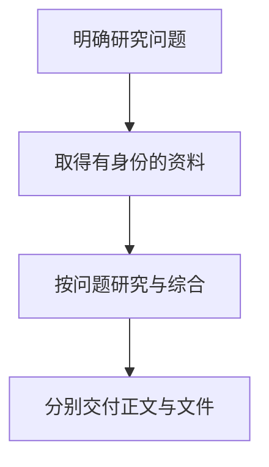
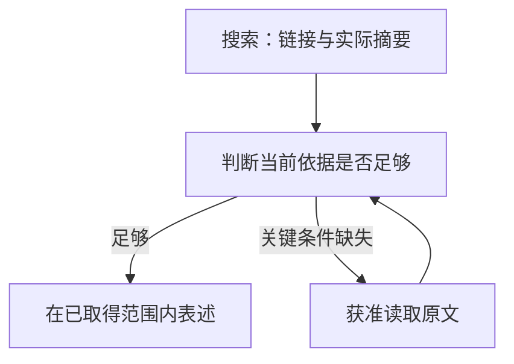
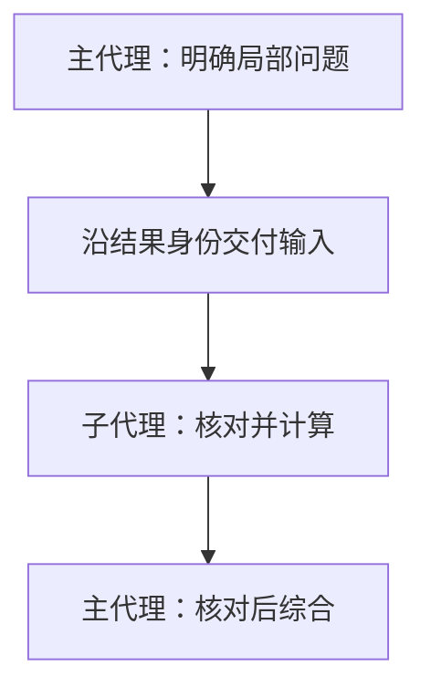
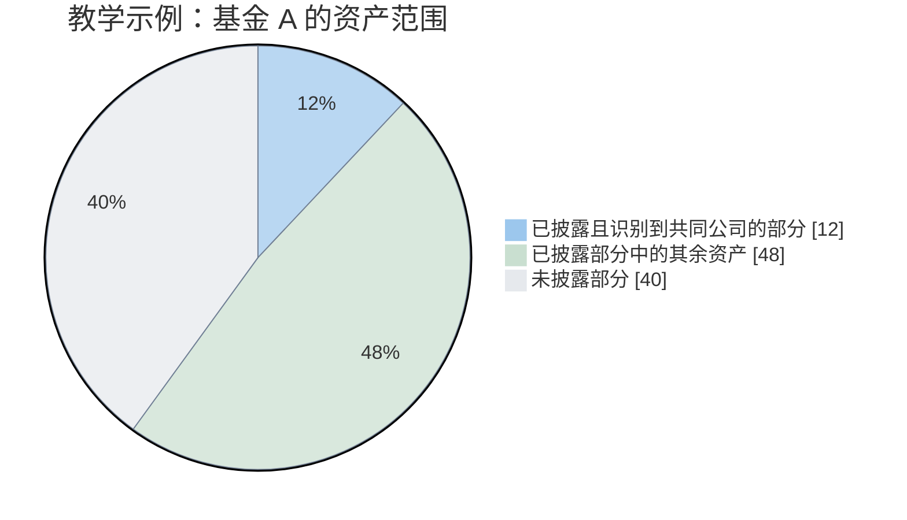
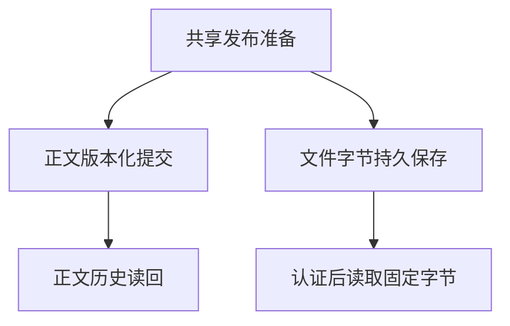
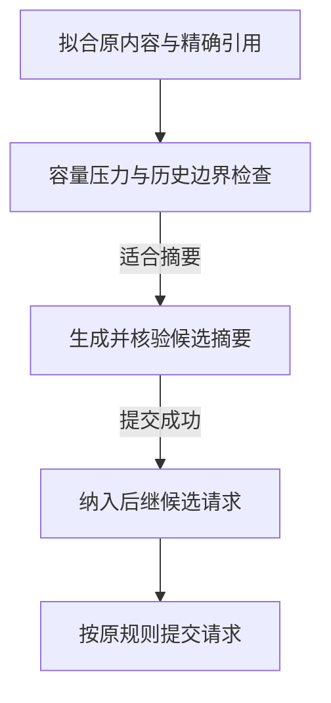
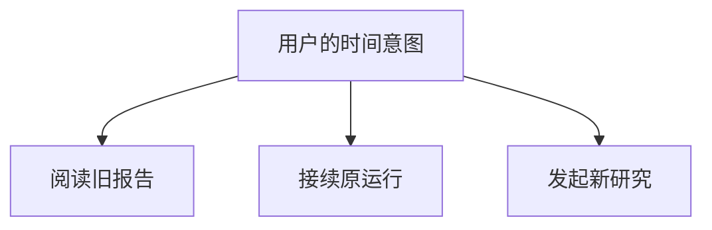
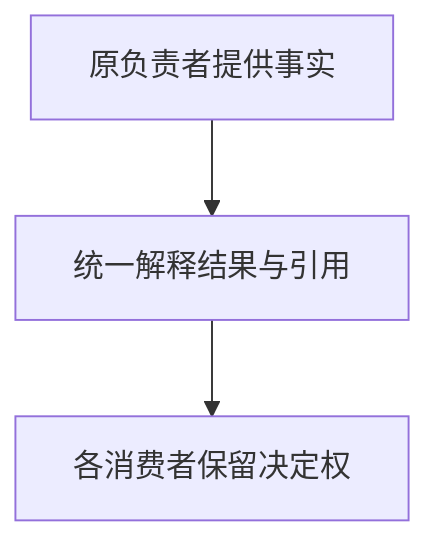

---
readingBrief:
  takeaways:
    - "证据跨读取、计算、子代理与摘要流转时，要保留原对象、时点、版本、覆盖和授权；来源可追溯不等于方法适用或结论正确。"
    - "主代理必须真正消费子代理成果并回应原问题；披露覆盖、资产覆盖和计算分母不可混用，未知部分不能靠归一化消失。"
    - "正文提交、文件保存与认证下载分别确认；历史阅读、同运行恢复和新研究也应分开，不能用新数据静默改写旧报告。"
  appliesTo:
    - "设计跨工具、计算、多代理和长期恢复的金融研究链，检查资料身份与使用边界能否持续保留。"
  notFor:
    - "把可追溯性当投资建议正确性保证；本文取材时的现金、费用与穿透数值治理仍有待实施部分。"
---
# 金融 Agent 的可信证据链：从原始数据到最终结论，如何守住事实的来路？

> 本文依据 ETF Agent 截至 2026 年 10 月 20 日的工程状态。

**金融 Agent 的证据链，不是给结论附上越来越多的链接，而是保证资料经过读取、计算、转述和交付之后，仍然能够回到它原来的对象、时点、口径与使用限制。**

用户问“我买的这只基金最近怎么样”，研究可能从产品官网走向 PDF 表格，经过子代理与 Python 计算，再由主代理写成 HTML 报告。每个环节都可能无意改变事实的含义：另一类基金份额的费率、旧披露的持仓、被省略的脚注，都可能让一份数据真实的报告得出错误解释。

我们曾讨论[为什么引用真实也不等于结论可靠](ai-citations-do-not-prove-reliability.md)。这里进一步回答一个系统问题：**同一份资料跨过多个工具、多个模型回合甚至几周之后，怎样仍能准确说明“我当时究竟依据了什么”？**

如果你主要关心架构取舍，可重点阅读资料如何被消费、计算、跨运行恢复及文末的采用条件；需要实现细节时再看中间的身份、投影、来源与交接机制。全文保留必要原始技术脉络，但**能追溯不是语义正确的自动证明**。

## 先交代技术来路：我们不是从零发明 Data Lineage

数据来路（Data Provenance）与数据血缘（Data Lineage）早就是计算机科学和数据工程的问题。W3C 于 2013 年发布的 [PROV-O 推荐标准](https://www.w3.org/TR/prov-o/)提供了描述对象、活动、参与者和派生关系的通用词汇。后来，[OpenLineage](https://openlineage.io/docs/spec/naming/) 和 [Marquez](https://marquezproject.ai/docs/quickstart/)面向数据作业和运行事件记录血缘，[Google ML Metadata](https://github.com/google/ml-metadata/blob/master/docs/index.md)管理机器学习流水线的产物与执行关系，[DataHub](https://docs.datahub.com/docs/features/feature-guides/lineage)甚至支持字段级依赖追踪。我们不是这些概念的发明者。

本文讨论的工程问题更窄，也更具体：在一次自主金融研究中，已有资料不只经过确定性的 ETL 作业，还可能由模型选择片段、交给子代理计算、退出上下文、在恢复后重新读取，再被写进答案和报告文件。这里需要让**来源关系、实际使用范围、原授权、方法前提与交付结果**在各自的职责内继续成立。它们涉及成熟的血缘、权限与分布式执行问题，但不能只靠一条派生边自动解决。

因此，本文介绍的是**将已有工程思想组合并适配到 Agent Runtime 的实践**，不是宣称实现了 PROV-O、OpenLineage 或某种新的通用血缘标准。最重要的区分也贯穿全文：能够追溯一个数值从哪里来，不等于那个数值适用，更不等于据此作出的金融结论正确。

## 一、金融研究为什么更难

### 一个数字，要放回对象和时间里理解

“这只基金最近表现怎样”，首先涉及对“这只”和“最近”的解释。

同一产品可能有不同份额类别，基金净值与交易所价格也有不同含义。比较指数、ETF 和联接基金时，价格、净值、分红和费用的处理方式可能不同。即使每个数值都来自可靠来源，把它们直接排成一列，也未必形成可比较的数据。

时间同样有多层。资料今天取得，不代表它描述今天；报告今天发布，持仓可能对应更早的期末；用户在本地看到的日期，与海外市场一个交易日的结束也不总是一回事。对 QDII 等跨市场产品，还要面对净值披露与相关市场交易之间的时间差。

因此，来源时间、数据时点和研究截止时间都要有位置。我们不能用“刚刚搜索到”表达数据新鲜，也不能因为两个字段都叫“收益率”，就省掉期间、币种和分红口径。

这些差别会影响后续计算。将不同日期的持仓当成同期快照，得到的重叠可能只是两个历史截面的拼接；把已经反映某些费用的净值再次扣费，会使模拟结果产生另一种含义。程序可以顺利完成运算，错误却已经发生在运算之前。

### 来源的权威有自己的范围

金融研究还会同时使用性质不同的事实。

基金管理人的文件可以说明产品在相应时点披露的投资目标和费用条款。市场数据可以提供某个对象、某个字段的一组观察。用户的账户资料说明其持有情况。Python 的输出则是给定输入和方法下产生的派生结果。

它们可以共同参与一个判断，却不能互相替代。公开网页上的金额，即使碰巧与账户金额相同，也不能证明用户持仓；费用条款可以支持估算，无法证明账户已经实际扣费；计算出的相关性也不能直接说明未来风险已经降低。

这让来源治理必须回答一个更具体的问题：**这份资料有资格说明什么？**

“官方”是有用的来源属性，但不是适用于所有主张的通行证。我们需要把原值、来源、适用对象和时间保留在一起，让研究者能够检查它们之间的关系。

### 不完整的信息也有价值，但不能失去“不完整”

很多金融资料天然只有局部覆盖。前十大持仓不等于全部持仓，已识别公司不等于所有底层资产，有净值的产品也不等于已经掌握全部风险因子。

研究仍然可以向前走。已披露部分可以帮助发现明显重复，明确的费用条款可以排除不适用的比较，无法确认的尾部可以成为后续跟踪条件。真正需要避免的是：局部信息经过整理后，看起来像完整事实。

这种变化很容易发生在写作中。原材料说“在已披露的部分中”，摘要变成“持仓中”，最终结论又变成“组合整体”。句子更流畅了，结论的范围却在每次转述中扩大。

金融研究的挑战就在这些交汇处：数据有时间，方法有前提，来源有范围，结论有条件，材料还可能涉及私人信息。它们都需要在 Agent 自主探索时继续成立。

用户最终关心的通常也超过资料整理。他希望知道增加这只产品解决了什么问题，有没有更简单的替代方案，什么情况下应该暂缓，未来出现什么变化需要重新研究。这要求 Agent 沿证据推进判断，同时保留判断仍依赖的条件。

## 二、把一项基金研究展开来看

### 从用户的问题形成研究依赖

一次持有基金的跟踪研究，还可能延伸到组合比较。下面用一个不涉及真实持仓的教学场景展开研究依赖；尚未落地的设计会就地标注。

假设用户已经持有几只宽基和科技主题基金，正在考虑新增一只 ETF，希望比较分散效果、费用与主要风险，并保留一份以后还能复核的报告。

主代理首先要理解“分散”在这个问题中的含义。用户可能想降低单一市场集中，也可能想减少少数公司的重复暴露，还可能只是希望持有过程更简单。这些目标不会自然得到同一个答案。

即使暂时不讨论具体买入金额，也可以形成三组相互关联的问题：新产品新增了什么暴露，为这些暴露付出什么成本和风险，哪些变化可能使原判断失效。

接下来才是资料与任务的安排。当前组合从获准的个人资料入口读取，产品信息从公开披露中核对，指数方法和持仓报告按需要继续查找。计算等待必要输入明确，公开资料核查则可以独立推进。

这种研究关系决定了工具的使用。现有结构化资料已经包含官方文件入口时，可以直接沿入口阅读；费用条款缺失时，再去寻找适用文件；关键日期不能对齐时，先说明比较限制。Agent 的自主性体现在这些选择中。

### 资料会经过一条很长的路

最能说明问题的一条路线，是从网页开始，最后回到历史报告。

搜索发现产品资料，产品页提供官方 PDF，PDF 中的持仓表和费用脚注成为研究输入。表格被保存为带版本的结果，主代理选择必要内容，将局部计算委派给 Python 子代理。子代理交回派生结果与限制，主代理继续综合。研究变长之后，较早的正文退出当前上下文，但原结果仍可定位；最终答案经过发布准备，再形成可以认证下载的文件。之后重新打开时，用户应能取得同一个历史版本。

**图一：从“这只基金最近怎么样”到可以重读的报告。** 先明确基金、份额与期间，再沿公开资料、获准个人信息和必要计算形成判断；需要文件时，继续走完 HTML 编排与交付。

这张概览只表达四个阶段，细节分开读：

1. **明确问题。** 从用户的问题出发，由主代理确认基金、份额、期间与研究目标。
2. **取得资料。** 公开研究沿产品网页进入官方 PDF，实际读取表格、正文和脚注，保留内容、单位、时点与限制；获准的持有基金和组合资料从各自入口进入。两路资料都形成带版本的结果与原始依赖。
3. **研究与综合。** 原结果既可按需直接供主代理综合，也可先选取输入，交 Python 子代理局部计算，再带着方法与缺口交回派生结果。主代理综合发现与适用条件；整理当前上下文时保留原身份，再继续研究，而不是另起无来源的结论。
4. **两路交付。** 正文经过发布准备和版本化提交，形成已提交正文，供历史阅读。需要报告时，结论、数据表、图表和引用另编排成 HTML；计算产物可供编排，但不强制经过 Python。文件复用发布准备并保留来源与内容身份，保存最终字节和版本后，经过认证下载、打开，之后按原版本重读。正文历史与文件重读最终都回到相应的原版本。

下文分别展开资料读取（图二）、子代理交接（图三）和两路交付（图五），不要求读者在一张长图里追完所有连线。

图中的公开研究可以由主代理直接执行，也可以委派。上下文投影表示研究继续时的材料整理，不要求每次都生成摘要。HTML 可以由模型直接编排，也可以使用获准 Python 的计算或批量处理成果；文件按交付需要产生，正文可以独立存在。保存、下载、打开和重读分别需要相应事实，图中的依赖不表示前一步已经证明后一步成功。

更值得关注的是，每条连线都在改变信息的使用方式。网页地址变成了实际内容，内容变成选定输入，输入变成计算结果，局部结果变成综合判断，判断又成为可保存、可重读的交付物。

### 同一个问题，让不同工序发生关系

如果只按工具组织答案，最终很容易得到三份彼此独立的材料：一段产品介绍，一张计算表，一份风险清单。

它们都可能正确，用户却仍然不知道该如何理解新增产品的作用。产品介绍中的某个行业暴露，是否就是重叠表里已经偏高的部分？费用差异是否足以改变选择？风险清单中的汇率因素，与用户原组合相比究竟增加了什么？

主代理需要保留原研究问题，把这些局部结果重新放到同一个比较中。计算给出已知范围内的差异，文件条款解释差异的适用条件，风险分析说明还有什么未被覆盖。

这也是为什么我们需要一条贯穿研究的证据链。它不仅服务于最终答案后的几个引用标号，还让下一道工序能够继续使用前面的成果。局部研究可以独立进行，整个问题的身份却需要延续。

当原问题发生变化时，研究也应承认这一点。用户从“了解重复暴露”转向“安排新增资金”，意味着需要新的约束与方法，不能仅仅给原表加一列建议金额。没有执行授权的研究，也不能在交付报告时顺便变成实际交易。

## 三、资料怎样成为可以继续使用的研究事实

### 搜索提供线索，也可能提供有限依据

搜索结果提供两类不同材料：链接是继续研究的线索，摘要是已实际取得、可在其范围内引用的文字。模型可以用明确标注的获准摘要回答简单问题，但核对费率生效日、份额条款或持仓口径时，应沿原链接读取来源正文。

产品页清理时，附件入口可能落在导航或侧栏之外。读取器因此分别保留正文与候选链接；后一项并不意味着附件已经读过。Web 深度阅读文章解释了这一过程，本文只保留它与证据链的关系：[Web：从搜索到连续阅读](021-agent-web-research-from-search-to-deep-reading.md)。

### 阅读范围决定了可以说多大的话

来到 PDF 后，找到文件与取得依据之间还隔着定位和阅读。

费用可能出现在正文，适用条件可能藏在脚注；持仓表给出数字，表头和附注说明这些数字代表什么。只把数字抽出来，往往已经损失了研究所需的一部分信息。

我们的早期阅读经历中，有过前一窗口没有覆盖关键后页、继续查找才取得目标正文与尾注的情况。这促使我们把查询命中、扫描范围和实际读取分别表达。没有命中时，系统需要说明查了哪里；模型也需要把“当前没找到”与“整份文件不存在”区分开。

这种区分同样适用于表格。PDF 里的文字位置不天然等于表格语义。[pypdf 的文本提取说明](https://pypdf.readthedocs.io/en/stable/user/extract-text.html)讨论了 PDF 缺少明确语义层、排版与表格还原之间的困难。我们的阅读路径因此按任务需要组合文本、结构化表格和页面图像，保留各自实际交付的范围。

图像提供了另一种看材料的方式，但接收到图像与解释正确仍然需要分别核查。某些扫描页可以被识别，某些图表的颜色、形状或限定仍可能被误读。增加视觉能力扩大了可研究的材料范围，也增加了需要独立判断的环节。

**图二：从发现资料到有限结论，研究如何决定下一步。** 摘要与原文各自保留实际取得的内容；关键条件是否齐备，由模型结合问题判断。

**读取与停止的判断分别是：**

- 链接只是下一份资料的导航线索；实际取得的摘要有自己的身份。摘要足以回答当前问题时，可以明确在该范围内表述；缺关键条件时，沿链接进入获准的原文读取器。
- 读取器按任务选择正文与脚注、表格与单位、页面图像，不要求三种形式全部执行。每次实际交付都记录内容、单位、日期、页码和限制。
- 模型再次判断关键条件：足以支持相应表述，就形成有限结论；仍可补查，就沿定位或游标回到原读取器；暂时无法补齐，就说明缺口并缩小结论。补查路径和停止条件不能互相替代。

三种证据表示可以单独使用，也可以互补；图中没有要求每份资料全部走一遍。取得更多内容，也仍需单独判断它是否支持结论。

这些机制在[《从能读取到能研究：我们如何把 PDF 阅读升级为可追溯的多模态能力》](https://github.com/hpoenixf/eff-agent-article/blob/main/articles/024-agent-pdf-from-text-to-evidence.md)中已经展开。沿整条研究链，后续结论都应当对应实际取得的那部分材料。

### 资料的身份要跟着实际内容走

当某段文字被切片、整理或用于后续引用时，文件地址仍然相同，实际内容却可能已经变了。我们因此需要区分原文版本、选取范围和当前表示。

换成 [W3C PROV-O](https://www.w3.org/TR/prov-o/) 的概念，一份基金年报可以是 Entity（实体），阅读和抽取是 Activity（活动），抽出的持仓快照是新的 Entity，Python 计算又可以产生一个派生 Entity；`prov:used`、`prov:wasGeneratedBy` 和 `prov:wasDerivedFrom` 描述这些使用与生成关系。这说明我们使用的“结果身份”“派生谱系”都有成熟的理论近邻。这里借用的是解释模型，并非声称系统采用了 RDF/OWL 表示或实现了 PROV-O 兼容接口。

但记录“重叠表由两份持仓生成”，并不能证明输入属于同一报告时点，不能证明前十大披露覆盖了全部持仓，也不会自动授予后来某个 Run 读取原账户数据的权限。这些还需要分别由金融方法、实际覆盖和运行授权来回答。

例如，引用第几页，应当对应实际返回内容中的页面关系。解析器内部知道某段来自哪页，不代表经过切片或脱敏后，模型看到的坐标仍然正确。同样，一个网址以后更新了内容，不能让旧研究在没有说明的情况下指向新版本。

结果定位、答案引用和文件下载还各有用途。结果定位用于再次读取或选择计算输入；正式引用帮助用户检查来源；文件身份指向已经保存的交付字节。它们可以建立联系，但知道其中一个，并不会自动获得另外两种能力。

授权也要由真实执行环境提供。当前机制中，一次研究运行获得的授权在同一 Run 及其恢复中保留，后续消费者沿原记录使用；新的研究运行需要自己的准入。内容删除、不可用或身份不一致仍按相应事实处理，不能因为曾经取得过引用就补造缺失内容。

到这里，材料已经带着对象、时点、版本、阅读范围和使用边界进入研究。它仍然需要被解释，但下一位执行者至少可以回答：我现在拿到的是什么，它从哪里来。

## 四、把资料保留在外，按研究需要读取

### 一张持仓表，不必每轮都重新摊开

深度研究可能积累多份报告、持仓表和计算结果。如果每轮都把原文重新塞入模型，上下文会被重复材料和局部调试占满。我们把**结果的持久身份**与**当前模型看到的投影**分开：原结果留在受控存储，消费者按问题读取选定字段、片段或获准计算输入。

例如，当前比较只需要基金身份、披露日期、覆盖范围与权重列；费用原文无需反复携带，较长价格序列也不必经模型逐值转抄。模型实际拿到什么、取得范围是否完整，仍须沿原结果与当前 Run 的授权核对；引用不是新的读取权限。

外置与精确回读的完整设计见[工具结果外置与完整性](tool-results-outside-model-context.md)。本文关心的是：这种访问方式是否让后续子任务、计算和引用保持相同来源身份，而不是比较不同框架的上下文管理实现。

### 重新打开，必须还是原来的那一份

外置之后，引用变得重要。模型可以说“继续读取这份结果”，但系统必须确认它指向原来的内容与选取条件。

如果费用文件后来更新，重新抓取到的新文件可以成为新的研究材料，不能静默顶替原研究使用的版本。如果一次刷新失败，也应保留失败和旧版本的身份，不能把旧数据换个取得时间后当成新数据。

这与普通缓存有相似之处，但研究还需要保存派生关系。后面那张重叠表，使用的是哪两个输入，选择了哪些记录，缺少哪些映射？这些信息决定了计算结果还能怎样继续使用。

同样，本轮明确请求的读取应当确实进入模型输入。系统不能一边把工具标成成功，一边在后续容量整理中只留下一个地址，让模型误以为正文已经可见。较早的结果可以退出当前工作集，新读取的交付事实则需要准确表达。

### 改变表示，不能重新发明来源

我们曾在这一交接处发现一个很有代表性的问题：生产结果与核验结果的环节使用了不同的容量规则，同一份合法数据因此在后面被误判。数据和授权没有发生变化，变化的是消费者如何重建它的表示。

这使我们更倾向于让消费者复用原结果的解释，而不是在每个入口独立判断“这个结果应该长什么样”。否则，大结果、选定视图和引用占位会各自长出细微差异。

机械拟合可以把较早正文收缩为原身份与精确回读位置。这里没有生成一份新的语义摘要，只是改变了材料是否常驻本轮上下文。稍后还会看到，真正的摘要压缩有另外一组责任。

对主代理来说，结果存储像一个有版本的资料柜。当前桌面不必摆满全部材料，但抽屉标签要能带它回到原件。这个比喻只解释访问方式，实际访问依然服从原研究范围和内容身份。

资料由此可以离开当前上下文，也可以进入另一位执行者的局部工作。接下来，最关键的交接发生在主代理与子代理之间。

## 五、多代理之间，究竟传递什么

### 什么时候值得委派

在基金组合比较里，Main 保留用户目标、份额与时间口径；Child 只在局部探索足够复杂时承担明确问题。例如：“核对新产品持续费用与一次性费用，保留份额、渠道、适用日期和原文条件”，比“研究一下这只基金”更有助于最终综合。

Web、PDF、Python 的区分首先是**研究方法重点**，不是按文件格式切分的强制流水线。已经获准阅读 PDF 的 Web Child，可以在原授权内继续核对表格或脚注；只需一次简单读取时，由 Main 直接完成通常更合适。多一个 Child 会增加等待、上下文和结果交接的成本，不能仅凭专家数量宣称研究更好。

### 把实际取得的材料交给下一位，而不是转述一句“已完成”

Main 知道“有持仓表”，不等于 Child 真正拿到了那张表；PDF 文字、表格和脚注来自不同读取范围，也不能被文件名合并成“整份都读过”。原结果身份、选定内容、来源权限、单位、披露日期和覆盖限制，需要随着委派进入实际可读的结果入口。

**图三：从原结果中选择输入，经 Child 计算后再由 Main 核对。** 图中只表达交接，不保证计算成功。

这条交接有三个关键检查：

1. **原始输入**：Main 按获准结果选取材料，Child 沿原研究身份精确读取，不能从自己的摘要推造缺失的字段，也不能猜测其他 Child 的文件路径。
2. **局部执行**：Python Child 先核对样本、对象映射和方法条件，再执行计算；失败就交回失败与缺口。隔离沙箱限制执行环境，并不会消除私人资料的授权依赖。更完整的计算与工作区机制见[Python 计算工作台](agent-python-compute-workbench-evolution.md)。
3. **最终消费**：Child 交回结果、原始依据、口径与限制，Main 实际读取并用于原问题。若费用条款与底层持仓说明了不同风险，回答要解释它们如何影响选择，而不是只在末尾附两份专家报告。来源冲突时，回到原对象、日期和覆盖复核。

这就是这里保留多代理的理由：**隔离局部过程，但不隔断证据的来路，也不转移 Main 的综合责任。** Subagent 的执行、恢复与专业化细节另见[《Subagent：从上下文隔离到专业化协作》](https://github.com/hpoenixf/eff-agent-article/blob/main/articles/agent-subagent-context-specialization.md)。

## 六、计算正确，还需要金融方法成立

### 先说明重叠的分母

现在，Python 已经得到选定输入并完成计算。回到最初的问题，“共同持仓”应该怎样解释？

假设在一个教学例子里，基金 A 已披露的前十大持仓合计占基金资产的 60%。在这些已披露持仓中，有 20% 的权重落在也出现在基金 B 的公司上。这里的 20% 以 A 的已披露部分为分母，换算后，对应 A 全部资产的 12%。

这只能说明已知部分中的一项事实：A 有至少这部分已识别资产落在双方共同出现的公司上。它没有给出 B 的对应金额，没有覆盖 A 未披露的 40%，也没有自动构成对称的基金权重重叠指标。

如果要计算一种常见的权重交集，例如对共同资产逐项取双方权重的较小值再求和，还需要双方可比较的权重、完整程度和对象映射。只知道公司名称相同，无法直接得到这个数值。

这样的差别不会因为用了 Python 就自行消失。脚本执行的是我们指定的方法，而方法本身需要先回答：比较哪一层资产，用哪个总体作分母，缺失部分如何表达，两个日期是否具有可比性。

**图四：把教学例子的分母放回全基金资产。** 已披露部分占 60%，其中 20% 对应全基金资产的 12%；其余已披露资产占 48%，未披露部分仍占 40%。

| 教学示例中的资产范围 | 占基金 A 资产的比例 |
| --- | ---: |
| 已披露且识别到共同公司的部分 | 12% |
| 已披露部分中的其余资产 | 48% |
| 未披露部分 | 40% |

查看同一组示例数字的完整饼图

图中的 48% 不能被标成“已确认不重叠”，40% 也没有因为已知部分可以计算就消失。这张图描述 A 的资产范围，没有给出双方完整的权重交集。

### 披露覆盖与金额覆盖需要分别保留

假设组合中有十只基金，成功取得九只的资料，不能直接说覆盖了九成资产。未取得的那只可能占组合很大比重。反过来，只读到少数几只主要产品，也可能已经覆盖较大金额，但它们内部的底层披露仍然不完整。

因此，持仓清单覆盖、估值覆盖、底层披露覆盖、身份映射覆盖和时间覆盖是不同问题。将它们压成一个“完整度”会使后续解释失去依据。

穿透还可能跨过多层。用户持有基金，基金持有另一产品，后者再持有公司。逐层乘权重可以表达已知的资本关系，但合计时必须选定层级，避免把父资产与子资产重复计算。相同底层公司可以合并分析，真实资本也不能因跨账户或份额去重而被丢掉。

缺失部分应当继续存在。把已知样本重新归一化为 100%，可以用于一个明确标注的样本分析，不能据此宣称整个组合已被完整穿透。研究可以在这个范围内提出发现，同时把剩余部分保留为未知。

### 费用包含三种不同的事实

费用计算也有类似结构。

一种是明确的假设，比如用一个设定费率观察敏感性；一种是根据适用产品条款估算；还有一种是实际执行回执报告的扣费。它们都可以有数值，事实含义却不同。

条款估算需要确认份额、渠道、有效期、计费基数和持有期，必要时还包括分档、舍入与扣费时点。缺少决定性条件时，可以保留假设场景，但不应把它改称实际费用。

年费拖累模拟与一次申赎费用也应区分。净值可能已经反映某些费用，继续扣除前需要核对口径。如果费用参与资金方案，同一份费用明细还需要在相应现金关系中正确计入，不能由不同消费者各算一次。

这些都属于金融方法。一个安全执行的脚本可以忠实运行错误方法，一份来源完整的表也可能被用错分母。数据来路、执行事实和方法适用性需要相互连接，仍保留各自的判断责任。

### 一个可以比较的金融实现

FinRobot V2 提供了一个具体参照。在其固定版本的[权益研究现金流折现（DCF）步骤](https://github.com/AI4Finance-Foundation/FinRobot/blob/2717499b8e30f242640af08c4ad9afd1113c2d45/finrobot_desktop/finrobot/engine/pipelines/equity_research.py#L520)中，输入由程序构造，随后调用确定性的估值与敏感性计算，再供后续研究论点和报告步骤组织叙述。这里能从源码核对的是计算与叙述的分工，不能单凭这种分工认定估值假设或最终投资判断正确。

对我们而言，可借鉴的判断是让金融方法有明确的输入与维护责任，再由模型解释结果。股票 DCF 与基金持仓、费用分析处理的是不同对象；这份代码也不能替 ETF Agent 尚未完成的数值治理提供验收。

### 我们已经确定的下一步，以及还没有完成的部分

在这条链继续深化时，我们形成了金融数值与指标的共同设计：数值基础处理带单位的值、显式转换、精度与残差；Portfolio、费用、穿透等领域分别维护适用方法；来源适配保留原值和时点；结果管理保存身份与依赖。

这一设计还区分计算精度、结算精度与展示精度。金额可以需要精确十进制，统计方法可以在明确容差下使用浮点；不同币种不能直接相加，比例与百分点的转换也要来自已知定义，不能按数值大小猜测。

**截至本文取材时，现金、费用、穿透的 P0 修复及后续联邦式指标收敛仍属待实施工作。** 已经建立的结果传播机制，不能据此被写成“全部金融数字已经得到统一正确性保证”。这里介绍的是下一步要落实的职责与方法。

我们也没有为此设计一个能否决所有回答的金融总开关。必要输入不足时，受影响计算可以没有值，并说明原因；可选诊断没有执行或暂不可用时，也不应让独立有效的研究内容消失。诊断帮助指出问题，原领域负责修正真实算法，正文交付继续由既有发布边界处理。

对模型而言，任务还没有结束。它需要忠实使用计算结果，保留方法条件，再讨论其对用户问题的意义。我们在[《金融 AI 最危险的“专业感”：数据是真的，数字却算错了》](https://github.com/hpoenixf/eff-agent-article/blob/main/articles/031-fintech-data-time-and-reproducible-numbers.md)中已经讨论过来源、计算与最终解释的差别。本文更关心这些差别怎样一起进入后面的综合判断。

## 七、把依据和条件一起带进最终答案

### 引用指向材料，解释建立关系

到这里，主代理手里已经有公开条款、已知组合、派生计算与若干限制。写作时，它需要重新回答那个最初的问题：新增产品究竟改变了什么？

一种有用的表达，可以先说明观察到的重复暴露，再解释其范围，随后讨论与用户目标的关系。例如，在已披露持仓中发现共同公司，说明这部分新增资金未必带来公司层面的新增暴露；行业、市场与货币风险仍需另行分析。若用户追求的是降低特定行业集中，选择可能需要回到整个组合，而不能仅比较两只基金的名称。

这一段推理中，引用帮助读者回到披露和计算，但“是否改善了分散”仍需要把目标、方法与资料联系起来。每个句子后都有标号，也无法代替这项工作。

这个区别在[《为什么 AI 明明有很多引用，回答还是不够可靠？》](https://github.com/hpoenixf/eff-agent-article/blob/main/articles/ai-citations-do-not-prove-reliability.md)中有独立讨论。它在交付时体现为清楚的职责：引用绑定保留来源归属，主代理继续承担解释责任。

### 正文进入发布之后，有了可保存的版本

模型写出一段文字，系统还要处理它是否已经成为可展示、可持久化的回答。

我们把这部分放在 Publication，也就是回答发布组件中。普通模型正文与显式发布入口可以进入共同的后续处理；组件准备正文与引用，按需要提供预览，再记录版本化提交。

预览、提交和客户端展示各有自己的事实。服务端可以先给用户看到已有内容，保存仍需等持久化结果；一段内容后来被修订，要能知道修改的是哪一段、哪个版本，以及它在原回答中的位置。后续研究失败时，已经提交的独立内容也应保留原身份。

这对金融研究尤其有用。一份比较可能先交付已经确认的条款，随后补上计算，再修正某个条件。它们共同构成同一研究中的回答，而不必等所有局部工作结束才第一次出现。

准备、修订与恢复的完整机制，可以继续读[《Agent 已经生成答案，为什么还需要一个独立的发布系统？》](https://github.com/hpoenixf/eff-agent-article/blob/main/articles/019-agent-answer-publication.md)。

### 局部问题，应当有准确的局部表达

假设费用说明本身有独立获准的依据，但模型写坏了其中一条引用标记。相应链接可以省略，来源限制可以明确显示，正文仍然有交付价值。

这种处理保留了两件真实的事：文字已经生成，引用绑定尚未成立。系统不需要为了修好辅助标记，强迫整项研究再多转一轮，也不能把未绑定引用偷偷猜成另一份来源。

如果正文确实依赖未获准私人材料，或者关键内容身份无法成立，受保护效果仍然要由原负责者限制。删除依赖、把私人资料改标为公开，都不会使权限问题消失。局部降级保护的是独立合法的成果，并不制造新的来源权利。

类似地，某个计算结果不可用时，可以交代该项缺口；文件导出失败时，可以保留已有正文并说明附件未交付。系统需要准确表达发生了什么，让用户看见可用部分，也看见无法完成的部分。

### 报告文件要走到用户真正能取得的字节

如果用户希望保留一份 HTML 报告，模型可以直接编排静态内容，也可以在确有计算或批量处理需要时使用获准 Python。我们没有把所有报告都绑定到一次 Python 调用上。

两种输入最终复用共享的发布准备与 Artifact，也就是持久文件产物路径。前者处理正文和引用，后者检查并保存最终内容，记录文件身份，再由认证下载接口提供相应字节。

工作区里出现一个文件，只能说明该处存在临时产物；保存完成后才有持久文件；下载还要核对当前请求者对该文件的访问权以及内容身份。用户知道一个 URL，只是知道定位，不等于获得读取权限。

历史文件也有自己的时间含义。它可以保留当时生成的内容，下载时不应拿今天组合的新鲜度重新要求它成为一份“当前报告”。若需要分享，授权针对明确接收者与固定文件版本，也不能因此扩大到原账户或全部来源。

在[《HTML 都保存了，为什么还是交付失败？一次 Agent 报告系统的架构反转》](https://github.com/hpoenixf/eff-agent-article/blob/main/articles/agent-html-evolution-challenges.md)中，我们已经详细讨论了这条交付链。这里的落点是：一份金融报告交出去时，用户应当拿到同一份、确实保存并获准读取的文件。文件可打开，仍需与分析内容是否正确分别判断。

保存正文与保存 HTML 文件如果落在不同持久化资源，并且业务要求两者必须共同成功，就会遇到传统的 **Dual-write（跨资源双写一致性）**问题。[Transactional Outbox](https://microservices.io/patterns/data/transactional-outbox.html)主要处理数据库状态与消息发布难以原子完成的场景；[Saga](https://learn.microsoft.com/en-us/azure/architecture/patterns/saga)用于组织多个本地事务以及必要的补偿或恢复。它们提供了理解失败与恢复的参照，但本文没有证据表明当前交付路径实现了 Outbox 或 Saga，也不把“附件必须成功”强加给所有回答。

我们在这里采用的交付语义，是分别确认正文版本与文件字节是否持久化：正文已提交但文件失败，就报告部分成功；提交回执不明，就保留未确认状态并核对原身份。**下载是后续的读取与授权检查，不是 Dual-write 的第二笔写事务。** 即使文件已保存，也不能跳过下载时对请求者和固定字节版本的核验。

**图五：正文与文件分别留下交付事实。** 两条路径复用发布准备能力，但保存正文、保存文件和下载文件并非同一个事务或同一种成功。

**正文与文件的交付要分别结算。** 正文可先预览，但只有版本化提交形成持久回执；无效的可选引用可局部降级，受保护来源不能借降级越权。HTML 文件则须保存最终字节并记录固定版本，下载时再检查请求者与文件身份；文件已保存、知道下载 URL 和真正获准读到它，是不同事实。文件路径失败不能撤回独立已提交的正文，两个结果都保留各自的成功、未知或失败。

图中两条路径不是一个原子事务，也不表示文件能打开就证明金融分析正确；具体计算、来源与授权继续由原负责者判断。

## 八、研究跨越时间之后，哪些东西应该保持

### 先分清两种上下文变化

**机械拟合**把不必常驻的较早结果换成原身份和可精确回读的位置，不生成新的解释；**语义摘要**则请模型浓缩已结算的工作，生成有版本的派生文本。后者可能遗漏日期、口径、用户修正或反证，因此不能当原件或执行回执。

ETF Agent 的下一轮仍须能回读精确依据，并保留原用户输入与使用资格。有关触发容量、摘要提交与恢复的完整机制见[Main 上下文压缩](agent-main-run-context-compaction.md)；本文重点讨论这些变化是否保留金融资料的对象、时点和依赖。

### 摘要要有用，也要承认自己是什么

在我们的设计中，摘要用于继续工作，原始结果仍由原读取路径管理。需要精确数字或原文时，应沿原结果回读；原文已经不可用，就保持相应缺失，不能从摘要重构一份假想原件。

这要求来源关系能够穿过上下文变化。材料从全文变成精确引用后，消费者不应把“当前未驻留正文”理解为“从未有来源”；摘要引用了私人材料，也不能因为它是一段新文字就洗去原依赖。

同时，摘要触发、生成完成、被采纳提交和实际进入后继请求是不同事件。只有尝试过压缩，无法说明后续模型已经使用它；保存了摘要，也不能证明其中所有语义都保留正确。

Main 上下文压缩已有压力触发、数值、PDF 引用和冷恢复的受控证据；长周期研究中的多次压缩仍需跟踪语义、引用及金融数字的一致性。

**图六：先整理原结果驻留，再按条件生成派生摘要。** 摘要生成、采纳提交与后继实际送模是三个不同步骤。

这条路径的选择顺序是：**先拟合可精确回读的原结果**；只有实际容量仍有压力且存在合格历史时，才考虑有损摘要。生成、身份核验或提交失败，仍保留原材料并交由原容量处理；候选被采纳后，还要确认它确实进入后继模型请求。摘要和旧引用不能把过期数字变成当前事实。

这里的图是有条件的机制示意，不表示每个 Run 都压缩、回退后一定能成功派发，或者摘要语义已经得到认证。

### 历史阅读、同 Run 恢复与新研究

用户几天后重新打开报告，首先是在阅读一份历史成果。系统应该保留当时的正文版本、来源与文件身份，不能在打开时静默用新行情更新其中几项数字，却沿用原结论。

FinRobot 的[研究指令](https://github.com/AI4Finance-Foundation/FinRobot/blob/2717499b8e30f242640af08c4ad9afd1113c2d45/finrobot_desktop/finrobot/engine/instructions.md#L42)把这个区别写成了明确口径：历史报告中的目标价空间，以报告运行时记录的价格为分母；当前观察列表则使用实时价格。用户寻找已有报告时，应先查找原成果，避免仅为展示旧报告而重跑研究。这里比较的是其指令规定的行为，未据此认证实际运行表现。

这种区分也解释了为什么报告身份值得保留：历史结论可以按当时价格重新理解，当前价格变化则产生另一项观察。新的行情不能悄悄改写旧报告的计算起点。

如果用户要求“按现在的资料再比较一次”，就产生新的研究需求。旧报告可以作为有身份的参考，新 Run 仍要独立准入，并取得适用于当前问题的数据。历史曾经成立的计算前提，不会因被重新打开而自动更新。

同 Run 的 Recovery 则解决另一件事：一项尚可接续的工作中断后，沿原授权、执行回执和检查点恢复。它需要确认已经发生的效果，而非重新问模型“刚才做到哪里”。已提交正文可以读回，尚未提交的候选不能仅凭预览冒充保存，未知执行也不能被盲目重做。

我们已有真实模型驱动的受控来源、Child 计算、发布及 Memory 同 Run 回放证据，也有脚本化模型网关配合真实 CPython 和 PostgreSQL 新连接读回的组合证据。这些验证分别覆盖来源、计算、发布、回放和持久化，而非同一条端到端运行记录。

从研究者视角看，时间延续有三个不同动作：看当时的报告，接续同一次工作，按新事实重新研究。把它们区分开，证据链才能既保留历史，又允许判断更新。

**图七：时间延续中的三个入口。** 用户打开历史、恢复原工作与要求重新研究，分别消费不同的事实。

- **阅读旧报告：** 历史与交付入口核对原提交、版本和相应读取权限，返回当时的正文、文件及原有限制；不静默替换成今天的数据或结论。
- **接续原运行：** 通过原恢复入口恢复授权、回执和检查点。已提交效果沿原身份读回；安全下一步在原边界内继续；未知效果交原负责者处置。返回的是保留原事实的恢复结果，不是模型重新猜一份执行历史。
- **发起新研究：** 按当前事实重新分析，需要新运行独立准入并取得当前适用数据，产出新的研究结果和报告版本。旧报告可以参考，但不自动授予新运行权限。

三条分支属于不同的用户意图，不是新增恢复状态机：历史不能静默换成今天的数据，接续不能重做已结算效果，新研究也不能继承旧 Run 的权限。

## 九、这条链怎样从工具接口里长出来

### 最初，元数据跟着一次工具结果返回

回头看这段演进，我们并没有一开始就设计出完整的研究资产体系。

2026 年 8 月建立 MCP 数据平面时，已经在工具结果中区分来源、取得时间、新鲜度、权威范围与覆盖，也把私人组合与外部市场能力分别组织。那时首先要解决的是：让应用通过真实的工具边界取得有含义的数据，不把提供商配置、原始载荷和投资账本直接暴露给模型或浏览器。

随着研究变长，一次标准工具结果开始承担更多角色。它先进入上下文，之后被选择、外置和重新读取；它可以成为 Python 输入，被子代理消费，支持一个发布块，再进入检查点和历史。原本跟着一次返回值走的元数据，需要跨越整个研究过程。

这时，“工具刚才成功了”已经无法回答后面的全部问题。子代理要知道自己拿到哪份输入，计算要知道选取是否完整，发布要绑定真实来源，恢复要区分原提交与新尝试。我们逐步需要一套能够被这些消费者共同使用的结果解释。

### 和成熟的血缘、元数据模型怎样对应

这套机制不应该被表述为重新发明结果身份或谱系。几种成熟方案已经提供了理解问题的坐标，但它们的对象粒度与职责并不相同。

| 已有技术 | 已经解决的典型问题 | 本文可以借鉴、但不能直接等同的部分 |
| --- | --- | --- |
| [W3C PROV-O](https://www.w3.org/TR/prov-o/) | 用 Entity、Activity、Agent 和派生关系描述事实如何产生 | 可解释原始回执、读取、计算和派生结果；不负责判定金融方法或访问授权 |
| [OpenLineage](https://openlineage.io/docs/spec/naming/) 与 [Marquez](https://marquezproject.ai/docs/quickstart/) | 用 Job、Run、Dataset 和扩展元数据记录、收集、展示数据流水线血缘，支持运行层级等信息 | 研究 Run、子代理、计算任务可以借鉴执行身份和依赖模型；不是声称其事件格式与本系统相同 |
| [Google ML Metadata](https://github.com/google/ml-metadata/blob/master/docs/index.md) | 以 Artifact、Execution、Context 关联机器学习产物、执行和工作流上下文 | 对照研究结果、执行、历史关联；不自动解决投研引用资格或账户撤权 |
| [DataHub](https://docs.datahub.com/docs/features/feature-guides/lineage) | 追踪数据集、字段和下游资产的依赖 | 提醒我们保存精确字段与变换关系；但 Agent 的“选取范围”还包括实际读到哪些内容、哪些条件未覆盖 |

PROV-O、OpenLineage 在这里仅作为设计参照；是否引入元数据系统，取决于跨系统互操作、查询与治理成本。

### 收拢共同解释，保留不同职责

到 10 月的结果治理中，我们先删除消费者重复的容量与身份决定，再进一步将结果身份、谱系、投影和引用资格的机械实现收拢到一个逻辑负责模块。

这里的“一个”很容易被误解。它没有把所有安全、计算和发布判断合到一起。来源生产者提供原始事实，工具执行者记录派发与结算，计算模块使用获准输入，Publication 负责正文处置，存储负责持久提交，文件读取负责对应访问。共同结果解释让这些边界使用相同来路，各自仍只处理自己的效果。

例如，Python 需要完整、可计算的输入，正文可能只引用其中一个片段；某种结果重用需要保留原版本，刷新则产生新结果；相同字节来自两个不同来源时，内容相等也不意味着权限相等。这些用途不能为了统一接口就被抹平。

我们更希望下一位消费者少知道一些内部细节。它需要的是原负责者给出的可消费结论，而非理解每个字段如何被拼出来，再重新作一次资格判断。这样，当表示规则变化时，修改尽量留在原解释处。

**图八：共同解释收拢之后，各种决定权仍然分开。** 中间层统一解释已有事实；计算、发布、文件与恢复仍各自保护真实效果。

进入共同解释的事实有三类：**来源读取**提供原值、内容版本和实际范围；**执行记录**提供派发、输出与结算回执；**运行准入**提供原授权和使用范围。结果与引用解释统一处理身份、派生关系、投影和引用资格，不替代这些生产者。

后续消费者各用原事实做自己的决定：上下文选择实际送模的内容；计算负责方法与执行效果；Publication 管理正文版本，文件负责保存与读取；Recovery 处理检查点和未知效果。**统一的是结果身份与引用解释，不是全局语义正确性或新的授权权力**。模型继续负责研究策略、解释和综合。

这些连线表示事实消费关系，不授予新的访问、投资执行或全局否决权。共同解释减少重复决定，各领域的独立保护仍然存在。

### 为什么没有做一个全局“可信管理器”

来源已验证但覆盖不全、计算成功但方法不适用、文件保存了却无权下载，这三种事实无法压成一个全局 `trusted=true`。若中央管理器据此裁定结论是否充分，还会越过模型的语义判断与各原 Owner 的执行权。

这里统一的是**结果身份和派生事实的解释**，不是授予新的全局信任等级。来源、金融方法、Publication、Artifact 和 Recovery 分别保留可核查的效果与拒绝范围；这样一处局部缺口无需抹掉其他独立合法的成果。

### 新增能力，也要能退出主线

能力越多，越要确认局部模块可以拒绝哪些效果。引用增强失败不能自动撤销已获准正文，历史查询超时也不能改写原 Publication；权限、数据身份、计算方法和实际文件下载各由原 Owner 决定。

这属于**决策权限分散与故障影响范围**问题，不等同于一般的单点故障。相关诊断与防止全局否决的机制见[Run 终结权与安全恢复](agent-veto-authority-and-run-termination.md)。本文的验证重点是：选定资料真正进入执行器，Child 成果真正被 Main 消费，正文能从新连接读回，文件可按原身份认证下载；这些路径与最终投研质量仍需分开评价。

## 十、让证据链真正帮助投资判断

在取材时点，结果身份、谱系、投影和引用解释的共同处理已经完成限定工程范围内的验证；真实 Child 计算、成果交接、报告保存与认证下载，也留下了各自有范围的执行证据。**这些事实说明研究材料可以被可靠地传递和重读，却不能单独证明模型的投资分析正确。**

对用户而言，更重要的是以后重新打开报告时，仍能回答三个具体问题：**当时比较的是哪只基金、哪一类份额和哪段时间？决定结论的数字采用了什么方法与限制？若出现新资料，哪些假设需要被重新检查？**

这也给架构师一条简单的设计准则：一项资料从工具流向摘要、计算、子代理、正文和历史时，**每个消费者只复用原来有资格的事实，不重新发明来源或扩大权限**。计算和引用的关系可以留证；最终是否回答用户原问题，则要用实际任务和独立判断核对。

我们借鉴 [W3C PROV](https://www.w3.org/TR/prov-o/) 等成熟血缘思路，但不把一个全局 `trusted=true` 当成金融正确性。真实的出处、适用方法、发布与再次读取由各自负责者保护；金融比较不足以成立时，可以保留部分有效结论与明确未知。

**可信证据链的价值，不是让 AI 的所有结论自动可信，而是让重要结论能够被人和后续 Agent 真正复核。** 对应的工程检查可从[原则页的方法 3](/principles#method-3)继续阅读。

<!-- agent-article-sync:guidance:start -->
## 延伸阅读与交流

欢迎到[独立阅读站](https://hpoenixf.com/eff-agent-article/)，结合目录、架构图和前后篇连续阅读。

系列文章与图文资料整理在 [GitHub 仓库](https://github.com/hpoenixf/eff-agent-article)。如果这篇文章对你有帮助，欢迎点个 **Star** 支持，也欢迎通过 Issues 交流问题。
<!-- agent-article-sync:guidance:end -->
