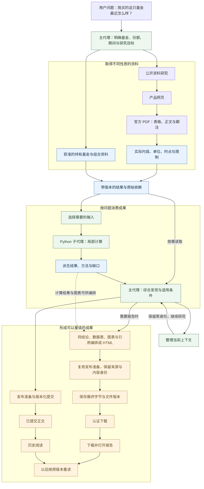
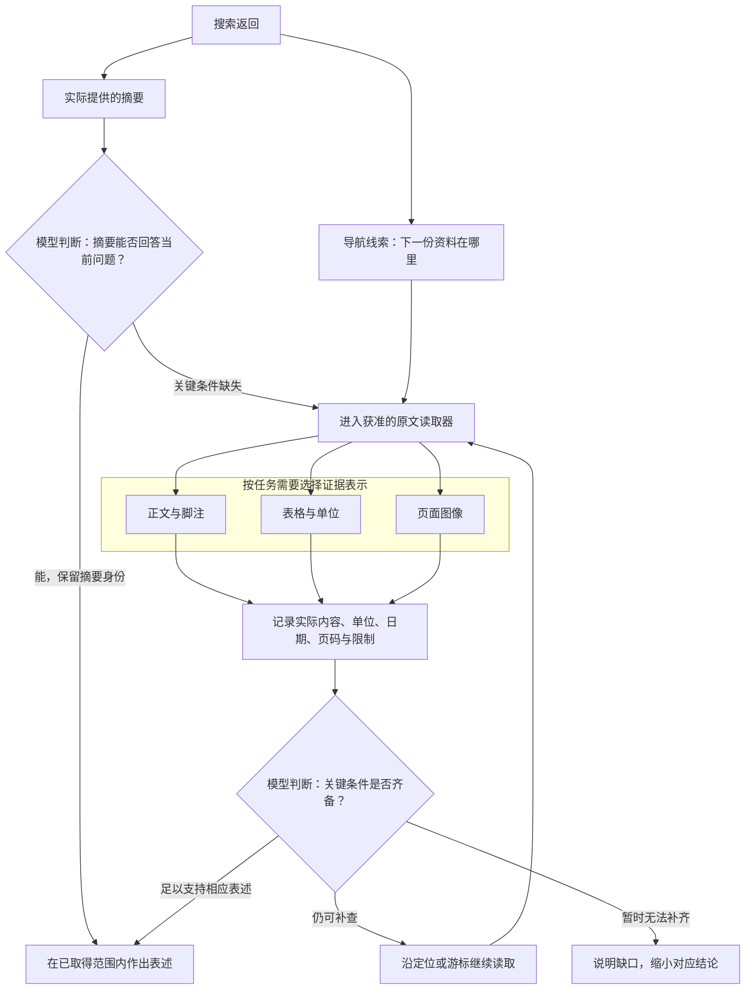
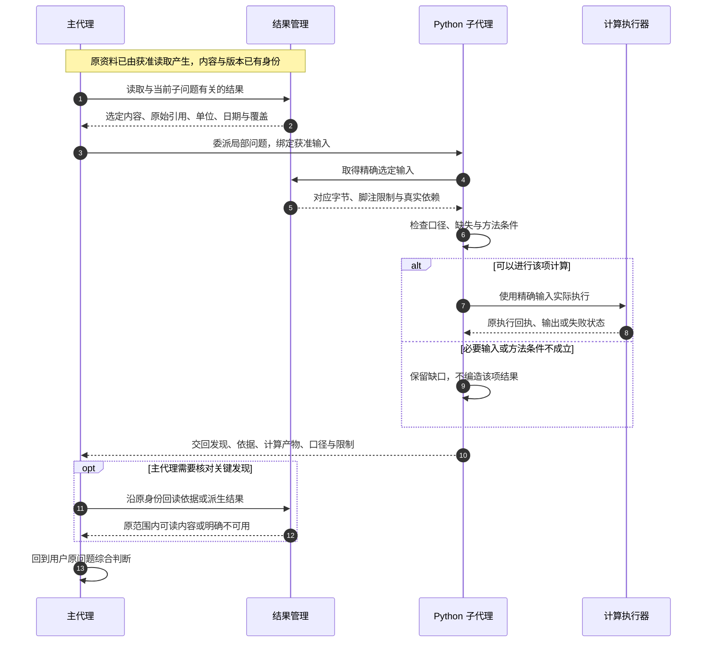
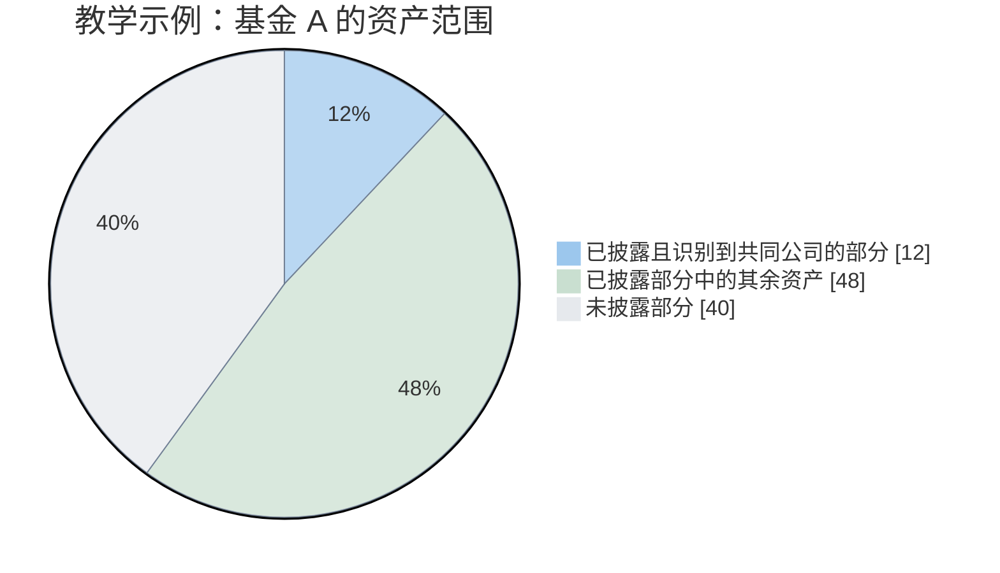
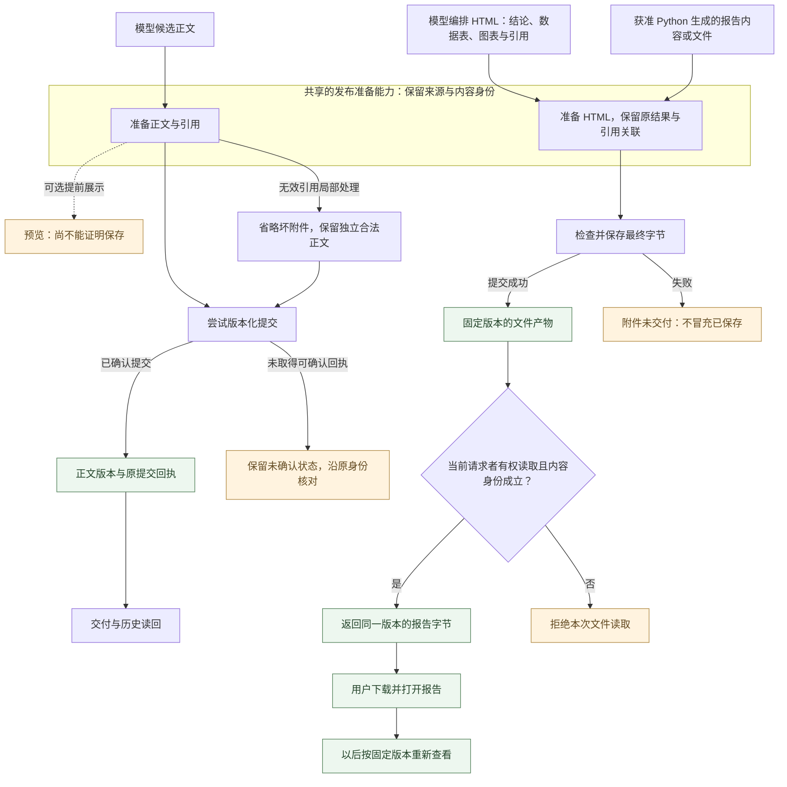
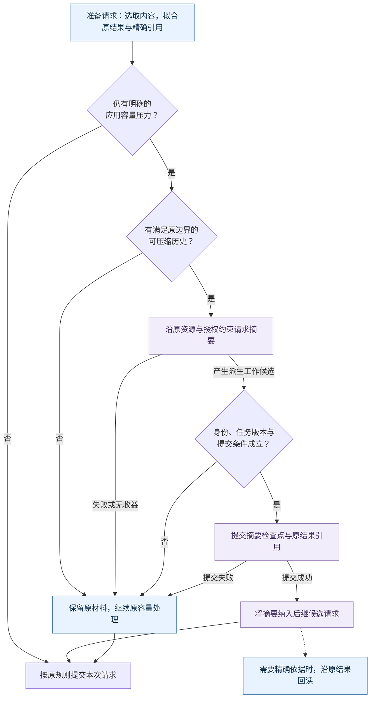
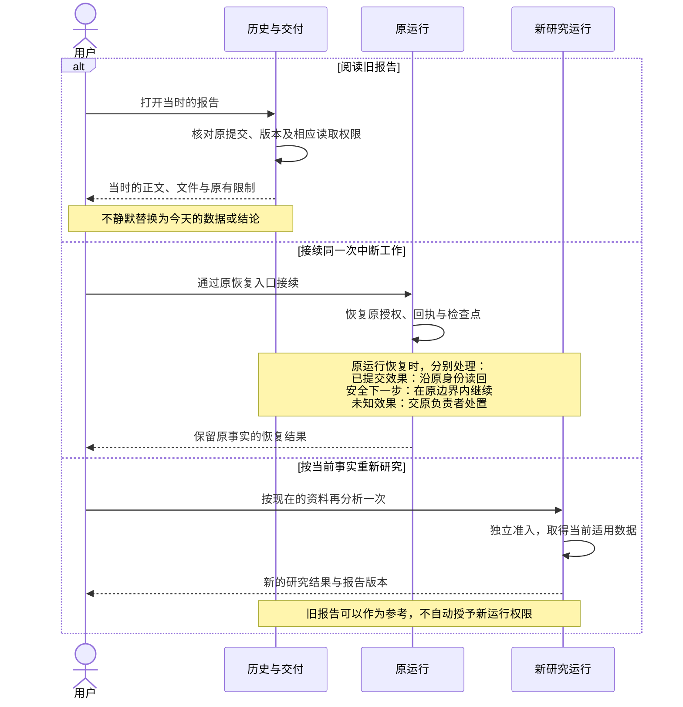
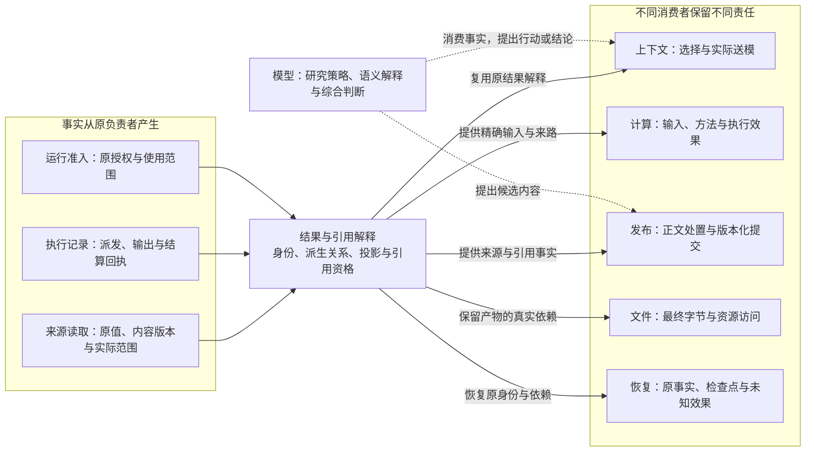

# 金融 Agent 的可信证据链：从原始数据到最终结论，如何守住事实的来路？

> 本文依据 ETF Agent 截至 2026 年 10 月 20 日的工程状态。

“帮我看看，我买的这只基金最近怎么样？”

这是一个很日常的问题，但回答可能影响真实资金的安排。用户需要的参考，首先应当建立在可靠的资料上：净值数据是否对应这只基金，费用条款是否仍然适用，报告中的信息能否支持正在讨论的判断。

这也是使用大模型研究金融问题时，一个很常见的困惑：回答有数据、有分析，还附着几个链接，看起来相当专业，可这些依据究竟可靠吗？

如果把旧条款当成现行规则，把另一类份额的数据用到当前产品上，后面的分析即使流畅、计算即使准确，也可能回答错了问题。**资料来自哪里、描述什么、适用于何时，决定了研究从哪里起步。**

我们在[《为什么 AI 明明有很多引用，回答还是不够可靠？》](https://github.com/hpoenixf/eff-agent-article/blob/main/articles/ai-citations-do-not-prove-reliability.md)中讨论过，引用可以帮助追溯来源，但还需要核对材料是否真正支持结论。

而在一个能够自主研究的 Agent 里，可靠资料还要走过很长一段路。

一条搜索结果可能把 Agent 带到产品官网，官网再指向一份 PDF；关键数据在表格里，适用条件却写在后面的脚注中。取得的内容可能交给子代理继续核查，再送入 Python 计算。主代理接回成果，整理越来越长的上下文，逐步形成研究判断。

当用户需要一份可保存的报告时，链路还会继续：模型将结论、数据表、图表和引用编排成 HTML；需要计算或批量处理时，也可以借助 Python 生成内容。随后，系统保存最终文件，让用户能够下载、打开，并在以后重新查看。

这些转换都可能影响依据的表达。表格里的单位有没有保留？图表是否仍然对应原计算结果？正文中的引用能否找到原材料？重要的脚注和限制，会不会在摘要或页面排版中被省掉？

**最初可靠的资料，能否经过这一系列变化，仍然保持原来的含义、口径和限制？**

这篇文章讲的，就是我们怎样把这条链串起来：从原始资料出发，经过读取、计算、子代理协作与上下文压缩，再到 HTML 生成、文件交付和历史重读，让最终报告仍然能够回到支撑它的原始依据。

## 先交代技术来路：我们不是从零发明 Data Lineage

数据来路（Data Provenance）与数据血缘（Data Lineage）早就是计算机科学和数据工程的问题。W3C 于 2013 年发布的 [PROV-O 推荐标准](https://www.w3.org/TR/prov-o/)提供了描述对象、活动、参与者和派生关系的通用词汇。后来，[OpenLineage](https://openlineage.io/docs/spec/naming/) 和 [Marquez](https://marquezproject.ai/docs/quickstart/)面向数据作业和运行事件记录血缘，[Google ML Metadata](https://github.com/google/ml-metadata/blob/master/docs/index.md)管理机器学习流水线的产物与执行关系，[DataHub](https://docs.datahub.com/docs/features/feature-guides/lineage)甚至支持字段级依赖追踪。我们不是这些概念的发明者。

本文讨论的工程问题更窄，也更具体：在一次自主金融研究中，已有资料不只经过确定性的 ETL 作业，还可能由模型选择片段、交给子代理计算、退出上下文、在恢复后重新读取，再被写进答案和报告文件。这里需要让**来源关系、实际使用范围、原授权、方法前提与交付结果**在各自的职责内继续成立。它们涉及成熟的血缘、权限与分布式执行问题，但不能只靠一条派生边自动解决。

因此，本文介绍的是**将已有工程思想组合并适配到 Agent Runtime 的实践**，不是宣称实现了 PROV-O、OpenLineage 或某种新的通用血缘标准。最重要的区分也贯穿全文：能够追溯一个数值从哪里来，不等于那个数值适用，更不等于据此作出的金融结论正确。

## 一、金融研究为什么更难

### 一个数字，要放回对象和时间里理解

“这只基金最近表现怎样”，首先涉及对“这只”和“最近”的解释。

同一产品可能有不同份额类别，基金净值与交易所价格也有不同含义。比较指数、ETF 和联接基金时，价格、净值、分红和费用的处理方式可能不同。即使每个数值都来自可靠来源，把它们直接排成一列，也未必形成可比较的数据。

时间同样有多层。资料今天取得，不代表它描述今天；报告今天发布，持仓可能对应更早的期末；用户在本地看到的日期，与海外市场一个交易日的结束也不总是一回事。对 QDII 等跨市场产品，还要面对净值披露与相关市场交易之间的时间差。

因此，来源时间、数据时点和研究截止时间都要有位置。我们不能用“刚刚搜索到”表达数据新鲜，也不能因为两个字段都叫“收益率”，就省掉期间、币种和分红口径。

这些差别会影响后续计算。将不同日期的持仓当成同期快照，得到的重叠可能只是两个历史截面的拼接；把已经反映某些费用的净值再次扣费，会使模拟结果产生另一种含义。程序可以顺利完成运算，错误却已经发生在运算之前。

### 来源的权威有自己的范围

金融研究还会同时使用性质不同的事实。

基金管理人的文件可以说明产品在相应时点披露的投资目标和费用条款。市场数据可以提供某个对象、某个字段的一组观察。用户的账户资料说明其持有情况。Python 的输出则是给定输入和方法下产生的派生结果。

它们可以共同参与一个判断，却不能互相替代。公开网页上的金额，即使碰巧与账户金额相同，也不能证明用户持仓；费用条款可以支持估算，无法证明账户已经实际扣费；计算出的相关性也不能直接说明未来风险已经降低。

这让来源治理必须回答一个更具体的问题：**这份资料有资格说明什么？**

“官方”是有用的来源属性，但不是适用于所有主张的通行证。我们需要把原值、来源、适用对象和时间保留在一起，让研究者能够检查它们之间的关系。

### 不完整的信息也有价值，但不能失去“不完整”

很多金融资料天然只有局部覆盖。前十大持仓不等于全部持仓，已识别公司不等于所有底层资产，有净值的产品也不等于已经掌握全部风险因子。

研究仍然可以向前走。已披露部分可以帮助发现明显重复，明确的费用条款可以排除不适用的比较，无法确认的尾部可以成为后续跟踪条件。真正需要避免的是：局部信息经过整理后，看起来像完整事实。

这种变化很容易发生在写作中。原材料说“在已披露的部分中”，摘要变成“持仓中”，最终结论又变成“组合整体”。句子更流畅了，结论的范围却在每次转述中扩大。

金融研究的挑战就在这些交汇处：数据有时间，方法有前提，来源有范围，结论有条件，材料还可能涉及私人信息。它们都需要在 Agent 自主探索时继续成立。

用户最终关心的通常也超过资料整理。他希望知道增加这只产品解决了什么问题，有没有更简单的替代方案，什么情况下应该暂缓，未来出现什么变化需要重新研究。这要求 Agent 沿证据推进判断，同时保留判断仍依赖的条件。

## 二、把一项基金研究展开来看

### 从用户的问题形成研究依赖

一次持有基金的跟踪研究，还可能延伸到组合比较。下面用一个不涉及真实持仓的教学场景展开研究依赖；尚未落地的设计会就地标注。

假设用户已经持有几只宽基和科技主题基金，正在考虑新增一只 ETF，希望比较分散效果、费用与主要风险，并保留一份以后还能复核的报告。

主代理首先要理解“分散”在这个问题中的含义。用户可能想降低单一市场集中，也可能想减少少数公司的重复暴露，还可能只是希望持有过程更简单。这些目标不会自然得到同一个答案。

即使暂时不讨论具体买入金额，也可以形成三组相互关联的问题：新产品新增了什么暴露，为这些暴露付出什么成本和风险，哪些变化可能使原判断失效。

接下来才是资料与任务的安排。当前组合从获准的个人资料入口读取，产品信息从公开披露中核对，指数方法和持仓报告按需要继续查找。计算等待必要输入明确，公开资料核查则可以独立推进。

这种研究关系决定了工具的使用。现有结构化资料已经包含官方文件入口时，可以直接沿入口阅读；费用条款缺失时，再去寻找适用文件；关键日期不能对齐时，先说明比较限制。Agent 的自主性体现在这些选择中。

### 资料会经过一条很长的路

最能说明问题的一条路线，是从网页开始，最后回到历史报告。

搜索发现产品资料，产品页提供官方 PDF，PDF 中的持仓表和费用脚注成为研究输入。表格被保存为带版本的结果，主代理选择必要内容，将局部计算委派给 Python 子代理。子代理交回派生结果与限制，主代理继续综合。研究变长之后，较早的正文退出当前上下文，但原结果仍可定位；最终答案经过发布准备，再形成可以认证下载的文件。之后重新打开时，用户应能取得同一个历史版本。

**图一：从“这只基金最近怎么样”到可以重读的报告。** 先明确基金、份额与期间，再沿公开资料、获准个人信息和必要计算形成判断；需要文件时，继续走完 HTML 编排与交付。

图中的公开研究可以由主代理直接执行，也可以委派。上下文投影表示研究继续时的材料整理，不要求每次都生成摘要。HTML 可以由模型直接编排，也可以使用获准 Python 的计算或批量处理成果；文件按交付需要产生，正文可以独立存在。保存、下载、打开和重读分别需要相应事实，图中的依赖不表示前一步已经证明后一步成功。

更值得关注的是，每条连线都在改变信息的使用方式。网页地址变成了实际内容，内容变成选定输入，输入变成计算结果，局部结果变成综合判断，判断又成为可保存、可重读的交付物。

### 同一个问题，让不同工序发生关系

如果只按工具组织答案，最终很容易得到三份彼此独立的材料：一段产品介绍，一张计算表，一份风险清单。

它们都可能正确，用户却仍然不知道该如何理解新增产品的作用。产品介绍中的某个行业暴露，是否就是重叠表里已经偏高的部分？费用差异是否足以改变选择？风险清单中的汇率因素，与用户原组合相比究竟增加了什么？

主代理需要保留原研究问题，把这些局部结果重新放到同一个比较中。计算给出已知范围内的差异，文件条款解释差异的适用条件，风险分析说明还有什么未被覆盖。

这也是为什么我们需要一条贯穿研究的证据链。它不仅服务于最终答案后的几个引用标号，还让下一道工序能够继续使用前面的成果。局部研究可以独立进行，整个问题的身份却需要延续。

当原问题发生变化时，研究也应承认这一点。用户从“了解重复暴露”转向“安排新增资金”，意味着需要新的约束与方法，不能仅仅给原表加一列建议金额。没有执行授权的研究，也不能在交付报告时顺便变成实际交易。

## 三、资料怎样成为可以继续使用的研究事实

### 搜索提供线索，也可能提供有限依据

搜索结果通常同时包含地址、标题和摘要。地址帮助找到下一份材料，摘要则是已经实际取得的一段信息。这两者的作用应当分开。

有些问题可以由获准展示的摘要回答。例如，我们只需要知道某份公告大致涉及什么，摘要已经包含相关内容，就可以明确说明依据是搜索摘要。需要核对份额、适用日期或费用条件时，再继续读原文。

因此，我们没有把“所有搜索都必须再打开一遍”当作研究准则。更有用的判断是：目前这份材料支持哪种表述，关键条件是否已经具备。摘要可以保持摘要身份，原文核对也要有实际读取事实。

产品页到 PDF 的连接体现了另一项细节。正文提取通常会清理导航、侧栏和其他噪音，但补充文件的入口可能就在这些区域。我们后来把可读正文与候选链接分别保留，让研究能够沿已发现入口继续走，而不是因为正文清理得更干净，就失去下一份资料。

这一部分的工具演进，在[《从“搜得到”到“读得下去”：我们怎样让 Agent 学会浏览网页》](https://github.com/hpoenixf/eff-agent-article/blob/main/articles/021-agent-web-research-from-search-to-deep-reading.md)中有更完整的说明。放到本文的研究问题里，它解决的是资料之间怎样接续。

### 阅读范围决定了可以说多大的话

来到 PDF 后，找到文件与取得依据之间还隔着定位和阅读。

费用可能出现在正文，适用条件可能藏在脚注；持仓表给出数字，表头和附注说明这些数字代表什么。只把数字抽出来，往往已经损失了研究所需的一部分信息。

我们的早期阅读经历中，有过前一窗口没有覆盖关键后页、继续查找才取得目标正文与尾注的情况。这促使我们把查询命中、扫描范围和实际读取分别表达。没有命中时，系统需要说明查了哪里；模型也需要把“当前没找到”与“整份文件不存在”区分开。

这种区分同样适用于表格。PDF 里的文字位置不天然等于表格语义。[pypdf 的文本提取说明](https://pypdf.readthedocs.io/en/stable/user/extract-text.html)讨论了 PDF 缺少明确语义层、排版与表格还原之间的困难。我们的阅读路径因此按任务需要组合文本、结构化表格和页面图像，保留各自实际交付的范围。

图像提供了另一种看材料的方式，但接收到图像与解释正确仍然需要分别核查。某些扫描页可以被识别，某些图表的颜色、形状或限定仍可能被误读。增加视觉能力扩大了可研究的材料范围，也增加了需要独立判断的环节。

**图二：从发现资料到有限结论，研究如何决定下一步。** 摘要与原文各自保留实际取得的内容；关键条件是否齐备，由模型结合问题判断。

三种证据表示可以单独使用，也可以互补；图中没有要求每份资料全部走一遍。取得更多内容，也仍需单独判断它是否支持结论。

这些机制在[《从能读取到能研究：我们如何把 PDF 阅读升级为可追溯的多模态能力》](https://github.com/hpoenixf/eff-agent-article/blob/main/articles/024-agent-pdf-from-text-to-evidence.md)中已经展开。沿整条研究链，后续结论都应当对应实际取得的那部分材料。

### 资料的身份要跟着实际内容走

当某段文字被切片、整理或用于后续引用时，文件地址仍然相同，实际内容却可能已经变了。我们因此需要区分原文版本、选取范围和当前表示。

换成 [W3C PROV-O](https://www.w3.org/TR/prov-o/) 的概念，一份基金年报可以是 Entity（实体），阅读和抽取是 Activity（活动），抽出的持仓快照是新的 Entity，Python 计算又可以产生一个派生 Entity；`prov:used`、`prov:wasGeneratedBy` 和 `prov:wasDerivedFrom` 描述这些使用与生成关系。这说明我们使用的“结果身份”“派生谱系”都有成熟的理论近邻。这里借用的是解释模型，并非声称系统采用了 RDF/OWL 表示或实现了 PROV-O 兼容接口。

但记录“重叠表由两份持仓生成”，并不能证明输入属于同一报告时点，不能证明前十大披露覆盖了全部持仓，也不会自动授予后来某个 Run 读取原账户数据的权限。这些还需要分别由金融方法、实际覆盖和运行授权来回答。

例如，引用第几页，应当对应实际返回内容中的页面关系。解析器内部知道某段来自哪页，不代表经过切片或脱敏后，模型看到的坐标仍然正确。同样，一个网址以后更新了内容，不能让旧研究在没有说明的情况下指向新版本。

结果定位、答案引用和文件下载还各有用途。结果定位用于再次读取或选择计算输入；正式引用帮助用户检查来源；文件身份指向已经保存的交付字节。它们可以建立联系，但知道其中一个，并不会自动获得另外两种能力。

授权也要由真实执行环境提供。当前机制中，一次研究运行获得的授权在同一 Run 及其恢复中保留，后续消费者沿原记录使用；新的研究运行需要自己的准入。内容删除、不可用或身份不一致仍按相应事实处理，不能因为曾经取得过引用就补造缺失内容。

到这里，材料已经带着对象、时点、版本、阅读范围和使用边界进入研究。它仍然需要被解释，但下一位执行者至少可以回答：我现在拿到的是什么，它从哪里来。

## 四、把资料保留在外，按研究需要读取

### 一张持仓表，不必每轮都重新摊开

随着研究推进，主代理可能已经取得多份报告、几张持仓表和若干计算输出。如果每轮都携带全部内容，上下文会重复积累，局部试错也会与全局问题混在一起。

我们选择把结果保留与当前上下文驻留分开。工具已经取得并允许使用的结果，可以留在受控存储中；模型先知道有哪些材料，再按问题读取需要的字段、记录或片段。数据也可以通过获准的精确引用进入计算环境，避免由模型逐项抄写。

回到基金研究，主代理当前可能只需要基金、报告日期、披露范围和权重列。用于说明费用的整段文件，不必在比较持仓时反复出现；Python 需要的较长序列，也不必全部复制到每一次综合请求里。

这一机制的完整讨论见[《工具查到的数据，为什么不一定要给大模型看？》](https://github.com/hpoenixf/eff-agent-article/blob/main/articles/tool-results-outside-model-context.md)。它改变了数据的访问方式，让研究有机会保持更有针对性的工作集。

LangChain 在 2026 年 1 月的[《Context Management for Deep Agents》](https://www.langchain.com/blog/context-management-for-deepagents)中，也把大工具结果写入文件，让上下文保留路径与预览，需要时再搜索、回读。这个做法说明，资料可访问与全文常驻上下文，可以分开设计。

本文使用的结果机制还要保留版本、原始回执、选取范围与 Run 绑定。我们比较的是按需访问的思路，不能把文中介绍的文件定位与这里的结果身份视为同一套机制，也不能仅凭知道定位就获得新的读取权限。

另一种相近的数据处理方式，见于 Anthropic 2025 年的[《Code execution with MCP》](https://www.anthropic.com/engineering/code-execution-with-mcp)。其示例在执行环境中取得整张表，再筛选、转换，只向模型返回必要内容；中间结果也可以存成文件接续使用。模型由此能够安排数据处理，而不必在工具之间反复抄写完整原表。

### 重新打开，必须还是原来的那一份

外置之后，引用变得重要。模型可以说“继续读取这份结果”，但系统必须确认它指向原来的内容与选取条件。

如果费用文件后来更新，重新抓取到的新文件可以成为新的研究材料，不能静默顶替原研究使用的版本。如果一次刷新失败，也应保留失败和旧版本的身份，不能把旧数据换个取得时间后当成新数据。

这与普通缓存有相似之处，但研究还需要保存派生关系。后面那张重叠表，使用的是哪两个输入，选择了哪些记录，缺少哪些映射？这些信息决定了计算结果还能怎样继续使用。

同样，本轮明确请求的读取应当确实进入模型输入。系统不能一边把工具标成成功，一边在后续容量整理中只留下一个地址，让模型误以为正文已经可见。较早的结果可以退出当前工作集，新读取的交付事实则需要准确表达。

### 改变表示，不能重新发明来源

我们曾在这一交接处发现一个很有代表性的问题：生产结果与核验结果的环节使用了不同的容量规则，同一份合法数据因此在后面被误判。数据和授权没有发生变化，变化的是消费者如何重建它的表示。

这使我们更倾向于让消费者复用原结果的解释，而不是在每个入口独立判断“这个结果应该长什么样”。否则，大结果、选定视图和引用占位会各自长出细微差异。

机械拟合可以把较早正文收缩为原身份与精确回读位置。这里没有生成一份新的语义摘要，只是改变了材料是否常驻本轮上下文。稍后还会看到，真正的摘要压缩有另外一组责任。

对主代理来说，结果存储像一个有版本的资料柜。当前桌面不必摆满全部材料，但抽屉标签要能带它回到原件。这个比喻只解释访问方式，实际访问依然服从原研究范围和内容身份。

资料由此可以离开当前上下文，也可以进入另一位执行者的局部工作。接下来，最关键的交接发生在主代理与子代理之间。

## 五、多代理之间，究竟传递什么

### 先交一个问题，再交与它有关的材料

在这个基金研究里，主代理需要同时理解用户目标、现有组合、费用、风险和交付要求。局部工作却可能很长：查找公告、定位脚注、对齐列名、修正脚本、重新计算。这些过程有独立的工作价值，也会产生大量只对当前工序有用的上下文。

我们引入子代理，首先是为了让这类局部工作拥有自己的执行空间。主代理保留整体问题与综合责任，子代理在获准范围内完成一段多步研究。

因此，一个好的委派应当足够具体。例如：“核对新产品的持续费用与一次性费用，保留份额、渠道、适用日期和原文条件”，或者“根据选定的两份持仓结果，比较已披露部分的共同公司，保留日期与覆盖限制”。

这样的任务让子代理知道自己需要回答什么，也知道哪些工作无需重做。相比之下，“研究一下这只基金”容易产生一篇独立产品报告，回到主代理后仍然缺少针对原问题的关系。

专业配置提供的是方法重点。Web 更关注来源选择和交叉核对，PDF 更关注页码、表格与脚注，Python 更关注输入、方法、实际计算和产物。它们复用通用执行底座，实际工具和资料范围由本次授权决定。

### 一份 PDF 不需要成为一次强制转派

假设 Web 子代理从产品页进入官方 PDF，接下来要找的是费用说明。它已经掌握研究目标和来源背景，在获准范围内继续阅读通常更自然。

我们没有要求它先把 PDF 地址交回主代理，再创建一个 PDF 子代理。文件格式与工作边界并不总是重合。PDF 专长适合一项需要深入跨页、表格或视觉检查的局部问题，但不意味着所有 PDF 都必须交给那个角色。

如果把格式当作硬边界，原本一段连续阅读会被切成多次委派。每次都要重新解释目标和限制，等待成果，核对来源，再决定下一步；这会使链路更长，却未必使研究更清楚。

我们希望隔离的是局部过程，让执行者保留解决问题所需的能力。复杂资料可以由一个子代理做深，简单动作也可以由主代理直接完成。

### 输入交接要能回到原始生产者

这里最容易被低估的是输入。

主代理已经知道“有一张持仓表”，不等于子代理已经拿到了那张表；主代理读过一段摘要，也不等于它可以把摘要描述成完整原表；子代理看到一个引用，更不意味着它有权读取引用可能指向的任何内容。

我们的交接沿原始结果和实际读取建立联系。主代理从获准结果中选取输入，委派绑定到原研究与执行身份，子代理通过受控入口取得对应内容。原结果来自哪里、选了哪部分、实际交付了什么，都有自己的位置。

这也让先后关系具有意义。前一个子代理产生了结果，主代理实际读取了可用成果，再将其中的选定材料用于后一个任务，这是一条可以核对的传递关系。只在提示里写“上一位已经做完了”，无法替代这些事实。

同一份 PDF 的不同读取范围尤其需要注意。费用正文、表格和脚注可能来自不同读取，甚至不同表示；它们可以共同支持一个判断，但不能因为文件名相同，就被粗略归成一次完整阅读。

对使用者来说，交接可以保持简单；对系统来说，它要保留原生产者与实际消费之间的联系。我们不要求模型每次重填一套来源声明，也不让模型自己列出的引用代替原始回执。

**图三：一次主代理到 Python 子代理的成果交接。** 图中“结果管理”消费原生产者的读取事实；每次交接都沿原研究授权与选定输入进行。

### Python 子代理接手一段计算工作

在我们的例子里，Python 子代理接手的是“在明确范围内比较持仓”，而非执行一行公式。它需要检查输入列，识别对象映射与缺失，采用适用方法，实际运行，再解释结果范围。

局部修错也属于这段工作。列名不匹配，可以检查实际输入后修正；报告模板失败，可以在自己的工作区调整。整个过程中，输入身份和方法限制不应因为脚本重跑而消失。

工作区同样有执行归属。主代理和兄弟子代理通过受控结果与产物交接，不能靠猜路径读取彼此文件。模型可能知道另一位生成了某个文件，但这个知识本身不构成访问权限。

同时，Python 沙箱保护的是代码运行对主机、网络和资源的影响。它无法单独说明数据从哪里来。模型可能把已经看过的私人数字直接写进代码，输出仍然继承相应的数据使用边界。报告经过一次计算，不会自动变成无私人依赖的公共文件。

前面 Anthropic 的代码执行示例可以直接调用 MCP；我们的隔离 Python 则消费经原工具与输入解析交给它的获准数据，不能据此自由联网或调用其他工具。两者可以比较“中间数据留在执行环境”的处理方式，实际调用边界需要分别理解。

隔离环境、方法复用与文件交付的细节，可以继续读[《Python：从工具到计算工作台》](https://github.com/hpoenixf/eff-agent-article/blob/main/articles/agent-python-compute-workbench-evolution.md)。这里需要保住的是：子代理独立工作时，原输入和派生结果之间仍然有来路。

### 交回的成果，要能进入主问题

子代理不必把所有搜索和调试记录复制回来。主代理更需要四类信息：发现了什么，可以核对哪些依据，产生了什么可用结果，以及还缺什么。

例如，费用研究交回适用条款和条件；计算任务交回已知范围内的共同持仓与派生表；视觉阅读说明哪些图表内容仍不能可靠识别。阶段性发现可以有用，部分完成也可以明确表达，不必为了整齐把所有结果都写成“完成”。

随后，主代理需要实际消费成果。若计算表说明新产品与原组合在几家主要公司上重复，而费用条款显示不同渠道适用不同费率，综合时就要一起解释它们如何影响选择。引用和产物应当服务这个判断，不能只在报告末尾机械附上。

主代理仍然可以按需要回读关键依据。子代理摘要能减少局部过程，重要结论却不能只靠“另一位说过”成立。尤其当两个子任务出现冲突时，应该回到对象、时间、覆盖和方法，检查差别来自哪里。

这种交接方式在[《我们为什么给投研 Agent 配上 Subagent：从上下文隔离到专业化协作》](https://github.com/hpoenixf/eff-agent-article/blob/main/articles/agent-subagent-context-specialization.md)中有更详细的介绍。它的价值是让局部探索成为可继续使用的成果，而不只是多出几位会写报告的模型。

### 多代理也需要证明自己值得存在

一个合理的问题是：为什么不让主代理直接完成所有步骤？

简单任务完全可以这样做。资料很少、计算稳定、过程高度依赖整段对话时，多一次委派可能增加背景复制、等待和汇总。只有局部过程较长、边界可说明、成果可检查时，独立上下文才更有吸引力。

并行也受实际依赖限制。费用核查与公开公告可以同时进行，依赖持仓口径的计算仍要等待输入。多创建一个子代理，并不会消除这条依赖。

我们已有局部计算、修错和正式成果被主代理消费的真实样本，但这些能力证据没有自动给出提速、降本或投资质量的比较结论。多代理的收益要放回完整任务观察：用户的问题是否得到回答，局部成果是否被用上，额外资源是否合理。

## 六、计算正确，还需要金融方法成立

### 先说明重叠的分母

现在，Python 已经得到选定输入并完成计算。回到最初的问题，“共同持仓”应该怎样解释？

假设在一个教学例子里，基金 A 已披露的前十大持仓合计占基金资产的 60%。在这些已披露持仓中，有 20% 的权重落在也出现在基金 B 的公司上。这里的 20% 以 A 的已披露部分为分母，换算后，对应 A 全部资产的 12%。

这只能说明已知部分中的一项事实：A 有至少这部分已识别资产落在双方共同出现的公司上。它没有给出 B 的对应金额，没有覆盖 A 未披露的 40%，也没有自动构成对称的基金权重重叠指标。

如果要计算一种常见的权重交集，例如对共同资产逐项取双方权重的较小值再求和，还需要双方可比较的权重、完整程度和对象映射。只知道公司名称相同，无法直接得到这个数值。

这样的差别不会因为用了 Python 就自行消失。脚本执行的是我们指定的方法，而方法本身需要先回答：比较哪一层资产，用哪个总体作分母，缺失部分如何表达，两个日期是否具有可比性。

**图四：把教学例子的分母放回全基金资产。** 已披露部分占 60%，其中 20% 对应全基金资产的 12%；其余已披露资产占 48%，未披露部分仍占 40%。

图中的 48% 不能被标成“已确认不重叠”，40% 也没有因为已知部分可以计算就消失。这张图描述 A 的资产范围，没有给出双方完整的权重交集。

### 披露覆盖与金额覆盖需要分别保留

假设组合中有十只基金，成功取得九只的资料，不能直接说覆盖了九成资产。未取得的那只可能占组合很大比重。反过来，只读到少数几只主要产品，也可能已经覆盖较大金额，但它们内部的底层披露仍然不完整。

因此，持仓清单覆盖、估值覆盖、底层披露覆盖、身份映射覆盖和时间覆盖是不同问题。将它们压成一个“完整度”会使后续解释失去依据。

穿透还可能跨过多层。用户持有基金，基金持有另一产品，后者再持有公司。逐层乘权重可以表达已知的资本关系，但合计时必须选定层级，避免把父资产与子资产重复计算。相同底层公司可以合并分析，真实资本也不能因跨账户或份额去重而被丢掉。

缺失部分应当继续存在。把已知样本重新归一化为 100%，可以用于一个明确标注的样本分析，不能据此宣称整个组合已被完整穿透。研究可以在这个范围内提出发现，同时把剩余部分保留为未知。

### 费用包含三种不同的事实

费用计算也有类似结构。

一种是明确的假设，比如用一个设定费率观察敏感性；一种是根据适用产品条款估算；还有一种是实际执行回执报告的扣费。它们都可以有数值，事实含义却不同。

条款估算需要确认份额、渠道、有效期、计费基数和持有期，必要时还包括分档、舍入与扣费时点。缺少决定性条件时，可以保留假设场景，但不应把它改称实际费用。

年费拖累模拟与一次申赎费用也应区分。净值可能已经反映某些费用，继续扣除前需要核对口径。如果费用参与资金方案，同一份费用明细还需要在相应现金关系中正确计入，不能由不同消费者各算一次。

这些都属于金融方法。一个安全执行的脚本可以忠实运行错误方法，一份来源完整的表也可能被用错分母。数据来路、执行事实和方法适用性需要相互连接，仍保留各自的判断责任。

### 一个可以比较的金融实现

FinRobot V2 提供了一个具体参照。在其固定版本的[权益研究现金流折现（DCF）步骤](https://github.com/AI4Finance-Foundation/FinRobot/blob/2717499b8e30f242640af08c4ad9afd1113c2d45/finrobot_desktop/finrobot/engine/pipelines/equity_research.py#L520)中，输入由程序构造，随后调用确定性的估值与敏感性计算，再供后续研究论点和报告步骤组织叙述。这里能从源码核对的是计算与叙述的分工，不能单凭这种分工认定估值假设或最终投资判断正确。

对我们而言，可借鉴的判断是让金融方法有明确的输入与维护责任，再由模型解释结果。股票 DCF 与基金持仓、费用分析处理的是不同对象；这份代码也不能替 ETF Agent 尚未完成的数值治理提供验收。

### 我们已经确定的下一步，以及还没有完成的部分

在这条链继续深化时，我们形成了金融数值与指标的共同设计：数值基础处理带单位的值、显式转换、精度与残差；Portfolio、费用、穿透等领域分别维护适用方法；来源适配保留原值和时点；结果管理保存身份与依赖。

这一设计还区分计算精度、结算精度与展示精度。金额可以需要精确十进制，统计方法可以在明确容差下使用浮点；不同币种不能直接相加，比例与百分点的转换也要来自已知定义，不能按数值大小猜测。

**截至本文取材时，现金、费用、穿透的 P0 修复及后续联邦式指标收敛仍属待实施工作。** 已经建立的结果传播机制，不能据此被写成“全部金融数字已经得到统一正确性保证”。这里介绍的是下一步要落实的职责与方法。

我们也没有为此设计一个能否决所有回答的金融总开关。必要输入不足时，受影响计算可以没有值，并说明原因；可选诊断没有执行或暂不可用时，也不应让独立有效的研究内容消失。诊断帮助指出问题，原领域负责修正真实算法，正文交付继续由既有发布边界处理。

对模型而言，任务还没有结束。它需要忠实使用计算结果，保留方法条件，再讨论其对用户问题的意义。我们在[《金融 AI 最危险的“专业感”：数据是真的，数字却算错了》](https://github.com/hpoenixf/eff-agent-article/blob/main/articles/031-fintech-data-time-and-reproducible-numbers.md)中已经讨论过来源、计算与最终解释的差别。本文更关心这些差别怎样一起进入后面的综合判断。

## 七、把依据和条件一起带进最终答案

### 引用指向材料，解释建立关系

到这里，主代理手里已经有公开条款、已知组合、派生计算与若干限制。写作时，它需要重新回答那个最初的问题：新增产品究竟改变了什么？

一种有用的表达，可以先说明观察到的重复暴露，再解释其范围，随后讨论与用户目标的关系。例如，在已披露持仓中发现共同公司，说明这部分新增资金未必带来公司层面的新增暴露；行业、市场与货币风险仍需另行分析。若用户追求的是降低特定行业集中，选择可能需要回到整个组合，而不能仅比较两只基金的名称。

这一段推理中，引用帮助读者回到披露和计算，但“是否改善了分散”仍需要把目标、方法与资料联系起来。每个句子后都有标号，也无法代替这项工作。

这个区别在[《为什么 AI 明明有很多引用，回答还是不够可靠？》](https://github.com/hpoenixf/eff-agent-article/blob/main/articles/ai-citations-do-not-prove-reliability.md)中有独立讨论。它在交付时体现为清楚的职责：引用绑定保留来源归属，主代理继续承担解释责任。

### 正文进入发布之后，有了可保存的版本

模型写出一段文字，系统还要处理它是否已经成为可展示、可持久化的回答。

我们把这部分放在 Publication，也就是回答发布组件中。普通模型正文与显式发布入口可以进入共同的后续处理；组件准备正文与引用，按需要提供预览，再记录版本化提交。

预览、提交和客户端展示各有自己的事实。服务端可以先给用户看到已有内容，保存仍需等持久化结果；一段内容后来被修订，要能知道修改的是哪一段、哪个版本，以及它在原回答中的位置。后续研究失败时，已经提交的独立内容也应保留原身份。

这对金融研究尤其有用。一份比较可能先交付已经确认的条款，随后补上计算，再修正某个条件。它们共同构成同一研究中的回答，而不必等所有局部工作结束才第一次出现。

准备、修订与恢复的完整机制，可以继续读[《Agent 已经生成答案，为什么还需要一个独立的发布系统？》](https://github.com/hpoenixf/eff-agent-article/blob/main/articles/019-agent-answer-publication.md)。

### 局部问题，应当有准确的局部表达

假设费用说明本身有独立获准的依据，但模型写坏了其中一条引用标记。相应链接可以省略，来源限制可以明确显示，正文仍然有交付价值。

这种处理保留了两件真实的事：文字已经生成，引用绑定尚未成立。系统不需要为了修好辅助标记，强迫整项研究再多转一轮，也不能把未绑定引用偷偷猜成另一份来源。

如果正文确实依赖未获准私人材料，或者关键内容身份无法成立，受保护效果仍然要由原负责者限制。删除依赖、把私人资料改标为公开，都不会使权限问题消失。局部降级保护的是独立合法的成果，并不制造新的来源权利。

类似地，某个计算结果不可用时，可以交代该项缺口；文件导出失败时，可以保留已有正文并说明附件未交付。系统需要准确表达发生了什么，让用户看见可用部分，也看见无法完成的部分。

### 报告文件要走到用户真正能取得的字节

如果用户希望保留一份 HTML 报告，模型可以直接编排静态内容，也可以在确有计算或批量处理需要时使用获准 Python。我们没有把所有报告都绑定到一次 Python 调用上。

两种输入最终复用共享的发布准备与 Artifact，也就是持久文件产物路径。前者处理正文和引用，后者检查并保存最终内容，记录文件身份，再由认证下载接口提供相应字节。

工作区里出现一个文件，只能说明该处存在临时产物；保存完成后才有持久文件；下载还要核对当前请求者对该文件的访问权以及内容身份。用户知道一个 URL，只是知道定位，不等于获得读取权限。

历史文件也有自己的时间含义。它可以保留当时生成的内容，下载时不应拿今天组合的新鲜度重新要求它成为一份“当前报告”。若需要分享，授权针对明确接收者与固定文件版本，也不能因此扩大到原账户或全部来源。

在[《HTML 都保存了，为什么还是交付失败？一次 Agent 报告系统的架构反转》](https://github.com/hpoenixf/eff-agent-article/blob/main/articles/agent-html-evolution-challenges.md)中，我们已经详细讨论了这条交付链。这里的落点是：一份金融报告交出去时，用户应当拿到同一份、确实保存并获准读取的文件。文件可打开，仍需与分析内容是否正确分别判断。

保存正文与保存 HTML 文件如果落在不同持久化资源，并且业务要求两者必须共同成功，就会遇到传统的 **Dual-write（跨资源双写一致性）**问题。[Transactional Outbox](https://microservices.io/patterns/data/transactional-outbox.html)主要处理数据库状态与消息发布难以原子完成的场景；[Saga](https://learn.microsoft.com/en-us/azure/architecture/patterns/saga)用于组织多个本地事务以及必要的补偿或恢复。它们提供了理解失败与恢复的参照，但本文没有证据表明当前交付路径实现了 Outbox 或 Saga，也不把“附件必须成功”强加给所有回答。

我们在这里采用的交付语义，是分别确认正文版本与文件字节是否持久化：正文已提交但文件失败，就报告部分成功；提交回执不明，就保留未确认状态并核对原身份。**下载是后续的读取与授权检查，不是 Dual-write 的第二笔写事务。** 即使文件已保存，也不能跳过下载时对请求者和固定字节版本的核验。

**图五：正文与文件分别留下交付事实。** 两条路径复用发布准备能力，但保存正文、保存文件和下载文件并非同一个事务或同一种成功。

必要的来源、权限和内容身份保护仍由原负责者执行。图中局部降级只针对独立获准正文的辅助缺陷；文件路径失败，也不能反过来抹掉另一条路径已提交的正文。图表是否忠实表达原计算，仍需内容核对，文件保存与打开的回执不认证这一语义关系。

## 八、研究跨越时间之后，哪些东西应该保持

### 先分清两种上下文变化

研究持续进行，主代理的上下文总会面临整理需求。前面讨论过机械拟合：较早结果的正文可以离开本轮输入，只保留原身份和精确回读位置。

另一种变化是语义摘要。系统选择一段允许压缩的历史，请模型提炼工作状态，形成派生摘要，再用于后续研究。这会生成新表达，因此比收起原文多出一项语义风险：重要限制可能在概括中丢失。

Anthropic 在 2025 年的[《Effective context engineering for AI agents》](https://www.anthropic.com/engineering/effective-context-engineering-for-ai-agents)中讨论了按需获取上下文、压缩与子代理等方式，并提醒过度压缩可能丢失后面才显现重要性的细节。我们的金融场景尤其需要保留对象、日期、口径、未完成问题与反证条件。

[Deep Agents 的上下文管理文章](https://www.langchain.com/blog/context-management-for-deepagents)还给出了更具体的顺序：较早写入、编辑调用的大段参数可以退出上下文，保留文件定位；外置不再够用时生成摘要，同时另存原始消息供搜索回读。它为“减少当前驻留，同时保留找回细节的路径”提供了具体实现参照。ETF Agent 中的精确回读还须沿原结果版本、回执和 Run 范围成立。

例如，“两只基金存在重复暴露”不足以支撑接下来的比较。更有用的工作摘要会保留它来自哪些披露、适用什么时期、覆盖到哪部分，以及需要时从哪里读回原表。原用户问题和后续更正仍应具有自己的地位，不能被模型摘要替换。

### 摘要要有用，也要承认自己是什么

在我们的设计中，摘要用于继续工作，原始结果仍由原读取路径管理。需要精确数字或原文时，应沿原结果回读；原文已经不可用，就保持相应缺失，不能从摘要重构一份假想原件。

这要求来源关系能够穿过上下文变化。材料从全文变成精确引用后，消费者不应把“当前未驻留正文”理解为“从未有来源”；摘要引用了私人材料，也不能因为它是一段新文字就洗去原依赖。

同时，摘要触发、生成完成、被采纳提交和实际进入后继请求是不同事件。只有尝试过压缩，无法说明后续模型已经使用它；保存了摘要，也不能证明其中所有语义都保留正确。

Main 上下文压缩已有压力触发、数值、PDF 引用和冷恢复的受控证据；长周期研究中的多次压缩仍需跟踪语义、引用及金融数字的一致性。

**图六：先整理原结果驻留，再按条件生成派生摘要。** 摘要生成、采纳提交与后继实际送模是三个不同步骤。

“按原规则提交”仍服从原有容量、取消、预算与执行边界，不保证每个请求都能派发。候选采纳检查也只保护其原机械条件，不认证摘要语义完整。

### 历史阅读、同 Run 恢复与新研究

用户几天后重新打开报告，首先是在阅读一份历史成果。系统应该保留当时的正文版本、来源与文件身份，不能在打开时静默用新行情更新其中几项数字，却沿用原结论。

FinRobot 的[研究指令](https://github.com/AI4Finance-Foundation/FinRobot/blob/2717499b8e30f242640af08c4ad9afd1113c2d45/finrobot_desktop/finrobot/engine/instructions.md#L42)把这个区别写成了明确口径：历史报告中的目标价空间，以报告运行时记录的价格为分母；当前观察列表则使用实时价格。用户寻找已有报告时，应先查找原成果，避免仅为展示旧报告而重跑研究。这里比较的是其指令规定的行为，未据此认证实际运行表现。

这种区分也解释了为什么报告身份值得保留：历史结论可以按当时价格重新理解，当前价格变化则产生另一项观察。新的行情不能悄悄改写旧报告的计算起点。

如果用户要求“按现在的资料再比较一次”，就产生新的研究需求。旧报告可以作为有身份的参考，新 Run 仍要独立准入，并取得适用于当前问题的数据。历史曾经成立的计算前提，不会因被重新打开而自动更新。

同 Run 的 Recovery 则解决另一件事：一项尚可接续的工作中断后，沿原授权、执行回执和检查点恢复。它需要确认已经发生的效果，而非重新问模型“刚才做到哪里”。已提交正文可以读回，尚未提交的候选不能仅凭预览冒充保存，未知执行也不能被盲目重做。

我们已有真实模型驱动的受控来源、Child 计算、发布及 Memory 同 Run 回放证据，也有脚本化模型网关配合真实 CPython 和 PostgreSQL 新连接读回的组合证据。这些验证分别覆盖来源、计算、发布、回放和持久化，而非同一条端到端运行记录。

从研究者视角看，时间延续有三个不同动作：看当时的报告，接续同一次工作，按新事实重新研究。把它们区分开，证据链才能既保留历史，又允许判断更新。

**图七：时间延续中的三个入口。** 用户打开历史、恢复原工作与要求重新研究，分别消费不同的事实。

图中的三个分支表示不同阅读或研究意图，不是一套新增恢复状态机。未知效果不会仅因用户希望继续而变成“已完成”或“可免费重试”。

## 九、这条链怎样从工具接口里长出来

### 最初，元数据跟着一次工具结果返回

回头看这段演进，我们并没有一开始就设计出完整的研究资产体系。

2026 年 8 月建立 MCP 数据平面时，已经在工具结果中区分来源、取得时间、新鲜度、权威范围与覆盖，也把私人组合与外部市场能力分别组织。那时首先要解决的是：让应用通过真实的工具边界取得有含义的数据，不把提供商配置、原始载荷和投资账本直接暴露给模型或浏览器。

随着研究变长，一次标准工具结果开始承担更多角色。它先进入上下文，之后被选择、外置和重新读取；它可以成为 Python 输入，被子代理消费，支持一个发布块，再进入检查点和历史。原本跟着一次返回值走的元数据，需要跨越整个研究过程。

这时，“工具刚才成功了”已经无法回答后面的全部问题。子代理要知道自己拿到哪份输入，计算要知道选取是否完整，发布要绑定真实来源，恢复要区分原提交与新尝试。我们逐步需要一套能够被这些消费者共同使用的结果解释。

### 和成熟的血缘、元数据模型怎样对应

这套机制不应该被表述为重新发明结果身份或谱系。几种成熟方案已经提供了理解问题的坐标，但它们的对象粒度与职责并不相同。

| 已有技术 | 已经解决的典型问题 | 本文可以借鉴、但不能直接等同的部分 |
| --- | --- | --- |
| [W3C PROV-O](https://www.w3.org/TR/prov-o/) | 用 Entity、Activity、Agent 和派生关系描述事实如何产生 | 可解释原始回执、读取、计算和派生结果；不负责判定金融方法或访问授权 |
| [OpenLineage](https://openlineage.io/docs/spec/naming/) 与 [Marquez](https://marquezproject.ai/docs/quickstart/) | 用 Job、Run、Dataset 和扩展元数据记录、收集、展示数据流水线血缘，支持运行层级等信息 | 研究 Run、子代理、计算任务可以借鉴执行身份和依赖模型；不是声称其事件格式与本系统相同 |
| [Google ML Metadata](https://github.com/google/ml-metadata/blob/master/docs/index.md) | 以 Artifact、Execution、Context 关联机器学习产物、执行和工作流上下文 | 对照研究结果、执行、历史关联；不自动解决投研引用资格或账户撤权 |
| [DataHub](https://docs.datahub.com/docs/features/feature-guides/lineage) | 追踪数据集、字段和下游资产的依赖 | 提醒我们保存精确字段与变换关系；但 Agent 的“选取范围”还包括实际读到哪些内容、哪些条件未覆盖 |

PROV-O、OpenLineage 在这里仅作为设计参照；是否引入元数据系统，取决于跨系统互操作、查询与治理成本。

### 收拢共同解释，保留不同职责

到 10 月的结果治理中，我们先删除消费者重复的容量与身份决定，再进一步将结果身份、谱系、投影和引用资格的机械实现收拢到一个逻辑负责模块。

这里的“一个”很容易被误解。它没有把所有安全、计算和发布判断合到一起。来源生产者提供原始事实，工具执行者记录派发与结算，计算模块使用获准输入，Publication 负责正文处置，存储负责持久提交，文件读取负责对应访问。共同结果解释让这些边界使用相同来路，各自仍只处理自己的效果。

例如，Python 需要完整、可计算的输入，正文可能只引用其中一个片段；某种结果重用需要保留原版本，刷新则产生新结果；相同字节来自两个不同来源时，内容相等也不意味着权限相等。这些用途不能为了统一接口就被抹平。

我们更希望下一位消费者少知道一些内部细节。它需要的是原负责者给出的可消费结论，而非理解每个字段如何被拼出来，再重新作一次资格判断。这样，当表示规则变化时，修改尽量留在原解释处。

**图八：共同解释收拢之后，各种决定权仍然分开。** 中间层统一解释已有事实；计算、发布、文件与恢复仍各自保护真实效果。

这些连线表示事实消费关系，不授予新的访问、投资执行或全局否决权。共同解释减少重复决定，各领域的独立保护仍然存在。

### 为什么没有做一个全局“可信管理器”

面对如此长的链路，很自然会想到集中管理：把来源、单位、公式、引用、发布、文件和恢复统一起来，最后输出一个“可信”状态。

这个方案看起来容易使用，代价却是把不同事实压到同一项判断中。来源真实但覆盖不全，应该怎样表示？计算已执行但方法条件不足，与文件已保存但当前请求者无权下载，又该如何比较？一个布尔值很难保留这些差别。

如果全局管理器开始判断全文是否充分、研究是否完成，还会进入模型负责的语义领域。增加字段和规则并不会让程序因此理解了投资判断。相反，消费者可能逐渐围绕这个总状态增加私有例外，使原本可解释的局部失败变成难以追踪的全局行为。

我们选择保留不同的事实维度，在真实接缝处连接它们。单位运算归数值基础，方法归领域，结果身份归原解释者，正文和文件各有交付职责。这种划分允许一个计算不成立时，另一项研究仍然可用，也允许正文已经交付、附件仍然失败。

这遵循的是“每种事实有明确的解释权威”，而不是“整个系统只有一个万能事实源”。结果身份可以统一解释，但它无权取代用户授权、金融方法判断或文件提交回执；把所有决策压成一个全局 `trusted=true`，反而会模糊这些不同问题。

### 新增能力，也要能退出主线

这条链还带来了一个重要取舍：能力越多，越要检查它们是否获得了过大的影响范围。

一个引用增强失败，不能自动成为整篇正文的拒绝理由；一个辅助历史查询超时，也不应清空独立已提交的回答。局部模块如果能够通过异常处理改写别处的成果，系统实际上就出现了多个隐藏的最终决定者。

这首先是**决策权限分散与越权（Authority Fragmentation）**，以及故障影响范围失控的问题，而非通常所说的 **Single Point of Failure（单点故障）**。SPOF 关注某个组件自身失效能否拖垮整体；这里要避免的是多个辅助模块都能以不同理由决定本不归自己负责的最终效果。[AWS Well-Architected 的故障隔离原则](https://docs.aws.amazon.com/wellarchitected/latest/reliability-pillar/use-fault-isolation-to-protect-your-workload.html)提供了另一项参照：局部故障尽可能限制在局部。我们借鉴的是隔离目标，不是声称实现了其特定 Cell/Bulkhead 架构。

我们因此反复检查：拒绝的是哪种效果，依据来自哪里，这个模块是否拥有相应决定权，以及已有合法内容能否继续。真实授权、私人来源、内容身份、投资执行与持久化保护仍然需要存在，附加检查则应当解释自己的必要性。

这个话题在[《当每个模块都能说“不”：我们如何收回 Agent 系统里散落的否决权》](https://github.com/hpoenixf/eff-agent-article/blob/main/articles/agent-veto-authority-and-run-termination.md)中已经展开。放回证据链，它影响的是一份合法成果能否继续流到下一步。

收拢也有维护成本。不可变结果需要保留策略，旧读入口需要明确支持范围，来源关系需要经过实际装配，跨进程恢复需要验证提交顺序。我们不能因为架构图上的箭头已经接通，就认为所有调用方都已遵循同一解释。

所以，验证要落在真实的交接上：让选定数据真正进入执行器，让子代理成果真正被主代理消费，让发布正文从新连接读回，让文件通过认证请求返回原字节。除了错误身份被拒绝，还要证明合法工作在局部失败后能够继续。这样的证据，才能说明划分职责带来了具体行为。

## 十、这套实践已经支持哪些判断

### 工程组织方式已经有了具体支撑

截至本文取材时，结果身份、谱系、投影和引用解释的统一收拢已经完成声明范围内的工程验证与关闭。已有多类生产接缝测试覆盖合法读取、错误身份、局部失败、派生输入与历史保留。

我们也有真实 Child 计算、局部修错、正式交回、文件导出与下载的有限样本，以及不同范围的真实模型、CPython 和持久化组合证据。这些材料支持一个实际结论：成果能够从局部研究进入后面的综合、交付与重读，多个环节已经具备可核查路径。

共享 HTML 的限定交付验收也已经取得正常完成、实际保存、最终链接、认证下载与文件打开的证据。金融内容质量和生产部署另按各自路径验收。

### 用户价值要回到研究问题里检查

即使一份报告的来源可追溯、计算能复现、文件也能正常打开，用户仍然可能觉得它帮助有限。资料盘点没有推进到替代方案，风险提示没有对应其目标，或者结论没有说明何时需要更新，都可能留下这个差距。

证据链为判断提供可检查的基础，接下来仍要看 Agent 是否发现了影响选择的事实，是否提出有条件的建议，是否能识别反例，以及是否知道何时应该停止扩展、交付当前可用的研究。

因此，设计下一步能力时，我们更愿意沿一个真实问题走完：从用户为什么想增加一只 ETF 开始，取得必要依据，完成适用计算，解释已知差异，保留未知，再交出一份以后能够重新核对的报告。哪里还不能成立，就在对应位置继续补证。

用户再次打开那份报告时，应该还能看见：当时比较的是什么，使用了哪部分资料，哪些结论依赖假设，哪些条件变化后值得重新研究。对我们来说，让这些关系穿过工具、执行者、上下文和时间，正是金融研究 Agent 值得持续建设的一项能力。

这项实践的增量，不在于发明数据血缘，也不在于把若干成熟模式换成 Agent 术语，而在于具体落实**可追溯的来源关系、受限的消费权限、金融方法前提、独立提交事实和跨运行恢复**之间的交接，并检验这些条件在哪些路径上真实成立。它为可信研究提供基础，但并不单独证明最终投资判断的正确性。

沿这条链检查时，我们采用[方法 3「证据传递与投影」](/principles#method-3)的区分：原始数据、按范围读取的投影、实际计算输入、派生结果和最终引用各自要保留身份与限制。它不是让更多链接自动变可信，而是确保每次转换没有悄悄改写来源能够支持的结论。

<!-- agent-article-sync:guidance:start -->
## 延伸阅读与交流

欢迎到[独立阅读站](https://hpoenixf.github.io/eff-agent-article/)，结合目录、架构图和前后篇连续阅读。

系列文章与图文资料整理在 [GitHub 仓库](https://github.com/hpoenixf/eff-agent-article)。如果这篇文章对你有帮助，欢迎点个 **Star** 支持，也欢迎通过 Issues 交流问题。
<!-- agent-article-sync:guidance:end -->
