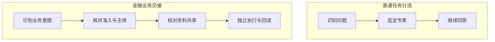
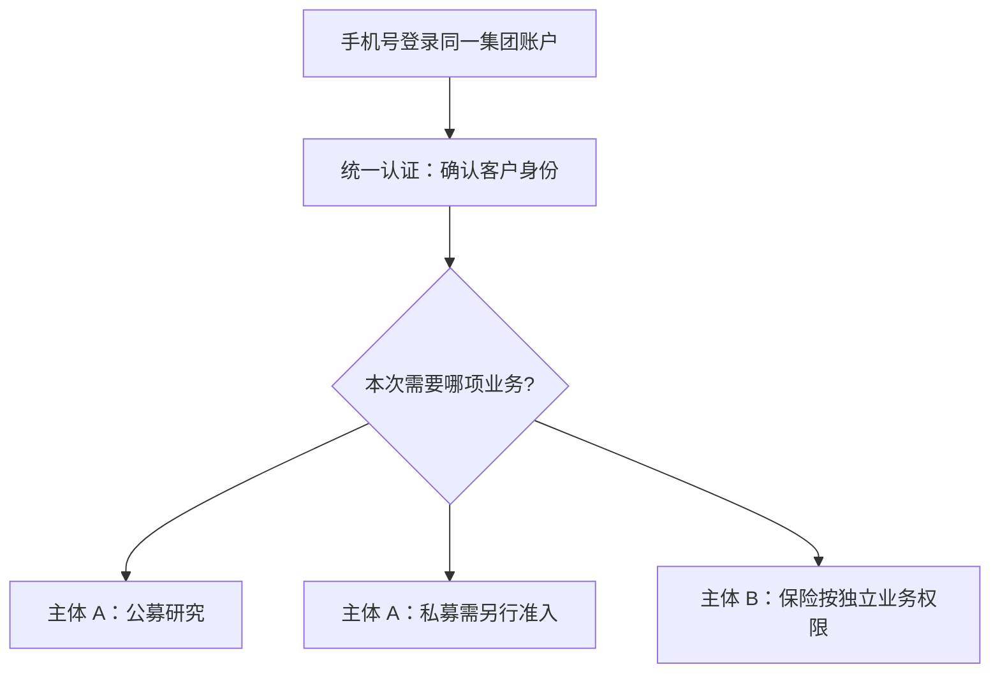
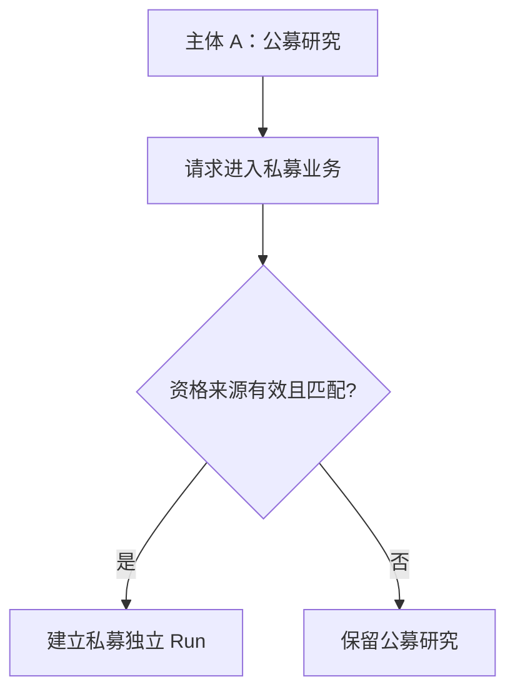
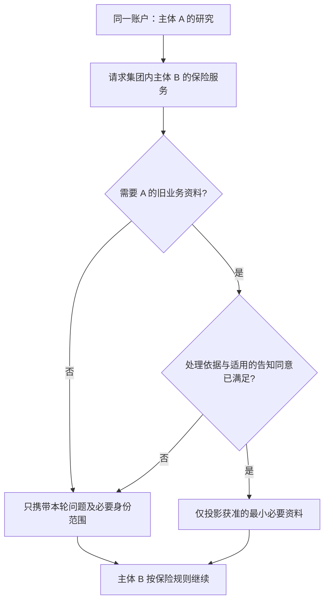
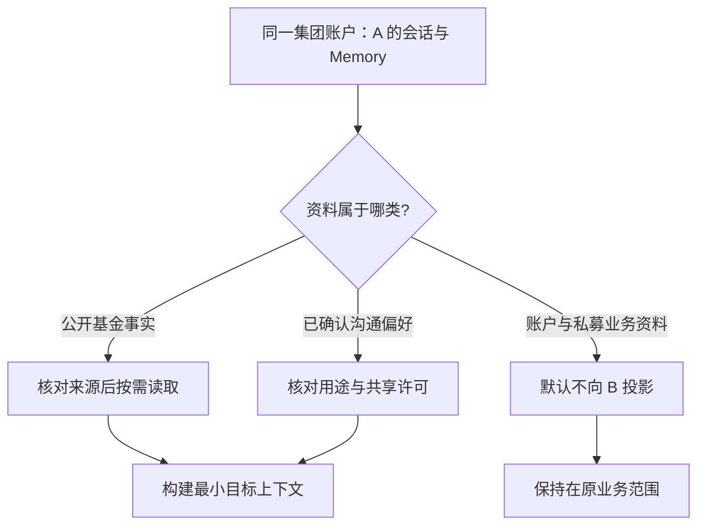
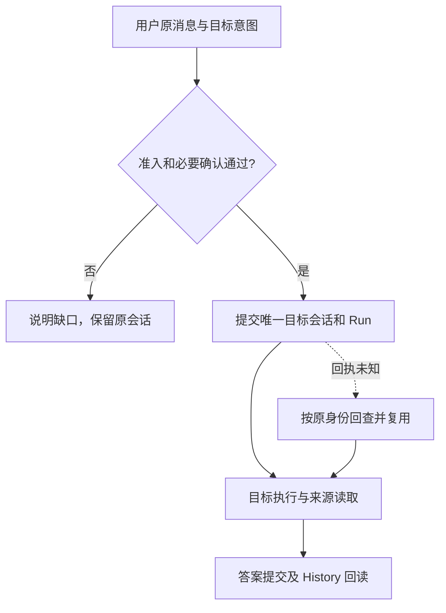

---
readingBrief:
  takeaways:
    - "统一登录只证明客户身份；业务准入、资料用途与责任变化时，切换确认、数据共享同意和交易确认必须分别处理。"
    - "目标业务按来源与用途接收最小获准上下文，不继承原业务的全部历史和权限；同一权限范围内仍可保留简单 Router。"
    - "目标创建、执行、答案提交与回读是不同事实；合成原型能恢复同一 Run，但未证明动态撤权、交易精确一次或真实机构合规。"
  appliesTo:
    - "设计金融集团内跨业务 Agent 的准入、历史隔离、独立执行与故障恢复。"
  notFor:
    - "不是可直接部署的合规方案，也不是公开版已集成保险业务或真实模型投研质量的证明。"
---
# 金融多业务 Agent 的可信交接：为什么不只是一个 Router？

*同一个金融集团、同一个手机号登录账户：从公募到私募再到保险，为什么不能让业务信息直接互通？*

> **范围说明**：本文以 ETF Agent 的受控合成原型为材料，核对至 2026 年 11 月 1 日。下文的客户、集团内业务运营主体 A/B、产品与资格均为教学模拟；A 承接公募和私募，B 承接保险。原型验证了确定性脚本网关下的业务交接、有限数据访问、结果回读和跨进程恢复；**没有**证明真实金融机构合规、真实语言模型投研质量、保险业务已集成到公开 Demo 或生产级动态撤权。引用法规用于解释设计依据，不构成针对特定机构的法律意见。

一位客户用手机号登录同一家金融集团的财富平台，先研究两只公募基金，接着问：“能不能把私募产品也放进来比较？”过了一会儿，他又问：“如果还想了解长期保险保障呢？”整个过程**没有换账户，也不需要为每个 Agent 再注册一个手机号**。

对普通多 Agent 产品，这看起来是两次意图切换：公募专家 → 私募专家 → 保险专家。模型选对专家，似乎就能继续聊天。但金融集团面临另一层问题：**同一个客户身份，只说明“是谁”，不说明“这项业务是否准入、哪些历史资料可以用于新目的”。** 如果保险 Agent 自动拿到投资持仓、私募资格、风险测评和完整聊天记录，统一账户就可能被错误地当成集团内部数据自由流通的许可。

这正是我们设计“可信交接”（Trusted Handoff）的起点：**让模型负责理解用户想做什么，让受信业务系统决定谁可以接、允许接走什么、实际完成到哪一步。**

## 一、先与普通 Agent Handoff 做一次正面对比

普通 Router 或 Handoff 并不低级。客服机器人把退款问题交给退款专家，研究助手把 PDF 解读交给文档专家，这些都是合理做法。OpenAI [Agents SDK Handoffs](https://openai.github.io/openai-agents-python/handoffs/) 甚至提供 `input_filter`、`on_handoff` 和按条件启用交接的机制；权限检查可以由开发者在回调中实现。它的标准 Handoff 发生在同一 Run 内，默认传递历史，除非开发者专门筛选。

我们的不同之处并非“普通框架完全没有安全能力”，而是**业务交接需要独立承担责任，不能只由一次模型工具调用来定义授权和数据范围**。

| 问题 | 典型普通 Agent 切换 | 本文的金融业务可信交接 |
| --- | --- | --- |
| 为什么切换 | 当前专家不擅长下一项任务 | 用户进入需要不同准入、数据或责任归属的业务 |
| 谁选择目标 | Router/模型按意图选择 | 模型提出目标，服务端按受信配置核定 |
| 目标能读什么 | 由开发者配置上下文/工具 | 业务资料逐项按来源、目的、主体及 Run 授权投影 |
| 登录账户与业务身份 | 常在同一任务身份下继续 | 同一手机号账户保持登录，但每项业务分别校验准入、上下文和授权 |
| 切完是否换会话 | 可以仍处于同一 Run | 必要时创建独立 Conversation 与目标 Run；**不是重新注册账户** |
| 什么时候询问用户 | 看工作流需要 | 依切换、跨主体提供资料、敏感信息和具体业务动作分别判断 |
| 出错后怎么继续 | 会话、检查点或框架恢复 | 按同一来源与目标身份核对已提交交接，避免重复开新任务 |

**图 1｜两类 Handoff 的责任范围。** 左边表示典型工作分流；右边展示额外的金融业务判定。它们不是互斥的两种框架，而是在相同 Agent 能力上叠加了不同约束。



如果只是同一受信范围内从“解释基金净值”切到“生成图表”，使用普通 Router 或一个 Agent 加 Skill 通常就足够。**同一账户登录也不要求每个意图都创建新会话。** 只有当**业务准入、信息使用目的、权限集合、确认责任或持久业务效果**真的变化时，才值得引入更重的交接合同。

## 二、一个集团账户、两个业务运营主体、三类业务

合成场景是一家金融集团的统一财富入口。客户**用一个手机号登录同一个集团账户**；登录服务认证客户身份，但不会把基金、私募、保险的业务数据自动并成一份可供所有 Agent 读取的资料库。

| 集团内业务 | 业务运营主体 | 代表 Agent | 独立规则 |
| --- | --- | --- | --- |
| 公募基金研究 | **A** | `fund-cn` | 按授权读取公募资料，不因此获得私募账户访问权 |
| 私募基金研究 | **A** | `private-cn` | 受限产品研究另查准入和资格，不能沿用公募 Run 的全部权限 |
| 保险保障服务 | **B** | `insurance-cn` | 按保险业务目的与权限处理信息，默认不读取 A 的私募历史 |

A 和 B **同属一个金融集团**，却代表不同的业务运营责任。它们是否是不同法人、不同个人信息处理者，原型并不据此推断；需要按真实集团组织架构与数据处理协议判断。技术上的 `operatorId=A/B` 是隔离维度，**不是**认定法律关系的凭证。集团账户标识可用来稳定识别同一客户，但不得把原始手机号直接当成模型输入中的跨业务授权令牌。

**图 2｜同一登录身份分流到三类业务：共用“是谁”，不共用“什么都能看”。** 箭头只表示可申请进入目标业务，不表示已获准访问或共享任何旧业务资料。



### 第一幕：A 内从公募到私募，变的是业务准入

客户刚看完两只公募基金的公开资料，想将私募产品纳入比较。私募专家确实更合适，但“想看私募”并不等于已获准使用定向私募资料或接受私募推介。

《[私募投资基金监督管理条例](https://www.mee.gov.cn/zcwj/gwywj/202307/t20230710_1035724.shtml)》第 18—20 条对私募募集、转让、合格投资者和推介设定限制；《[证券期货投资者适当性管理办法](https://www.csrc.gov.cn/csrc/c106256/c1653849/content.shtml)》要求经营机构了解投资者及产品、进行适当性匹配，并限制不当推介。因此，当用户进入**需要受限产品资料、定向推介或销售服务**的业务流程时，准入必须从受信资格来源验证，不能相信模型从聊天里猜出的“高净值客户”标签。

这里必须说清适用范围：监管并非要求人们询问任何公开的私募知识都先通过资格认证。**合成原型对整个私募目标 Run 使用更保守的准入策略，是工程策略，不是法条逐字规定。**

在本例中，A 的私募 Run 获取匹配且仍有效的合成 `eligible` 结果后才能开始。它可以通过指定只读工具查看先前的两只公募基金公开资料，但不会继承公募 Agent 的全部工具权限；反过来，公募 Agent 也不能自动读私募客户资料。

**图 3｜A 内切换：同一账户不替代私募准入。** 未通过时保留原公募研究，不强行开启私募 Run。



### 第二幕：同一账户转到集团内 B 的保险业务，变的是数据用途和责任归属

客户不退出账号，只是在同一聊天入口问：“再看看我的保险保障是否够。”保险专家由**集团内主体 B** 提供。B 可以接收经过认证的账户范围标识和本轮问题，但不意味着可以直接读取 A 留下的资产、私募持仓、风险测评或全部 Memory。**同一集团、同一手机号账户不等于同一个业务处理目的，更不等于所有数据共享已有合法依据。**

《[个人信息保护法](https://www.miit.gov.cn/jgsj/zfs/fl/art/2022/art_515a4b20c12f430eab54bb4f56d89f56.html)》第 6 条强调目的明确和最小必要，第 13—14 条涉及个人信息处理的合法依据和同意，第 23 条对**向其他个人信息处理者提供**个人信息规定告知和单独同意要求，第 28—29 条对金融账户等敏感个人信息提出更严格保护要求。**集团内的 A/B 是否构成两个独立处理者，必须依实际法人、处理目的和委托或共同处理关系判断；即使是同一处理者内部不同业务，也不能因一次手机号登录就无条件扩大数据使用目的。**

因此，原型将 **A → B 的集团内跨业务 Handoff** 默认设为**显式切换确认 + 旧业务历史隔离**：同一个账户不用重新登录，但用户要知道已进入 B 的保险服务，B 也不能自动继承 A 的完整资料。是否额外提供 A 的资料，需要在具体处理关系下逐项确认必要性、处理依据及适用的告知/同意条件。少量已确认、用途适配的沟通偏好可在受信规则许可时共享；“中文回答”即便不敏感，也不能仅因集团内部就忽略个人信息处理规则。

例如，客户只是询问“重疾险一般保什么”，B 没有必要拿到他的私募持仓；若客户主动要求“结合我的资产水平考虑保障预算”，系统也应先确定**需要的是哪项资产信息、该不该提供、能否用更小的摘要满足目的**，而不是把 A 的整个聊天历史发送给 B。这是教学示例，不是已验证的真实保险建议能力。

**图 4｜同一集团 A → B：确认切换与决定资料能否共享，是两件事。** B 可以在原登录态下接手，但旧业务资料默认不带走。



原型当前的轻量 HTTP Demo 主要演示 **A 内公募 → 私募**。集团内 **A → B 保险** 的跨运营主体路径仅在另一套合成 PostgreSQL/HTTP 场景中验证。**它模拟的是同一集团和同一账号体系，不是对接外部保险机构，也不是已开放给真实客户的完整一站式产品。**

## 三、让法规对应到具体业务动作，而不是堆“合规”名词

做金融 Agent 不是给每个节点加一个“合规检查”就结束。更重要的是：**一条义务由谁履行、在什么时候检查、出了问题能回查到什么依据。**

| 真实业务问题 | 对应依据（截至 2026-11-01） | 我们采用的工程响应 |
| --- | --- | --- |
| 可否向这位客户开放受限私募业务？ | 《私募投资基金监督管理条例》第 18—20 条；《证券期货投资者适当性管理办法》第 3、22 条 | 新目标 Run 读取受信资格及准入结果；不能从自然语言自证 |
| 相关销售或服务是否匹配客户？ | 《证券期货投资者适当性管理办法》第 6、18、24—25 条 | 客户评估、风险提示与确认由业务规则管理，并保留适用的业务证据 |
| 统一账户中的 A 业务资料能否用于集团内 B 的保险服务？ | 《个人信息保护法》第 6、13—14、21、23、28—29 条 | 先辨认实际处理关系和用途，再判断合法依据、必要告知/同意及最小可共享字段；统一登录不构成授权 |
| 保险业务能否按新风险和新目的开展？ | 《[金融机构产品适当性管理办法](https://policy.mofcom.gov.cn/claw/clawContent.shtml?id=103294)》（2026-02-01 起施行） | 目标业务另行承担客户识别、适当性与保险产品匹配；不复用私募资格充当保险适当性结果 |
| 高风险金融 AI 能否自动推进重大动作？ | 国家金融监管总局《[关于银行业保险业人工智能安全开发应用的指导意见](https://policy.mofcom.gov.cn/claw/clawContent.shtml?id=106182)》（2026-06-18） | 银行保险适用场景中，根据风险分级设计准入、人工监督干预与退出/替代流程 |

最后一份 2026 年指导意见**针对银行业保险业适用机构**，不能直接等同于对全部证券基金 Agent 的统一监管命令；但它为集团内 B 的保险场景提供了尤其贴近的依据。它强调高风险 AI 应用场景的准入与人工干预，也强调数据安全、责任可追溯及业务连续性。**对于指导意见明确列入高风险的适用场景，文件第（十六）项提出应经机构风险管理委员会批准后实施，第（十七）项要求关键环节建立人工监督和干预。**

还要避免把四种“同意”合成一个按钮：**业务切换确认、个人信息提供同意、产品风险揭示确认、交易或签约确认**所对应的目的、法律基础和效力不同。原型实现的类型化人工 Handoff 确认，只是其中一个业务控制，不自动取代其他法定流程。法规也没有指定必须使用 `Manifest`、`Run`、MCP 或三种历史模式。

## 四、交接时究竟可以带走哪些信息？

普通聊天产品常把整个历史交给下一位 Agent，以免重新提问。金融场景反而要先拆开资料来源与用途，再决定对新处理者而言什么是必要的。

**图 5｜从“整段聊天继承”变成“按用途选择历史”。** 下列分类是本例的设计示意，实际处理仍需逐项判断法律基础与来源许可。



项目在受控场景中提供 `isolated`、`selective` 和 `full` 三种历史投影模式。这里的 `full` 仅代表**对获准来源集合的完整投影**，不是绕过身份和来源权限的“所有聊天记录都发给你”。集团内从 A 到 B 的跨运营主体交接默认 `isolated`，即使使用的是同一个登录账户。用户的原始消息保留引用与身份，已提交助手正文须从可核查的发布结果读取；模型摘要、工具缓存与未经核验的 Memory 不能冒充原始授权资料。

权限还有方向性：在受信配置许可下，私募 Run 可以调用公募供应商的两个合成只读方法——`public_fund__get_fund_profile` 和 `public_fund__get_nav_history`，查询指定基金 ID 与有界日期范围；公募 Run 并不会因此获得私募持仓读取权限。供应商也不应收到整段私募会话。**共享公开研究事实，不等于共享私募账户权力。**

## 五、交接不是一句“已切换成功”，而是一组可以回查的业务事实

对于用户而言，最容易混淆的状态有四个：**目标业务已创建、目标 Run 已开始执行、答案已提交、结果和依据可回读**。这四个阶段不应该被页面上的一个“成功”图标合并。

**图 6｜一项交接的状态及失败处理。** 目标创建后即使页面关闭，也应找回原任务；不确定的网络回执不能直接触发第二次创建。



它与单次 Run 内的 Handoff 有一个重要差别：原会话不被改写，目标创建后有独立的 Conversation 与 Run。前端回到目标时应订阅原目标 Run，而不是再次提交一条看起来一样的普通用户消息。来源消息、目标 Agent 和动作身份构成可核对的幂等关系；未知回执先查询原事实，不能假定失败。

对于跨进程恢复，原型在合成 PostgreSQL 中保存已接纳业务的身份、配置和授权版本，在独立进程重启后恢复**同一个** Run。已接纳的旧 Run 遵循其冻结授权和停止规则；**新发起**的私募 Run 则重新读取当前资格。要注意：这并不等于支持运行中即时撤权，更不等于对投资下单等不可逆动作提供精确一次执行保证。

## 六、开发者可以如何复现这个思路，而不必复制整套 Runtime？

要把文章里的设计迁移到自己的系统，不需要先照搬我们全部的内部模块。更容易理解的最小路径，是先明确五份业务事实：

1. **可信身份**：同一手机号登录后，服务端确定客户账户范围；再为每个业务请求绑定运营主体、业务类型与具体 Agent。账户认证可以复用，但不能从手机号推导业务权限。
2. **目标准入**：进入受限业务前，独立查询资格或适当性判断；不能把模型预测当作资格来源。
3. **交接决定**：用户本次要去哪里，哪些资料需要传递，是否需要特定确认，以及确认对应哪一次请求。
4. **目标执行**：在目标独立 Run 中重新确定工具、数据来源与预算；受信 Host 再检查精确工具和入参。Manifest 类配置只限定能力上限，不代替具体 Run 授权和数据来源许可。
5. **结果与恢复**：保存目标身份、已产生的副作用、交付结果与可回查引用；重试时先读原提交而不是直接重新发送。

合成 HTTP 入口可用当前用户消息的 `businessHandoffTarget.agentId` 表示目标意图，但它不是自动授予目标业务权限。一个很小的示意合同便能表达差异（不是完整协议或可直接部署的安全实现）：

```json
{
  "source": { "operator": "A", "domain": "public-fund" },
  "target": { "operator": "A", "domain": "private-fund" },
  "admission": "trusted-eligibility-required",
  "history": "selective",
  "execution": "new-conversation-and-run"
}
```

实际落地还需研究：统一手机号账号如何映射成不暴露手机号的稳定客户身份、不同业务的权限怎样独立发放、资格结果如何验时效、数据来源如何逐项授权、集团内个人信息提供与委托处理的法律关系、幂等键及外部副作用如何恢复。读者可以先验证 **A 内公募→私募** 的受限路径，再验证同一集团、同一登录态下的 **A→B 保险** 历史隔离；不必第一步就建一个包揽所有法规的通用 Policy Engine。

和现有实现对照，可以从三个公开起点入手：

- [OpenAI Agents SDK — Handoffs](https://openai.github.io/openai-agents-python/handoffs/)：学习标准专家交接、回调及历史过滤，并重点理解其 **同一 Run** 语义。
- [LangGraph — Thinking in LangGraph](https://docs.langchain.com/oss/javascript/langgraph/thinking-in-langgraph)：学习显式工作流、状态、人工中断与检查点；再把业务准入和资料权限作为自己的应用规则补上。
- [NIST SP 800-162 — ABAC](https://csrc.nist.gov/pubs/sp/800/162/upd2/final)：用主体、资源、动作和环境属性思考准入判定，但不要误以为采用了 ABAC 就自动满足金融法规。
- [Open Policy Agent（OPA）](https://www.openpolicyagent.org/docs)：参考如何对结构化身份、资源和动作做外置策略决策。这是可选的业界实现路线，**不是本文原型已采用的组件**。

这些参考分别覆盖**编排、持续执行、访问控制及策略决策**，都不是开箱即用的“中国金融业务合规 Handoff”。原型的独特取舍，是沿用既有 Conversation、Run、MCP Host、Memory 和 Recovery 的事实负责人，不额外创造第二个权限中心。

对有权访问私有原型的开发者，轻量合成 Demo 可在本地以 `DEMO_BUSINESS_HANDOFF=true npm run demo:api` 启用（见仓库内部操作说明）。它不包含可直接面向真实客户的私募资格核验、集团内 A→B 完整保险业务或生产级合规流程。公开版 `open-etf-agent` 也不应被写成已经提供这套等价实现。

## 七、我们真正想守住的，是业务责任的连续性

回到这位客户：**他始终用同一个手机号账户登录同一家金融集团**。公募研究可以继续；私募业务能否接入，要看独立准入；转由集团内 B 处理保险问题时，不能因为“都是同一个客户”就复制 A 的私募持仓和聊天历史。只有在明确目的、处理依据和最小共享范围之后，才能决定交付哪些资料。即使新会话已经创建，也要能回查是谁处理、是否执行以及怎样恢复。

所以我们的目标从来不是把 Router 做复杂。**普通 Handoff 交接处理任务，金融可信 Handoff 还要交接有条件的业务责任。** 当所有业务仍在同一权限范围内，保留简单 Router；只有规则、资料和责任真实变化时，才把交接升级为可审查、可拒绝、可恢复的业务行为。

---

*延伸阅读：[模型会理解，代码才授权](/articles/011-model-understands-code-authorizes) · [从投资研究到投顾与交易的边界](/articles/030-fintech-from-research-to-investment-advice) · [持久人机交互](/articles/agent-durable-human-interaction-response-adoption)。本文引用的法规按发文机关原文判断适用范围；案例中的集团、主体 A/B、统一手机号账户设定、产品与测试结果均为合成示例，不代表真实客户业务。*
