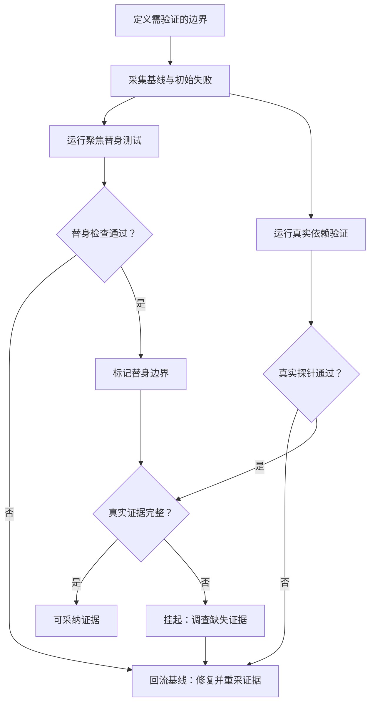

# 绿了，但并不是真的：如何让测试无法伪造生产边界

> 聚焦集全绿后，全量集仍待补；单测默认值也曾掩盖真机超时。本文回看这些结果为何不能互相替代。

## 缘起：一次看似完成的交付

那次迭代的聚焦用例跑出了满分结果。

所有人都松了一口气，觉得边界已经守住，可以收尾了。

可是切换到更大范围的全量集合时，结果却停在待补状态。

它不是可采纳的绿，而是在本例约定下结论为不采纳、需要回流基线的挂起。

这种落差逼我们重新审视一个基本问题。

测试的绿色到底在为什么事情背书。

是为真实生产边界背书，还是只为测试替身背书。

如果分不清这两者，绿灯越多，信心反而越脆弱。

本次复盘的结论很直接：绿色必须绑定边界类型。

没有边界标注的通过数，是难以跨环境比较的数字。

假绿的最大代价不是误报，而是让团队停止追问。

当所有人相信已经完成时，真实风险会被推迟暴露。

越到后期暴露，修复成本越高，复盘时越难还原现场。

我们后来约定，绿灯汇报需要附带边界说明。

说明只需三句话：哪里是替身，哪里是真实，哪里尚未验证。

写不出这三句话的绿灯，按团队评审约定退回重新采集证据。

我们还发现，假绿往往伴随口径不一致与证据缺环。

口径不一致让超时看起来合规，证据缺环让缺失看起来像通过。

把这两处堵住，大部分假绿在评审前就会现形。

本文出现的全部用例数与耗时，均为一次受控验证窗口内的示例记录，仅用于说明记法，不构成性能结论，也不构成通用承诺。

## 概念：先把绿色分成三种

为避免口径混淆，本文统一使用以下一组主词汇，其余表述均按此理解。

| 层面 | 取值 | 含义 |
| --- | --- | --- |
| 证据等级 | 已验证 / 未采集 | 证据是否来自真实执行并已记录；只谈证据完整度，不代表结论好坏 |
| 流程状态 | 挂起 / 回流基线 | 挂起表示证据未齐、等待补位；回流基线表示回到起点修复并重采证据 |
| 采纳结论 | 可采纳 / 不采纳 | 是否可以把当前结果作为交付依据；这是终局判断 |

三者的关系可以记成一句话：证据等级回答有没有证据，流程状态回答下一步去哪里，采纳结论回答能不能用。

已验证不等于可采纳。当真实执行确认边界不成立时，应记为证据等级已验证、采纳结论不采纳，并回流基线。

为方便后文阅读，这里先用通用语言说明四个常用词。

聚焦集指小范围快速验证集合，用于早期定位逻辑问题。

全量集指更大范围的验证集合，用于观察边界是否闭合。

证据台账指记录基线起点、红绿变化与中间观察的清单。

分层清单指区分临时放行项与真实依赖验证项的清单。

第一种绿叫替身绿，发生在完全隔离的替身环境里。

它的输入是伪造的，外部依赖是桩，时间是可控的。

它验证的是逻辑分支是否正确，不验证外部世界是否存在。

另一类证据是“真实依赖验证通过”：测试实际启动进程、连接隔离数据库或触达对应网络边界。

它只证明本次窗口覆盖到的边界，不代表生产质量或整体验收。

第三种不是绿，而是挂起，它看起来像黄灯，但比含糊的绿更诚实。

它明确声明某些证据尚未采集，结论暂为不采纳。

我们过去最大的错误，是把三种状态混成一个通过率。

聚焦集的满分属于替身绿，全量集的待补状态属于挂起。

两者不在同一坐标系里，不宜直接换算。

证据台账的价值正在于此：它强制对照基线边界。

每条记录需要写清红灯起点、绿灯终点和中间观察。

缺少基线对照的绿，按本例约定视为难以复核的陈述。

另一份分层清单则负责区分临时放行与补位。

临时放行是已知缺口的延期处理，补位是针对缺口的真实验证。

在一次示例窗口中，动态缺口计数为零、延期项为四，含义比较明确。

系统在该窗口内没有新增未知风险，但仍有四项工作只能延期处理。

这种诚实比满分更重要，因为它让风险可见且可追踪。

替身绿的适用范围是快速定位逻辑错误，而不是证明系统可用。

它的反馈周期短，适合在开发早期频繁运行。

但它的结论有效期也很短，一旦脱离替身环境即失效。

真实依赖验证通过只说明对应依赖边界在该次受控运行中成立。

它的运行成本高，数量注定稀少，但每一条都对应真实执行。

挂起的适用范围是阻止结论外溢，避免局部成功被误读为全局成功。

## 主流程：让假绿显形的一条流水线

下面这条主流程是我们事后沉淀的防伪造流水线。

它只有一个入口、两个验证分支，最终只有两种终局：可采纳，或回流基线。

挂起是通向回流基线的中间状态，不是第三种终局。



**关系或判断条件：**

- **CheckMockTests → ReturnToBaseline**：否。
- **CheckMockTests → MarkMockBoundary**：是。
- **CheckRealProbe → ReturnToBaseline**：否。
- **CheckRealProbe → CheckRealEvidence**：是。
- **CheckRealEvidence → AcceptEvidence**：是。
- **CheckRealEvidence → SuspendAndInvestigate**：否。

这张图的关键在于伪造边界这个中间节点。

替身全绿之后并不直接通向发布，而是先被打上伪造边界标记。

只有携带齐备真实依赖验证证据的替身绿，才能形成可采纳结论。

缺少真实依赖验证证据的替身绿，按本例约定先记为挂起，再回流基线补证据。

这种设计把过去的隐性假设变成了显性关卡。

它提醒评审者不要把局部绿灯误读为全局结论。

伪造边界标记并不是惩罚，而是一种保护性提示。

它提醒阅读者，这份绿灯尚未走完真实分支。

挂起同样不是终局，而是一种明确的待办状态。

它告诉后续工作应该补哪条探针，而不是笼统地重跑一遍。

只有当真实依赖验证证据到齐，挂起才能解除，结论才可能变为可采纳。

否则终局均为回流基线，回到起点修复并重采证据。

## 从输入到结构化输出：一个可复制的证据契约

为了让上述流程可执行，我们统一了证据的结构。

每个验证动作的输入都是声明式的，输出都是结构化的。

输入描述想要验证什么边界，输出描述实际观察到什么。

```json
{
  "caseIntent": "验证超时的治理上限是否生效",
  "boundaryType": "真实依赖验证",
  "inputs": {
    "unitDefaultTimeoutSec": 45,
    "modelTimeoutSec": 80,
    "governanceCapSec": 60,
    "callStyle": "逐次调用"
  },
  "observations": {
    "effectiveTimeoutSec": 80,
    "boundaryHolds": false,
    "evidenceLevel": "已验证",
    "adoption": "不采纳",
    "followUp": "修正超时透传方式后回流基线重测"
  }
}
```

这个契约有三点值得注意。

第一，输入需要同时写出三层超时，而不是只写一层。

单测默认值、模型超时与治理上限缺一不可。

第二，输出把边界是否成立与证据是否齐备分成两个字段。

边界是否成立记在 `boundaryHolds`，证据是否齐备记在 `evidenceLevel`。

替身结果不宜记为真实依赖验证，未经真实执行的推测不宜记为已验证。

第三，已验证不代表可采纳，输出需要显式写出采纳结论。

上例中 `boundaryHolds` 为假，即使 `evidenceLevel` 为已验证，采纳结论仍为不采纳，并触发回流基线。

这样记录后，已验证的上限违反不会再被误读为通过。

契约的另一半是分支的诚实性，可用伪逻辑概括。

先采集基线，再运行替身分支，然后运行真实依赖验证分支。

若补位分支缺失或不成立，最终先记挂起，再回流基线。

下文所谓契约拦截，均指团队评审约定下的人工核对动作，而非机器强制门禁。

契约的另一个作用是统一超时口径，避免各说各话。

总量超时回答一次任务最多等待多久，逐次超时回答单次调用最多等待多久。

在本例窗口中，两者相差一个数量级，混用容易让实测等待越过治理上限。

把三层数值写进同一份输出，评审时更容易发现错位。

## 机制：输入、规则、分支、失败与安全

输入层包含四类信息：边界声明、超时参数、隔离资源与预期结论。

边界声明回答验证对象是逻辑还是真实外部行为。

超时参数需要展开为默认值、透传值与治理上限三元组。

隔离资源指独立数据库、回环监听地址与独立进程空间。

预期结论需要预先写明什么算可采纳、什么算挂起并回流。

规则层包含四条评审约定，违反任何一条都不宜标为可采纳。

其一，替身绿不宜单独作为发布依据，需要配对真实依赖验证证据。

其二，分层清单需要区分临时放行项与待补证据项，不宜合并计数。

其三，超时参数需要按逐次调用口径解释，不宜混用总量口径。

其四，证据等级只有已验证与未采集两种，推测需要记为未采集。

分支层包含三条路径，分别对应逻辑正确、边界正确与结论待定。

替身分支负责快速反馈逻辑错误，失败即回流基线。

真实依赖验证分支负责暴露环境与配置错误，失败同样回流基线。

两者虽绿但证据链不完整时，先走挂起，再回流基线。

失败处理强调分级处理，而不是简单的重试。

逻辑失败直接回到基线修复，不进入补位分支浪费资源。

环境失败则保留现场并记录可复现的最小输入。

超时类失败需要同时记录三层超时数值，避免只修一层。

安全设计围绕隔离与最小暴露展开。

以下均为同一受控验证窗口内的示例记录，不作性能或规模承诺。

在该窗口内，真实依赖验证使用隔离数据库，示例记录为执行三条、跳过零条。

回环监听验证在该窗口内执行六十五个用例，窗口内记录耗时约一点八四秒。

结束后确认无残留进程，端口与临时资源全部回收。

真实通道验证在该窗口内采用标准输入输出方式，四条记录均为通过。

其中包含大结果截断类型的受控返回，在该窗口内观察到类型化截断返回，未观察到通道破坏。

这些数字本身并不重要，重要的是它们都来自该窗口内的真实执行。

隔离的意义在于可重复，而不是在于规模大。

独立数据库保证每次探针都从干净状态开始。

回环监听保证网络行为可观测且不污染外部环境。

标准通道探针则保证超大输出有明确的类型化截断语义。

三者共同构成该窗口内最小可信的真实依赖验证集合。

## 三组对照：绿色在不同边界下的真实含义

### 对照一：聚焦满分与全量待补

在一次示例窗口内，聚焦子集跑出三十二比三十二的满分结果。

这是在替身环境里取得的，速度快且稳定。

但全量集合在同一窗口内的记录停在十一项中的八项完成。

剩余部分在该窗口内证据已部分验证，但采纳结论为不采纳，需要回流基线。

如果只看标题数字，前者像是成功，后者像是失败。

可一旦补上边界标注，解读完全不同。

前者只是逻辑分支正确，后者揭示了生产边界尚未闭合。

我们最终把前者记为伪造边界标记，把后者作为真实进度。

这个决定当时有争议，但事后看它保住了复盘的诚实性。

### 对照二：放行清单与真实依赖验证的分工

在一次示例窗口内，分层清单给出动态缺口为零、延期四项的结果。

初看像是仍有欠账，需要继续投入才能收尾。

可清单同时明确区分了临时放行项与待补证据项。

零动态缺口意味着该窗口内没有新增未知风险。

四项延期意味着已知工作被显式推迟，而非被隐藏。

与之配合的真实探针来自隔离数据库与标准通道。

同一窗口内隔离库记录为执行三条、跳过零条，标准通道记录为四条通过。

这两组示例记录补上了清单无法覆盖的真实执行面。

清单回答风险是否可见，探针回答边界在该窗口内是否成立。

两者缺一不可，合并解读容易产生误导。

### 对照三：被默认值掩盖的超时真相

最有代表性的反转来自真实命令行的超时观察。

在该示例窗口内，单元侧默认超时为四十五秒，看起来留有充足余量。

可模型侧超时为八十秒，且被当作逐次调用超时透传。

治理上限为六十秒，逐次八十秒在该窗口的口径下已经越界。

由于单测替身从不真正等待八十秒，这个越界长期不可见。

只有真实命令行长时间运行后，才暴露了超时被掩盖的事实。

总量口径与逐次口径的混淆是该窗口内观察到的根因。

四十五秒是总量假设下的默认值，八十秒是逐次调用的真实等待。

把逐次值直接套进总量预算，在该窗口内观察到治理上限被越过。

修复方向不是调大上限，而是修正透传语义。

这次对照让我们立下一条团队约定：凡涉超时，需要三数同框。

## 证据分界：已验证与未采集的诚实分界

| 维度 | 已验证 | 未采集 |
| --- | --- | --- |
| 证据台账基线与红绿边界 | 基线、红灯、绿灯均有记录 | 缺少任一环节即按约定视为难以复核 |
| 聚焦子集结果 | 示例窗口内三十二比三十二替身绿成立 | 不宜外推为全量结论 |
| 全量集合结果 | 示例窗口内十一项中八项完成属实 | 剩余部分在该窗口内结论为不采纳，待回流补采 |
| 分层清单 | 示例窗口内动态缺口为零成立 | 四项延期仍待后续采集 |
| 标准通道探针 | 示例窗口内四条通过成立 | 超大结果行为需持续观察 |
| 隔离库探针 | 示例窗口内执行三条跳过零条成立 | 生产库行为不在本次范围 |
| 回环监听探针 | 示例窗口内六十五条约一点八四秒无残留成立 | 跨机器网络行为尚未覆盖 |
| 超时透传行为 | 示例窗口内三层数值关系已验证，且边界不成立 | 修正后的重测结果尚未采集 |

这张图的阅读方法只有一句话：左列是信心，右列是边界。

任何脱离右列引用左列的行为，都是对证据的误用。

我们约定每次汇报需要同时朗读左右两列。

只读左列的汇报会被按评审约定打回重写。

已验证只说明证据来自真实执行，不等于可采纳；是否采纳要看边界是否成立。

未采集不是空白，而是明确的工作清单。

每一项未采集都对应一个具体的补位动作和责任人。

只有把未采集写清楚，团队才知道下一步该补什么证据。

这比含糊的通过率更能推动进度，因为它指向行动。

## 结论：让每盏绿灯自带边界水印

回顾整个过程，真正的转折点不是某次修复。

而是我们承认聚焦集的满分只是一种替身绿。

承认全量集的待补不是终局失败，而是挂起并回流基线的诚实记录。

承认动态缺口为零与延期四项可以在同一窗口内同时成立。

承认四条通道通过与三条隔离库执行只是该窗口内的真实依赖验证证据。

承认六十五条回环验证的窗口内秒级记录不能替代长超时验证。

承认四十五秒默认值曾掩盖八十秒透传对六十秒上限的越过。

这些承认让绿灯第一次有了水印：边界类型、证据等级与采纳结论。

未来的改进方向已经非常具体，不再是空洞的加强测试。

第一，所有超时参数需要三数同框并注明口径。

第二，所有替身绿需要配对真实依赖验证才可能采纳。

第三，所有延期项需要在清单中显式保留，不宜提前消化。

第四，所有长时间行为需要走真实命令行复核。

当每盏绿灯都自带水印时，假绿自然失去生存空间。

水印的本质是把隐性假设变成显性文字。

读者不需要猜测绿灯背后的环境，只需阅读水印即可。

这种习惯一旦建立，评审效率反而会提高。

因为争议从观点之争变成了证据之争。

这正是我们想要留给后来者的经验。

后来者不需要重复我们的弯路，只需沿用这套边界记法。

每次新增验证，先问边界类型，再问真实依赖验证证据，最后才看通过数。

顺序正确，绿灯才可信，交付才安稳。
