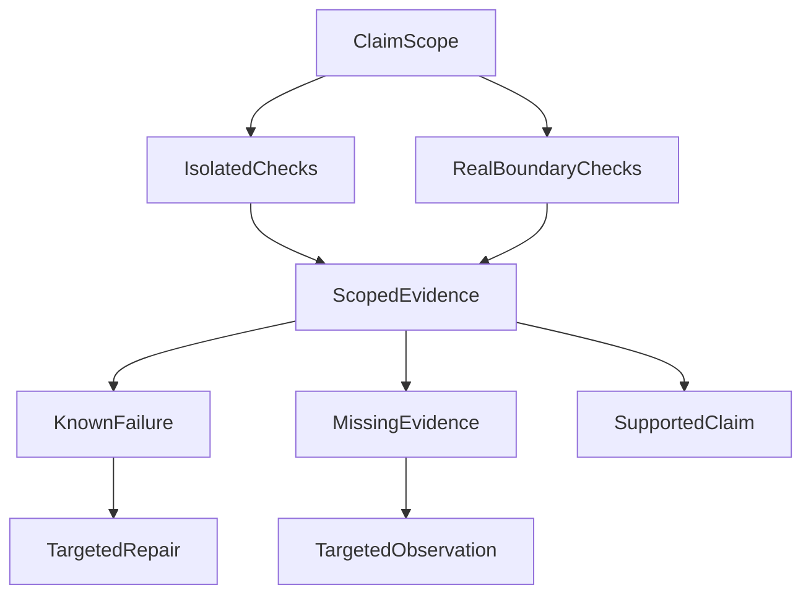

# 测试全绿、模型有返回，就算 Agent 成功了吗？

在早期 Agent 模型评测中，我遇到过一个挺别扭的问题。

服务端有候选答案，自动裁判也给了结果，运行状态甚至已经是 `completed`。如果只看评测报表，这次请求似乎已经结束了。

但继续往前端链路看，会发现事情没有这么简单：候选答案存在，不代表它真的被发送；服务端记录了发送，也不一定等于浏览器最终完整接收和展示。

这几个状态以前很容易被我下意识地当成一回事。

后来我发现，评测报告最容易误导人的地方，是**把不同层级的“成功”压成一个通过状态**。分数可能很好看，实际交付链却仍有缺口。本文先把这些状态拆开，再讨论怎样据此比较模型。

> 我们到底在评测什么？又凭什么说一次 Agent 请求真的成功了？

下面把两类证据放到一起看：工程测试有没有跨过它声称的边界，以及模型评测有没有使用真正交付的内容。这些案例属于各自的历史验证窗口，用于解释判断方法，不是当前评测模块、命令或模型排名的清单。

---

## 先确定这次测试究竟跨过了哪条边界

另一轮工程验证里，聚焦替身集合记录为 **32/32 通过**，更大范围却只有 **11 项中的 8 项完成**。这两项结果都可以真实，但不能合成“系统已经可用”。前者验证的是被替身隔离的逻辑，后者暴露了原验收范围仍有缺口。

替身测试可以控制输入、外部依赖和时间，适合定位逻辑分支。真实依赖验证则实际启动进程、连接隔离数据库，或经过标准输入输出、回环网络等边界。一次通过只能支持它真正触达的范围。

这里有三个独立问题：

| 维度 | 要记录什么 | 不能偷换成什么 |
| --- | --- | --- |
| 观察证据 | 在哪个版本和环境中实际观察到了什么；未执行则写未采集 | 有真实观察就等于行为通过 |
| 后续工作 | 已有确定缺陷，还是缺少特定证据；下一步修哪里或补什么 | 未知就是失败，或必须重跑全部检查 |
| 采纳结论 | 当前证据能否支持这次声明范围内的完成或发布判断 | 局部通过就是整体交付完成 |

真实执行完全可能证明一个边界**没有成立**。这时证据是有效的，行为结论却是失败；“已验证”不能被读成“已通过”。同样，未采集不能写成零失败。

这也不意味着每个小改动都必须跑真实外部依赖。验证投入应对应具体声明：本地逻辑可以用相应确定性测试证明；若要声称进程、数据库或网络交接已成立，就需要触达那条边界的证据。已有证据足够且行为未变时，也无需因为整理报告重新跑一遍。

### 三个超时数值，为什么必须放在一起看？

一个更具体的反例来自命令行超时检查。原受控窗口里，单元侧默认值为 **45 秒**，模型侧透传为**逐次调用 80 秒**，治理上限为 **60 秒**。替身从不真正等待 80 秒，单看默认值就会漏掉实际透传已经越界。

总任务期限与单次调用期限回答的是不同问题。修复方向应是对齐期限的起点、作用范围与透传语义，而不是看到等待太久就统一调大上限。

下面是对该记录的教学化表达，不是现行运行协议：

```json
{
  "boundary": "per-call timeout propagation",
  "unitDefaultTimeoutSec": 45,
  "modelTimeoutSec": 80,
  "governanceCapSec": 60,
  "observation": "the propagated per-call value exceeds the stated cap",
  "boundaryHolds": false,
  "postFixRerun": "not collected in this window"
}
```

原窗口没有采集修复后的重测结果，不能因为已经找到修复方向，就把失败记录改成通过。超时报告应同时展示默认值、实际透传值和上限，并说明计时口径；它们不是三个可以互相替代的数字。

---

## completed 只说明程序走到了某个状态

普通接口里，我们很习惯看一个请求是成功还是失败。

但 Agent 的链路要长很多。

一次看起来普通的问答，可能经历：

用户提交问题后，Runtime 请求模型研究与回答；候选经过发布，再由服务端发送，客户端接收并展示。每次交接只证明本段事实：候选答案、服务端发送、客户端接收和界面展示需要各自的观测证据。

```text
用户问题
→ 规划
→ 工具调用
→ 证据整理
→ 生成候选答案
→ 质量检查
→ 流式发送
→ 前端接收和展示
```

这些环节并不是同时成功或失败的。

比如：

- JSON 合法，但规划理解错了问题；
- 规划没问题，但需要的工具根本没调用；
- 工具调用成功，但证据已经过期；
- 候选答案写得很好，但发布校验没通过；
- 服务端开始发流了，但中间断掉；
- 服务端认为发送完成，客户端却没有足够证据证明完整渲染。

以前如果最后只留一个 `success=true`，这些差异就全没了。

所以我后来更愿意把一次评测拆成几个独立的问题：

| 层面 | 真正要确认的事情 |
| --- | --- |
| 协议 | 输出能不能被系统正常解析 |
| 规划 | 模型有没有理解任务和需要的证据 |
| 证据 | 需要的数据是不是真的拿到了 |
| 回答 | 最终内容是否正确、安全、和证据一致 |
| 交付 | 这份内容是否真的进入了用户侧链路 |

前一项通过，不能替后一项背书。

HTTP 200 不能证明回答正确，`completed` 也不能证明用户看到了答案。

这个区别看起来很基础，但我们后面不少评测问题，根源都在这里。

---

## 我不再急着算一个总分

一开始做模型比较时，很自然会想得到一个分数。

比如协议、规划、工具调用、回答质量各自打分，最后加权成 82 分、87 分、91 分。

问题是，有些东西其实不适合被平均。

如果一个模型语言质量很好，但关键证据没有拿到，我不希望“表达能力”把“证据缺失”抵消掉。

如果一次请求根本没有把答案送出去，也不应该因为服务端候选内容很好，就得到一个不错的综合分。

所以现在更接近这样的记录方式：

```text
Protocol = pass
Planning = pass
Evidence = inconclusive
Answer = not_evaluated
Delivery = pass
```

这组结果没有一个特别漂亮的总分，但它更有用。

我一眼就知道：协议和规划没问题，交付链也跑了，但证据还没有闭合，所以这次结果不能拿去证明模型质量。

这里有个词我觉得很重要：`inconclusive`。

它不是“比较委婉的 failed”。

`failed` 表示我们已经有足够证据说明它没达到要求。

`inconclusive` 表示证据还不够，暂时不知道。

这两种状态后续动作完全不同。前者应该修，后者应该补证据。

如果把它们都算成 0 分，最后得到的模型排名会混入很多基础设施噪音。

---

## 比总分更容易骗人的，是分母

后来真正让我警惕的，是另一个更隐蔽的问题：**评测分母会偷偷变小。**

假设原本计划跑 30 题。

结果其中 20 题因为排队、超时或者工具问题，没有在观察窗口内完成。剩下 10 题里，有 9 题返回了非空内容。

这时候写：

> 已完成样本中，9/10 返回了答案。

没有问题。

但如果把它写成：

> 成功率 90%。

意思就完全变了。

因为那 20 个没跑完的题，很可能恰恰是长上下文、多工具、复杂纠错或者更容易暴露问题的题。

它们通常不是随机缺失。

如果只看已经跑完的样本，最后测到的其实是：

> 模型在“它成功完成的那些题”里的表现。

而不是它在原始题集上的表现。

这也是为什么后来我越来越坚持固定分母。

一次评测开始之前，就把下面这些东西固定下来：

```json
{
  "suite": "agent-cases-v1",
  "sourceHash": "sha256:...",
  "revision": "git-revision",
  "modelId": "provider/model-version",
  "profile": "live-read-only",
  "attempt": 1
}
```

题集变了，算新窗口。

代码变了，算新窗口。

模型版本变了，也算新窗口。

可以做前后对比，但不能把不同条件下的结果直接拼在一起，再算一个更好看的百分比。

这条规则其实挺反人性的，因为它会让报表变难看。

但失败样本不应该因为“没有完成”就从统计里消失。

有时候，没完成的那些题才是最值钱的样本。

---

## 裁判看到的答案，不一定是用户拿到的答案

这可能是整套评测里我最在意的一点。

很多自动评测都发生在服务端。

模型生成一个候选对象，系统把它交给裁判，裁判开始检查事实、格式、引用、语气，然后给出一个 verdict。

技术上完全合理。

但如果真实产品是流式交付，就多了一层问题：

**裁判评的那份内容，和用户实际收到的内容，是同一份吗？**

它们可能不是。

一个候选答案可能已经完整生成，但在发布校验时被拒绝。

也可能开始发送，前半段到了，后半段因为超时没有出去。

甚至服务端已经记录了 `send`，但如果没有客户端 ACK、接收事件或者渲染侧证据，我们最多只能说：

> 服务端确认发送过这些内容。

不能再往前一步说：

> 用户一定完整看到了这些内容。

这个边界我觉得有必要说得很死。

所以评测里最好至少区分三层：

```text
模型候选内容
    ↓
服务端实际发送内容
    ↓
客户端接收 / 展示证据
```

我们当前最容易可靠重建的是第二层：从真实发送事件按顺序拼出“服务端交付材料”。

如果客户端还有 ACK、消息序号或渲染回执，可以继续证明第三层。

如果没有，就不要为了让指标名字好听，把“已发送”写成“用户已看到”。

### 服务端交付材料怎么重建

对流式系统来说，答案不是一个最终字符串，而是一段事件历史。

例如：

```text
run started
tool call
tool result
text delta #1
text delta #2
text delta #3
terminal
```

评测用的正文应该尽量从真实对外发送的 `text delta` 重建，而不是直接拿后台保存的候选答案。

这样做之后，一个很常见的假 Green 会自然消失：

> 裁判认为答案完整，但用户侧实际上只收到前半段。

如果流在中途断了，评测材料也只能包含已经真正发送出去的部分。

后台后来补写了一个更完整版本，也不能反过来修改那次运行的历史。

这一点让我觉得，Agent 评测和普通 benchmark 很不一样。

它评的不只是模型输出，还在评一个分布式系统的交付过程。

---

## 评测系统自己也会犯错

做到这里，还有一个问题绕不过去：

**如果错的是评测器本身怎么办？**

我们确实遇到过这种情况。

某一类输出因为夹具或者校验合同的问题，被机械地判成失败。后来修正评测逻辑后，同一批受影响样本的结果发生了明显变化，但仍然保留了一部分真实失败。

最简单的做法当然是直接改旧结果。

但这样一来，第一次为什么失败、后来为什么改判，就再也说不清了。

所以后来采用的思路更像账本：

```text
原始评测结果不改
        +
追加 correction
        ↓
生成新的修订视图
```

一条 correction 至少要知道：

- 它修改的是哪一次评测；
- 哪些 case 受影响；
- 原来的 verdict 是什么；
- 新 verdict 是什么；
- 为什么改；
- 它对应的原始输入和版本是不是同一份。

可以简单理解成：

```text
RevisedView = RawLedger + ValidCorrections
```

这里的重点不是公式，而是 `RawLedger` 不被覆盖。

如果以后发现第二次修正也有问题，可以再追加一条，而不是继续篡改历史。

这对调模型也很重要。

否则几轮之后，你看到的是一张“修过很多次但不知道修过什么”的榜单，很难再判断提升到底来自模型、Runtime，还是评测器自己。

---

## 不要把不同验证窗口拼成一张总成绩单

一组替身测试通过，与更大范围里尚有未完成项，可以同时成立。问题不在于哪组数字更漂亮，而在于它们触达的依赖边界不同。数据库、网络、真实模型回答和用户实际收到的内容，都不能因为另一个局部检查成功而自动算作通过。

评测系统本身也可能误判，因此原始结果与后续更正应分别留存。发现明确缺陷就定向修复，缺少关键观察就补足对应证据，不必为了展示“全绿”不断扩大验证范围。

## 最后，我们把发布模型结论变成了一个门槛问题

做到后面，我发现其实不需要设计一个特别复杂的总评分公式。

先问三个问题就够了。

### 1. 这次比较是不是同一场实验？

题集、代码、模型、配置、数据快照和分母是否对得上。

对不上，就不要硬比。

### 2. 有硬门没有通过吗？

比如协议、安全、隐私、关键证据、交付。

这次比较已经声明为必需的条件若明确失败，候选就不应依靠其他高分进入该角色的后续排名。不能把某项可选能力的缺口顺手升级为所有用途的否决。

### 3. 还有关键状态未知吗？

如果关键证据还是 `inconclusive`，那就保持 provisional。

先补证据，再谈冠军。

只有通过这几层之后，质量、稳定性、延迟和成本这些指标才适合真正拿来比较。

伪代码大概是：

```text
if not same_experiment:
    return inconclusive

if hard_gate_failed:
    return not_eligible

if hard_gate_unknown:
    return provisional

return compare_quality_reliability_latency_cost()
```

它看起来没有一个漂亮的“智能评分公式”。

但实际用下来，我反而更信任这种东西。

因为它不会让一个 95 分掩盖掉“答案根本没发出去”。

---

## 让每个结论停在它真正证明的地方

一项声明应先确定范围，再选择相应测试，最后根据观察得出限定结论：



图中的两种检查按声明需要选择，不要求所有改动同时运行。已有证据可能支持一个范围内的结论，也可能证明失败，或仍不足以判断；修复和补观察因此是不同的下一步。

`completed`、候选正文、裁判通过、服务端发送与客户端展示是不同事实。替身绿与真实依赖验证也是不同证据。先把这些区别保留下来，再比较模型质量、稳定性、延迟和成本，结果才有可解释的含义。

**每次看到一个 Green，先问它证明的是哪条边界、哪个版本和哪份实际内容。** 数字本身可以完全正确，结论仍可能越过它能够支持的范围。

---

这里用到的是[方法 5「验证与故障归因」](/principles#method-5)：确定性契约适合做明确的边界回归，模型与用户效果则按风险选择真实对照；评测结论不能越过本次观察实际覆盖的版本、输入与交付范围。

## 延伸阅读

想进一步了解原始运行观察怎样留存和修订，可阅读 [Spec 与 Evidence 工作流](026-agent-spec-evidence-workflow.md)。更多文章见 [GitHub 技术文集](https://github.com/hpoenixf/eff-agent-article)，欢迎交流。
