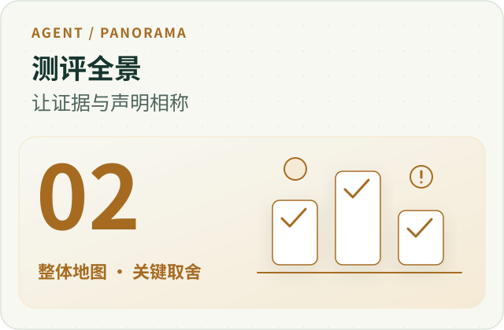
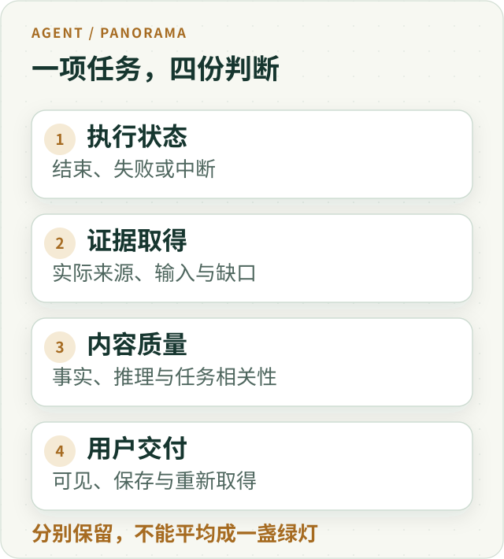
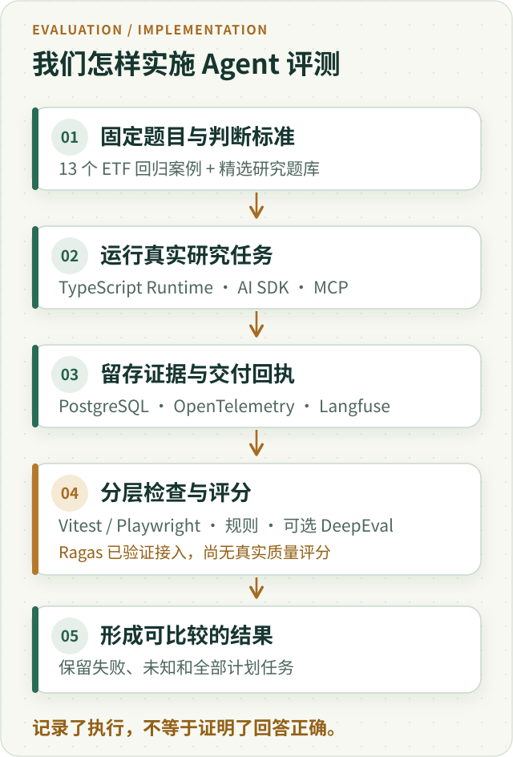
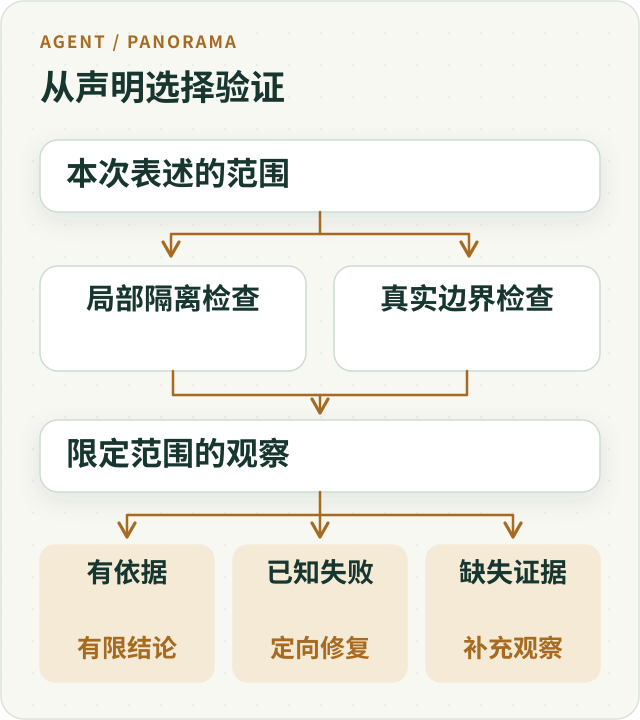

---
readingBrief:
  takeaways:
    - "运行、证据、内容质量与交付分别判断；裁判必须评与声明对应的实际内容，后台候选和正常结束都不等于用户任务完成。"
    - "固定输入、版本、预算与全部计划样本，保留失败和未知；只有可比窗口才谈质量成本，片段命中与检索高分不等于收益。"
    - "先校准裁判并检查评语依据，修正评测器时保留原观察；按行为风险选验证深度，不因局部绿灯发布模型排名。"
  appliesTo:
    - "设计 Agent 回归、真实研究测评或模型对照，需要厘清评分对象、样本分母与证据资格的团队。"
  notFor:
    - "不提供当前模型排行榜或完整生产验收；不要求每个小改动重跑全部真实模型任务。"
---
# Agent 测评全景：从测试绿灯到真实任务价值



**绿灯只说明某项检查在给定条件下通过，不会自动证明用户的任务已经完成。** Agent 评测最重要的工作，是先确认检查了哪条边界、评的是哪份内容、分母包含哪些任务，再比较质量和成本。

这不是要求每次修改都重跑整套研究，而是让证据与声明相匹配：局部逻辑用局部检查，跨进程效果看真实交接，模型质量看实际产物。否则，一个准确的测试数字也可能支撑一项错误的产品结论。

我们早期遇到过这样的情况：服务端有候选答案，自动裁判给出了结果，运行状态甚至已经是 `completed`；继续沿前端链路检查，却发现候选存在、服务端发送、浏览器收到和展示，并不是同一个事实。

下面的历史案例解释如何避免这种误判，不作为当前模型排名或完整生产验收结果。

为了让这些判断真正能复用，本文还把同一项目里有关 RAG 检索、多专家贡献、Trace、模型裁判与成本的实践放在一起：不是每个技术指标都要取消，而是要知道**它测到了什么、缺了哪个环节，以及在什么条件下才值得改变设计**。

## 先给出地图：评测的对象是模型与系统共同完成的任务

假设要比较两个研究方案：一个由主 Agent（Main）直接研究，另一个把部分任务交给三个子 Agent（Child，即在独立上下文里处理指定工作的助手）。只看最终文本，可能遗漏工具没有执行、专家没有读到资料或正文没有保存；只看执行状态，又可能漏掉一个顺利结束但答非所问的任务。

因此，一份可用于决策的评测应同时保留四个坐标：**运行做了什么、依据取得多少、内容判断怎样、用户得到什么。** 这四个坐标可以互相解释，不应挤成一枚代表一切的绿灯。



*图 1 · 运行失败仍可能留下有用正文；运行完成也可能留下错误判断。图中的坐标是评测视角，不是新增四个运行时审批层。*

下文沿“提出声明 → 设计样本 → 执行任务 → 确认评分对象 → 解释差异”展开。工程测试帮助我们验证确定性的约定，真实模型评测检查开放任务中的表现，用户观察检查实际取得的价值。它们组成互补证据，不是每次修改都要逐级重跑的固定仪式。

## 我们实际用了什么技术？各自负责什么？

这里的案例来自 ETF Agent 的研发评测链路，不是某个现成评测平台一键生成的成绩。系统的主要研究执行由 **Node.js / TypeScript 编写的 Research Runtime（研究运行时，即管理模型调用、工具使用与任务状态的程序）**承担；测评器在其外侧选择题目、记录结果，不另造一套执行系统。



*图 2 · 这是一张职责图，不是新增五层审批。模型、工具和评分器都不能绕过实际来源与交付记录。*

| 技术或机制 | 在评测里做什么 |
| --- | --- |
| **Research Runtime、AI SDK、MCP** | 让主 Agent 和子 Agent 使用模型、检索及计算工具，记录每次真实任务执行（Run）；MCP 是连接外部工具的一种协议。 |
| **Golden Dataset（金标准测试集）、精选研究题库、自建评测脚本** | 固定问题、资料版本、预期行为、重复次数和全部计划样本；对真实运行做有限条件下的对比。 |
| **Vitest、Playwright、PostgreSQL** | 分别检查确定性代码行为、浏览器端交付、数据库及跨进程的实际交接。 |
| **OpenTelemetry、Langfuse** | 通过 Trace（一次请求内模型与工具步骤的记录）定位超时、失败和成本线索；Trace 有记录，不等于答案正确或浏览器已经展示。 |
| **业务规则检查、模型裁判、人工复核、可选 DeepEval** | 分开检查数字与权限、回答是否有依据、回答质量和高风险争议；不能用模型打分覆盖代码已确认的违规。 |
| **Ragas（可选、尚未形成真实质量分）** | 面向检索增强生成（RAG：先检索材料、再让模型回答）的专门指标；目前只完成部分 SDK/隔离接入验证，后文说明实际状态。 |

它们不是串起来就能自动盖章的流水线。例如，Langfuse 能显示模型调用结束，PostgreSQL 能证明一份正文已保存，只有拿到实际发送内容与必要的客户端记录，才能进一步判断用户收到了什么。公开的 [Open ETF Agent](https://github.com/hpoenixf/open-etf-agent) 可供学习部分可运行机制，但不是这套私有评测系统的完整开源复刻。

## 一、先说清楚：这一盏绿灯照到了哪里？

**替身测试（mock test）**就是用可控的假接口代替真实依赖：比如让假的行情接口固定返回一份价格数据，不连接真实服务。这样能稳定检查局部逻辑，却无法证明真实接口、网络或数据库一定可用。真实依赖验证则实际启动进程、连接数据库或跨越网络。两者都有价值，但回答的问题不同。

我们曾观察到一组使用模拟依赖的小范围检查全部通过，更大范围的验收却仍有未完成项。问题不是哪组数字更漂亮，而是较小的检查没有触及尚未成立的那些交接。

一个更具体的反例来自命令行超时验证：

| 原受控窗口中的值 | 数值 | 含义 |
| --- | --- | --- |
| 单元侧默认值 | 45 秒 | 局部测试看到的默认配置 |
| 实际传给模型调用的值 | 每次调用 80 秒 | 后续调用实际收到的超时限制 |
| 治理上限 | 60 秒 | 当时声明的上界 |

模拟接口不会真的等待 80 秒，只检查默认值就可能错过实际传给模型调用的超时限制已经超标。总任务期限与单次调用超时还具有不同的起点和作用范围，不能看到等待过长就把所有上限一起调大。

这个窗口定位了问题和修复方向，但没有采集修复后的重测结果。因此它仍是一条失败观察，而不是事后补写的通过记录。

**验证对象应当是调用者真正依赖的行为，而不只是最容易检查的配置或返回值。** 声称数据库交接成立，就需要触达数据库；只修改一个不读写外部系统、仅按输入计算的函数（纯函数），则不必为证明局部逻辑重新运行全部外部依赖。

### 先证明故障真的发生，再证明系统能恢复

另一次恢复测试里，模拟环境声称“旧 Worker（后台执行进程）已经停止”，实际却仍允许它继续写检查点、执行收尾。此时恢复模块拒绝一份尚未封存的请求，并不是恢复能力差；是测试没有制造它宣称的故障。

后来把故障注入放到旧 Worker 真正写入的地方：先留下可核对的检查点，再明确阻断旧进程的后续写入，才观察恢复者如何处理。容量测试也一样，不应随手减去固定的 4,000 字节，而应先测量原结果究竟有多少内容可省。**测试输入首先要满足所声称的前提；否则测试绿灯和红灯都可能与目标机制无关。** 这属于受控测试设计教训，不是说用户线上真的遇到了相同中断。

## 二、不要用一个总分抹掉不同的失败

一次 Agent 请求可能经历理解问题、取得材料、生成候选、发布、发送和界面展示。协议合法并不证明问题被理解；工具返回并不证明材料适用；一份好答案也可能没有交付。

评测至少应该分别回答：

| 层面 | 需要确认什么 |
| --- | --- |
| 协议 | 输出能否正常解析 |
| 研究与证据 | 是否理解任务，并取得所需的合格材料 |
| 回答 | 内容是否准确、恰当且有依据 |
| 交付 | 实际内容到达了服务端发送、客户端接收还是展示的哪一层 |

有些条件不能被平均。表达流畅不能抵消关键材料缺失；没有发送答案，也不该因为后台候选写得好而获得漂亮总分。

同样，失败和未知要分开。`failed` 表示已有证据说明要求没有满足；`inconclusive` 表示证据不足以判断。前者需要修复，后者需要补充相应观察。把两者都记成零分，会把基础设施缺口混入模型能力评价。

这不是取消综合比较，而是先确定候选是否满足本次用途的必要条件，再比较回答质量、可靠性、延迟与成本。可选能力的不足，也不应被顺手升级为所有用途的否决条件。

### 别把“有引用”当作“主张已核验”

[引用可靠性专题](ai-citations-do-not-prove-reliability.md)给了一个很有用的对照：即使两只基金的前十大持仓有六只名称相同，也只能说**已披露的前十大存在重叠**；如果缺少完整持仓、各项权重和用户投入比例，就不能顺势宣布整个组合“严重重复配置”。引用真实、页码正确、数字抄对，并没有自动证明推理充分，更没有证明回答解决了用户的问题。

因此，确定性代码应检查资料身份、金额计算、时间口径、权限与账本不变量；模型裁判或人审再判断关键结论是否得到这些事实支持、是否遗漏了限制。若只有一个可观察的拒绝阶段，也只能记录**最后确认阻止交付的环节**，不能因为它恰好报错，就自动写成深层根因。这个区分能避免把发布校验问题反复归罪于模型供应商。

## 三、最容易悄悄改变结论的，是分母

看一个假设例子：计划评测 30 题，其中 20 题因为排队、超时或工具问题，在观察窗口内没有完成。剩余 10 题中，有 9 题返回非空内容。

“已完成样本中，9/10 返回了答案”是准确描述；直接写“成功率 90%”则改变了口径，还把非空内容偷换成任务成功。

未完成的题目可能更长、更复杂，需要更多工具和纠错。它们不一定是随机缺失；只看完成的部分，容易把最能暴露问题的样本排除掉。

因此，评测前应固定题集、数据快照、代码版本、模型版本、配置和原始分母。任何条件变化，都要保留自己的观察窗口。可以比较不同版本，但不能把不同条件下的结果拼成一次更好看的实验。

这里的可执行判断很简单：**先展示全部计划任务去了哪里，再讨论已完成部分的质量。** 未完成、失败、未知和有可用答案的样本都应该留在各自位置，而不是从统计中消失。

### 同一批真实运行，三个分母相同的结论也不相同

2026 年 10 月 30—31 日的专家研究测评，为前面的区分提供了一个具体例子。计划 120 次运行，当时实际结束 59 次，另 61 次尚未执行；不能把计划次数当成已完成的证据，也不能把重复题目的独立运行写成互不重复的问题。

按研究运行时（Runtime）的最终执行状态，59 次中 42 次 completed、17 次 failed；按正文观察，48 次有可见且确认保存的正文，其中 6 次来自 Runtime 失败的运行。自动测评另记录 40 次 inconclusive、19 次 failed。这三套状态描述执行、交付观察和评测判定，不能互换成金融语义正确率。

失败后已有部分正文，不等于整项任务完成；程序正常结束，也不等于回答已经独立核验。完整质量对照尚未完成，失败和未执行样本都应保留原身份。协作贡献的具体取证方法见[多专家 Agent 的贡献证据](agent-subagent-contribution-evidence.md)，观测查询与实际覆盖的差别见[Trace 完整性案例](agent-trace-complete-observation-gaps.md)。

### 另一个容易被隐藏的分母：哪些事件根本没有被采集？

同一批 59 次运行的 Trace 查询都返回了 `complete`，但独立回查发现 **17 条模型轮次输出缺失**，41 次运行存在工具协议观测缺口，观测器累计报告遗漏 851,339 个事件。这个计数是**采集器报告的协议事件**，不是 851,339 次工具执行失败，更不能据此推断具体哪条工具调用没有发生。

[Trace 完整性专题](agent-trace-complete-observation-gaps.md)解释了关键机制：一次流式工具调用可能拆成许多小碎片，很快耗尽观测容量；即使查询读完所有已保存的页，采集器也可能早已丢掉一些事件。后续改进选择在原容量内区分被遗漏的碎片与其他协议事件，而非无限扩容；历史缺失事件仍然未知，不反向补成零。

所以“查询完整”“请求输入输出完整”“工具生命周期完整”“原执行和交付完整”需要分别表示。Trace 有缺口时，去原工具动作、发布版本和实际模型请求中找可核对的回执；**观测平台是排查入口，不应被升级为唯一事实来源**。

### 重复运行、成功率与不确定性，要一起解释

同一道题重复运行，能够观察随机性，但不会凭空增加题目多样性。十道题各跑三次，应同时报告十道不同任务和三十次运行；如果按运行计算比例，也要保留同题重复的关系。

有时我们关心“同一题最多试 k 次，至少有一次成功”，有时关心“一次交付就可靠”。前者常用 `pass@k`（在 k 个候选中至少一个通过的比例）表达，后者更接近单次成功或多次均成功的要求。允许系统生成多个候选后挑选，与用户等待一次真实结果，承担的成本和失败体验不同，不能共用一个成功率标题。

小样本尤其需要克制。一个**纯教学例子**：相同的十个任务上，方案 A 通过八个，方案 B 通过九个。这只能说明该批样本的观察差异；还要看差异集中在哪些题、同题重复是否稳定、预算和输入是否一致。不能只据此宣称提升已推广到所有研究。适用时可报告配对差异及区间，题目重复相关时也应保留按任务分组的结构。

成本与质量应并列呈现。预算增加后质量变好，可能是一个有用的产品方案，但不能直接归因为“多 Agent 架构更优”。若比较的是整体配置，应如实称整体方案对比；若要解释某项机制的贡献，应尽量固定其他条件，并保存失败与未知费用。只有已知价格和用量的部分，才适合计算估算成本。

成本本身也有分母和归属：一次逻辑请求可能包含多次真实派发，同一物理调用又可能同时出现在 Trace、网关回执、正文和文件的成本视图。**重复记录不能重复计费；没有用量不能当零；正文与附件引用同一批调用，也不能把两张成本小计相加宣称总价。** [成本归因专题](agent-report-cost-attribution.md)进一步解释了运行预算、请求级估算、共享工作分摊和最终账单的区别。

## 四、裁判必须知道自己评的是哪份答案

自动评测通常发生在服务端：取一个候选答案，让模型裁判检查事实、格式、引用和表达。它能够评价候选质量，但流式产品还必须回答另一个问题：用户收到的是不是这一份内容？

完整候选可能被发布环节拒绝，也可能只发出了前半段。服务端记录了发送，仍不等于客户端已经完整接收或展示。

因此至少分清三个对象：模型候选、服务端实际发送的正文、客户端接收与展示证据。若声明在评价“已交付回答”，就应当从实际发出的内容片段按顺序重建评测材料，而不是拿后台最完整的草稿替代。

流在中途断开，重建材料就应该保留这种不完整。后台后来补写的新版本，也不能倒过来改写当次交付历史。有客户端确认、消息序号或渲染回执时，再据此扩大交付结论；没有，就准确说到“服务端已发送”。

**评分对象的身份与范围，比评分公式是否精巧更重要。** 这也是 Agent 评测与纯模型基准的区别：产品结果还经过了一个真实的交付系统。

### 有时不是产品没有完成，而是采集器拆坏了事件

一次 CLI 测评把 SSE（服务器向客户端连续发送的事件流）的换行符 `CR` 和 `LF` 分到了两个网络数据块。采集器逐块归一化文本，破坏了事件分隔，于是误报“没有终态”。正确做法是先累积字节、按完整事件解析，再依据原 Run 与发布版本关联；不能从一次错误的流解析推出模型没有答完。

还有一个独立问题：前端观察窗口比研究运行时短。真实研究尚在合法执行，CLI 或 Web 代理已先超时断开。调整观察窗口能修复“等不到”的问题，却不会自动提高研究质量。流结束瞬间的数据库状态也可能尚未完成异步结算，应在原身份上追加一次独立读回，**不能用事后的成功覆盖当时确实发生的采集失败**。

## 五、如果错的是评测器，要修判断，不要重写发生过的事

### 十个模型一起失败，错误却在共同使用的判分标准

2026 年 9 月的 Worker 评测里，十个候选在同一道输出协议题上全部被判失败（0/10），相邻的两位小数格式题却全部通过。审计原始回答发现，模型把开始和结束标记放在独立行，符合可读的多行格式；**测试夹具**（fixture，即预设输入和期望结果）却要求标记与字段首尾紧贴。大家共享的判分规则把合理格式误判成违规。

修正格式契约，并让真实调用按原计划接收超时参数后，针对这十个受影响样本重测，严格通过变成 **9/10**。这不等于原十个模型突然变聪明，更不能反推全部 700 条历史观察都正确。相同题目集中的异常，应该先核对原始输入输出、协议示例和评测程序，而不是直接淘汰整批模型。

若直接覆盖旧成绩，就很难知道第一次为何失败、后来为何改判，也无法区分进步来自模型、运行时还是测量工具。

这次采用的方式是**保留原 700 条观察，只对指定十条建立带来源摘要校验的更正记录**；其余 690 条来源不改，原有四处基础设施缺口也继续保留。每次更正写明对应案例、旧判断、新判断和理由，生成修订视图，而不是覆盖旧账本。局部更正后报告仍是暂定且不完整，不能顺手发布最终模型排行榜。

这个机制的目的不是增加一套审计仪式，而是保住比较的基础：**执行结果改变了，与我们对同一结果的认识改变了，是两种不同的进步。**

### 模型裁判先考试，不能自己给自己发资格证

[Reviewer 模型评测的历史实践](ai-coding-judgment-and-verification.md)还有一个更深的教训：在让模型替我们给开放式答案打分之前，先用**人工锁定标签**的正反例校准裁判。我们曾准备 20 个脱敏合成评价样本，十个可接受、十个有缺陷，固定评分规则，再对十个候选各运行五轮，总计形成 1,000 个已结算评价单元。

运行完成不代表可以选出合格裁判。那次预先确定的门槛包含危险答案不能被放行、好答案的误拒绝不能太高，以及结构化输出、问题识别和整体判别要求。**最终没有一个候选同时满足全部门槛**，因此没有为了凑一位 Reviewer 放宽标准或自动发布正式选型。人工盲审当时仍待完成；后续若修改标签，必须升级金标准版本，再谈新一轮可比成绩。

这里的 Golden 不等于上一节 ETF 的离线回归数据集：前者用于**校准裁判本身**，后者用于检查固定领域行为。一个模型很会写答案，不代表它适合独立评价另一份答案；评分结果也不能自动取得金融事实与执行权限。

### 裁判给了满分，为什么结论仍然可能是 inconclusive？

2026 年 10 月下旬的受控多 Agent 投研评测留下了两种不同的反例。一组 Judge 返回了完整评语，但其中部分引文无法在当次提供给裁判的材料里定位：这不是“答案被扣分”，而是**评语的依据尚不能复核**。另一组评审返回了满分，但评审与生成使用相同模型，尚未满足该对照要求的独立性。满分是已返回的评分事实，不等于已取得独立质量验证。这些记录不足以推出“多 Agent 比单 Main 更好”。

因此，审查一份模型裁判结果，至少分三步：**评审调用有没有结算、评语依据能否在实际输入中定位、裁判与样本是否满足预先确定的独立性及可比性条件。** 第一项通过不代表后两项通过；来源无法查证或必要对照缺失时，应保留原评语及 inconclusive 状态，明确下一次需要补的材料。也不要把一份不合格的评审回执误记成被评研究没有运行。

这组限定记录尚无可公开重放的完整真实模型配对和可比较收益数字，因此这里只讨论**如何判定评审证据的资格**，不报告多 Agent 的成功率或性能提升。

## 六、怎样做出一份真正能用的最小 Agent 评测集？

前面说明了不能把绿灯、候选答案和用户效果混为一谈。落到工程实践，还要回答：**下一次改动之后，拿什么证明同一类错误没有回来？**

不用先建一套全新的 Eval 平台。先从一次真实、已确认的错误开始，保留可合法复现的输入，再加上几条正常路径与相邻反例。每条任务至少包含以下信息：

| 保存什么 | 为什么需要 |
| --- | --- |
| **任务与身份** | 稳定 case ID、原始用户问题、希望完成的业务任务；不能只保留提示词的改写版本。 |
| **可重建输入** | 脱敏后的资料快照、来源与时点、模型/代码/工具配置、授权范围；外部数据随时间变化时，先冻结用于回归的输入。 |
| **验收对象** | 本次判定的是工具执行、模型候选、服务端实际发送的正文，还是客户端展示；每一种对象单独保存身份。 |
| **检查规则** | 哪些是代码可判定的不变量，哪些需要模型裁判，哪些涉及业务人员复核。必要条件与可选质量分开。 |
| **执行与观测状态** | 完成、已知失败、未知，以及预算、延迟和取证缺口；保留预先纳入的全部任务。 |

以一个**纯合成的基金费率对比题**为例，样本契约可以只有这些字段。它不是当前系统跑出的评测成绩，也不包含真实客户持仓：

```json
{
  "caseId": "fund-fee-asof",
  "question": "按给定材料比较两只基金费率，说明时点差异",
  "snapshot": "fixtures/synthetic-fees-v1.json",
  "requiredEvidence": ["feeA", "feeB", "effectiveDate"],
  "mustNotDo": ["placeOrder"],
  "gradeTarget": "server_emitted_answer"
}
```

这道题的**代码检查**是：无交易授权时没有实际下单工具回执；参与比较的每个数字具备可识别的来源和生效日期；发往裁判的正文确实来自该次对外发送事件。**模型裁判**按给定评分示例判断有没有混淆费率与时间口径，是否回答了原问题。**人工复核**优先处理裁判不一致、证据冲突和可能诱发真实交易决策的高影响样本。裁判说“引用充分”不能替代来源身份和数字复算。

### Golden Dataset：有标准答案，不等于模型已经学会

**Golden Dataset（金标准测试集）**不是把一堆问题存成 JSON 就叫“金标准”，而是让每个问题有可复核的预期行为或参考依据：需要哪些资料、哪些数字必须对应来源、什么情况下应该拒绝、怎么判断完成。对于开放式研究，不一定只有一段唯一正确的标准作文。

项目已有版本化的 **`etf-golden@v1`，包含 13 个脱敏 ETF 案例**，离线检查问题路由、实体识别、证据与引用、数值一致性、时效提示和投资账本不能被悄悄修改等规则。它使用预先准备的输入与结果，可以稳定做工程回归，**并不是 13 次真实模型回答正确的证明**。另外还有精选研究问题及独立审查标准，用于真实任务的记录式评估；两者不应混为同一批模型成绩。

还有一个容易忽略的条件：**用于反复调试的问题，只能说明回归表现，不能冒充从未见过的考题。** 要证明面对陌生问题的效果，需要事先隔离、未用于调参的留出题（holdout），并记录题目、标准和版本是否已经暴露给被测方案。没有隔离证据，就保留“尚不能判断泛化能力”的结论。

也不要把“参考答案通过了独立算术检查”“模型最终回答通过了核验”“题目不曾被调参见过”写成同一个 Golden 标记。比如一份构造的基金收益计算基准，可以有明确公式与参考结果，但仍然没有证明任何模型回答正确，也没有自动获得盲测资格。

### Ragas、DeepEval 能不能直接替我们判分？

[Ragas](https://docs.ragas.io/en/latest/concepts/metrics/available_metrics/) 是面向 RAG 应用的评测工具：它关注模型先取回的材料和最终回答之间是否匹配。以基金费率题为例，四项常见指标分别问：

| 指标 | 它在问什么 |
| --- | --- |
| Context Precision（检索精确度） | 真正有用的材料，是否排在检索结果前面？ |
| Context Recall（检索召回） | 参考答案所需的关键信息，检索结果是否找全？通常需要参考答案等依据。 |
| Faithfulness（事实忠实度） | 回答中的具体断言，能否从实际提供的检索材料中推出？ |
| Response Relevancy（回答相关性） | 回答有没有真正回应用户的问题，而不是说了一堆看似相关的话？ |

它能帮助定位“没找到材料”和“找到了却答错”这两类问题，但不能替代基金数值复算、工具权限检查，也不能证明答案最终送达用户。尤其要注意：**没有原任务真正使用的检索片段，就不能拿任意补找的材料冒充依据来打忠实度分。**

截至 **2026 年 10 月 30 日**，项目中的可选 **DeepEval** 适配器已有少量获批准入的真实历史样本评审；**Ragas 0.4.3** 则只验证了隔离 Python 环境、SDK、样本结构和合成场景的部分执行，实际评测入口的四项 RAG 指标仍为**未评估**。Ragas 真实模型评分、与 DeepEval 使用同一批合格样本的对照，以及与人工复核的一致性，均不能写成已完成。

第三方评分工具也是需要治理的执行程序。DeepEval 的一次指标调用可能在内部再次发起模型请求，不能绕过原 Host 的授权、预算、逐次记录和未知结算。历史受控批次首轮 12 个案例中有 9 个产生评分，另 3 个因返回了不符合协议枚举的 `borderline` 而保持未确定；后续复核也不能改写首轮失败。**SDK 可以运行、指标可以返回、评分有资格用于选型**，仍然是三个不同的事实。

所以，金标准题集负责说明**拿什么问题、按什么标准检查**；Ragas、DeepEval 等裁判负责提供**特定维度的观察**；实验能否用于选模型，还要看原始证据、独立性、样本暴露和完整分母。

### 检索高分之后，研究任务为什么还可能失败？

[RAG 专题](rag-retrieval-evaluation-evidence.md)中一组离线实验给出非常漂亮的数字：12 个固定问题、每题相同的 48 个合成候选片段，标出两个正例、两个负例，**其余 44 个片段保留未判定**；BM25 对已标注正例的 Recall@10 达到 1。这个数字只证明构造正例在前十项里被找到，不能把未判定片段当作负例，更不能宣称完整资料库的真实召回率达到了 100%。

换成真实 ETF 公告时，又遇到**整页与分块（chunk）不可直接比排名**、新旧公告都能命中相同词语、检索有授权但工具没有真正进入模型请求等问题。即使某次 `read_tool_result` 返回了全部字面命中位置，也不等于读到了对应段落；如果答案把“某版本公告中的字段变化”说成“当前市场结论”，真正该修的是来源时点和推理，而不是简单提高检索阈值。

另一轮金融知识 RAG 的真实模型正式评测，在离线检索与来源读取修复后，**12 个研究任务只有 4 个满足当次预设的三次重复自动验收条件**，人工复核仍待完成。这是那一轮任务门槛的结果，不是所有 RAG 系统的准确率。它提醒我们：**检索指标 → 实际工具消费 → 引用支持 → 完整任务价值**应分别验证。Ragas 适合帮助定位前几个环节的部分问题，却不能给最后一个环节自动盖章。

### 最小执行流程：固定、运行、定位原因、复核

1. **固定任务集合和条件。** 每条样本保存原始 ID 与可回放快照；候选版本和对照版本使用相同输入与授权，条件变化另开观察窗口。
2. **选择必要的验证深度。** 权限、持久回执、数值计算等确定性契约先做工程检查；改了模型可见输入或研究策略，再选受影响任务做真实模型运行；声称改善用户效果，需触达相应交付层。
3. **把所有样本留在分母。** 报告任务总数、完成、失败与未知；已完成样本中的回答质量单独列出，不用后者代替全量任务完成率。
4. **分开三种改动。** 产品行为改变、Judge 解析或标注口径修正、观测记录变完整，各自存证；保留原判定和带理由的更正，不覆盖历史。
5. **用人工样本校准裁判。** 对不一致和高风险样本优先复核；模型裁判本身也需要可比的输入和可检查的评分规则。
6. **仅对足够可比的窗口作结论。** 同时记录质量、成本、延迟与失败类型；缺少必要观察时，只能报告局部修复或暂定判断。

这里的任务集不是每篇文章附上一份新仪表盘，更不是强行规定“每个 PR 都跑全套真实模型”。回归频率由风险和行为变化决定；确定性不变量有了足够证据，就不必为了仪式感重复做推理实验。

### 对照业界做法：我们补的是哪一段？

[Anthropic 的 Agent 评测实践](https://www.anthropic.com/research/demystifying-evals-for-ai-agents)将代码、模型和人工三类裁判组合，强调隔离执行环境与结果判定；[OpenAI 的 Agent 工作流评测指南](https://developers.openai.com/api/docs/guides/agent-evals)则区分用于诊断的 Trace grading，以及用于稳定回归的数据集和 Eval runs。它们提供了可复用的评测构件，我们不需要重新发明一套评分框架。

本站的额外强调来自已有交付故障：**若结论写的是“用户收到了可靠回答”，评分对象就必须与实际发送或展示的内容对应**，而不是只对内部 Trace 里最完整的候选打分。Trace 可以帮助定位哪步错了，但不能代替没有采集到的客户端证据。这个要求是我们对目标范围的补充，不意味着上述工具不支持交付验证。

### 长任务最容易被评测器自己改变

评测脚本也是系统的一部分。产品允许较长研究，脚本却悄悄在外层增加更短的超时、更低的请求数或更小的工具预算，测到的将是这组额外约束下的行为。它可以是有意设计的压力实验，但不能仍然叫作默认真实环境测评。

我们在一次历史排查里确认过这类问题：Runtime 认为仍有请求额度，外层测评器已经禁止下一次实际运输。原研究由此提前中断。修复应把真实上限通过既有准入与预算接口传进去，让研究者知道可用资源；不能一边隐藏限制，一边把未完成全部归因给模型。

离线回放也有自己的边界。冻结网页和替身工具让回归可重建，真实连接观察当前外部服务；前者无法验证实时资料取得，后者的变化又可能让前后样本失去可比性。选择哪一种，取决于本次想回答的问题。无需把全部离线任务升级成昂贵运行，也不能用离线通过替换真实能力声明。

对长任务，评测结束还应检查剩余动作：迟到的子 Agent（Child）、仍持有的请求、已提交但未读回的正文，以及未知结算。这些现象有助于判断资源和生命周期实现，不能为了让评分报表整齐而直接清空。

## 七、先决定能否比较，再决定谁更好

我现在更愿意在发布模型结论之前问三个问题：实验条件和原始分母是否可比；本次用途明确要求的条件有没有失败；仍有哪些关键事实未知。

条件不可比，就先解释差异；必要条件明确失败，就针对该用途记录不合格；关键事实未知，就保留暂定结论。通过这些检查后，质量、稳定性、延迟和成本的比较才有解释力。

这不需要变成新的万能运行时门禁。它首先是研发与评测中的判断顺序：



*图 3 · 缺失证据引导补充观察，已知失败引导定向修复；两者都保留原样本身份。*

图中的两种检查按声明需要选择，不要求所有改动同时执行。证据可能支持一个有限结论，也可能发现缺陷，或留下一个尚需观察的问题。已有证据足够、行为又没有变化时，不必为了整理报告重新验证一切。

### 多专家的输出被 Main 看见，不等于产生增量价值

[子代理贡献专题](agent-subagent-contribution-evidence.md)曾用 59 次研究运行追查真正的交接：可回读的专家最终提交有 **75 份**，其中 **70 份**至少有一段文字在后续主 Agent 模型输入中匹配。它首先证明部分内容确实进入了 Main 的输入，而不是只留在子代理日志；但不能把 `70/75` 写成“专家采用率”，更不能当作多 Agent 的质量提升幅度。

研究一条关键结论，应从**专家原提交 → 后续 Main 实际输入 → 最终主张 → 原始资料**逐项核对。Main 可能读到材料却忽略限制，也可能早已独立读过同一来源；文字命中、语义采纳、因果增益不是同一种测量。若想比较单 Main 与多专家，固定同题、数据时点、模型与总预算，再盲评最后交付的任务答案，才有机会回答“分工是否值得”。

### 新例子：原始研究保存成功，为什么 A/B 仍然不可比？

2026 年 10 月的一轮金融研究评测把这件事暴露得很具体。一个真实的研究题 C04 留下了模型实际回答及可重开的原始记录；独立计算基准和人工待评维度也被分别保存。随后用公开合成数据，沿真实工具、容器 Python、结果引用、隔离 PostgreSQL 和另一个操作系统进程的原 Human 安全点，检查资料与计算能否被原身份恢复消费。

这证明了两种能力：**真实回答可以保存并供审阅；受限原结果也能跨进程读回，而不用重新执行已提交的计算。** 但它没有给“哪个模型更好”提供配对实验。此时真正的 C04 只有一个原始候选，找不到同时匹配不可变模型版本、配置、题目与重复次序的替代样本。可比较的真实配对数是 **0/1**，不是一次“没有显著提升”的实验。

为了验证比较程序本身，工程中另用 A/B/C 合成记录测试：只改变单一因素时才进入配对；同时改变模型与配置、样本重复不完整，或者配置身份未知，都必须标出不可比。**合成比较器正确，不会把缺失的真实对照变出来。**

因此，评测结果应分别展示：执行和交付成功与否、材料和数字的来源资格、可比样本的实际分母、人评/裁判尚未给出的判断，以及已知和未知成本。原题如果缺一份来源或少了一种计算，可以形成定向改进候选；它仍不等于某次模型 A/B 的因果收益。

这也是一个开发实践判断：把恢复、校验和比较接到同一条可审阅链路之后，**当结果不够比较时，正确输出可以就是“证据不足以升级”。** 比给出一张没有可信分母的排行榜，更能帮助下一次决定该收集什么。

同样要把费用带回这个判断：如果多个专家共享同一次检索或模型请求，成本视图之间存在重叠；若某些物理请求没有用量或最终账单，已知小计只能作为**部分估算**，不是整份报告的总价。预算完全相同与“每个专家分到同样预算”是不同实验，后者可能天然花费更多。材料和质量不可比时，再漂亮的成本曲线也不能证明某一架构效率更高。

对研发人员，先把本次修改要证明的行为说具体；对评测设计者，固定输入与分母，并让裁判看到与声明相符的实际内容；对作决策的人，把失败、未知和质量差异分别处理。

**测试的价值不是让报表全绿，而是帮助我们知道该修什么、该补什么证据，以及现在能够放心作出哪一种决定。**

每次看到一个 Green，先问：它证明了哪个版本、哪份输入、哪条边界和哪份实际内容？这对应[方法 5「验证与故障归因」](/principles#method-5)。让结论停在证据真正支持的位置，才能避免用局部成功提前宣布产品成功。

## 延伸阅读

[全景系列](/panorama) · [完整英文版](/en/articles/honest-agent-evaluation)。

[Spec 与 Evidence 工作流](026-agent-spec-evidence-workflow.md)讨论原始观察如何保留和更正；[AI Coding 最贵的不是写代码，而是决定什么值得验证](ai-coding-judgment-and-verification.md)讨论怎样按错误代价分配验证资源。

本篇重用了这些专题中能够独立讲清的关键机制：[RAG 检索评测](rag-retrieval-evaluation-evidence.md)、[子代理贡献](agent-subagent-contribution-evidence.md)、[Trace 完整性](agent-trace-complete-observation-gaps.md)、[引用支持](ai-citations-do-not-prove-reliability.md)、[失败归因](agent-failure-is-a-boundary-problem.md)、[Langfuse 观测](025-agent-langfuse-from-trace-to-trustworthy-observability.md)与[成本归因](agent-report-cost-attribution.md)。它们各自还保留更深入的工程细节。

更多文章见 [ETF Agent Engineering Notes](https://github.com/hpoenixf/eff-agent-article)。欢迎 Star 与交流。