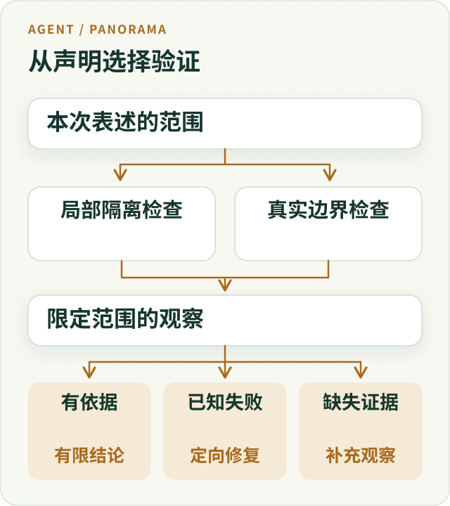

# Agent 测评全景：从测试绿灯到真实任务价值

一份基金研究报告完成了、保存了，还有模型裁判的评分。看起来，我们可以开始比较两种 Agent 方案了。可真正复核时，模型把 ETF 二级市场交易写进了不适用的印花税规则；另一份“高分”评审的引用甚至无法在裁判收到的材料里定位。

**Agent 测评最反直觉的地方，是运行成功、证据可读、评审分数与用户真正得到的答案，可能同时成立却指向不同的判断。** 如果把它们压成一个通过率，评测会比模型更早制造幻觉。

本文不再按照每批修复、每个中间阶段罗列工作，而是沿一份真实研究报告回答：**哪里出了超出预料的问题，业界通常怎样测，我们为什么把评测对象、来源资格和原始记录分开。**


## 一、最先要决定的不是评分公式，而是评什么


Agent 的一次工作至少有四类独立结果：**执行**有没有按协议发生，**证据**是否取得并能读回，**内容**有没有满足任务，**交付**到达了哪里。它们不能互相顶替。

比如模型生成了一份完整草稿，Publication 只接纳了前两段；自动裁判若拿完整草稿打分，评的是模型候选，不是用户收到的内容。反过来，Run 以 partial 收场，也可能已经保存了一段合法、有价值的正文。正常结束不能自动评为成功，中断也不能把所有已交付内容抹成零。

这使评测对象的身份比评分公式更重要：一份答案要关联原 Run、请求、发布修订、实际发送正文和当前观测范围。只有客户端有对应接收或渲染事实时，才扩大到“用户已看到”。

## 二、意外一：十个模型同时不及格，出错的可能是裁判

早期一次协议题中，十个模型全部被判失败（0/10）。真实输出只是把标记放在了合法的独立行，而评测夹具却要求它们挤在一行。修正规则并复核原十份输出之后，严格通过变成 9/10。

这不是九个模型一夜之间升级了，而是**评测规则曾错认了有效格式**。如果直接覆盖旧成绩，就无法追溯“模型行为变了”还是“我们承认原测量错误”。

另一个容易让结果失真的地方是分母。计划了 100 次任务，只完成其中的 60 次；把“已评任务里的通过率”写成“整个计划通过率”，可能把未派发、超时、缺少持久正文或无法审查的案例一起隐藏。更糟的是，查询接口返回 complete 也可能只说明分页读取完毕，源头未采集的模型回合并不会神奇出现。

我们的约束不是把未知样本都判失败，而是**保留原始样本身份、计划分母和未评事实**。已知违反必要条件才是 fail；材料不足时是 unassessed / inconclusive。二者对应不同下一步：修行为，或补观察。

## 三、意外二：材料在同一个 Run 里，也不代表支持同一项结论

一次双 ETF 研究的本地有界复核，四项必要条件中三项满足，另一项把场内 ETF 交易错误套用了印花税。这里不是数值加减没算对，而是**先选错了适用的交易制度**。一个总分会掩盖“该条件失败”的具体原因。

随后我们又遇到更隐蔽的问题：原 Run 里有两份季报，并不等于每条评分条件都曾使用它们；评审之后新找回一份交易所材料，也不等于研究模型或原裁判当时看过它。

因此当前逐项复核的链路是：

- 用原 Run、问题、最终被评答案与**事先冻结的判断条件**定位同一评测对象；
- 对每条条件，区分来自原 Run 的实际 Reader 来源关联与事后显式提供的补充文件；
- 对补充文件只核对所声明的本地 SHA-256 字节身份；不能用“内容现在找到了”倒签成原模型曝光，也不能把字节相同当作材料语义支持；
- 逐项解释失败或未知，而不是因为关联了更多材料就重新给整篇报告打分。

**事实不是越晚越完整就能改写早期观察**。事后材料可帮助我们形成新的人工判断，却必须保留它的获取时点和复核角色。

## 四、意外三：裁判给满分，比较仍然不成立

另一轮多 Agent 研究里，某些裁判产出了完整评语，却有引用无法定位；另一些给出满分，但和生成者使用相同模型，未满足预设独立性。评分调用结算并不等于得到独立、可核查的质量信号。

真实研究还出现过只有一个候选、缺少固定模型和配置身份、没有合格替代臂的情况。保存报告、做完独立计算，甚至让裁判跑完，都不能补出不存在的对照。比较需要相同任务、日期、来源、预算口径与可复查的版本；“单个模型做得不错”不能推出“多 Agent 比单 Main 强”。

更难的是**评测本身改变了待测任务**：超时窗口太短，裁判尚在合法工作就被测评程序判成失败；为了补跑而改变配置、增加调用预算，又使新旧样本失去单变量可比性。应修观测边界并保留原运行记录，而不是用新设置“补齐”旧成绩。

## 五、我们最后采用的是一条怎样的评测链


先冻结任务与必要条件，再执行原研究；将**实际保存或实际发送的对象**与来源和执行身份关联；把确定性错误交给规则检查，把语义支持交给人工或已校准的评审；最后才比较可比的样本。

| 问题 | 由什么回答 | 最容易误判的地方 |
| --- | --- | --- |
| 工具和模型调用真实发生了吗？ | 原 Runtime 请求、工具回执与持久执行记录 | Trace 看不到，不等于没执行 |
| 用过哪份资料？ | 原 Reader 结果、来源版本与实际模型输入 | 候选来源出现，不等于被消费 |
| 结论成立吗？ | 固定业务条件、复算、可核查的原文与有限评审 | 有引用、有评分，都不自动给结论加分 |
| 用户得到什么？ | Publication、发送事件与必要客户端证据 | 最完整后台草稿不等于已交付稿 |
| 两组方案谁更好？ | 固定分母、版本、资源与有效对照 | 不可比的两组均值没有因果解释力 |



这不是在运行时增加一串新的否决 Gate。评测是**对已经发生的工作作出有限判断**；评分不足通常应使比较结论保持未知，而不是抹掉原本合法的答案。

## 六、和主流评测平台相比，我们多做了什么选择

[Langfuse](https://langfuse.com/docs/evaluation/core-concepts) 的 Score 可以绑定 Trace、Observation、Session 和 Dataset Run，并支持人审、代码评分与 LLM Judge；[LangSmith](https://docs.langchain.com/langsmith/evaluation-types) 擅长数据集实验、回归与对照。它们解决了如何**组织实验和评分**的通用工作流。[Ragas](https://docs.ragas.io/en/latest/concepts/metrics/available_metrics/)与 DeepEval 类工具可以提供检索、回答与裁判指标。

我们的选择不是重复造一座评分平台：仍利用 Trace、数据集、原模型调用和现有评测工具。另做的部分是**金融任务能否作出这个结论**：保留原答案的完整身份、冻结条件、来源的当时暴露资格、算术口径与费用规则，并把事后补证、引用支持和总评明确分开。通用框架能够存下一份分数，却无法单凭分数判断某只 ETF 的税费规则是否适用。

如果你的 Agent 只是做语气分类，通用框架加一套数据集往往足够；如果它要形成可追溯的投资研究结论，就不能跳过这道业务语义复核。

## 七、怎样从一次错误开始做出有用的评测

最小样本不必复杂，但要明确对象、必要条件与对照资格。下面是**合成教学案例**，不是当前研究系统的真实评分协议：

```json
{
  "caseId": "etf-cost-asof",
  "question": "按指定时点比较两只 ETF 的交易成本",
  "sourceSnapshot": "synthetic-market-rules-v1",
  "mustCheck": ["instrument_type", "trading_venue", "fee_rule_asof"],
  "target": "saved-publication-revision",
  "unknownPolicy": "keep-unassessed"
}
```

从一次错误出发，锁定来源与规则，增加一个正常例和一个相邻反例，按相同版本和预算重跑。读报告时先看**是否具备比较资格**，再看评分和成本；不要让一个平均数替你作出不被证据支持的产品决策。

**测评的终点不是给模型发证书，而是让下一项工程决策更有依据：该修产品、修裁判、补来源，还是暂时不比较。**

## 延伸阅读

具体机制可继续读[引用系统](ai-citations-do-not-prove-reliability.md)、[多专家贡献](agent-subagent-contribution-evidence.md)、[可观测全景](025-agent-langfuse-from-trace-to-trustworthy-observability.md)与[成本归因](agent-report-cost-attribution.md)。这些文章负责各自的深入机制，不需要在本文重复验收记录。

更多文章见 [ETF Agent Engineering Notes](https://github.com/hpoenixf/eff-agent-article)。