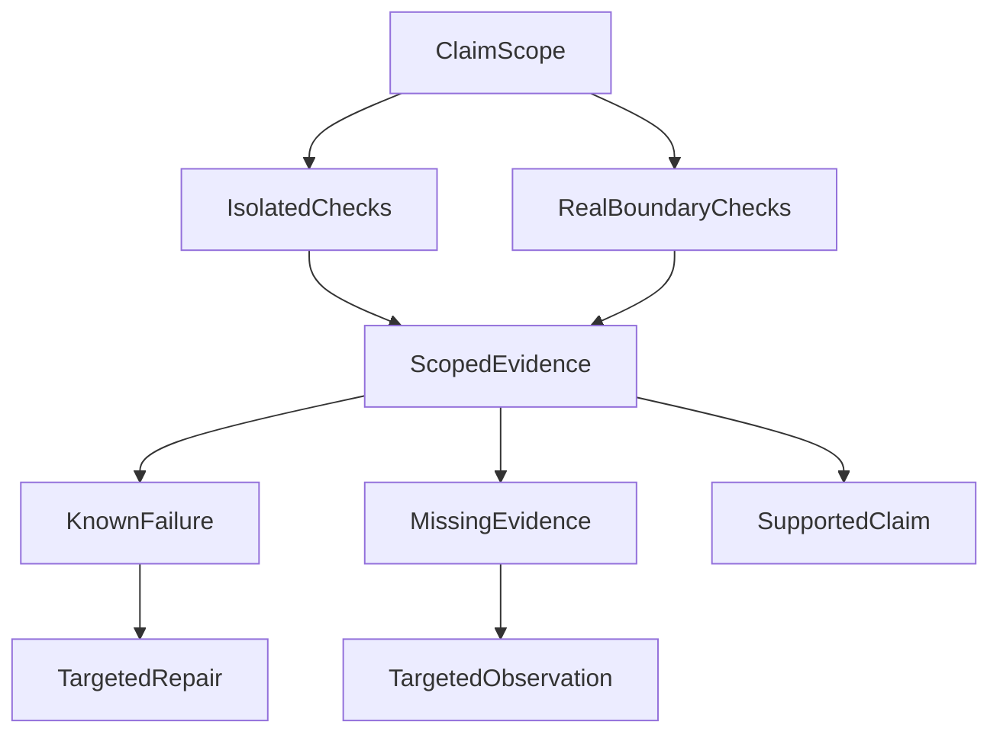

# 测试全绿、模型有返回，就算 Agent 成功了吗？

**绿灯只说明某项检查在给定条件下通过，不会自动证明用户的任务已经完成。** Agent 评测最重要的工作，是先确认检查了哪条边界、评的是哪份内容、分母包含哪些任务，再比较质量和成本。

这不是要求每次修改都重跑整套研究，而是让证据与声明相匹配：局部逻辑用局部检查，跨进程效果看真实交接，模型质量看实际产物。否则，一个准确的测试数字也可能支撑一项错误的产品结论。

我们早期遇到过这样的情况：服务端有候选答案，自动裁判给出了结果，运行状态甚至已经是 `completed`；继续沿前端链路检查，却发现候选存在、服务端发送、浏览器收到和展示，并不是同一个事实。

下面的历史案例解释如何避免这种误判，不作为当前模型排名或完整生产验收结果。

## 一、先说清楚：这一盏绿灯照到了哪里？

替身测试能够控制输入、依赖与时间，适合检查局部逻辑。真实依赖验证则实际启动进程、连接数据库或跨越网络。两者都有价值，但回答的问题不同。

我们曾观察到一组聚焦替身检查全部通过，更大范围的验收却仍有未完成项。问题不是哪组数字更漂亮，而是较小的检查没有触及尚未成立的那些交接。

一个更具体的反例来自命令行超时验证：

| 原受控窗口中的值 | 数值 | 含义 |
| --- | --- | --- |
| 单元侧默认值 | 45 秒 | 局部测试看到的默认配置 |
| 模型侧实际透传值 | 每次调用 80 秒 | 真正送入后续调用的限制 |
| 治理上限 | 60 秒 | 当时声明的上界 |

替身不会真的等待 80 秒，只检查默认值就可能错过实际透传已经超限的问题。总任务期限与单次调用超时还具有不同的起点和作用范围，不能看到等待过长就把所有上限一起调大。

这个窗口定位了问题和修复方向，但没有采集修复后的重测结果。因此它仍是一条失败观察，而不是事后补写的通过记录。

**验证对象应当是调用者真正依赖的行为，而不只是最容易检查的配置或返回值。** 声称数据库交接成立，就需要触达数据库；只修改一个纯函数，则不必为证明局部逻辑重新运行全部外部依赖。

## 二、不要用一个总分抹掉不同的失败

一次 Agent 请求可能经历理解问题、取得材料、生成候选、发布、发送和界面展示。协议合法并不证明问题被理解；工具返回并不证明材料适用；一份好答案也可能没有交付。

评测至少应该分别回答：

| 层面 | 需要确认什么 |
| --- | --- |
| 协议 | 输出能否正常解析 |
| 研究与证据 | 是否理解任务，并取得所需的合格材料 |
| 回答 | 内容是否准确、恰当且有依据 |
| 交付 | 实际内容到达了服务端发送、客户端接收还是展示的哪一层 |

有些条件不能被平均。表达流畅不能抵消关键材料缺失；没有发送答案，也不该因为后台候选写得好而获得漂亮总分。

同样，失败和未知要分开。`failed` 表示已有证据说明要求没有满足；`inconclusive` 表示证据不足以判断。前者需要修复，后者需要补充相应观察。把两者都记成零分，会把基础设施缺口混入模型能力评价。

这不是取消综合比较，而是先确定候选是否满足本次用途的必要条件，再比较回答质量、可靠性、延迟与成本。可选能力的不足，也不应被顺手升级为所有用途的否决条件。

## 三、最容易悄悄改变结论的，是分母

看一个假设例子：计划评测 30 题，其中 20 题因为排队、超时或工具问题，在观察窗口内没有完成。剩余 10 题中，有 9 题返回非空内容。

“已完成样本中，9/10 返回了答案”是准确描述；直接写“成功率 90%”则改变了口径，还把非空内容偷换成任务成功。

未完成的题目可能更长、更复杂，需要更多工具和纠错。它们不一定是随机缺失；只看完成的部分，容易把最能暴露问题的样本排除掉。

因此，评测前应固定题集、数据快照、代码版本、模型版本、配置和原始分母。任何条件变化，都要保留自己的观察窗口。可以比较不同版本，但不能把不同条件下的结果拼成一次更好看的实验。

这里的可执行判断很简单：**先展示全部计划任务去了哪里，再讨论已完成部分的质量。** 未完成、失败、未知和有可用答案的样本都应该留在各自位置，而不是从统计中消失。

## 四、裁判必须知道自己评的是哪份答案

自动评测通常发生在服务端：取一个候选答案，让模型裁判检查事实、格式、引用和表达。它能够评价候选质量，但流式产品还必须回答另一个问题：用户收到的是不是这一份内容？

完整候选可能被发布环节拒绝，也可能只发出了前半段。服务端记录了发送，仍不等于客户端已经完整接收或展示。

因此至少分清三个对象：模型候选、服务端实际发送的正文、客户端接收与展示证据。若声明在评价“已交付回答”，就应当从实际对外发送的内容事件按顺序重建评测材料，而不是拿后台最完整的草稿替代。

流在中途断开，重建材料就应该保留这种不完整。后台后来补写的新版本，也不能倒过来改写当次交付历史。有客户端确认、消息序号或渲染回执时，再据此扩大交付结论；没有，就准确说到“服务端已发送”。

**评分对象的身份与范围，比评分公式是否精巧更重要。** 这也是 Agent 评测与纯模型基准的区别：产品结果还经过了一个真实的交付系统。

## 五、如果错的是评测器，要修判断，不要重写发生过的事

我们也遇到过评测夹具或校验契约导致的机械误判。修正评测逻辑后，受影响样本的判断发生变化，但仍有真实失败保留下来。

若直接覆盖旧成绩，就很难知道第一次为何失败、后来为何改判，也无法区分进步来自模型、运行时还是测量工具。

更稳妥的方式是保留原始结果，追加更正，再生成修订视图。每项更正对应原来的运行、输入版本和受影响案例，说明旧判断、新判断与理由。后续发现更正仍有问题，也继续追加，而不是把历史反复改成最新的解释。

这个机制的目的不是增加一套审计仪式，而是保住比较的基础：**执行结果改变了，与我们对同一结果的认识改变了，是两种不同的进步。**

## 六、先决定能否比较，再决定谁更好

我现在更愿意在发布模型结论之前问三个问题：实验条件和原始分母是否可比；本次用途明确要求的条件有没有失败；仍有哪些关键事实未知。

条件不可比，就先解释差异；必要条件明确失败，就针对该用途记录不合格；关键事实未知，就保留暂定结论。通过这些检查后，质量、稳定性、延迟和成本的比较才有解释力。

这不需要变成新的万能运行时门禁。它首先是研发与评测中的判断顺序：

图中的两种检查按声明需要选择，不要求所有改动同时执行。证据可能支持一个有限结论，也可能发现缺陷，或留下一个尚需观察的问题。已有证据足够、行为又没有变化时，不必为了整理报告重新验证一切。

对研发人员，先把本次修改要证明的行为说具体；对评测设计者，固定输入与分母，并让裁判看到与声明相符的实际内容；对作决策的人，把失败、未知和质量差异分别处理。

**测试的价值不是让报表全绿，而是帮助我们知道该修什么、该补什么证据，以及现在能够放心作出哪一种决定。**

每次看到一个 Green，先问：它证明了哪个版本、哪份输入、哪条边界和哪份实际内容？这对应[方法 5「验证与故障归因」](/principles#method-5)。让结论停在证据真正支持的位置，才能避免用局部成功提前宣布产品成功。

## 延伸阅读

[Spec 与 Evidence 工作流](026-agent-spec-evidence-workflow.md)讨论原始观察如何保留和更正；[AI Coding 最贵的不是写代码，而是决定什么值得验证](ai-coding-judgment-and-verification.md)讨论怎样按错误代价分配验证资源。

更多文章见 [ETF Agent Engineering Notes](https://github.com/hpoenixf/eff-agent-article)。欢迎 Star 与交流。
