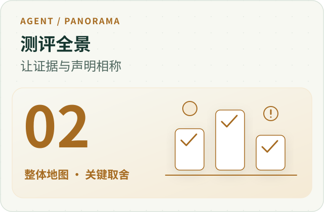
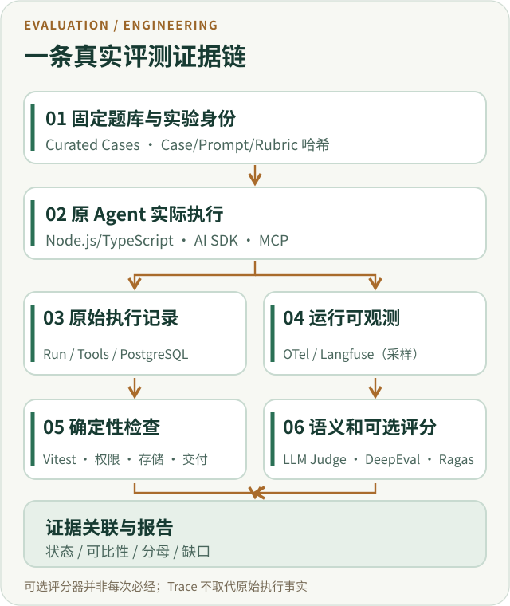
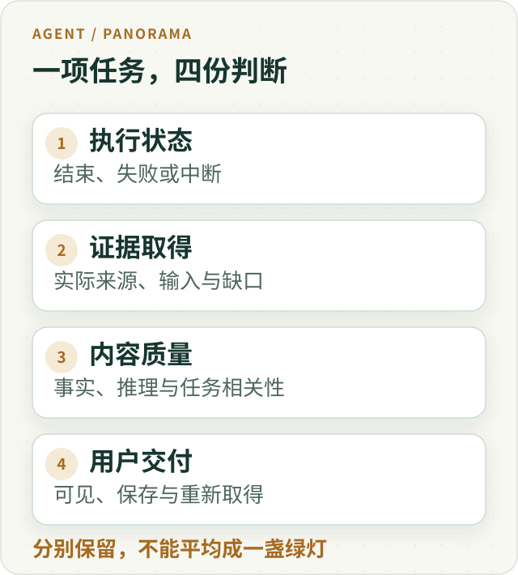
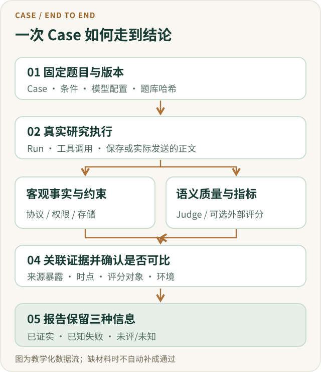

# Agent 测评全景：从测试绿灯到真实任务价值

有一个很容易让工程团队产生信心的画面：自动化测试是绿色的，Agent 的 Run 返回 completed，Langfuse 里能看到模型和工具调用，最后还有一张写着 85 分的质量报告。如果再把两个版本各跑几遍，就似乎能得出“新版更好”的结论。

但在 ETF Agent 的实际研究验证中，我们见过完全不同的结果。一份双 ETF 分析里，大部分检查能够成立，却有一项把不适用的交易印花税规则套进了场内交易成本；另一次评审生成了很漂亮的反馈，却引用了裁判实际输入里无法定位的资料。还有一个更刺眼的历史案例：十个模型同时被判不通过，最后发现是共同使用的格式判定条件出了错，而不是十个模型突然一起失去能力。

问题不在于“测试有没有价值”，而在于**测试系统究竟测到了什么**。单元测试可以证明函数满足约定，模型返回可以证明一次调用得到结果，Trace 可以说明某些动作被观察到，LLM Judge 可以给出受条件约束的内容评价；这四件事加起来，也不能直接替代“用户交给 Agent 的事情是否完成”。

这篇文章不再停留在原则层。我们以 ETF Agent 的工程实践为主线，打开它的评测技术栈：统一题库为什么要单独维护，Node.js Runner 如何驱动真实任务，Vitest 与隔离数据库验证什么，Langfuse/OpenTelemetry 如何和持久事实配合，独立 Judge、DeepEval、Ragas 分别打什么分，最后如何把数据汇成一份不掩盖失败与未知的报告。文中的“现行实现”对应 2026 年 11 月初核实的工程代码与记录，不意味着所有可选评分都已进入生产门禁，也不意味着这套内部系统在公开教学仓库中完整开放。

## 一、先看整张地图：测评不是一个 Judge，而是一条数据生产线

对一个普通 Web 接口来说，断言状态码、响应体和数据库结果，往往已覆盖核心行为。Agent 不一样。它可能搜索、阅读、计算、调用多个工具、交给专家协作、恢复中断、分段发布，还可能在后台继续运行；有些错误只存在于资料与结论之间，有些错误存在于实际保存和用户可见之间。

因此我们把一次评测拆成六件相互连接、却不能相互证明的工作：

第一，**固定任务**：规定题目、上下文、输入身份、模型配置、必要业务条件及本次要覆盖的样本。第二，**执行任务**：让被测 Agent 真正走一遍约定入口，而非把模型回答当作已经完成的任务。第三，**采集证据**：记录模型、工具、来源、持久结果和交付各自能够证明的事实。第四，**分层评价**：确定性规则处理客观条件，模型或人工处理需要理解语义的内容。第五，**复核可比性**：确认不同结果确实在同一任务、版本与资源条件下产生。第六，**输出有限结论**：明确哪些通过、哪些失败、哪些未评以及为什么。

下面这张表是理解整套系统最短的路线。它不是“我们安装了哪些库”的罗列，而是在同一条链路上解释每一项技术的工作。

| 环节 | 实际使用的技术或模块 | 负责解决的问题 | 不能越过的边界 |
| --- | --- | --- | --- |
| 任务定义 | 版本化 Curated Question Set、JSON 清单、内容哈希 | 固定题目、标签、多轮前置与评测分母 | 题库存在不代表已执行 |
| 运行组织 | Node.js / TypeScript、自建 CLI Runner、AI SDK、原 Agent Runtime | 驱动案例、管理启动、输入、异常和结果 | 运行结束不等于任务完成 |
| 工程验证 | Vitest、隔离 PostgreSQL；按任务使用浏览器验证 | 检查协议、存储、恢复、确定性规则和交互 | Mock 绿灯不等于真实模型质量 |
| 运行观测 | OpenTelemetry、Langfuse、原始 Run/工具/Publication 记录 | 追踪调用链、阶段、消耗和诊断 | Trace 的完整性不自动成立 |
| 质量判定 | 自建 LLM Judge、AI SDK、Zod、明确的评分 Skill | 结构化评估证据、完整性、时效、安全和表达 | 裁判不是金融事实权威 |
| 可选独立评分 | 隔离 DeepEval、Ragas 0.4.3、本地 bge-m3 | 为已保存答案补充通用评价维度 | 分数不代替真实任务成功 |
| 证据和报告 | Evaluation Evidence Loop、结构化结果、JSON/HTML/Markdown 阅读稿 | 关联样本、状态、证据、差异及未知 | 不能用新报告覆盖旧事实 |

最关键的架构选择是：**我们没有把 Langfuse 当成万能评测数据库，也没有让某一个 Judge 负责判定所有事情。** 原运行记录保留实际发生过的动作；评测系统只消费适合它权限和范围的数据，再为特定问题建立判断。需要增加评分器时，增量应该出现在评分层，而不是顺手改变 Run 的历史或投资业务的权威。

## 二、为什么先建题库，而不是先买评测平台

第一个工程难题其实非常朴素：同一句“比较两只 ETF”，今天问和下周问，可能指向不同的行情时间、费率与公开资料。如果题目、指代、前置上下文和判断要求每次都靠人工抄写，那么所谓两轮对照，可能连输入都不一样。

ETF Agent 的题目统一维护在一个带版本的 Curated Question Set。案例有稳定的 Case ID、修订号、问题正文、业务标签、会话组和轮次，按不同运行器投影为需要的视图。单个题目身份不只是名字，还包含内容哈希；文件级别还有题库哈希。修改了文字或前置条件，旧成绩不能再假装来自完全相同的题目。

截至本次核对，题库说明的默认精选核心为 14 题，覆盖概念解释、数值计算、净值时差、同口径比较、日期纠错、公开产品与私人组合区分、交易权限拒绝、过期证据以及多轮指代。扩展案例仍在同一份题库中，通过标签明确选入。这个“14”指当时的核心选择，并不是全系统所有可能测试的数量，更不是已经全部跑出高质量结果的证明。

这里有一个容易被忽视的细节：**多轮题目不能只抽取最后一问来测**。如果案例第二轮问“那另一只呢”，它的语义来自上一轮。一种危险的运行器会把第二轮独立送进去，然后把模型的困惑记作失败。当前题库选择逻辑会带入必要的前置轮次，并检查顺序、重复身份和执行器是否真正支持该多轮情形；不支持就拒绝错误的执行计划，而不是悄悄少跑一半。

题库还要区分两类目标。回归案例主要问“我们曾经支持的能力是否退化”，能力案例则问“现在能否处理原来做不到的任务”。前者期望接近稳定，后者可能故意选择困难的任务。把两类结果简单合并，既难以解释产品变化，也容易让团队只优化熟题而失去发现新问题的能力。

一个题目可以附着必要条件，但不要误以为每道研究题都存在唯一标准全文。基金研究常常是条件化回答：同一事实可以有不同合理组织方式，真正应固定的是客观事实、来源与时点、重要风险、必须覆盖的部分和禁止越权的行为。对开放内容采用单段“标准答案完全匹配”，只会惩罚合理的表达差异。

从操作入口看，项目提供 questions:list、questions:check、questions:run 等脚本来选择和检查题集；旧的 6/24 题 Live 分片已经在运行器里被明确退役。这里不提供一条会直接触发付费模型的无条件复制命令：运行真实任务需要当前配置、可用服务和明确的模型及数据使用授权。对读者而言，值得复用的顺序是**先列出实际选中哪些题、哪些前置轮次，再确认运行能力，最后才允许派发**。

## 三、Runner：为什么评测要调用真实 Agent，而不是只调模型接口

模型回答质量是 Agent 能力的一部分，却不是它的全部。比如用户问“把我的两只基金和基准在同一时点比较，并解释可能的跟踪误差”。只向模型发送这句话，得到一段流畅文本，无法证明系统调用了真实行情和持仓工具、理解了份额类别、区分了数据时点，或把最后结果保存到了正确会话。

自建 Runner 的价值，就是把**模型调用**放回**真实应用工作流**。它负责准备执行环境，选择题目，建立受控请求，观察服务响应，识别超时或中断，关联结果身份，最后生成一份有清楚适用范围的报告。真正执行研究的是原 Agent Runtime；Runner 不应该再写一个“长得像 Agent 的简化替身”，否则测试的是替身的行为。

在代码层可以看到两条重要分工：一条是已有的自测 CLI，对接实际任务、结果和独立评审；另一条是针对特定能力的有界 Live Evaluation，例如限制工具步数、执行时间和案例数量的即时冒烟检查。后者证明的是有限的工具选取或恢复观察，不能把它的三道检查题解释为整个基金研究体系的准确率。我们还保留按 OpenSpec 计划做的固定证据验证，以便不用外部服务也能复核合同。

运行器为什么需要关心端口和数据库？因为 Agent 测评是有副作用的工程活动：它可能创建会话、保存状态、插入日志、写报告，甚至遇到并行运行的资源竞争。原自测运行器有独立端口选择、按轮次归档、隔离数据库准备和清理逻辑；异常中断时也要保留 inconclusive 汇总，并尝试清理本轮进程与数据库。这些代码不是为了让评分好看，而是为了避免“下一次测试被上一次留下的环境污染”。

这个设计有成本。启动真实服务、准备数据和支付模型调用比纯函数测试慢，也更容易受网络和提供商影响。因此它不应替代 Vitest，而应与确定性测试分工。对一个语法修正，可能只需要静态检查；对模型路由、知识读取、工具授权或发布交接的改动，才有必要把真实 Runner 放进更高一层的验证。

一次有效运行必须保留至少四种身份：**执行的是哪道 Case、使用了什么版本和模型配置、实际进入了哪个 Run、最终评分关联哪份答案**。缺了其中一项，自动生成的漂亮报告也可能无法说明它到底在评价谁。

## 四、Vitest、PostgreSQL、浏览器验证：三种绿灯分别证明什么

评测不等于一启动就去烧 Token。Agent 系统里大量最危险的问题可以确定性复现：不允许的工具是否被暴露，取消后是否又派发请求，数据库里一条结果是否被错误更新，历史恢复会不会把未确认状态当作完成，评分 Schema 是否接纳了非法数据。这些首先应该由本地测试覆盖。

ETF Agent 使用 TypeScript 与 Vitest 检查相应的合同和运行分支。它们的优点是快、可重复、无需让评审模型猜测程序究竟做了什么。发现确定性的数据库状态错误时，不应该把数据库内容翻译成 Prompt 请 LLM 裁判；更合理的方法是直接读取必要状态并执行断言。像 schema、工具白名单、字节哈希、唯一性、交易限制等条件也一样。

PostgreSQL 则提供另一种验证价值。Mock Store 很适合检查调用顺序，却容易掩盖真实持久化里的迁移、唯一约束、重复请求、事务、并发和重启问题。自测在适当场景下创建隔离库，给原应用用完后删除，目的不是模拟全部生产负载，而是验证**业务状态确实跨过了真实数据库接口**。如果隔离库创建或清理失败，应该把它报作环境问题，不能让“模型答得还可以”抵消这类失败。

最后是浏览器及客户端。服务端记录了 Publication、SSE 发送了某段内容，最多证明服务端走到了发送边界。客户端是否采用了修订、列表刷新是否能读到历史、重连后是否显示、用户最终看到了哪段内容，必须由对应的客户端观察或端到端验证支持。项目引入了 Playwright 等测试能力，但**不能仅因依赖存在，就宣称每次测评都完成了浏览器级端到端验收**；这需要具体运行记录和测试场景。

用一个典型过程理解三层的区别：Vitest 证明“相同 revision 不应重复发布”；隔离数据库验证“重启后仍能按同一版本读回”；浏览器验证“前端实际使用了正确版本，没有把较旧的响应盖到新内容上”。如果第三层没执行，报告可以写“服务端保存与回读已验证，客户端接收未验证”，而不是笼统写“交付成功”。

反过来，如果业务任务只有一个无状态文本判断，没有持久保存、工具执行或界面交付要求，就没必要为了显得工程化而安装数据库和浏览器测试。**验证层数应该由任务的真实交接决定，不由技术栈清单决定。**

## 五、Langfuse + OpenTelemetry：看见过程，却不替代发生过的事实

模型调用一次要花多久、是否发生工具重试、哪一步 Token 消耗异常、错误是出在检索还是答案生成，这些信息靠最终正文不可能还原。ETF Agent 接入 Langfuse，并通过 OpenTelemetry 的 Trace 与 Span 表达运行中的阶段和嵌套关系。一个 Trace 可以关联 Run，内部 Observation 进一步标记模型 generation、工具执行或其他受支持的阶段。

这套接口的价值不只是看瀑布图。通过 runId 一类关联标识，可以把“这次问答异常慢”分解为模型等待、研究阶段、工具调用、评分器或交付等待。若同一模型升级后延迟变长，还可以在同类问题、相同工作量下分辨是调用次数上升、上下文变长还是某个具体工具耗时。诊断工具允许按 Run/Request 查找关联的 Trace 与 Observation，避免面对一个报错时全仓翻日志。

然而这里有一条非常重要的实现边界：Langfuse 的事件可采样、异步到达，传输可能延迟或失败；查询已经遍历全部返回页，不代表运行时本来就产生并上报了所有事件。代码里也区分了可验证的观测投影、查询完整性与未确认的导出状态。因此，**远端 Trace 非空，只能证明我们看到了某些事件；Trace 缺失，也不能反推模型一定没有运行。**

比如一个生成阶段在本地持久记录里有请求与结算，但 Langfuse 的远端查询没找到对应 Observation。这首先是“远端观测不全或尚不可读”，而不是“模型没有请求”。如果只用 Trace 的行数计算模型调用成功率，就可能把采集率当成了产品质量。相反，如果观测组件补发了一条旧事件，也不能因此让任务执行次数增加一轮。

我们把观测链和事实链分开：**原 Runtime/Store 负责自己能证明的执行与持久记录；Langfuse 帮助下钻排查；评测报告记录两者是否关联，以及仍然缺哪种观察**。对账时还应检查采样条件、事件丢失、重复回放、关联键缺失与时间窗口，而不是只看“请求 HTTP 200”和 Dashboard 上的总数。

成本分析同样需要这种区分。Langfuse 可以聚合 Token 和部分费用，但模型供应商的真实扣费、重试、共享账户消费与结算未明的尝试，可能不等于一行按单价估算的金额。能证明价格和完整 usage 时才给出估算；没有完整记录时，成本保持 unknown，而不是为了表格整齐填 0。

## 六、Publication 和前端：Judge 究竟应该评哪份文本

长任务有一个常见结构：模型先生成候选，再整理为可保存内容，之后通过 Publication 对外发布，最后可能经由 HTTP/SSE、历史接口或前端界面到达用户。几个版本的文本都可能存在，并且它们不必相同。评测必须先说清楚“评分目标是什么”。

举个教学化例子：研究模型生成了完整的十段报告，包含风险、假设、数据来源和结论；发布时只有前五段得到合法保存，随后任务中断。如果 Judge 读了生成器缓存里的十段全文，给出“完整性 5/5”，这分数可以描述候选文本，却**不能证明用户获得了完整研究报告**。把两种对象混用，是比评分公式小误差更大的问题。

同理，一段 SSE 消息被服务器成功发出，不一定被浏览器确认采用；历史接口里最终存有正文，也不一定意味着旧页面当时展示了这份修订。我们需要把“候选、持久发布、实际发送、客户端接收与渲染”按各自证据分别标记。没有客户端证据时不扩大结论；已有合法 partial 发布时，也不应因为后续 Run 中断就把它归零。

这不是建议在生产路径上增加新的语言 Gate。Publication 是业务交付的现有职责，评测系统的职责是**在正确的交付边界上选择可评分对象**。例如报告标题明确写“对保存的 publication revision 评分”，并保留 Run、请求、版本和正文的关联；若只评分模型候选，标题就写“候选答案质量”，而不是复用“最终用户体验”这个更强的词。

很多团队并不是 Judge 太差，而是在这里发生了对象偷换：生成结果更新了，评分还拿旧答案；重试拿到较完整的新回答，却把它填回旧尝试；评审时额外粘了几份材料，最后却写成原 Agent 曾经看过。只要评分对象没有冻结，任何后续分数都难以审计。

## 七、确定性检查：能由代码证明的事情，就不要让 LLM 猜

在评分阶段，最容易走偏的方案是“让一个更强的模型判断所有问题”。这样确实可以很快写出原型，但金融 Agent 有很多无需推理的硬条件：工具是否得到授权、是否调用了写操作、是否产生了可验证的保存记录、Schema 是否正确、是否越过了预算、是否缺失必需来源、数值是否与指定口径下的计算结果一致。

这些条件适合由专门的确定性检查处理。原始工具回执证明调用是否发生；数据库记录证明受管状态是否改变；权限策略证明某次调用是否超出允许集合；清楚定义的数值公式可以由受控计算结果验证。模型裁判不应凭一段“我没有执行交易”的自然语言，宣告交易权限从未被触及；也不应根据回答里出现“见来源”几个字，推测模型确实阅读了原始资料。

不过“代码检查”不是“随便写几条正则”。ETF Agent 的评测契约专门约束：不能靠扫描开放式自然语言来断言模型遵守指令、事实可信或语义上引用正确。文字里没有出现某个机械关键词，并不一定代表研究没有完成；文字里出现了“已经核验”，也不能把它当成执行证据。只有案例明确要求某种协议字符串或数值格式时，才应该把这种格式作为可验证的合同。

这对研究型 Agent 尤其重要。两个候选答案可能都没有出现我们预想的短语，但一个准确说明了适用范围，另一个错用了一条税费制度；前者不应因缺关键词被硬性判错，后者也不能因关键词齐全通过。对开放文本的真伪、覆盖和解释质量，应保留独立语义评审，不让客观检查越权。

更实际的组织方式是建立三个判断面：**硬约束**必须由权威记录证明；**语义质量**由适当评审与证据支持；**工程可比性**检验这次运行是否满足实验合同。即使语义评分高，也不能抵消没有授权的工具调用；即使硬约束均未发现问题，也不能自动得到“研究观点正确”的结论。

## 八、自建 LLM Judge：具体检查什么，为什么分数并非真值

对“回答是否完整解释 ETF 场内和场外的差异”这样的任务，仅靠程序断言往往不够。ETF Agent 因而有独立的质量评审模块：使用 AI SDK 发起模型请求，用 Zod 约束结构化输出，配合专门的 Judge Skill 和明确的维度、问题代码进行评价。

当前被核对的自建质量 Judge 定义了五个主要维度：grounding（依据是否充分）、completeness（覆盖是否完整）、freshness（时点是否恰当）、safety（安全边界）、clarity（表达是否清晰）。它返回 verdict、0–100 的 overallScore、confidence、逐维评分和 issueCodes。其相关实现中还有 70 分的最低分数阈值和 0.70 的最低置信度阈值；**这是这个评审路径的具体规则，不是所有 Agent 任务统一的金融正确性标准，更不是当前全部发布门禁的等价表达**。

为什么要这么多字段？因为“75 分”不可操作，而“缺少请求的费用部分、来源时点未披露、回答把不适用制度用于计算”能够指导不同修复。缺少内容可能改答案规划；证据缺失可能改读取链；时点问题要检查数据来源及发布时刻；未经授权的执行则需要检查工具和权限，而不是让模型改写措辞。

Zod 解决的是**输出结构有没有遵守合同**。例如 Judge 只能给出预设 issueCode，维度必须存在，分值必须在合法范围。它无法证明 Judge 解释的事实一定正确。因此运行评审还要考虑模型输出截断、非法 JSON、超时、提供商失败、低置信度以及引用不能定位的情况。此时的正确结果可能是 abstain、not-evaluated 或 inconclusive，而不是为了得到报表分数把错误当作 0 分或默认通过。

独立性也不是“给生成模型换一个 API 名称”这么简单。评审者与被评模型如果共享盲点，两个分数可能同时好看却错在同一处。评测计划需要说明评审模型是谁、采用什么协议和 Rubric、是否经过人工校准、哪些案例明确不可评。对高风险业务结论，人工复核仍然是必要的校准依据；一轮“模型评模型”的优秀成绩不能自己给自己发资格证。

更重要的是评分应有对象约束。Judge 只应看到经授权且与这道题相关的原答案及可审查材料；保存一份“看过哪些引用”的证据不等于能证明每个引用语义正确。评审完成后，输出应能反查这个答案、这套标准和这个评审版本，不应成为可随意覆盖的孤立分数。

## 九、DeepEval：为何接入现成指标，却把它放在隔离的可选层

不必所有通用指标都自己实现。DeepEval 提供了回答相关性、Faithfulness 和可用自然语言准则描述的 GEval 等评分方法。接入它可以帮助开发者用另一套成熟方法审视“回答有没有回应问题、是否违背给定检索资料、分析是否满足某些自定义要求”，而不需要让自建 Judge 的一套分数承担所有分析任务。

但我们没有把 DeepEval 作为 Runtime 的硬依赖。当前的外部评测适配器独立于正常的 Agent Server、Publication 和恢复流程；运行前需要提供已记录的答案，经精确内容审查和指纹批准，才允许把相应非私密材料交给外部裁判。子进程、可用调用次数、超时、输入大小与模型权限都受到约束。评审失败时保留原本的案例分母和不可评分状态，不会把 SDK 崩溃转换成“模型质量不行”。

这个隔离设计还解决了一个不太常见但非常真实的问题：第三方 SDK 自己也可能有发布包问题。仓库记录曾发现某些 TypeScript 版 DeepEval npm 分发物的构建内容无法正常运行，因此采用了固定上游源码、锁定提交与哈希后进行无修改构建的办法。读者要学到的不是那个具体版本号有多神奇，而是**评测器本身也是第三方软件，必须验证可复现性与失败模式**。

在一项限定诊断中，12 个不同案例最终有 11 个获得了有效评分，未评分和失败仍保留；这说明“适配器确实跑出了一些真实指标”，但不说明全部案例通过、与人工判断达到一致，更不意味着生产环境已经启用了自动门禁。尤其 Task Completion 和完整多轮轨迹，如果没有被授权提供完整 Trace，就不能从一份独立答案倒推出来。

因此这层的正确角色是“可插拔的外部质量透镜”：当需要与通用评分框架交叉核对时启用，成本和数据权限受当前任务控制；不启用时主 Agent 的运行与日常合同测试仍应正常工作。对小规模、规则确定的任务，完全可以先不加它。

## 十、Ragas：相关性、忠实度和事实正确性到底区别在哪

Ragas 更适合把检索增强回答拆成几个可以讨论的指标。当前工程使用经过固定的 Ragas 0.4.3，通过隔离 Python 执行评分；模型判分仍走既有 Host 的授权与调用管理，向量计算使用配置中的本地 bge-m3。Python 子进程不直接拿应用凭据或网络权限，不能因为是评测脚本就绕过真实模型使用边界。

这条实现已经不再只是“接入成功但没有分数”的旧状态。2026 年 11 月 3 日的记录显示，一组十份已保存回答实际获得了 response relevancy（回答相关性）评分，原研究的 partial 状态没有被覆盖；另有一次独立复核得到某个案例的 answer accuracy 分数，五种指标的受控上下文演示则属于**另外一个样本**，不能合并进十题的通过率。工程图因此也必须同步更正。

各项指标针对的问题不同：

| 指标 | 想回答什么 | 高分仍不能证明什么 |
| --- | --- | --- |
| Response Relevancy | 回答是否围绕问题 | 事实一定正确、金融结论可执行 |
| Faithfulness | 回答中的主张是否得到提供的上下文支持 | 提供的原始资料本身一定真实、完整、最新 |
| Context Precision | 检索上下文是否把有用内容排在适当位置 | 最终回答必然正确 |
| Context Recall | 检索上下文是否覆盖参考所需内容 | 模型确实正确使用了全部内容 |
| Answer Accuracy | 回答与独立参考的准确程度 | 参考答案适用于另一时点、交易制度或任务 |

一个非常典型的错觉是相关性高，就认为“研究质量高”。比如模型认真回答了“这只 ETF 的交易成本”，列出了多个费用概念，语言完全切题，相关性评审可以很好；但如果它把错误税制用于场内交易，相关性分数并不会自动发现这项制度适用性错误。这时需要明确的业务规则、可信来源和独立事实复核。

Ragas 还有严格的数据前提。Faithfulness 必须拿到这次评分真正允许使用的 retrieved contexts；依赖参考答案的指标要有独立 reference。**不能让 LLM 从被测答案里编造检索上下文或参考答案，再反过来给它打高分**。缺少输入的指标应保持 unassessed；即使其他指标完成，也不能通过插值凑一个“综合准确率”。

选择 Ragas 的代价也很现实：需要维护 Python SDK 和依赖环境、模型调用、Embedding 路径、超时与结果持久化；不是每个案例都有合格的来源片段或人工参考。因此它适合用于资料检索和研究文本的定向诊断，不适合作为所有工具型 Agent 的唯一指标。工具授权、真实副作用和用户交付需要别的观察者。

## 十一、金融研究的特殊性：技术判断必须落到业务口径

如果只做文章语气分类，质量评估可以围绕一致性和风格；金融研究的错误有时出在更深一层：**问题看起来是“数值不对”，实际是业务制度、对象身份或时间口径先选错了**。一只基金的场内交易与场外申购、不同份额类别、不同货币及净值时点，不能因为名字相近就在同一条规则上计算。

原文曾记录一次双 ETF 研究的有界复核：四项必要条件中三项能够满足，一项把不适用的印花税规则带入了场内交易分析。这不是需要让 Judge 再多读一段“请谨慎”的 Prompt，而是要检查对象类型、交易场所、适用规则与规则生效时点，再由可核查的来源和计算证明结论。大模型说“这个费用存在”与“这个费用适用于眼下这项交易”是两种不同命题。

来源还存在时间关系。某条年报数据可能描述上一季度的财务状态，实际文件随后才公开，Agent 可能更晚才抓取。业务时点、公开时点、采集时点不应被一个“日期”字段粗暴合并。当用户问“当时能否知道这个事实”，以后找到的资料不能倒灌成过去的已知条件；当用户问“现在还能否引用”，又必须审视有效期、撤权和时效。这种三时点是研究时应明确的模型，不表示所有历史数据链路都已经完成统一迁移。

更进一步，“报告引用了来源 A”仍只是第一层。至少要区分资料是否被成功读到、资料字节与版本身份、是否进入这次模型消费、报告里的具体主张能否被资料支持，以及该来源是否足以支持金融制度判断。前四层的缺口中，有些能靠运行记录和哈希发现；最后一层通常需要业务语义与人工判断。

这样的设计有明确适用边界。公开且静态的产品常识可以用较轻量的定向检查；涉及净值、估值、交易成本、持仓或策略建议时，来源与口径要求会更高。但测评系统不应因风险高就自动获得交易权限，更不能用“评分通过”把研究建议变成真实下单授权。研究质量、交易审批和账户状态属于不同业务责任。

## 十二、Evidence Loop：为什么一个结果需要多种状态，而非 pass/fail 一列

只要做过几轮真实模型测评，就会遇到难以塞进一个布尔值的样本：模型正常回答，但内容错了；模型没完成，因为供应商断线；模型回答可以，但 Judge 异常退出；两份答案都拿到了分数，却因为配置不同不能比较。这四个样本的下一步处理完全不同。

ETF Agent 的 Evaluation Evidence Loop 把结果拆成独立轴。其中执行状态可以是 completed、failed、inconclusive；判断结果可以是 pass、fail、abstain、not-evaluated；资格可以是 eligible、ineligible、unverified。它还保留模型、协议、Case、重复次数、Fixture/Prompt/Scorer/Rubric 哈希及可比性原因。这样一份结果即使后来增加新评分器，也不会变成“重新猜一遍过去发生什么”。

下面是**说明结构的教学示例**，不是直接从生产数据库导出的完整 Schema：

~~~json
{
  "caseId": "C-example",
  "caseRevision": 3,
  "evaluationRunId": "study-demo-01",
  "target": "saved-answer-revision",
  "executionStatus": "completed",
  "judgement": "fail",
  "eligibility": "eligible",
  "comparability": "comparable",
  "findings": [
    {
      "layer": "research-quality",
      "code": "WRONG_APPLICABLE_FEE_RULE",
      "basis": "criterion-review"
    }
  ],
  "delivery": "saved-only",
  "clientRendered": "not-observed"
}
~~~

这里 executionStatus 是 completed，因为任务有可确认的执行结果；judgement 是 fail，因为已经发现具体质量缺陷；eligibility 可以仍是 eligible，因为该样本具备被纳入这次质量比较的实验资格。它并不自动意味着模型可上线。如果证据不足导致没有语义裁判，judgement 应当变成 not-evaluated，而不是用“硬检查没发现错”填 pass。

这样做还要求失败具有分层归因。能确定是未经授权工具调用，就标注安全与权限的硬性问题；能确定是 Judge 超时，就标注 validator/evaluator；环境没有准备好属于 harness 或 provider/infra；不知道谁先失败时，就保留未知或并列关系。**不要把每个异常都记到被测模型头上。**

这也是 Evidence Loop 相比一张评分 CSV 更有用的地方：它可以回答“这个分数来自什么版本、哪次执行、什么依据、哪一种评价”，并允许后续补充诊断时保留原观察。技术上只需稳定的身份、版本和记录协议，并不意味着必须新建消息队列、独立数据库或复杂编排中心。原系统已经有合适的记录时，应尽量消费它们，而不是为了名词好看复制一次。

## 十三、沿一份报告走完全程：输入、证据、判断和输出怎样接起来

前面都是部件，现在用一个贯穿案例把它们连起来。以下“用户比较两只 ETF 的成本与跟踪差异”的流程是**基于现有系统职责整理的教学化执行示意**；它把真实案例中已观察的税费错误与现行技术接口合在一起说明，不声称存在一条具有全部这些字段的同名生产 Run。

**步骤一：选题与冻结。** 评测人员选定某个 Case 与修订，声明需要比较的产品、交易场所、时点以及结果如何验收，连同模型配置、提示词和评判 Rubric 形成固定实验身份。若案例需要前文，前置轮次也必须纳入执行。这个阶段不应该触发模型调用；它首先确保“要测什么”稳定下来。

**步骤二：进入 Runtime。** Runner 依据授权启动一次真实研究请求。Agent 可以调用允许的市场资料、基金数据、Web/PDF 阅读或计算能力。能否调用、可访问什么资料、是否允许写操作，取决于应用原本的能力与授权，而不是测试脚本自己扩大权限。这里至少应能够记录请求身份、派发与终态；若中途遇到超时，要区分是资源限制、上游不可用还是 Agent 自己出现确定性错误。

**步骤三：产生可审查的工作结果。** 研究可能生成候选文本，可能已经保存部分结果，也可能最后发布完整答案。评分目标要在这时绑定真正可审查的答案身份：是候选文本、保存的版本还是已发送的版本。假如只保存了半篇，不允许从工作区里取“更完整”的草稿，冒充最终用户交付对象。

**步骤四：汇集原始观察。** 从原 Run、来源读取和工具回执得到事实；从 Langfuse/OpenTelemetry 查调用链、耗时和使用量。两者能关联时可以合并诊断，不能关联时就分别报告覆盖缺口。某个工具在 Trace 里没有出现，不足以单独认定它没运行；某篇来源可从磁盘找到，也不足以证明当时模型消费了它。

**步骤五：客观硬检查。** 检查授权边界、必要工具/来源是否有记录、输入是否符合协议、是否存在实际越权副作用，以及可以复算的数值部分。比如交易制度要求与产品类型不匹配，先把对应的业务规则、来源和计算条件记录清楚，不让一个整体高分掩盖它。

**步骤六：语义与外部指标。** 自建 Judge 评价回答完整性、依据、时效、安全和清晰度；如有经过审查且适合外部评分的非私密材料，可以选择 DeepEval；如果具备真实检索上下文或独立参考答案，也可以选择 Ragas 的相应指标。缺少某项输入就留下未评，不自动生成假的引用和参考答案。不同评审来源应作为独立意见保留，而非互相覆盖。

**步骤七：判定与报告。** 汇集执行状态、可评分资格、硬问题、语义评分、成本和时间覆盖。若本次只有一个有效候选模型，就得到单模型诊断而不是 A/B 结论；若两个模型使用的上下文和资料窗口不同，就把比较资格标为不足。最后的报告应该指向可以采取的下一项行动：修业务规则、修读取链、补观测、修 Judge，还是重新设计对照。

对读者来说，这条链最有价值的地方不是它有七个步骤，而是每个环节都**可以停在自己确实有依据的范围**。Agent 做出了回答，但资料证据缺失，就不应报“事实已验证”；内容完整，但客户端未观察到，就不应报“已在浏览器展示”；模型质量有分数，但两轮实验口径不一致，就不应报“新版优于旧版”。

## 十四、三种容易制造虚假进步的比较：分母、配置、裁判

第一种是假进步是**改变分母**。计划 100 次，实际只完成 60 次，如果其中 54 次通过，就能说“已评完成样本通过率为 90%”；却不能不加说明地说“本计划成功率 90%”。没有派发的 40 次、超时的执行以及缺少审查结果的记录，必须留在原计划人口里。对于因环境失败而无法评估的样本，应说明 inconclusive 的数量和原因，而不武断把它们算为模型语义失败。

第二种是假进步是**改变运行条件**。同一问题在两次运行中可能使用不同模型版本、提示词、允许的工具、最大输出、预算、资料时点或缓存。即使问句完全相同，也未必是单变量实验。比如多 Agent 比 Main 多读了两份季报，同时又多用了三倍模型调用，最后写出更长的报告；只比较最后一分，无法回答到底是专家协作、资料、计算预算还是运气带来的变化。

第三种，也最令人意外，是**改变裁判本身**。历史上有一轮格式协议题，十个模型严格评判结果为 0/10。复核发现评分夹具误把合法的换行格式判成不合法；对同样的十份原始输出修正规则并复核后，严格通过变成 9/10，剩下一个真实格式问题仍然保留。这个事件证明，测量系统可以制造大幅度的“成绩提升”，哪怕模型什么都没有改变。

正确做法不是覆盖那张 0/10 的旧表，而是保留“原观察＋原评分规则＋修正后的解释”。这样后来再看 9/10，才知道它来自 Rubric 纠偏，而不是模型能力跃迁。也正因为如此，评审模型、Rubric 版本、评分器实现及输入范围都属于评测结果的身份之一。

如果要比较 A/B，至少让两个候选在同一套选定问题上分别执行，事先确认资料时点、工具和调用预算的公平范围，保留重复执行及失败样本，并对可能的外部波动给出解释。若只有一个模型、一个可用结果或两个版本的任务条件不相同，直接交“诊断报告”通常比硬写“胜出者”更专业。

## 十五、性能和费用：把未知留成未知，别写成零

质量是用户最在意的维度之一，但做真实研究时，延迟与费用决定方案能否持续使用。如果只看模型 response 的几个百毫秒，忽略排队、资料读取、PDF 解析、工具执行、重试和发布阶段，就会误判整个任务的体验。长任务尤其要区分首个有用交付出现的时间、最终完成时间、阶段等待时间，以及任务被主动取消或部分交付的情况。

在 ETF Agent 的评测设计中，延迟和使用量应回到可关联的真实调用记录：一次 Run 含多少模型 generation，工具执行占比如何，何时发生第一份有意义的结果，是否因为候选模型的上下文膨胀而使后半程成本增加。没有足够样本时，只给出本批实际观察，不把一两次执行外推成 p95 生产指标。

费用更容易混淆。按 Token 单价计算的是估算，提供商结算是另一份事实；模型调用重试、未知派发、订阅额度和共享预算又增加不确定性。报告应明确区分模型请求次数、Token 使用、费用估算和可核对的实际结算。发现有调用但缺少账单时标 unknown，而不是填 $0；确实为免费受控夹具时才写零费用，并注明这个零不代表生产成本。

模型 Judge 自己也要花钱。一个看似便宜的 Agent 回答，如果需要多个独立 Judge、多次 Ragas 生成和向量化才能形成可信评价，**评测费用**不能混入**原 Agent 执行费用**，否则模型性价比比较会被测评器配置污染。反过来，降低评测次数可以降低实验开销，却不等于产品本身更省。

有时延迟控制也会改变结果。评测器给深度研究只留很短的超时窗口，Agent 正在合法工作却被提前终止，此时首先要核对任务 SLA 和评测边界；不能宣布“模型能力差”。但把超时窗口临时扩大再跑一遍，也不代表原试验取得了成功。两轮应独立保存，新的设置成为新的比较条件。

## 十六、真实踩坑：我们实际怎样分辨产品错误和测量错误

**案例 A：十个模型一起失败，根因在共享的格式规则。** 这是测量缺陷，不是产品能力突然集体崩溃。最重要的教训不是“正则要写对”，而是不能让同一套未经校准的评判条件同时决定所有候选的名次。复核时必须回看原始输出，解释规则如何把合法格式误判，并让修订后的成绩带着新的 Rubric 身份。

**案例 B：双 ETF 研究的局部结论错用了税费规则。** 这是有具体金融条件的质量问题，而不是“报告写得不够流畅”。判断时需要知道金融对象、交易场所、规则适用条件和证据时点。即使检索到了资料、答案没有明显语病、其他条件全过，仍应在该条件上失败。这也是为什么通用相关性指标不能替代金融业务复核。

**案例 C：多 Agent 研究形成评审意见，却缺少独立、可比的效果证明。** 有的评审无法定位引用，有的与生成者共享模型身份，也有些运行缺少合格替代臂或完整配置。我们可以承认系统实现了多专家对话、信息交接或部分输出，却不自动推出“协作提升了投资研究质量”。要证明增量价值，需明确独立对照、专家贡献实际被 Main 消费的证据，以及最终输出相对单 Main 的质量与成本差异。

**案例 D：事后找回原始材料，并不能重写以前的模型曝光。** 对单条主张的复核，需要区别原 Run 真正读取和消费的材料，以及评审后来显式附加的本地资料。SHA-256 可以帮忙确认补充文件的字节身份，却不会证明那份文件在过去的某个时刻被模型看见，更不能代替“这段资料语义上支持这条主张”的人工判断。

这些例子表面上分属格式、金融业务、多智能体和来源治理，底层却指向同一件事：**发现问题以后，要先确定哪一层拥有修正它的权力**。产品错了修产品，Judge 错了修 Rubric，采集缺失补采集，A/B 不可比重做实验。任何一种修复都不应该偷偷修改另一层曾经发生的事实。

## 十七、什么时候用现成平台，什么时候需要这些自建机制

站在新项目的角度，没有必要从第一天就完整复刻这套系统。Langfuse 已经支持 Trace、Dataset、Experiment、Score 与各种评价方法；LangSmith 等工具也能组织数据集实验和回归；Ragas、DeepEval 则提供现成指标。它们都值得优先考虑。自建整个可观测平台、评分后台和任务调度，仅因为“我们做的是 Agent”，往往是成本高而收益不清的选择。

建议先从一条很小的完整链开始：固定五到十道代表问题，记住题目与配置版本，用原 Agent 的真实入口执行，收集原始结果和失败原因，写最少量的客观检查，然后对需要语义解释的部分做人工复核。先能回答“哪道题、哪次运行、什么结果、为什么”，再考虑是否需要模型 Judge。

当题库开始变大、变更多轮，或者多个模型经常需要公平比较时，再加稳定的选择身份、样本分母和对照资格。当任务涉及数据库副作用、异步发布或恢复时，补上相应的持久证据与交付检查。当检索质量成为主要瓶颈时，引入 Ragas 的相关指标；当需要独立的通用回答质量复核时，再考虑 DeepEval 或另一种合格 Judge。**技术出现的顺序，应跟着真实失败模式走。**

也要承认少做的一面。没有长时任务，不必建立复杂断点恢复测评；没有检索，不必强行算 Faithfulness；只有一个候选模型，不必凑 A/B 胜率；能用数据库断言证明的事实，不应增加一次裁判调用；没有可核对的计价资料，暂不报告费用数字；没有真实用户端观察，就只报告服务端交付边界。这些“不做”与增加能力一样重要。

若确实要建立持续的质量门禁，先问清楚它保护什么：单元测试可以保护协议，固定回归集可以保护已具备功能，阶段性真实模型评测可以检测语义退化，人工复核可以校准复杂金融判断。门禁应把违反安全或授权的硬错误明确拦下；在成本、时效和模型表现之间的取舍，则应使用可解释的比较，而不是把一个分数阈值夸大成全部产品价值。

## 十八、把工程全景收束到一次实际决策

回到开头的研究报告。技术上，我们可以证明某道题目来自固定题库，Node.js Runner 发起过原 Agent 任务，Vitest 和隔离环境覆盖相应合同，OpenTelemetry/Langfuse 留下了可查询的运行轨迹，独立 Judge 形成结构化判断，按条件又能使用 DeepEval 或 Ragas 进行补充评分。但这些能力真正协作的意义，不在于工具名字终于齐全，而在于**它们没有假装自己能证明职责范围以外的事情**。

一份可信的评测报告，最重要的不是综合分数字体有多大，而是读者能沿着它找到：题目与版本、实际执行、被评分的答案、业务证据、确定性错误、评分依据、未观察到的部分、是否可比，以及下次该改哪里。只给出分数的表格，远不如能解释一个具体失败的记录有用。

因此我们现在更愿意把 Agent 测评理解为一套**将非确定性行为转换成有限、可复查工程判断的系统**。它不会让研究模型变成确定性程序，也不会自动提供真实投资收益证据；它至少能减少另一种更危险的不确定性：团队不知道究竟是哪一层出了问题，却已经根据一个漂亮的通过率做了发布决定。

## 延伸阅读与实现来源

本文为工程全景，不是公开可复制的完整产品部署指南。ETF Agent 内部研发仓库中的全部实现、运行权限与未脱敏结果并未因此开放。读者可以从现有的[可观测全景](025-agent-langfuse-from-trace-to-trustworthy-observability.md)、[引用系统](ai-citations-do-not-prove-reliability.md)、[多专家贡献](agent-subagent-contribution-evidence.md)和[成本归因](agent-report-cost-attribution.md)继续深入；即使不点击这些链接，本文所需的完整主链已经在前面解释。

通用评测方案的官方资料可参考 [Langfuse Evaluation Concepts](https://langfuse.com/docs/evaluation/core-concepts)、[Ragas Metrics](https://docs.ragas.io/en/stable/concepts/metrics/available_metrics/)、[DeepEval Docs](https://deepeval.com/docs/faq) 和 [Anthropic：Demystifying Evals for AI Agents](https://www.anthropic.com/research/demystifying-evals-for-ai-agents)。这些平台提供通用的实验、观测与评分能力；文中涉及 ETF Agent 的版本、真实案例和局限均来自本项目的具体工程记录，不应解释成第三方平台的缺陷或官方认证。

更多文章见 [ETF Agent Engineering Notes](https://github.com/hpoenixf/eff-agent-article)。
