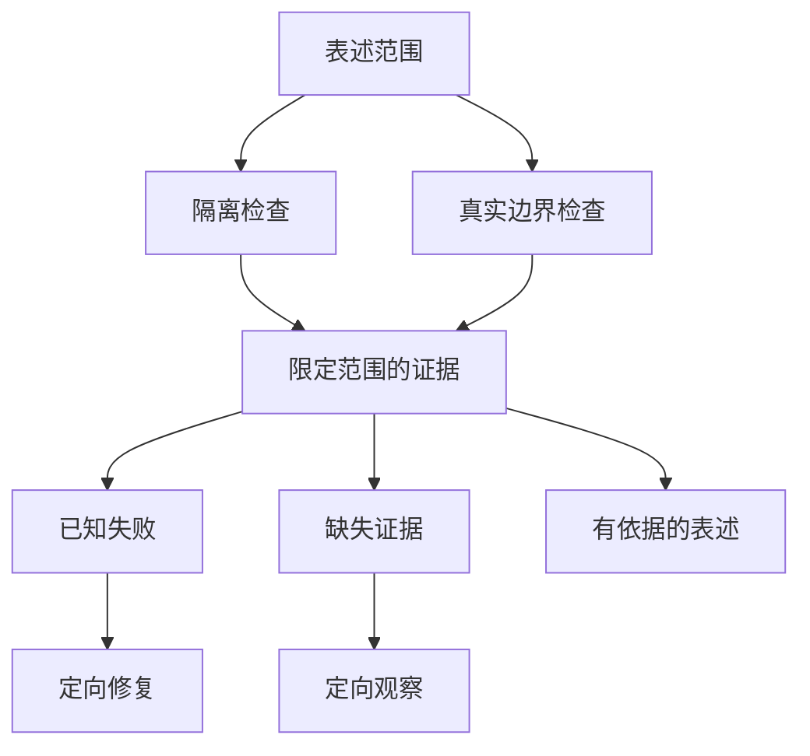

# 测试全绿、模型有返回，就算 Agent 成功了吗？

**绿灯只说明某项检查在给定条件下通过，不会自动证明用户的任务已经完成。** Agent 评测最重要的工作，是先确认检查了哪条边界、评的是哪份内容、分母包含哪些任务，再比较质量和成本。

这不是要求每次修改都重跑整套研究，而是让证据与声明相匹配：局部逻辑用局部检查，跨进程效果看真实交接，模型质量看实际产物。否则，一个准确的测试数字也可能支撑一项错误的产品结论。

我们早期遇到过这样的情况：服务端有候选答案，自动裁判给出了结果，运行状态甚至已经是 `completed`；继续沿前端链路检查，却发现候选存在、服务端发送、浏览器收到和展示，并不是同一个事实。

下面的历史案例解释如何避免这种误判，不作为当前模型排名或完整生产验收结果。

## 一、先说清楚：这一盏绿灯照到了哪里？

替身测试能够控制输入、依赖与时间，适合检查局部逻辑。真实依赖验证则实际启动进程、连接数据库或跨越网络。两者都有价值，但回答的问题不同。

我们曾观察到一组聚焦替身检查全部通过，更大范围的验收却仍有未完成项。问题不是哪组数字更漂亮，而是较小的检查没有触及尚未成立的那些交接。

一个更具体的反例来自命令行超时验证：

| 原受控窗口中的值 | 数值 | 含义 |
| --- | --- | --- |
| 单元侧默认值 | 45 秒 | 局部测试看到的默认配置 |
| 模型侧实际透传值 | 每次调用 80 秒 | 真正送入后续调用的限制 |
| 治理上限 | 60 秒 | 当时声明的上界 |

替身不会真的等待 80 秒，只检查默认值就可能错过实际透传已经超限的问题。总任务期限与单次调用超时还具有不同的起点和作用范围，不能看到等待过长就把所有上限一起调大。

这个窗口定位了问题和修复方向，但没有采集修复后的重测结果。因此它仍是一条失败观察，而不是事后补写的通过记录。

**验证对象应当是调用者真正依赖的行为，而不只是最容易检查的配置或返回值。** 声称数据库交接成立，就需要触达数据库；只修改一个纯函数，则不必为证明局部逻辑重新运行全部外部依赖。

## 二、不要用一个总分抹掉不同的失败

一次 Agent 请求可能经历理解问题、取得材料、生成候选、发布、发送和界面展示。协议合法并不证明问题被理解；工具返回并不证明材料适用；一份好答案也可能没有交付。

评测至少应该分别回答：

| 层面 | 需要确认什么 |
| --- | --- |
| 协议 | 输出能否正常解析 |
| 研究与证据 | 是否理解任务，并取得所需的合格材料 |
| 回答 | 内容是否准确、恰当且有依据 |
| 交付 | 实际内容到达了服务端发送、客户端接收还是展示的哪一层 |

有些条件不能被平均。表达流畅不能抵消关键材料缺失；没有发送答案，也不该因为后台候选写得好而获得漂亮总分。

同样，失败和未知要分开。`failed` 表示已有证据说明要求没有满足；`inconclusive` 表示证据不足以判断。前者需要修复，后者需要补充相应观察。把两者都记成零分，会把基础设施缺口混入模型能力评价。

这不是取消综合比较，而是先确定候选是否满足本次用途的必要条件，再比较回答质量、可靠性、延迟与成本。可选能力的不足，也不应被顺手升级为所有用途的否决条件。

## 三、最容易悄悄改变结论的，是分母

看一个假设例子：计划评测 30 题，其中 20 题因为排队、超时或工具问题，在观察窗口内没有完成。剩余 10 题中，有 9 题返回非空内容。

“已完成样本中，9/10 返回了答案”是准确描述；直接写“成功率 90%”则改变了口径，还把非空内容偷换成任务成功。

未完成的题目可能更长、更复杂，需要更多工具和纠错。它们不一定是随机缺失；只看完成的部分，容易把最能暴露问题的样本排除掉。

因此，评测前应固定题集、数据快照、代码版本、模型版本、配置和原始分母。任何条件变化，都要保留自己的观察窗口。可以比较不同版本，但不能把不同条件下的结果拼成一次更好看的实验。

这里的可执行判断很简单：**先展示全部计划任务去了哪里，再讨论已完成部分的质量。** 未完成、失败、未知和有可用答案的样本都应该留在各自位置，而不是从统计中消失。

### 同一批真实运行，三个分母相同的结论也不相同

2026 年 10 月 30—31 日的专家研究测评，为前面的区分提供了一个具体例子。计划 120 次运行，当时实际结束 59 次，另 61 次尚未执行；不能把计划次数当成已完成的证据，也不能把重复题目的独立运行写成互不重复的问题。

按原 Runtime 终态，59 次中 42 次 completed、17 次 failed；按正文观察，48 次有可见且确认保存的正文，其中 6 次来自 Runtime 失败的运行。自动测评另记录 40 次 inconclusive、19 次 failed。这三套状态描述执行、交付观察和评测判定，不能互换成金融语义正确率。

失败后已有部分正文，不等于整项任务完成；程序正常结束，也不等于回答已经独立核验。完整质量对照尚未完成，失败和未执行样本都应保留原身份。协作贡献的具体取证方法见[多专家 Agent 的贡献证据](agent-subagent-contribution-evidence.md)，观测查询与实际覆盖的差别见[Trace 完整性案例](agent-trace-complete-observation-gaps.md)。

## 四、裁判必须知道自己评的是哪份答案

自动评测通常发生在服务端：取一个候选答案，让模型裁判检查事实、格式、引用和表达。它能够评价候选质量，但流式产品还必须回答另一个问题：用户收到的是不是这一份内容？

完整候选可能被发布环节拒绝，也可能只发出了前半段。服务端记录了发送，仍不等于客户端已经完整接收或展示。

因此至少分清三个对象：模型候选、服务端实际发送的正文、客户端接收与展示证据。若声明在评价“已交付回答”，就应当从实际对外发送的内容事件按顺序重建评测材料，而不是拿后台最完整的草稿替代。

流在中途断开，重建材料就应该保留这种不完整。后台后来补写的新版本，也不能倒过来改写当次交付历史。有客户端确认、消息序号或渲染回执时，再据此扩大交付结论；没有，就准确说到“服务端已发送”。

**评分对象的身份与范围，比评分公式是否精巧更重要。** 这也是 Agent 评测与纯模型基准的区别：产品结果还经过了一个真实的交付系统。

## 五、如果错的是评测器，要修判断，不要重写发生过的事

我们也遇到过评测夹具或校验契约导致的机械误判。修正评测逻辑后，受影响样本的判断发生变化，但仍有真实失败保留下来。

若直接覆盖旧成绩，就很难知道第一次为何失败、后来为何改判，也无法区分进步来自模型、运行时还是测量工具。

更稳妥的方式是保留原始结果，追加更正，再生成修订视图。每项更正对应原来的运行、输入版本和受影响案例，说明旧判断、新判断与理由。后续发现更正仍有问题，也继续追加，而不是把历史反复改成最新的解释。

这个机制的目的不是增加一套审计仪式，而是保住比较的基础：**执行结果改变了，与我们对同一结果的认识改变了，是两种不同的进步。**

### 裁判给了满分，为什么结论仍然可能是 inconclusive？

2026 年 10 月下旬的受控多 Agent 投研评测留下了两种不同的反例。一组 Judge 返回了完整评语，但其中部分引文无法在当次提供给裁判的材料里定位：这不是“答案被扣分”，而是**评语的依据尚不能复核**。另一组评审返回了满分，但评审与生成使用相同模型，尚未满足该对照要求的独立性。满分是已返回的评分事实，不等于已取得独立质量验证。这些记录不足以推出“多 Agent 比单 Main 更好”。

因此，审查一份模型裁判结果，至少分三步：**评审调用有没有结算、评语依据能否在实际输入中定位、裁判与样本是否满足预先确定的独立性及可比性条件。** 第一项通过不代表后两项通过；来源无法查证或必要对照缺失时，应保留原评语及 inconclusive 状态，明确下一次需要补的材料。也不要把一份不合格的评审回执误记成被评研究没有运行。

这组限定记录尚无可公开重放的完整真实模型配对和可比较收益数字，因此这里只讨论**如何判定评审证据的资格**，不报告多 Agent 的成功率或性能提升。

## 六、怎样做出一份真正能用的最小 Agent 评测集？

前面说明了不能把绿灯、候选答案和用户效果混为一谈。落到工程实践，还要回答：**下一次改动之后，拿什么证明同一类错误没有回来？**

不用先建一套全新的 Eval 平台。先从一次真实、已确认的错误开始，保留可合法复现的输入，再加上几条正常路径与相邻反例。每条任务至少包含以下信息：

| 保存什么 | 为什么需要 |
| --- | --- |
| **任务与身份** | 稳定 case ID、原始用户问题、希望完成的业务任务；不能只保留提示词的改写版本。 |
| **可重建输入** | 脱敏后的资料快照、来源与时点、模型/代码/工具配置、授权范围；外部数据随时间变化时，先冻结用于回归的输入。 |
| **验收对象** | 本次判定的是工具执行、模型候选、服务端实际发送的正文，还是客户端展示；每一种对象单独保存身份。 |
| **检查规则** | 哪些是代码可判定的不变量，哪些需要模型裁判，哪些涉及业务人员复核。必要条件与可选质量分开。 |
| **执行与观测状态** | 完成、已知失败、未知，以及预算、延迟和取证缺口；保留预先纳入的全部任务。 |

以一个**纯合成的基金费率对比题**为例，样本契约可以只有这些字段。它不是当前系统跑出的评测成绩，也不包含真实客户持仓：

```json
{
  "caseId": "fund-fee-asof",
  "question": "按给定材料比较两只基金费率，说明时点差异",
  "snapshot": "fixtures/synthetic-fees-v1.json",
  "requiredEvidence": ["feeA", "feeB", "effectiveDate"],
  "mustNotDo": ["placeOrder"],
  "gradeTarget": "server_emitted_answer"
}
```

这道题的**代码检查**是：无交易授权时没有实际下单工具回执；参与比较的每个数字具备可识别的来源和生效日期；发往裁判的正文确实来自该次对外发送事件。**模型裁判**按给定评分示例判断有没有混淆费率与时间口径，是否回答了原问题。**人工复核**优先处理裁判不一致、证据冲突和可能诱发真实交易决策的高影响样本。裁判说“引用充分”不能替代来源身份和数字复算。

### 最小执行流程：固定、运行、归因、复核

1. **固定任务集合和条件。** 每条样本保存原始 ID 与可回放快照；候选版本和对照版本使用相同输入与授权，条件变化另开观察窗口。
2. **选择必要的验证深度。** 权限、持久回执、数值计算等确定性契约先做工程检查；改了模型可见输入或研究策略，再选受影响任务做真实模型运行；声称改善用户效果，需触达相应交付层。
3. **把所有样本留在分母。** 报告任务总数、完成、失败与未知；已完成样本中的回答质量单独列出，不用后者代替全量任务完成率。
4. **分开三种改动。** 产品行为改变、Judge 解析或标注口径修正、观测记录变完整，各自存证；保留原判定和带理由的更正，不覆盖历史。
5. **用人工样本校准裁判。** 对不一致和高风险样本优先复核；模型裁判本身也需要可比的输入和可检查的评分规则。
6. **仅对足够可比的窗口作结论。** 同时记录质量、成本、延迟与失败类型；缺少必要观察时，只能报告局部修复或暂定判断。

这里的任务集不是每篇文章附上一份新仪表盘，更不是强行规定“每个 PR 都跑全套真实模型”。回归频率由风险和行为变化决定；确定性不变量有了足够证据，就不必为了仪式感重复做推理实验。

### 对照业界做法：我们补的是哪一段？

[Anthropic 的 Agent 评测实践](https://www.anthropic.com/research/demystifying-evals-for-ai-agents)将代码、模型和人工三类裁判组合，强调隔离执行环境与结果判定；[OpenAI 的 Agent 工作流评测指南](https://developers.openai.com/api/docs/guides/agent-evals)则区分用于诊断的 Trace grading，以及用于稳定回归的数据集和 Eval runs。它们提供了可复用的评测构件，我们不需要重新发明一套评分框架。

本站的额外强调来自已有交付故障：**若结论写的是“用户收到了可靠回答”，评分对象就必须与实际发送或展示的内容对应**，而不是只对内部 Trace 里最完整的候选打分。Trace 可以帮助定位哪步错了，但不能代替没有采集到的客户端证据。这个要求是我们对目标范围的补充，不意味着上述工具不支持交付验证。

## 七、先决定能否比较，再决定谁更好

我现在更愿意在发布模型结论之前问三个问题：实验条件和原始分母是否可比；本次用途明确要求的条件有没有失败；仍有哪些关键事实未知。

条件不可比，就先解释差异；必要条件明确失败，就针对该用途记录不合格；关键事实未知，就保留暂定结论。通过这些检查后，质量、稳定性、延迟和成本的比较才有解释力。

这不需要变成新的万能运行时门禁。它首先是研发与评测中的判断顺序：



图中的两种检查按声明需要选择，不要求所有改动同时执行。证据可能支持一个有限结论，也可能发现缺陷，或留下一个尚需观察的问题。已有证据足够、行为又没有变化时，不必为了整理报告重新验证一切。

### 新例子：原始研究保存成功，为什么 A/B 仍然不可比？

2026 年 10 月的一轮金融研究评测把这件事暴露得很具体。一个真实的研究题 C04 留下了模型实际回答及可重开的原始记录；独立计算基准和人工待评维度也被分别保存。随后用公开合成数据，沿真实工具、容器 Python、结果引用、隔离 PostgreSQL 和另一个操作系统进程的原 Human 安全点，检查资料与计算能否被原身份恢复消费。

这证明了两种能力：**真实回答可以保存并供审阅；受限原结果也能跨进程读回，而不用重新执行已提交的计算。** 但它没有给“哪个模型更好”提供配对实验。此时真正的 C04 只有一个原始候选，找不到同时匹配不可变模型版本、配置、题目与重复次序的替代样本。可比较的真实配对数是 **0/1**，不是一次“没有显著提升”的实验。

为了验证比较程序本身，工程中另用 A/B/C 合成记录测试：只改变单一因素时才进入配对；同时改变模型与配置、样本重复不完整，或者配置身份未知，都必须标出不可比。**合成比较器正确，不会把缺失的真实对照变出来。**

因此，评测结果应分别展示：执行和交付成功与否、材料和数字的来源资格、可比样本的实际分母、人评/裁判尚未给出的判断，以及已知和未知成本。原题如果缺一份来源或少了一种计算，可以形成定向改进候选；它仍不等于某次模型 A/B 的因果收益。

这也是一个开发实践判断：把恢复、校验和比较接到同一条可审阅链路之后，**当结果不够比较时，正确输出可以就是“证据不足以升级”。** 比给出一张没有可信分母的排行榜，更能帮助下一次决定该收集什么。

对研发人员，先把本次修改要证明的行为说具体；对评测设计者，固定输入与分母，并让裁判看到与声明相符的实际内容；对作决策的人，把失败、未知和质量差异分别处理。

**测试的价值不是让报表全绿，而是帮助我们知道该修什么、该补什么证据，以及现在能够放心作出哪一种决定。**

每次看到一个 Green，先问：它证明了哪个版本、哪份输入、哪条边界和哪份实际内容？这对应[方法 5「验证与故障归因」](/principles#method-5)。让结论停在证据真正支持的位置，才能避免用局部成功提前宣布产品成功。

## 延伸阅读

[Spec 与 Evidence 工作流](026-agent-spec-evidence-workflow.md)讨论原始观察如何保留和更正；[AI Coding 最贵的不是写代码，而是决定什么值得验证](ai-coding-judgment-and-verification.md)讨论怎样按错误代价分配验证资源。

更多文章见 [ETF Agent Engineering Notes](https://github.com/hpoenixf/eff-agent-article)。欢迎 Star 与交流。