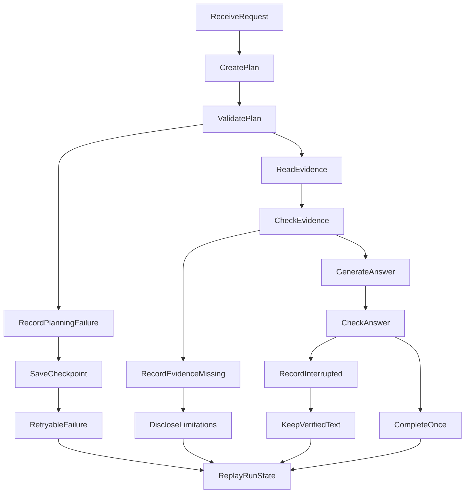
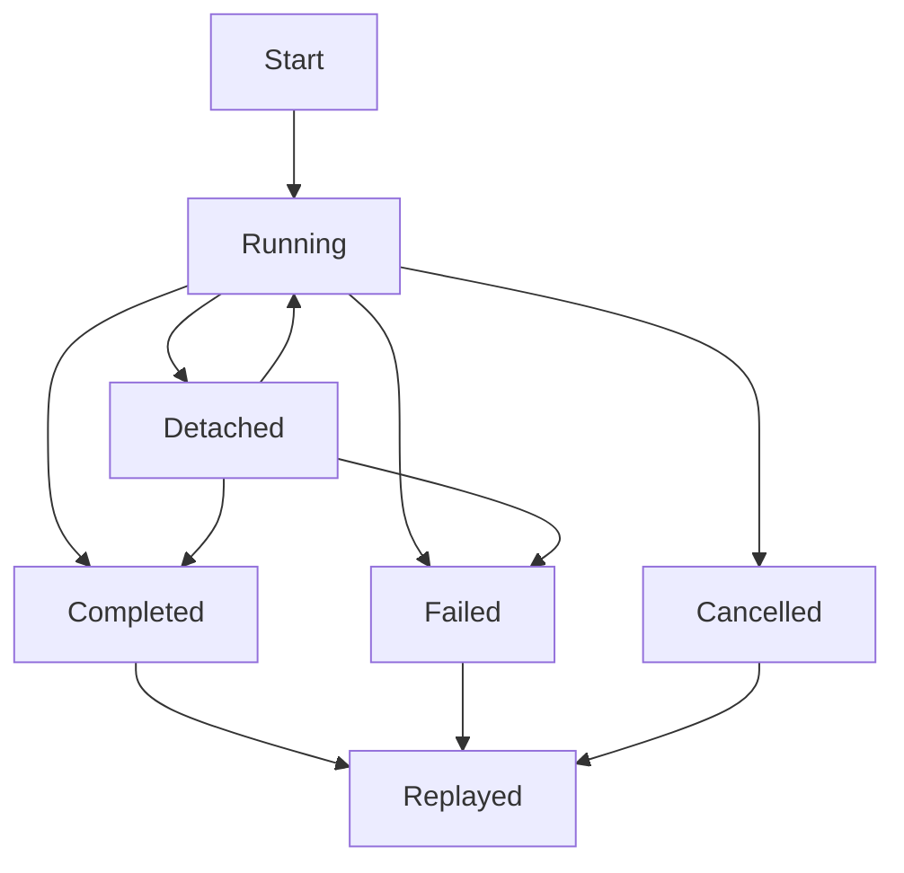

# 别让兜底回答伪装成功：流式 Agent 的阶段预算、失败终态与安全恢复

> 一个 Agent 最危险的失败，不是明确报错，而是在规划已经失效、证据没有取得时，仍然给出一段看起来正常的回答。

用户向 Agent 提问后，页面转了很久，最后出现一段语句通顺的文字。这个请求成功了吗？

未必。规划器可能没有生成合法计划，工具可能从未被调用，回答也可能只是失败恢复阶段拼出的通用文本。系统有输出，不代表它完成了用户交给它的任务。

本文讨论一种更严格的可靠性设计：把规划、取证、生成和流式交付拆成不同阶段，为每个阶段定义自己的时钟、成功条件和失败状态。恢复机制只能延续已经验证的事实，不能把技术故障改写成业务完成。

文中的测试数量和耗时来自一次受控开发与验证窗口，用来说明判断方法，不构成通用性能承诺。长期生产失败率与用户重试成功率仍未采集。

## 一、先定义成功：不是“有文字”，而是任务闭环

传统接口很容易把一次请求压缩成三个状态：处理中、成功、失败。Agent 不适合这么简单的模型，因为一次回答内部还包含规划、工具调用、证据校验、语言生成和流式传输。

如果只看最终有没有文字，下面三种请求都会被误判为成功：

- 规划失败后，系统改用一个不需要证据的通用任务继续回答；
- 工具已经成功，但模型续答失败，页面只保留了中间状态；
- 流正常结束，却没有正文、合法工具调用或明确终态。

更可靠的成功定义至少包含四层。

| 层次 | 要回答的问题 | 最小成功条件 |
| --- | --- | --- |
| 规划 | 系统是否理解了目标和证据需求 | 产生通过结构校验的计划 |
| 取证 | 所需事实是否真的被取得 | 必需工具已调用，来源和时效可核验 |
| 生成 | 是否形成可交付回答 | 正文非空，关键断言有证据支持 |
| 交付 | 用户是否真正收到结果 | 流中存在唯一、可重放的终态 |

其中任一层失败，都不能被下一层自动“修成成功”。规划失败时，即使模型能写一段常识，也没有资格声称本次数据任务已经完成。

可以把一次成功写成一个最小判定式：

```text
Success = PlanValid
       ∧ EvidenceSatisfied
       ∧ AnswerDeliverable
       ∧ TerminalCommitted
```

这里使用逻辑“与”，意味着四项缺一不可。某项未知时，整体也只能是未知，不能因为另外三项通过就补成成功。

这个表达式比平均分更适合高风险任务。平均分允许“语言很好”抵消“证据不存在”，而逻辑门明确规定：再流畅的回答也不能替缺失证据背书。

### 1.1 兜底回答为何是一种任务类型错误

规划失败后改答常识，看起来只是降级，实质上却可能改变了任务类型。

“查询某指数最近表现”是一个需要当前证据的数据任务；“解释指数是什么”是一个可以使用稳定知识的概念任务。二者话题相近，却有完全不同的完成条件。

如果系统在运行中悄悄把前者替换成后者，用户收到的不是低质量版本，而是另一个问题的正确答案。这类错误比显式失败更难发现，因为文本表面上仍然相关。

因此，降级只能减少承诺，不能替换目标。可以从“给出精确数值”降级为“披露证据缺口”，却不能从“回答当前事实”降级为“讲一段一般知识”后仍标记完成。

### 1.2 证据状态和运行终态不能混成一列

证据状态说明本轮拿到了什么，不说明失败发生在哪个阶段，也不替代运行终态。

| 证据状态 | 含义 | 后续处理 |
| --- | --- | --- |
| `grounded` | 证据齐全且新鲜度满足要求 | 只在证据支持的范围内回答 |
| `partial` | 部分来源缺失，仍有可用证据 | 保留有证据的部分，并披露缺口 |
| `unavailable` | 证据通道不可用，或命中失败终态 | 说明缺口；只有明确定义的恢复路径才能重试 |
| `no-evidence` | 通道正常，但没有命中可用证据 | 只报告本次范围内无命中，不推断事实不存在 |
| `not-requested` | 本轮没有发起取证 | 不把它当作工具失败，也不据此作事实断言 |

同一请求的运行阶段仍要单独记录：规划失败、工具失败、用户取消和流中断不是同一种原因。最终证据状态按术语表中的收敛顺序计算；后续成功不得覆盖失败终态。

## 二、为什么一个 timeout 不够用

在流式 Agent 中，“超时”可能指完全不同的事情。

模型可能长时间没有产生有效正文；工具可能在等待外部数据；请求可能排队很久但实际执行很快；浏览器也可能先于服务端停止观察。它们需要不同的处理方式。

一次真实诊断中，某个质量检查从页面看耗时约 360 秒，但其中约 347 秒属于排队，实际执行约 13 秒并正常完成。若直接把墙钟时间记成执行超时，后续就会错误地调整模型或工具预算。

因此至少要区分四种时钟：

| 时钟 | 从哪里开始 | 用来判断什么 |
| --- | --- | --- |
| 排队时间 | 请求进入调度队列 | 容量与并发是否不足 |
| 阶段执行时间 | 某个阶段真正获得执行权 | 当前模型、工具或校验器是否过慢 |
| 无进展时间 | 最近一次有效进展之后 | 当前阶段是否已经失去响应 |
| 整体截止时间 | 整条业务请求开始 | 用户最多需要等待多久 |

“有效进展”也不能只看网络心跳。空白 token、usage 事件和连接保活，只能证明传输仍然存在；可见正文、合法工具调用或结构化计划片段，才可能刷新业务上的无进展计时。

阶段预算应受整体截止时间约束。即使某个阶段拥有更长的理论预算，也只能使用整条请求的剩余时间。这样可以避免每个阶段都合法等待，最终却让整条请求无限延长。

## 三、主流程：阶段失败不能改变任务性质

下面是一条简化后的运行流程。关键不在于节点多少，而在于每个失败分支都有明确终态，并且不能偷偷回到“生成普通回答”。



**关系或转移条件：**

- **ValidatePlan → RecordPlanningFailure**：否。
- **ValidatePlan → ReadEvidence**：是。
- **CheckEvidence → RecordEvidenceMissing**：否。
- **CheckEvidence → GenerateAnswer**：是。
- **CheckAnswer → RecordInterrupted**：否。
- **CheckAnswer → CompleteOnce**：是。

这个流程遵守一条核心规则：**恢复可以延续任务，但不能改写任务。**

用户问的是当前行情，规划失败后不能把任务改成“解释行情的一般知识”；用户问的是个人持仓，证据不可用时不能拿历史摘要补成当前状态。

失败恢复首先要保存的是任务身份、已经确认的实体、时间范围、证据需求和已验证片段，而不是尽快凑出一段正文。

## 四、运行状态需要记录哪些信息

要让失败可恢复，系统必须保存比错误字符串更丰富的状态。一个教学级运行记录可以包含以下字段：

```json
{
  "input": {
    "question": "分析某个指数最近一段时间的表现",
    "requiresCurrentEvidence": true
  },
  "runId": "run-example",
  "clientMessageId": "message-example",
  "phase": "planning",
  "status": "planning_failed",
  "failure": {
    "category": "validation",
    "retryable": true,
    "reason": "planner_output_missing"
  },
  "checkpoint": {
    "lastValidTask": null,
    "evidenceNeeds": [],
    "validatedParts": []
  },
  "downstreamCalls": {
    "tools": 0,
    "answerModel": 0,
    "reviewer": 0
  },
  "delivery": {
    "terminal": "failed",
    "replayable": true
  }
}
```

`phase` 表示失败发生在哪里，`status` 表示业务终态，`category` 用于区分协议、供应商、权限或时限问题。`checkpoint` 只保存已经确认且允许继续使用的语义。

这个示例把“需要当前证据的分析请求”明确投影成规划失败，而不是把问题改写为一般知识问答。输入是否需要当前证据，是后续能否降级的关键槽位；一旦该槽位为真，系统就不能用无来源常识补齐结果。

`downstreamCalls` 是很重要的负向证据。只断言页面显示了失败还不够，还要证明失败之后没有偷偷调用工具、回答模型或评审器。

`clientMessageId` 用于识别同一个逻辑请求。网络重连时应重放已存在的运行，而不是创建一个新运行并重复调用上游资源。

### 4.1 合法检查点必须保持单调

检查点不是任意缓存，而是“到目前为止已经被验证、允许继续依赖的最小状态”。恢复过程应满足单调性：没有新证据，就不能让已确认事实集合变大。

设某时刻的可信状态为 `K(t)`。一次不包含新证据的重试，只允许保持或缩小它：

```text
没有新证据时：K(t+1) ⊆ K(t)
取得并验证新证据后：K(t+1) = K(t) ∪ NewVerifiedFacts
```

这条规则阻止恢复逻辑把模型猜测、旧上下文或默认值悄悄加入可信状态。

多轮对话尤其需要这条边界。用户说“年份改成 2024，其他不变”，但本轮规划失败时，系统可以保留上一轮已经确认的标的和任务结构，却不能自动接受“2024”已经绑定成功。新值仍然属于未确认输入。

### 4.2 失败所有权决定谁可以恢复

“失败发生在哪一层”不仅用于日志分类，也决定恢复权限。

规划层可以重建计划，但不能复用一个从未合法存在的工具请求；工具层可以在同一计划下换用允许的后备来源，却不能修改用户目标；回答层可以复用已验证证据，却不能重新抓取更多私人数据。

如果恢复者拥有的权限超过失败层，就会出现越级修复。最典型的例子，是回答生成器发现缺数据后自行选择新工具。它绕过了规划和权限检查，即使最终数字正确，过程仍不可审计。

## 五、判定规则：何时重试，何时停止

不同失败不能共用一个重试开关。可以按“是否已有合法状态”和“重试是否会重复副作用”做判断。

一个可操作的重试资格可以写成：

```text
RetryAllowed = TransientFailure
            ∧ ValidCheckpoint
            ∧ BudgetRemaining
            ∧ NoUnreplayableSideEffect
            ∧ SameAuthorizedTask
```

临时故障只是第一个条件。没有合法检查点、预算耗尽、已经产生不可安全重复的副作用，或重试会改变原任务时，都必须停止。

| 场景 | 默认处理 | 原因 |
| --- | --- | --- |
| 规划输出为空或结构非法 | 返回 `planning_failed`，允许显式重试 | 没有合法计划，不能进入工具阶段 |
| 已有合法计划，临时供应商错误 | 在共享预算内有限重试 | 任务语义未丢失，重试目标明确 |
| 工具已成功，回答续写失败 | 复用工具结果，只恢复回答阶段 | 从头执行会重复成本和外部调用 |
| 已产生合法部分回答 | 保留片段，不静默重写 | 重写可能改变已经交付的事实 |
| 浏览器普通断线 | 解除订阅，不取消服务端运行 | 网络连接不等于业务生命周期 |
| 用户显式停止 | 取消运行并写入唯一终态 | 用户意图高于自动恢复 |
| 结果格式错误且修复预算耗尽 | 失败关闭，不降级为自由文本 | 自由文本会绕过结构与证据约束 |

重试预算必须共享，而不是每个子调用重新领取一份。否则一个看似“最多重试一次”的规则，经过多阶段嵌套后可能膨胀成多次外部请求。

对于模型评测和独立审核，重试策略还应更严格。交互式对话可以为临时网络问题做有限恢复，评测若自动重试却会改变样本成本与可比性，因此通常应保持零重试或单独记录每次尝试。

重试次数也不宜由每个函数各自维护。假设规划、工具和回答都允许“两次重试”，嵌套执行可能把一次用户请求扩张为多轮外部调用。共享预算让所有阶段从同一余额扣减，才能形成真正的全局上限。

这里还有一个容易忽略的区分：幂等不等于可免费重试。一个只读请求即使不会写数据，也可能消耗付费额度、占用稀缺租约或触发上游限频。副作用除了数据库写入，还包括成本与容量。

## 六、三个真实案例：错误为何总被归到错误层

### 案例一：工具成功了，失败发生在续答

一次组合查询连续多次表现为“网络错误”。拆开时间线后发现，工具在约 0.15—0.29 秒内已经成功，真正的失败发生在工具返回后的第二轮模型续答：等待约 30 秒仍没有形成正文。

如果按页面文案修网络层，问题不会消失；如果整条请求重跑，又会重复已经成功的工具调用。

正确做法是保存工具结果，把恢复范围限制在回答阶段。同时，无正文、无合法工具调用的流结束不能记为完成，而应进入明确的空完成终态。

### 案例二：墙钟很长，不代表执行超时

一次检查的总墙钟约 360 秒，其中排队约 347 秒，实际执行约 13 秒并成功结束。若只记录总耗时，会得出“模型执行了六分钟”的错误结论。

同样地，工具返回 `unavailable` 与工具根本没有被选择也是两类问题。前者说明调用链存在但数据不可用，后者说明计划、权限或调度链路在工具之前就断了。

这类诊断要求同时记录排队、实际执行、结束原因、工具调用和来源。最终文案只是结果，不是根因。

### 案例三：最危险的恢复，是把失败任务换成容易回答的任务

在一组固定的 48 条真实验证记录中，8 个运行里的 10 次规划调用出现了同类现象：模型持续输出内部推理片段（reasoning），却始终没有给出合法计划正文，最终到达阶段截止时间。

旧恢复逻辑随后构造了一个通用知识任务。实体、时间范围和证据需求在转换中丢失，系统没有调用原本需要的结构化工具，却仍然进入回答阶段。

其中一个简单请求经历两次完整规划和长时间排队，端到端耗时被放大到约 672 秒。问题不只是慢，而是失败后的任务已经不再是用户最初交付的任务。

修复后的策略是把它记录为 `planning_failed`。首轮请求没有合法计划时，只保存未知等待状态；多轮纠正失败时，可以保留上一轮合法任务作为安全检查点，但不能猜测本轮的新实体或新时间。

失败路径还必须满足三个零调用：工具调用为零、回答模型调用为零、评审调用为零。这样才能证明系统没有通过另一条隐蔽路径继续生成答案。

## 七、流式交付还需要一个独立状态机

业务运行和浏览器连接不是同一个生命周期。把二者绑在一起，会导致用户刷新页面时取消后台运行，或者断线重连后重复执行同一任务。



**关系或转移条件：**

- **Running → Detached**：浏览器普通断线。
- **Detached → Running**：同身份重新订阅。
- **Running → Completed**：唯一完成终态。
- **Running → Failed**：类型化失败终态。
- **Running → Cancelled**：用户显式停止。
- **Detached → Completed**：后台完成。
- **Detached → Failed**：后台失败。
- **Completed → Replayed**：重放已存结果。
- **Failed → Replayed**：重放失败信息。
- **Cancelled → Replayed**：重放取消状态。

每个运行只能持久化一个终态。完成、失败和取消互斥，后续重连只能重放，不能再把失败改成完成。

分块交付时也要保留对象边界：第一个回答块已提交、第二个块被拒绝，应留下第一个块并把整次结果标为部分；不能因第二块失败而回滚已提交内容，也不能把第一块当作完整答案。

这种约束可以理解为终态封印：一旦运行进入 terminal，后续事件只能补充读取视图，不能改变业务结论。若确实需要继续，必须创建一个带因果关联的新运行，而不是篡改旧运行。

新运行与旧运行之间应记录 `causedBy` 或等价关系。这样可以回答：这是用户主动追问、失败后的显式重试，还是系统自动恢复？没有因果身份的“继续执行”，很容易在统计中被误算为同一次成功。

如果 HTTP headers 已经到达，但正文和结束标记之前发生未知中断，也不应直接命名为 timeout。没有明确的截止时间证据时，使用 `stream_interrupted` 或保留 unknown，比编造精确根因更可靠。

## 八、安全边界：可靠性修复不能偷偷扩大权限

可靠性问题很容易诱导出一些看似有效的捷径：增加所有 timeout、自动切换模型、用关键词直接选择工具、失败后生成通用回答。这些办法可能提高表面的回答率，却会改变原有权限和证据边界。

一套安全的恢复机制至少守住以下约束：

1. 没有合法计划，不调用任何需要该计划授权的工具。
2. 已成功的外部调用不因下游失败而自动重放。
3. 失败恢复不新增模型、工具、数据范围或执行权限。
4. 当前事实缺少证据时，不用常识文本补齐。
5. 日志只保存阶段、耗时、尝试次数和类型化原因，不记录完整提示词、原始工具载荷或私人数据。
6. 自动重试、模型对冲和权限扩大必须作为独立设计评审，不能混入一次 bug 修复。

这些约束的价值在于：系统即使没有恢复成功，也不会因为“努力恢复”而做出更危险的事情。

## 九、验证失败机制，不能只看最终页面

可靠性测试要同时覆盖正向结果和负向调用。下面是一组可复用的检查面：

| 检查面 | 需要证明的事实 |
| --- | --- |
| 规划失败 | 产生类型化终态，没有进入取证和回答 |
| 工具后续答失败 | 工具结果被复用，没有重复工具调用 |
| 空完成 | 无正文且无合法工具调用时不能标记 completed |
| 普通断线 | 服务端运行继续，同身份可以重放 |
| 显式取消 | 运行停止，只留下一个 cancelled 终态 |
| 多轮纠正失败 | 保留上一合法任务，不采用未经确认的新值 |
| 诊断信息 | 能区分排队、执行、无进展和整体截止时间 |

在本次受控窗口中，规划失败改造经过 84 项聚焦测试和 693 项相关回归；更大范围的离线检查中，Agent 侧 2,557 项、根侧 1,773 项通过。

这些数字证明的是本地契约与回归范围，不证明长期生产稳定性。修复后的真实规划失败率、供应商长尾表现、浏览器重连成功率和用户重试结果仍属于未采集项。

### 9.1 指标也要按阶段定义

上线后的监控不应只看总成功率。至少需要分别观察规划合法率、必需证据满足率、可见正文率、唯一终态率和显式重试成功率。

这些指标的分母必须保留原始请求，而不是只统计走到本阶段的样本。例如可以报告“证据满足数/合法计划数”，但还要保留“合法计划数/总请求数”，否则上游规划失败会从视野中消失。

阶段耗时也要同时给排队与执行分布。只看端到端 P95 无法判断该扩容、换模型还是修复状态机；只看模型执行 P95 又会忽略用户真实等待。

### 9.2 故障注入要验证“不发生什么”

可靠性测试最有价值的部分往往是否定断言：规划失败后工具调用为零，普通断线后业务取消为零，重放时新增模型调用为零，终态之后状态改写为零。

正向测试只能证明某条成功路径存在，负向测试才证明危险旁路不存在。对于带权限和外部成本的 Agent，这类零调用证据与最终正文同等重要。

同样，局部实现绿色不等于整个长期变更已经完成。实现证据、运行证据和完成声明必须分别记录。

## 十、把失败设计成一等结果

流式 Agent 的可靠性，不是想办法让每个请求都返回一段话，而是让每个请求都能诚实地结束。

规划失败就停在规划失败，证据不可用就披露证据缺口，回答中断就保留已验证片段，浏览器断线就等待重放。每一种状态都有自己的恢复权限，也有明确禁止跨越的边界。

最值得警惕的不是红色错误页，而是一个已经失去原任务、失去证据需求，却仍然显示 completed 的绿色结果。

可靠恢复的目标可以压缩成三句话：先判断失败发生在哪个阶段；只从最后一个合法检查点继续；宁可给出可重试的失败，也不要用无依据的回答伪装成功。

当失败成为结构化、可观察、可重放的一等结果，系统才真正拥有了恢复能力。否则所谓兜底，只是在把问题藏得更深。

## 证据边界与材料来源

本文根据以下工程复盘提炼，正文已将项目模块翻译为通用机制：

- 规划失败安全终态
- 阶段化对话时间预算
- 对话续答、流式恢复与空完成
- 48 条运行中的超时与工具调用审计
- Research Runtime 的当前发布与交付合同
