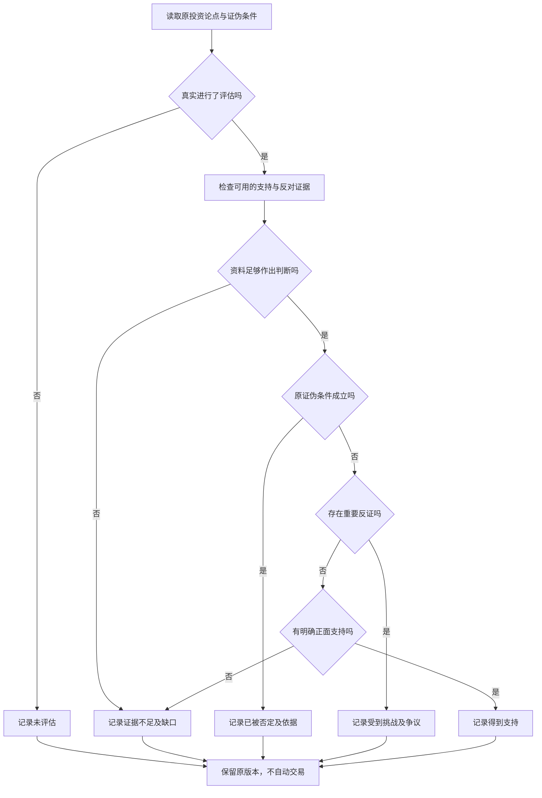

# AI 投研不能只有支持意见：从多视角分析到投资假设证伪

> 多 Agent 投研协作 · 第三篇｜从投资者的问题走向可检验的判断

假设你已经买了几只基金，最近又看上一只科技 ETF。你问 AI：“要不要再加一点？”

它很可能很快整理出行业前景、产品费用、近期表现和风险提示，最后告诉你“结合风险偏好审慎决定”。这些内容未必有错，但你仍然不知道：**新买这只基金会让整个组合发生什么变化？你最初想买它的理由，真的成立吗？**

这正是我们在 ETF Agent 里不断遇到的研究难题。获取资料是一回事，把资料变成对个人组合有用的判断，是另一回事。更进一步，即使判断看似有道理，我们还希望 AI 能主动问：有什么证据会推翻它？

于是我们把不同投资方法、独立反方和版本化投资论点连接起来。这篇用一组完整的合成数据讲清为什么这样做、能为投资者解决什么，以及做成真正可信的研究流程还要跨过哪些技术和金融难题。

## 一、基金好，不等于适合加入我的组合

“这只基金怎么样”通常可以从产品资料回答：它跟踪什么指数，有什么费用和交易限制，持有哪些资产。

“我该不该把它放进已有组合”则是另一个问题。它取决于之前已经持有什么、这笔钱从哪里来、你希望改变什么，以及什么风险愿意承担。

例如，用户说“增加基金数量，应该更分散”。这听起来很合理，却忽略了一个常识：两只基金可能买了相同的公司。如果新增产品与原持仓高度重叠，基金数量变多，底层风险未必变少。

这叫作*穿透分析*：不只看基金名称，而是检查基金底层实际持有的行业、公司或风险来源。投资者教育资料也提醒，持有多个基金不一定构成充分分散，仍须留意底层重叠。[1]

从用户角度看，好的 AI 不应该急着在“买”和“不买”中二选一，而应先帮你发现真正需要比较的方案：不动原组合；拿一部分现金买；或者卖出另一只基金再买。三种行动改变的是不同的风险。

## 二、为什么我们需要不同的投资视角

投资研究没有一个能回答所有问题的万能指标。

讨论分散化，要看各类资产怎样共同波动；讨论长期持有，还要看现金需求和能否执行计划；讨论基金替换，费用、指数跟踪和买卖成本可能比一个漂亮的行业故事更重要。讨论估值时，即使是好公司，也不等于任何价格都值得买。

因此我们设计了六种固定研究视角，分别借鉴不同投资理论与实践框架：

| 研究视角 | 它会提醒投资者思考什么 |
| --- | --- |
| **Markowitz：组合配置** | 新资产会改变哪些风险？相关性有没有被忽略？ |
| **Taleb：尾部与脆弱性** | 如果遇到极端行情或流动性问题，组合会怎样？ |
| **Bernstein：长期投资纪律** | 这笔调整是否符合期限、现金用途和既定计划？ |
| **Bogle：低成本实现** | 为获得目标暴露，需要付出多少可见与隐含成本？ |
| **Marks：价格与风险补偿** | 即使资产不错，现在付出的价格是否合理？ |
| **Fama–French：因子解释** | 历史收益可能来自哪些可验证的风险因子，而非神秘“选股能力”？ |

这不是让 AI 冒充六位投资大师本人，更不是引用他们并未说过的当下建议。我们抽取的是分析框架，而不是名人身份。

也不会让六个 Agent 每次都上场。只要一次可靠的穿透计算已经回答了“行业占比是否提高”，就不必再请六种方法重复这个数字；缺少有效估值或因子资料时，多一个视角也不能把数据变出来。

对用户的真正价值，是**把一个含糊的投资提问拆成具体、可检查的问题，并且在不确定时知道自己还缺什么**。

## 三、多空的作用不是制造争论，而是挑战原理由

投资者往往会先有一个倾向，再寻找支持它的材料。AI 如果只是把支持与反对意见都写得更完整，仍可能没有检查最重要的前提。

我们因此增加了 Bull/Bear 两种职责：Bull 组织支持原假设的论证；Bear 主动寻找足以推翻它的关键证据。两方先各自研究，再围绕真实提出的观点交叉质询，最后由主代理综合。

这有一个与普通“多 AI 投票”不同的目标：**让一个判断有机会被真正修改，而不是让不同声音看起来很公平。**

假设原理由是“多买一只科技 ETF，让组合更分散”。Bear 的价值不是说“科技估值可能高”，而是检查该产品与既有持仓的实际重叠，问原结论是否仍能成立。

同样，Bear 找不到证据也必须承认；Bull 接受反例也不意味着研究失败。双方同意也不会自动使结论成为事实。我们希望帮助投资者避免错误理由，而不是让 Agent 之间产生胜负。

下面用同一份可手算的数据，把这件事讲具体。

## 四、一个人人能核对的例子：新增基金后，风险真的分散了吗

以下是**纯合成教学数据**，不对应任何真实投资者、具体基金或市场预测。为便于理解，把总资产看成 100 元；真实组合计算仍需处理估值日期、币种和披露覆盖。

原组合有 50% 宽基股票基金、30% 债券、20% 现金。我们比较两种不同的“新增 10% 科技 ETF”方案：

| 方案 | 宽基基金 | 科技 ETF | 债券 | 现金 |
| --- | ---: | ---: | ---: | ---: |
| A：保持不动 | 50% | 0% | 30% | 20% |
| B：从现金拿出 10 个百分点 | 50% | 10% | 30% | 10% |
| C：卖出 10 个百分点宽基，再买 ETF | 40% | 10% | 30% | 20% |

再假设：宽基基金内部 30% 属于科技行业，候选科技 ETF 内部 80% 属于科技行业。我们明确假定同一时点、同一行业分类、持仓覆盖完整，债券和现金没有本例定义的股票科技行业暴露。

计算其实只是按各基金在组合中的占比加权：

```text
A：50% × 30%                         = 15%
B：50% × 30% + 10% × 80%             = 23%
C：40% × 30% + 10% × 80%             = 20%
```


结果很清楚：两种买入方式都**提高**了科技行业暴露。B 比原组合多 8 个百分点，C 多 5 个百分点；B 还把现金从 20% 降到了 10%，并提高了股票总比例。

因此我们能明确撤回一句话：“因为基金数量多了一只，所以科技行业风险更分散了。”

但请注意，**科技行业占比提高，不等于整个组合的波动率一定提高，也不等于这笔投资必然不值得做。** 如果用户就是想主动提高科技配置，那是另一条需要验证的投资理由。

这样的结论看似没有“买入目标价”刺激，却对用户更有用：它区分了已经算清的变化、没有算清的风险，以及需要另外确认的个人目标。

## 五、把“看好”写成以后可以核查的投资论点

常见投资复盘有一个困难：三个月前说“长期看好科技”，三个月后无论涨跌，都能重新写一段理由解释为什么原判断仍正确。

为避免事后改写，我们引入 **Investment Thesis（投资论点）**：记录当时的主张、适用对象、资料依据、时间，以及*什么条件出现时，这条主张应该被重新判断*。

这最后一项叫“证伪条件”。简单理解，就是事先约定：看见什么证据，不能再继续按原来的方式讲这个故事。

本例可以拆成三条不同假设：

| 假设 | 原主张 | 当前能核对到什么 |
| --- | --- | --- |
| H1 | 方案 B 不提高科技行业占比 | 完整合成穿透数据已显示从 15% 到 23% |
| H2 | 方案 B 降低组合整体波动 | 缺少同口径的历史收益与相关性材料 |
| H3 | 方案 B 更符合用户长期安排 | 缺少经用户确认的现金用途与目标 |

H1 的证伪条件可以写得很明确：“按相同口径的完整底层持仓计算，B 的科技行业占比高于 A。”现在已有满足条件的数据，所以 H1 应被撤回。

H2 没有相应的收益序列，就不能借行业暴露代替整体风险计算；H3 的个人约束尚未确认，更不能让角色 Prompt 自己发明一个可承受回撤。

**一个论点被证伪，不意味着其他问题都被证明了。** 这是我们设计多空研究时非常坚持的一点。

## 六、一轮真正有用的对话，应当改变哪句话

下面是教学构造，不是项目真实模型输出。

> **Bull：** 新增科技 ETF 可能有助于增加成长资产机会，但我原来用“基金数量更多”支持分散改善，尚未核对底层暴露。
>
> **Bear：** 我核对了原始方案与候选基金的行业占比。方案 B 把科技暴露从 15% 提高到 23%，满足 H1 之前写下的证伪条件。请撤回 H1；整体波动情况仍然未知。
>
> **Bull：** 接受撤回 H1。如果用户目标是主动增加科技资产，可以继续研究估值与资金安排，但不能把它说成原来的分散化理由成立。

一轮就足够了。投资者真正得到的信息是：原理由不成立；它为什么不成立；接下来如果仍考虑买入，应当核查哪些新问题。

我们不会让 Main 把“支持 10%”和“反对 0%”取平均，生成“折中买 5%”。金融判断不是投票，更不能根据 Agent 意见的数量决定仓位。

## 七、从这里开始进入技术：如何保留“当初为什么这样判断”

单次回答可以说“我修改意见了”，但长期投资研究还有一个更困难的问题：下一次复盘时，系统能不能找回当时到底提出了哪条假设，**以及是哪一条证据使它发生改变**？

我们的做法不是把每份报告和所有聊天内容一直塞进模型上下文，而是保留有版本、有来源的论点与复核关联。旧论点不会被最新摘要覆盖；用户后来修改目标，也生成明确的后继版本。

下面是一个**概念示例**，便于理解身份关系，不是 ETF Agent 原样的生产 Schema：

```json
{
  "thesisId": "demo-tech-allocation",
  "version": 1,
  "hypothesisId": "H1",
  "claim": "方案 B 不提高科技行业占比",
  "falsificationCondition": "同口径完整穿透显示 B 的科技占比高于 A",
  "source": "synthetic-lookthrough-v1"
}
```

反证发生后，我们关联这份原记录、实际证据和真实发生的 Bull/Bear 消息，保留本次评估是谁做的、在什么时候做的、有哪些缺口。新的主张生成后继版本，不改写第 1 版的证伪条件。

这是一个经过实践考验的取舍：对投资者来说，旧报告未必代表今天的事实，但旧报告必须准确代表**当时的判断**。若看到结果后悄悄把“为了分散化”改成“本来就是追求成长”，长期研究便失去了被检验的意义。

## 八、研究评估不是二选一，连“没评估过”也必须保留

一条投资论点可以有四种研究判断：

| 状态 | 通俗含义 | 应注意什么 |
| --- | --- | --- |
| **Supported** | 当前材料支持它 | 不是永久正确，更不是收益保证 |
| **Challenged** | 遇到重要挑战，还不足以认定原条件被触发 | 要指出争议点和限制 |
| **Invalidated** | 原论点的明确成立条件被合格证据推翻 | 本例的 H1 属于此类 |
| **Inconclusive** | 实际评估了，但证据不足或存在难解冲突 | 需记录缺少什么 |

还存在不该被装进四态的第五种情况：**根本没有执行评估**。如果 H3 没有人核查用户现金用途，那叫“未评估”，不能自动写成 `Inconclusive`，也不能解释成风险已经不存在。

同样，Bear 没找到反例，不代表原假设自动被证明。可能是证据覆盖不足、时间范围太短，或者该论点本来就缺少正面支持。



图中是*复核思路*，不是靠几项字段就自动裁决市场真伪的程序。评估状态是有日期、有依据的研究意见，并不是买卖指令；任何交易仍需要独立的用户授权与实际执行规则。

## 九、还有一个容易忽略的坑：数字算对了，金融解释仍可能错

前面 15%、23%、20% 的计算很简单。在真实基金组合里，困难却常常发生在计算之前。

基金可能只披露前十大持仓，穿透覆盖并不完整；两份持仓日期可能不同；A 股、港股与海外基金可能有币种、时区、份额类别和披露规则差异。把缺失部分自动当作零，会制造一种“数据齐全”的假象。

同时，行业暴露与整体风险不是同一个指标。对于给定频率和同一统计口径的资产收益，组合方差可写为：

\[
\sigma_p^2 = w^\mathsf{T}\Sigma w
\]

不熟悉公式也不影响理解：`w` 是每类资产的权重，`Σ` 反映资产各自的波动和彼此如何一起变化。**知道持有多少科技，不足以知道整个组合波动多少。**

本例没有提供可比历史收益、相关性和再平衡规则，所以不能计算有依据的整体波动率。我们也没有真实费用和估值输入，不能为“价格是否划算”或“长期收益会怎样”凭空补数字。

以下是完整合成数据下的最小 Python 演示。它刻意在穿透数据缺失时拒绝计算，而不是用零替代：

```python
from math import isclose, isfinite

def tech_exposure(weights, lookthrough):
    if set(weights) - set(lookthrough):
        raise ValueError("Missing look-through data")
    if not isclose(sum(weights.values()), 1, abs_tol=1e-9):
        raise ValueError("Weights must sum to one")
    if any(not isfinite(x) or not 0 <= x <= 1
           for x in [*weights.values(), *lookthrough.values()]):
        raise ValueError("Invalid proportion")
    return sum(w * lookthrough[k] for k, w in weights.items())

lookthrough = {"broad": .30, "tech": .80, "bond": 0., "cash": 0.}
plans = {
    "A": {"broad": .50, "tech": 0., "bond": .30, "cash": .20},
    "B": {"broad": .50, "tech": .10, "bond": .30, "cash": .10},
    "C": {"broad": .40, "tech": .10, "bond": .30, "cash": .20},
}
for name, weights in plans.items():
    print(f"{name}: {tech_exposure(weights, lookthrough):.1%}")
```

输出为 `A: 15.0%`、`B: 23.0%`、`C: 20.0%`。它只验证这一项加权计算，不是覆盖多层基金、杠杆、衍生品或历史披露缺口的完整穿透引擎。

这也是为什么我们希望投资视角优先共享已经核实的事实和计算结果，再提出不同解释，而不是每位 Agent 自己编一套数字。如果来源或计算口径不支持结论，就应该缩小判断范围。

## 十、个性化与协作的最后一道边界：帮助决定，不替人决定

用户可以为 Agent 保存“讨论调仓前先比较维持原状”“检查现金用途”“优先讲清可能失效的条件”等研究习惯。但保存指引不意味着 AI 知道真实现金需求，更不等于它有权替用户确认风险承受能力。

一个喜欢科技的用户，需要的是能认真回答“我承担了哪些新增风险”的研究助手，不是专门赞同科技投资的助手。个性化提高的是问题的相关性，不能成为事实或交易授权的替身。

截至 2026 年 10 月 24 日，ETF Agent 已有六种投资方法、可选多空直接对话及原 Thesis 的版本化关联，并完成相应限定工程验证。但真实模型是否稳定发现更多有效反证，是否比单 Main 更有价值，需要在相同问题、证据条件、时间与成本约束下独立对照；不能仅凭代码通过或一次精彩对话宣称效果改善。

我们投入这些工程能力，最终不是为了让投资报告看起来有更多专家参与，而是希望投资者真正得到一件更稀缺的东西：**一个敢于把理由讲清楚、说明它怎样可能错，并且在反证出现时愿意修改判断的研究过程。**

---

### 参考与延伸阅读

[1] Investor.gov，[Asset Allocation and Diversification](https://www.investor.gov/introduction-investing/getting-started/asset-allocation)。用于基金底层重叠与分散化的通用背景，不作为本例真实数据依据。

费用及持有成本的金融背景可参阅 Investor.gov 的 [Mutual Fund and ETF Fees and Expenses](https://www.investor.gov/introduction-investing/general-resources/news-alerts/alerts-bulletins/investor-bulletins/mutual-fund-and-etf-fees-and-expenses-investor-bulletin)。因子方法有明确市场与收益口径，见 [Kenneth French Data Library](https://mba.tuck.dartmouth.edu/pages/faculty/ken.french/Data_Library/f-f_5developed.html)。

技术篇见：[Subagent：从隔离到专业化协作](agent-subagent-context-specialization.md)、[有界多空直接对话](bounded-bull-bear-peer-dialogue.md)。既有持续研究背景见：[一份周报过去后，Agent 还记得当初为什么这样判断吗？](https://hpoenixf.github.io/eff-agent-article/articles/agent-weekly-thesis-history-continuous-research)。更多文章见 [ETF Agent 文集](https://github.com/hpoenixf/eff-agent-article)，欢迎 Star 关注项目的下一步实践。本文不构成具体投资建议。
