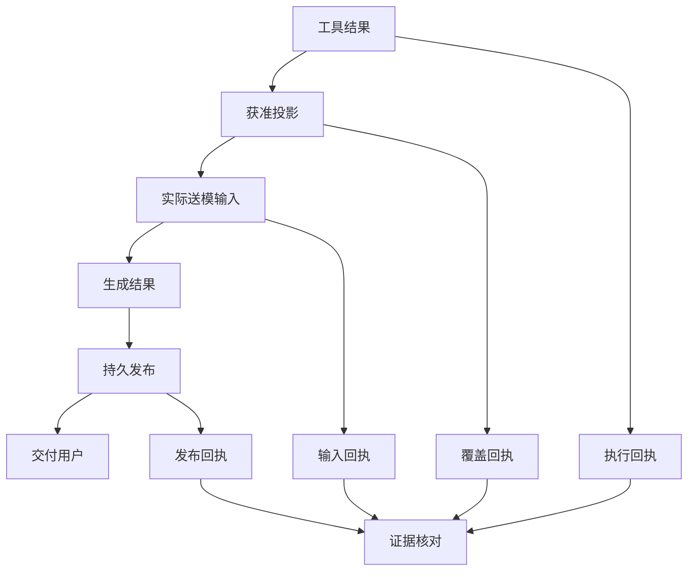

# 局部改善不等于整体进步：怎样判断 Agent 真的变好了？

假设正在优化一个报销单识别工具。上传图片太大，于是加了压缩：4 MB 变成 1 MB，上传数据量减少了。

接下来却发现，图片上的 126.80 被识别成了 128.80。文件确实变小，用户核对金额的工作反而增加了。

这是一个教学模拟，图片大小、金额和后续情节均为说明问题而设。它提示我们：**判断一次优化，要追到用户原来要完成的事，同时看它把代价转移到了哪里。** 中间某项指标变好，值得记录；是否值得保留这项改动，还要继续判断。

## 一、先说清楚，这次到底要改善什么

用户需要从报销单中取得可核对的日期和金额。图片上传只是过程中的一步。

因此，“文件压到 1 MB 以下”和“报销信息更容易核对”是两项不同要求。前者可以用文件大小检查，后者要打开实际识别结果，和原图比较。

如果团队只盯压缩率，就容易继续提高压缩强度，把文字压得更模糊。如果直接盯“整体成功率”，又可能不知道错误出在哪里。两个层次都需要，关键是说明它们之间的关系。

Google SRE 的[服务级目标章节](https://sre.google/sre-book/service-level-objectives/)从用户关心的行为讨论指标选择，也区分用户侧体验与容易取得的服务端代理指标。这个思路适用于这里：先确定用户需要的结果，再选择能解释结果的中间观察。

在原任务里写一句具体目标就够了：减少图片传输负担，同时保留小字金额的可辨识度；检查最终页面展示的日期和金额是否仍然正确。这样，压缩率就不会悄悄替代用户目标。

## 二、把同一张图片，沿实际路径走一遍

想确认问题，不必先新增一个综合评分系统。沿图片经过的地方逐段比较：

| 位置 | 具体检查 |
| --- | --- |
| 压缩后的文件 | 文件是否变小，小字和小数点是否还可辨认 |
| 识别器实际收到的输入 | 用的是新文件、旧缓存，还是另一份缩略图 |
| 识别结果 | 日期和金额是否与事先核对的原图一致 |
| 用户页面 | 是否展示了这次结果，能否打开对应原图核对 |

一个经常被遗漏的情况是：压缩函数的测试通过，上传按钮却继续走旧路径。还有一种情况是识别正确，页面仍显示上次缓存。仅检查压缩文件，无法分辨这些问题。

预期金额应来自事先人工核对的样本，不能把同一个识别器的另一次输出当作正确答案，否则两边可能一起读错。

发现“126.80 变成 128.80”之后，修复也应对应原因：若压缩损伤了小数点，就调整压缩策略或为这类图片保留足够清晰度；若页面展示了旧结果，就修正结果关联。不能只增加重试次数，再把偶然一次正确当作完成。

## 三、先分清三种进展，才知道下一步改哪里

沿这条路径，我们可能得到三种有价值但不同的结果。

**局部修复。** 压缩后的图片保留了小数点，相关样本可以辨认。这解决了一个具体缺陷，识别器和页面是否都改善，还要沿后续路径检查。

**测量修正。** 评测脚本以前把所有 PNG 文件判为失败，现在支持了它们。评测结果会变化，但同一张图片的实际识别输出并没有因此改变。需要保留旧脚本的错误记录，并用一致口径重新比较，不能把评分变化记成模型能力提升。

**用户任务改善。** 在可比较的报销单样本中，上传负担减少，最终日期和金额仍可核对，并且没有增加不可接受的等待或人工修正。这才对应最初的任务目标。

三者都值得做。问题是不能在复盘里只写一句“识别系统升级成功”，让下一位维护者猜究竟改善了什么。

## 四、ETF Agent 的真实材料里，也要分清这些层次

我们曾记录过一次持仓遗漏：工具返回了 50 条，送进模型的中间整理只保留 20 条，回答漏掉了黄金持仓。当时把通用条目上限调整到 60，保留原有硬容量限制和敏感字段处理，修复了那个明确的截断点。

这说明当时的输入遗漏得到了有界修正。它并不自动说明整份投资研究更准确：还要看后续模型实际收到了什么、使用了什么，以及报告内容是否改变。详见[结果外置与完整性](tool-results-outside-model-context.md)。

另一类问题来自观察工具。长输入输出的采集缺口，曾让部分执行内容甚至回合在读取时不可见。补上缺失标记，会让排查更可信，却不会让过去的模型重新执行一次。详见[可信观测](025-agent-langfuse-from-trace-to-trustworthy-observability.md)。

独立评测器也出现过输出预算不足、评分格式无法解析的情况。调整评测器预算后，相关格式失败消失；工作模型原来过短、未覆盖要求的回答仍然不合格。这是测量工具的修复，应与回答质量的变化分开记录。

还有一个反例同样重要：有界测试触发了网页内容压缩，核对实际生产配置后，却没有证据表明默认研究路径已经遇到相同瓶颈。我们因此没有继续添加一套新摘要机制。测试揭示一种可能分支，与生产当前确有该问题，也需要区分。

图片案例帮助理解这些关系；这些真实材料则说明，为什么我们开始重视“收益究竟落在哪一层”。

## 五、完整性更好，成本也可能更高

假设为保留文字，把部分图片恢复到更高分辨率。上传量增加了，但金额识别更可靠。这可能是值得接受的选择，不能仅因为文件变大就判为退步。

也不能反过来，只要识别更准，就忽略等待时间、调用费用和人工修正。应把取舍写清楚：在哪类图片上，需要什么清晰度，额外成本是多少，是否存在同样有效但代价更小的做法。

在 Agent 中，扩大结果输入、丰富工具说明、增加检查模型，都可能产生类似取舍。工具说明更充分，可能帮助选择，也会增加输入负担；删除必要说明，又可能使工具更难正确使用。不能为了压低 Token 而悄悄缩减已准入的合法工具或遗漏保护条件。

权限、隐私和资金执行约束先要满足，不能拿速度或质量高分抵扣。其余可权衡的目标，再放在同类任务里一起看。

## 六、一次比较怎样才有参考价值

回到压缩方案，先保存一批与问题相关的样本：正常清晰图片、小字金额、倾斜拍摄、原本就模糊的图片。样本数量根据本次问题确定，不编造一个全行业都适用的门槛。

用同一份输入和预先核对的日期金额比较前后版本。尽量保持识别器版本、任务要求等条件一致，记录实际压缩大小、最终内容、耗时及调用情况。模型有波动时，按要作出的决定增加必要的重复观察，不拿一次幸运输出下结论。

不能悄悄把仍然无法判断的图片移出分母，也不能把“金额正确”和“只要有输出”当作同一个通过标准。评测规则改变时，先恢复可比口径，再讨论收益。

如果现在只验证了小数点不再丢失，就记录这项局部修复。正确性问题需要及时处理，不必等到长期收益统计齐全；尚未验证的整体收益留待后续确认。

对于 Agent，原文的这张关系图表达了同样的追查顺序：工具取得结果，整理为获准输入，提交给模型，形成结果并保存，最后检查交付。旁边的记录帮助逐段对照，不自动替任何一步宣布成功。

图中英文节点保留系统交接名称。它是分析示意，不要求新增同名字段或数据库：复用已有记录，核对同一次任务在各处发生了什么即可。

## 七、下一次“优化完成”，把结论说到恰当的位置

修改一个确定的截断条件，可以先用针对性用例验证；调整实际输入或识别方法，再检查对应真实路径；要声称用户体验或研究质量提高，才需要与该主张相称的任务比较。每次改动都做全套昂贵实验，同样会拖慢研发。

压缩案例的任务可以这样写：保存问题原图及人工核对值；确认损失发生在压缩、识别还是展示；只修改造成差异的位置；先验证这个反例，再用代表性样本观察正确性和额外代价。

完成时也给出具体结论：压缩后的小数点保住了，或者页面已经显示对应文件的识别结果，或者这轮只修好了评测脚本。哪个成立就说哪个，不用一个笼统的“整体变好”覆盖全部。

**能说清改好了哪一段、结果有没有传到用户、代价增加在哪里，局部优化才有机会成为系统进步。**

## 延伸阅读与交流

本文对应[第九原则：局部改善不等于整体进步](/principles#principle-9)，也关联[上下文中的事实](/principles#principle-5)与[用户任务成功](/principles#principle-8)。关于评测口径，可继续读[测试与评测](honest-agent-evaluation.md)；关于可选能力的成本，见[代码与系统演化](code-cheaper-systems-harder-to-evolve.md)。

欢迎在 [GitHub 公开文集](https://github.com/hpoenixf/eff-agent-article)交流反例；如果文章对你有帮助，也欢迎点一个 Star。
