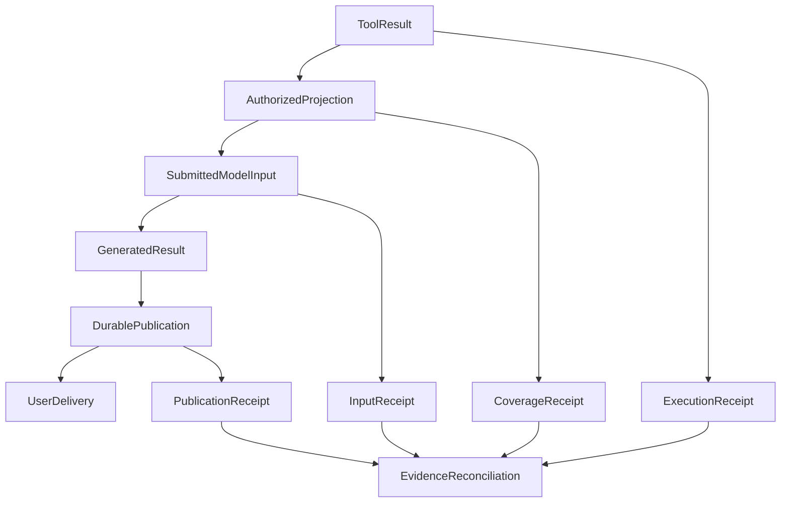

# 局部改善不等于整体进步：怎样判断 Agent 真的变好了？

我们曾遇到过一件很具体的事：MCP 明明返回了 50 条持仓，模型却只看到了 20 条，最终回答遗漏了黄金持仓。

修复并不复杂。我们找到中间的结果投影，把通用条目上限从 20 放宽到 60，相关边界检查随之通过。问题似乎结束了。

但这次经历留下了一个更难回答的问题：**模型现在可以看到更多条目，就代表投资研究能力提高了吗？** 它可能更完整，也可能在更长的上下文里花更多时间、遗漏别的证据，甚至仍然没把结果正确交给用户。

复杂 Agent 的很多“进步”，其实首先发生在某个局部：工具能多返回一点，Trace 能多显示几轮，评测器少报几个错误。这些进步真实而重要，却未必已经沿执行链传递成用户价值。

由此形成我们的第九条架构原则：

> **局部改善不等于整体进步。以端到端效果判断收益，用可核对的因果链解释局部；观测与评测帮助认识系统，却不能代替系统事实。**

## 一、一个系统，可能出现三种不同的“变好”

我们通常用“优化成功”描述三个完全不同的事情：

| 发生变化的地方 | 真实改善是什么 | 还需要问什么 |
| --- | --- | --- |
| **局部机制** | 工具投影保留了更多条目，某个契约不再失败 | 变化有没有进入下一次实际模型请求？ |
| **观察与判断** | Trace 缺口可见，Judge 能输出合法评分 | 底层执行或回答质量改变了吗？ |
| **完整任务** | 用户获得正确、完整、可使用的结果 | 为此是否付出了更高的延迟、成本或风险？ |

这不是说前两类没有价值。没有可靠的投影和观测，第三类效果往往无从诊断。问题在于把层次搞混：**中间环节的指标，可以作为诊断信号，却不能自动升级为最终收益。**

Google SRE 在[服务级目标的讨论](https://sre.google/sre-book/service-level-objectives/)中同样强调，应从用户关心的行为反推需要观察的指标，而不是先选择最容易测量的数字，再把它当成目标。Agent 还多了一层困难：最终回答不仅要送达，还要在具体研究任务里有用。

## 二、工具结果放宽了，瓶颈可能只是换了位置

最早的持仓遗漏并不是 MCP 没查到数据。原始结果的覆盖记录显示 50/50；通用模型投影仍对数组和对象键使用 20 条上限。来源完整，**模型实际输入不完整**，两件事同时成立。

当时选择的是有界修复：把通用投影上限改为 60，放宽一部分默认容量，同时保留硬上限和敏感字段过滤。旧上限并非毫无道理，它原本就承担控制输入规模的职责；放宽后也不能把“任何长度的结果都应直接进上下文”当成新规则。

这次修复可以可靠地说明：那个导致遗漏的投影截断点已按限定条件调整。它还不能直接说明：

- 在真实后续轮次里，模型一定充分使用了新增条目；
- 整份报告的投资事实、解释或建议因此正确；
- 更多上下文没有带来额外的 Token、延迟与干扰成本。

后来还有一件值得对照的事。一次上下文调优讨论基于有界测试，观察到旧网页正文被压缩，于是怀疑生产研究会损失证据。核对实际配置和请求投影后发现，触发该现象的是测试的容量限制，并非默认生产路径已经碰到相同瓶颈。这一次，我们没有继续发明新的摘要或读取机制。

两个案例放在一起，给出了同一个判断方法：**先定位真实的损失发生在哪里，再看修改是否触达实际运行路径。** 扩大容量有时是在修复正确性，有时只是在扩大成本；测试里的瓶颈也未必存在于生产配置。

详细的结果外置、显式读取和覆盖语义，可见[《工具查到的数据，为什么不一定要给大模型看？》](tool-results-outside-model-context.md)。

## 三、观测变完整了，系统不一定更可靠

第二类错觉更隐蔽，因为我们会用仪表盘来证明自己做对了什么。

早期接入 Langfuse 时，我们先确认合成 Trace 可以正常显示。后来排查长研究才发现：应用侧的正文捕获有容量限制；当输入或输出过大，读取投影可能只剩空值，极端情况下连整个模型回合都消失了。页面上“查完了”，并不等于真实执行记录完整。

修复没有选择无限放大日志上限，而是保留**有界的缺失事实**：知道哪次调用发生过、哪一侧正文未保存、已知原因是什么；无法从旧记录确认的部分继续标记未知。

这让观测更可信，却没有让过去的模型多执行一次工具，也没有让用户自动收到原本缺失的回答。

同样的原则适用于一次 Trace 的成功状态。某个模型请求完成、某条 span 结束，只涉及它代表的操作；研究是否把证据送进下一轮、是否持久发布、用户是否得到文件或正文，仍要由对应环节的事实说明。

真正需要的不是更大的“成功仪表盘”，而是把**执行回执、模型实际输入、发布记录和交付结果**沿稳定身份关联。观测缺失，不能推断执行没发生；观测存在，也不能反推业务任务完成。

具体的采集缺口、恢复和自诊断见[《从 Trace 到可信观测》](025-agent-langfuse-from-trace-to-trustworthy-observability.md)。

## 四、评测红灯减少了，回答质量可能原封不动

还有一次，独立 Judge 经常给不出可解析的严格 JSON。直觉上，它似乎在告诉我们“工作模型不合格”。

拆开两个角色后发现，一部分失败来自 **Judge 自己的输出预算**。将它从 1,200 调整到 3,200 后，对应的格式失败消失；但工作模型原来只有几十字、没有覆盖问题要求的回答仍被拒绝。

从评测系统看，通过情况改善了；从被评测的回答看，它并没有因此变长、补全来源或完成研究。

如果团队只看一个总通过率，就可能把这类测量修正错记成模型升级。更糟的是，后续会围绕错误指标继续优化 Prompt、加护栏，制造一次又一次“改好了一点”的循环。

因此，评测至少应分清三种结果：**产品行为真的改善、测量工具被修正、当前证据仍不足以判断。** 不确定不是新的失败类别，更不能靠把它从统计分母里剔除来制造进步。

关于评测分母、实际交付和错误归因，可继续读[《测试全绿、模型有返回，就算 Agent 成功了吗？》](honest-agent-evaluation.md)。

## 五、如何判断改善有没有真的穿过系统？

我更愿意把一次优化看成一条需要追问的传播链，而不是一个可以直接庆祝的局部百分比：

图中是用来分析问题的**通用关系示意**，不是要求每个 Agent 新建相同字段、数据库或总控模块。实际系统有什么回执，就用什么回执建立关联；没有客户端收件证据时，也不要用服务端提交冒充用户送达。

以“把 20 条投影上限改成 60”为例，合适的验证次序是：

**先看改动处。** 同一份源集合在新版本投影中是否完整保留？硬上限、脱敏和授权有没有退化？这是确定性契约能回答的问题。

**再看传播处。** 模型下一次*实际提交的请求*，收到了完整条目、摘要还是仅一条引用？如果请求没真正提交，不能从“投影准备成功”推断它已经被使用。

**最后看任务与代价。** 同一类持仓问题是否还漏报黄金？结果覆盖与来源是否正确？输入 Token、延迟和可选工具的成本有没有变差？必要时用固定题目和数据版本做成对比较，而不是拿两批条件不同的成功率直接相减。

这里的关键不是追求一条万能“总体分数”，而是同时知道**收益落在哪一层、风险转移到了哪里、最终任务有什么变化**。

## 六、这不意味着每次改动都要重跑完整研究

一个合理的反对意见是：如果每次调字段、修回执、改监控都要做多轮真实模型对照，Agent 根本开发不动。

我同意这个担忧。第九原则不是增加新的验收委员会，也不是规定每个 PR 都要跑昂贵的端到端实验。

工程判断应与改动的不确定性匹配：

- 对身份绑定、授权、不得静默截断等**确定性不变量**，用针对性契约检查即可判断该局部修复是否成立。
- 对改变模型实际输入、研究策略或结果选择的改动，至少核对真实请求接缝；要声称回答质量提升，再使用可比较的实际任务样本。
- 对交付、持久效果、金融数值等高代价路径，按风险跨越必要的真实依赖验证，不能让 mock 绿灯替代用户结果。

某些局部修复本身就是必须做的安全或正确性工作，即使尚未测得业务收益，也不必搁置。我们只需要准确命名其成果，而不是提前兑现尚未验证的收益。

真正应该停止的是另一种习惯：把一张绿灯图当作下一轮优化的方向盘，却没有问它究竟测量了什么。

## 结语：进步需要沿着结果链被确认

工具投影扩容解决的是可见范围，可信 Trace 解决的是我们能否解释运行，Judge 修复解决的是评测器能否正常表达判断。这三件事都有价值，价值却不相同。

Agent 工程不必追求每个局部指标同时最好，而应在可靠边界内让完整任务变得更好，并愿意承认“这一轮只修好了测量工具”或“现在还无法判断”。

**局部优化让某一段路更顺，端到端结果才告诉我们有没有走到目的地。**

---

这就是[第九原则：局部改善不等于整体进步](/principles#principle-9)。它补充[第五原则的 Context 投影](/principles#principle-5)与[第八原则的用户任务成功](/principles#principle-8)：前者关心事实在哪里，后者关心任务是否完成；第九原则关心我们**如何判断一次改动真的带来了进步**。
