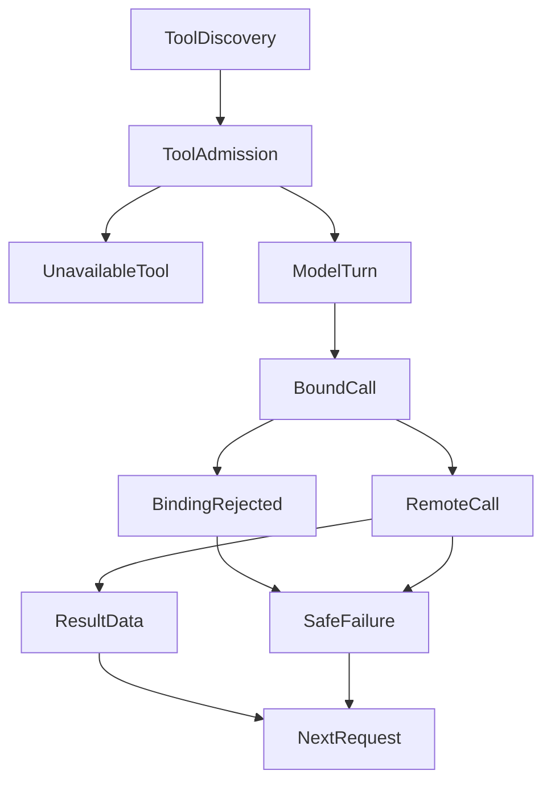

# 从接上 MCP 到真正用上工具：Agent 的接入链路怎样构建

一个远程 MCP 服务通过了连接检查，工具目录里也出现了目标方法。接下来，我们希望模型选择它、生成参数、读取结果，再继续研究。真正需要保持连续的，是这一路上的参数约定和调用身份：模型看到什么工具，执行时就应使用与之对应的来源和契约；工具返回什么，下一轮就应拿到能够正确解释的材料或失败信息。

在 ETF Agent 中，这条链经过 MCP 连接、工具准入、模型请求、调用执行和结果消费。任何一段单独成功，都只能证明该段完成了自己的工作。我们逐步补齐的工程能力，是让这些交接可以核对，并且把失败留在能够解释、处理它的位置。

MCP 官方的[架构说明](https://modelcontextprotocol.io/docs/2026-07-28/learn/architecture)区分了 Host、Client 和 Server：Host 是协调客户端的应用，Client 与服务端交换上下文。协议提供交换方式，应用仍须安排模型怎样使用这些内容。本文讨论的就是这部分应用工程，以项目实际支持的只读研究工具为范围；不同协议版本的连接与发现细节，交给对应 SDK 和传输实现处理。

## 一、从一个远程查询开始

下面使用一个合成的教学样例。工具名借用了我们的接入资格样例，字段经过简化，不代表真实供应商接口，也没有真实账户数据。

假设研究任务需要查询某只基金的公开资料。远程服务 `sample-source` 提供 `strategy_query`，业务参数是：

```json
{
  "code": "FUND_DEMO",
  "asOf": "2026-10-01"
}
```

服务可以通过 Streamable HTTP 直接接入现有 Host。项目中的 Portfolio 和 Market 服务则通过本地 stdio 接入。远程服务无需先包装成一个本地 Market 供应商，三种来源复用连接管理，同时保留自己的工具身份。

发现目录后，Host 会保存远程原名，并向上层提供带服务命名空间的 `sample-source__strategy_query`。命名空间解决重名问题；准入仍由受信配置决定。服务端配置需要准确列出获准的只读方法和研究范围，当前研究方法及运行授权还会进一步限定模型可见的工具。

因此，上游声明“我是只读工具”，不能独自完成准入。MCP 的[工具规范](https://modelcontextprotocol.io/specification/2026-07-28/server/tools)也要求谨慎对待来自不受信服务的 annotations。我们的远程路径使用服务器侧审核配置，工具描述和模型参数没有扩权作用。

这种区分也改变了连接检查的输出。现在检查命令可以分别报告目录是否已知、发现多少工具、准入多少工具；没有当前研究方法和运行上下文时，可见性与执行结果明确保留为 `not-evaluated`。一个服务显示 `ready`，只说明相应连接与目录发现完成。

这里有一个容易遗漏的细节：发现失败必须保留为失败，不能投影成“成功发现零个工具”。前者需要检查连接、认证或协议，后者可能是一个合法空目录。如果两种情况都显示工具数量为零，后续排查就会走错方向。项目的接入规范因此把这些阶段分开表达，并直接复用实际准入决定，避免诊断界面再维护一套不同的判断规则。

## 二、让模型与执行器理解同一份参数约定

工具进入目录之后，还有一个兼容问题：供应商提供的 JSON Schema，能否完整走到模型请求与实际调用？

继续使用教学样例，供应商的参数定义可以是：

```json
{
  "type": "object",
  "$defs": {
    "FundCode": { "type": "string", "minLength": 1 }
  },
  "properties": {
    "code": { "$ref": "#/$defs/FundCode" },
    "asOf": { "type": "string", "format": "date" }
  },
  "required": ["code", "asOf"],
  "additionalProperties": false
}
```

如果适配层只保留自己认识的 `type` 和 `properties`，删除 `$ref`、`required` 或复杂约束，这个工具可能更容易塞进某个模型 API。但模型得到的输入说明已经发生变化，Host 再按原始契约校验时，就会出现“照着展示生成，执行却不接受”的裂缝。若执行侧也跟着放宽，错误则继续传给供应商。

我们的处理是保留供应商参数段的完整含义，先判断当前校验器能否支持，再决定这个工具能否进入可用目录。已支持的本地引用、联合类型、条件约束等继续保留；未支持的方言、外部引用、递归引用或非法引用片段，明确拒绝对应工具。一个工具不兼容，不会顺带抹掉其他健康工具。

这带来一个实际代价：有些上游工具即使可以“勉强调用”，也不能直接进入当前研究路径。解决方式是修正上游契约，或增加经过验证、能够保持语义的适配。静默删约束会让接入数量看起来增加，却把理解差异推迟到运行中。

模型侧也可能需要宿主自己的控制字段。例如，我们用 `__hostResult` 表达结果选择或刷新要求。这部分与供应商业务参数分开，发往上游前会被剥离；它不允许覆盖上游字段或改变原有约束。因此，所谓保真，指的是供应商契约没有被削弱，宿主扩展有明确归属，并不要求整个模型工具定义与远程 JSON 逐字相同。

实际调用前，Host 仍会按原始参数契约校验一次。发现时的检查回答“这个契约是否受支持”，执行前的检查回答“这次参数是否满足它”。两个问题发生在不同时间，任何一个都不能替代另一个。当前支持范围和拒绝原因收在参数校验实现中；这也不构成对所有 JSON Schema 方言或所有模型 API 的兼容承诺。

## 三、同一轮里，模型看到的工具必须与实际调用绑定

参数定义完整，还不足以保证调用正确。工具目录可能刷新，某个来源可能变为不可用，同一个公开用途也可能存在多个供应商。此时，工具名称未变，背后的契约却已经不同。

为了说明这个问题，继续扩展教学样例：供应商甲接受 `code` 和 `asOf`，供应商乙使用另一套参数和日期规则。如果模型已经根据甲的定义生成参数，执行器在甲失败后直接改投乙，即使公开工具名相同，这次调用也失去了原来的依据。

Host 根据发现的原始方法名、描述、输入与输出 Schema，以及相关受审信息生成绑定指纹；存在适用参数规则时，相关规则也进入绑定身份。模型回合开始时，再选定实际来源并保留这份绑定。指纹由 Host 产生，模型不能在调用参数里指定另一个指纹。

模型选择工具后，调用执行侧保留它看到的绑定。Host 在实际派发前核对预期绑定与当前工具：若来源或契约已经变化，就返回明确错误，让后续回合处理变化。新的模型回合可以展示新的实际定义，旧参数不会被直接发送给另一家供应商。

这条交接曾在实际开发中出过问题。一次原生工具接入的受控复现发现，底层来源描述已经更新，**下一轮真正发给模型的请求仍然带着旧描述**。检查调用封存路径时，又发现绑定指纹没有进入最终调用契约的哈希。前者意味着模型下一轮拿到的依据仍是旧约定，后者让封存记录无法完整表达当时绑定的是哪份工具。

修复同时落在两个交接点：新模型回合重新取得当前描述；最终请求封存时保留 Host 的绑定指纹。同一回合里的漂移仍然拒绝，已有调用包装和授权边界继续生效。这个回归案例直接观察实际模型请求和封存参数，验证的对象超出了单个工具注册函数。

下面的图概括一次工具进入研究回合的主要分支。准入未通过的工具止步于不可用项；绑定变化在远程派发前产生失败；已经取得的结果和可反馈的失败，再分别交给后续请求装配。



这里的取舍是：同一轮保持稳定，会放弃一部分看似便利的透明切换。模型需要在下一轮看到新契约后重新生成调用。对于参数差异明显的研究来源，这个额外回合能够保留“依据哪份接口发出了什么请求”的可解释性。

## 四、调用执行时，连接层只承担自己的部分

从代码位置看，连接、准入和调用都可能经过 `host.ts`。从职责看，它们需要分别回答不同问题。

运行授权决定当前任务允许使用哪些来源和能力；调用执行侧负责封存工具身份、参数、实际派发和结算；MCP 接入负责连接状态、目录与协议传输；具体工具再负责自己的业务结果。结果取得后，结果管理维护身份与来源，上下文装配决定本次模型请求如何容纳这些材料。

这使每次拒绝有一个确定范围。Schema 不兼容可以排除该工具，参数非法可以拒绝本次调用，连接损坏可以隔离对应来源。它们没有获得判断整项研究是否完成的权力，也不能代替金融数据服务解释一个数字属于哪个对象、哪个时点。

我们曾经在本地 MCP 准入中，把只读声明检查放在“存在有效服务器版本信息”的条件下。受控回归发现，空版本字符串可以通过 SDK 的握手检查，却让必要的只读检查被跳过。修复后，版本元数据与只读契约独立处理。现行 Host对本地 allowlist、只读声明和模型工具范围逐步记录决定，版本只用于表达版本身份。

连接生命周期也需要限制故障传播。可选远程来源暂时不可用时，应用可以保留它的失败状态，并继续使用独立健康来源。发现阶段只对明确的暂时性连接错误做有界重试；认证失败或无效目录不会被当成普通抖动反复重试。连接恢复以后，来源仍须经过原有准入，恢复网络不会自动增加工具权限。

## 五、结果回来以后，还要保留失败的含义

教学样例成功时，业务数据部分可能如下。这里省略协议版本对应的外层字段，只展示应用关心的内容：

```json
{
  "content": [{ "type": "text", "text": "合成净值表，仅用于说明结果结构" }],
  "structuredContent": {
    "columns": ["code", "date", "unit", "value"],
    "rows": [["FUND_DEMO", "2026-10-01", "CNY/share", 1.2345]]
  }
}
```

原生远程路径保留正文、结构化字段和未知业务字段，并校验协议形状、声明的输出 Schema、隐私边界及最终大小。传输私有的 `_meta` 不直接当成研究正文。服务端提供的日期和单位可以作为研究材料保留，但连接层不会据此认证新鲜度或投资事实。

失败结果需要同样认真地处理。MCP 的工具规范区分协议错误与带 `isError` 的工具执行错误；在我们的应用路径里，还要明确空结果、容量拒绝和证据资格这些不同情况：

| 来源结果或处理状态 | 交给后续研究的含义 |
| --- | --- |
| 合法结构化结果 | 保留数据及其来源身份，交由结果与上下文模块继续处理 |
| 合法空表 | 保留空行和表结构，表示这次查询没有返回记录 |
| `isError` | 反馈安全错误类别，不把供应商私有错误正文直接注入模型 |
| 协议形状或输出契约不合法 | 明确报告无效结果，不能伪装成空数据 |
| 结果超过上限 | 明确报告容量失败，不截断成一份貌似完整的结果 |
| 结果可消费，但证据类别未经审核 | 允许在获准上下文读取，同时保留缺失的引用资格 |

最后一行很容易被合并掉。一个获准工具返回了内容，不代表它的结果天然可以支撑对外结论。当前路径允许未经证据分类的结果作为上下文存在，但不会因此发放 grounding source。研究材料能否被读取、能否成为可引用来源，是两项不同事实。

错误的传播范围也取决于实际原因。业务查询失败可以只结束这次调用；确认发生连接或协议损坏时，可能需要隔离相应来源。后续是否改用另一来源，由研究流程在仍然合法的工具范围内决定。独立健康来源可以继续工作，旧调用的失败身份也会保留。

## 六、把观察点放到下一次模型请求

工具函数返回成功之后，结果可能还要经过存储、字段选择和上下文拟合。小结果能够直接进入请求；满足工具结果大小限制、但不适合直接放进本轮上下文的较大结果，可能先保存为带身份的结果，再按需读取。MCP 返回值存在，无法单独证明模型已经看到了需要的内容。

我们的接入资格样例因此启动本地 HTTP MCP，经由实际研究执行路径调用它，并用确定性模型替身捕获下一次请求。检查内容包括：正常表格是否出现，空结果是否仍为空，工具错误是否成为安全错误，无效结果和超限是否保留对应原因，以及另一条健康来源是否还能继续调用。

这个观察点还会检查参数定义的交接：模型请求里的供应商 Schema 是否保持原义，宿主控制字段是否独立存在。前面的回合绑定回归，则继续检查下一轮工具描述和最终封存契约。几处检查沿着同一条调用链排列，分别验证自己接收到什么、交出了什么。项目中的消费样例保留了这些正常与非成功分支。

这些结果能够支持限定范围内的接入能力：工具定义、调用身份和结果反馈已经通过相应工程路径。但它们没有证明真实模型一定会选择合适工具，也没有证明供应商返回的金融数据正确。真实供应商可用性、模型参数适配和研究质量，仍需要各自的观察。

对于只连接固定内部工具的简单应用，不一定需要立即引入完整的回合绑定与多来源诊断。随着工具目录会变化、供应商契约不同、研究过程包含多轮调用，交接处的身份和约定就需要显式保存。我们建设这条链路的目的，是让每次扩展能够说清工具从哪里来、当前按什么约定调用，以及后续研究实际拿到了什么。

## 继续阅读

- [把个人持仓接入 Agent：我们怎样设计一个只读金融 MCP](https://hpoenixf.github.io/eff-agent-article/articles/portfolio-mcp-readonly-investment-data)
- [一个金融数据 MCP，为什么长成了研究决策系统](https://hpoenixf.github.io/eff-agent-article/articles/mcp-market-responsibility-retrospective)


<!-- agent-article-sync:guidance:start -->
## 延伸阅读与交流

欢迎到[独立阅读站](https://hpoenixf.github.io/eff-agent-article/)，结合目录、架构图和前后篇连续阅读。

系列文章与图文资料整理在 [GitHub 仓库](https://github.com/hpoenixf/eff-agent-article)。如果这篇文章对你有帮助，欢迎点个 **Star** 支持，也欢迎通过 Issues 交流问题。
<!-- agent-article-sync:guidance:end -->
