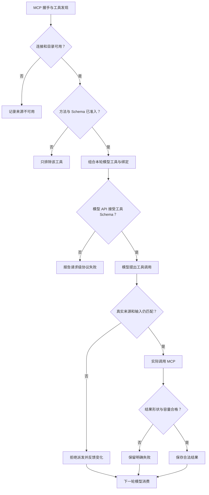

# 从接上 MCP 到真正用上工具：Agent 的接入链路怎样构建

2026 年 9 月，我们遇到过一次很奇怪的失败：Market MCP 已注册，工具目录也能发现，业务参数还没有生成，模型请求却直接返回 **HTTP 400**。原因不是行情服务宕机，而是一个工具的 JSON Schema 使用了模型供应商不支持的正则表达式。**工具尚未调用，就先拖垮了整次模型请求。**

几周后，又出现相反的问题：某个可选远程 MCP 不可用，应用自己的就绪检查竟然也跟着失败；另一次回归则发现，供应商工具描述已经刷新，下一轮真正发给模型的请求仍拿着旧描述。连接成功、工具可见、模型可调用、结果能消费，原来是四件不同的事。

我们因此重新审视了 ETF Agent 的 MCP 接入链路。本文不介绍如何从零写一个 MCP SDK Demo，而是沿着几次真实故障，说明怎样把连接、目录、Schema、回合绑定、结果校验和后续模型消费连成一条可验证的工程路径。**本文覆盖只读研究接入，不把模型工具可见性当成授权，也不把金融结果真实性交给连接层。**

MCP 官方的[架构说明](https://modelcontextprotocol.io/docs/2026-07-28/learn/architecture)区分 Host、Client、Server：应用 Host 协调连接与能力，Client 负责具体协议连接，Server 暴露方法。协议定义了交互形式，却不会替应用保证“模型这一轮实际拿到了什么”。我们碰到的坑，几乎都出现在这些交接处。

## 一、工具注册了，为什么 Agent 还是看不到它？

下面使用一个合成的教学样例。工具名借用了我们的接入资格样例，字段经过简化，不代表真实供应商接口，也没有真实账户数据。

假设研究任务需要查询某只基金的公开资料。远程服务 `sample-source` 提供 `strategy_query`，业务参数是：

```json
{
  "code": "FUND_DEMO",
  "asOf": "2026-10-01"
}
```

服务可以通过 Streamable HTTP 直接接入现有 Host。项目中的 Portfolio 和 Market 服务则通过本地 stdio 接入。远程服务无需先包装成一个本地 Market 供应商，三种来源复用连接管理，同时保留自己的工具身份。

发现目录后，Host 会保存远程原名，并向上层提供带服务命名空间的 `sample-source__strategy_query`。命名空间解决重名问题；准入仍由受信配置决定。服务端配置需要准确列出获准的只读方法和研究范围，当前研究方法及运行授权还会进一步限定模型可见的工具。

因此，上游声明“我是只读工具”，不能独自完成准入。MCP 的[工具规范](https://modelcontextprotocol.io/specification/2026-07-28/server/tools)也要求谨慎对待来自不受信服务的 annotations。我们的远程路径使用服务器侧审核配置，工具描述和模型参数没有扩权作用。

这种区分也改变了连接检查的输出。现在检查命令可以分别报告目录是否已知、发现多少工具、准入多少工具；没有当前研究方法和运行上下文时，可见性与执行结果明确保留为 `not-evaluated`。一个服务显示 `ready`，只说明相应连接与目录发现完成。

这里有一个容易遗漏的细节：发现失败必须保留为失败，不能投影成“成功发现零个工具”。前者需要检查连接、认证或协议，后者可能是一个合法空目录。如果两种情况都显示工具数量为零，后续排查就会走错方向。接入规范因此把这些阶段分开表达，并直接复用实际准入决定，避免诊断界面再维护一套不同的判断规则。

### 先区分：注册、准入、暴露

第一次把 MCP 工具接入 Agent 时，很容易将 `tools/list` 的结果直接理解成“模型拥有的工具”。但真实链路至少分成三层：**Server 注册的方法、Host 审核后允许的方法，以及某一轮模型请求实际携带的方法**。前两层不保证最后一层。

2026 年 10 月 7 日，我们就重新开放过 `market__search_instruments`。它原本仍在注册目录里，却被本地 `modelTools` 排除；当其他重叠供应商能力被收拢后，这个用于识别公开证券名称的工具没有等价替代，Agent 反而失去了必要的发现能力。调整并不是“把 Market 全部放开”，而是**仅恢复有明确用途的工具，其他已收口或重叠方法仍不默认暴露**。

这类问题如果只观察“模型为什么不调用”，很容易误判为 Prompt 或模型能力不足。实际上它可能根本没进入最终 `tools[]`。工具应按什么研究领域出现，属于独立的回合 Tool Surface 议题；MCP 接入这层必须先把真实、可审核的目录与来源交出来，不能靠模型文本猜授权。

## 二、让模型与执行器理解同一份参数约定

### 一次真实的 HTTP 400：工具还没用上，模型请求先失败

2026 年 9 月 16 日，`market__search_instruments` 的工具参数约束使用了 Unicode 属性类 `\p{L}`、`\p{N}`。这在 JavaScript 的 Unicode 正则语义下并不稀奇，但实际模型供应商的 Tool Schema 校验不接受它，直接返回 HTTP 400（当时记录的类别为 `sub2_request_rejected`）。

我们做了真实 A/B，而不是只猜错误码：**携带该表达式的单工具请求返回 400，十工具请求同样返回 400；换成经审阅的明确字符范围后，两种请求都返回 200。** 一个工具定义有问题，影响的是包含它的整次模型请求，不是调用该工具时才出错。

修复不是删掉 `pattern` 或放宽业务含义。我们将受支持的拉丁字母、数字、常用汉字与必要代码符号写成可移植的范围，让模型可见的 Schema 和服务端多个参数守卫复用同一来源，并加回归遍历模型可见工具里的正则约束。这样做承认了一个工程事实：**合法 JSON Schema 的一个子集，在某条具体模型 API 路由上也未必可用。**

这次实测定位到特定模型路由的 Schema 兼容差异；修复必须保留上游契约，不静默删除约束。

工具进入目录之后，还有一个兼容问题：供应商提供的 JSON Schema，能否完整走到模型请求与实际调用？

继续使用教学样例，供应商的参数定义可以是：

```json
{
  "type": "object",
  "$defs": {
    "FundCode": { "type": "string", "minLength": 1 }
  },
  "properties": {
    "code": { "$ref": "#/$defs/FundCode" },
    "asOf": { "type": "string", "format": "date" }
  },
  "required": ["code", "asOf"],
  "additionalProperties": false
}
```

如果适配层只保留自己认识的 `type` 和 `properties`，删除 `$ref`、`required` 或复杂约束，这个工具可能更容易塞进某个模型 API。但模型得到的输入说明已经发生变化，Host 再按原始契约校验时，就会出现“照着展示生成，执行却不接受”的裂缝。若执行侧也跟着放宽，错误则继续传给供应商。

我们的处理是保留供应商参数段的完整含义，先判断当前校验器能否支持，再决定这个工具能否进入可用目录。已支持的本地引用、联合类型、条件约束等继续保留；未支持的方言、外部引用、递归引用或非法引用片段，明确拒绝对应工具。一个工具不兼容，不会顺带抹掉其他健康工具。

这带来一个实际代价：有些上游工具即使可以“勉强调用”，也不能直接进入当前研究路径。解决方式是修正上游契约，或增加经过验证、能够保持语义的适配。静默删约束会让接入数量看起来增加，却把理解差异推迟到运行中。

模型侧也可能需要宿主自己的控制字段。例如，我们用 `__hostResult` 表达结果选择或刷新要求。这部分与供应商业务参数分开，发往上游前会被剥离；它不允许覆盖上游字段或改变原有约束。因此，所谓保真，指的是供应商契约没有被削弱，宿主扩展有明确归属，并不要求整个模型工具定义与远程 JSON 逐字相同。

实际调用前，Host 仍会按原始参数契约校验一次。发现时的检查回答“这个契约是否受支持”，执行前的检查回答“这次参数是否满足它”。两个问题发生在不同时间，任何一个都不能替代另一个。当前支持范围和拒绝原因收在参数校验实现中；这也不构成对所有 JSON Schema 方言或所有模型 API 的兼容承诺。

## 三、同一轮里，模型看到的工具必须与实际调用绑定

参数定义完整，还不足以保证调用正确。工具目录可能刷新，某个来源可能变为不可用，同一个公开用途也可能存在多个供应商。此时，工具名称未变，背后的契约却已经不同。

为了说明这个问题，继续扩展教学样例：供应商甲接受 `code` 和 `asOf`，供应商乙使用另一套参数和日期规则。如果模型已经根据甲的定义生成参数，执行器在甲失败后直接改投乙，即使公开工具名相同，这次调用也失去了原来的依据。

Host 根据发现的原始方法名、描述、输入与输出 Schema，以及相关受审信息生成绑定指纹；存在适用参数规则时，相关规则也进入绑定身份。模型回合开始时，再选定实际来源并保留这份绑定。指纹由 Host 产生，模型不能在调用参数里指定另一个指纹。

模型选择工具后，调用执行侧保留它看到的绑定。Host 在实际派发前核对预期绑定与当前工具：若来源或契约已经变化，就返回明确错误，让后续回合处理变化。新的模型回合可以展示新的实际定义，旧参数不会被直接发送给另一家供应商。

这条交接曾在实际开发中出过问题。一次原生工具接入的受控复现发现，底层来源描述已经更新，**下一轮真正发给模型的请求仍然带着旧描述**。检查调用封存路径时，又发现绑定指纹没有进入最终调用契约的哈希。前者意味着模型下一轮拿到的依据仍是旧约定，后者让封存记录无法完整表达当时绑定的是哪份工具。

修复同时落在两个交接点：新模型回合重新取得当前描述；最终请求封存时保留 Host 的绑定指纹。同一回合里的漂移仍然拒绝，已有调用包装和授权边界继续生效。这个回归案例直接观察实际模型请求和封存参数，验证的对象超出了单个工具注册函数。

### 工具同名，不代表可以悄悄换供应商

例如一个公开市场查询在模型回合 T 中绑定供应商甲：这一轮携带甲的描述、Schema 和绑定指纹。即使甲在派发前断线，也不能把模型按甲的参数构造的调用直接转交乙；乙的必填字段、日期口径或结果结构可能不同。正确的路径是让本次调用得到可解释的失败，**下一轮**再用新获准来源的真实接口让模型决定是否重试。这是机制示意，不是额外一次生产实测。

因此我们不仅比较“工具名字有没有变化”，还在最终请求与调用封存处检查真实绑定。修复旧描述的回归必须捕获**模型实际收到的下一次请求**，而不能只断言 Host 的 `getModelTools()` 已经返回新值。

下面的图概括一次工具进入研究回合的主要分支。准入未通过的工具止步于不可用项；绑定变化在远程派发前产生失败；已经取得的结果和可反馈的失败，再分别交给后续请求装配。



这里的取舍是：同一轮保持稳定，会放弃一部分看似便利的透明切换。模型需要在下一轮看到新契约后重新生成调用。对于参数差异明显的研究来源，这个额外回合能够保留“依据哪份接口发出了什么请求”的可解释性。

## 四、调用执行时，连接层只承担自己的部分

### 一家可选远程服务，为什么拖垮了整个应用？

2026 年 10 月 7 日，我们修复了另一处责任范围错误。先前应用就绪检查拿的是所有 MCP 连接状态：本地必需的 Portfolio、Market 都已正常启动，但某个**可选远程**服务返回错误，整体 `/api/v1/health/ready` 仍会被判成 `not-ready`。结果是，一个补充数据源的故障影响了并不依赖它的研究入口。

修复后保留两个不同的观察面：**完整服务状态**仍报告那个远程来源 `unavailable`，而**应用就绪门槛**只按必须存在的本地服务判断。在本地 HTTP 失败夹具中，两个必需服务 ready、可选远程 unavailable，应用 `/ready` 仍能返回 ready。这是确定性组件回归，不声称远端线上故障已被测量或解决。

远程发现也不是失败就无限重连。现在只有明确的暂时性 `TIMEOUT` 或 `CONNECTION_FAILED` 才在新的发现连接上有限次重试；认证失败、非法目录与最后一次失败都保留自己的不可用状态。重试决定的是连接是否恢复，绝不自动放宽来源权限。

从代码位置看，连接、准入和调用都可能经过 `host.ts`。从职责看，它们需要分别回答不同问题。

运行授权决定当前任务允许使用哪些来源和能力；调用执行侧负责封存工具身份、参数、实际派发和结算；MCP 接入负责连接状态、目录与协议传输；具体工具再负责自己的业务结果。结果取得后，结果管理维护身份与来源，上下文装配决定本次模型请求如何容纳这些材料。

这使每次拒绝有一个确定范围。Schema 不兼容可以排除该工具，参数非法可以拒绝本次调用，连接损坏可以隔离对应来源。它们没有获得判断整项研究是否完成的权力，也不能代替金融数据服务解释一个数字属于哪个对象、哪个时点。

我们曾经在本地 MCP 准入中，把只读声明检查放在“存在有效服务器版本信息”的条件下。受控回归发现，空版本字符串可以通过 SDK 的握手检查，却让必要的只读检查被跳过。修复后，版本元数据与只读契约独立处理。现行 Host对本地 allowlist、只读声明和模型工具范围逐步记录决定，版本只用于表达版本身份。

连接生命周期也需要限制故障传播。可选远程来源暂时不可用时，应用可以保留它的失败状态，并继续使用独立健康来源。发现阶段只对明确的暂时性连接错误做有界重试；认证失败或无效目录不会被当成普通抖动反复重试。连接恢复以后，来源仍须经过原有准入，恢复网络不会自动增加工具权限。

## 五、结果回来以后，还要保留失败的含义

教学样例成功时，业务数据部分可能如下。这里省略协议版本对应的外层字段，只展示应用关心的内容：

```json
{
  "content": [{ "type": "text", "text": "合成净值表，仅用于说明结果结构" }],
  "structuredContent": {
    "columns": ["code", "date", "unit", "value"],
    "rows": [["FUND_DEMO", "2026-10-01", "CNY/share", 1.2345]]
  }
}
```

原生远程路径保留正文、结构化字段和未知业务字段，并校验协议形状、声明的输出 Schema、隐私边界及最终大小。传输私有的 `_meta` 不直接当成研究正文。服务端提供的日期和单位可以作为研究材料保留，但连接层不会据此认证新鲜度或投资事实。

失败结果需要同样认真地处理。MCP 的工具规范区分协议错误与带 `isError` 的工具执行错误；在我们的应用路径里，还要明确空结果、容量拒绝和证据资格这些不同情况：

| 来源结果或处理状态 | 交给后续研究的含义 |
| --- | --- |
| 合法结构化结果 | 保留数据及其来源身份，交由结果与上下文模块继续处理 |
| 合法空表 | 保留空行和表结构，表示这次查询没有返回记录 |
| `isError` | 反馈安全错误类别，不把供应商私有错误正文直接注入模型 |
| 协议形状或输出契约不合法 | 明确报告无效结果，不能伪装成空数据 |
| 结果超过上限 | 明确报告容量失败，不截断成一份貌似完整的结果 |
| 结果可消费，但证据类别未经审核 | 允许在获准上下文读取，同时保留缺失的引用资格 |

最后一行很容易被合并掉。一个获准工具返回了内容，不代表它的结果天然可以支撑对外结论。当前路径允许未经证据分类的结果作为上下文存在，但不会因此发放 grounding source。研究材料能否被读取、能否成为可引用来源，是两项不同事实。

错误的传播范围也取决于实际原因。业务查询失败可以只结束这次调用；确认发生连接或协议损坏时，可能需要隔离相应来源。后续是否改用另一来源，由研究流程在仍然合法的工具范围内决定。独立健康来源可以继续工作，旧调用的失败身份也会保留。

### 一张合法的 2100 行表，被错当成非法结果

2026 年 10 月 4 日的另一条**本地受控回归**揭示了相反的容量问题：模拟远程 MCP 返回了 **2100 行符合输出 Schema 的数据，编码后不到 32 KiB**，低于当时配置的 64 KiB Host 结果上限，却被报告为 `INVALID_RESULT`。原因是输出校验复用了给模型输入和 Schema 检查设置的 **4096 节点遍历上限**。字节并未超标，数据也没有违反声明结构，仅仅是行数使 JSON 节点变多。

这里不能靠增大所有上限来补救。我们将输入参数的复杂度预算和**结果数据的容量预算**分开：输出仍须是合法、有限的 JSON，仍须满足原输出 Schema、隐私过滤与 Host 字节上限，但不再用模型输入的节点门槛拒绝一张正常表格。定向验证核对了本地表格消费边界；真实供应商返回的大表仍须在实际链路中核验。

这次事故也说明“拒绝不完整数据”与“错误拒绝完整数据”同样值得追查。前者防止假完整，后者会让 Agent 在明明有数据时告诉用户查不到。

## 六、把观察点放到下一次模型请求

工具函数返回成功之后，结果可能还要经过存储、字段选择和上下文拟合。小结果能够直接进入请求；满足工具结果大小限制、但不适合直接放进本轮上下文的较大结果，可能先保存为带身份的结果，再按需读取。MCP 返回值存在，无法单独证明模型已经看到了需要的内容。

这也形成了一个有点反直觉的验收标准：**工具注册通过、Host 调用成功、结果结构合法，三者相加仍不等于 Agent 已经用到了这个工具。** 中间的适配器可能用旧 Schema 拼装请求，回合绑定可能未被封存；另一端也可能将合法结果拟合掉，却只留下“调用成功”的日志。

因此我们要在模型适配器的实际请求处观察工具描述和 Schema，并在下一次请求处观察工具回执的可见部分。需要外置大结果时，保留可授权重读的结果身份；需要反馈失败时，保留 `empty`、`isError`、`INVALID_RESULT`、超限、来源不可用之间的区别。检查的重点不只是函数返回值，而是**下一轮模型真正能基于什么继续研究**。

我们的接入资格样例因此启动本地 HTTP MCP，经由实际研究执行路径调用它，并用确定性模型替身捕获下一次请求。检查内容包括：正常表格是否出现，空结果是否仍为空，工具错误是否成为安全错误，无效结果和超限是否保留对应原因，以及另一条健康来源是否还能继续调用。

这个观察点还会检查参数定义的交接：模型请求里的供应商 Schema 是否保持原义，宿主控制字段是否独立存在。前面的回合绑定回归，则继续检查下一轮工具描述和最终封存契约。几处检查沿着同一条调用链排列，分别验证自己接收到什么、交出了什么。消费样例保留了这些正常与非成功分支。

这组工程记录验证了工具定义、调用身份与结果反馈在限定路径上的成立。后续应分别检验真实供应商可用性、模型参数适配和实际研究质量。

回头看，这几次修复没有带来一个“更聪明的 MCP Client”。相反，它们让错误停留在正确的位置：**模型请求级**的 Schema 400，不假装是市场数据失败；**可选来源级**的连接故障，不宣判应用整体不可用；**调用级**的绑定不一致，不暗中切换供应商；**结果级**的容量和结构问题，不谎称查询为空。

如果只有固定的少量内部工具，未必需要全部机制。但当接入从本地 stdio 扩展到远程 HTTP、多个不同供应商和多轮研究时，最重要的不是目录里有多少工具，而是每次都能回答：**模型看见了哪份接口、Host 按哪份接口派发、返回的是什么、下一轮又实际拿到了什么。**

## 继续阅读

- [把个人持仓接入 Agent：我们怎样设计一个只读金融 MCP](https://hpoenixf.github.io/eff-agent-article/articles/portfolio-mcp-readonly-investment-data)
- [一个金融数据 MCP，为什么长成了研究决策系统](https://hpoenixf.github.io/eff-agent-article/articles/mcp-market-responsibility-retrospective)

<!-- agent-article-sync:guidance:start -->
## 延伸阅读与交流

欢迎到[独立阅读站](https://hpoenixf.github.io/eff-agent-article/)，结合目录、架构图和前后篇连续阅读。

系列文章与图文资料整理在 [GitHub 仓库](https://github.com/hpoenixf/eff-agent-article)。如果这篇文章对你有帮助，欢迎点个 **Star** 支持，也欢迎通过 Issues 交流问题。
<!-- agent-article-sync:guidance:end -->
