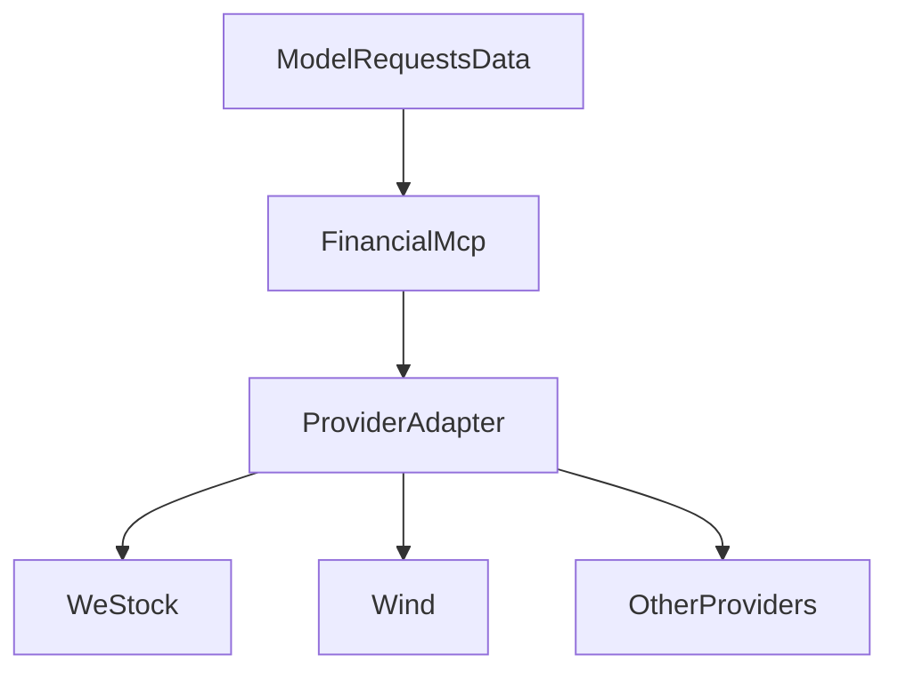
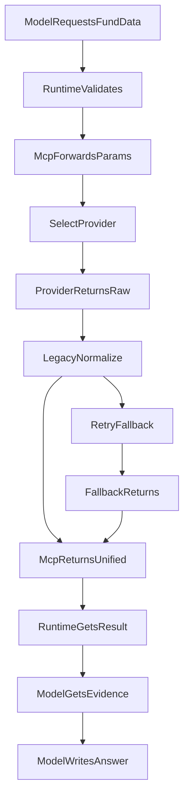
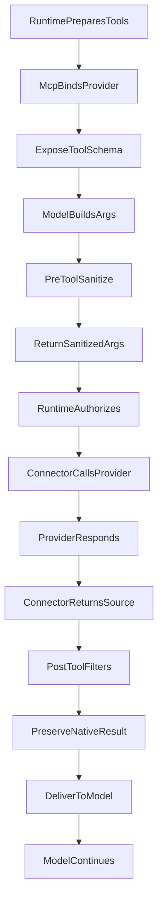

# 一个金融数据 MCP，为什么长成了研究决策系统

我们为投资研究助手做了一个金融数据 MCP。大模型通过它查询基金资料、指数信息和行情历史；它的背后连接着 WeStock、Wind 等不同供应商。

MCP 可以理解为模型使用外部工具的接口约定：工具告诉模型自己能做什么、需要什么参数，模型发起调用，工具返回资料。我们做的这个 MCP 是统一入口，背后的供应商才是数据来源。

为了让统一入口接上这些来源，我们又在内部做了一层供应商接入代码。它起初用于连接、认证和转发，后来逐渐承担了字段解释、结果完整性判断、自动补查和故障避让。

这篇文章讲的就是这层代码怎样变厚，以及我们如何发现、定位和重新划分职责。局部保护规则与开发约束已经开始修正，完整改造仍在推进，尚不能宣布回答质量已经改善。

## 一、先有金融数据工具，再有供应商接入层

投资研究助手需要回答“这只基金跟踪哪个指数”“这段时间表现怎样”等问题。模型本身不能可靠地记住这些实时资料，因此需要调用工具读取。

我们没有让模型分别处理所有供应商的连接和认证，而是先建设自己的金融数据 MCP，对外提供“查询产品资料”“读取行情历史”等工具。来源凭据留在服务端，模型只在授权范围内调用。

内部的供应商接入层连接不同来源。有的来源提供自己的 MCP，有的通过数据接口或桥接程序接入。它们的工具名、参数、返回格式和覆盖范围并不一致。

当时的调用关系可以简化为：

这里有两层不同的职责：金融数据 MCP 是模型使用的入口；供应商接入层负责把入口连接到真正的数据来源。后来的问题主要出现在内部接入层，而不在 MCP 协议本身。

## 二、统一入口为什么会吸收越来越多工作

最初，我们希望模型只需要学会一套金融工具。查询同一种资料时，无论背后使用哪个供应商，输入和输出都尽量相似。

这意味着接入层不再只是转发。它需要把统一请求改成供应商参数，再把供应商的表格或字段改成统一结果。

例如，模型请求一份基金资料，接入层先选择具体来源和业务接口。来源返回产品名称、成立日期、比较基准等内容后，程序再把它们放进内部定义的金融字段。

如果来源的字段名不同，就增加别名映射；单位不同，就处理换算；表格有多层，就提取记录；缺少预期字段，就判断这份结果能不能用。为了维持同一个输出结构，来源差异不断变成程序分支。

接入层还包含了跨来源收集、备用来源切换和失败避让。检查这些功能时，我们发现它已经需要回答许多研究问题：

| 接入层承担的功能 | 隐含的判断 |
| --- | --- |
| 把产品分类映射到供应商接口 | 这类产品应该查哪个业务工具？ |
| 把字段转换成统一金融结果 | 来源字段的业务含义是什么？ |
| 判断结果是否满足统一要求 | 缺失资料是否影响当前研究？ |
| 结果不足时查询备用来源 | 下一步应该补查什么？ |
| 暂时跳过失败来源 | 这次异常是否代表整个渠道不可用？ |

以一次“查询基金资料”为例，下面按发生顺序画出审查时的请求路径。每一列是一个模块，箭头表示请求或结果传递；供应商一列可以代表 WeStock、Wind 等来源。这是机制示意，不是某次线上请求的完整记录。

**步骤与职责：**

- **ModelRequestsFundData**：大模型 → 运行时，请求查询基金资料。
- **RuntimeValidates**：运行时 → 金融数据 MCP，校验权限和预算后调用统一工具。
- **McpForwardsParams**：金融数据 MCP → 内部接入层，提交统一业务参数。
- **SelectProvider**：内部接入层 → 供应商，分类选接口，转换参数后查询。
- **ProviderReturnsRaw**：供应商 → 内部接入层，返回原始表格或数据。
- **LegacyNormalize**：内部接入层 → 内部接入层，解释字段，转换成统一金融结果。
- **RetryFallback**：内部接入层 → 供应商，按备用来源规则再次查询（内部判定资料不足）。
- **FallbackReturns**：供应商 → 内部接入层，返回另一份资料或失败（内部判定资料不足）。
- **McpReturnsUnified**：内部接入层 → 金融数据 MCP，返回统一结果或不可用状态。
- **RuntimeGetsResult**：金融数据 MCP → 运行时，返回工具结果。
- **ModelGetsEvidence**：运行时 → 大模型，记录并交付结果。
- **ModelWritesAnswer**：大模型 → 运行时，根据结果组织回答。

最厚的部分发生在供应商返回资料之后：接入层既解释金融字段，又决定结果是否够用、是否再查其他来源。模型接到结果前，程序已经替它做了一段研究判断。

这些工作并不都应该取消。例如，授权和超时必须由程序保证。但解释金融字段、判断资料是否充分、规划后续研究，已经超出了连接数据来源的职责。

## 三、从“资料读不到”追到接入层

这次讨论的起点是实际使用中的资料读取问题。回答里出现了“来源不可用”“尚未读到”等说明，一些基金的指数归属因此没有得到核实。

最直接的疑问是：是不是某个供应商不可用？为什么依赖 Wind？其他渠道能不能提供资料？沿着这些问题继续检查，接入层本身的复杂度也暴露了出来。

我们没有把回答里的“不可用”直接当成供应商故障，而是拆开读取路径：调用了什么工具，供应商返回了什么，内部怎样解释结果，失败又会影响哪些后续请求。

### 第一个定位点：内部分类不等于供应商能力

审查时，一条 WeStock 资料读取路径会把内部“基金”类型送到 ETF 专用接口。ETF 是可以在交易所交易的一类基金，但基金并不都属于这一类。

这说明问题可能发生在接口选择，而不仅是渠道健康。程序规则写得确定，分类前提却不一定成立。继续靠产品例外修补，会让接入层维护更多供应商业务知识。

### 第二个定位点：有资料，不等于符合内部形状

另一类适配代码会把来源表格提取成单条金融记录，并按已知字段和格式解释它。这样做方便后续消费，也让内部结构要求成为资料是否可用的门槛。

来源可以返回复杂表格、多个记录，或者我们尚未映射的字段。它们可能对模型有用，却不一定符合统一结果要求。因此，排查要区分“来源没有返回资料”和“内部没有接受这份资料”。

### 第三个定位点：局部结果异常被扩大了范围

最初审查的聚合代码，会把部分结果结构不匹配也计入故障避让。当时的失败记录按“供应商加操作类型”区分，没有包含具体产品。

一次产品资料未通过内部要求，因而可能让同一供应商、同一操作下的其他产品查询也被跳过。源码支持这条影响路径的存在，但不能据此断定所有读取失败都由它造成。

后来，这条规则已在代码中收窄：不同请求使用不同的失败记录，结构不匹配也不再自动触发这类避让。它修正了一个局部问题，也进一步说明必须分清调用异常、数据限制和渠道故障。

## 四、问题为什么没有被“权责分离”挡住

我们此前一直强调模型负责理解、程序负责执行。然而，“执行”在具体修复中被赋予了越来越宽的含义。

权限是否合法、参数是否满足要求、调用是否超时，属于程序可以依据系统事实决定的事情。资料是否相关、缺少的字段是否影响结论、下一步要查什么，则依赖研究语境。

部分后一类判断被写成校验、适配和容错，看起来也在提高执行可靠性。一个局部问题解决了，接入层同时多承担了一项判断。文件仍然分层，职责却已经移动。

统一金融结果的设计又强化了这种演变。只要坚持让不同供应商输出相近的金融字段，维护者就要持续解释、转换和补齐差异。旧规格也要求把来源隐藏在统一接口后面，单靠提醒“封装要薄”很难改变这个前提。

我们的判断是，这是一条可能推动架构腐化的机制：为了方便先统一字段，为了稳妥再判断完整，为了成功继续自动补查，最后又管理补查失败的影响范围。它不是对每次历史提交动机的还原。

因此，这次治理不能停在删几条映射或缩短文件。需要重新决定：统一入口应该统一到什么程度，哪些判断必须交回模型。

## 五、治理方案：统一工具入口，保留来源真实要求

新的方向仍然保留我们自己的金融数据 MCP，也保留统一公开工具名。内部接入层只根据明确的能力配置、授权、连接状态和预算选择供应商。

模型收到的是被选来源的真实工具说明与参数要求。返回内容也保留来源结构，不再要求所有供应商提供相近的金融字段。模型负责构造参数、理解资料差异，并决定是否继续研究。

下面是一个简化示例，用来解释方案，不代表真实供应商接口：

| 本轮选择的来源 | 模型看到的工具名 | 本轮必须填写的参数 |
| --- | --- | --- |
| 来源甲 | 查询基金资料 | 产品代码 |
| 来源乙 | 查询基金资料 | 市场名称、产品代码 |

模型按甲的要求生成参数后，本次调用就绑定到甲。如果甲随后不可用，程序不能把这份参数偷偷送给乙。下一轮需要重新提供乙的要求，让模型重新构造请求。

这里统一的是工具调用的基本形式，以及模型交付回答、引用、进度和结束状态的应用协议。不同来源的金融内容可以不同，不必先被程序转换成一个通用金融对象。

具体职责也随之重新分配：

| 工作 | 新的归属 |
| --- | --- |
| 理解问题、选择研究工具、解释资料、规划补查 | 大模型 |
| 按能力配置、授权、健康和预算选择供应商 | 数据接入层 |
| 连接、认证和协议转发 | 连接程序 |
| 必要参数清洗和结果筛选 | 公开工具调用前后的处理逻辑 |
| 权限、预算、超时、隔离、记录和回答发布 | 运行时 |
| 收益率、回撤等计算与输入校验 | 独立计算工具 |

仍以同一次“查询基金资料”为例，目标方案的请求路径如下。这里把调用前后的清洗筛选归为“工具处理”，把认证与转发归为“连接程序”，只保留理解职责迁移所需的模块。它是改造目标，不代表整条路径已经完成验收。

**步骤与职责：**

- **RuntimePreparesTools**：运行时 → 金融数据 MCP，准备本轮查询工具。
- **McpBindsProvider**：金融数据 MCP → 运行时，按配置、授权、健康和预算选源，绑定实际协议。
- **ExposeToolSchema**：运行时 → 大模型，提供统一工具名和供应商实际参数要求。
- **ModelBuildsArgs**：大模型 → 运行时，构造参数，提出查询。
- **PreToolSanitize**：运行时 → 工具处理，调用前作必要参数清洗。
- **ReturnSanitizedArgs**：工具处理 → 运行时，返回实际参数，保留改写记录。
- **RuntimeAuthorizes**：运行时 → 连接程序，校验权限、参数和预算后，按绑定调用。
- **ConnectorCallsProvider**：连接程序 → 供应商，认证并转发请求。
- **ProviderResponds**：供应商 → 连接程序，返回原生资料或明确失败。
- **ConnectorReturnsSource**：连接程序 → 运行时，返回结果与实际来源。
- **PostToolFilters**：运行时 → 工具处理，记录结果，调用后作必要筛选。
- **PreserveNativeResult**：工具处理 → 运行时，保留原意，不转换成统一金融对象。
- **DeliverToModel**：运行时 → 大模型，最终安全与大小校验后交付。
- **ModelContinues**：大模型 → 运行时，解释资料，提出补查或交付回答。

对照前图，参数构造和金融解释回到模型，资料是否充分与下一步补查也由模型决定。金融数据 MCP 只选择并绑定来源；工具处理只清洗筛选；连接程序只认证转发；运行时负责校验、记录和限制。这些事情都有明确归属，不再集中在内部接入层。

图中省略了缓存与并发控制，它们仍由执行设施负责。需要收益率或回撤时，模型另行调用独立计算工具；查询基金资料本身不必经过计算模块。绑定来源在调用前失效时，返回明确失败，下一轮重新提供工具要求，不在本次请求里偷偷切换。

需要退出的是完整金融转换层、隐式产品分类路由、研究充分性判断、隐藏补查路径，以及把局部数据问题扩大为渠道故障的规则。

## 六、清洗规则可以保留，但不能重建一套适配器

回收职责不意味着所有小问题都交给模型。一些明确、反复出现的格式错误，值得用程序修正。

我们决定按公开工具维护必要规则，共用逻辑优先，确有必要时允许小型供应商例外。调用前可以修正无歧义的日期或枚举格式，调用后可以筛选已知冗余和敏感内容。

这些规则需要说明具体问题，保留原始与处理后记录，并接受最终参数、安全和大小校验。结果筛选不能补造日期、改变单位含义，或因为字段陌生就删除有用资料。

如果规则开始推断产品类别、解释大量金融字段、补齐统一结果，或者决定下一次查询，它又承担了业务适配层的职责。把代码搬到调用前后的处理函数里，不算职责收缩。

收益率、回撤等计算则有另一种边界。独立计算工具可以严格要求对象、单位和时间范围，并在输入不明确时拒绝计算。这种局部校验应当保留，但不能扩展成所有研究资料的接入条件。

## 七、怎样避免修复再次侵蚀边界

我们把治理拆成两部分：一部分调整金融数据 MCP 与内部接入层；另一部分调整开发指引和已有审查机制，让下一次修复先明确归属。

首先，不再笼统写“交给智能体”。这个词可能指模型，也可能指整套程序。修复说明要直接写大模型、数据接入层、连接程序、运行时或计算工具。

其次，每次增加规则前，先定位最早出问题的环节。来源没有数据、参数错误、权限不足、模型解释错误，需要不同处理。缺少证据时记录未知，不默认往执行代码里加分支。

再检查已有规则能否重写、合并或删除。新增逻辑替代了哪条旧路径？供应商例外为什么不能共用？这些问题进入已有提案和修复说明，不另外建立审批平台。

开发助手需要了解职责边界；研究模型需要收到正确的工具说明。现有提示指令检查已经开始补充这类归属提醒，但不会把整段架构教程塞进模型的全局提示词。已有指引正确时，也允许不新增规则。

完整改造的验收还需要检查实际路径：模型收到的参数要求是否与调用一致，一个产品的局部失败是否影响无关查询，旧字段转换与隐藏补查是否真正退出，而不只是换了文件位置。

之后还要用真实研究案例评估模型能否适应来源差异、回答是否改善。调用机制正确与回答质量提高，需要各自的证据。

这次复盘把“权责分离”推进到了具体判断上：一个决定依赖什么事实，谁有能力作出，失败会影响谁。金融数据 MCP 可以继续作为统一入口，但内部接入层不应为了维持统一表象，逐渐接管整段研究过程。
