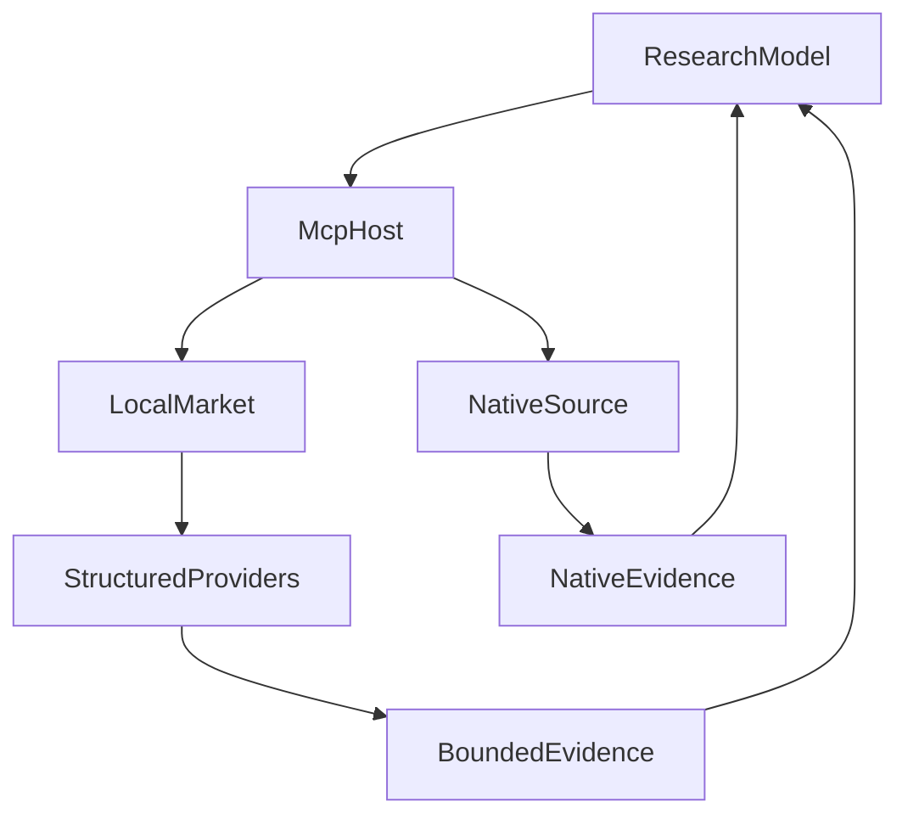

# 一个金融数据 MCP，为什么长成了研究决策系统

**金融数据 MCP 应该负责把可用资料准确交给研究者，而不是悄悄替研究者决定什么资料才“够用”。** 如果接入层开始自行解释金融字段、安排补查、判断结论是否充分，统一工具入口就可能成长为第二套研究决策系统。

这来自我们连接多家行情供应商、公开接口和本地数据程序时的一次反省：原本希望模型只需使用统一工具，但后来出现“资料可能存在，回答却称不可用”的情况。排查发现，问题并不总是供应商缺数据，而可能是接入层已经替模型作了领域判断。

我们最后保留了多来源连接和确定性计算所需的严格格式，同时让开放研究回到原生工具与模型决策。这篇回顾的价值不在于比较哪个供应商更好，而在于帮助读者判断：**下一次增加适配逻辑，是在解决协议问题，还是在越权替研究做决定？**

## 一、一个投资问题，往往需要不止一种数据能力

“看看这只基金最近表现怎样”，至少可能涉及基金本身的净值、跟踪指数的价格、实际持仓披露，以及产品文件中的投资范围。它们的对象和发布时间不同，也未必由同一个渠道完整提供。

我们因此同时接入几类来源：供应商提供的 MCP、固定公开网站的接口，以及通过 Python 调用的数据程序。中证公开接口适合提供特定指数的历史观测；基金公司接口可以提供已配置产品的净值；WeStock、Wind 和 Python 数据渠道则提供各自支持的行情读取路径。

多来源首先解决覆盖差异，其次提供可替代的读取路径和有限的交叉检查。它也带来成本、权限和维护上的选择：某个来源需要凭据，某个来源只覆盖特定市场，某个来源返回的字段更完整，但不能据此直接认为它适合所有问题。

[MCP 官方工具规范](https://modelcontextprotocol.io/specification/2026-07-28/server/tools)定义了工具名称、说明、输入 Schema，以及工具发现和调用的协议。我们在这之上建设金融能力：哪些接口属于同一种用途、一个数值对应什么对象和日期、何时可以继续计算，都需要由应用明确处理。

最初建设统一入口是合理的。连接、认证、请求限制和调用记录不必让每个研究任务重新处理；稳定的工具也方便模型使用。真正需要重新审视的是：为了维持这个入口，我们应该统一多少金融含义？

## 二、多供应商支持，具体支持到了哪一层？

在当前实现中，“接入”包含几种不同形态。下面这张表描述的是源码中的能力和启用条件，不能把它读成所有渠道此刻都已通过真实联网验收。

| 来源 | 我们怎样接入 | 当前组合与能力范围 |
| --- | --- | --- |
| WeStock | 通过 MCP 客户端连接，使用服务端保存的 OAuth 凭据 | 结构化路径保留历史行情读取，默认组合可由开关关闭；实际调用仍取决于凭据、授权和渠道状态 |
| Wind | 通过 MCP 客户端取得相应数据服务，再调用具体工具 | 结构化路径保留历史行情读取；配置 API Key 且未关闭时才进入候选，位于后一层来源 |
| BaoStock | 固定 Python bridge，通过受控子进程交换请求和结果 | 默认结构化组合包含此适配，当前保留中国市场的历史行情路径 |
| yfinance | 同样通过固定 Python bridge 接入 | 默认结构化组合包含此适配；历史行情的静态排序在美国市场优先考虑它 |
| 中证公开数据 | 向固定中证域名发起有边界的 HTTP 请求 | 提供中国市场指数历史数据适配，不能据此扩称覆盖所有中证产品与接口 |
| 基金公司公开接口 | 固定组织和域名，配置产品代码及净值路由 | 当前配置允许华泰柏瑞、南方基金；必须明确支持的代码和路由，才构造相应 Provider |
| AKShare | 独立的公开基金单位净值工具，使用固定 Python 程序 | 已实现可选组件；需受信任的组合代码确认公开数据使用和来源条款，默认 Market 进程入口尚未注入 |

这里的 Provider 是“接受一种明确请求、读取某个来源、返回候选结果”的实现。供应商不必自己提供 MCP：HTTP 接口和 Python 程序也可以通过我们自建的 Market MCP 暴露为工具。这是多源建设中实际复用的能力。

但相同的 Provider 接口不意味着相同的业务覆盖。当前 WeStock、Wind、BaoStock、yfinance 的这组结构化适配主要保留历史行情；基金公司适配负责已配置产品的净值历史。过去曾统一处理的产品资料、通用快照、成分和宏观等研究路由已有退役，不能拿仍能解码的历史类型当作可执行能力清单。当前来源组合体现了这些区别。

AKShare 则提供了另一个有用的例子。它返回单位净值观测，同时保留原字段、依赖版本、来源修订标识和实际返回范围；币种、份额类别、分红事件与发布时间没有核实，就保持未知。一次交付有行数上限，超出的部分通过遗漏数量和下一段起始日期显式说明。

因此，这个组件能贡献一段可追索的净值材料，却不会自动把它升级成完整总收益率序列。我们确实建设了这条可选接入路径，也保留了它尚未进入默认进程组合的事实。AKShare 接入实现中的这些处理，比一句“支持 AKShare”更能说明能力所在。

## 三、统一入口怎样逐渐吸收研究判断

最初，我们希望模型查询同一种资料时，无论背后使用哪个供应商，输入输出都尽量相似。这要求接入层把统一请求改成供应商参数，再把返回的表格和字段改成内部金融对象。

字段名不同，就增加别名映射；单位不同，就处理换算；表格有多层，就提取记录。每一步都有局部理由，后续消费也确实更方便。但当来源没有返回预期字段时，接入层还得决定：这份资料到底能不能用？是否应该换一个来源补齐？

于是，原本处理协议差异的代码，开始维护研究过程中的判断：

| 新增的接入逻辑 | 它实际需要回答的问题 |
| --- | --- |
| 按内部产品分类选择供应商接口 | 这个产品应该查哪一种业务工具？ |
| 把复杂表格转换成统一字段 | 来源字段在这里是什么意思？ |
| 检查统一结果是否完整 | 缺少的资料是否影响本次研究？ |
| 自动补查其他来源 | 接下来查什么最有帮助？ |
| 因结果异常而跳过来源 | 本次问题是否足以代表整个渠道故障？ |

这不是所有适配都不该做。对于已经明确对象和公式的历史价格计算，参数转换与输入校验仍然有必要。问题在于同一套要求也开始约束开放研究：模型还没看见资料，程序就已经替它解释、筛选，并决定下一步。

“模型负责理解，程序负责执行”没有自动挡住这种演变。因为在一次次修复中，“执行”逐渐包含了分类、充分性判断和研究规划。文件看起来仍然分层，决定权却已经移动。

## 四、从一次“资料读不到”，追到三个不同问题

这轮复盘的起点是实际研究中的资料读取问题：部分基金的指数归属没有得到核实，回答出现来源不可用的说明。我们没有直接把它归因于某个供应商宕机，而是依次检查调用了什么、返回了什么，以及内部为什么没有接受。

首先，一条 WeStock 路径会把内部的“基金”类型送到 ETF 专用接口。ETF 属于基金，基金却不一定是 ETF。这个问题发生在接口选择阶段；继续增加产品例外，会让接入层维护更多供应商业务知识。

其次，有的来源返回多行表格或陌生字段，而内部适配期待单条、固定形状的记录。来源返回了资料和程序接受了资料，是两个不同的事实。若把后者失败直接写成前者不存在，模型就失去了继续解释原材料的机会。

第三，早期失败避让按“供应商加操作类型”记录，部分结构不匹配也会进入这套规则。一个产品的查询失败，可能让同一来源下其他产品的同类查询被跳过。源码支持这条影响路径，但不能据此把所有历史读取失败都归为同一个原因。

后续修复先收窄了影响范围：失败记录包含具体请求，结构不匹配也不再自动进入相同的避让。更大的调整则是重新区分研究资料读取和确定性消费，避免为了守住一个统一结果，持续替模型安排研究。

## 五、改造后的两条路径：自建 Market 与原生来源并存

现在的方向不是把所有供应商改造成一种新的接口，而是保留两条各有用途的路径。

**第一条经过自建 Market MCP。** 它对外提供有明确合同的能力，例如查询已知产品目录、读取价格或净值历史；背后调用固定 HTTP 接口、Python bridge 或相应供应商适配。确定性消费者需要稳定对象、时间范围和结果结构，这些局部合同继续保留。

**第二条让研究使用获准来源的原生工具。** 应用根据明确配置提供工具用途和来源绑定，模型看到当前来源真实的说明与 Schema，按它构造参数、理解返回资料。远程 MCP 可以独立接入 Host，不要求所有金融工具都先通过本地 Market Server 的归一化接口。

下图只展示这两种消费关系。Host 是应用中持有 MCP 客户端、执行授权和调用的部分；图中分支由已提供的工具能力决定，不代表每次研究同时访问所有来源。



原生路径保留统一公开工具名时，参数要求仍来自本轮实际绑定的供应商。模型按来源甲生成参数之后，如果甲不可用，程序不能把原参数偷偷送给要求不同的乙。需要换源时，下一轮重新提供相应工具要求，让模型构造新的请求。

调用前后可以保留必要的机械处理，例如无歧义的格式修正、敏感字段过滤和大小限制；它们要保留原始与有效参数，接受最终校验。如果处理开始推断产品类别、补齐金融字段、决定是否继续补查，就又承担了完整业务适配层的职责。

这条原生研究路径没有继承下面要介绍的结构化多层回退。两者分别服务不同的调用合同，不能因为最终都接触 WeStock 或 Wind，就把它们画成同一个自动换源系统。

## 六、保留下来的结构化路径，怎样组织多个来源？

### 先限定请求，再选择候选

结构化请求包含操作、产品代码、市场、对象类型、日期范围和数据口径。代码相同但市场不同，或者基金净值与指数价格不同，都不能只按名称相似就当成同一结果。

执行时，程序先筛出已启用且声明支持该操作的 Provider，再按照当前请求的失败记录和来源层级选择候选。第一层包含公开接口与常用渠道；配置允许的 Wind 位于后一层。每层按优先级选取有限数量的来源，并发读取，层与层之间顺序执行，共享总截止时间。

当前每层最多并发三个来源。历史行情的静态排序对美国市场优先考虑 yfinance，对其他市场优先考虑 WeStock；中证、基金公司这类专用适配保留自己的较高优先级。这是具体实现采用的读取顺序，不是关于哪家供应商永远更好的判断。

### 选择一份主结果，不把各家字段拼成一份“真相”

候选返回后，要先检查对象和口径。主结果排序还考虑当前请求的覆盖、来源优先级和数据日期，所以不是谁最快返回就采用谁，也不是日期更新便无条件覆盖其他来源。

第一层得到满足当前合同的可用结果，就可以停止后续读取；若只得到部分、陈旧或冲突结果，则保存这份局部结果，在剩余时间内尝试获准的下一层。后备层仍无完整结果时，返回先前保留的部分结果；当前实现不会再对各层的部分结果做一轮全局排名。

这里回退的是**同一个已限定的数据请求**。程序没有改写用户问题，也没有决定应该研究另一只基金；它只是完成已声明的读取策略。开放研究中的“材料够不够支持结论、要不要另找资料”，仍由模型判断。

### 缓存保存读取事实，也保存它的局限

相同结构化请求使用稳定键去重；并发中的同一请求共享读取，结果可以保存在内存和配置的磁盘缓存中。当前默认缓存重用窗口为 24 小时，命中时返回缓存状态和年龄，原数据日期不会被改成今天。这个窗口属于缓存策略，源数据的时点与请求覆盖仍是另外的事实。

刷新失败时，已有结果可以以 `partial`、`stale` 和明确的刷新失败原因返回。若本次只允许读缓存，没有本地记录，就直接说明不可用，不临时访问网络。这样模型能分清“读到了旧资料”和“根本没有读到”，而不是从相同的成功标志猜测。

失败避让同样限定到供应商与规范化请求，默认窗口为三小时。当前结构化路径不会仅因 `INVALID_RESULT` 就写入相同的可重试失败记录；对别的产品和参数，也不会沿用这次请求的失败键。原生研究路径则按各次调用及已证明的连接故障隔离，不能把这两个策略混为一谈。

### 来源冲突是一条线索，不是整段历史的质量认证

结构化路径会在对象、市场、类型和口径匹配的候选间做有限数值比较。当前实现取请求窗口内的末值，将相对差异不超过 0.05%、不超过 0.5% 和更大的情况分成一致、小差异与冲突；大冲突会使该层结果降为部分可用，并停止把所选数值作为无争议结果输出。

这些阈值是本项目的局部规则，不是金融数据的通用准确率标准。实现还没有把这一步扩展为逐交易日对齐核验，比较函数也未另行强制各候选末值日期相同。因此，调用方仍须读取实际日期，不能把 `confirmed` 理解为整段序列已经核验一致。

同理，返回范围满足当前请求的覆盖检查，不等于已经排除交易日缺口或确认每条观测最终有效。我们保留这些差别，才能知道哪些是已取得的数据，哪些仍需要后续研究。结构化读取实现集中承载了这套有限策略。

## 七、把同一个请求走完：多来源最后交给模型什么？

下面用一个**合成教学示例**说明：模型要求读取沪深 300 在一个明确区间内的日度价格，并计算所读序列的区间变化。日期与工具参数用于说明接口，所有行情数值和供应商响应均为假设，不是真实查询记录。

```json
{
  "code": "000300",
  "market": "CN",
  "type": "index",
  "from": "2026-09-01",
  "to": "2026-09-30",
  "frequency": "daily",
  "metrics": ["interval_return"]
}
```

假设本次没有缓存，第一层选中的三个来源给出以下结果。中证与 WeStock 适配的结果均满足当前请求的覆盖检查，这里只展示影响解释的首末值。

| 本次候选 | 合成结果 | 对当前读取的影响 |
| --- | --- | --- |
| 中证适配 | 对象与价格口径匹配；首日 4,000，末日 4,080 | 可以作为主结果候选 |
| WeStock 适配 | 对象、首末日期相同；首日 4,000，末日 4,081.2 | 提供另一来源，末值差约 0.03%，落在当前一致区间 |
| BaoStock 适配 | 本次请求超时 | 记录本次失败；已有候选仍可继续处理 |

在这些条件下，按主结果排序可选择中证适配的序列，得到 `4080 / 4000 - 1 = 0.02`。第一层已经满足当前合同，无须继续调用 Wind。下面把实际返回信息压缩成一个教学视图，展示交接重点，省略完整协议中的其他字段：

```json
{
  "status": "available",
  "instrument": { "code": "000300", "market": "CN", "type": "index" },
  "basis": "market_price",
  "source": "csindex",
  "actualFrom": "2026-09-01",
  "actualTo": "2026-09-30",
  "intervalReturn": 0.02,
  "corroboration": "confirmed",
  "cache": "miss"
}
```

模型得到的不只是“涨了 2%”，还应一起消费对象、区间、口径、实际来源和核对范围。这个数字描述所选价格序列的首末变化，不能直接写成用户持有基金的真实收益；有其他来源参与，也不能省略日期和数据资格检查。

改变一个条件，输出就应改变：

- **两家末值差异超过当前冲突阈值**：这一层结果会降为部分可用；只有后续来源已获准且仍有时间，才继续同一结构化请求。不会取一个平均数当作市场真值。
- **只有旧缓存，刷新失败**：保留旧日期和 `stale` 状态，模型可解释这段历史，但不能说刚刚取得了最新行情。
- **来源没有完成读取**：本次读取不可用、操作不支持与明确查无结果有不同的返回语义；被跳过或超时的来源，不能为“市场上没有这份资料”提供证明。

这也是多供应商接入真正增加的能力：让不同来源参与同一个有边界的读取，同时把采用的来源、已有覆盖与仍不确定的部分带到消费端。

## 八、这次改造留下了什么判断？

后续限定工程验收覆盖了原生工具描述与内容保留、调用的局部失败隔离、必要的前后处理，以及部分持久化与恢复交接。仍需分别检验真实供应商授权、服务稳定性和模型对不同 Schema 的使用效果。

改造途中还有一个很有价值的反例：一份合法原生结果包含 **2,100 行**、少于 **32 KiB**，却被复用的模型入参校验器按 **4,096 节点**的另一套容量规则拒绝。我们调整的是输出校验的适用范围，保留 Schema、隐私和字节上限，而不是再造金融字段映射。

这让取舍更具体。原生 MCP 的好处是减少重复的语义适配，但模型必须面对更多来源差异；需要固定结构的计算者，依然要在自己的业务接口上维护明确口径。**复杂度没有神奇消失，而是回到真正能解释它为何必要的位置。**

下次接入新供应商时，可以先问：它填补了哪个真实的数据缺口？失败发生在连接、参数、对象身份还是金融解释？有没有实际消费者必须使用稳定的结构化字段？只有最后一个问题有明确答案，才考虑增加专用转换。

**连接事实归数据接入，计算前提归业务方法，开放研究中的取舍归研究者。** 不要让一个方便的统一工具，悄悄取得研究决策权。

## 继续阅读

- [从接上 MCP 到真正用上工具：Agent 的接入链路怎样构建](https://hpoenixf.com/eff-agent-article/articles/mcp-host-from-discovery-to-consumption)
- [把个人持仓接入 Agent：我们怎样设计一个只读金融 MCP](https://hpoenixf.com/eff-agent-article/articles/portfolio-mcp-readonly-investment-data)
- [金融 AI 最危险的“专业感”：数据是真的，数字却算错了](https://hpoenixf.com/eff-agent-article/articles/031-fintech-data-time-and-reproducible-numbers)：对象、日期、运算和方法口径怎样共同影响金融数字。
- [Agent 明明调用了 Python，为什么投研报告还是会算错？](https://hpoenixf.com/eff-agent-article/articles/financial-agent-python-result-consumption)：计算已经发生之后，结果怎样被模型正确消费。
- [金融 Agent 的可信证据链](https://hpoenixf.com/eff-agent-article/articles/financial-agent-trustworthy-evidence-chain)：来源、计算与发布之间的事实如何保持可追索。


<!-- agent-article-sync:guidance:start -->
## 延伸阅读与交流

欢迎到[独立阅读站](https://hpoenixf.com/eff-agent-article/)，结合目录、架构图和前后篇连续阅读。

系列文章与图文资料整理在 [GitHub 仓库](https://github.com/hpoenixf/eff-agent-article)。如果这篇文章对你有帮助，欢迎点个 **Star** 支持，也欢迎通过 Issues 交流问题。
<!-- agent-article-sync:guidance:end -->
