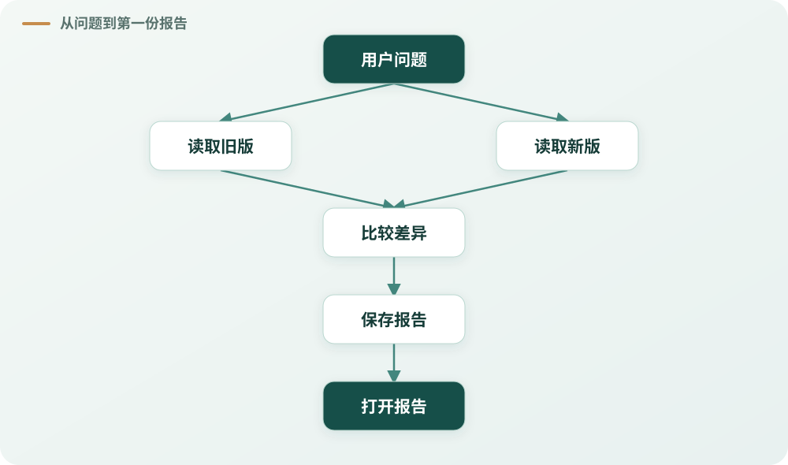
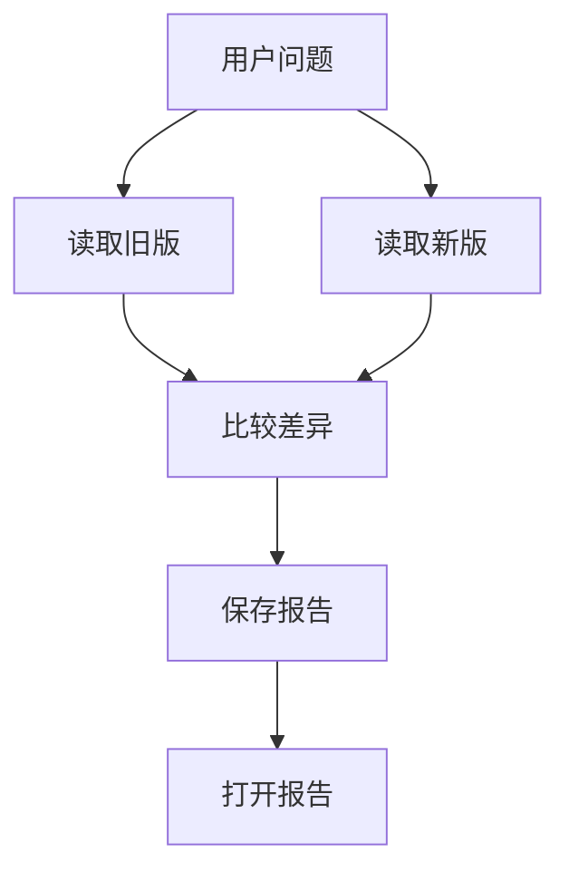
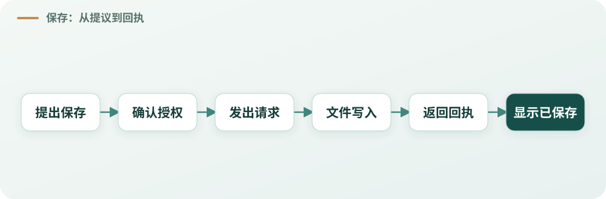
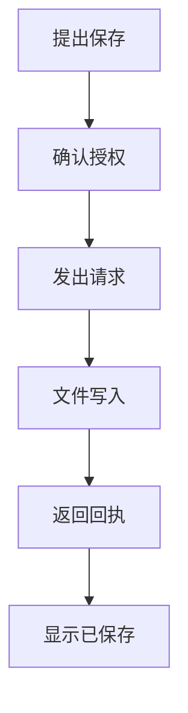
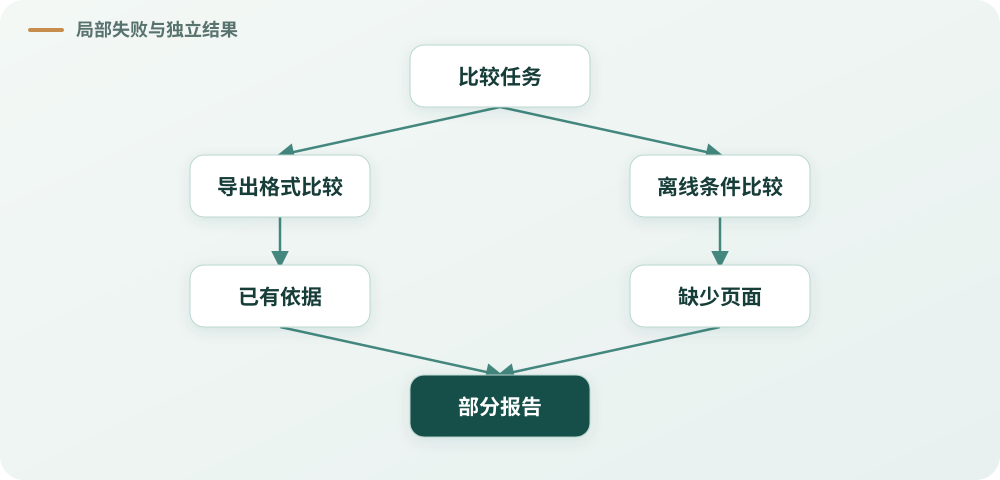
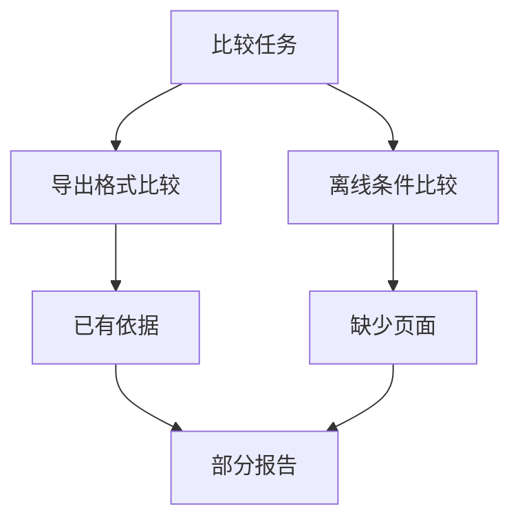
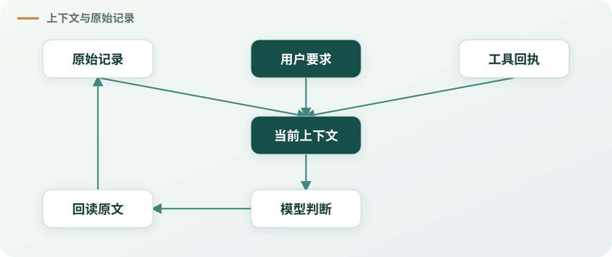
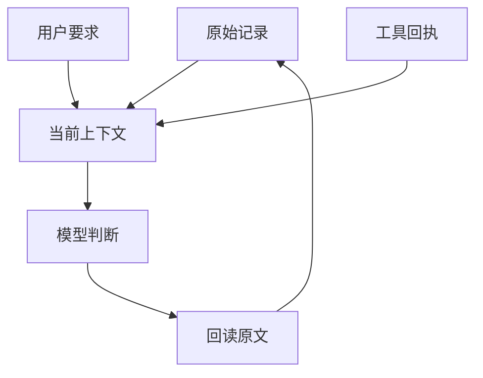
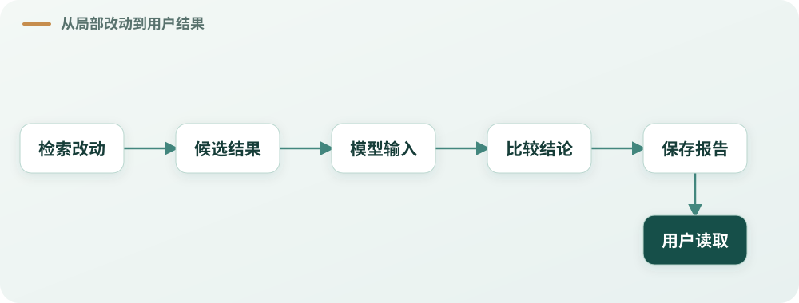
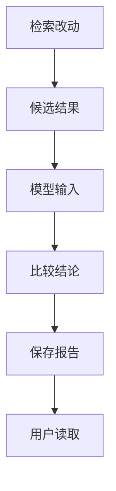

# 一份报告背后的九个架构判断


## 用户只想知道新版多了什么

团队正在评估一款笔记工具。同事带来两份产品文档：文档 A 是旧版，文档 B 是新版。他想知道，新版相对于旧版改变了什么，尤其关心导出格式、免费版离线使用条件，以及每次能导出多少条记录。他还希望得到一份可以回到原文核对的报告，保存下来，过几天也能打开。

这是一个看起来不大的任务。两份文档各有四页，内容也不复杂：旧版只能导出 Markdown，新版增加了 PDF；两版导出都不包含操作历史。免费版可以离线查看已经缓存的页面，但编辑需要联网；新版企业版另有离线编辑。免费版每次导出上限从 1000 条变为 5000 条，增加 4000 条，是原来的 5 倍。

我们希望一个 Agent 帮忙完成比较。它可以读取文档、形成解释、标注出处，再把报告保存成文件。模型擅长理解语言，工具负责取得材料，运行系统负责安排这些动作。看起来，只要把几个组件接起来，事情就完成了。

真正开始设计后，问题接连出现：模型能不能读到两份文档？它说“报告保存了”，系统怎样知道文件真的存在？新版某一页没有读到，已经写好的正文是否还能给用户？研究时间长了，摘要里漏掉“免费版”三个字怎么办？一个检索器看上去改善了搜索，如何知道最终报告也因此更好？

这些问题都围绕同一份报告。它们不是按顺序必须建出的九个组件，而是设计一条用户任务路径时，可能需要作出的九类判断。好的架构不是让每个模块都能证明自己有用，而是让模型的理解、程序的决定和实际发生的效果接得上，让用户最终得到真正需要的结果。

本文以两份虚构的产品文档作为贯穿案例。文档内容和代码示例来自公开项目 [Agent Harness Lab](https://github.com/hpoenixf/agent-harness-lab)；项目提供文档比较和报告保存的可运行示例，默认使用模拟网关。为讨论架构取舍，下文逐步加入读取失败、保存结果未知和资料规模增长等假设；这些情节不表示全部发生在同一次运行中，也不表示项目已经实现所有讨论的机制。

先把两份资料摊开。后面所有例子都从这张表出发：

| 比较项 | 文档 A：1.0 | 文档 B：2.0 | 需要留意 |
| --- | --- | --- | --- |
| 导出格式 | Markdown | Markdown、PDF | 两版都不包含操作历史 |
| 免费版离线使用 | 可查看已缓存页面；编辑需联网 | 可查看已缓存页面；编辑需联网 | B 的企业版另支持离线编辑 |
| 免费版每次导出上限 | 1000 条 | 5000 条 | 增加 4000 条，变为原来的 5 倍 |

表中的数字来自示例文档，不是系统性能指标。它们会让我们在后面分别讨论计算、条件和引用。

## 一、先让用户得到第一份结果

如果从系统组件开始设计，很容易列出一长串需要的东西：文档解析器、检索服务、研究规划器、任务队列、报告模板、引用校验器、文件存储、恢复机制、测评平台。每一项都能讲出道理。可是同事眼前需要的，只是一句可以核对的比较：新版能不能导出 PDF？

先把问题收窄到文档 A、B 的第 2 页。读取两页，发现 A 只支持 Markdown，B 支持 Markdown 和 PDF；再确认两份文档都说明导出不包含操作历史。于是可以形成一段简短的报告：新版增加了 PDF 导出，导出内容仍不包含操作历史。报告附上文档版本与页码，保存后让用户打开。



<details>
<summary>查看中文 Mermaid 源码</summary>



</details>

*图 1：第一份报告的最短路径。两条读取支路汇合后形成比较；保存后还要让用户能够打开。*

这条路径已经有了可核对的起点：用户提出问题，系统取得材料，模型或示例程序形成比较，报告把结论与来源交给用户。此时我们还没有证明系统能处理几百份长文档，也没有证明真实模型能完成任意复杂比较，但用户已经能够检查这一份结果。

从这里出发，所谓“第一份可交付结果”不是最低质量的借口。它可以范围小，但必须真能拿到，且不隐藏已知条件。如果报告只写“新版增加 PDF”，却略过两版都不包含操作历史，答案可能仍回答了部分问题；如果用户明确问到导出是否包含历史，这个遗漏就不能用“第一期先这样”代替。缩小范围要说清回答了什么，而不是把缺失写成不存在。

现在考虑两个选择。选择一是先实现固定的短文档读取和报告保存；选择二是先建立支持所有格式的通用研究平台。前者更快暴露用户是否真的能打开、理解、核对报告；后者可能适合明确存在大量来源、多个账户或复杂并发的系统，但如果这些条件还没有出现，它也会让第一份报告依赖很多尚未证明必要的机制。

我们可以完整讨论后续要支持的格式、恢复和长期历史，实施时却先保住第一条可用路径。未来的能力没有被否认，只是暂时不拥有阻塞第一份结果的权力。反过来，读取授权、版本身份和保存结果是否真实，直接影响这一份报告的可信性，不能因为“先做最小版本”就省略。

假设把这项工作分成三期：第一期交付带原文出处、能够打开的单次比较报告；第二期再处理更长的研究和必要的恢复；第三期再考虑多种资料格式或持续更新。每期的完成条件分别写清，例如第一期要验证报告能否保存、打开和回到对应原文。某一期完成只说明它自己的承诺成立，不等于后续功能已经实现，也不免除原本需要的授权和来源保护。这是沿本案例作的分期示意，不是 Lab 已交付这三期的声明。

这种排序来自我们对[周报大 Spec 分期交付的复盘](https://hpoenixf.com/eff-agent-article/articles/agent-weekly-review-staged-delivery)：当外围能力与首份交付混在一起时，项目可能一直在推进，却迟迟没有用户能取得的结果。报告案例借用的是“先定义第一份结果，再安排必要依赖”的判断，而不是把周报的开发经历移植成这份报告实际发生过的事。

这也是之后讨论架构时的参照：每增加一个能力，都要能指出它改变了用户任务的哪一部分，或保护了哪一项真实边界。组件多、目录整齐、运行次数增加，都不能自行说明这份报告变得更有用。

## 二、模型读懂问题，系统决定能做什么

同事接着问：“新版能不能离线编辑？我只关心免费版。”这句话有两个条件。模型需要理解“新版”指文档 B，理解“只关心免费版”限定了答案范围，还要区分“离线查看已缓存页面”和“离线编辑”。文档 B 同时提到了免费版和企业版，如果把企业版能力写进免费版，答案就错了。

这类工作需要理解语言和上下文。模型可以决定先读第 3 页，发现问题以后再读旧版的对应段落，也可以把两个版本的条件并排解释。它的研究过程不必预先被一个固定关键词表写死。程序若只因为看到“离线编辑”就回答“支持”，会漏掉同一段话里的适用对象；如果只因为看到“免费版”就截取邻近文字，也不一定能解释条件之间的关系。

但是模型理解任务，不意味着它可以自行扩大资料范围。用户提供的文档 A、B 是这次任务中可供读取的材料；某个工具是否开放、某个账户是否允许访问某个文件，是运行系统依据已授予的范围处理的事实。模型可以提出读取哪一页，不能靠回答“我有权限”把另一位用户的私有文件加入本次研究。

这个边界并不要求代码永远不处理语言。搜索可以用关键词寻找候选，格式校验可以检查页码是否是有效整数，结构化数据也可以确定计算公式。区别在于：这些方法究竟在做一个有明确依据的技术操作，还是冒充对用户含义、证据充分性或授权的最终判断？

例如，用户输入“只看免费版”，搜索工具可以把“免费版”当作词语查找；找到的第 3 页是否回答了问题，需要结合上下文解释。工具成功返回一页，只证明得到了一段材料，并不证明模型理解正确。报告附了两条来源，也不能仅凭引用数量证明结论得到支持。

反过来，语义归模型也不意味着程序必须照单全收。模型请求第 0 页，读取器可以按页码契约报错；模型请求不在本次允许范围内的文件，拥有该权限边界的执行入口可以拒绝这次读取。拒绝应针对这项具体效果，而不是顺手宣布整份报告没有价值。旧版已获准读到的材料、独立的公开内容，以及模型根据这些内容能做的解释，仍然应按各自条件处理。

最小示例里的读取参数很具体。下面摘出模拟网关提出的两次调用；这是一段**实际项目代码节选**，模拟网关按预定顺序工作，不能用它证明真实模型一定会选择相同页码：

```javascript
{ id: 'read-a', name: 'read_page', args: { documentId: 'manual-a-v1', page: 2 } },
{ id: 'read-b', name: 'read_page', args: { documentId: 'manual-b-v2', page: 2 } },
```

执行入口随后检查文档和页码，再返回文本与来源身份。模型提议的是“读哪一页”；真正返回了哪段内容，由执行结果记录。示例来源见 [Lab 的 desk.mjs](https://github.com/hpoenixf/agent-harness-lab/blob/aa14b6a/examples/document-desk/src/desk.mjs)。

一个简单的设计问题是：**这个判断依赖的是人的语义，还是系统掌握的客观事实？** 如果是“免费版是否支持离线编辑”，要看原文、问题和上下文；如果是“这次读取是否已经被允许”，要看授权记录；如果是“第 3 页有没有返回”，要看工具回执。把三者混成一个布尔值，反而会让系统失去解释错误的能力。

## 三、把责任交给真正掌握事实的地方

第一份报告形成后，团队希望每一句结论都能点回原文。此时有几件事情同时发生：模型根据文档组织比较；读取工具返回文本和页码；来源记录保存此次读取的身份；发布模块保存可见报告；界面展示正文并在用户点击时展开出处。

如果把所有逻辑塞进一个“报告管理器”，它很容易变成所有事情的中转站。为了显示一条引用，它要了解文档解析器的内部编号；为了判断模型是否可以继续，它要复制一份运行状态；为了控制下载，它还要猜测文件是否已经保存。模块名叫“管理器”，并不会让它自然拥有这些事实。

更可取的做法，是先沿任务观察每个事实从哪里产生、谁能够改变它、其他地方需要使用什么。文档读取器知道自己实际返回了哪一页；结果存储保留原文和来源位置；运行系统知道工具调用是否派发以及收到什么回执；发布方知道哪一版报告已经被提交；界面读取已提交的正文与可展开的来源。

它们之间仍然需要交接。报告可以保存来源引用，但不必复制整个读取器内部状态；界面可以请求一个原文窗口，但不必了解 PDF 解析器采用了哪种字体识别方法。模型可以选择引用哪些已经取得的材料，但不能通过自己写一个编号来凭空制造一次读取。原始身份、文本和页码仍应能够回到真实结果。

这里的“Owner”并不是说每个概念都要拆一个服务，也不是要求一张新的责任表。它回答的是谁对某个事实或效果有最终决定权。一个模块可以同时拥有几项责任；一项责任也可以由已有模块承担。只要实际交接清楚、其他地方不复制权威状态，就不必为名字好听再增加一层。

假设有两个读取任务并行：一个读旧版，一个读新版。两个任务都可以持有自己的读取进度，却不应该各自复制并重新计算整项研究的共享预算。否则它们可能分别看到相同的剩余额度，最终把一份额度用两次。运行系统若已经拥有共享资源记录，子任务应依据它取得实际可用资源，而不是创建另一份自认为权威的账本。

责任划分也影响排查。当报告缺少 B 的第 3 页，要区分几种情况：模型从未请求；请求被权限边界拒绝；工具返回失败；工具返回了但结果没有进入模型可用的上下文；模型看到了原文却忽略免费版条件。它们的外观可能都是“答案漏了条件”，修复位置却不同。模型多保证一次自己读过，不能修复工具没有返回；重试读取也不能自动修复模型已经看见材料后的理解错误。

因此，沿一份报告检查架构时，先找事实的来源和交接，再讨论目录怎么分。真正封装的是变化原因、知识和决定权，而不是把几行代码搬进一个新文件。

可以用四个角度把这次设计讨论收拢：**事实**是原页、来源身份和保存回执分别在哪里；**权力**是谁能允许读取、拒绝下载或决定正文如何发布；**故障**是一页缺失后哪些部分仍可继续；**价值**是同事能否读到并核对比较结果。四问不要求形成新的运行时步骤，只帮助团队找到责任和遗漏。遇到拒绝时还要追问：它是否重新解释了其他 Owner 已经记录的授权或执行事实，形成重复裁决？关于局部拒绝怎样变成整轮终结的工程背景，见[终结权与局部否决复盘](https://hpoenixf.com/eff-agent-article/articles/agent-veto-authority-and-run-termination)。

## 四、准备保存，不等于报告已经存在

同事读完正文，说：“把报告保存下来，我过几天还要看。”模型提出一次保存请求，运行系统确认保存位置属于允许范围，文件服务开始写入。之后页面显示“报告已保存”。

这句话背后至少有四件不同的事：模型提议保存；系统允许这次保存；请求实际交给文件服务执行；文件服务完成写入并返回可核对的结果。它们可以由同一段代码组织，也可以跨越几个进程，但不能在事实层面合并。



<details>
<summary>查看中文 Mermaid 源码</summary>



</details>

*图 2：从提议到显示已保存。图中每条箭头表示需要继续交接，并不表示前一步必然成功。执行后若回执丢失，效果可能已经发生，状态仍需核对。*

为什么？考虑一个中断：文件服务已经写入文件，返回结果的连接却在运行系统记下回执之前断开。恢复时，本地没有成功记录。这只能说明本地不知道结果，不能证明文件没有写入。若直接重新创建，可能产生两份文件；若直接告诉用户“保存成功”，又没有依据。

一种方法是在执行前确定动作身份，让支持幂等的保存服务识别同一动作的重复请求。另一种方法是在服务支持查询时，先按原身份确认结果，再决定是否继续。如果服务既不能安全重试，也无法查询，那么结果就应保留为未知；系统可以告诉用户正文已经生成，但文件保存状态尚未确认，避免制造一个假的下载成功。

业界也会用幂等键处理可重试的写请求。以 [Stripe 的幂等请求说明](https://docs.stripe.com/api/idempotent_requests)为例，客户端使用同一键重试，以关联原请求的结果。这说明的是该接口提供的重试语义，并不意味着所有文件服务都支持同样的查询、去重或保存保证；我们的报告案例仍要先确认接收方的实际契约。

这并不要求每个普通函数调用都引入复杂的事务协议。先看这项动作是否可能产生持久效果，重复是否有代价，接收方是否提供现成的幂等或查询能力。只是把内存中的一个值重新计算一遍，与向外部系统新增一份报告，风险并不相同。

同样的区分可以用于状态文案。页面显示“正在保存”，依据可能是请求已派发；显示“已保存”，需要相应的保存结果；显示“可下载”，还需要有有效的用户读取路径。保存成功也不自动证明用户在另一设备上一定能打开：权限、地址、文件内容和环境可能影响后续读取。应该根据产品承诺选择适当的检查，而不是用一个笼统的“成功”覆盖所有阶段。

对模型而言，“我已经保存了报告”可以是一句自然语言；对系统而言，它不应成为文件已经存在的证据。对用户而言，最重要的不是系统内部用了几个状态，而是每句状态都对应真实发生的事情。

## 五、一页没读到，整份报告要不要消失

现在把任务扩展到离线使用条件。旧版第 3 页成功读取，新版第 3 页暂时不可用；第 2 页的导出比较已经完成，并且有双方来源。系统应该怎么办？

一种常见设计是，在最终发布前运行一个统一校验：所有请求过的页面都必须成功，否则报告整体失败。这种设计有吸引力。它保证不会把一份不完整的比较伪装成完整结果，程序也容易实现：只要有一项失败，就返回一个错误。

但它同时把一项局部失败变成了对所有成果的否决。新版离线条件无法比较，并不自动使已经有出处的导出格式比较失效。用户可能更愿意先读到可靠的导出部分，看到“离线条件目前无法确认”，然后决定是否等待或补充材料。



<details>
<summary>查看中文 Mermaid 源码</summary>



</details>

*图 3：同一报告有两条比较支路。在这个推演中，导出格式已有双方来源，离线比较缺少新版一页；报告保留前者，并明确说明后者暂不能判断。若缺页影响整份报告的授权或内容身份，仍需由相应责任方处理。*

合理的处理应当看失败影响什么承诺。读取器可以说“新版第 3 页未取得”，不能据此断言整份报告没有价值；模型可以结合用户问题决定先交付导出比较、明确离线部分的缺口，或者说明当前核心问题无法回答；发布方按照自身拥有的责任处理正文和来源的可展示性。

如果用户的问题只有“新版免费版能否离线编辑”，而唯一相关页面没有取得，那么系统不能用其他页面凑成完整答案。它可以诚实说明缺少关键材料，也可以继续使用允许的其他来源，但不能把猜测写成确定事实。局部失败不意味着强行给结论，而是保留独立合法的成果，并把缺口交给真正负责判断的人和模块。

还有一个更重要的反例：假如正文包含了不属于当前用户、且本次从未获准使用的私人内容，就不能为了“保留正文”把引用删掉，让内容看起来像普通比较。权限和内容身份是真实的保护边界；是否可以展示相应内容，应由拥有该效果的发布与授权机制依据客观事实处理。保留合法正文不是绕过保护，也不是由模型自己宣布材料公开。

附件也有类似情况。报告正文已经提交，CSV 附件转换失败，界面可以说明附件暂不可用，同时保留独立合法的正文。反之，如果一份报告的唯一交付要求就是 CSV 文件，而文件没有产生，就不能说整个用户任务已经完成。相同的异常会有不同影响，原因在于用户承诺与效果范围不同。

评审一个拒绝逻辑时，可以沿这份报告问三句：它保护什么效果？作出拒绝的模块是否真正拥有这个效果的决定权？拒绝是否扩散到不相干的内容？同时为它找一条应该继续的路径：新版一页失败，旧版已读内容是否仍能查看；一个附件失败，正文是否还能读；一个引用不能展开，其他可用引用是否保留。

这不是要求所有错误都轻轻带过。发生取消、真实越权、文件身份冲突或未知外部效果时，系统需要实施相应保护。关键在于让保护准确落在它有权保护的范围，而不是把“宁可全失败”当作默认正确。

## 六、上下文是桌面，原始记录是材料柜

两份短文档可以直接放进一次模型请求。随着研究增加：同事又问离线条件、保存方式和导出上限，模型先后读了多个页面，还产生了一个计算结果和几次修订。把所有原文、工具返回、模型草稿和交互历史反复塞进请求，很快就会增加成本，也让当前问题被旧内容淹没。

于是运行系统整理上下文：保留用户当前问题、必要的方法说明、相关文档片段以及能回到原记录的引用。已经处理过但本轮暂时用不到的长内容可以移出，必要时再读取。这个上下文更像工作桌面：它为当前判断摆放材料，不是全部材料的唯一存放处。

假设压缩后的摘要写着：“新版支持离线编辑。”这句话遗漏了“企业版”。如果系统后来只保留摘要，把原文窗口删掉，模型就可能在下一轮把企业版能力写成免费版能力。摘要看起来比原文更简洁，却改变了影响答案的条件。

另一个例子是摘要写着“报告已保存”。它可能只是根据模型当时的计划归纳，而实际保存调用尚未结束。摘要的语言再流畅，也不能替文件服务签收。保存是否发生，仍要查原动作身份和回执；没有可靠回执时，状态仍可能是未知。

因此，压缩应当围绕两类问题设计。第一，模型继续当前工作需要知道什么：原始用户限制、已经取得的关键内容、尚待回答的问题、下一步可用工具。第二，哪些事实不能由摘要重新定义：原文版本、来源身份、授权、工具结果、保存回执和已提交的报告。摘要可以指向这些记录，却不能把自己的概括升级成它们。



<details>
<summary>查看中文 Mermaid 源码</summary>



</details>

*图 4：上下文从原始材料、用户要求和工具回执中选择本轮需要的内容；模型需要核对时，可以沿身份回读原记录。图中的箭头表示使用或读取关系，摘要不会因此变成原始记录。*

回读路径很重要。如果摘要说“第 3 页关于离线功能的条件需要再看”，模型或用户应有办法找到对应文档的准确版本和原文窗口。若原文已经不可用，系统应该把这个缺口留出来，而不是根据旧摘要补造原句。检索也一样：候选片段帮助定位材料，是否需要阅读前后文，取决于问题和材料；搜索结果的排名本身不证明结论成立。

把报告结论追溯到原文，与数据来源领域讨论的问题相近。[W3C PROV-DM](https://www.w3.org/TR/prov-dm/)用实体、活动和参与者描述一份产物怎样形成；这里的文档、读取和报告可以借此理解来路，但有了来路仍不自动证明模型的解释正确，也不能据此声称本项目实现了该标准。我们自己的[可信证据链文章](https://hpoenixf.com/eff-agent-article/articles/financial-agent-trustworthy-evidence-chain)进一步讨论资料经过检索、计算、上下文和交付时应保留什么；本例聚焦一份文档比较，不把其中的金融业务结论搬过来。

沿第 3 页走一遍，就能看到不同关系：原始记录保存文档身份和内容；本轮投影决定模型实际看见哪一段；工具的执行输入记录实际读取了哪个版本和页码；如果正文依赖私人材料，相应的内容身份与授权也是展示时的安全依赖；某句比较所指向的来源，则需要保留它与实际读取结果的精确关系。这些关系不能因为经过摘要、引用或格式转换而相互替代：原文存在不等于已送入模型，引用身份匹配也不等于它支持模型的解释。

这并不意味着所有内容都要永远保留，或者每次都要重新读取整份文档。保存多久、怎样控制隐私和容量，取决于产品的真实约定。架构判断只是提醒我们：为了让当前请求更短而改变视图时，不能悄悄改变过去发生过的事实，也不能让用户原本明确的限制在压缩中失效。

## 七、断线之后，是继续，还是重做

同事开始比较后关闭了页面，第二天回来，希望看到报告。关闭页面可能只是浏览器离开，后台任务仍在运行；也可能服务进程恰好退出；还可能文件服务已经保存，运行系统却没有收到回执。对用户来说都是“回来后看不到结果”，但对系统来说是不同问题。

如果后台仍在工作，页面重新连接时应读取已有进度和已提交结果，而不是因为旧连接结束就启动一份新研究。如果原执行进程已经停止，且系统具备恢复能力，就需要依据原任务身份、已保存状态和真实回执，判断从哪里继续。哪些工具结果已取得、哪些动作尚未执行、哪些效果未知，都应分别处理。

最容易出错的地方，是把“没有看到成功”当成“可以重新做”。读取一份静态的、已授权的公开文档，重复读取通常代价有限；创建文件、发送消息或触发付费任务，则可能产生重复效果。恢复设计应按实际效果选择重读、幂等重试、状态查询或保持未知，而不是把所有动作都包装成同一种重试。

假设保存报告使用稳定动作身份，文件服务可按身份查询；恢复者先确认报告已经存在，再把真实回执接回当前视图。如果保存服务不支持这样的能力，就需要说明当前保存状态无法确定，并避免无依据地创建第二份文件。此前已经生成且允许展示的正文仍可作为独立结果保留，但不能把它当成文件下载成功。

同一任务恢复时，还要保留已记录的任务范围和原始用户限制：例如用户只要求比较免费版，就不能因为新进程收到的摘要不完整而把企业版写成默认范围。对具有明确 Run 授权契约的系统，恢复应按该契约继承已记录授权；新任务则应独立处理自己的准入。不同产品对外部资源撤销、过期和后续动作的约定可能不同，不能用这一案例替所有外部协议作承诺。

恢复机制也有成本。一个单进程、运行几秒的演示，可能只需清楚地保存最终文件；跨进程长研究、并发执行和外部写入，则可能需要更严谨的身份、所有权与对账。没有真实需求时，不必先为示例建一套分布式任务平台；需求出现以后，也不能用一句“再试一次”替代对未知效果的处理。

## 八、什么时候应该再加一个模块

假设新版文档的导出表格很长，模型只看到了前半部分，报告漏掉了重要限制。团队提出一个方案：在报告生成后再调用一个完整性审核 Agent，让它检查内容是否有遗漏。听起来合理，问题是，我们还不知道遗漏为什么发生。

如果读取器本来就返回了续读位置，但运行系统没有把它交给模型，先修复这个交接会更直接。如果原文已经完整进入模型请求，而模型仍漏掉了用户要求的限制，问题更接近理解或研究方法，可能需要调整任务说明、比较方法或评测。若模型已经写对，最终报告却缺了一段，应追查正文保存和展示，而不是再让审核 Agent 阅读原文。

额外审核有自己的价值条件。对高代价任务，独立检查可能发现一次性生成容易漏掉的条件；但它也会增加调用、等待、材料传递和意见冲突。审核者没有读到正确页面时，可能给出看似确定的错误评价；审核失败也不应该自动变成“没有发现问题”。需要证明额外检查在哪些任务上有帮助，而不是因为“多一层看起来更安全”就让所有简单问题都经过它。

看不见的成本不只在实际调用时出现。一个可选能力即使没有被使用，也可能让每轮请求都携带更多工具描述、更长的提示和新的选择；后台还可能维护配置、状态、测试以及未来退出路径。这些都是正常路径上的成本。与之相比，一段更长但只在特定格式调用的解析代码，影响范围可能更小。

判断一个抽象是否值得，可以拿具体改动来试。比如团队经常增加一种导出格式，那么一个清晰的格式生成接口可能让同类扩展更容易；如果现在只有 Markdown 报告，未来没有可信的多格式需求，为五种假想格式先建立工厂、注册表和继承体系，可能只是把一次简单修改分散到更多文件。

对同一份报告，可以把设计讨论落到一张小表。下面的代价是**需要实际测量的问题**，不是本例已经测得的数据：

| 假设中的改动 | 类型 | 应看什么 |
| --- | --- | --- |
| 在已有导出体系中增加一种格式 | 同类扩展 | 生成器、组合入口之外，是否还有无关模块必须了解新格式？ |
| 新增私人文件下载 | 新维度 | 是否需要新增权限、文件身份和用户读取路径？ |
| 从同步读取改成异步读取 | 契约变化 | 消费者是否假定内容立即可用？失败和未完成如何表达？ |

不是“文件越少越好”：必要边界值得明确存在。要找到的是对这类改动没有独立作用、却迫使读者反复跳转或调用方理解内部细节的部分。

文件数不是最终答案。新增一种格式需要修改生成器和组合入口，可能很合理；新增需要用户权限和持久文件的新能力，也可能自然跨越多个边界。更有用的问题是：哪些位置必须知道这个变化，哪些无关位置被迫理解它？阅读一次保存路径要跳过多少只做透传的层？这些层保护了身份、权限或失败语义，还是只把同一调用换了个名字？

重复代码也要这样看。两段错误处理都写了 `try/catch`，不代表它们必须合并：读取失败可能要求标明资料缺失，附件失败可能要求保留正文并提示下载不可用。相似语法背后的责任不同，抽成一个带许多开关的通用处理器，可能只是把差异藏起来。相反，如果多种格式确实遵循同一个保存契约，并且每次都因同一原因变化，共享实现就可能减少真正的重复。

最小充分并不是“代码越少越好”。可靠保存可能需要幂等身份，私有资料读取需要访问边界，长期任务可能需要持久状态。它要求我们说清楚这些复杂度保护了什么，以及为什么不能由已有责任方更简单地承担。必要的复杂度应放在知道问题的地方，不应为了表面简洁消失，也不应扩散到所有调用方。

把这次“增加审核 Agent”的提议再用五个反向问题过一遍：是否只是因为能做就新增？它的状态和特殊判断是否扩散到其他模块？它能否否决独立合法的正文？未调用时是否仍让普通任务承担工具描述、上下文或检查成本？以后不用时能否退出，同时保留已发生的结果？这就是我们在[代码与架构演化复盘](https://hpoenixf.com/eff-agent-article/articles/code-cheaper-systems-harder-to-evolve)中归纳的“五不”，用于讨论取舍，不是五个新门禁。

[Anthropic 对 Agent 构建的建议](https://www.anthropic.com/engineering/building-effective-agents)同样主张从简单、可组合的方案出发，再按需要增加复杂度。它提供的是一般设计方向；本例还要具体核对已授权正文、实际来源和正常路径的代价，不能把“简单”解释成去掉必要保护，也不能仅凭引用证明新增审核无效。

## 九、替换一个读取器，为什么旧报告也要考虑

同事后来提出：除了两份短文档，希望系统还能读取网页，或者换一个能够处理扫描版 PDF 的解析器。此时我们需要决定接口放在哪里。

如果报告模块直接依赖某个解析器的内部字段，例如它专用的页面对象、缓存路径和排序方式，那么更换解析器会让模型调用、报告保存和界面展开都跟着改。即使新解析器输出的文字更完整，旧报告中的引用也可能失去对应对象。

先从消费者需要的事实出发：这是哪份获准的文档、哪个版本，返回了什么内容，位置在哪里，是否存在未取得的部分，以及以后能否沿来源身份回读。解析器可以内部使用不同格式，但交给后续工作的公共结果应表达这些必要内容。接口不是把第一款实现的方法原样抄出来，而是要让消费者能依照它完成自己的工作。

一个实现也可能值得有接口。它可以隔离外部依赖，明确权限或测试边界，并限制消费者对内部格式的假设。反过来，即使有多个实现，如果接口把第一种工具的同步、完整读取或特定错误码写成所有实现都必须满足的前提，第二种工具出现时仍可能需要改动整条链路。数量是线索，契约能否承受真实变化才是关键。

替换读取器之前，把同一份报告里不同的稳定需求摆在一起：

| 具体接口或效果 | 这个案例中需要守住或允许变化的内容 | 验证重点 |
| --- | --- | --- |
| **受保护效果** | 只读取获准的文档；调用身份和执行回执不能由解析器自行授予或伪造 | 原有授权、身份及失败边界仍有效 |
| **持久成果** | 已提交正文、报告和来源身份仍能按原约定读回 | 新旧结果能否找到各自原材料 |
| **持续演进的行为** | 模型如何比较、何时补读，以及报告如何组织可以继续改进 | 针对真实任务和材料检查回答，而非把当前措辞冻结成规则 |
| **可替换适配器** | PDF 或网页读取器可以改变内部格式、解析和传输方式 | 消费者所需的来源、状态和失败信息是否仍被正确交接 |

这四项按**具体接口和效果**区分，并不把整个模块永久归入某一类，也不另造一位上级 Owner；同一个责任方可以同时持有受保护效果和持续演进的行为。来源见[差异化演进契约](https://hpoenixf.com/eff-agent-article/articles/agent-differentiated-evolution-contracts)。表中是本案例的设计判断，具体项目仍要按实际消费者和风险选择验证，不机械追加四套测试。

假设旧读取器同步返回一页文本，新读取器需要异步等待。若整个接口只允许立即返回，开发者可能错误地先返回空字符串，等异步完成后再填值。调用方收到空内容，却可能误认为“文档这一页没有文字”。这里最危险的不是替换失败，而是失败被伪装成成功的空结果。接口需要表达实际完成时机与失败状态，而不是用漂亮的类型名遮住限制。

替换还不止于让新任务调用新代码。已有报告中的来源身份怎样找到原材料？旧任务是否正在使用原读取器？历史报告是否仍依赖旧格式？一个能力可以停止接受新任务，同时继续保留必要的旧结果读取；等已有消费者与持久数据都得到安排，才能讨论彻底删除。

同样，停用一个可选检索索引，应该让两份短文档直接读取的路径继续工作，而不是让不使用索引的任务也必须理解它的状态。为新能力留下少量必要的组合入口是正常成本；让所有模块都知道它的私有标志、内部错误码和恢复细节，则会让未来替换和退出变得困难。

我们想删除的是不再需要的机制和依赖，不是抹掉用户已经取得的报告、原始材料身份或真实发生过的效果。能力容易撤退，和历史可以随意删除，是两回事。

旧读取器退出时，还要查看它的调用接线、现行 Spec、Prompt、Skill 和测试：它们是否仍要求先走旧路径？如果代码已经切换，而一份仍被使用的说明继续要求旧行为，下一次修改可能又把它接回来。应更新拥有当前约定的地方，保留仍需读取的旧结果；历史记录则保留当时的事实，不改写成新方案一直存在。[工程 Context 与 History 的知识退役讨论](https://hpoenixf.com/eff-agent-article/articles/027-agent-context-document-history)解释了为什么代码之外的前提也需要退出。类似地，Martin Fowler 的 [Strangler Fig Application](https://martinfowler.com/bliki/StranglerFigApplication.html)讨论渐进替换旧系统；它是迁移策略的近邻，不代表报告读取器已经采用了该模式。

## 十、引用可以点开，不等于结论正确

报告终于保存成功。每条引用都能点开，页面也显示来源版本。接下来能不能说这份比较可靠？还不能。

看一句话：“新版免费版支持离线编辑。”假设它引用了文档 B 第 3 页。引用确实指向正确的文档，页面也成功展开，但原文实际说的是免费版编辑需要联网，企业版支持离线编辑。来源身份正确，并没有保证结论正确；模型把两个不同对象的条件混在了一起。

再看导出上限。A 是 1000 条，B 是 5000 条。报告若写“增加 5000 条”，即使两个原始数字都存在，计算关系也错了。正确的增加量是 5000 减去 1000，等于 4000 条；新版上限是旧版的 5 倍。程序可以对明确给定的数值和运算做确定性计算，但仍需要确认这两个数指的是同一个对象、同一种口径和同一个比较条件。

**计算示意：**输入来自两份示例文档第 4 页；这段代码演示计算关系，不是项目源码的摘录。

```javascript
const oldLimit = 1000; // A：免费版，每次最多导出
const newLimit = 5000; // B：免费版，每次最多导出

const increase = newLimit - oldLimit; // 4000 条
const multiple = newLimit / oldLimit; // 5 倍
```

数字相减并不难。更重要的是两个输入是否都是“免费版、每次、导出记录条数”。如果一边是每日上限，另一边是每次上限，计算仍会得到一个数字，却不能支持这个比较。

还有一种更隐蔽的情况：答案写“免费版不能离线编辑”，这是对的，却引用了文档 B 的第 2 页。读者如果替作者找到第 3 页，也不能因此说这条实际引用已经支持原句。材料中存在依据，和答案展示的依据恰好支持它，是两个判断。

因此，检查报告至少要分开看：用户要求是否完整保留；相关材料是否实际取得并进入形成答案之前的工作过程；关键结论是否得到所引用原文支持；明确计算是否正确；文件是否真的可以取得。每项可以有自己的证据，不能由“模型正常结束”统一代替。

项目默认使用模拟网关。它有利于反复检查工具调用、保存和读取路径，但预定的演示行为不能证明真实模型总会选择正确材料。仓库也保留了[两模型、四任务的小样本真实运行记录](https://github.com/hpoenixf/agent-harness-lab/tree/aa14b6a/docs/live-runs/2026-10-25)：报告、原页和附件的交付检查通过，但辅助内容核对仍发现过无原文支持的补充，以及宽泛差异报告遗漏部分页面却声称完整等问题。每个模型每题只有一次运行，内容意见尚待作者逐题签审，不能由此比较模型的一般能力。

这些观察恰好说明为什么要分开交付与内容：文件可以真实存在，报告也可以有来源，但读者仍需知道答案中的条件是否正确。相反，一次内容复核没有发现明显问题，也不能证明下载路径正常，或证明未来所有任务都会正确。

## 十一、一个环节改善，不代表整份报告改善

团队决定扩展检索：原先每次返回少量候选，现在返回更多可能相关的页面。局部测试显示候选能够正常返回。是否可以宣布报告覆盖更完整了？

这取决于接下来发生了什么。模型实际收到哪些候选？其中是否包含第 3 页免费版条件？返回的片段是否被截断？模型有没有继续读取上下文？最终报告是否使用了相关材料，而不是只重复第 2 页和第 4 页？更大的候选集合还可能增加输入长度与等待时间，甚至让模型更难注意关键条件。

因此需要区分三个层次。第一，检索模块的行为改变了，例如在某些输入下能够返回以前没有返回的候选。第二，测量工具可能改变了，例如原来漏记了模型收到的页面，修复日志后我们终于能看见它。第三，用户的完整任务是否得到改善，例如报告更完整、更容易核对，或在质量不下降的前提下更快交付。前两项都可能是真实进步，但不自动证明第三项。



<details>
<summary>查看中文 Mermaid 源码</summary>



</details>

*图 5：检查检索改动是否影响最终报告，需要沿候选、实际模型输入、比较结论、保存和用户读取继续观察；任何一条边都可能出现缺口。*

比较也要保持条件可理解。若两次使用了不同文档、不同问题、不同模型和不同工具范围，很难把答案变化归因于检索。可先固定几项代表性任务：导出格式、免费版离线条件、导出上限和保存后重开；记录实际模型输入、工具行为、报告和文件结果，再观察修改前后发生了什么。真实模型具有随机性，少量结果可以帮助发现具体问题，却不足以证明普遍成功率变化。

这不意味着每次改一行代码都要运行昂贵的模型对照。修正页码序列化或文件名编码，可以先用针对性的工程检查；如果声称新的研究方法提升了答案质量，则需要与主张相称的真实任务观察。没有可比基线，就说“当前样本发现了什么”，不要给一个漂亮但无依据的提升百分比。

这也是[测试与评测：绿灯究竟证明什么](https://hpoenixf.com/eff-agent-article/articles/honest-agent-evaluation)的核心区分：固定替身适合检查约定的执行路径；模型是否理解条件、完整任务是否真的完成，需要相应的实际输入、输出和评审。先定位未取得材料、错误投影还是理解失误，再选择验证方式；这些证据回答不同问题，不必把所有变更都升级成付费 A/B。

还要看到取舍：更多候选可能改善某些遗漏，却增加成本；更早结束可能缩短等待，却让研究不完整；额外评审可能抓住条件错误，也可能带来延迟和新的误判。我们可以选择最适合当前任务的平衡，但不能用牺牲真实权限或隐私换取一项漂亮的质量指标。

第一个问题是“用户成功是什么”：这份报告是否可读、可核对、可取得，并回答原问题。第二个问题是“本次修改是否让这种成功更可靠或更经济地发生”。前者定义目标，后者检验改变是否真的有贡献。

## 十二、把九个判断带回同一份报告

现在回到最初的同事。他仍然只是想知道新版增加了什么、免费版有哪些条件、报告能否保存。他不需要看到我们内部有多少模块，也不必知道每个架构术语。系统的设计却决定了，他拿到的是一份真正可核对的结果，还是一个措辞流畅、条件缺失、文件打不开的承诺。

沿这条路径，我们可以把九个判断重新放在一起：

1. **模型负责理解，系统掌握客观事实。** 模型解释文档条件；系统处理授权、调用、回执和已保存结果。
2. **复杂度归到真正的 Owner。** 读取、来源、运行和发布各自持有相应事实，消费者不另造一份权威状态。
3. **提议、批准、执行、生效分别记录。** 想保存报告、允许保存、发出请求和取得文件回执，不是同一种完成。
4. **局部失败限制局部效果。** 一页或一个附件失败，不应自动抹掉独立合法的成果；真实权限和身份保护仍然有效。
5. **上下文是工作视图。** 摘要和检索候选帮助继续研究，不能改写原文、用户限制或执行回执。
6. **机制保持最小充分。** 先定位缺口，再决定局部修复、复用原有能力或增加新机制；必要的保护不因简化而省略。
7. **能力应能引入、替换和撤退。** 新读取器通过必要契约接入，旧任务与历史报告有去处，私有实现细节不扩散。
8. **内部成功要对得上用户任务。** 模型结束、文件保存、用户可下载和结论正确，需要各自的证据。
9. **局部改善要回到整体检验。** 检索、日志或评审变好，只能先证明对应局部变化；整份报告是否改善，需要继续观察完整路径。

这些原则不要求系统每次运行时按顺序过九道门。它们是设计和排查时的不同视角：看当前问题涉及什么，再选相应判断。一个简单的报告可以使用简单的结构；当任务跨越权限、持久效果、恢复和多种消费者时，系统也需要足够的机制承接真实复杂度。

如果下一次又有人提出为报告增加一个新模块，可以先拿这份任务问几件事：用户会因此多得到什么？这个模块掌握了什么别人没有的事实或责任？它未被调用时是否仍给普通路径增加负担？若有一天要替换它，旧报告和正在运行的任务怎么办？最后，怎样知道变化确实帮助用户取得更好的结果？

回答这些问题不一定会得出“不要新增”。有时答案恰恰是必须增加可靠保存、访问控制或恢复能力。但答案应当来自真实任务、具体边界和可以核对的效果，而不是来自对某种架构形状的偏好。

从一份比较报告出发，我们最终讨论的仍是同一件事：当模型能够提出下一步时，系统怎样让它在明确范围内取得材料、形成判断、留下真实效果，并把结果交回用户。架构原则的价值，正在于让这条路在变长、变复杂之后，仍然能够被理解、检查和改变。
