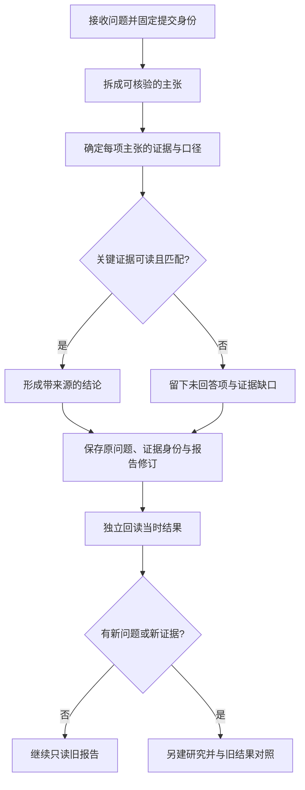

# 从能回答到可信任：研究 Agent 必须保存结论成立的条件

<LearningPathNav />

周五，你请 Agent 写一份 ETF 周报：核对说明书中的产品条款，补充本周场内价格变化，再看看基金公司有没有对相关变化作出解释。它读到了说明书，搜索到了几个网页，但行情接口暂时不可用，其中一篇原文也打不开。

这时交出一份措辞完整、数字齐全的周报很容易出错；直接说“任务失败”又浪费了已经核实的材料。更难的问题在下周：行情恢复、网页内容更新之后，你重开上周的报告，看到的究竟是**上周实际知道的事**，还是系统拿今天的资料重新编排过的答案？

这两个问题看似一个属于工具调用，一个属于历史保存，实际上指向同一件事：

**研究 Agent 的交付物不是一段文本，而是一份能够说明结论在什么条件下成立的研究记录。**

证据决定今天哪些话可以说；历史保证明天还能核对今天为什么这么说。

## 一、用户需要的是有边界的判断，不是完整感的文字

一般聊天回答追求相关、流畅和及时。研究任务多了一项要求：读者需要知道结论依据何在、适用到哪里，以及尚有哪些没有解决。

同一句“这只 ETF 本周表现有所改善”，可能隐含至少三个不同判断：交易所价格上涨了、基金净值上涨了、持有人的含分红收益改善了。它们需要的资料与计算口径不同，不能因为文字相似就互相替代。

因此，评价研究回答的单位不应该只是“整篇报告是否生成”，而应是**报告里每一项可核验的主张**。

| 要交付的内容 | 仅有流畅回答还缺什么 |
| --- | --- |
| 结论 | 哪一份原始材料、哪段信息支持它 |
| 数字 | 指标口径、覆盖日期和是否可以比较 |
| 解释 | 是来源明确披露的事实，还是 Agent 的推断 |
| 不确定性 | 哪一部分尚无足够证据，不能下结论 |
| 历史结果 | 当时的问题、证据版本和已发表的正文 |

一个有用的简化模型是：

> **可信研究交付 = 有证据的主张 + 明确的未回答部分 + 可回读的当时记录。**

这里的“可信”不是宣称结论必然正确，而是让结论具备可检查、可质疑、可修订的条件。

## 二、证据是否“可选”，由问题决定，不由工具决定

回到周报。可以把用户的问题拆成三个可分别核验的部分：

| 子问题 | 要满足的证据条件 | 本次观察 | 应当怎样回答 |
| --- | --- | --- | --- |
| 说明书如何约定产品条款？ | 读到明确版本的原文 | 原文已读 | 引用相应条款，限定为该版本的规定 |
| 本周场内收盘价如何变化？ | 有日期和交易所口径的有效价格序列 | 行情源不可用 | 不填写涨跌数字，说明本次未完成核对 |
| 基金公司对某项变化作何解释？ | 读到可核验的正式说明 | 搜索命中，但原文不可读 | 可以说明找到线索，不能把线索写成公司解释 |

这张表揭示了一个容易混淆的概念：**工具可选，不代表证据可省。**

Wind 可以不进入默认研究流程；但如果某个结论必须依赖相应行情，缺少数据就必须放弃那个结论。相反，用户主要问说明书的产品条款时，行情获取失败不应该抹掉已经核实的条款。

即使工具成功，也还要检查语义。Open ETF Agent 在 [v0.38.0](https://github.com/hpoenixf/open-etf-agent/releases/tag/v0.38.0) 提供的可选 Wind 查询，针对的是场内 ETF 的**交易所未复权日收盘价**。它不是基金净值，更不是自动计算好的含分红再投资总收益。把“取到了价格”当成“回答了收益问题”，仍然是证据错误。

所以，研究执行至少要把四件事绑定到每项主张：**来源是否真的读到、来源所指的指标口径、数据所属时间，以及这些材料能支持到什么程度。** 搜索结果、摘要、计算结果与原文不能因为都写进上下文，就获得相同的证据资格。

## 三、真正的降级，是主动缩小自己声称知道的范围

传统服务的降级常常是少返回几个字段、使用缓存，或者给一部分功能限流。研究 Agent 不能直接照搬：少一个字段也许不影响展示，却可能直接破坏一项结论的成立条件。

处理外部来源失败时，应该先问“失去的证据会影响哪些主张”，再决定回答形式：

- **缺的是旁证**：保留已有原文足以支持的结论，同时交代少了一份交叉核验。
- **缺的是关键证据**：该项结论不发表；如果它就是用户唯一的核心问题，应明确本次无法回答。
- **拿到的资料口径不对**：即使调用成功，也不能用相近指标冒充所需指标。
- **用户指定了必须核对的原文**：第三方转述不能无声地顶替该原文；无法读取就报告无法核验。

例如，合理的周报可以这样写：

> 本次已核对所提供版本的基金说明书，可确认其中列示的产品条款。场内价格序列未成功获取，因此不判断本周价格变动；检索发现了疑似相关说明，但未能读取指定原文，因此不将其列为基金公司的正式解释。

这不是“回答了一半”的借口，而是把**能够证实的部分和暂时不能证实的部分**区分开。缺证据之后只在完整报告末尾添一句“仅供参考”，并没有真正降级。

这一点也解释了为什么“工具成功率”不是研究质量指标：十次检索成功，可能仍然拿不到用户要求的原文；一次关键原文核验成功，反而足以支持一个范围很窄的判断。

## 四、历史保存的是当时的认识，不是下一次重新生成的答案

前面解决了“今天能说什么”。接下来要解决“下周如何验证当时说了什么”。

假设周一重新打开周五的报告。网页可能已经修改，行情服务也恢复了。**如果系统重新搜索、重新生成并覆盖旧正文，历史就不再是历史，而成了披着旧日期的新研究。**

一次已发表的研究至少要能区分三个身份：

1. **提交身份**：用户当时提交的原问题与请求内容。输入框里尚未发送的新草稿，不属于它。
2. **执行与证据身份**：这次 Run 实际访问过什么，哪些原文已读，哪些获取失败，以及对应的时间、版本或可核验引用。
3. **交付身份**：最终保存的是哪份正文与报告修订；后来独立打开它，不应该悄悄触发一次新研究。

这也是提交重试为什么与可信研究有关。在 [v0.39.0 本地 GUI](https://github.com/hpoenixf/open-etf-agent/releases/tag/v0.39.0) 的设计中，浏览器若没收到提交确认，重试会沿用未确认请求的消息标识和原载荷，而不是把输入框新草稿作为新的同一请求发出去。客户端保留身份是必要条件；完整的防重复执行还依赖服务端正确识别同一提交。

同样要区分两种用户操作：**回读旧报告**是在核对历史；**补充新证据再研究**是在创建新的认识。后者可以与旧结论对照，但不应倒过来修改旧结论。

如果来源后来失效或访问权限被撤销，系统也不应该为了让历史“看起来可用”而偷偷换来源。它应尽可能保留获准保存的原始证据或稳定身份，并如实说明哪些原文现在不能重新读取。可回读的记录不意味着永久拥有访问一切来源的权限。

下面是这套约束的最小闭环。它是一张**设计原则图**，不是某个公开版本已完整实现的状态机：



这张图真正的分界在保存报告之前：**没有获得证据资格的内容不能靠出版动作变成事实；保存之后，也不能靠再次执行改写过去。**

## 五、用一次练习，把“证据”和“历史”放到同一张验收表

Open ETF Agent 的公开实践刚好给了几个不同的观察点：可选 Wind 查询用于检查数据语义；[v0.39.0](https://github.com/hpoenixf/open-etf-agent/blob/v0.39.0/docs/local-gui.md) 的离线 GUI 用于检查报告及来源回读；后续 [v0.41.0](https://github.com/hpoenixf/open-etf-agent/releases/tag/v0.41.0) 增加了显式开启的在线研究与网页来源路径。它们证明的是各自经过验证的有限路径，**不能合并成“真实模型已能稳定完成所有 ETF 研究”的结论**。

最容易亲手复现的是历史这一半。准备 Node.js 26.8.1–26.x，在固定的 v0.39.0 上使用内置合成资料：

```bash
git clone --branch v0.39.0 --depth 1 https://github.com/hpoenixf/open-etf-agent.git
cd open-etf-agent
npm ci --ignore-scripts --no-audit --no-fund
npm run gui -- --project ./test-output/local-gui --port 4179
```

打开命令输出的本机地址，创建会话、生成示例报告、打开引用来源。然后关闭服务，以**同一项目目录**重新启动，进入历史并核对原问题、正文和来源。默认示例是脚本驱动的合成资料练习，不会联网取实时行情，也不能证明模型推理质量。

如果你在建设真正的研究 Agent，还应补完另一半验收。下面是**建议的回归用例**，不是声称上述离线 GUI 已经全部通过：

| 注入条件 | 合格表现 |
| --- | --- |
| 可选网页原文读取失败 | 有足够原始证据的主张仍可交付，依赖失败原文的主张缩小或撤回 |
| 关键价格序列缺失 | 不编造数字，也不拿净值、报价或旧数据冒充所需序列 |
| 只有搜索摘要，没有指定原文 | 不写成“已核对原文”；留下可检查的获取缺口 |
| 提交已到服务端，但确认丢失 | 原身份、原载荷重试，不意外创造第二个研究任务 |
| 来源后来更新，再次打开旧报告 | 旧正文与证据身份保持不变；新材料进入新的研究记录 |

这五项可以归成两个验收问题：**这句话当时有资格发表吗？现在读回的还是那一次发表吗？**

只有这两项同时成立，历史才不是一串聊天截图，证据也不是仅供装饰的引用链接。

## 结语：可靠研究不要求没有缺口，而要求缺口不会消失

Evidence 解决的是空间上的问题：这项判断能沿着哪些来源、口径和条件追溯。History 解决的是时间上的问题：隔了一周、换了进程、补了资料，能否确认自己看到的仍是当时那项判断。

它们不是为了凑齐一组 Agent 功能。它们共同约束一份研究交付：**知道多少，就只说多少；已经说过什么，就留下当时为什么能这么说。**

这比不断增加工具更接近用户真正需要的专业研究，也让系统有可能在被质疑、修订和长期比较时仍然可靠。

延伸阅读：[从命令行到研究工作台：让一份研究下次还能接着做](open-etf-agent-research-workbench.md)。那一篇进一步讨论追问、每日对照与独立工作区；本文聚焦结论的证据资格和历史完整性。
