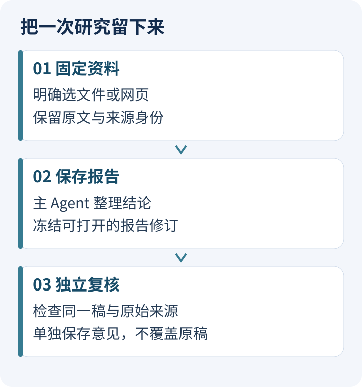
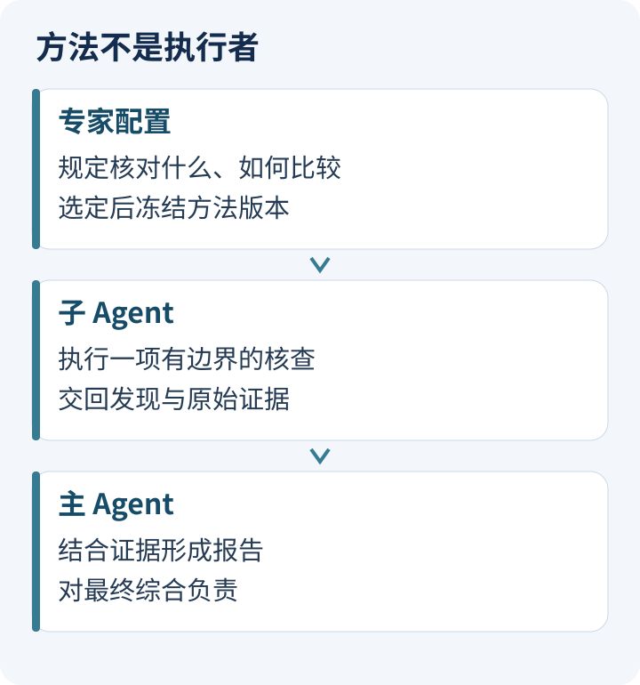
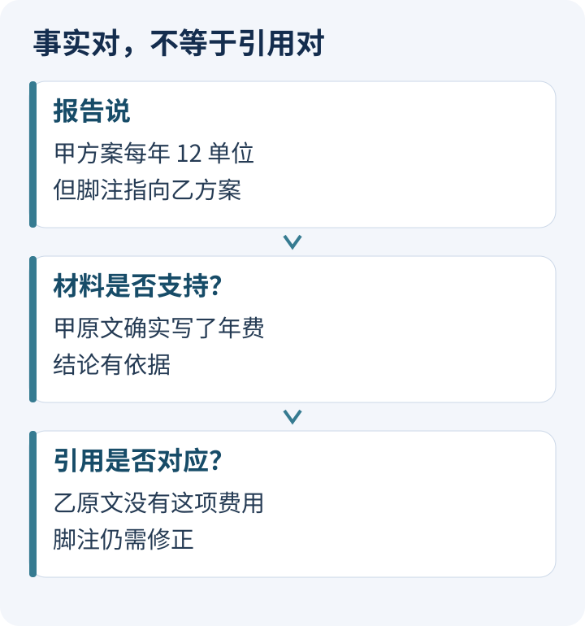
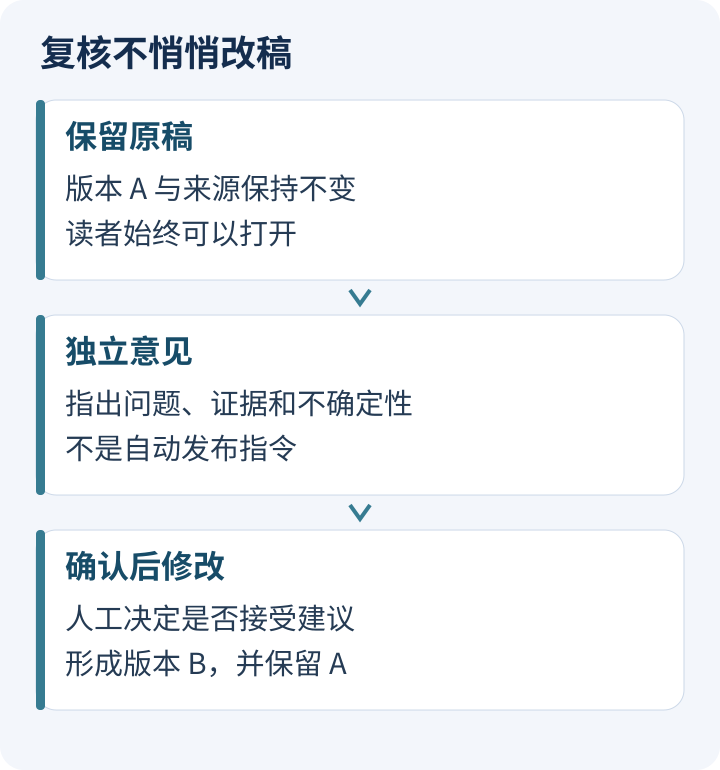

# 报告写完以后：让 Agent 查证、协作，再独立复核

<LearningPathNav />

你已经让 Agent 写出第一份报告，关掉程序后还能重新打开。接下来最自然的问题是：**这份报告里，哪些话值得再检查一次？**

继续在聊天框里说“再仔细检查一下”当然有用。但当报告变长，资料更新，或者另一个人来接手，我们需要知道：它检查的是哪一稿？看到的是哪些原文？指出一个问题以后，原报告有没有被悄悄改掉？

[第一篇练手](https://hpoenixf.com/eff-agent-article/articles/open-etf-agent-research-project-workshop)完成了“自己的资料进来，研究项目和报告留下”。这一篇再往前走：用选定的网页补充资料，用专家方法做局部核查，最后把已保存的报告交给独立复核。

以下按 Open ETF Agent **已发布的 v0.28.0** 的接口组织，对应提交 `b34750d1515982dbaaaf4c1aa4da4c380173d753`。三个模块分别承担资料采集、研究分工与成稿复核。示例中的服务条款是教学材料，不是实际产品报价。真实研究需要读者自己的模型服务与明确的数据、费用授权；本文同时提供不调用外部模型的演练路径。

> 验证边界：本文的默认复核 prepare/run/read 已完成零外部模型演练，冷读一致且原报告不变。真实模型生成报告及 Gateway 配置步骤依据源码和接口文档核对，未宣称本文整套真实服务命令已端到端运行通过。

## 先选一个能靠原文回答的问题

这次不用几十页财报。先比较两份虚构的导出服务说明：

- 甲方案：每年 12 单位费用；只有授权有效时才能导出。
- 乙方案：每月可免费导出 3 次；第四次起每次 2 单位；离线不可用。

你想知道：“每月导出 2 次时，两种方案的费用和限制分别是什么？”

一份有用的报告至少要分清三件事：甲的费用周期是年，乙的免费额度周期是月；“免费”有次数条件；两份材料都没有说明的功能，不能靠常识补成产品事实。

假如报告写成“甲每月只需 12 单位，且任何时候都能导出”，我们可以检查它错在何处。假如报告说“乙更适合你”，则还要问是否知道你的离线需求。前者偏事实核对，后者已经涉及判断前提。



*一条研究路径留下三类产物。复核意见可以引导下一次修改，但不能替代原始材料。*

## 一、给这次研究固定一份资料

在上一练习的 v0.24 项目之外，使用新的 v0.28 工作目录。不要把升级命令直接套在唯一的旧项目上。源码与研究资料分开放，便于保留旧结果。

```bash
git clone https://github.com/hpoenixf/open-etf-agent.git open-etf-review
cd open-etf-review
git checkout v0.28.0
npm ci --ignore-scripts --no-audit --no-fund
npm run build
mkdir -p ../review-workshop
```

使用 Node.js 26.8.1–26.x。先按[项目入口](https://github.com/hpoenixf/open-etf-agent/blob/v0.28.0/docs/research-project.zh-CN.md)准备自己的 `live-config.json`，模型服务端点和凭据沿用你已经批准的配置。只启用本篇需要的 `report` 与 `child` 能力，不叠加定时任务、PDF 或任意插件。该版本不支持把这些能力任意组合。

先初始化新项目，再导入两份明确选择的文本。配置文件须按上面的项目文档补全，不能直接把文中的教学条款当成配置：

```bash
node src/research-cli.mjs project init \
  --project ../review-workshop/project --config ../review-workshop/live-config.json
printf '甲方案：每年 12 单位费用；只有授权有效时才能导出。\n' > ../review-workshop/a.txt
printf '乙方案：每月可免费导出 3 次；第四次起每次 2 单位；离线不可用。\n' > ../review-workshop/b.txt
printf '["../review-workshop/a.txt","../review-workshop/b.txt"]\n' > ../review-workshop/files.json
node src/research-cli.mjs source import \
  --project ../review-workshop/project --files ../review-workshop/files.json \
  > ../review-workshop/import.json
MANIFEST=$(node --input-type=module -e \
  'import fs from "node:fs"; console.log(JSON.parse(fs.readFileSync("../review-workshop/import.json","utf8")).manifestSha256)')
```

两份条款分别保存为短文本，使用明确的文件列表导入。**本地文件与公共网页只是来源的两种进入方式，后面的研究不必另起一套机制。**

如果已有适合的公开 HTML 页面，可以将精确 URL 放入 `selected-urls.json`，再显式采集：

```bash
node src/research-cli.mjs source acquire \
  --project ../review-workshop/project \
  --acquisition selected-terms-01 \
  --urls ../review-workshop/selected-urls.json \
  --approve-public-fetch
```

返回的 `manifestSha256` 是这批资料的身份。提交研究时要显式选它；采集成功不会自动把它变成下一次研究的输入。相同网址明天可能有不同正文，沿用今天的资料身份，才知道今天的报告依据什么。

这里的 Web 模块只接收有限的公共 HTTPS 页面，并检查跳转与 robots。它不搜索互联网，不登录网站，不运行页面 JavaScript，也不抓远程 PDF。如果资料需要登录或动态渲染，先停在这个边界，改用你有权取得的文件，不把限制当作需要绕开的障碍。[Web 来源合同](https://github.com/hpoenixf/open-etf-agent/blob/v0.28.0/docs/web-sources.zh-CN.md)解释了当前支持范围。

这一步最容易忽略的收获，是把“我看过那个网页”变成“这份报告使用过这份材料”。来源附带原始网址、采集时间和内容身份；后面冷读报告时，不会为了显示引用而重新抓取网页。

## 二、把“请仔细研究”变成一项具体方法

现在有了资料，为什么还需要专家配置？

因为“认真一点”没有说明怎么检查。“比较两份条款”则可以拆成具体方法：逐项保留主体、时间、适用范围与条件；不能因为日期不同就认定两段话互相矛盾；没有证据时保留缺口。

v0.27 的专家配置保存的正是这种方法。它不凭名字产生专业知识，也不增加访问权限。先用仓库内置的对照方法，避免第一次练习就同时调方法和调系统。

下面的 Node 命令仅生成配置文件，不调用模型：

```bash
node --input-type=module <<'JS'
import { writeFileSync } from 'node:fs';
import { CLAIM_COMPARISON_METHOD } from './src/child.mjs';
writeFileSync('../review-workshop/profile.json', JSON.stringify({
  name: '条款核对',
  description: '比较原文中的费用、周期与使用条件',
  enabled: true,
  method: CLAIM_COMPARISON_METHOD
}, null, 2));
JS

node src/research-cli.mjs specialist init \
  --project ../review-workshop/project
node src/research-cli.mjs specialist create \
  --project ../review-workshop/project \
  --id terms-checker \
  --profile ../review-workshop/profile.json
```

首次创建的修订为 1。将选择保存为 `specialists.json`：

```json
{
  "profiles": [{"profileId": "terms-checker", "revision": 1}],
  "maxChildren": 1
}
```

选择固定修订很重要。今天提交的任务使用今天的方法，明天你修改专家目录，不能让今天尚未完成的任务突然换了一套标准。



*专家配置是方法，Child 是执行。主 Agent 收到的是派生意见，还需要回到原文判断。*

把问题写入 `question.txt`，例如：“比较两份条款中的费用周期与限制；需要时请条款核对专家读取原文，区分事实、计算和未知，引用来源并保存报告。”然后在你确认服务商、材料与费用后提交：

```bash
node src/research-cli.mjs run submit \
  --project ../review-workshop/project \
  --run terms-report \
  --question ../review-workshop/question.txt \
  --manifest "$MANIFEST" \
  --specialists ../review-workshop/specialists.json \
  --report-delivery artifact-required@1 \
  --approve-provider --approve-data --approve-cost

node src/research-cli.mjs run work \
  --project ../review-workshop/project --run terms-report
node src/research-cli.mjs run report \
  --project ../review-workshop/project --run terms-report \
  > ../review-workshop/report-receipt.json
```

`MANIFEST` 使用导入或采集实际返回的值；若改走网页路径，请显式更新该变量。报告回执包含正文、`directory` 和 `revision.revisionId`，后两项会用于复核。

配置了专家，不代表模型一定会调用它。先看实际执行记录有没有委派、Child 是否读到了原文，再看主 Agent 怎样采用意见。不能因为开关是 ON，就把报告的变化归因于专家协作。对很短的条款，主 Agent 自己完成可能反而更省事。

## 三、报告保存以后，再开一项复核

初稿生成和报告复核适合分开进行。前者不断增加信息、组织结论；后者要有一个稳定对象，才能指出“这一句的问题在哪里”。

这里冻结的是**报告修订及它绑定的原始来源**。复核不重新搜索来替旧引用解围，也不把专家摘要升级为原始证据。

从回执取出精确身份，再准备复核：

```bash
SOURCE_DIR=$(node --input-type=module -e \
  'import fs from "node:fs"; console.log(JSON.parse(fs.readFileSync("../review-workshop/report-receipt.json","utf8")).directory)')
REVISION=$(node --input-type=module -e \
  'import fs from "node:fs"; console.log(JSON.parse(fs.readFileSync("../review-workshop/report-receipt.json","utf8")).revision.revisionId)')

node src/report-review-cli.mjs prepare \
  --session ../review-workshop/review-demo \
  --source "$SOURCE_DIR" --revision "$REVISION" \
  --request terms-review-demo
node src/report-review-cli.mjs run \
  --session ../review-workshop/review-demo \
  --run review-terms-review-demo
node src/report-review-cli.mjs read \
  --session ../review-workshop/review-demo \
  --run review-terms-review-demo
```

**上面是零外部调用的生命周期演练。** `prepare` 核验并固定材料，默认 `run` 返回明确标为合成的演示结果。你可以练习准备、保存和冷读，但空的 findings 不表示模型已经检查过报告，更不表示“没有问题”。

真实复核要在 `prepare` 和 `run` 两步都指定可信的 `--gateway-module /绝对路径/host-gateway.mjs`。该模块接入已有 Gateway、准入与预算管理，导出 `gatewayBinding` 和 `createGateway({session, directory, runId})`；后者返回 `{gateway, close}`。它是操作者审核的可执行代码，不能由报告正文或模型提供。具体接口见[真实 Gateway 接入](https://github.com/hpoenixf/open-etf-agent/blob/v0.28.0/docs/report-review.md#real-gateway-integration)。

真实路径请使用新的、明确批准的请求身份，例如 `terms-review-live`，不要把已经完成的合成演练换成真实配置重跑。请求身份一旦接受，就不能偷偷绑定到另一份输入。**当前还没有一个“填入 API Key 就自动完成全部复核配置”的通用向导**；如果你尚未接好可信 Gateway，可以先完成这里的零模型练习，或者直接人工核对下一节的几类问题。

复核请求整体最多 48,000 UTF-8 字节，包括报告、来源和元数据，不能把它理解为单独允许 48KB 正文。超限会明确拒绝，不悄悄剪掉后半份材料。第一轮用短报告，是为了能逐句检查结果，不是为了迎合评分。

## 四、分清“这句话有依据”和“这条引用用对了”

假设有一份报告写着：“甲方案年费为 12 单位”，却引用了乙方案的页码。

资料集合里确实存在支持这句话的原文，所以事实可能正确；但读者沿着脚注打开的材料不支持它，所以引用仍然有问题。只检查其中一项，都会漏掉另一项。



*本图是教学示意。复核意见需要指出具体报告片段和来源摘录，而不是只给一个总分。*

Review 对每条发现分别保留材料支持情况、实际引用对应情况、理由、来源摘录以及不确定性。报告中的原文区间也被记录，便于找到问题所在。

但坐标有效，只能证明“这段文字确实在那里”。它不能证明模型理解正确。你仍要检查：

- **数字与单位：**“每年 12”有没有变成“每月 12”？
- **适用条件：**“授权有效时可用”有没有被改成“随时可用”？
- **证据强度：**原文没有提及，能否只说“未说明”，而不是说“明确不支持”？
- **引用位置：**来源集合中有这项事实，报告实际引用的是否就是那一项？

一条有价值的复核意见，应让你更容易回到原文作决定。若它只是重新断言“该报告不准确”，却没有定位和依据，即使语气坚定，也没有帮你减少多少工作。

## 五、先保留两份，再决定要不要产生第三份

读到复核意见后，先保留原报告和复核结果。只有决定采用某项建议，才创建新的报告版本。



*复核完成不是自动发布条件。新报告形成后，旧复核仍属于它当时检查的那一稿。*

这有一个很实际的好处：复核也可能出错。如果它直接覆盖原文，你还得猜究竟是原报告错了，还是修改动作把正确内容改坏了。分开保存后，可以逐项接受、拒绝，或补充资料再研究。

这与 Anthropic 在 [Building effective agents](https://www.anthropic.com/engineering/building-effective-agents) 中介绍的 evaluator–optimizer 思路有关：生成与反馈分工，适用于标准较清楚、反馈确实能改善结果的任务。本文选择了更窄的一步：先产生独立建议，不自动进入反复修改循环。它少了一些自动化，也避免把“复核模型说要改”直接变成执行权。

一个短问题只有两句话资料时，人工对照往往比搭一套流程更划算。反过来，当你需要反复复核同一类报告、保留原稿、交接给别人，或者明确知道哪些意见被采用，这种分离才开始值得。

## 完成这一篇以后，应该学会什么

你可以做一个很小的练习：在教学报告中分别放入费用周期错误、引用错位和缺条件三种问题。先自己写下检查依据，再观察复核模型能否定位它们。不要只数它说中了几项，也要看它有没有新增错误指控。

本版独立复核已有真实模型执行记录；Web 采集、专家协作、报告和 Review 的完整组合另有合成网络与模型的集成验证。它们说明不同范围的事实，不能拼成同一条真实公网全过程。读者换成自己的材料与服务后，要检查自己的这一次路径。

这一篇的终点并不是“报告已经被认证”。而是你手里有了固定的资料、可回查的原稿，以及针对这份原稿的复核意见。下一步要不要修改，依据终于清楚了。

想进一步分清这些名字，读[专家、Subagent、Review、Judge 的职责地图](agent-expert-subagent-review-judge.md)。想让这项研究跨过今天与明天，再读[任务、会话、Run、Worker、Schedule 的关系](agent-task-session-run-worker-schedule.md)。


<!-- introductory-series-links:start -->

## 入门系列：按顺序继续

上一篇：[专家、Subagent、Review、Judge：都是另一个模型，为什么不是同一回事？](agent-expert-subagent-review-judge.md)。

下一篇：[从一次提问到答案可见：ETF Agent 六层调用全景](017-prompt-to-answer-six-layer-panorama-v3.md)。

<!-- introductory-series-links:end -->
